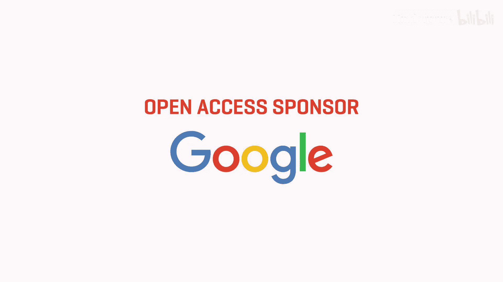
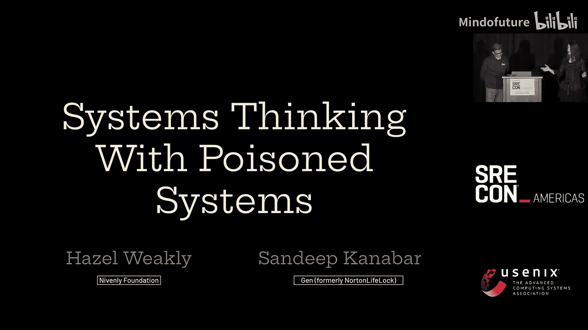
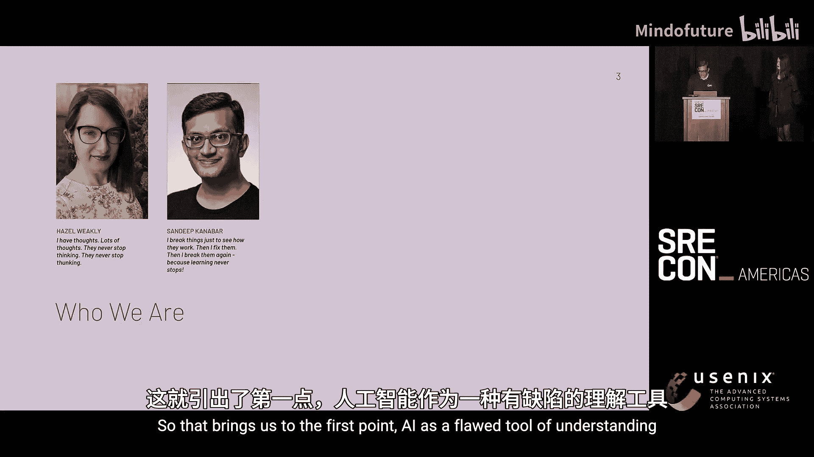
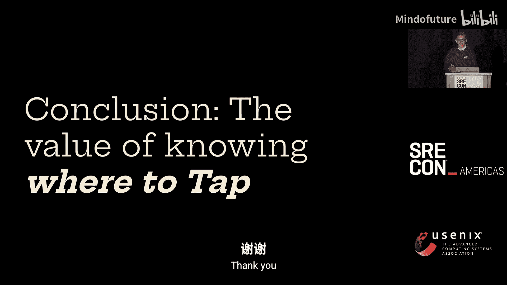
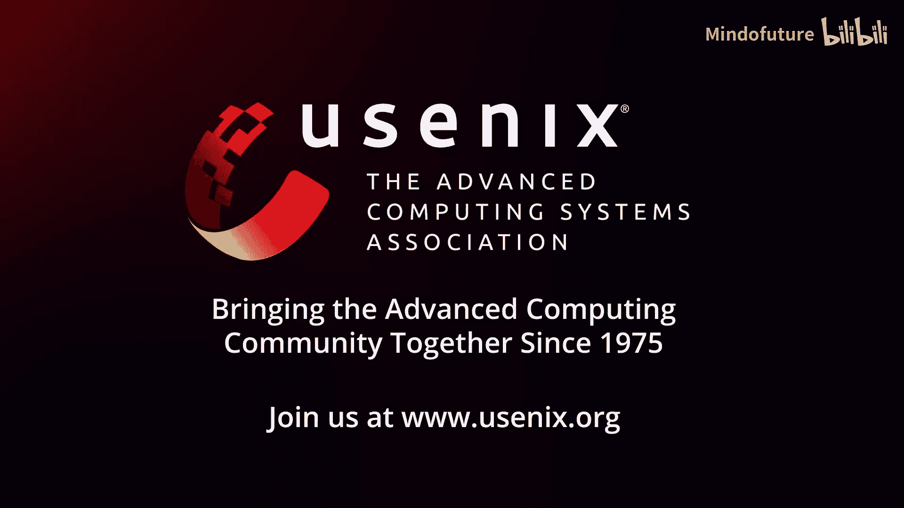

# SRE大会-2025-美洲-｜-srecon-｜-分布式-｜-缓存-｜-OpenTelemetry-｜-安全-｜-AIOps-p34-P34-Systems-Thinking-with-Poisoned-Systems--BV1TmLDz7EZZ_p34-

。

So my name is his weeklyley。 This is Dan Deep。 And today we're going to be going over systems thinking with poisoned systems。

So I am a fellow of the Niberley Foundation。 I have thoughts， lots of thoughts。

 They never stop thinking。 they never stop thinking。

 and also I am part of the Defaf and Hard He working Group at the CNG。Because fun of fact。

 neither of us can hear。 So if you have any questions， that's not。 Just kidding。 we have slack。

And so here's Sandy。嗯。Hello everyone， I'm Cindy， Im a software engineer at Jane。

 formerly known as Northern Lalock unoffic Ive been an Sari for as long as I can remember although I don't have the official title of an S。

So get to mind， she said yesterday that I'm the kind of person who just can't hug myself from running into a a fire。

 she spoke this in yesterday'snar session and I could totally relate to it because I'm the kind of person who ran to haunt the fire of Gfka。

 last Casandra you name it to him T for him， I been done and doneta and I also had to run to catch a plane so that I could make it to the。

And this is my first time speaking at acon and I've justmine overwhelmed。

 but the long that I've gotten you， it's a beautiful comfort， and imaging audience。

 and I wouldn't be here but it's not from a brilliant cost speaker header。So let's get started。

So today have to talk about systems thinking with systems。

 because I we just don't dealing with broken systems dealing with systems， which are also misleading。

We have all been de production the monitoring stage。

 the lock something and the root causes is hidden behind layers of automation been have it。Now。

 but I want you to imagine this that you to and I into the mix。

So AI promises to help us understand our system better， detect anomalies and even products we。

 but what if the AI strain on incompatable load and poison data， but help bullet the extra？

So Is often described as a garbage in garbage art。But when a well system starts rely on AI。

 do we get girls or or something in between， so that brings us to the first point。

 AI is a flawed tool of understanding。

빌리 인 세단 머네터링， 레퍼& 더버쇼든 맛 반멘 죠。It does not actually understand systems。

 it find patterns based on historical data。So at S。

 we use tools to help us monitor the and optimize system。

 but in high power tools introduce a new challenge。They just don't pluguck reality they help it。

 and it can sometimes be actually misleading。😡，So inI models they learn from data。

 now what happens if the data is learned， whether to biology。

 inconsistency or intentional manipulation？So if the data fl。

 the conclusions will also be fl and when we blindly press those airI floor output we end up making my decisions。

And I as it stands out does not understand the systems to baby instead in just makes probaistic gas based data riskma not actually will cover a。

So into the talk， we will explore tricky key issues that highlight AI limitations。

 the first one is data poisoning， the second one is AI My， and the third one is AI related disking。

就干话的达到保证呢。So as I said， rely on historical data， showing data incar， incomplete， damp and width。

단넌 아직낫다 보잖아。And 나도 보年間 happened in 도 왜。Aninal poisoning， your missed level of。

 a system that is supposed to be marked up， you accidentally marked down by training your data。

 so that is an unintentional and intentionally a malious attacker can actually manipulate the training data and the model misclassified data。

You theプログ大でした。喂。Once instance data is version and an AI model is drain on the version data。

Then whatever it output， that output it again into further model。

 then you know what it leads to its makes since was， it goes into like a circle of。😡。

And if the air system has never seen a real failure。

 it might assume that the that this fell never existed in the first place。 and if that happens。

 it could actually miss a real critical failure。And you man here is not mean a poison。

 it can make God assumptions God， which brings us to AI bias。

So I must emphasis one models reinforce patterns in training data without questioning whether the training data should use。

 whether those patterns are far representative of color。So since I learned from historical incident。

 but doesnt always the fact that real more complexity。

So what happens is that the AI power remediation system， they could prioritize past solutions。

Even if that wrong or that sub or yeah could suggest that because of a CPU spike。

 you restart the service to fix the CPU spike。 But when you have restart the service。

 it could lead to a complete outrage。And I might underprioritize you are failed at most because it hasn't been trained on time and the new infrastructure。

 for example， like to，ness， I Im because yeah isn't trained for it。So suming up。

 yeah it's not a reliable decision maker。 it is a tool that needs constant learning and human oversight。

And ironically， instead of making the troublehooting easier， it could sometimes make it more complex。

😡，So let me start with a story。Once upon a time and by once upon a time， I mean。

 the time period has been changed to preserve the innocent。

I was taskshed with troublesoing and seeing and figuring out how to take something。

 And it just wasn't working It was little tricky and the evolved tools that nobody on the team was quite familiar with or really knew what to do。

 And then so I was like， how do I she accomplished this， with this tool。 I， how do I do this。

 And I asked the coworker for help。 And I asked him for his advice。 And he said， oh。

When if you tried this command line flag argument？And my first immediate thought was that's a weirdly convenient command line flag argument。

 it's almost like it does exactly the thing that I needed to。

So try it and then just see a light Sps on there and says。This flag is not recognized。

This doesn't exist。 Like， what are you doing， And then I turned to my coworker and I said。

Did you give me the right argument？ It's not working。 And then he said。Oh， it should work。

And then I looked over at his screen and theres。An AI chat thing， and then I look at him and I go。

Did you just give me？An AI output thing。 And then he looked at me sheeply and he goes。Oh yeah。

 I mean， I get I could totally be making things up and I go，Don't tell me that。😊，Why。

 why would you possibly like one on earth would make you take this thing and go。Oh yeah。

 I'm just going to blindly believe everything that I've been on the internet。

And by I went on the internet I mean like that' something just gave me and I'm like。

 you don't even do that when I give you something that I myself。

 I mean sure the AI doesn't have one of it。9。There is this concept of dis skilllling that is kind of happening where it turns out that humans have certain sets of skills that are advanced。

 certain sets of capabilities， and they develop these capabilities and there's not the entire culture。

Institutional knowledge is of a culture and everybody in that culture that needs that skill gets it。

And it's really， really cool， so for example， there was a town in the United States that for about 50 years。

 the vast majority of people in the town were born de。Nobody knew what。

But it turns out that that town invented its own sign language and everybody in the town could sign because it was just assumed you probably needed to know how to do that because everybody was deaf except for people born outside the 50 year time ranges。

And then that' not happening。 And then everybody forgot how to sign because they were like， oh。

 we don't need this anymore。 But also， it turns out this is also how language evolves。

 And this is also how certain other things evolved。 Like， do you。

 I'm going do a sign in sign language。 And I'm going to see if you can figure out what the sign is。😀。

So for those of you who are old and traumatized by the weary years， remember。Yeah。You remember that？

Everybody else who is not old and weary in traumatized and doesn't wake up with back pain。

 Good for you。 You just to that。It's kind of nice。 We don't know what Ver down was anymore。

 Nobody even knows that like one of the reasons why 9，1，1's number is because。That's really fast。

That's one of the reasons why it's 911 instead of being only each seven fifths。

But the decaling thing， this concept of， you don't need these skills anymore you just get to kind of forget them。

 It's pervasive。 It doesn't have to be bad。But one of the things that's really。

 really important here is。What was seen throughout the industry。

 particularly when it comes to AI and these thought workers。

Is we spent decades just not calling ourselves thought workers。 We spent decades saying， hey。

 what if？Hem me out What if we figure out how to turn our brain off and just do the ticket and don't think about it。

 just implement it， don't think about it just and we lose this notion of critical thinking in all of our thought work and then we think。

 oh， we can replace these non thoughtt workers with things that don't think and that would be true if we weren't thought workers。

But we are。 We do this knowledge work that we literally get paid to take our brain stem and plug it into the computer and then get traumatized by outages。

 like that's the whole thing。And maybe we shouldn't forget that。So as Hezel said。

 I add layers of complexity rather than simplifying the system understanding understanding understanding。

 so I think I want to make quite a bit of theory， so let me some practical examples。

So I think all of you know about the my。Okay， and I think you know that when we are doing testing。

 we always want to use production data for testing。

 because that is how we can basically make inferences。

So me how like a production Google cloud and the text environment and we have Android。

 So then who wanted to do the testing thing， He copyied the whole lot of production data into text market。

And I never forgot to deleteate it。Now， Google has recently come up with something known as a soft delete retention policy。

What that means is that， if we delay something in a bucket， but default。

 it was retain it for seven days。And in production。

 this is very helpful because I remember even as an experience I accidentally over the market through spark。

 but thankfully， because of this ability to data that the market provider。

 I was able to all than that。But now in this Google year。

 I'm talking about a development environment， why would I want a retention policy in a development environment in this doesn't make sense so when the cost novel。

 my manager asked me to look and to find the market this question so much。

So then I went to the Gp and I told him， let's give that more。

That this the top10 bucket by the sides and the top10 polar us within it。

You think to me after1 minutes that， right？그면 당연히 하 하겠다。Now。

 the challenges the the a preten policy that was recently introduced。Okay。

 there is no Python SD documentation for it in the official Google documentation show you cannot find aython SD documentation。

 It only hurt like the car command on and other thing， but nothing enough。So I dont know。

 I did not notice。 I actually to found it。 So one day I told anything。

 it confidently told me that the university my and I'm blind。I used the method one。

 it did not then it told me to use method2 it not then it told me to do method did not then again went to it。

 it told me to use method one again that method to method and it went on a no and it was horrible and I would like it's just a simple thing taking so much time and that's when I found that there is no documentation so since there is no training that I said no documentation it couldn't really figure out exact if I called to yours for。

So how did they别？I went to the source code， from the source code。

 almost my some test cases from the test cases， I found a API code。

 I took it and then I told GPT since the single test case now generated the equivalent pattern code。

 and finally it generated very accurate。So the system is a very wonderful tool， but it sort of needs。

 a continuous human intervention， it is sort of what you have like in the data process and the algorithms interview where to start with a brute force and then step by step you're going optimize this is how of interaction as you should be interacting with air。

And so I supposed to enhance observability and explainability and not to them， and lastly。

 the correlation is not necessary equal to cation， and I often class patterns without understanding why they exist leading to misdias issues。

Okay， so now I'm going to talk about somebody bias， some related to sorry， some generally。

So if you go to an air tool and ask to generate an image of a person who is right in the left hand it invarily generates an image of a person right in the right。

그 때한테가 되는 다 주주 탄。The second thing is I came from India， so from India to San Francisco。

 I came my Frankfur。rankfurfurfur。So I have use reserve says why I am yeah。

 so I could transit to happen。Now the airlines also had to dial air Canada so my stupid if I could transition to Canada it's yes if I have a US visa。

 I could transition to Canada， I don know hundred0 percent here and then it corrupt say no an Indian citizen cannot transition to Canada。

 even if they have a value US so this the way the air response you have to continuously join it。

And then so me harm like a large number of questions nose， they all run on ECto。

 and it is like a self managed cluster。That is always sort of semi automatic because don the power。

 So see if you really understand your system very well。

 then you sort of try and build sort of put yourself manner system because you could actually scale on cost and boost the performance。

So yeah， it's not。 I mean， it's not abnormal for Cascentra to run actually about 90% money because it usually the full he that we allocate。

So when an air system was important， it actually said that discussion is horrible and its underperforming。

 but in actually， it was performing very。😊，And next。

 I actually want you to give an example of what happens with。But be it。So we hired the person。

 we have like a lot of pipelines， a lot of stuff， and we hired the person an S。

 and we asked him to optimize。So I am a very young elastic that I optimize of find。

I'll come to the context later， but notice this sorry he just become the elastic and then whatever he just visit into the G。

The teacher gave him so many very good responses， and then he began detailing documentation and spent one week making a super detailed con experience of how to optimize that。

And then it came and told me， this is my firsta。Get再 이 말 때는 다 된다。I had to this the whole one be。

Because it was not a own applicant or the elastic access system in the first place。

They are now learned in detail。So on this particular elastic system of back my manager came and told me that the business part is has changed。

 this elastic system is to be put on keep life on， no new development， no new maintenance。

 no new money， and it is cost $12，000 per month， make it $4，000 month。

You will have no thanks to ourvic Boston。You so I went back to my drawing board。

 so I thought all that， you think doing a a in the production system is the ho。😡。

It is but in the okay， I had the time best in so all my daughter was going into today's so yesterday's index did not get any data so for I made it only and so then I did not need any click for yesterday previously because if something that were to happen I couldn't stand。

Okay， and10 monthly indexes and my device indexes merge into monthly。

 my monthly into year so that a lot of optimization was done so the year index could have about 00 the monthly index had about 15 cents and the daily index had about 101 applicant because today's index must crash I needed not。

So in this context of the air tool wasn't this system is actually the first performance and I without any time to this there。

 but the air tool and the most was last excessive。😊，소 만찬만 걸라 버라 했。Okay。

 so the last cloud for me before head text over。So the AI Drive observability alerting incident response are still evolving and the AI recommendations become harder to challenge because most organizations are relying on automated decision making。

 but as I said， you need women in the loop， not fully the autonomous system。

 so how do we counter AI failures and make it work for us and that where system thinking and resiliency engineering comes in with hazard detector？

嗯。So a lot of what we do is this systems thinking， it's really the whole thing boils down to figuring out how to do the non obvious thing。

 figuring out how to take these complex stuff and make it workable。

 but when the system is kind of broken， kind of poison， kind of whatever。

 how do you do the system thinking。So I honestly have a picture here of the Princess bride and this is one of my favorite scenes in it it's where you know he mostlysley is capturing and rescuing the princess and when he rescues the princess he plays this game of oh if the person takes this poison in vial。

 you die or I you and they do this Ro lay kind of game and then she goes what？Oh， no。Wait。

 it was yours。 It was poisoned the whole time。 And then he goes， don't be silly。

I poisoned both of them。And in fact， not even that。It's if you take this and you step back。

He's going。You know what？I fucked it up on purpose。For the purpose。Oh。

Understanding things of absolutelyy getting into where we needed to go。

 Why try and avoid errors when you can。You're really， really good at sours。

 you're not going to have a perfect system， It's not going to be fully functional anyway。

AI or not poison or not， just get really good at drinking poison。😀Yeah。Guys are that shit down， No。

 why do you think we all have a drinking problem？So。When you think of a resilient system。

 the system is socio technicalch yet to people。You have the tools。 You have the apps computers。

 You have the interactions valid things。 And what does it mean for a system to be resilient。

A lot of people might go， oh， you know， Up time。 Some people might go M T。

 T R and those people are shunned， but。When you take this whole thing you go， okay。

 what is resilience really， resilience is a lot of ways about being able to work with what you have and to continue to make progress of the system kind of despite what happens。

I mean， none of us blindly， you know， without reservation trust our own code。

 none of us trust our coworker's code， when look at it together。

 we verify and we check and we think about it。We should probably do that with our toolss as well。

 because as we all know， have we ever spent the time when we've debuunked something and I'll send it turns out either the tool。

 maybe light to us or the tool itself was broken or what's the difference？

When you have these resilience concepts， you need the resilient tools。

 the tools themselves have to be resilient， but how you use them。

 the process of using them also needs to be resilient。

You can't just pick up something and go oh this hammer。

 this hammer will absolutely work for anything that I use it on and then just smash that screw to a wall you might have to think about it and that's okay because that's what we do we think about things we work with it we make stuff work even if it's hard。

O不是。Other band， other band， there we go。One of the coolest things about making things work and understanding them is so humans work in a really。

 really cool way and we are special in this regard in that we think we're special and we're actually not。

 but the I don't weigh it up special in this regard is，Tools are literally。

 if you look sociologically at how humans work， Tos are how we understand the world。

 we look at the world， we look at the environment and we build a tool to help us understand the environment。

 it's deeply encoded in our evolution to do that。That's how we do things that's how we learn。

 that's how we function and not only do we do that。

 but we then have this really iterative thing going on where。I go a tool and someone goes。

Wh that's cool， I'm going to learn how to build that same tool sometimes I forget to know credit people for that。

 we' working on it， it's a bug。But we go， oh， I'm going to take this tool。 I'm going to learn。

 I'm going to understand it。 and then know what， my context， my need， This is a little different。

 I'm going to tweak it。I'm going to change a little bit I'm going to make this tool work for me。

 I'm going to make this process work for me， make this workflow work for me and you do this kind of crude sloppy sort of oh I took the tool and then I just gave me welded some stuff on the side of it and now it does Law is A and other logs。

And then you like go over here and you someone else goes，ooh， that's cool。

 you just keep doing this process evolution thing， this stool evolution thing。

 and if you want to teach other people how to do theis， how to do this thing， you have a process。

Like， for example， Alex let the Doger was telling me the other day about how he was one of the first people to take like a flowchar and write down the。

 no， what's wrong， it's DN us。No， it's not just no screw you， it's DNS like you'll face it。

 and then you have this flow out of debunkgging， that's a process。That's how you teach learning。

 that's how you teach investigations， how you teach systems thinking。

We already have that and if the system in the tool and the floats are in the process needs to now include。

 and the tomb is a little fuzzy， it's a little wonky， it's a little， you know。

 more unpredictable than you maybe be used to。But it' flexible in other ways。

Well you just have to put that into your process and you find it。So if you think of maybe。

Thinking of like the golden signals， because people have asked questions about that。

 We have these normal systems。 We have these magical golden signals。 We have these。

 if you don't know what you're doing instead here。😊。

And so you have the AI side of things where you have， you know， the normal one is linkency。

 traffic errors and saturation。The AI ones are know， Lindey， traffic gear and saturation。

What change well， okay， so maybe traffic is kind of more about I token。Or， whatever the hell that is。

Maybe the error is more like， oh， is your context st， is the context being dropped？

Maybe you need to worry about like model up on that， but。The fundamentals， if you dare。

 there's like one layer deeper。Different shape。Same stuff and if that doesn't that when we keep telling everybody every time they invent a brand new thing and you're like you just reinvented naio so I hate you for that and every three years we have the same same thing again。

Fine。Because it turned out。No matter what happens， what keeps happening over and over and over again。

 the fundamental truth is。Systems thinking was always messy and human。

The tools that you have to build to understand something。They're shankky， they're brittle。

 they're weird， the better your system is， it the more effective that you have to explain how your tool works。

Like the more weird， the more nonsense you have going on behind the scenes， the more polished。

 the production， have you ever seen Broadway or seen like this magical theatrical production and you're like。

 this is beautiful， this is perfect。 And then everybody's like， don't look behind the curtain。

 you want to know why it's all the trauma of the theater kids who' said。

 I could have been an eari instead。😊，😀Yeah。And instead， I was like。

 and they' all running around the cry and let lights your in。

 everything like the wh just got glued on last minute。 And they're like。

 I'm gonna have to shave your head later。' like， I don't care just on。😊，The process is really messy。

 It always was。 it always will be thats。Right。嗯。We have this irony， there's a famous paper， you know。

 the Iies of automation and it was written in the 1970s by a woman。

 which is why nobody knows about it。But the paper talks about。The more you autoimatemate a system。

 the better you make it， it turns out。They know less of people need to run it。

 but those people need to know a lot more they need to be a lot more sophisticated than how they mess the system。

I just imagine cars back in the 1940s， those things were dead simple。

You can like take four different tombs， open the whole thing in a park。

 put it back together in about two days with a paper manual now that they're like， oh yeah。

 you need these 87 different rentes， these 14 different gauges。

 16 different computers to unplug everything otherwise you blink your fluid won't work and then they're like no no blink your fluid doesn't exist and they're like no no no。

 you can think Tela with that one。And。It going to keep happening the more complex things are。

 the more funy they are， the more adaptable and malable they are the。

Harest get to be able to kind of work with it。Then where are the sheeps going to be at the end of it。

 but it's just going to kind of work out pretty long。As long as you remember。

Then you just have to think about the entire system altogether。Yeah 10 seconds確かに。

So come to the talk You have about story of9，9 in S and engineering。

 but I'm going to tell you on the first story about39。So that was once the step was engine failed。

And during the， he tried to hire so many specialist engineers。But one of another engineer tried。

 but no engineer， no expert could fix the ships engine。So then there was one old man。

And the I called him and all men came with a big out of doors。And then he went about。

 he began tapping everything and listening in the ships engine where the noise was coming as they back in for a couple of minutes。

 he went to his make toolkit and it took out a hammer。He walked with the hammer， he went to a play。

 and just damned the hammer twice。And then then brand to life。

Something that normally was able to fix quite a couple of。

Dielvan Tom and a sent a mailor of 1000 dollars。The ships on a while with hammer， how it got $1000。

Can you send me an item mind mail， please。Com that。弯 dollar了。No right to top，9， nine， nine。

So this isnt a about the S engineering， the future isn't about building a better。

 but it about building better engineers who can in， Thank you。

