# SRE大会-2025-美洲-｜-srecon-｜-分布式-｜-缓存-｜-OpenTelemetry-｜-安全-｜-AIOps-p35-P35-No-Time-to-Do-It-All!-Approaching-Overload-on-DevOps-Teams--BV1TmLDz7EZZ_p35-

。

Like she said， I'm Alex Wise， thanks for coming to my talk， it's called No Time to Do It All。

 it's about those times on a software team where there's just more work happening than you can really get done。

 some thoughts about why that happens and hopefully some tricks you might be able to take home to make that better maybe。

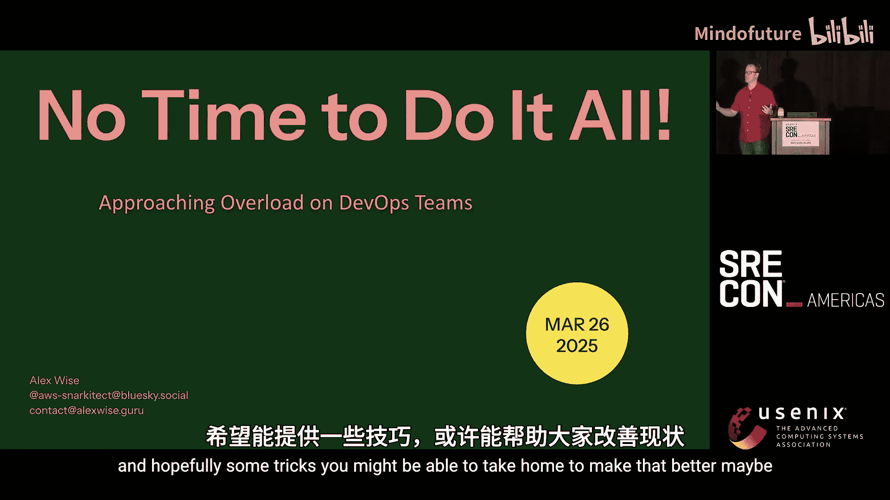

You can find me on social media， AWS Ae， most places， I love chatting with people there。

 been a software engineer focused on reliability for a long time。

 small startups to large enterprises， everything in between。

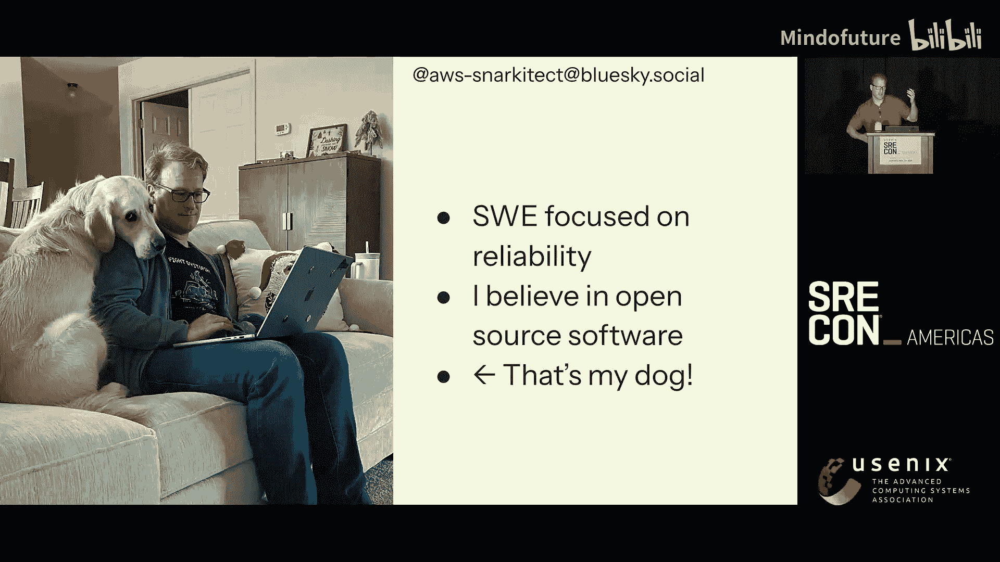

That's my dog， Clover。 He loves responding to incidents， too。

 but only when the incident is dropping food on the floor。so。

Everywhere I've been all these different place I've worked I regularly see or encounter or I'm on teams where there's just more work coming in than we can really perform in time and we're having to make these difficult tradeoffs about quality。

 about timing， about about working weekends， nights， things like that。

The literature calls this state overload， I just known as being busy。

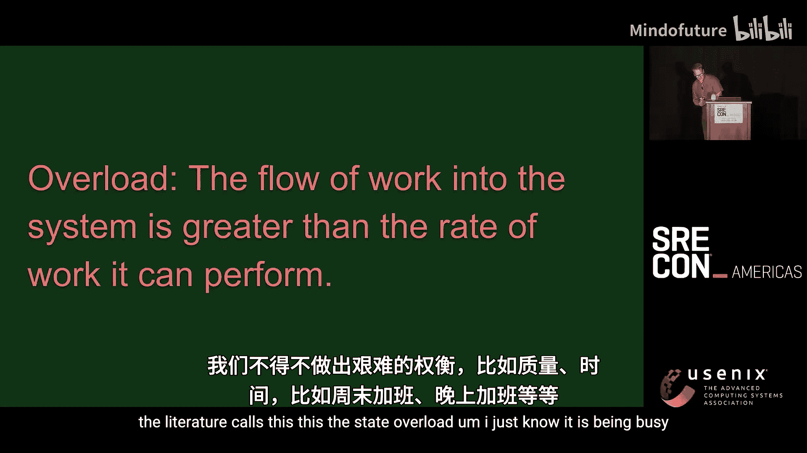

Just like quick clap if you have ever experienced being busy on a software team。Yeah， yeah， okay。

 I may trick you to clap for me。 that makes me feel good。 But yeah， yeah， I think it's really common。

 right， And it's not just uncomfortable。 It's not just frustrating。

 It can really have a detrimental impact。If we， if we stay in this mode for too long。

 So this is an article from the crowd strikeike incident from last year。

 It's come up at a few different talks this year。 And it really just points to kind of the common production pressures that that。

We see and everyone in here is experienced， right the pressure to ship hard trade offs about quality versus fixing。

 interrupt work， things like that。And and so so it's very common。

 And the state of overload is also can can be pretty。

 pretty bad to stay if you stay in it for too long。

 So I really wanted to dig into kind of why it happens and and maybe hopefully figure out some things about can we。

 you know， can we make it better， So it started where all quests for knowledge start in the modern age。

 I Googled it。I was hoping that some AI oracle would come down and hand me like a1 point listicle that I could follow and never be busy again。

Not there yet。 Maybe with G5， we'll see。But so then I went to the library。

 I'm really bad at libraries， I don't know about you guys but I tend to like opportunistically browse and pull things off the shelves。

 I'll go and looking for books on system safety and come out with like a big stack of books on cat behavior it's just it doesn't work for me so I thought well if I can't find the answers out in the world maybe I can just reflect on my own experience as a software engineer and think about that and maybe come up with something。

And I'm from Denver， we got a lot of great mountains there。

 so I'm going to walk up a mountain and I'm going to stay up there and I'm going to think about this busyness problem。

 this overload problem， and I'm not going to come down until I figured something out。And I did that。

And I think I discovered these two fundamental truths about the world。

 and I want to share them with you for the first time here today， you can call them Alex's truths。

The first is that resources are finite， that that our time， money， effort， attention。

 we don't have unlimited of that。The next is that change continues that that the world is。

 is moving around us and shifting things。 and we have to adapt。respond to that， and I thought， yes。

 this will be my big contribution to this problem of overload。I don't know if he climbs mountains。

 too， but we found out yesterday morning that that that this is Dr。 Woods， that this is。

 this is the theory of graceful extensibility。 It's his adaptive universe。

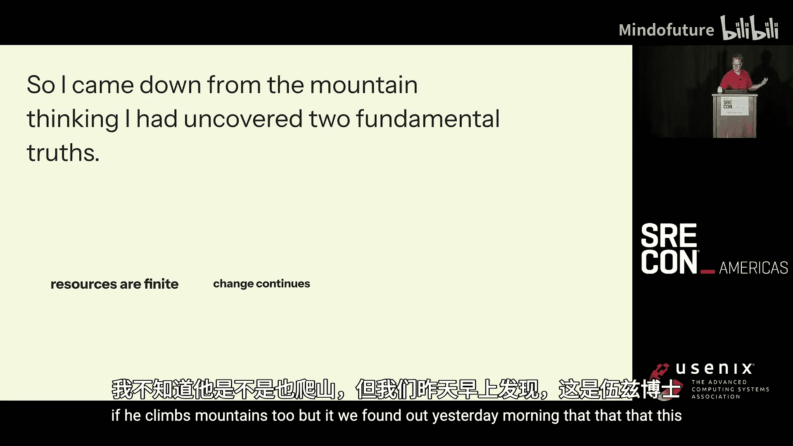

And， and it says just that， right， right that as the world changes around us， we have to adapt to。

To this world that we will inevitably bump up against this time， resource， attention。

 effort limits that we have， and it will feel uncomfortable。

 we will not have enough stuff to respond to it， we will be in this state of overload。

And I wanted to begin to talk with this， because I think when we talk about things like technical debt。

 but also things like outage outages， particularly outages。

 that kind of escape containment of this engineering world that we live in and have a real human impact。

We get this chorus of this no true Scotsman kind of thing like， oh。

 a real engineer would never ship code with no tests or oh they knew about that bug for months and never fixed it。

 how dare they or the greedy business deliberately withheld reinvestment knowing that it would cause an outage like this。

And the thing is， if you believe in the adaptive universe， if you。

 if you believe that this is a temporary natural order。

 that these systems will sometimes find themselves in the state of overload。

The none of these need to be true。That really we should first and foremost， have empathy。

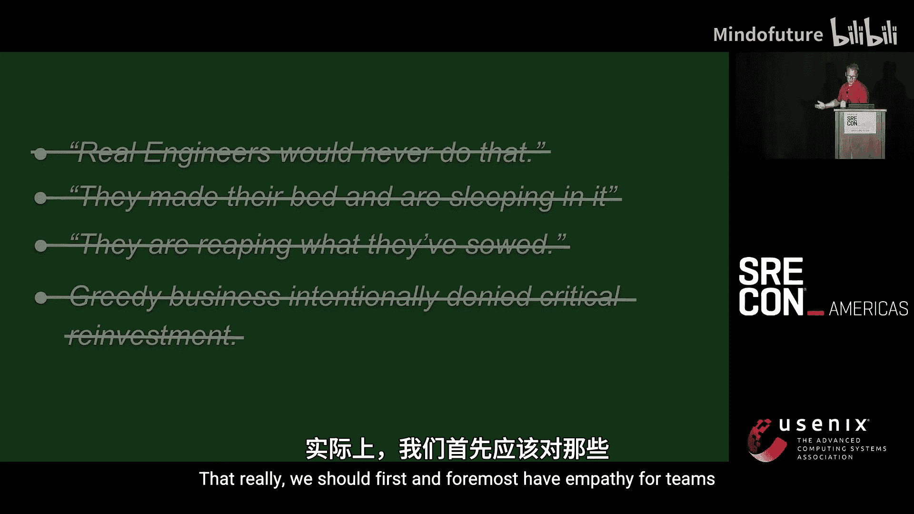

ForFor teams that are experiencing this kind of overload because we will be there some soon。

I think it's also a really good argument for why we need to be efficient with the resources we have。

 even when we have enough of them， even when we have enough time， even when we have enough money。

 because we don't know when the world is going to adapt change and we're going to need to adapt and we want to spin those resources wisely to get out of that state of overload more quickly。

So。I really liked Dr。 Woods。😊，that theory really helped me you。

 feel better about the state of business。 it's not just me。Being a slow coder。

 That is why I'm seeing this so often。 it's not me just being bad at my job and and causing all this problem。

 it really is just a natural state of， of systems。But it didn't give me everything I needed， right。

 I think it was Tom Demarco that said that software development is an active discovery。

And so things regularly feel uncertain we're facing uncertainty and then often。Stuff is hard。

 so how do I know when the pain that I'm feeling is from this state of overload and not from some other cause that has other remedies？

So Dr。 Woods has us covered there too， this is the Patts and CSE book。

 it is the appliedli companion to the cognitivetive systemss engineeringing book。嗯。

If if this group is familiar with the SRE book and the SRE workbook。

 this is like that applied workbook style book。And in it。

 he talks about lays out a framework for how there are four possible responses to a system when encountering overload。

 if you saw Cory's talk， he also talks about this， we don't let you leave SRcon until you've memorize these four things。

 so pay attention， if you've got a flight later。One the four ways that a system can react。

 it can shed load， it cannot not do the work。 it can reduce thoroughness。 It can do a crappy job。

 It can shift work in time。 It can do it later， or it can recruit resources。

 It can can bring in things to help and as a rule of thumb， those last two shift work in time。

 recruit resources。 those tend to yield more positive outcomes in our systems。

 they do they do require anticipation。 They require planning。 They require a cost and resources。

And I love this framework。 I think this framework is super cool。

 I like it in like a post incidentdent context。 If you're in an incident interview and you start hearing things like then the database had dirty rights。

 or that's when the web server was dropping requests on the ground。

 This framework can prime you and you can think， okay。

 is there a way that we might adapt that part of the system to move from these kind of reactive responses to overload to maybe more proactive ones。

 Can we add back pressure。 Can we Can we enable auto scaling。😊，So I think that's super useful there。

 but the joint and joint cognitive systems refers to any system where we have humans。

 humans and machines， so it holds true for like your incident response team and the web servers。

 but it's also true of your software delivery team and the JRA work queue that they work out of so。

If we hear。Things like this one off。 It could be， just a one off poor communication or something。

 If you start to form a pattern， if you hear， hey， why did this change not get committed or we thought we said we were gonna fix this months ago。

 Did that never get done， That could be an indicator that the team is responding to overload By the same token。

 I think it is really important。To celebrate when our teams do use these positive anticipatory planningbased responses so like hey we don't think we're going to be able to get this done this quarter。

 can we get this moved to next quarter or hey we're a little busy with this to do all of this right now can this other team help with maybe this part of it we should celebrate those because that is the system responding in the most productive way to being faced with more work than it can do？

So I promise， I think I promise I am done poorly citing Dr。

 Woods at a conference where you can just walk out into the hallway and talk to him。嗯。

I think you never know what S arecon， I might have some other quotes hidden in there。

That was that was really helpful for me， right to understand not only like why。

 why this is so common， but also you know when when I'm in this mode， can I identify when when。

When when， when my team was responding to overload。 but the other thing I wanted to know was kind of。

Is there something that I'm doing that's making it worse or is there something that I could be doing to put the positive spin out that makes this state of overload better that helps us get out of this state of overload。

 this mode of overload more quickly。

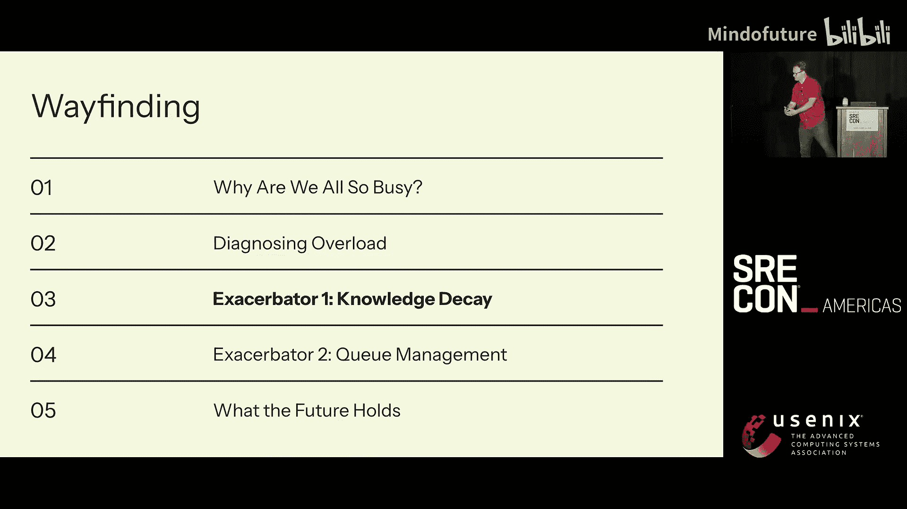

And I'm an engineer， nominally， I like math。And I know a little bit about software engineering。

 so I thought， well what if I make a little toy simulation of a software team and just kind of play with the inputs and outputs and see what happens so we're going to keep it very small。

We're just going to model a single service。 It's just going to be force software engineers。

 all equivalent， all contributing equally。We're gonna start by saying we're gonna to write 150000 lines of code in year one。

 and then we're never gonna touch it again。No of us would ever do that right。

 but if we're not going to model like any kind of like feature ads or customer feedback or anything。

 we will model attrition。We want to say， you know， every year we the。

 the employee that's been there longest is going to rotate out just a very simple model of attrition。

And we do， we're writing software。 So we do have to， to measure bugs， right。

 So for every X number of bugs that we have every X number of lines in the code base。

 we're gonna find a bug。 In this case， a bug， we're just going randomly pick a single line of code and say。

 there's the bug， that's the bug。 if the author， the most recent author of that line of code is still the company。

It's going to take one hour to fix。If the author is not there， it's going to take 10 hours to fix。

 but then they become the new owner of that line of code。And the thing we're measuring here。

 like I'm not trying to get to an actual number or like real quantitative value of any of this。

 I really just want to see the shape of the curve and kind of understand the inputs playing on it and the thing we're going to measure here we're going to have years。

By hours spent fixing this fixed number of bugs。So what does that look like and I will email when I email these slides I'll have like a detailed explanation in the speaker notes there。

 hope that's helpful but to talk through this graph here in year zero we're really cooking we've written all of our code。

 we also have these bugs because that happens every time you write code and where we have high context and we know about every line of code we can fix it all really quickly。

Over on the right， here's 4，5 and 6。 things are a mess。 they take。

 we spend 15000 hours a year fixing this code。 but， but it， it's at least consistent， right。

 We know that when we w into this mess that it's gonna take a long time。

 It's gonna be pleasant and we don't want to do it very often， but it's。

 it's kind of here in the in that rise in years， years 12，3。😊，Where， where year after a year。

 the same amount of work is taking longer and longer。 We're bumping up against these。

 these limits of the adaptive universe。 things feel tough。 This is where。

 I think we feel overload most acutely there。But we don't have unbounded time to fix bugs and small services。

 So， so what happens if we say， you know， year year 0 there， we spend 1500 hours fix these bugs。

 Let's just cap it there。 That's all we're willing to spend。Well， as you might expect。

 the number of bugs you fix goes down a lot there because you're capping it， But also。

 your backlog just kind of grows indefinitely。 It's monotononic growth。

 has anyone experienced just the endless growing backlog of Jra tickets。 Yeah， yeah， not。

 not super uncommon。😊，So I don't know if there is a fancy academic term for this。

 I don't know of when， I would love a pointer to one if there is one I call it knowledge decay。

The idea is that as your knowledge of the system and how it works degrades。

 your facility at adapting it to the changing world changes， impacts your resilience， things。

 things tend to freeze up。And given the economics of how software is built。

 I think we encounter this more often than we would want to。

 But so that's what is what can we do about it。 And when I talk to folks at meetups and at work in things。

 there's always this kind of immediate response， It's like well， du Alex。

 you got to retain your employees you know， if you just didn't lose those employees。

 would you would be in superstar mode the whole time。 And I think that's super true。

 right retain your employees as a superpower， do everything you can to do it whatever your comparative advantage is there if it's money。

 if it's freedom。 if it's vibes like do what you can to keep your employees for sure。

 it's not always possible the folks who like to build from zero to1。

 rarely like the ride from one to two or whatever。 unless your company is in some kind of time bubble in 2018。

 there's probably not room on your ladder for everyone who wants to be promoted above senior to do so。

So you can't retain everyone， you have to build robustness to people leaving the company。

 I think that's also a superpower， but what can we really do to do that？

Let's take another look at that graph。You know， there was kind of a buried assumption here。

 I said that that each bug was represented by a single line of code。

 but also each line of code is represented by a single author and， and in software development。

 that doesn't have to be true， right？ We have tools。 We have pair programming。

 mobbing and the like where you can have multiple people having context about a single line of code。

 So what does it look like if we were to pair program on this service。Whenever we touch it， well。

Curve looks a little something like this， and I'll talk through it too so so start off in the same place in year zero。

 but we're completely robust to losing an engineer in year one。

 there's still full knowledge of the code base。 and really like our curve looks a much better in years two and three。

 It's not until we fully rotate all of those original authors off that we kind of shoot back up to where we were in。

In our solo coding paradigm。An interesting thing to point out here too。

 I think is like the impact of parent programming only exists at the point in time when you're actually touching the code if you were to start pairing over in like year six when you're only touching a small handful of lines of bugs every year。

You know， it's not really going to have that much of an impact。

But that's also a choice in our model too， right， we can choose to change this code base after we touch it like let's say。

For example， this is like an old three tier web service that's got some weird clunky data model trying to do transactions。

 And hey， the company moved to event buses after we wrote it。

 What if we just kind of put this on Kafka， You know， we can keep the business logic the same。

 But it's writing to Kafka， which is gonna have a bunch of benefits for us downstream。 But what。

 what happens there if in like year 4 or5， we start。We rewrite half of the application。

 what does that look like？It looks like this， where in year four we've got our normal 15。

000 hours a year of aixing bugs， but then we rewrite half the code base and that shoots back down to 8。

000 and we really reset the clock on the staleness of this code base and our facility with it。

And it was when I got to this point， I stared at this a while。 I was like， oh man。

 that reminds me of something。 I've seen something like that before。

What is that and digging through bookmarks and trying to find it。

This is a diagram from a blog post from Will Larson's blog， Will Larson， the CTO of Carta。

title of the blog is Mis， the sole scalable fix to tech debt。And in it。

 he makes the argument that really the only way to get your hands around and stay atop of， of。

The the software and the infrastructure that you run of your system is to proactively seek out and fight for chances to migrate and update and refresh parts of the code base if you just wait for things to become so broken。

 they have to be replaced。You're constantly going to be firefighting。 So， so he's。

 it's a great blog post。 I recommend everyone read it， but he's making the case there。

To proactively seek out migrations。 and I just to。To add on there， to riff on what he's sayingy。

 yes and him。And migration is not just getting good at migration is not just one thing。

 it's a whole set of muscles that you really need to build and deliberately work on in your organization。

 it's things like how do you identify what would be a good thing to migrate？

It it's this idea that instead of asking， well， how does this work。

 you ask if we were to rewrite this tomorrow， what would it need to do。

 that question tends to yield much more actionable answers。

D the building consensus thing so how do you go from oh I think we need to rewrite this back in we do we actually do the port to Kafka that we were talking about or maybe we do we just like swap the end of life SQL server for a new Postgres or something and call it a day。

 How do you build consensus about what actually you're going do derisking is another part of this can you make the changes smaller。

 can you do it in phases， can you do it without customer impact do you need to talk to customers about what you're doing I promise if you have a big migration go sideways。

 you're gonna to be migrating less than you want to or need to in the future。And I think most， most。

 most importantly is getting good at selling this kind of change to the business if you just do a simple。

Dollars in， dollars out analysis。 the unfortunate truth is， is that you can。

Get a lot of value out of just throwing burnt out onca engineers and band-aid patches at a service to keep it running until something else happens。

 So so what context are you framing this change and how are you making it something that's legible that the business should be doing。

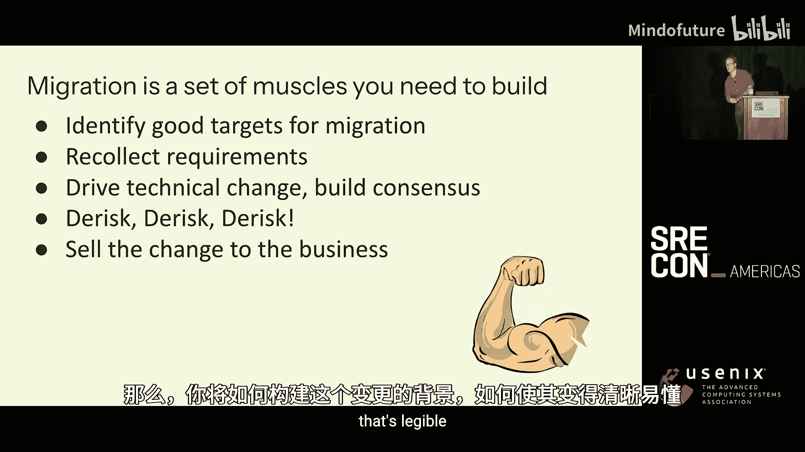

The other thing that happens at systems that struggle with knowledge decay。

People who are you might say too online would call this Copenhagen culpability。

 but I find that no one knows what that means， so I like to call you touch at you on it is and basically the idea is if there is something that is not well understood in the organization and you go and touch it and something happens later down the road。

you bear some kind of ownership or responsibility for the thing that happened。

 even if you weren't directly responsible so in places where the struggle with knowledge decay。

 there tends to be this kind of oh I don't see that I don't want to see that and that kind of behavior can lead to kind of a great sucking sound of the knowledge of how your system works out the doors because we really do like Larsson was arguing to proactively refresh our knowledge of how things work。

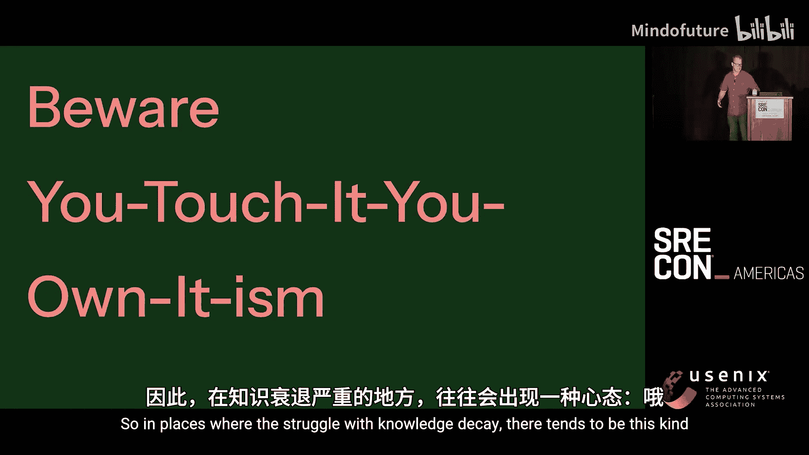

U so。What do you do to fix this well。Something that's probably necessary but not sufficient is to make sure things actually have ownership。

You know， you actually actually say hey， you' you're responsible for this thing I think by itself。

 you've still kind of siloed that knowledge， you haven't really empowered anyone to update or change or fix it and like we showed in in the pair programming graph。

 it's really a lot harder to get knowledge about a system shared around after it's been written and it's not being touched anymore that's a really difficult thing to do so one thing I like here is lunch and learns you can oh it sounds like we don't know how this thing works。

You know， can， can you go talk to this V P， this V P read this old crusty documentation and kind of give us an explainer to everyone and share that knowledge out and make it okay to touch。

Figure out your reward systems for this。 Like， there's a lot of。Of work in， in。Getting past this。

 this kind of Copenhagen cultultability， this， this， this， this， you touch you， you own it stuff。

There's a story from Twitter days， I think Dan Lu， it was a tweet thread where he talks about the project to understand the health of the Twitter servers。

And doing so required collecting， decoding and organizing。

Hundreds of thousands of undocumented de message message logs and understanding figuring out what they meant and which ones were important。

 And that's not a thing that that a lot of organizations typically reward， but， but。

Can have a super big impact if you're a solve style kind of staff engineer。

 I really like grabbing juniors by the hand and just diving into a part of the code base on a Friday afternoon and kind of building understanding and scaffolding back up And as a principal or staff engineer。

 you're actually on the hook for all of these really hard things about migrations。

 I'm sorry if it was easy， they wouldn't pay you so much。嗯。So that's my thoughts on knowledge decay。

 retain employees however you can， mob parents share at the time of writing code。

Might proactively migrate everything that you can and。

That you touch eanism don't let people try to avoid the poorly understood parts of the system。

All right。So。I like that that helped， but this graph here， this ever increasing backlog。

Also rang some bells for me。Maybe a decade ago， had of product that I worked with really liked lent me a book。

 I never gave the book back。 I liked it so much。 So I'm sorry for stealing your book。

 This is flow by， by Don Reinson。 Don Reinersson， you could call him like a systems thinker he。

 he was one of the folks that was applying leanan manufacturing principles to the work of software engineering。

😔，And he has a lot of cool insights， his big thing was he modeled software teams as mathematical cues。

 these kind of MM1 cues that had a certain set of properties that he thought reflected the real world and he applied those principles and kind of talks about what happens when you model software teams like these cues and how should you best manage the work they're receiving and yet a lot of insights。

But two that I think are most important for this talk don't saturate capacity and that your batch size matters。

So like I said， he models software teams as these MM1 cues work arrives in kind of a stochastic way。

 most of it gets processed quickly， but there is a long tail on the distribution so some stuff can take。

 it's possible for stuff to take a long time。One property of these cues is。

When you give them 100% of everything that they can do all at once， they just seize up。 They just。

 they just stop being able to really do work。 And really。

 there's a sweet spot at around 75% utilization that you really start to see。Throughput tank。

 you also see variability go through the roof。 So stuff that seems like it should be done very quickly。

 suddenly takes a really long time for no reason。 I don't know if。

 if people have experienced that on teams as well。 I know I have so。For Ri， it's in。

 it's not just a culture thing or a safety thing of why you should。Should， should prevent overload。

 keep teams out of overload。 There's also a pretty strong economic case。

 like your teams will just perform poorly when they're， when they're really overworked。嗯。

The other thing since this is the SRE cried， and one of the things I took away from the conference here is that teams have very different levels of interrupt from company to company。

 but if you are one of those high interrupt teams，You know。

 that should get factored in before you start。But before you figure what you're gonna pull it。 And I。

 and the real， the real thing here， I guess to， to say， is that when you on your team are pulling in。

Work， whether it's for for the sprint or the quarter or whatever。 when you're saying yeah。

 we can take this on， I think it's important to call out that that it's not just upside risk to pull in too much。

 It's not like， oh， hey， we accidentally did 50% more than we thought we could that there is a mathematical downside fixed cost as you pull more and more stuff in。

嗯。And if Reinson doesn't like。Oh， man， I'm way ahead of time here。

 I guess we're gonna get to see extra slides。 This is great。 So if he hates overutilized team。

 he really hates these large batches of work。😊，嗯。Large batches of work。 So let's say， you know， you。

 you get word from。From above that the company needs to switch its identity provider for whatever reason。

 and that's going to be a big project that has a bunch of different dependencies in a bunch of different environments and it's going to hit a bunch of different teams。

嗯。But you're kind of overworked。 You think， okay， well， we kind of know what that is。

 We'll just work on it as we go。 We'll just leave it as kind of this big。

 big hunker work on our board。 Well， what happens then。Well， well。

 the size in in these rhins and SQs， I should say size has an exponential relationship with delivery time so incrementally as you get bigger。

 it takes you a lot longer the variability we're talking about also goes up where things just take soon to take longer for no reason the most interesting property here that I found was that these big batches of work are really self-reinforcing so I mentioned the 10 other teams that all have dependencies here because you have a big block of work on your board。

 things tend to agglomerate and back up and become big on all of their boards and that kind of selfproagates out you know all throughout your organization。

So。Oh let's just skip ahead on on。

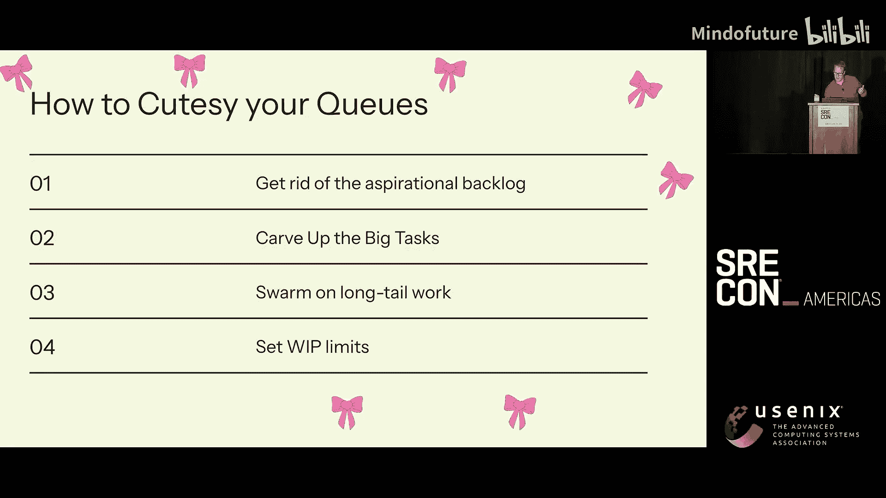

said extra slide so the other thing that Ryansen talks about is is W limits。

 I am not work in progress limits， how much work does your team have in fight at once。

 there are a lot of different ways of thinking about whip limits。 I'm not a big evangelist of any。

 I think。

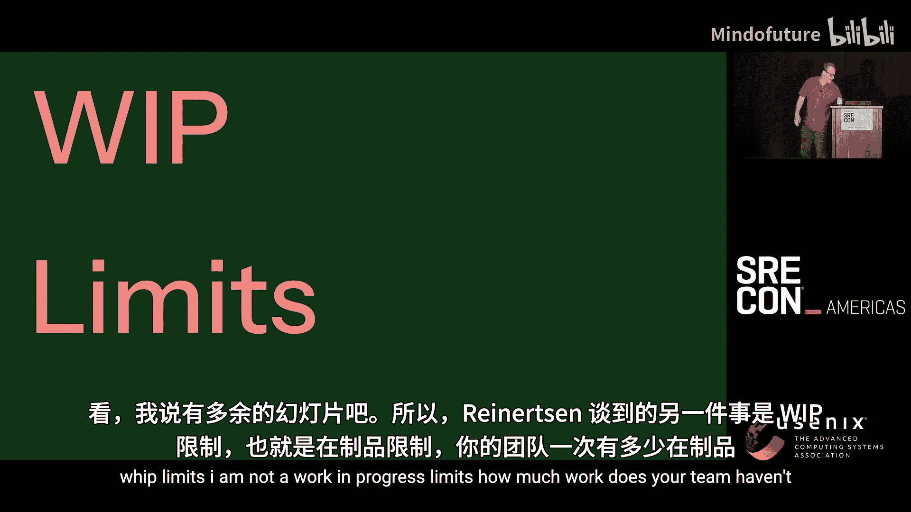

For Reinerson， the thing that W limits give you is they help with what you might think of as your 1% lows。

 So like that stuff that takes a really long time for no real reason。

 W limits can really help with that。And for these mathematical cues， it's like twice。

 your average whip level is where you should set the limit。

For the if you're a theory of constraints person， you you find the biggest bottleneck and you set a global rate limit to that if you're a utilization trap person you want。

Fewer tasks than you have servers or actors so if that's another case for pair programming and things like that and in the agile folks they just say well do what works。

 figure it like tests try things out change things nothing's fixed so whiplim are also talked about in the book as a strategy for combating some elements of this state of overload。

There's also organizational width this is。This is a diagram from John Cutler's blog that I really like I have this is a Zoom background when I'm sometimes feeling too snarky and the way you read this here is kind of in the center left there there is you see W is rising。

 a work in progress is rising organization right follow your choice of arrow to see kind of what the mind this mind map of kind of what happens there。

 you know throughput goes down。It takes us longer to learn。 We， we， we lose morale。 We， we。

 we miss deadlines。 Then we have to hire new people quickly。

 and it kind of all feeds back around into W。 And， and and the thing that I like about。

This diagram is you can really imagine some awesome heroic interventions that that that might fit you know。

 might that someone might attempt。 So like， if you have a really good manager。

 they might sacrifice a bunch of political capital and really block their team for that pressure from short term results。

 right or or you might have an engineer This's like。

 I'm just going work through this all week and long。

 And I'm going make sure that time to deliver does not go up。😊，But because this is a big web。

 you can see that this， these pressures will find other ways back through the system that these sort of short term intervention circuit breakers don't really。

Have a permanent。Impact。And the other interesting thing about this diagram to me is that like。

 if you look over here， like rapidly hiring new players。 Well。

 that looks like a response of recruiting resources， you know。

 shedding just not doing as much or doing things more quickly。 you know。

 you can kind of map on like you can a whole organization can be in the state of overload as well。

 And you'd see。😊，Sort of these responses manifesting at that level as well。so。That's what I got。

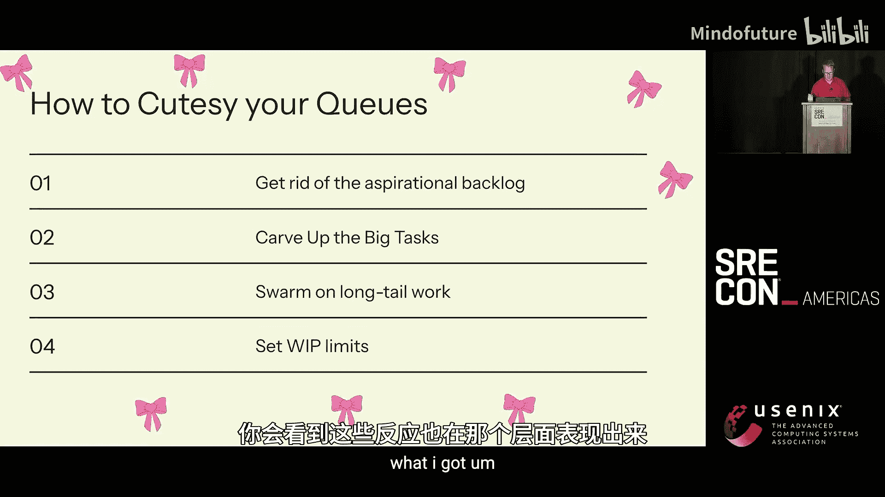

Yeah， thank you so much。

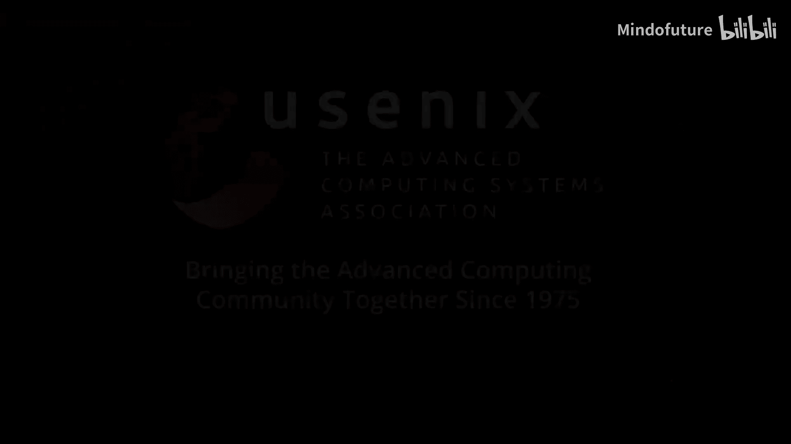

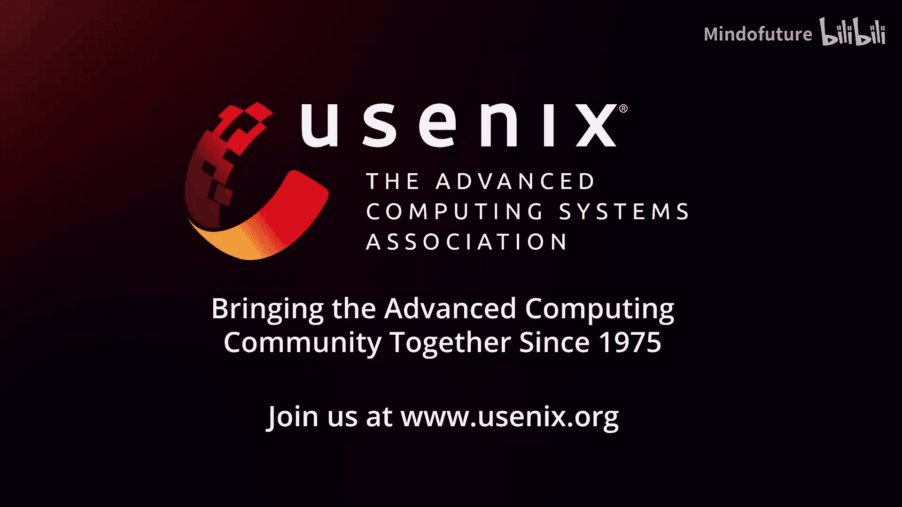