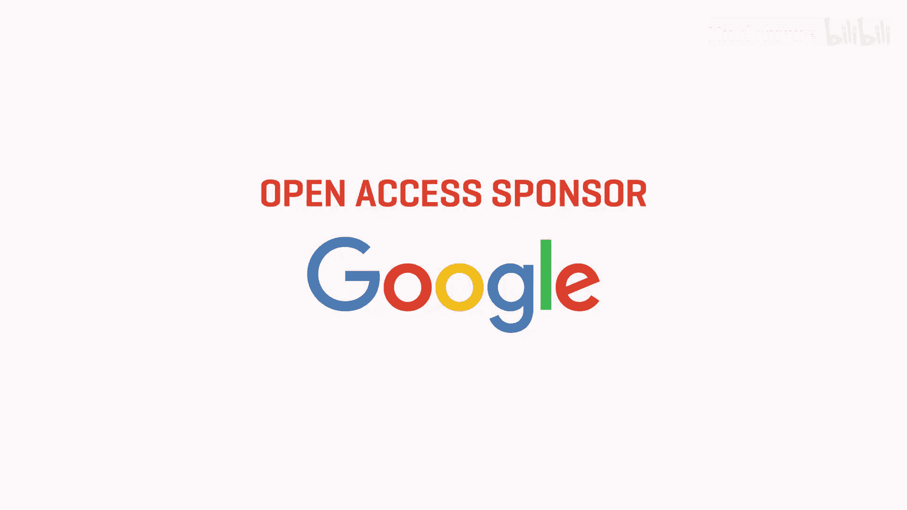
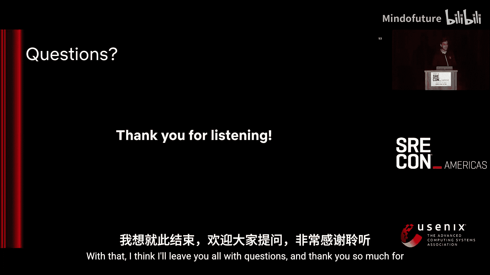
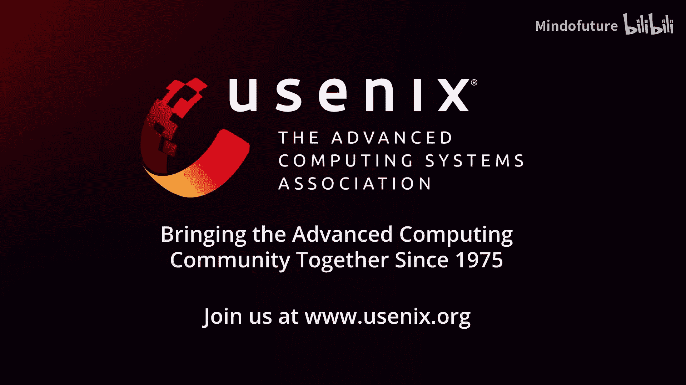

# SRE大会-2025-美洲-｜-srecon-｜-分布式-｜-缓存-｜-OpenTelemetry-｜-安全-｜-AIOps-p36-P36-Securing-Distributed-Cache---Achieving-Secure-by-Default-with-Key-Challenges--BV1TmLDz7EZZ_p36-

。

My name is Aash Steve Boyyle。 I'm a senior software engineer in distributed caching platform at Netflix。

I have with me Shiam and Sam。 together， we manage distributed fleet， running its secure。

 serving millions of requests per second for both streaming， gaming， live and ads platform。😊。

So today we'll take you on a journey on how we keep all this secure while still maintaining sub millisecond latencies for millions of requests per second across the globe。

😊，Let's get started。On this journey， I'll also give you some key challenges and insights on how what are the incidents that we face。

 how we deal with them and some of the learnings that I hope we all can take when we go back。😊。

So on the left is a familiar site。 It's the page that opens when you go to Netflix dot com。

 Can I have a show of fans who all here are Netflix subscribers。😊，Well， I still see some hands down。

 I'll give you five minutes。 Open up your phone， go to Netflix dot com。Subscribe。

 there's a lot of content。 It's so much fun。 I watch it all the time。😊，Well。

 on the right side is the call graph that makes all this possible。😊。

Netflix is highly microservice oriented architecture。

 There are tons of microservices at play that power every single thing you do at Netflix。😊。

For example， this homeage， it's unique for every single subscriber across Netflix。

 And to make this happen， there are precomput microservices。

 There are road render microservices that are at play。

 and almost all these microservices deal with huge amounts of data， both in overlap and OLTP spaces。

😊，And at the very tail end of these microservices are the data accesses。

 which are empowered in split second by E V cash， which is our distributed cache that well talk about。

😊，So what exactly is EVC？EVCash is a distributed， sharded and replicated key value store。

 it is written in house on top of MeCash tea。😊，On the left。

 you see a very simple deployment and is showing a single written setup where the apps can be present in each single availability zone。

😊，And by default， we prefer the local zone calls。 but in the case of fallbacks。

 apps can go cross zone as well。EVCash has stillable in region and global replication by this。

 we mean we can replicate the data across one or more availability zones。

 we can also go across regions as well。😊，EV cash is resilient to failures。

 We can tolerate a node going down。 We can tolerate an availability zone going down。

 We can even tolerate an entire region going down。 thanks to our robust and resilient infrastructure。

😊，So Ivigsh client is topology aware。It knows exactly where a key should live and directly communicates to that key。

 and in the event of a failure， it knows how to fall back to a different zones for retri。😊。

Our entire infrastructure is linearly scalable， depending on the reads and the rights per a second workload from the clients。

We have robust cash forming infrastructure in place that ensures whenever things go down。

 they come back up hot and ready to use for the clients。Look at the fleet overview that we operate。

 EVcash operates in four different regions。 US East1， US West2， Europe West 1 and US East 2。

 We run 200 clusters spanning 22000 servers， serving 400 million operations per second。

 spanning 2 trillion items， taking 14。3s of storage。😊，Now。

 we will show you we run this without a nose bleed。

Let's dive into a sample data flow from the client side。

 This is a very simple flow where the client goes to Mem Caashty。

 which is composed of listeners and workers on a high level。

 The listener assigns one of the workers to serve the request and in turn goes to Mem Cashty store。

 Now the story is where I'll dive a little bit more in the next slides。

 What flavors of store do we run and then serves the request back to the client。😊。

This is the first version of Memcachety store， the pure in memory version。 In this case。

 the worker purely stores both the keys and their values in memory。 Everything lives in memory。

 in this case。😊，Now， this is a little bit more efficient。 And， you know。

 dual mixed mode set up of Me cache key。 In this case。

 your hot keys are the keys that are frequently accessed。😊，They live purely in memory。

 along with their values， whereas the cold keys or the tale of allut， so to speak。

 those values are flush to E X C store or the disk based flavor of Mem Casti。😊。

Please keep in mind the keys for even those values。

 They are still in memory for quick access and look up。

Now you saw a lot of data flowing through different channels。 So this begs the question。

 is it all safe， right， in the age of security，'s for every Aliceice and Bob。

 we all know there is always an eve or a hacker waiting to eavesrop and sniff the packets around。😊。

So how do we run it secure？That is where T L S or encryption in transit comes into picture。

 This is a very 30000 feet overview of how our fleet runs secure。 On the left， you start with client。

 which opens a bidirectional Tl S channel with the Mem CashD with inbuil SSL buffers。

 which in turn uses open SSL constructs to talk to M CashD workers。😊。

Now we will dive deep into both the client and the server side of these things。

 so talk about how client fits into this picture， I'll first invite my colleague Shera。

 who will give you a deep overview into the client side。😊，Sorry。😔，Thank you， Akaash。

 great marketing strategy。 So I also to give five minutes。

 Probably you can take up your phones and sign up for Netflix you haven't again So again。

 Aash gave a great introduction about EVc。 So as you know all。

 you know that EVcash has two components。 One is the EVcash client and EVc server。

 So my for the next 10 to 15 minutes。 I'm going to talk about the security aspects from a client perspective。

 And Sam is going to talk about the security aspects from from the server perspective。😊。

So my talk is going to be on what is going to give a quick introduction about what is EBC client。

 what are its most important features and then get into the security aspects so lets get started。

What is Evc client。 It's an open source library。 It's available in Github。

 if you haven't please take it out。 So the Evc client enables to fetch or set the data to the Evc server。

 What is Evc server here is a set ofc nodes So what is most important features of Evc client it's a thick client。

 what is thick client here is all the good distributed systems logic is all present the Evc client。

 So for example， the availability。 So all the data replicated within the region across the region is all done by the EVc client。

 then as akash mentioned it's topology aware， which means that Evc client knows the entire server topology and it exactly knows which server to read the data from or which node to write the data to and the reason and we might now ask a question。

 hey， there are a lot of pros and cons of having a thick client right but you might ask a question why thick client actually it is just designed by default。

 we wanted。😊，This entire distributed system logic either should be present on the server or the should be present on the client or on the server。

 but we prefer to be on the client because we wanted to use the memory for we wanted to use the memory on the EVC server to be mistakeically for get and fit so that it' is extremely high performance for example。

 for a 400 million operations per second。 We wanted the server to be as performant as possible。

 That is the main reason why we move this entire logic to the client。😊。

So now you might ask the question， hey， now now is such a heavy client。

 which means that the the setup has to be as efficient as possible。

 What do you mean by efficiency here， For example， as I mentioned before。

 EVc client knows the entire server topology， which means that I'm just giving a random example here。

 EV cache cluster with one availability zone with 0 nodes。

 the client manages 0 connections and we do in replication， we， we try to have at least three。😊。

3 rep3 replicas available within the region， which means that and we do do homogeneous deployment。

 which means that the client has almost 300 connections。 So for this entire setup。

 it has to be highly efficient as possible。 So what we do here is that we use nonbing Ivo with the M Ca G nodes so that each operation we don't need to wait for each operation to complete。

 And each thread can handle multiple connections at the same time。So next， load balancing。 So again。

 this is very related to what I just spoke earlier， as we mentioned， EV cache client knows。

 which were to write the data to and where to read the data to as well。

 So the entire load balancing logic， we use Kaama hashing based on the key。

 and we just route the data to the specific server nodes。

 So the entire load balancing logic is all present on the Ev cache client。😊，Secure connection。 Let。

 let's give the secure connection a special treatment。😊。

So before even going into the secure connections， right， let's let's start with the data flow。

 Evc client helps us to have a seamless data moment。

 as well as a secure data moment from the client to the server。

 So what does it mean it makes sure that the data integrity is present。

 It maintains the data integrity and also prevents the unauthorized access。

 How we do it is through SSL and Tl S。 So we make sure that the data is encrypted during the transmission so that it cannot be intercepted or eesdrop so that the data is protected。

😊，Data defense。 So E cash client employs a comprehensive data secure technology like so that we protect the data。

One， if if you are aware of the open source Ec client。

 you might see that none of the security implementations will be present there。

 The reason is that we use our own security implementation。

 and I don't think it makes much sense to open source。

 So what we do when we when we deploy the Cc client across different applications across fix is that we have our open open open source Ebc client。

 And we have a wrapper around it， which has the all the security implementation。

 And we deploy this as an entire library to all the applications across。😊，Cool。

 now let's talk about the role of clientide with SSL Nls。Encryption。

 So the reason why we have this entire security is to actually encrypt the data so that it can never be intercepted and it can be deciphered only by the authorized party。

😊，Data integrity again， it is extremely crucial to that like for example。

 whatever you write is what is received so EVc client maintains this data integrity。😊，Authentation。

 whenever we talk about authentication， we mainly focus on the server side。

 but also the clients also place an important role with SSL and Tl S because it fetches the security。

 It transfers all the security， and it has to do in a very perform manner as well。

 And and it transfers the security the server。 Again。

 I'm not going to go into detailed implementation in each of this case。

 I'm just going to highlight that the clients also plays an equal role in all these three scenarios。

 But Sam is going to give a very detailed overview of how we do each and every case。😊，Cool。

 now let's talk about， as I mentioned before， the security implementation is very internal。

 and we use our internal implementation。 That's the reason why we don't open source。

 So what have done in this slide in the future slides is that I've taken the implement the the internal implementation out。

 I've just taken the basic concepts to say that， hey。

 you have a client and how can you secure the client And how can you deploy it at scale。

 So and what are thes you need to have。 So and Netflix is very Java heavy。

 So that is the reason why I have Java as examples here。

 But the constructs or the concepts remain the same for other programming languages as well。 just。😊。

So what is the first step is to actually go and secure the connections。

 What are the two steps needed here is to have an SSL context and SSL engine。

 What is an SL context here is consider it as a factory to produce all the secure connections。

 As I mentioned to you before， Evc client manages or maintains connections to every single node。

 which means that， for example， I I mentioned in my previous example， say 300 connections。

 which means all the 300 connections has to be secure。

 How do you make sure this secure or consistently produce these secure connections is through the SL context。

 What is SSL engine here is actually why do we do this is to actually go and encrypt the data。

 So the SSL engine takes care of this encrypt of the data。😊，Now we do have a connection established。

 Now how do you go and initialize this process through TLSV 1。2 and 1。3。

 We enable both The reason why we enable both is to actually support up to date encryption protocols as well as improved handshping process。

The other important step is to actually in the initialization process is how good the performance is。

 As I told， we do roughly around 400 million operations per second。

 So we wanted we don't want and these clients resides on these client applications right and we' we don't want to be a bottleneck to the clients。

 We wanted these libraries to be as performant as possible。 So what we do is that we use nonbing ios。

 As I mentioned before we don't want the operations to wait。

 We wanted to handle multiple connections and just consider that one thread managing multiple connections easier to manage than each connection having its own thread and managing such at large scale is going to be hard。

 So socket connections or configure blocking is false。😊，Now， you might ask a question。 Hey。

 you just said that the client manages all the connections。

 What is happening to the connection failures。 Yes， connection failures happens all the time。 So。

 for example， an intermediate like， for example， intermittent network failure can also result in a connection failure and server going down result in a connection failure So how good we manage these failures is super simple。

 we go page the on call， like that means that none of the Evc engineers or on call person is going to sleep overnight and we are going to be 24 hours。

 because this failures is going to happen all the time。

 So what we do here is that we do a two step process。

 One step is that we try to auto remediate itself。 example example we try to fix these connection failures。

 if not， then we have to page the on call。 So let's start with how do we do auto remedias So we do have a pool manager。

 which goes and sp up a new thread and make sure that and make and monitors the health of each and every connection。

 For example， if any of these connections are failure， then we go and put it in a rate。😊。

And try to see if it's an intermittent failure。For some cases， right。

 I'm just giving an example here。 if server is going if the server is not responding at all。

 then which means that none of these res are also going to work in this case。

 if it passes certain threshold， we have to trigger on call or non call person comes and understand whether what is the nature of the issue It can be either the client side it can be the server side。

 it can be the network and then take appropriate action。 So the first step is always auto rehaation。

 which solves almost 90% or 95% of the use case and 5% and on call is getting trigger。

Resource management， as I mentioned again， this is very relevant to the connection failures。

 So consider like you have an Evc client， which is running on your client applications， right。

 and say that you have not cleaned up your resources。

 which means that there are leaky channels available there are going to be leaky channels。

 What is going to happen here is that these leaking channels are going to use the CPU are going to use the resources resources on the client。

 which is going to degrade the performance on the client， the client from their perspective。

 it's just like hey， they have used your library， but even though they have it is not in the part of the Evc client or in the part of the Evc。

 stills going theyre going to have a performance regulation just by having these leaking channels because these are background threads that are running and securing these connections So the first step is to make sure that what what are the things we can do here again。

 is to proactively detect these leaking channels and clean up them。😊，How we do it again。

 I'm using Java as an example here is in Java。 I'm pretty sure most of you are aware here is that there is something called the selectors and selection keys。

 selectors are nothing。 but it goes and monitors every single channels。

 That is the secure connection the socket channels to make sure they are ready to read or write and selection key consider them as each and individual channels that goes registers to the selectors。

 So we go through all the selectors and selection keys。

 and make sure that they are ready to read or write。 if they are not。

 then it is it is good to proactively clean it depth。

 And then as I mentioned before put it to the retry queue and see if they are able to reconnect it again。

😊，And just if I， I think whenever you are doing a client library。

 I would strongly recommend that resource management take it as a P0 else it is going to like debugging this issue in actual production is extremely hard。

 and it is actually going to affect the client performance。😊，Great， so reconnection strategies。

 So now consider a case， right， I just mentioned that this entire distributed system logic is all present in the client and not in the server。

 and we do scale， we do scale up and down this curve all the time， So we don't want。

 and these connections are all established on the client。

 Just consider a scenario where we go and scale up the cluster。

 and we have to go ask the clients to go and redeploy them to secure the connections again， right。😊。

That is okay for one cluster。 That is okay for two clusters。

 But across it like Evc is used across Netflix。 And then we become more like we have to just keep working on slackla to just communicate with these clients to do a redeployment。

 I don't think that is useful for our time。 So what we do here is that hey。

 this two events should be completely independent of each other。 Again。

 what we do here is that we use the same Evc pool manager to go and regularly monitors these connections。

 It not only goes and checks the connections。 It also checks whether the connections。

 whether new connections are available since the client is aware of the entire server topology。

 The new connections， it goes and establishes new connections if the node is going down for example。

 disconnect those connections， clean up those connections all done by the Evc pool manager。

 So reconnection strategies or so extremely independent and itll take a lot of time away from the client as well。

😊，Why do we do this to make sure the data is secure。 So then what we do is that we use our SL engine。

 as I mentioned before， whenever we do a connection establishment to go and encrypt the data。

 as you can see， S L engine dot rap， which goes and encryptse the data。

 So only the authorized parties can go and decrypt it。😊，Great。

 now we went ahead and deployed like the code。 the code works really well。

 We went ahead and deployed it。 But one thing to note is that the unit testpa integration testpa and always issues happens in the production。

 right， So it is always good to have metrics for especially our last system。

 it is good to have metrics in place， especially with these security features。

 it's hard to implement because the entire workflow or the entire business logic happens in transaction。

 which means that you need to understand the packet， you need to understand the CPU profile。

 and it's not like and the debugging process also sometimes gets very hard。

 So to proactively detect issues。 I would strongly recommend to have lot of metrics and monitoring in place。

 We do have more than 30 to 40 metrics。 but what are the most important metrics in this in the scenario is active connections。

😊，Paid connections， connection latencies。 I'm not going to explain in detail because the names already say that error race and SSL handshake failures。

 I think I'm going to just emphasize what is about SL and handshake failures。 For example。

 a new client comes in and tries to access an EV cash cluster， which is it is not authorized to do。

So from a client perspective， hey， we are internal to Netflix。

 We can still go and authorize We can still go and access any Evc clusters we wanted， right。

 but it is up to the platform engineering team to secure its data。 So in this case。

 what we do is that we get all the alerts， for example。

 if a client tries to if client who is not authorized to go and access those Evc clusters。

 we get page or we get even slack alerts saying that hey this client。

 a new client is coming and authorizing it。 then what we do in this case is that we go and proactively reach out to the client。

 ask them for their business use case。 if， for example。

 if the business use case is justified to access to access those sensitive data or access any data that is secure right。

 then we go add all these proper security information is available so that these client can subsequently go and access it。

 if not we have to we have to convey， we have to tell all the security measures as a platform engineer to make our data as secure as possible。

😊，Now I let Sam talk on the client side， so server side， sorry。Thank you for your own。Hi， everyone。

 I'm Sam。 and I'll be talking about how the EVc server authenticates and authorizes requests。

 So how does the EVc server make sure that bad actors or services or users that are not supposed to access certain sensitive information is kept out and that their their requests are rejected。

 So earlier mentioned that the client uses SL Tl S to establish the connection to the server。

 So the server does the same thing， it uses T L S。 So in a process called mutual T L S。

 the client in the server exchange their certificates。

 So the server receives the client certificate and the client receives the server certificate。

 and they verify that they are who they say they are。 So through this process。

 they can start communicating and they are authenticated to each other。

And these certificates are issued by a certificate service， which is a trusted authority。

 So that way， the client can trust the server and the server can trust the client。Now。

 let's talk about authorization。 So across Netflix， we have a lot of different services。

 a lot of users， and we have a lot of different caches。

 and each cache contains different information。 So the information in one cache might be sensitive and the information。

 one cache might be not sensitive。 So each cache will have a different read policy。

 a different right policy， which app can access this cache， which user can access this cache。

 it's all different for each cache。 So when the client like this tries to send a request to cachety to a certain EBc server asking for information。

How does the client， How does the server know whether or not to allow this certain client to access this information。

So。Neflix has a authorization service。 Basically， this authorization service contains all the different policies of each different server。

 each different cluster of cash。 And it knows， okay。

 this user is allowed to read this cache and this user is allowed。

 this app is allowed to write to this cache。 So it pushes all these policies onto the relevant servers and onto the authorization agent。

 So the agent now knows。Client A is allowed。 Cl B is not。 So that's an example， right。

 The agent lives on each of the E V Ca servers， and then that is how the that is how Mcsh D will know。

So in this back to that example， we have this client that's trying to access this information Memkashti receives this request and goes and makes a request to the local agent。

 Hey， this client is asking for this information， can I。

 is it safe to give this information out to this client and the agent will say yes or say no。

 if it says yes， the Mem Kaashti will respond with the appropriate information and it says no。

 Memkashti will kill the connection。 And the unauthorized app will not be able to access that sensitive information。

But how do we know， How does Memkashti know where or who is sending the request in the first place。

 Because that is key information for Memkashti to know in order to even ask the agent who is allowed to access that server。

And it's not part of the request text。So one easy solution。

And wrong solution is to just send that with the request to the client here。 Beth。

 Beth is sending is asking for certain information。 and she says， okay， I am Beth， by the way。

 and ask Mem Caashty to return some sense of information。 Mem Caty goes and ask the off agent。

 The authorization agent says， okay， yes， Beth is allowed to access this information。Okay， all good。

 right？This is Lupin。 Lupin is a master thief。So Lupin now pretends to be Beth and also sends the same request to Mem Kaashti。

 And Mekashti， if it didn't know any better， would just。Ask the off agent， hey。

 is Beth allowed to access this and the off agent respond with yes。

 And and Kashty would return with sensitive information。

 and loop in would get away with data that he is not supposed to。Now， to prevent this。

 we can look inside the client certificate。 Remember earlier how the server and the client exchange certificates。

 Well， now the server has access to the client certificate。

 and there's information in the certificate that can help us identify who the client is。

So let's look inside the certificate kit， which is in a very standard X 5，0，9 like format。So。

 we can see there's。Information like validity。 There's information like who issued this certificate。

 When was it issued， There's also the signature。 The key thing that to focus on here is the extensions。

So。Every time that Netflix issues these certificates。

 it also includes ato Protobuff message that includes the information about the client。

 So in this message， we can see that the application name is in that protobuff message。

 So that means that the server can go and read that client certificate and read that application name And that's how the server will know who who this is。

Okay， so now Beth will send her certificate to the， to the server and include her application name。

 and it will save Beth。So problem solve， right？Now， quite。 We have another unauthorized app here。

 And this app actually is trying to pretend to be Beth by changing certain fields of their certificate to claim that they are Beth。

And Mem Kaashti， if it was not secure， it would read this field and it would think that Beth is making this request。

 and then it would return with sensitive information。

So now we can turn and look at the certificate signature that's inside the client certificate。

So this signature is computed by taking all of the fields。

Including the extensions and then computing a hash using a hash algorithm。

And then encrypting that with a private key that's issued by a trusted authority。

 So once that signature is computed， the server has access to that signature and then tries to decrypt that with a public key that's also issued by the same trusted authority。

 And the server then goes ahead and computes its own hash of all the different fields。

And if the hashs match， that means that the client and the server compute the same hash and that all the content matches that no content。

 no fields have been altered。So in this case， if a certain field has been altered， has been changed。

 then the the server knows that the hash is not the same and it will go ahead and reject the request。

So that will keep the information， the data in that EBC server safe。

So we actually authenticate and authorize per connection， not per request。

 since each connection can have many， many requests， and we want to reduce the load on the server。

 So that way， we have to， we don't have to authenticate and authorize as much as if we were to do that per request。

 Let's take a look at thestruct that represents each connection。

 So there's some interesting fields in here。 We can see there's a authenticated field。

 which represents if this connection authenticated。

 There's also the SL context that exists within the connection。We added two fields here。

 One is whether or not this connection is authorized。

 and another field is the last time this connection was authorized。

 So why do we need this last field here。It's because bes， bes。

Authorization to this cluster can actually be revoked at any time。

 So in the case where her access is revoked， we don't want that connection to always think that Beth is allowed to access this。

 this server。 So if that access is revoked， the authorization service will push the updated policies to the authorization agent and the agent。

So now Mem Caashti every once in a while will go and ask the agent， hey。

 is this connection still valid， Is this connection still authorized？ And if it's not。

 then Mem Caashti will go ahead and kill that connection。

 So if Beth is no longer authorized to access， even though she was earlier。

 then she can no longer access sensitive data anymore。

We also have internal metrics that represent the show which applications are trying to access which clusters。

 So， and we also know how often they get granted access as well。 So in this case。

 we can see that client A， client B and client C have been granted access。

If certain clients are denied access， then it would page the On engineer to investigate。

And once in a while， the server certificate has to be refreshed。 It has to be rotated out。

 So in that case， Mem Caashty still has an outdated server certificate。

 and we would have a Chon job that runs every once in a while to make sure that Mem Caashty updates its internal server certificate that way。

 when Mem Caashty talks to a client。 The client will receive an updated server certificate。

 and then it will be able to trust the server。😊，So now I will hand it to Akash。

Thank you so much Sam and Shira for giving our audience a deep insight into the infrastructure。

 I hope that leaves you all with a deeper understanding of how we run our field secure or what goes into it。

😊，But as with all the distributed systems and infrastructure。

 things are not always following the happy path。 Things can go wrong。 Things can fail at any time。

 I'm here to give you a deep insight into one such scenario， which happened with us。

So this was a regular workflow that we do all the time。 scaling our EV cash。

 We scale up our fleet all the time， depending on customer needs or different seasons of the year。

In this case， the new cluster Y comes up Now here Y can be a new instance family。

 or it can be higher note count or a combination of both。😊，Once this new cluster gets warmed up。

 it's ready to serve the client request and it starts accepting reads and bam EV cash on call gets paged。

😊，What could have gone wrong？So that's where we scrambled。

 And we started taking a look at some of the dashboards。

 And this is the first thing that we see that there is clear evidence spike in the right latency from the client side。

😊，And as with all the high performing platform or the infrastructure teams， what do we do。

 we blame the client。😊，It is always the client right and in this case we had a pretty evident log line coming from the client logs that the conency limits are being tripped and they are preemptively failing。

😊，Unfortunately on diving deep with the client teams having extensive discussions we figured out that this is actually a pretty red herring and this happens all the time and at a layer below EVC request so this couldn't have potentially impacted any of the latencies。

😊，Well we continued our journey and explored a couple of other parts。

 there you can see the GC pause has been elevated and the read retriries have gone up by a huge amount。

😊，Now， these re retriries are more of an effect because if the latencies go up clients can retry all the time as Sira mentioned。

 and this is pretty normal to happen in such scenario。😊。

This is where we shifted our journey and looked at the differences between isolated the stack。

 Look at the difference between old and the new deployment。

 You can see it's different in two different keyways。

 The build is higher and the setup flavor is different。 As I told earlier。

 we run two different flavors of M CaD。 The first one was in memory。

 when we scaled up we shifted to EX store。 Now this begs the question why we would do that We do that。

 depending on the changing requirements on the client。

 if we can see that they will benefit more from the efficiency that is offered by the displaced Me caD。

 We try to put them on a displaced ma CaD， especially if the data is large。😊，Now。

 that's when we switched our attention to the hardware family。

 and this is where we had our breakthrough。We performed two different experiments In the first one。

 We deployed an in memoryory flavor with a higher bill number。

 but a different in family than the one we had。 And we saw that the latencies are pretty much in line with what they always have been。

😊，And the experiment， too， we tried with a different instance family。

 but with the E X T stored flavor or the diskbased flavor of Memcastti。 and immediately。

 the latencies began to go up again。 So that pretty much told us that we have messed up some configurations with the on disc flavor of Mem Cati。

😊，This is where we took a step back and dive deep into the good age old toolget of performance and did took the CPU dump。

😊，And you can clearly see that there is a get authorization policy call。

 which was consuming more than 50% of the CPU cycles。😊，This was never supposed to happen。

 And it's pretty evident if Bgash is always busy getting the authorization policy。

 how would it have CPU cycles to serve client requests。So why can this happen。

 I'll take you on a little diagram and show you what is the flow look like in a regular world。

 clientient gets a set， get call and the worker gets a certificate from the certificate store and marks the connection as authorized。

 As I mentioned， we authorized at a connection level。 So this is all the happy path。😊，In this case。

 the client was still doing the get call。 But instead of going to the certificate store。

 the worker was instead fetching a config， which tells the worker whether to look at the policy store or the certificate store。

 And it was set to policy store。 So that's where the call was coming from。

 for every single request that call was happening。 And then policy。

 and then the connection was being marketers authorized。 So the clients were still getting served。

 but the lots of CPU cycles were getting wasted in that get off policy calls。😊，Now。

 this backs the question， what could have changed。 So it turns out when we upgraded to higher build number。

 than n plus one build， we changed us key way in which this config is fetched。😊。

ItThis config used to be part of the machine image， but with the upgrade。

 this config got moved to a configurable property which was accidentally set to true。😊。

And this simple config change triggered a havoc on the clients。😊。

So this brings us to the learnings that we can take away from this particular incident and best practices for running the field secure。

😊，The first and foremost is you always have the deployments coherent。

 Imagine us running 200 clusters。 And if all of them are in different configurations。

 it would be such a mess to wrap your head around What cluster is running in which config。

 How do you manage， How do you roll back， So always keep your bills coherent。😊。

It's also important to have a robust configuration management so that your build automatically tells you hey。

 I'm upgrading and these are the config changes that are coming with this particular build upgrades。

😊，It' is important to stay calm and persevere in such situations。 For example。

 you saw we took like a couple of different path in this investigation and all of them led to a dead end。

 It is the n plus one path that will lead you to success。😊，And CPU profiling is a great tool。 Use it。

 It has been there since long and I think it is here to stay it always helps to look at what actually is happening at a system level and it's important to have that kind of context with your systems。

😊，The fourth one is interesting。 and I really like this one。

 Always develop your stack with iterative debugging in mind。 Imagine in this case。

 had we our stack had been difficult to deploy。 It would taken us days to it an experiment and isolate the issue。

 But since we had a really quick deployment turnaround time。

 we were able to do it in a matter of hours。😊，And as always。

 it's important to have metrics on all the problematic code parts。

 I think that's the theme of SR con， always have metrics wherever possible so that you are alerted proactively rather than rely。

😊，And as the age of security， it's all the more important to use latest protocols。

 academia research is moving really fast。 It's important to stay on top of security and have strong ciphers in place so that you are protected from malicious attacks。

😊，So what trade offs we do when we run our fleet secure。 As you can see here。

 we pay 5% penalty in almost all the key client metrics with and without authorization。😊。

That begs the question， is it worth it。What if I tell you the downside is not having the customer data secure and having many sleepless nights for EV cash on calls。

😊，I think everyone present over here would agree that it's always worth it would keep the customer data as secure as possible。

Be it comes at a cost of higher CPU utilization。 I think we all can get around that by running a fleet with a few couple of headroom and still keep the customer data secure。

😊，With that， I think I'll leave you all with questions and thank you so much for listening。

