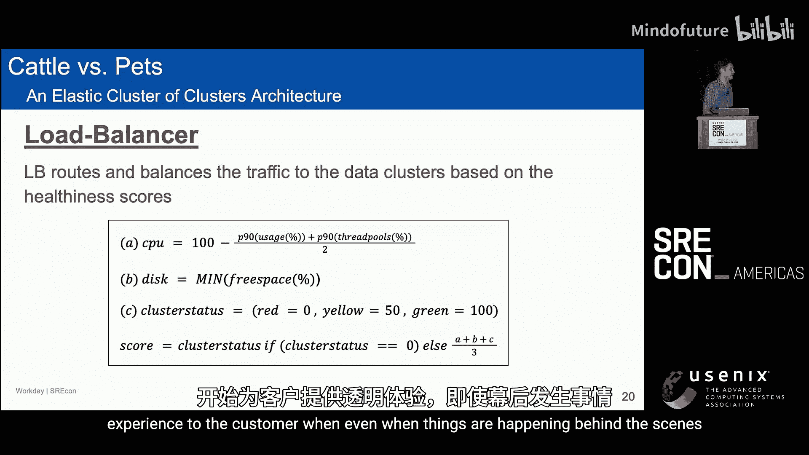
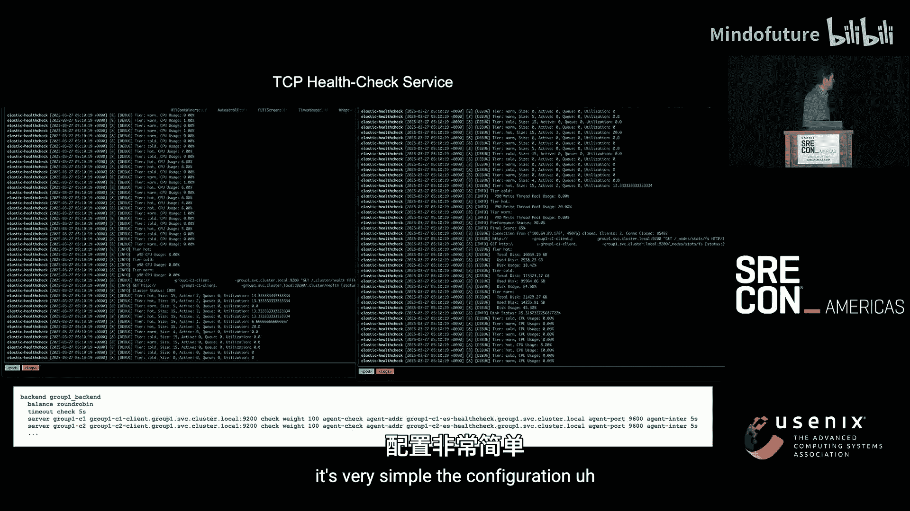
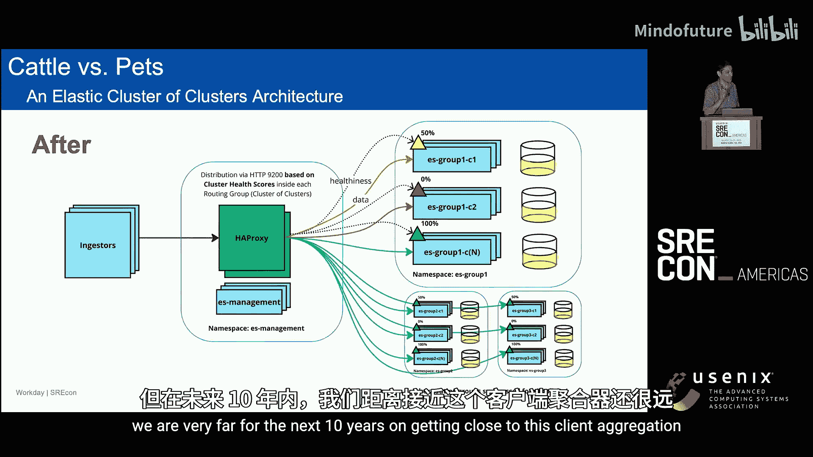
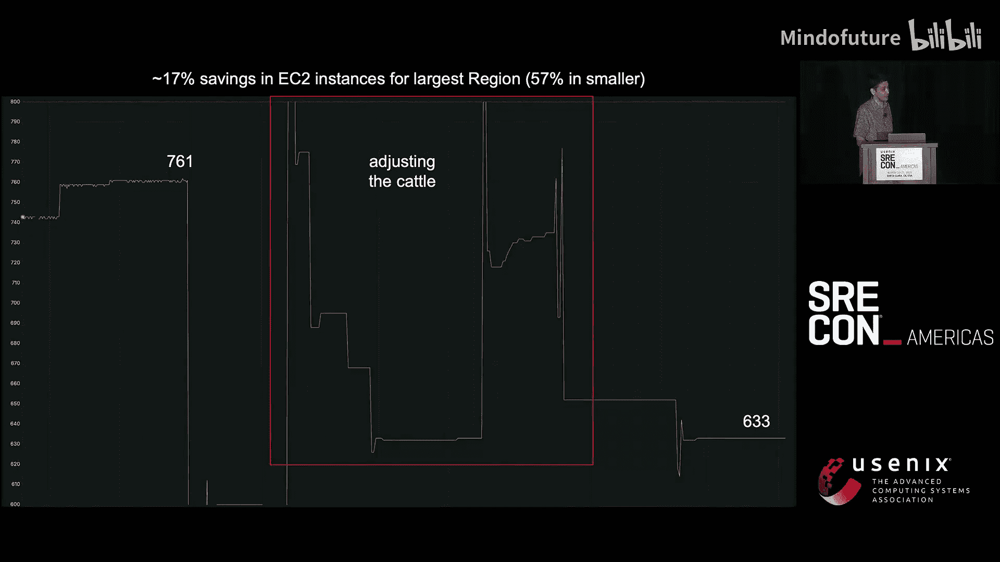
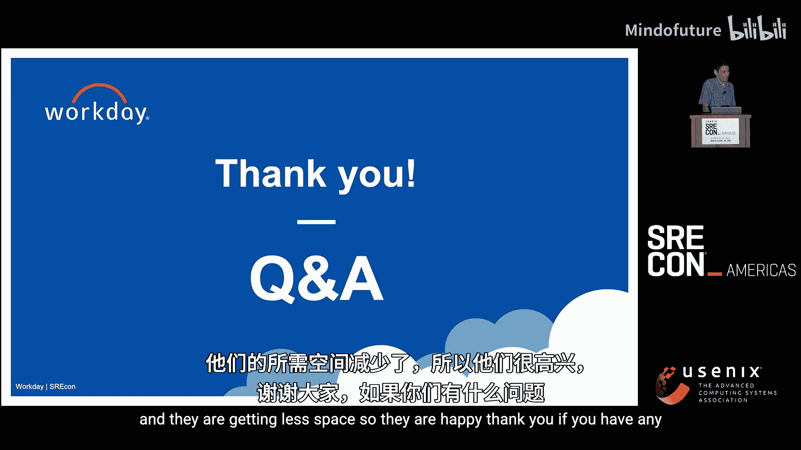
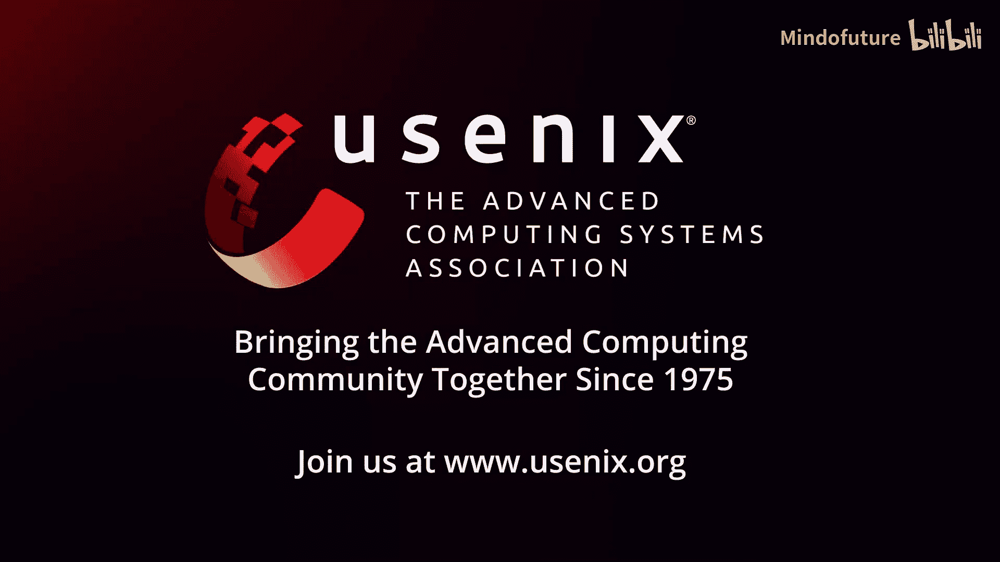

# SRE大会-2025-美洲-｜-srecon-｜-分布式-｜-缓存-｜-OpenTelemetry-｜-安全-｜-AIOps-p37-P37-Cattle-vs.-Pets---A-Cost-Effective-Elasticsearch-Architecture-to-Scale-Out..--BV1TmLDz7EZZ_p37-

。

It's humbling for me to be in this space before， before workday I was six years working in A W S on the active monitoring side on the network and before that。

 I was on the Brazilian Army as a sergeant。 So if you want to talk about。E stuffs and electronic war。

 cryptography， this kind of stuff。 we can， we can discuss some things Before that。

 I was working in Brazil government for electoral systems。

 If you want to know about electronic elections like how we get the president in 40 minutes。

 We know what what's are present。 if that's safe or not。 yeah， it's more costly than safe。 actually。

 and before that， I was selling popsicles on the streets to buy books to study to be in Brazilian Army。

 So that's why it's happening for me to be here。 And thank you for， for having me。😊。

My name is Leonardo But like， you can call me Liu。 or if you want to be very correct。

 Is Lao in Portuguese， Brazil and Portuguese and from Brazil。

 living in Dublin for the last seven years since I joined in W S there。

And so we have an agenda for today very basic one， who， why， what where this kind of stuff。 So we。

 we are going to break down this problem， how we scale like all the problems we faced while scaling elastic I think everyone which works with elastic has quite similar problems and knows the limitations on scaling and how and when。

 when we go to scale of petabytes， it start to get more and more complicated。

 And why did we decide to go to this approach And I。

 Ive explained the details of this approach as much as I can。And the outcomes at the end。

 some Q And A。 Let's see how it goes。 So who we are I'm part of the observability team at work pay from for the last one and a half year。

 This project is， it will happened in like six months， last six months one year。

 Observability is responsible for metrics， logs for the whole company。

 differently from from A W S many big companies that。😊。

ma teams take care of their logs or just on board in system that will bring your logs。

 like in work day， we have this big system that serve of the whole company and all the customers to about our logs and our metrics and。

 and everything。 So， yeah。And I need to recognize our heroes。

 like the guys that were were pushing me to hail。 We need to do that because we are having a lot of pain and a lot of problems doing our calls and how to keep scaling that。

 So Mark was 20 years in IBM before work day。 It was the guy that came to me with this term like Ka versuspect。

 I was doing that in A W S very cattle architecture for everything。

 I was doing pets on Brazilian government data centers before。 But I was not putting。

Both in the same place and， and， and thinking that we had to change our architecture in workday from Pat to cattle。

 I've explained more in details after。 And Valerri is a guy that was on the ground doing since the beginning workday scale from elastic search he knows more than anyone else I know everything about elastic in other vow is。

The hero manager that was saying， hey， go for it。 I brought the design。 And like。

 we should change things like that。 And it's always hard to get the buyins from people。

 And I need to recognize that。 he was like， go for it， try it to adore door if doesn't work。

 We try something else。So why are the aggregated logs so important for work they。

 So as as an ERRP company， we have like human capital management， finance financial management。

 business planning。 it's an HR payroll talent management workforce planning。

 like if we stop like many， many companies in the globe will will stop So we will not receive your salary or some。

 I don't know， medical staff。 we， we will just stop working because of of our system。

 So we have very strict S Ls and S L， S for our customers。

 internal S Ls we need to respond very quickly our log system is not good。

 our support teams cannot bring the systems back as all the like this。

Big system full of models all depends on the logs to， to identify or or issues。

 So we have tens of petabytes and trilllonions of unstructured in ss per month。 we store。

Close to that in terms of time。Because cost and because of the importance of the load。

 like six month load is not interesting for us。 like we are interested in solving problems that are happening right now over in the last two weeks。

 for example， and that's scar because every we we on average grow5% every month。

 So approximately every one and a half here we are double in size。

 So its is scar because either we are able to scale elastic forever or we need to change from elastic to something else that can scale forever。

And yeah， let's talk about the how this thing started。 The origin of this carryinging problem。

Like everyone else， we start with a PC OC or mini viable product。

 and you create like your a small machine。 you put like the data let's go step back first like everyone starts C log we start to drop this log UDP to some server at least's how was doing that on the past and you do pipe grabs and you everything is fine。

 your company is small。 you don't need elastic search until you find that elastic search。

 I was there in 20102012 they start with elastic search and， that's nice。 I can create dashboards。

 can I don't need to pipe all of this stuff anymore。 just elastic search I get my logs there。

 and that's nice。 it's easy to convince people to to move to that。

 but then your system starts to grow like two x x tax。

 and need to scale need to build a proper plus proper design。😊，After you sell your M VP。

 and youll think that， hey， Vatica scale is okay。 I think I just need to like put bigger machines。

 I have this 30 machine。 that's okay， but until it's not。And you start to put more machines like。

 okay， let's go horizontal。 That should solve my problem。

 Everyone is talking about not practical and going horizontal scaling。 And you figured out that。

There is a limit。 And if you see this master node on the screen is the elected guy to receive like。

 if you change a chart or any information that you， you， you， you need to， to。

 to share with your data nodes about， about your charts or about your indexes iss communicated to the master node。

 So the architecture of elastic depends on this master node to， to， keep growing。

 And if you have this inter communication in too much inter communication you just will。

Total limit there。 and you cannot scale a cluster after a certain limit。

 Then you go there and you say， okay， I reach this limit inside my cluster。 Im。

 I have an idea Id just go to vertical scale again。 right。

 until the point that you don't have enough big machines and need or your business guys。

 you come to you。 the financial team and say， hey， stop that。 you cannot scale like that anymore。

Then you keep having awesome ideas like， oh， by the way。

 this is a recommendation you get from the support in general。 like， oh。

 don't go beyond 200 nodes with the default configurations because that's not a good idea based on our internal information。

 But I found like in redit and in talking to other teams from other companies that they there are people going to more than 700 nodes。

 The problem is if you go more than 200 nodes start to tweak every single parametermeter in memory and everything。

 And it's not to be standard out to be great and it's a very petty approach to your cluster。😊。

And how to keep scaling then and you think like， okay， instead of having one cluster。

 I'm going to put two elastic clusters， right？ and I'm going to send part of my customers to one cluster and part of my customers to the other cluster。

 And also， you think about， let's separate the like you have two problems。 Sorry。

 need to separate the presentation layer and the data ingeesttion way。

 how to tell my customers to search in this elastic keep a screen or this other keep screen。😊。

How to keep in jesting at scale for these two guys。In the search path， first part of the problem。

That part elastic or open search everything I'm talking here up by to search as well。

 They are very good。 They provide you this functionality that you called cross cluster search that you can just configure that and say。

 hey， you go to one elastic cluster let let's say your first one。 your first path and say， hey。

 you have this the second cluster。 When my customer comes here and do a search。

 you can just redirect the search to the second cluster。 it will be transparent。

 And no one you notice that。 you have to cluster behind the scenes up to 200 nodes and everything is great。

😊，But then you have a few problems there。 Your first cluster handles it becomes critical because it's a very big one。

 It has customer data， and it has presentation metadata like Kiana and alarms and dashboards and bunch of saved objects。

 If you lose this cluster of something goes wrong。 No one can access the second cluster。😊。

And you have a lot of heterogeneity issues there like a lot of branch in code in your automation。

 like Sres， you are working with a bunch of automating tools templates and you know how complicated it is if you have a lot of if else to manage corner case we didn't want that。

 And this is what your cluster looks like。 So data from my first cluster。 you have Kiana。

 you have everything there but also you have alarms and everything in data from cluster A going to yes cluster because you never thought you would have yes2。

 thought you had just yes， and that's it forever。 or just put more notess。 But now we have yes2。

 you have yes 3 and you have the brilliant idea of a brilliant idea of put in customer B in cluster B customer C in cluster C。

 and you have a big of a problem。 like you need to go to every single customer and tell them where they need to write their data。

😊，So， and what about the ingestion path， We start to split in a lot of linear clusters。

As we move from the data center to the cloud， because of time constraints， business needs。

 we just got all the pets we had on the data center like， okay， let's solve that。

 We don't have more space and capacity in the data center。 left to go to the cloud。

 We put the same thing on the cloud。And just put like AW S load balance in front of it and some routing rules there。

 which was the same as not having a load balancer because my customer could just write directly to to a cluster。

 load balancer was just put in some routing rules based on H TP header or H TP path。But now。

 you need to， as I said before， inform every single ingesor。 I'm abstracting。 by the way。

 the layers before the ingeor have a lot of Kafka holding the logs and。

 and avoiding writing directlyly to to elastic。 But like I'm just abstracting that。

 And you need to configure every single ingetor to， to right to the。Right， please。

And that's a nightmare。 If you think about tenants and customers they don't need to go to their machine。

 We host that。 But like and change that on the fly when you need as we scale your cluster。

 So it takes weeks to do that。And also， these AW S load balancers。 And I was there。

 they are not very a customizable to for you to say， hey， check not just the H T TP status code。

 like 200， because sometimes my cluster is in yellow state。

 My cluster is in red state and yellow red Then all of these states will always respond to you with 200 state。

Even if the cluster is bad， it will respond to you with like internally。

 the information on your g zone or your Yao is， it's saying， hey， because it's bad。 It's red。

 but they， they， they start to be will not be。You just be too handed sorry。 And， of course。

 your first cluster is full of data。 Your memory is high。 Your CPU and your。

 your hardware profile is completely different from the second cluster and from the third cluster and so on and so forth。

😊，Have a lot of。Bty situations here。And yeah， same heterogeneity issues as in the search path source we routing I talked about before and no centralized strategy how to route your stuff to。

 to your cluster， you have traffic and balance and balances hotspots。

90% of your data is one in the first cluster。 the second and third cluster handling very few data and you can still if one cluster if one customer grows like customer A grows forever。

 It can grow forever this way because you need to， hey now I'm I'm going to break down in customer A。

 a or a1， a 2， a 3， it's a nightmare。And then adding new cluster calls naming convention issues。

 much deployment models。 I need to deploy one way in the my my first cluster in a completely different way in cluster be C And D。

 and operational load imagine the amount of page you are getting with this model that we don't know if cluster is yellow red or green and just keep ingesting to this clusters and hard to change something without impacting my customer directly。

 and yeah。And of course， my customer will not stop coming every week。 and it's not their fault。

 asking for new logs。 I want to ingest new logs。 I want to I have a new use case。 I。

 I want to keep growing， keep growing， and we can't stop the company to keep growing。

 So we hit we had a real original for a redesign。 That's where capital versuspa start to come。

And that's a very old term Mark came to me with。 It was like 2016。

 Randy Bay has introduced that term like trying to illustrate the old way of doing things like we had at least I remember many years ago working Brazil government in data center and we had a server called Dexter know the Siri Dxter。

 So we we were putting series names， we were putting Greek names whisk whisky town like things like that guine is on the service because they are very patch。

 we knew the server by name like as a person。 it was super interesting。

 then like if a server is down， mail server is down my CEO can't send on because my male server is down or if D B is down。

 if a load balance is down it was very complicated to do a change。

 If you remember like don't change things on Friday。😊，Kind of stuff。

 And when I went to AW S was a completely different approach。

 Like because I was trying to change when we identified the poor problem in in in my own call。

 I was trying to go very deep and trying to， to run pair tools and care stuff。

 I was doing that in my master's degree。 And I was like， oh， that's super interesting。

 I want to get to the bottom of this problem。 And my Italian colleague come to me like Paranto。

 I don't do that。 You should just replace this server and don't care about it because。😊。

We just keep monitoring these metrics。 If this we replace the server。 the service is good。 That's it。

 And we start to think about scale and about like server servers needs to be replaceable， disposable。

 And that's the whole thing about this Ka versus。 the Kato approach is like。

 you don't have pets anymore。 You don't put personal names， drink names on the server。

 But you just call that 0，1，0，2，0，3 or etc ceter。 And you can just drop any server at any time without importing your customer。

 So we started to think about how to design this thing。😊，And taking some of these AW S experience。

 it was like， we do that all the time。 there It's like， oh， let's think about it was how S 3 started。

 for example， Let's think about the next 10 years。ELet's design for the next 10 years。

 I don't know if I can achieve that， but let's put on the paper。After we。

 we figure out and put a bunch of smart people in the room and we discuss this design and see if if if that can can happen。

 And The second one was we want to separate data from presentation layers。

 we want to support a specialized listed profile because many customers came to saying， hey。

 my data is not that important。 I want to put in a cluster， but my cluster is important。 I。

 I can't put this data that's not that important。 That's the best effort mode。

 but I wanted to put a best effort cluster there without impacting all the other clusters。

 I want to be cost effectiveness have cost effectiveness because I didn't want to。

Let's say put expensive hardware。 like it couldn't be a requirement saying， hey。

 I need to get this specific AS machine。 I can work with anyS institutions instance to make that work。

 I want to work with any infrastructure code。 If I want to have charge， terform， whatever。

 doesn't matter。 I want design to work with that。 naming conventions needs to be standardized because。

 you know， the first problem in computer computer sciences about names。

 you take more time discussing names than anything else。 like at the beginning of the design。

 it should be stupid simple I can't complicate you saw the professor talking yesterday about complexification。

 which should stop making very complex unless it it's really needed。

 And we wanted to think about self healing。 I didn't want I want to know status like yellow red。

 green being part of my health the health of my system。

Then we put as part of trying to achieve these requirements， a load balancer in front of everything。

 That's not AW S load balancer。With able to out scale， like I， it's not a bad load balancer。

 I can lose any load of my load balancer。 and it it's too able to， to figure out stuff。

 We used AJ products for that， because some familiarity and also the features or not for what we had in on the design。

 but it can be changed any any， any other load balancer。

Rdirect extra traffic to my group of clusters based on H T TP headers and or paths。

If I have specific specific profiles。I show that after and non tag， not tag traffic。

 So I'm not going to lose traffic on impact customer If they are not putting a chip header or path。

 I just sent to my default cluster。 my default cluster of clusters。 actually， I show what's。

 what's that after。And we implemented TCP help Shack service with an idea from Brendan Greg。

 I think everyone knows these guys nowadays from Netflix， which created this use method， I。

 I love that。 And it just like， based on utilization。

 saturation and air represents the score of my whole subsystems， my。

 my cluster of clusters and my my sub clusters。 and I redirect traffic based on that。

 So if my cluster is bad， I don't send traffic to this cluster。

 And now I know that my cluster is bad based on that。😊，And the formula is more or less like this。

 what we did。So basically， I get like utilization， for example， based on CPU。

 it's the the general parameter parameter everyone fertilization or memory as well。

 I didn't put that， but you can do as you want。 We get the P 90 because I don't want to get one bad server sometimes doesn't represent that my elastic cluster is bad。

 just like one bad server and it outres。 But I I use P for that after also after observations in Ri case disasters。

Iue， sorry， T pools as a saturation parametermeter there on the formula。

 And when a disk is getting full as well， it's close to get full。

 we don't send more ingestion to this cluster before we were just getting page because the disk is getting full。

 my cluster wentt read and and went to read only state and my lag to ingest things We just getting in insane。

 And with this B item in the formula。 just like， no， if you don't have this one disk that。

 I just alleviate the traffic to this this cluster。

 And the other cluster can can cope with the the load。And more especially。

 elastic knows better than anyone about the cluster status and it can get you a red if the cluster is read only。

 if you lose an index or you don't have any shot for the specific index。 or if you lose part one is。

 for example， cluster goes yellow or if everything is okay cluster is green。 So if you get red。

 we just0， these cluster score completely just multiply by by0， and that's it other than that。

 we use the yellow and green status to compose or score。 if this score is low for all the clusters。

 we just keep distributing the load to all of them equally。

 But if one cluster is bad because someone was doing some maintenance and forgot some parameter in the code。

 it do not impact my customer the cluster goes to read only and you still you are still able to search and to do whatever you want as a customer so。

Was start to bring like a transparent experience to the customer when even when things are happening behind the scenes。

So this is just a screenshot from in the in the book mode for this algorithm。

 We wrote that in a week。In Python， it just replica set a deployment running every single cluster check with elastic What status all the time。

 And we opened the TCP port made the TCP server responding with 0 to 100。

 And my load balance you see below。 It's very simple。

 The configuration is just checking in the the port 9，6，0，0。 What's this status every 5 seconds。

 we could if lower that。 But like that that's an offer or use case。 that' logs。

And that works really well。 I'll show you some graphs later about how what what's the impact on。

 that， of that in practice。So other mental balance。

 we also put on this architecture management cluster。

 So instead of having this very petty cluster as the the first one， we separated that。 like。

 I don't want to mass my data clusters with my management cluster。

 I'm going to put cross cluster such and all the elastic features， etca。

 etc cea and this management cluster and all my data is separated。

 Like I'm abstracting this layer and my customer is not accessing things directly anymore。😊。

So we have now a single name space。 It's it's all in Kubernets。

 but can be in anything else with a minimal elastic cluster Theyre acting as an entry point for search in ingeesttion ingestion through the load balancer in search through Kibanana or APIs。

We don't store any real customer data。And all the centralized tool like L B， Cubaban。

 cross cluster search， all the metadata。 And we， I show you also auditor service we。

 we created as part of this。And yeah， as I mentioned before。

 this LB layer that that has use this use weighted round robin method is also stored inside this management cluster。

 It's a very， very tiny cluster， like it's distributed， etc cea， etc cetera。

 but it's a very tiny one compared to what we had in the past。So before we had that。

 as I have shown to you。And now it looks more like that。 So that that。

 that picture summarize everything I was talking about before and how a cattle。

Architecture looks like this architecture looks like for us。 So we are checking health every。

5 seconds。 we are sending based on the cluster status less or more data with the goal of making all the the clusters balanced and and and healthy all the time and transparent to the customer in terms of。

 of ingestion and and search。And we don't trust on just 200 status anymore。

 The complete separation e of the management cluster and and all the other clusters。

 And as you can see， you have group on there。And inside group 1。

 have a cluster of elastic with 200 nodes， another cluster up to 200 nodes。 you don't have。

200 have100 in something nowadays。And you have the group 2， group 3， a bunch of other groups there。

 and we can just decide to route specific profiles to different groups。 And we can right now。

 we can scale forever inside these groups。 The only bottle act nowadays nowadays is the aggregator on the management cluster。

 the client aggregator， which we we start to push elastic on how to circumvent this， this limitation。

 But we are very far for the next 10 years on getting close to this client aggregation。

And that's the impact in practice。 It was with a lower cost。 by the way。

 We did the migration to this new cluster。 This SO query performance is a query that we emit every one minute。

 This is for the last one year。 this， this graph。😊，I， I couldn't put the the timeline below。

 but like， you can see。That after the migration， we were adjust in the cluster。

 we are still up a little bit。 But after we did some weified some bottlenecks on on I O。

 And after solving this bottlenecks， we called that Kato rate 0。

 because instead of putting like four disk， look how this change of mindset it brings a lot of benefits for for us。

 like instead of putting for disk in every E S Kubernets pod。

 which is quite complicated like things that for single data center but like not Kubernets。

 like to configure for A W S disk makes your life miserable。😊，We decided， like， oh。

 I don't need that。 I can just create more pods。 And instead of paying for 2 TB disk。

 I paid for 500 gig disk， and I split in4 in in four elastic nodes。

 So you start to call that a k rate 0。😊，And also with replicas and， and， and。

 and completely distribute。 And then at the end of the day， I started to pay less。And I pay the same。

 But， after after， after doing some being packing with this， these parts， we start to pay even less。

And we had4 x， better performance。And that's for indexing time。

 Like one very important metric for us is the lag。 like the time I take to index stuff is critical。

 And for like paying less after this migration and adjusting the cluster。

 we started to index like close to 4 x。EAs well， with better performance。

And here is what we like every time you see like this， this， this is the amount of message we， we。

 we have on the Kafka waiting to be consumed。And that's a problem because if like。

 I take one hour to ingest my the average is to me we have very low S Ls。

 But if I take one hour to ingest， it's not important anymore。 this log。

 the support doesn't doesn't want that。 They want the log immediately when the log is， is。

 is pushed by my， my tenants。So after the migration， you see， the lag just dropped completely。

 We had some events， but it was by our mistake and some deployment or something like that after that。

 And the page just start to go down like the the number of page we were getting because of ingestion。

And this is on in terms of savings， like our biggest cluster with more than close close to 1000 nodes。

 very big nodes went from 761 to 633， like 17% on our big biggest cluster。

 And you got this molecule cluster with 57% of savings there。

And after all of that， while we were doing this migration。

 sometimes we had like page and issues and customers say， hey， the system is low。

 it's not returning what I want， etc cetera， et ce。

And we were always blind because the only thing that a last signal should provide you is like a log saying it's a slow log or a security log saying。

 hey， in your specific note in specific chart saying， hey。

 this is the slow query but the slow log will not tell you the。

 the the user in the security log will tell you the user but not tell you the query。😊，I look I was。

 we were lucky that they have something called the pack I D that matches between both。

 And we were like， we need to do something else about something about it because our cluster now is too big。

 It's a cattle。 And I want to know when my， my things are bad and how to reply my customer because customer knew I。

 I don't know if they knew， but looks like they new that we didn't have something to tell that the problem is not in our side。

 but in their query。 They need to improve their query。😊，And elastic doesn't have a mechanism to。

 to say， hey， I'm going to throttle if the query is bad。

 there are lot of readyit discussions and elastic forum discussions about that。 And they tell you。

 we don't know if the thread is bad until I run the thread in my cluster。

I need to run the thread because the cluster is complex。 We have a lot of knobs。

 a lot of parameters like for one cluster can be bad for another cluster it cannot be。

 And we were like， okay， let's disbelieve that。 And let's try to do something about that。

 So what we did was to build this auditing service， which was quite simple。

 we just wrote some sidecar in our pods， which was collecting UDP。

 like I was sending just all the is low logs and and security logs to this pod。

 we did that in Python。 It was just an UDP server listening some some in some port。

 And we were aggregating that in Python and sending that to the management cluster。

So the data cluster was blind。 just， just getting these logs and management cluster。

 and we aggregate that in one role for every like we are distributing that to thousands of pods and youre aggregating that in management cluster in one one row。

 So I know everything in an aggregated mode about this query。

 And if my customer is coming to us saying， hey， my query is bad。 like the cluster is bad。

 I can loop my dashboard and say， no， that's your query。Hundred percent。No。So， and also it。

 this service， of course， it， it start a surge of like changing to car to approach。

You start to get a surge of tooling and people come in and saying， hey。

 now I know how your system works。 It is stupid simple。 Now I can just implement this new tool。

 this new audit system， this new health shacks thing like a bunch of of other tooling like。

For example， the C ICD pipeline。 now it's we， we are building a C ICD pipeline that's super simplified。

 It can globally deploy and roll back and roll forward stuff without human intervention。

 which before it was not possible completely。And we right now can also think about rate limit top offenders and。

 and and overcome this， this limitation of， oh， we cannot， we。

 you can't know your query before you run that。 The idea we are having is to create。

Separated cluster， mirroring the traffic on the load balancer and running these queries。

 these bad queries in these mirror cluster。 And we've been able to identify what are the profile of these bad queries and being able to block them。

To don't impact the other customers。So and this is the phase of the Audi team service。

 Anyone can implement that like it was one， two weeks to implement in Python this UDP server。

And it's doing really， really well for us to， to identify problems。

And this is how what the dashboard looks like right now。

 we know in these very big cluster of clusters and groups of stuff。

 We know exactly what the amount of queries that my customer runs。

 the ratio between queries and ingestion。Because just getting elastic statistics will not tell you that it's very granular and not get this aggregate。

 like the customer view。Also， we can identify that like， for example。

16% of my queries can be cashable。 And we want， we。

 we are thinking about not letting it to go to the to to all my elastic cluster。

 but like on the load balancer put putting a main cache or these or something like that and just return from there in milliseconds。

Identify subqueries going to the cluster。 like what's the time taken over time。

 If customer complained that they got a spike during that time， we know exactly how。

 you see at the end of the graph。 Yeah， cluster was bad there I had a lot of queries。 And you。

 we know exactly which customer were running which query which time what was the node that were replying with on the max took time there。

The maps mean average， like all the statistics are there aggregated for everything that is running behind the scenes on the cluster。

And you know which tears are。Being the problematic ones。Also， unique queries per user。

 If one user is causing problems， you， you know that。And， yeah。And most importantly， this one。

 when customers complain， I just see this query time distribution like， oh， it just you。

99% of my queries are okay。 and I see your query here is just you complaining。Yeah。

 on the data data cluster side， we try to make them instead of different hardware profile。

 different configurations。 all of them needs to be the same configuration。

 this the same this profile， CPU memory， JVM。Yeah， and， and being agnostic to the data coming。

 it's just like they have a bunch of cluster When I load balance， they decide where to put。

 so they don't know even which data they are storing。In terms of topology as well， index and charges。

 everything very uniform。 and customer doesn't have direct access anymore to my underlying system。

 and nothing beyond data run on this class like， remember， keep its stupid simple。And yeah。

 we start to route to groups， this group of clusters， So these clusters of clusters。Okay， yeah。

 the namem space。 yeah， also， we， we made the nam space in in Kubernetes to match exactly where we are。

 where we are routing to。 which was a long discussion discussion with the team about names to。

 to get to that。 But it's， it's been helpful。Agnostic or standard nam conventions。

 I already mentioned that before。 And we created this dedicated nam space for this management cluster。

 And look， nowadays， how the whole configuration for the cluster looks like and everything else is picking the configuration from there。

Just that。It's a template， a heshot template。 And like my load balance is just looking at and doing all the。

 the magic based on that， all the automation inside the load balance configuration。😊，Yeah。

 in the 1000 feet view， this is more or less how this architecture looks like。And the outcomes。

The architectureure looks more like a mapra style。 Maybe we， we think about hierarchy in the future。

 but we need， we， we need to talk to keep talking to elastic guys if we can make like a cross cluster search of cross cluster search。

 like on cluster of cluster， because we are afraid of after 10 years reaching this limit of aggregating in one single place。

Stard cluster size and configuration。 It reduced a lot。 engineering ops。 You jump in a cluster。

 You know what it should look like every time you jump in any， any， any pod in any node。 tell names。

 better， better code maintenance social of automation tooling we are getting more recently。

And it enabled more experimentation， as I was done before。

 we are thinking about creating this mirroring traffic there and experimenting there everything that we see that looks good in this small cluster。

 that's a copy of all the others and mirroring traffic We can just apply to all the others。

 Think about that on on economic terms， you can just change an instance type and and check if that we have a good result and just spread that round。

 we couldn't do that before。 and's very convenient to upgrade any infrastructure。

 because if if you think about the routing mechanism， this health check mechanism。

 we can shut down anything any time without any problem without communicating customer。😊，And for me。

 that's the， the， the biggest one。 We reduce the build time and the migration time of the cluster from 14 weeks to to to 5 days。

 less cluster。 The biggest cluster we have， I migrate to that cluster in two days。😊，And before we。

 it was like， no， I don't want to get this project to migrate this cluster。

 I need to talk to all the customers。 I need to to go to every single server。

 I need to route everything again。 It bring bread problems。 I need to stay after hours。 No。

 in two days， we are migrating。 Everything is completely transparent to the， to the customer。

Up to 57% of of reduction in computing cost it was when we start to do the rate 0。

Ca rate 0 because it allowed us to do that for x better performance。

 And we can could return that in cost。 like could make whatever tradeoff you want。 Like， oh。

 have better performance。 Ill load their hardware and give the same performance and。Better cost。Mo。

 So it helped us to identify like bottlenecks， as as I said in in I O。 And right now。

 we are projecting from 50 to 82% of savings by moving from S SD to A Gs and doing more cattle rate zeros。

 putting more and more closer with smaller instance for the future。And yeah， let me。

 let's acknowledge these heroes that those are the people maintaining this。

Thinking and supporting me during the time that I was deploying at。 and they are getting less space。

 so they are happy。Thank you。谁问题。

