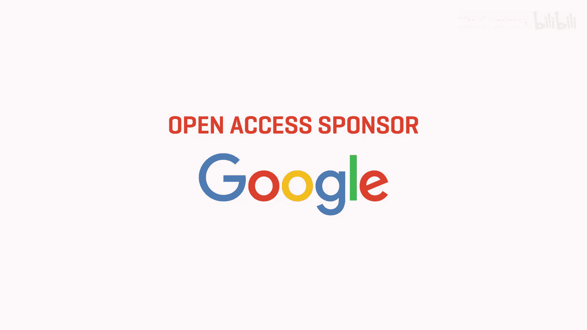
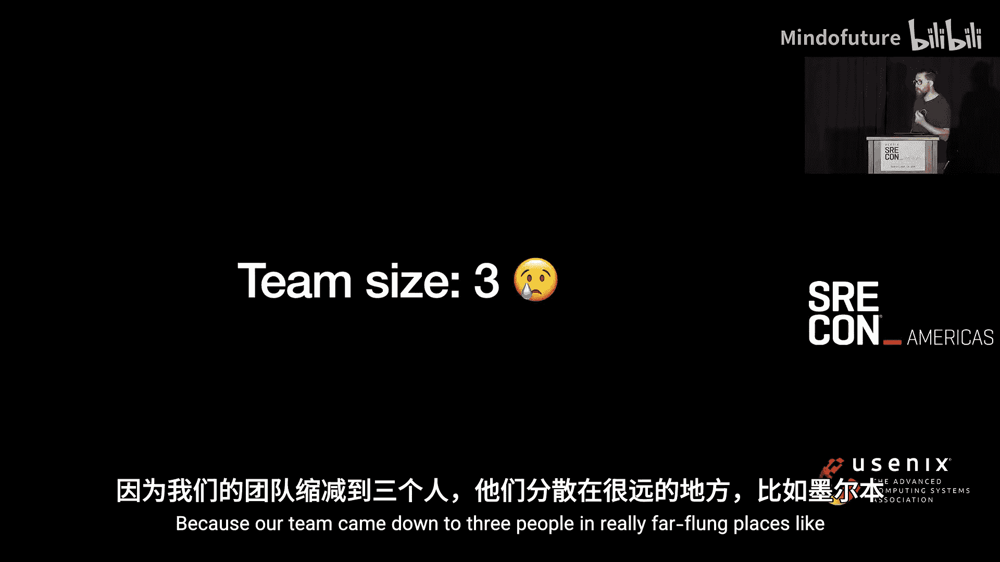
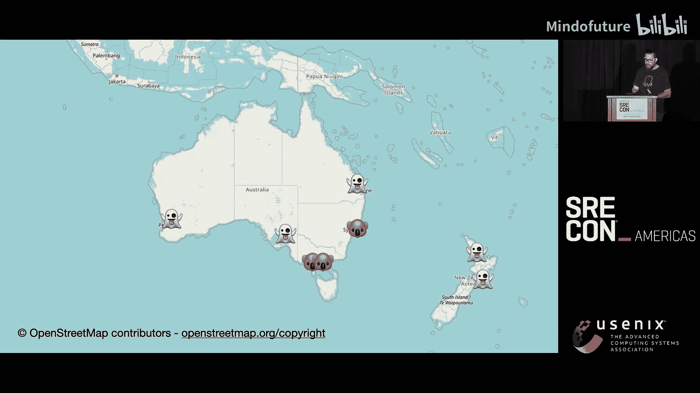
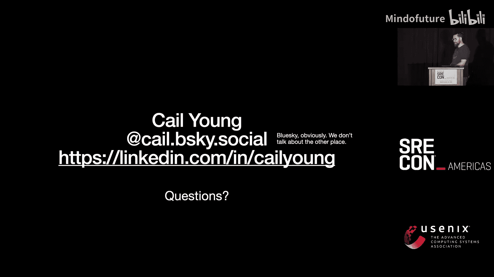
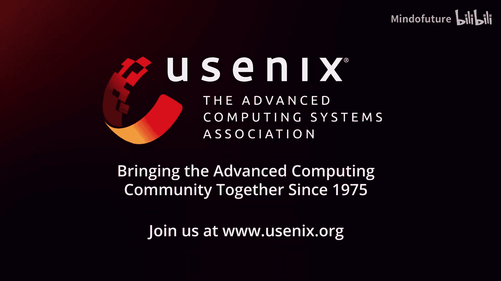

# SRE大会-2025-美洲-｜-srecon-｜-分布式-｜-缓存-｜-OpenTelemetry-｜-安全-｜-AIOps-p38-P38-One-Million-Builds-per-Year,-Only-One-Page---Operating-Internal-Services...--BV1TmLDz7EZZ_p38-

。

Goodday。If you couldn't tell I from Australia， my name is Ka。

I'm an S at a company called Octopus deployloy， where we make a continuous deployment tool。

 If that's the kind of thing that is really exciting for you。

 you can check us out at octopus dot com。 I work on an internal tools team that looks after the build and test and deployment infrastructure for our product。

 So that million builds there is talking about a million builds of our product in calendar year on the platform that my team provides。

😊，Now， I did。You see the little footnote star there on the one I have cheated just a bit。

 that's one page that woke someone up in a year and I think that's for me I care about getting woken up。

 I don't like it， there were other ones， but there was only one that actually had to wake someone up。

Just a bit of background about how the engineering Cult octopus deploy works。

 most of engineering is on call。There's kind of three groups of teams or kinds of teams。

There's teams that are on call for external services。 Is anybody here in in a team like that。

 You're on call for something that customers use。嗯。

There's teams like mine that are on call for internal services， anyone。Quite a few。 Yeah， O， great。

 And there's a sort of secret third kind of team that's not on call for anything。 Is anyone here No。

 must be nice。 Is it nice。😊，A good mix of perspectives， this is good。 So the team that I'm in。

 I like to think of it is we own everything from Github right up until this sort of app behind part of our marketing website that lets you see release notes and get download links for versions of product right back to like V1 and even before。

So before we really get into the。Core of this， we need to give you some context。

 We need to go back in time and the sort of very beginning of the team that I'm in。

So this is about a year after I joined the company。

 I sort of started really getting my feet planted on the ground and I sort we've got this these build infrastructure。

 these tests running， it sort of like ambiently out there， but nobody's really explicitly owning it。

And I think that's probably reasonable， I think it was an artifact of organically growing a company from like a single technical founder up to at that time of about 70 people。

And myself and a few other people thought， well， it's probably worth the C I system having an explicit owner。

 You know， I think， you know， we've had some problems。 And let's maybe start looking after it。

So we figured out who to speak to to kind of get the keys to the kingdom and take it on board。

And we've spent the years since taking on more and more and more of that pipeline。

And so as trying to be good custodians， we started with the basics like， you know。

 patching the O S of the host that it runs on。 You know， I might want to do that， but then。Whoops。

We were doing everything by hand， kind of improvising there's no automation involved here。

And it turns out that software engineers don't like when the bill systems down for six hours。

I'm not happy。And so with a very natural reaction， we thought， okay， that hurt。 Let's。

 let's maybe do that kind of work like at the end of or the beginning of the day。 Let's。

 let's sort of lessen the burden on the rest of the company。But there was a problem with that。

 which is that in my team， no one had signed up to work routinely outside of working hours。

 That's why they're called working hours。There was， there was a risk of burning out of。

 of people leading the team of leaving the company。And we wanted to do something about that。

So I'm going to spend some time here telling you the story of some of the decisions that we made that in hindsight helped us to have this future where now we have。

 we run these services without staying up late most nights of the week。

And I'm going to begin with something that might be a little disappointing if you're hoping for like a tool that you could just apply to the problem。

You're going to have to talk to people， sorry。I know that's hard for some of us。

There's no like software fix， although we are going to talk about some technical choices later。

And the shape of problem we had was mainly around time zones。 you know。

 we are a remote first organization where you can work back pre 2020， but the center of gravity。

 if you like， of engineering was the east coast of Australia。

 although infamously that still manages to have more than one time zone， thanks daylight savings。

But we had people in New Zealand and we had people elsewhere as well。

And we had a lot of hard conversations back and forth about， you know。

I would a couple of hours of downtime potentially every couple of weeks for some services。

 would that be okay？And then the answer we eventually got back from most people was， yeah。

Maybe not when we're trying to get like a long term support release out the door。

 and there's a bunch of change happening at once。 But otherwise， yeah， sure。

 if you saw Katie Wes talk about the infinite uptime hack。

 this was kind of our way of achieving that。 You know， we said， okay， well。

 let's set some rules about when we are allowed to be unavailable。So we wrote a support policy。

Where we said， all right， everyone else， we will commit to put one person during normal working hours on keeping the lights off on work。

 proactively looking at what's going on in production and dealing with all of the interoper work coming in。

And the quid pro quo， the kind of reverse side about is we wrote a paging policy。 Instead。

 given we're doing all this work during working hours。We'll go on call。 But， but only pages。

 if you need our tools to solve your incident。So if you're just someone who happens to work in in a distant time zone and you're just trying to get a build through。

But that's it。 And it's not working for you。 No， you can wait till tomorrow。

 But if we have a security fix and it needs to go out overnight， Yes， absolutely pages。

 That's what we're there for。So that worked pretty well。 We kind of set an SL A for。

 for responsiveness now。Not to get too sidetracked。

 I know this acronym can be kind of polarizing for some people。

 you might have had it kind of used against you in the past。There are other polarizing acronyms。嗯。

There's a third one that I learned for the first time during this whole period。

Whoho doesn't know what that means， It's R IF。 You are so fortunate， reduction in force。

It is a euphemism for firing people。So while my team was busy building these these like good culture and good policies and all of this stuff。

 the company was approaching what under the mandatory res model of dynamic safety that we need to mention every Scon was approaching economic failure。

 So if you don't know what this is， go watch Andrew Hatch's talk from last year who goes into way more detail than I have time for。

But in general， we can say people whose opinions matter see the company as moving around within these three boundaries。

 economic failure， workload failure， performance failure。

 And they felt like we were moving towards economic failure。嗯。

Octs as a company is actually is not debt financed。 It's very concerned with profitability。

 And so they saw that profitability margin dropping and said， we need to do something drastic。

So the story actually looks like this。And I mention all of this because the riff affected the choices we made。

Because our team came down to three people。

In really far flung places like Melbourne。Also Melbourne and Wollongong， which is near Sydney。

Veryre nice Australian place known。And it was certainly not the kind of seven or eight people you need to have a sustainable on call 247 on call program。

Refhead entered the chat。So。We were already doing toil reduction， but we really needed to ramp it up。

 We needed to make sure that we could stay on top of the necessary work that needed to happen。

So one technical choice we did make was to lean into the cloud what I mean here is we chose to use the highest level of abstraction that our cloud vendor gave us for basically everything where we could。

 where it was appropriate。A good example here is databases。

So my team runs a whole bunch of different applications from third parties， some of them like MySQL。

 some of them like Postgrerows， some of them like Microsoft SQL Server。And we only had three people。

 we did not have the time to get expertise in how to operate all of those things deeply。

So we lean on a cloud vendor to say， all， you just give us a nice API to like create and manage these things and you worry about patching and backups and H。

Speaking about Jo。Another choice we made was to opt into deploying things in HA mode or in replicated mode or both。

 even if it didn't really feel necessary。And I know what you're saying， Ka。

 what about Byzantine failure modes。Yes。That's a risk。

But we preferred the trade off here of having the risk of that versus having。

 you know our service just drop off line because a single availability zone when off the internet。

 which did happen to us。And to be fair， we don't run that many replicated stateful services in our team。

 so it was kind of an easy choice to make really。You also might be thinking about Cal。

 doesn't all that cost money？Yeah， and it does。I'm really fortunate， though。

 that we had a leadership team that recognized that we needed to spend some money。

 despite the overall picture on not burning out the people who were left。😊。

A phrase that got used a lot in this period was being cost aware， but not cost afraid。

And so my team was expected to do budget forecasting and modeling how much things would cost and hold ourselves accountable to that over time。

 but we weren't given like a headline figure and said design around that so like can build what you think you need。

 let us know and we will plan it accordingly。The third and maybe more controversial choice we've made is to auto upgrade basically everything all the time。

Not automatically， like not blindly， but at least build these systems that let us know when these things need to happen。

And I mean this in the broadest possible sense， Terraform provider versions， applications themselves。

 their dependencies， you name it， anything with a version stream on the Internet。嗯。

Our sensible default is that we have a pipeline at the very least propose a change when one is available。

 Now， for some things we choose， okay， let's just throw it in and see if there's a fire because we don't really care about availability to that degree。

 Some things we have gates like tests or other kind of gates that stop things from going out。

 some things we schedule these activities on weekends so that， you know， if there isn't a problem。

It doesn't cause too much damage。This was not easy to achieve， both politically and technically。

The very first one we did this with was kind of difficult。

But we put a lot of safety in and as we've learned how these things fail。

 we've come up with a lot of good patterns that make sense for us。

I want to make the point like we don't live on preview builds。

 like we're not that far on the bleeding edge， but we like to stay as after to date as we can。

That said， like sometimes it's Monday and you come into your home office and a software engineer in New Zealand is unhappy because the build system has dim down because there was an auto upgrade that happened on the weekend。

This really happened and that hurt， that was a painful conversation to have。But in hindsight。

There had been like 100 weeks where we'd had a great upgrade and nothing had happened。

 And I would much prefer that。Than having to plan these monthly quarterly or annual big bang upgrades of these services by hand。

So all of that is how actually， as of last year had to update this week。

 actually had one and a half million builds last year。

 with still only one out of our page in our team。And most stakeholders are pretty happy with the situation。

There are some downsides there。And this， this first one is going sound a little bit like， you know。

 when you get a job interview and they're like， what's your biggest weakness And you say。

 I work too hard。I promise it's legit， so as we started to grow。After the riff。

 our systems were now too stable to generate the kinds of natural failure that let people understand how they would fail。

And we ended up having to invest a bunch of energy into explicitly onboarding people into the way that things had failed in the past。

 by reading retrospectives or just doing knowledge sharing sessions， things like that。

 and our team hasn't really had the capacity to do things like game days or chaos engineering or anything like that。

 We are working on it now。And it's not to say we didn't have incidents。

 but just not enough to rely on them as a source of learning for newcomers into the team。

Another challenge has been that the company is growing and growing globally now。

And so our teams needed to challenge the assumption that working hours on the East coast of Australia are still appropriate as that boundary between oncore support and daytime support。

 given that we've got people in New Zealand， we've got people in four time zones in Australia。

 we now have people in Europe in the engineering team。What should we do about that， I don't know。

It's not really clear。 I know we can't do follow the sun though。 Our team's not big enough。

 we're not in enough places。Before I wrap up， I just want to come back to this acronym。

It got me thinking that like， maybe， I mean， we know this is not good。

 but maybe there is a good mean， maybe we could think about mean to page。

How often are you getting paidd， How often are you getting woken up And ours was， yeah。

 about every 12 months over like a three year period。 But is that good。It that bad。

 I don't really know。 I don't think very low is ideal。

 I think we need some minimum level of feedback on how our systems are going。

 Are they creaking around the edges。 I don't know。 So if you're a tooling vendor。

 there's a new graph you can build。Thank you so much for your time。

 I need to thank my team for contributing to this for giving me the time to come here for reviewing this talk。

 I need to thank my partner who's home right now with three kids so that I can be here。😊。

And if any of this kicked off like trains of thought and you want to talk about it， I'll be here。

 I'm in the slack， you can reach me at these socials and I think I have a little bit of time for questions。

Thank you。

