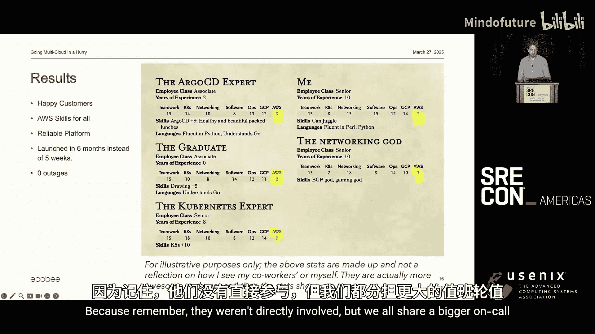
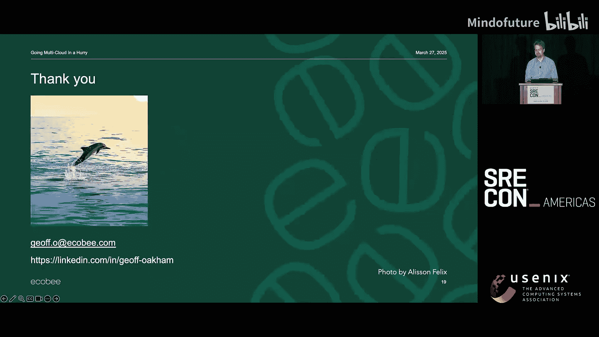
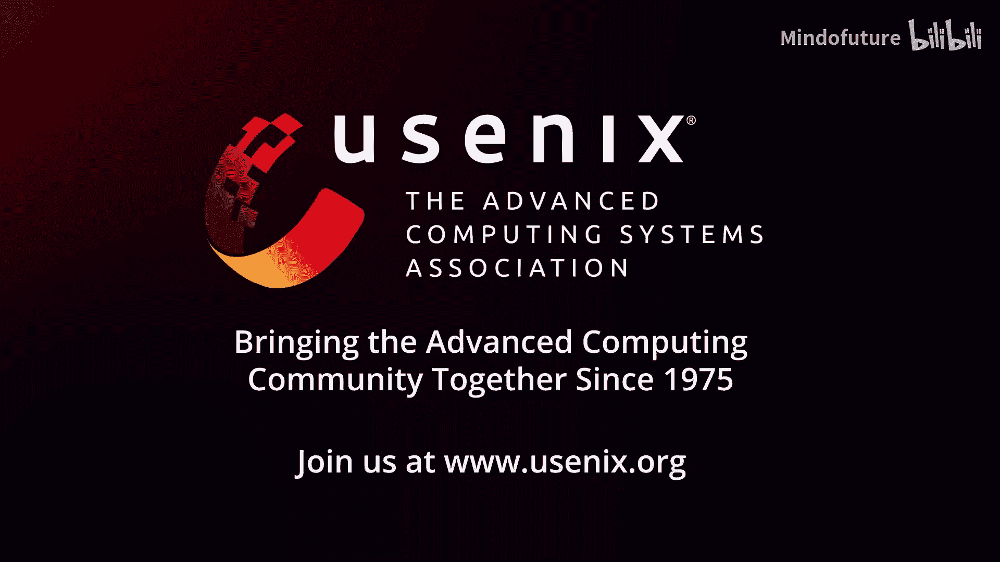

# SRE大会-2025-美洲-｜-srecon-｜-分布式-｜-缓存-｜-OpenTelemetry-｜-安全-｜-AIOps-p39-P39-Going-Multi-Cloud-in-a-Hurry-with-Quality-and-Style--BV1TmLDz7EZZ_p39-

。

So it's Friday， I boss knocks on my virtual door and asks， hey， you have a minute？I'm like， yeah。

 sure。 what's up， Can you extend our Kubernetes platform so that we can be in two cloud providers at once。

 Great， and You service is launching in five weeks。And we need it to be in AWS。

How many of us have been there before？Let me remind a bit。

Our team manages a platform that I imagine would probably be familiar to most of you。

 it's a managed Kubernetes platform built in GCP on top of GKE。

 it has things like ArgoCD and helm to deploy applications and out of the box it comes preconfigured in an opinioned way with things like Prometheus Grfaa and L7 low B or a secrets manager。

And we provide them support， our tenants generally love us。

Our team is also responsible for things like setting standards for things like infrastructure as code。

 observability， reliability， and we test all these standards ourselves before pushing them out to the broader company。

The team itself is a coer of 10 people， we have a wide range of skills ranging from super awesome networking to super awesome software and we work really hard to balance our work life balance and are delivering quality was really neat was yesterday's talk on how Pager duty is rootuting in our life went through the checklist I'm like w we're actually hitting a lot of those like for example we debrief after every single on call rotation and during the handover we often go。

 okay， so what's the state of our systems， are there any noisy alerts we need to address those kinds of things。

嗯。And as for our architecture， as I said， most of our stuff is hosted on our managed Kubernetes platform。

 the ones that our team manages， we do have some stuff outside of it within GCP and we have some stuff outside of it within AWS。

The thing is is that we're starting to， we're starting to get more requirements for AWS and we knew this was coming。

The trouble is is that we didn't have our platform built out for it at the time。

So initially what we were thinking was。When this team approached us and said hey we're going to need AWS what can you do for us and we're like well we're kind of busy right now we've got our half plannedned out and stuff and we're like。

 okay here's what we can do for you why don't you just use one of AWS's application as a service make sure your stuff is containerized and when we're ready we'll come to you and we can just migrate things over really easily but what we discovered was that it became apparent that we're going to need more help than we could offer them than just advice。

So our management reprioritized our work and set aside a good half of the team to work on this problem。

And I asked us to do it The team itself was specifically one senior， one associate。

 one fresh out of university， a senior network engineer and myself a staff aspiring senior。

The problem was， none of us knew AWS， we were all GCP experts。So。

I felt confident that our experience with GCP was going to help us go into AWS like they say in Thailand。

 same same but different， that said I knew also there there were going to be subtle differences in the technology that we were going to have to pay close attention to。

But the other catch was I knew we were also going to be expected to maintain this platform for years to come and be on call for it。

 so knowledge silo should be avoided at all costs， even if it meant that we had to go slower。

So I reached for the first thing that came to my mind， I'm like， hey， let's try pair programming。

So we did that， we all gathered around the keyboard。

 the virtual keyboard because we're you know a remote team and we started up our first EKS cluster with four people watching one person doing the work and I mean it worked。

 we stood up the cluster but and you could immediately tell that you know people weren't all engaged with four people on the call this just wasn't going to scale。

But before I could even tackle that problem， I was hit with my first setback。

New compliance requirements， I was told that specifically there were going to be new compliance where the new cluster was going to be needed to be held to a much higher compliance standard than the existing one。

And with it would come sign off and things like that。

 and one of the things that I found a little on the frustrating side was they asked for a complete work allocation or system diagram or basically everything we were going to do。

Before we even started a single thing， but as I said。

 we didn't know AWS so we couldn't exactly provide it。So I felt stuck， I'm like。

 how could I give them a plan ahead of time and learn at the same time？And on top of that。

 they still wanted to launch in four weeks。All right。

 so time to rethink first thing I did was I engage with my leadership and I'm like， okay。

 can you give us some more clarity on the requirements can you find out if you can push back on any of this and they did so I'm grateful the other thing we did is we engaged with the product owners and I said okay so when were you planning on launching and I found out that the release timeline was a little more flexible than I was initially given the impression of。

So we kept lines of communication open with a product and then I went talked to the product engineers。

 they were super happy to hear from us because it meant they didn't have to build out the infrastructure anymore。

 they thought they were going to have to do it all。嗯。

Glad to make that connection So back to the team。I still wanted to be able to build things out with minimal distractions and I'm like。

 okay， well I'll take on all the compliance documentation and like for example。

 I went and I made a diagram， a networking diagram based off of AWS documentation。

So we could start circulating it for approvals， funny enough。

 even though I chose to take this on when my team saw that I was doing this， they were like， hey。

 can I can we help on that I'm like yeah， yeah thanks， I really appreciate that。

So now we have lines of communication open with our key stakeholders。Oh。

 there was one other thing I did， I reached out to compliance and I said hey。

 is there any chance that you could dedicate someone so that we could get rapid sign off on decisions because then we can still move forward iteratively and meet our compliance requirements。

So we did that so getting back to our team， let's see how we can move forward。

 So the other half of our team， like the ones not working on AWS were working on a cloud migration and they were doing something called they had called jam sessions These were like work meetingss where you would sit down and actually。

You would sit down with subject matter experts and work through technical problems so they weren't like status meetings。

 they were actual work meetings and like it felt like it fit our problem space a little bit better and I'm like。

 hey， why don't we try that for our side and the AWWS team was like yeah sure let's do that。

So for our version， what we did is for every twice a week for we would set aside two hour sessions and we bring topics that could be basically anything。

 they could be like making a decision， they could be code reviews。

 they could be help requests for unblocking yourselves。Or just sharing something we learned recently。

So I made sure that I would bring things that I was struggling with basically or things that I had recently learned because I wanted to model that this was a place where we should be helping each other and not a place there where we needed to deliver perfect presentations so for example one topic I brought back I swear at least three times it was like okay。

This is what I know about AWS I am so far， and I'm still lost。U。And yeah。

 so it was working pretty good。 The only problem was that the meetings didn't have a lot of focus。

 In fact， I distinctly remember the first one we were sort of standing at each other。

 staring at each other awkwardly in the first few minutes。So the second round is。

 is the very first thing we would do in the meeting is set out an agenda， it's like， okay。

 who has stuff and we would get an agenda going and we would work through it。

It was around this time where we were like， okay。Because these are informal meetings， not status。

 formal status meetings， these these are informal meetings。

 one of the things we could do is a great place for solving problems so we started inviting other people into the meeting as well。

 like say the product engineers who were struggling with how is this going to be different from how we were doing things before and we would also invite compliance and when we thought we had compliance compliance decision to make or。

A decision with compliance implications， I think， is a better way phrasing it。

So all these things worked out relatively well and it was also I noticed that we had a habit of splitting things off into subgroups。

 so safe forward towards the end， it's like， oh yeah， you needed a PR reviewed， I'll tell you what。

 I'll go take a look at your PR and do you want to go work on like the network yeah the network problems that you're having and it would just sort of naturally happen？

What I also realized is that people would volunteer to help each other based off of either their personal interests。

 like say someone was interested in networking they would gravitate towards the network one or like what the group needed and what I also noticed was it wasn't always the same people picking the same topic so I knew that that knowledge was being spread around the jam sessions were working in other words。

What I did get was I did get a bit of feedback that two hours twice a week was a lot of focus time for everybody。

 and there were certainly a number of people myself included who really liked working focused heads down by themselves。

So all right， what can we do about that so for that what I did was we had the jam sessions in the afternoon in the morning of the jam sessions we would set up a thread and say like okay post your topics and everyone start posting their topics and then while you post your topics vote on the ones that you would be interested in participating in and this would naturally give us a list of topics and it would make it super easy to set the agenda。

The agenda I typically used or the order I typically used was I would put guests first because I want to make them feel welcome and also their topics tended to be shorter even if when it was longer we could kind of。

I'd still prefer to put them first and then afterwards the topics with broad interests and then the topics with more niche interests and the topics with more niche interests would naturally ones that we would split off into subgroups anyways。

So in the end we ended up delivering a production quality AWS platform in about six months。

 I know that's a little more than what they originally had asked for。

 but we were able to give what the product engineers needed ahead of when they needed it like for example they were talking to us and theyre like look we need somewhere we know the AWS side is not ready yet but we need somewhere to test and get our stuff to you deploying and I'm like no problem we've got basically the identical thing over in GCP if you don't have any AWS specific stuff yet。

Why don't you go use that And they're like， we could do that。 And I'm like， yeah， yeah， go do that。

Sure enough， and then it won't be hard to move back and like， yeah， no problem。

 you just do a quick fiddle with Argo CDD and you're off to the races。So little things like that。

 keeping those lines of communication open became really important。

It's also the cluster itself has been running for over an year with no major incidents to date。

 I'm going to knock on wood there。And has been the knowledge has been sufficiently spread out that we have good coverage for vacations and lottery factors the documentation we also had to produce for compliance reasons has been a great way to bring the other half of the team up to speed when they are on call because remember they weren't directly involved。

 but we all share a big on call rotation。

So all in all， I'd say this project was a huge success。

So I've been reflecting on what made this project successful。

 like while I'm proud of my work on this project and particularly proud and look back fondly on the jam sessions。

 I think those style of work sessions were only useful for this rapid kind of rapid learning so I don't think we're going to see my book publish anytime soon。

However， I believe jam sessionsession succeeded because the team was willing to try things with me and allow me room to make mistakes。

 in other words， psychological safety was key。To be honest。

 psychological safety was key with the jam sessions themselves。

 like it required everyone to have the humility to say， I don't understand this or I need help。

 and it's not a skill everyone has。But I'm super glad my coworkers have it andm that they bring it to work。

And similarly， our leadership played an important roles， at first glance。

 they provided the autonomy to run the project how we liked。

And they provided support when we needed it。Again， on further reflection。

 I realize it's not an accident that our coworkers。

 my coworkers have considerable emotional intelligence。

 it's something we look for in hiring and it's something we model during our weekly routines。

And meetings and rituals。In many ways， this project was just a continuation of that way of working。

I've also been reflecting on what I needed to succeed here。嗯。

And I actually believed that a younger person of me would be very surprised of the skills or even suspicious of the scales I needed to succeed。

 you see I used to believe that to succeed at work I needed to be excellent technically to have all the answers and then just truth would prevail。

But succeeding in this project required bringing people together。

 communication and saying I don't know， let's figure this out or your idea is better。

 you've convinced me， and these are soft skills I know a younger me would have found difficult to exercise。

And that's why I wanted to give this talk today， it took me too long in my life and career to prioritize those skills。

And my hope is here that there's someone out here today in a similar frame of mind that might be bra to hear advice from me。

And if you are out there to you， I say， try working on your soft skills and has helped every part of my life。

 including my career。Otherwise， if that's not for you。

 I'll leave you with this advice if you find yourself using jam sessions。

 and I suggest using conferencing software that includes a splashing dolphin。

Thank you。

