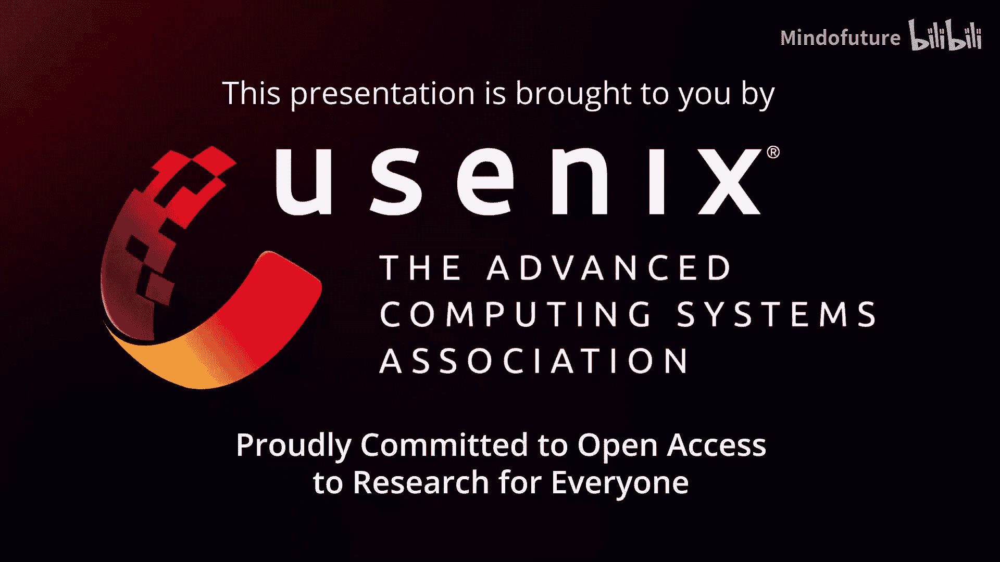
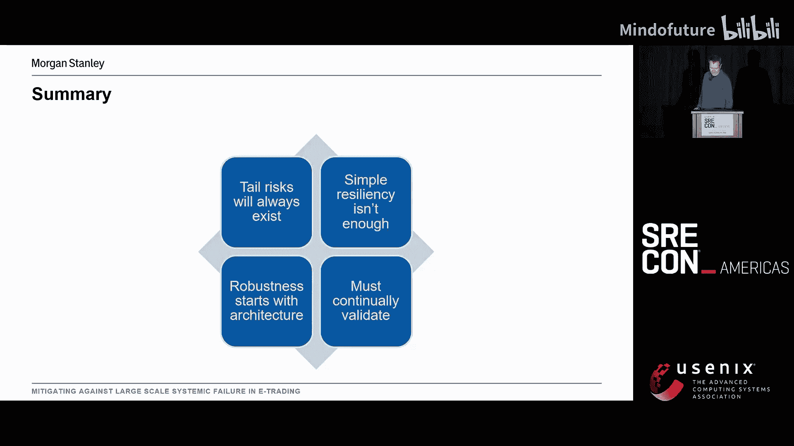
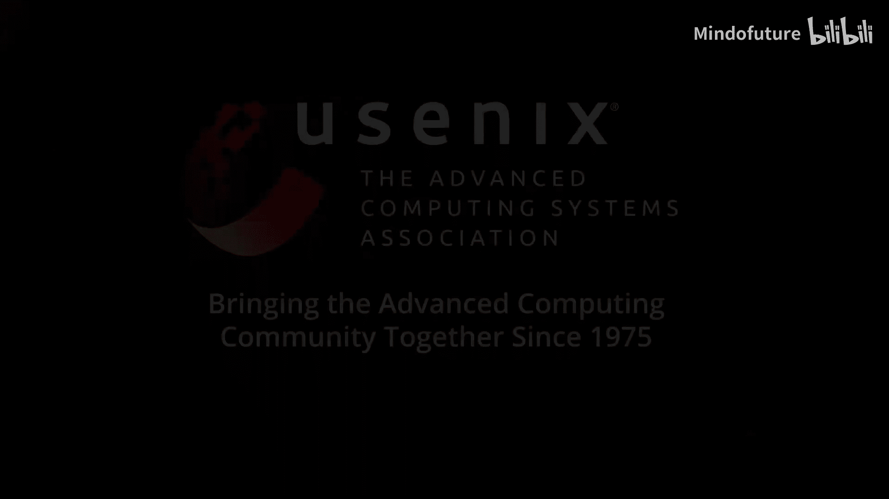
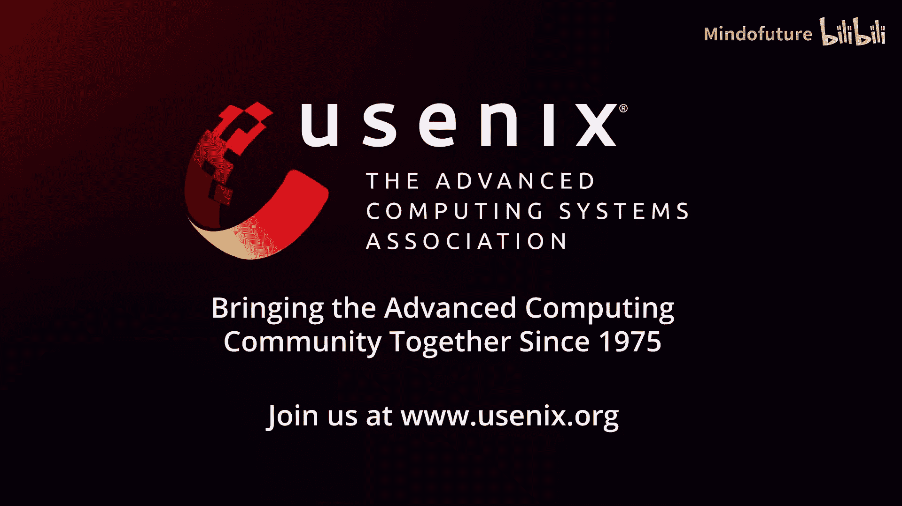

# SRE大会-2025-美洲-｜-srecon-｜-分布式-｜-缓存-｜-OpenTelemetry-｜-安全-｜-AIOps-p40-P40-Mitigating-Against-Large-Scale-Systemic-Failures-in-E-Trading--BV1TmLDz7EZZ_p40-

。

As a way of introduction to some of the e trading side of things。Obviously。

 we're heavily constrained by the markets that we're trading and so time of day is really important。

Whilst some markets trade。Around the clock。So the majority of the ones that we deal with are quite narrow time windows。

And so while we might have to have our system available at all times is to capture order some clients。

The severity of an incident will vary dramatically dependent upon the time of day。

As you can see from the chart， where I've put on just the London and US exchanges as an example。

If we have an incident at 2 AM， not really going to cause too much of a problem。

 If that incident happens 12 hours later， we're in for a thoroughly bad day。

So if we take an example of one of these incidents that has happened in the wider world。

In December 23。The LSC had a hardware failure that caused some degradation in their diss。

And whilst it was below the automated fail of a threshold。

 it caused impact where the market had to stopped trading twice during the day。 and immediately。

 this is in the news。So what does that mean for us in terms of the risks that we're running？

We can potentially be exposed to。Naturally， the first one that we're going to think about is the financial risk。

Not all of the orders that we deal with can be considered the same from a risk basis。

 they vary wildly in size and so a very large order。

 if it has even just a small movement in the price that we get back for the client can be a massive impact on the P&L。

We're highly regulated industry， which means that anything that goes wrong is very quickly scrutinized by all of our global regulators。

And if they find something they don't like， that's going to result in sanctions， fines。

 it's not particularly pleasant。And finally， the reputational side of things。

We are a very competitive industry。As a result， as we saw from the London Stock Exchanges。

 if something goes wrong， it makes the news very quickly and no one wants to be in the news for something going wrong at their company。

So what do we do to kind of keep ourselves up and running all the time？Standard things。

 we have multiple locations。We run multiple instances that allow us to scale for capacity。

 segregating floors。We regularly test that both of our sites work。

 so we're not running into a situation where something goes wrong and we don't know how to cover it。

When we're rolling out software， we stagger the deployments。

 we build up the confidence that as something is going through pilot， part of production。

 dive of production that we've tested all the different use cases and that we're not going to suddenly find an issue that impacts all of our flow。

But that's not the end of the story。 right， things will still go wrong。

There will be issues somewhere in that system that well be exposed to。

 These are very complicated systems。 There's tens of thousands of millions of lines of occurred in there。

And as a result， some of these problems can go years before they're noticed if it's in some weird edge case。

 who knows？And as we know， the less frequent issues are almost certainly going to be the most severe ones。

So what'll are some of these risks。We could have， as we mentioned， a lateen book。

 It's been there for ages。 We don't know。What it is until it turns up。Poison pill。

 we take external data feeds from multiple sources。

If there's something about one of those messages that we don't handle well and that's broadcast across our plant。

 all of a sudden you've got a failure across multiple parts of the system。Interdependency values。

Increasingly， we've got services that talk to each other where you know。

 everyone's getting away from monoliths。So how do we deal with the fact that these different components are all looking at each other？

And we got the risk of a cascading failure。How do we handle the fact that they're on different versions at different times？

And then finally， environmental changes。 So this could be a change that someone else has made in the plants。

 but it also could be a change in the wider world。Markets react to news very quickly。

 The volatility goes through the roof。 We've seen that this year quite a lot。

 So like all these different things can potentially cause a problem。

So what might one of these problems look like？Let's say we've got a bug。

It's somehow slipped through all of our controls。 It's been reviewed up PR。

 It's gone through regression testing， automated testing。

 It's been rolled out progressively across the entire plant， and it's just satAT there for years。

No one knows it's there until something happens。It could be spiking market data volumes that are beyond something we've ever seen before。

 could be a different message type of've seen。 It could just be that something changes in the plan。

 and now。We've hit that book。We can see this as well with interdependencies for those not familiar。

 the was night capital had an incident where。The different versions of components talking to each other had different behavior。

And as a result of that， when a new feature flag was switched on， all of a sudden。

 they started bombarding the market with orders completely uncontrolled。

When this happens and we've had our incident， we're now trying to find out what's the impact。

 how do we fix that if we're lucky it's just going to annoy someone and we can just kind of ease over that。

But we're never going to be that lucky all the time right sometimes this will potentially take out trading and as we said。

 there's a lot of money， there's a lot of regulatory pressure on this。

These issues have been there for years and years at times。

So how are we going to debug that like the person that made that change that introduced the bug。

 they might not work at the firm anymore。These aren't going to be quick fixes。

So what can we do to mitigate that？Fundamentally， we can build more testing。

 We can be better at the coding。But the best way to solve this。

 we have to look at the bottom of the thing。 We have to look at the architecture of our systems。

How do we make it so that there is。A reduced risk of doing this。And， obviously。

If we do this backwards。The size of that pyramid also reflects how much it's going to cost to fix it。

 changing your architecture late in the day。 You're going to struggle。

So what are some things that we can do。Potenti。Look at this from an architectural perspective。

We can look at reducing the vast radius。 when we're deploying our services。

 it can often be very easy to think。 I know let's deploy the same service generically that we can use in multiple different cases。

When something goes wrong， they all go down at the same time。

That's not going to be a good situation to be in。What we can do instead is introduce。

Different variants of these services。Each one having just the features that are needed for that particular use case。

That way， when things do go wrong。It only impacts the specific。

Area that uses that part of functionality。Sure。This means that we've now introduced additional complexity into the system。

We've now got to manage all these different versions， these different components。

 understand what we're doing here。You know， it's a trade off。another option， obviously。

 these are complex systems。We're not building them as a monolith。

 we've got these different components。As we build them。

 we can look to have the core of the system be kind of isolated from some of this other functionality。

That way， if something breaks in some of these functionality， the modules around it。

That bit startss working and we have graceful degradation。The rest of the system， the main part。

 the ability to trade in our case， it keeps working。And obviously， hopefully。

 we can fix those other pieces of the coat as we go， we fix them。 functionality comes back。

 Use are happy they get everything。 But at the very least。

 we've been able to manage the core of what it is we're doing。😊，And finally， even with all of that。

 there's the risk that the core of the function， the core functionality of the system is what breaks。

In that case， you might have another system that has some overlap in what we're doing。

We have multiple different business lines that are trading。

The ability to trade is kind of common across the different systems。

So maybe we could use one of those other systems to mitigate that。Obviously。

 you have to have different systems there。 And that also comes with the risk of， well。

 what if we've never done this， what if we've never used this。

 you can't just kind of throw a new system at someone and hope that they're going to be able to use it。

 So you have to be regularly exercising。Exactly what you're doing here。 This one's pretty drastic。

 as you could imagine。 and， you know， quite expensive。So in summary。These aren't simple problems。

There's no quick way to make them disappear。 There's no silver bullet。

 We're not going to be able to wave a magic wand and make it just work。

We need to invest in the architecture。We need to build it and design it and expect that things will go wrong。

 We can't just accept like， I've built my system to be robust and everything's going to be fine。

And what we need to do is we need to build it in a way that minimizes the risk。But at the same time。

 we need to accept that when these things are going to be used。

 that they work and we need to continually validate as we're doing that。

没有。Thank you， any questions？

