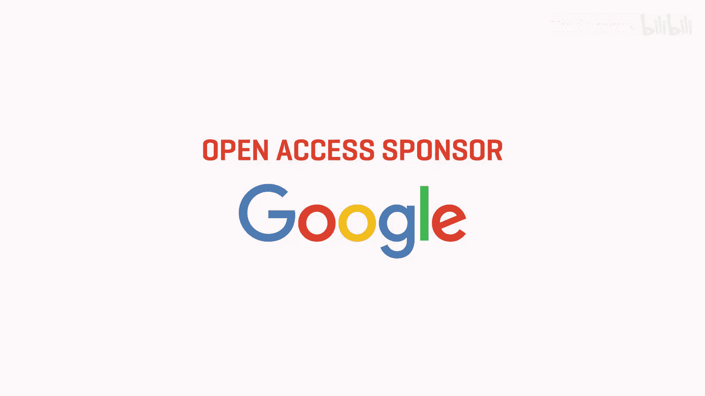
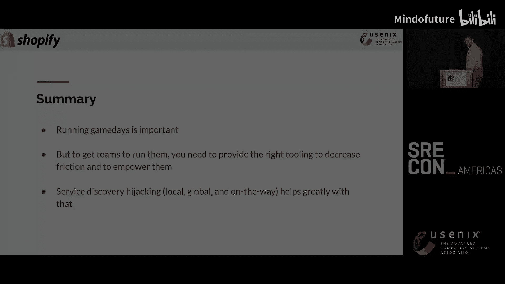
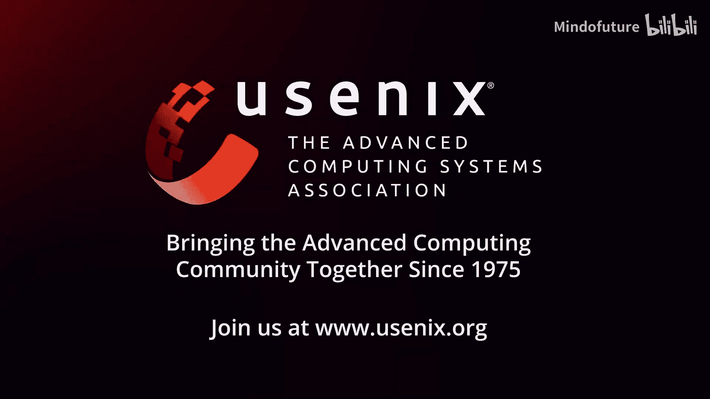

# SRE大会-2025-美洲-｜-srecon-｜-分布式-｜-缓存-｜-OpenTelemetry-｜-安全-｜-AIOps-p41-P41-Hijacking-Service-Discovery-to-Simulate-Dependency-Degradation--BV1TmLDz7EZZ_p41-

。

Hi everyone。 My name is Ab Heli。 You can call me Abboot for short， and this is my cat and Noof。

And we're going to be talking about how to。Basically use service discovery cowboy shenanigans to make running a game day a little bit easier。

嗯。Before we get into that， for those of you who don't know Shopify， we are an 8。

000 plus employee company and we are an e-commer platform that runs the shops of millions of merchants in 175 countries worldwide。

Just last quarter， we had achieved a new milestone of 1 trillion running through our platforms。

 basically。 and last Black Friday， in one weekend， we。Conducted $11。5 billion of GMV。

 we saw an average traffic of 170 million RPpm， and it peaked at 280 million。That said。

We have a resiliency team， so this is a subset of the team right now it has grown a little bit more so we have 40 SRE engineers that that are part of the resiliency organization。

 we have a resiliency organization that has our team another team that we call the RA team which is more resiliency exploration tooling team。

 and then we have also incident response which are more responsible for。

Communicating with merchants and support during incidents。

Our team specifically we're basically responsible for everything resiliency。

 so from anything that has the word incident in it。

 it matters to us from testing to improving the product again。

 like we said to education to actual incident management。

 we have follow the Sun team some of us are in Australia。

 Singapore I'm in Canada and we are basically the first responders whenever anything bad happens。

And lo and behold， bad things do happen。And as some might argue that the best way to test your resiliency for instance is to wait for them to happen and wait for surprises to learn from them ideally you do that in a little more controlled manner。

 which is what game days are for so for those of you who don't know in a game day the way we do it at least in Shopify we start by creating a thing we call resiliency matrix so you go and you kind of list the flows that your service has and then you go to the possible faults that can happen and for every one of them you say what you expect the reaction or like the effect on that flow to be is it going to be down is expected to be able to survive this specific thing is it going to be maybe prioritized or shed etc。

 and then you go and you inject the fault basically。So yeah。

 game days are about simulating incidents。We our team specifically we run the larger scale more crafty game days but we also want teams to be responsible for their own smaller game days so we want everyone in our organization to be game day all the time and that's at least like at least we ask them like okay make resideency matrix and tell us your flows what's going to happen to your flows when your dependencies are down surprisinglyprily a lot of teams don't even know what their dependencies are so the exercise is already useful。

嗯。That said， once they have listed that， we want to start injecting faults。

 the question becomes whether you should actually shut off the dependency to simulate the failure。

A lot of our SREs would tell you yes， and a lot of them would shudder inferior of the idea。

 and the answer is probably somewhere in the middle， like especially for team specific run game days。

 the ones that SREs are not run， we want to make them easy。

 we want to make them a little bit more controlled and we want them to be a little more abstracted。

So they're running their own game days， game day， we don't want to affect other services。

 and also we want it to be a little bit abstract for them。From the client's perspective。

 the service is down， it doesn't matter if the service is actually down or if it's a networking problem or if it's a security problem。

 typically for application developers。For them， it's just， it's them。So with that in mind。

 what we do to simulate that， we use fault injection proxies。

The two most common ones we use are pretty much the only ones we use toy proxy and envoy Ty proxy is an open source one that we developed in Shopify the nice thing about it is that it has client integration so it sits like if you also want to put it in your CI it sits perfectly in there you can basically write it that says okay。

Take service take the dependency down and run this code and then do a little bit of assertions。

 so it works great in CI， but also obviously you can use it in a normal game day and then there's envoy。

 the nice thing about envoy is that chances are you might already be using it in production so you can just add a little bit of fault injection in there you don't need to install anything。

But。If you're not using envoy already， if you have to put that proxy。

 the challenge becomes about like， okay， how do you actually get the traffic to go through that proxy because the proxy is going to sit in the middle before you're dependency and you want to figure out what to do。

嗯。It's easy， right， you kind of just change the code。

 so instead of saying I want the traffic to go to database one。

 you say I want the traffic to go to toxic proxy， right？And you can do it in your code。

 You can do it in configuration files。And then you just generate a different image and put it in your production。

And this is very quickly starting to sound like a bad idea。Yeah。

 we don't want teams having to mess with their service and with their code and with their configuration files just to run a game day ideally for us。

 the game day is something you kind of plug in。You run a bunch of tests and then you remove and everything goes back to normal。

Once we start talking about like， okay， you've got to change your code and push a different image。

 then something is wrong。So yeah， we don't want to add this friction， it's dangerous。

 it's not safe and it's going to make them do it less often。

Instead what we provided was something we call the game day body so this is a Kubernetes operator and this is an example of a sample configuration we call it a game day confg so in it you can kind of you know you provide the name of your service。

 which deployments you're targeting， which dependencies you're trying to game day what kind of toxics you're trying to inject so for example you want a latency of 1000 milliseconds。

And that's about it， it does the whole thing for you。Basically yeah。

 like it spins up toxic proxy and it directs the traffic through toxic proxy for you the question is how does it do that and for that there is a lot of nuance as well。

So it in general。And here we're going to get a little bit more meta。 We do it。

With three approaches that I think in general， when you're hijacking。

 you can do any of that you can either。Change locally or globally or on the way。

 and we're going to give three examples because we support all of that。嗯。

So example the most straightforward one is locally。

 basically we change the client itself to be like instead of talking here， talk there。In general。

For those of you who don't know when a service is trying to do DNS resolution before going to the DNS server。

 it might check the ETC hostt file to see if there are any entries in there and if it finds entries in there。

 these are overrs。And the nice thing is that Kubernetes allows you to provide a field called host aliases that。

You can add those entries in it。Basically like the way game day body works。 and by the way。

 I use a lot of sequence diagrams。 this is the segue， but like if you don't use sequence diagrams。

 please do they amazing。Yeah。😊，But yeah， like basically it spins out a toy proxy and then it talks to the Kubernetes API。

 it says， please add host aliases to direct the traffic to toy proxy and it also instructs toy proxy to talk to the actual upstream and now you have it in the middle。

 that's perfect， very straightforward very easy， except if they do one small thing which is put a dot at the end of the domain name。

If they do that。Their service decides that， okay， I don't want to look at the ETC host file anymore。

 I'm just going to go and。 I'm going to talk to the DN S。 That's an optimization。

 It's useful for them。 It's not useful for us。 So then some of the two other approaches becomes needed。

 which is。Like fuck， I'm just going to go I'm going to change the whole rule globally in the DNS server itself。

 and I'm going to add an entry saying if anyone is trying to talk to Redis。

I wanted to talk to toxicrxy instead。This is getting a little bit icky。

 we use it sometimes under certain conditions it's like， okay。

 if the CorDNS maybe is only configured for the namespace or if it's like a cluster that we spun up for testing。

 we can tolerate something more global in there， that's not an issue。But for the majority of cases。

 this is an issue and。For us， zookeeper was the big one。

 and this is basically where we get into more nitty gritty service discovery。

The way our different services， basically the way they discover a lot of things like if you're doing ViTs。

 if you're doing caching， very often the service doesn't exactly know what dependencies exist in the first place so it doesn't use the N has to do that you know to discover them instead one example technology is zookeeper so the way it does it。

It knows where Zookeeper is， thankfully。 it starts asking questions like just。

It starts sending a bunch of list requests basically so if you for example have meCache。

 there's many partitions， it's broken down over different domains， et ce。

 the client kind of knows what domains exist and it just starts inquiring zookeeper about what zones exist。

 what regions exist and how many partitions exist。AndZookeeper basically responds with first of all。

 it sends a bunch of lists， but then it says get for a specific one of them。

 This is the one that it actually wants to talk to。

 and zookeeper is going to send whatever information you stored in there so that could be the IP of the upstream。

 it could also be like a lot of other information like if it's a database。

 is this a writer or reader， what's the replication like， etc。

And then it can finally talk to the upstream。And Zooki prefer is global。

 we can also kind of do like what we did with CorDNS and we can just go and change the content of the node to whatever we want it to be。

 but instead we do it on the way by using something we developed called Zoo creeper。

So zoo creeper is yet another proxy that we use。And it sits basically between Vic client and zookeeper。

So whenever the client is doing all the list requests to zookeeper， zoo creeper just forwards them。

 it doesn't care much about them， but the moment it sends a get requests， this is the Mey one。

 this is the one that actually has the node information。

 so it actually forwards the request to zookeeper which sends back the true information。

 but before forwarding it back to the client under the hood， it goes， it creates a topy proxy。

And then it puts the IP of toyrxy in there and sends back back to the client。

And now the client is going to talk to the upstream using toxicy proxy。So。It is in general。

 we're always kind of doing the same thing。 we're figuring out like how is this service talking to its dependencies？

Sorry， how is the service discovering its dependencies and we're basically hijacking this discovery layer to forward things to toxicxyrxy instead？

Zoo creeper is not yet open source， I'm hoping one day I can open source it it's pretty nice we're proud of it because like first of all it talks the zookeeper communication protocol and for those of you who don't know this is not actually documented like I had to actually like I found some other zookeeper clients and I had to steal some code from there and like eventually we figured out the communication protocol plus a lot of wire shark stuff。

The second nice thing is that like this content in here it's here。

 it could be adjacent if it's vites， it could be like a protobuff encoded。Blob。

 it could be anything basically so zoo creeper was developed in a way that is pluggable like whatever new protocol you wanted to talk you just add a plug a few lines of code and now it supports that new protocol so we use it for three different protocols in Shopify so far and hopefully we can add a few more later。

And yeah， the nice thing about it also is that。When it comes to discovery。

 like especially when you're discovering things with zookeeper。

You can get it to override just one dependency if you're just trying to hijack one dependency。

 but you can be like， hey， I wanted to not be able to talk to all of U Central one。So for ViT。

 for example， we once conducted an experiment and we told it like， hey。

 anything in any database that exists in new essential line I don't want to be able to talk to anymore and it was like just a single line of configuration which was very easy for the developers to do。

嗯。So， in summary， first of all， if you're not trying game days and if you're not making your teams run game days。

 please do， they're very important， they're very easy， you can even run them as a tabletop exercise。

 just get them to do their resiliency matrix， that's already a huge step。but yeah。

 if you want them to run proper game days and to run them frequently and effectively。

 they need tooling and one obstacle that we found often was that， okay， how do we overrite things？

And we did it at the service discovery level locally， globally and on the way。And that's it。

 thank you。

