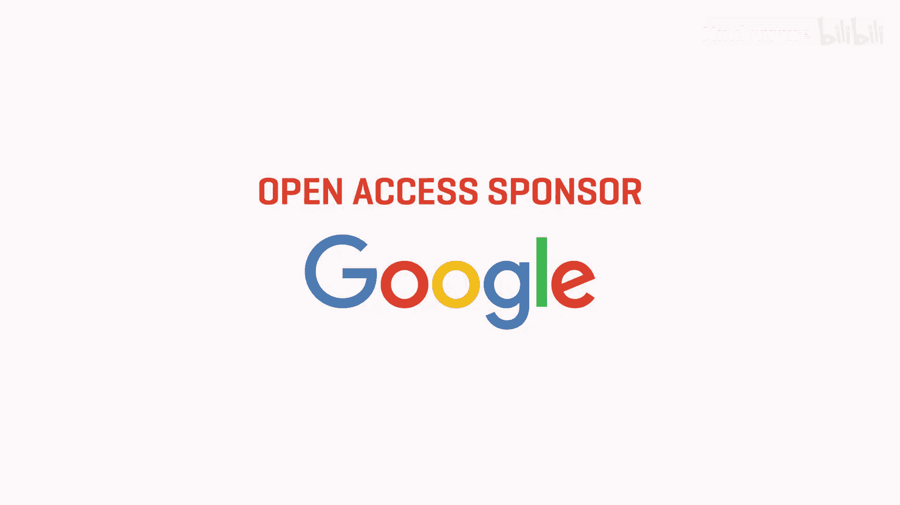
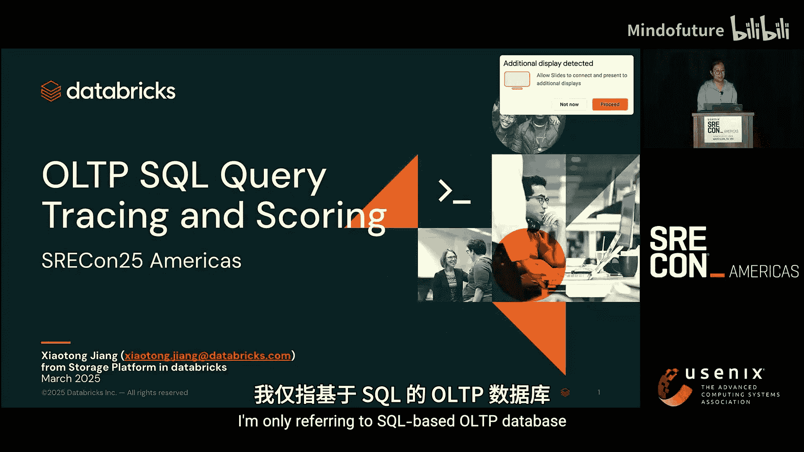
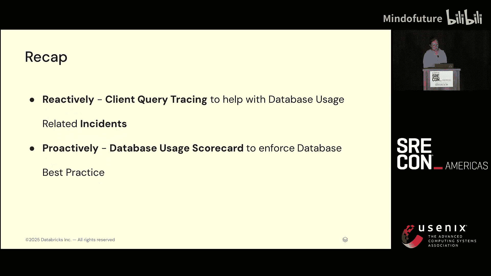
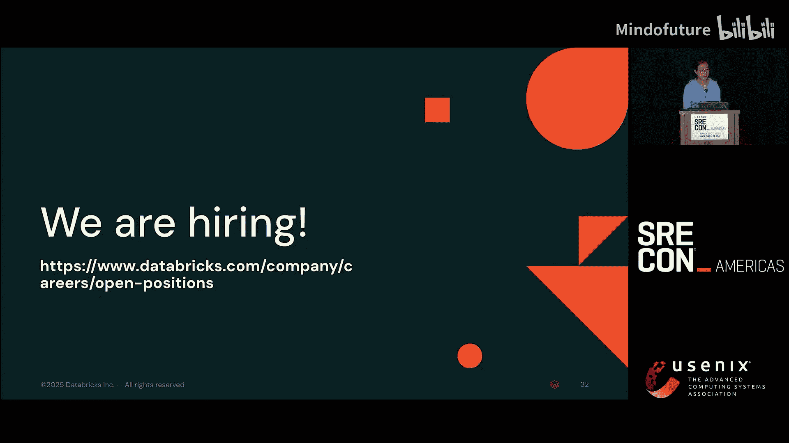
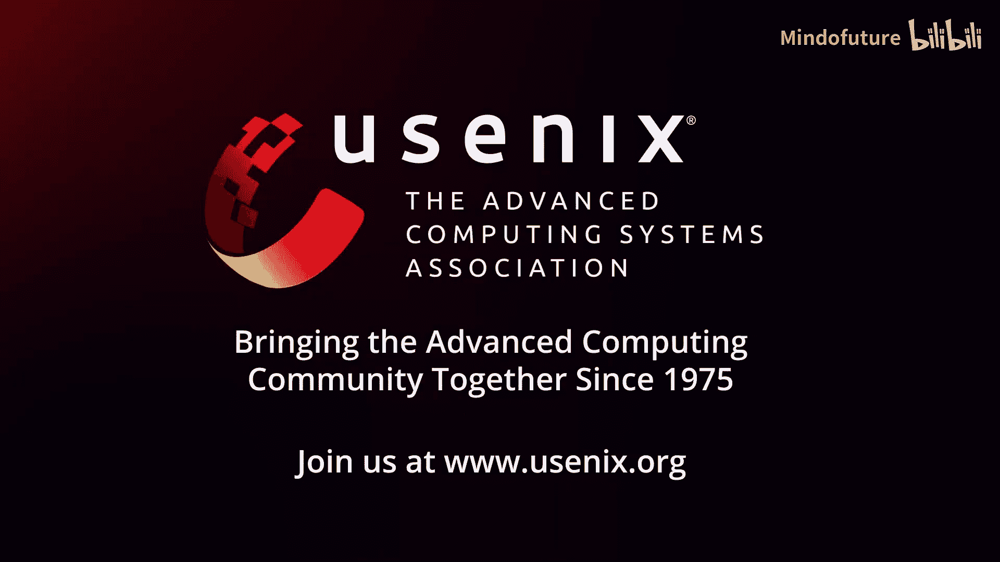

# SRE大会-2025-美洲-｜-srecon-｜-分布式-｜-缓存-｜-OpenTelemetry-｜-安全-｜-AIOps-p43-P43-OLTP-SQL-Database-Query-Tracing-and-Linting--BV1TmLDz7EZZ_p43-

。

Hi， everyone。 I'm Xiaong from St platform in Datas。

 My recent work focuses on O TP SQco database performance optimization。

 specifically from the database usage perspective。 today。

 I'm gonna talk about our work around database client。

 queryer tracing and scoring for someity today when I'm talking about database I'm only referring to SQLbased OL TP database。

 Here's the outline of today's talk。 Firstly， we will talk about some interesting challenges。

 Datas have around our database usage Next， we will talk about how do we handle these challenges in a both proactive and reactive way。

 So by reactive， I mean， whenever existing antipatent usage causing an incident。

 How are we handling them effectively by proactive， I mean， instead of being incident driven。

 how do we enforce this， there's no new antipat being added。

It。First of all， how does things look like ins in Datas thanks to our high growth product usage。

 we have a lot of interesting challenges in this domain。 Firstly。

 we are managing thousands of database instance across multiple region。

 multiple clouds and multiple database engine。 And for each of the database。

 they have a very diverse database usage pattern， and they can change very fast We also have a multiple tenant infr setup to allow efficient utilization。

 So one physical database can have multiple tenants。Database are not magic。

 It cannot just handle all the usage pattern equally effective。 In fact。

 we have seen a lot of client database utilization related incidents。

 examples are queries distribution change and then like database optimizer choosing some suboptimal plan。

 One suboptimal plan can destroy all the tenants in the database。 when chargingging incidents。

 We already have tons of amazing tools like percona Myql D。

 and we also look at Myql performance schema。 Theyre great。

 They give query level aggregation on different resource。

 You can see which  queryries using more resources but in most case。

 when handling database usage related incidents， it theyre not enough。

 because they primarily focus on the D server perspective， what is missing。

Here is a contact from the client side。They are actually super important when handling D B usage related incidents。

 especially for the multiten setup。 For example， in this graph。

 several tenants are sharing the same physical database among other tenants。

 one of them is issuing some expensive query to to the database and increase the overall stress。 Now。

 if we look at the percona， Most likely， we will see a global increase of the load。

 It is hard to identify the clear next step from database server side。

But with a database client query tracing like this setup。

 we can actually carry the custom I D to so that we can aggregate on a customized view。 like this。

 So here in this graph X is the time。 And why is the data database time spent。

 The color block here is is a slice by custom I D。 So we can see one of the color is contributing most to the D B time increase。

 So with this info， we can quickly act on it during the incident， we can re limit the tenant。

 And after the incident， we can fix the problematic query。

You can also view on any other application specific dimensions here， like custom ID。

 tenanton I or API。 You can also slice over retry or error codes so this flexibility gave us valuable insights and have proved to be very effective when charging database usage related incidents。

Now， you might say this is useful， but it's kind of late。

 I should have not have any antipat database usage in pro in datas， we also have such a retrospect。

 But unfortunately， by then， we already have hundreds of expensive queries running in pro。

 We need to proactively prevent any new antipat to be checked in。

 So we started to also look at the bottom of this pyramid。

 which is in the pre mergege C I environment where things are more controllable and easier to fix。

We believe there is some anti pattern that shouldn't be checking at the first place。

 So our philosophy are we boring。 We prioritize the reliability over performance。

 So there is some queries that we we just don't like。 Firstly， it's unpredictable query。

 if the query execution plan is unpredictable some optimizer can decide to use suboptimal plan。

 We should always subs the execution plan by pin the index drawing cases or union cases。2。

 if the queries is complicated， most of the time it's actually because you embedded your business logic in your query。

 So those logic should actually be offload to application。

 third is some efficient query can actually be rewrite into more efficient way。

 but produce the same result。last like query without time out limit， they can be long hanging。Thus。

 we introduce a query score， which is a rub based score in the database client in C。

Query score would check W and ban some bad patterns proactively。

 It will run over all the queries in C I environment。

 which gave an early signal in our develop and preventing anti pattern to be checked in。

 So we will go over some of the disallowed queries。This one is due to select for updates pattern。

We can see this query is a select for update over A B D columns with a limit one clause。

 So from the table definition， we can see this query is not on a fully covered the primary key。

 So a quick quiz time if there is 200 k rows， match A and B。 But there is only zero rows， match D。

 how many rows will be examined。Any gas。For。Oh you will be confused during the incident too。

 It is actually 200 k。 So why is this query dangerous。

 It is like select for update is actually locking the rows that it scanned。 So in this case。

 it actually needs to scan 200 k rows to know there is0 row exist。

 even though we have with one limit one clause there。So in database。

 we also have a pass incident like this。 So it end up locking the entire 200 K rows and it makes the database600 times slower。

Now， with a query score， this pattern would be banned。 And like they cannot be checked into pro。

 So how should we fix this query for select for update， we should always use a point to read。

 So in this case， we added C in the clause。 So like it's over a fully covered primary key。

Another example is for unpredictable queries。 So quick score here is complaining about theres multiple index candidates here。

 So if we look at the query， it is a DM ML query。 It is over B and C。 So from the table definition。

 we can see this query can actually be served by both index by either index B or index C。

So what is the problem here if it can be served？The problem here is optimizer can decide to change index during the production traffic。

 And this behavior is risky because we never tested the other index。

 So we don't know the performance here。 So in one of our incident。 It's also similarly。

 it's a DMML query， which will also lock the rows。 The optimizer decided to scan the entire row。

 which is 100 million rows。 So during the incident， there's no rights succeed。

 So the lesson we learned in thes is never trust the optimizer。 Yeah， so with the query score。

 this pattern wouldn't be allowed either。 And what we should do is add a fourth index。

 So that we explicitly tell the optimizer what to do。

Some other patterns we are scoring or for C D MO should always should always be bonded with the index and limit。

 and there is no there should not be any table food scan index food scan， of course。

 and query without index is also not allowed。However， database usage is not just about query。

 It also involve traffic， schema， data distribution。

 and they are all tightly coupled with each other。 So next step。

 were working on a unified database usage score。 So how are we doing this。

 We bridged all the components we covered in this talk。

 We trace a query from pre merge to its post mergege。

 traces the query from DB client to its D B server。

So we also applied the similar philosophy to schema， trace it from pre mergege to post mergege。

So a DB owner could get a best score if there is query thats not doesn't have time out or it is never tested in C。

 but running in production query without name make it hard to trace and query that running need to examine excessive amount of rows to serve one row means that they are using excessive amount of database resource and they should theres opportunity to optimize or a query success rate being low deserve some investigation。

So for schema， we also check a lot of rules。 First say。

 you cannot have a table without any primary key。 You can also not have too many index or duplicateating index。

 Theyre also not efficient。 You also shouldn't use like a column that's unbounded and can be randomly big。

 We also look at the read and write amplification。Because it can indicate theres some data model design being bad and there's some opportunity to optimize here。

 too。 for like there's a more dimension。 We're trying to score。

 including cost data and resiliency of the database。

 Here's how the database usage scorecard roughly looks like every D B will have a score， total score。

 and they have different dimensions， including traffic query and schema。All these scorecard data。

 including the client query tracing。 all of those are built on top of dataricks products。

 So you can also build something similar quickly as a data customer。

So a quick recap to what we discussed， how do we both reactly and proactively managing database usage for thousands of database in databases by reactively we have client query tracing that provides very rich client contacts help us to root cause several incidents and it prove to be very effective and by proactively we have database usage scorecard that enforce the database best practice across different dimension including traffic schema and query So all of them provide a safeguard to our database best practice and we are managing 100 service team through this mechanism yeah。

That's all I have。 Thanks for your attention。 And one last but most important thing we are hiring。

 So like we are hiring database experts to help us to solve this interesting problems。 Yeah。

 thank you。

