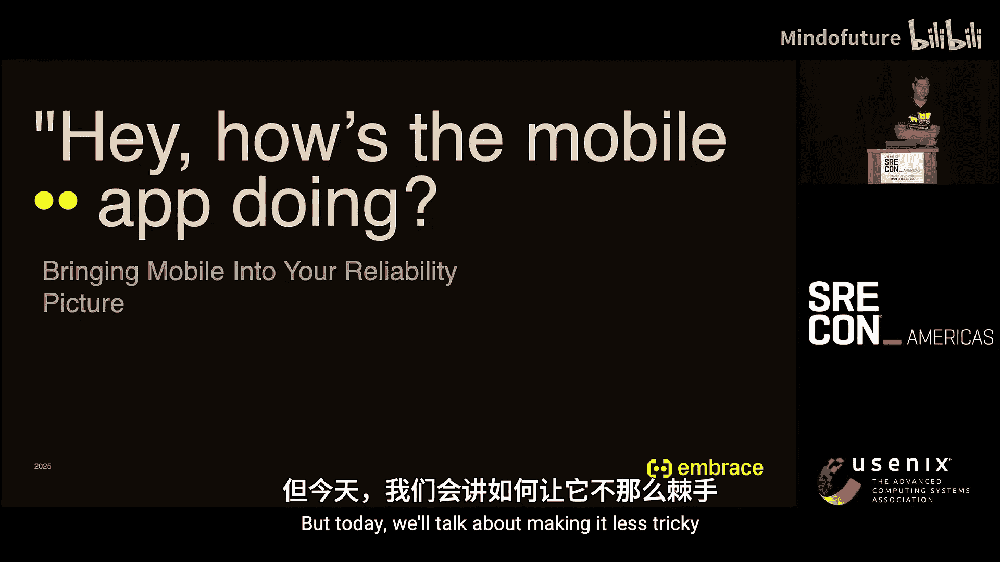

# SRE大会-2025-美洲-｜-srecon-｜-分布式-｜-缓存-｜-OpenTelemetry-｜-安全-｜-AIOps-p44-P44-“How’s-the-App-Doing”-Bringing-Mobile-Into-Your-Reliability-Picture--BV1TmLDz7EZZ_p44-

。

Hi there。 How many of you use telemetry collected on mobile devices in your reliability practice？

Amazing， see some hands。I'm not seeing too many though。

 and I imagine you wouldn't be here if you already had or if you were happy with what you're getting。

 because that's the tricky part。 But today we'll talk about making it less tricky。

So I'm David Rifkin， I work in developer Res， along with me is Hanson Hope。

 our Android architect and we do mobile observability built on open telemetry at Embrace We've both worked in mobile development for a long time and we're here today to talk about creating a better picture of your system by including mobile。

Have you ever seen a picture like this？The system， you know， for maybe a very simplistic view。

 looks like this， the reliability team is looking at their services， their up time。

 how all the parts communicate， the requests。Coming in， the response is going out。

 And I'm sure the service is highly available down to 59s。 Everything is within SLO。

 So it must mean that everyone is happy。😊，But。What's missing？

Because when we're talking about everyone， that's probably people。

 So we're not talking about the users。Behind each additional 9 might be someone staring at their phone。

 getting pissed off。Are you finding out whether they are？

Because the user experience is occurring where the user is。 It's the payment they can't make。

 the picture of their neighbor's dog that they can't like， some truly terrible scenarios。

 So what's perceived。Is on the client increasingly mobile devices。And that's the user experience。

 How can you say your stack succeeds for users if you don't have a great user experience。😊。

When we talk about good or bad user experiences or the SLOs that reflect those。

 they aren't experienced at the service level。The user experience is kind of like your whole system in inverse because that's occurring on the client。

That client might be the end result of every single service， database， widget， pipe， toothpick。

 piece of gum and tape that keeps the system together。

 but you have to succeed at the end of that system because that's where people are。

So it was a whole host of information。You might not be gathering right now。

Not just the buttons and scrolling either， there's a whole host of interactions with the client issues specific to the client that affect how people。

 individuals and users relate to the system。It's an entire casserole of issues。

 So let's grab our fork and knife and dig in。Thanks， David。Let's start with a little story， shall we？

Imagine you got Ts， S R life computers。 I want to deal with that， but you love cooking。😊。

What if I opened up a restaurant？I'm going to make money by serving customers。Oh。

 my background is in computing， so I'm going make sure quality kept really high。

 I'm going measure things。 I'm going to observe the kitchen， because。😊，Good food。😮，Plus， fast prep。

Means。Happy customers， right？嗯。Right。Well， what if。

 what if there's delays in seating those customers is waiting for a long time to get a table。

What about？😮，Rude waiters， waiters that， you know，Not really customer oriented。

And what if you have overpriced wines， So people have to pick the lower quality。

 cheaper ones because they can afford it。Well。You'll get reviews like this。So slow， bad service。

Crerap wine never again one star。 and your food is delicious and comes up really fast。😊，How。

 how can that be？Well， happy diners need more than good food。Happy diners need a good experience。

Overall。And transpose that to our world。Happy users。People need good experiences。Not just。

A fast processing on the server side。Because。The workflow starts from a device and end on device。

 and there's plenty of room to fail in between。Your network requests being sent and received on your backend。

What if？A request is never received by your backend。That can happen。

You can have an app crashing before the request is sent。You can have networking issues。DNS。

 perhaps you walked into an elevator and you just don't have a zdo anymore。Or just a bug in the app。

 maybe some sort of poor queuing and requests just sitting client side and queuee。

 waiting to be sent， just hanging out。Never get sent。You don't know about it。

But sometimes you do know about failures。 if the request is delayed。You'll know what failed。

But do you know if it got delayed on the client side。Just took a long time for it to be sent out。

What if there's congestion on the client？Chaty SDKs is is using all the connections。

Busy background processors hogging up all the cores。And your network request doesn't go out。Bad UX。

 You have to fill in a ton of forms and ton of activities。 and just to make that request。Well。

 a user has already spent minutes on your app before setting a request。But you don't know about it。

 And they're kind of pissed off already。And there could be a bug in the app as well。

 because that happens。That where priorities are hard sometimes just sits in the back of the queue。

Well， what if your server records a 200 every last bite was said， connection closed。

 good to go move on， success， right？Well。What if the app fumbles the response。Could that happen？Well。

 failed de serialization。Happens all the time。You can have slow processing on the client side。

 response， desialized， inject in database， pull back out， rehydrate。

 oh we've got to pull up some images as well， big images。Really nice looking dogs。

 And where I would like， I just took 10 seconds。I said seconds because on the app。

 we measure latency by the seconds。 So thank you for sitting us 100 milliseconds on the back end。

 but。AUse's waiting 10 seconds。And also， bugs on the app。 I got the response。

 but I just didn't want to show it， because。Well， it's been to fold， and I can't scroll。

 So too bad hoopsies。Your user didn't get their satisfaction。On your backhand said。Here you go。

 it worked， eh？Readen dashboards everywhere。Unfortunately， if the mobile app is what。

The user is using。There are plenty of failure points outside U D。 C。

Because mobilebi is a hostile environment， everything we work on is unpredictable and full of pitfalls。

For instance， those bugs I were， I was mentioning before。 Oh， I found it fixed it 15 minutes。 Great。

 rolled out。 Oh， okay， Well， and few days for Q A。 go to alpha beta。 Oh， finally。

 it's ready to be released。 release。 yay， Play store an app store。 I'm gonna review it。

 Here's three days。 Just wait。😊，Oh， here we go。 It's out。 It's out， it's out great。 It's out。 Oh no。

 no， no， sorry，1% rollout， please。1% rollout。 just make sure there's no crashes。 Yeah。

 Wait no 24 hours。 Great After 24 hours， the bug fixes out。 Well。

 it's out when the user downloads it。 And you know what， the long tail is super long。

 not everybody updates all the time。 So if you fix a bug in 15 minutes。

 It might take you 15 days for it to get out to the general public。😊。

Well runtime environment is also unpredictable。 You have all sorts of devices made by all sorts of manufacturers running all sorts of Android versions whos iOSos too。

And。How much resources you get， RA， CPUU cycles， it depends what the OS wants to give you。

 And if you walk into an elevator shaft， well， in the elevator， that is in the elevator shaft。

No signal。 boom。 You thought it was going to work。 It was working。Until it didn't。

That's because you can't predict what you're going run on。And lastly。

 user expectations differ wildly when it comes to what performance means。

I'm using a fast phone and fast network。Performance。If it comes back to two seconds， that's okay。

What if you had a handmi down from a handmi down。From 10 years ago。

 and you're using a 2G network because you're out in the farm somewhere。Well。

 if you press a button and your phone。Spins for about 20 seconds and you see success， you're like。

 oh my God， that works really well。Performance when you come to the app depends on the aisle beholder。

 It， it is not a number。 You can't draw a line and say this is good performance。

 This is bad performance。 Na na， It is much more nuanced and subtle than that。

So let's get back to our story。You realize restaurants heart to operate front the house don't want to deal with it。

 I like computers more。Let's pivot to a food delivery app。Well。The kitchen is now your DC。

 That's where you all have all your instrumentation， where you measure things。

What if the were perfect issues outside JuDC。What then。Well。

 you lose business because as a restaurant， if your app doesn't work for me。

 I'll just use some other app。 I go to some another restaurant。

 I order from Domino's if I'm really desperate。Oh， sorry， maybe Do knows is here。

But the most insidious thing is。You wouldn't know that you lost business。

Because you didn't know somebody tried to actually use your app to order food because you don't have anything outside your D C。

What was a quick fix， yeah， sure。Quick fixixes， just start by instrumenting the app。

 Just add anything。 I'm sure you have things like analytics for your product people。 So just。

Get some data from there。Something。Anything。Please don't。

Please take in some information from the outside。 Even if it's not super detailed。

 it gives you additional context if or nothing else and to inform you who is trying to use your app and perhaps under what context you're using in。

Start small。But ideally， ideally， what do you want？Well， you want to make it observable。

You want the front， end and the app to be as observable as your back in。And that means telemetry。

I'm not just talking about how quick operations are and， know， level things on the device。

 I'm talking about user centric telemetry。You want to get inside the brains of your users。

 you want to know what they're thinking， what they're doing。

 So all the performance stuff that that brings a good user experience。 You all the final accounting。

😊，Did it work or did it not， Did they stay long enough to get value from your app or did they not。

 Teleelemetry has to be user centric， not machine centric。And on top of that， you add some context。

This is where the magic happens。 You add context。To use telemetry。

And you get Saquaan Barercley added to an awesome offensive line， you get magic in a Super Bowl。

What you get is mobile observability for real answering questions about your app using only data crisis you didn anticipate before。

What you guys Molly？David。Thanks。So the thing about all this is observability is not new right。

 it's been used for the longest time to find out about applications， link systems together。

 make mission critical decisions， I don't know for the last two decades based on logs put together。

 it's hard， but it's not new。And。Neither is information about frontend apps。

In any front end practice from the beginning of time， product is always wanted info about the app。

 They've always wanted to know the what， what's happening。 What did the user do。

 But developers haven't really gotten the chance to ask that question and then add in the why。

 So client side observability， The goal is the users why， What happened and why for the user。

But let's be kind here。 This is new for mobile teams。On mobile。

 there isn't a tradition around using telemetry to learn about the application。

 because why do they need it， They've really only been told there's a crash。

 Someone left a bad review in the app store。 The CEO hates this。So they're reactive。

 And it's hard to measure things in production when you're not empathizing with the end user。

 but it's even harder。When you are， but you haven't flexed that muscle。

 and mobile devs haven't put that muscle to work。So help them out。

Mobile and front end teletry can look exactly like backend。 It just doesn't yet。

Have your team start logging something from your apps using open teleelemetry。Find out。

When the most important part of your app failed。Because when you log something in Otel。

 it's going look like the other telemetry that you're collecting across the rest of your system。

The data shape。It's going to look pretty similar。 It's just going to have mobile specific information。

 So share that data， that context with the rest of your system， link it all together。

And then teach them how to flex a muscle that you're already familiar with。

 asking questions about the system。 You might not be familiar with performance data for user interaction。

 Yeah， sorry， user interactions， but you are with correlating information across the system， So ask。

 why can't I check out why didn't users in Japan login。

 Are these reviews about our app store actually true or do we know better。So if there's one takeaway。

That you should get from this。Is get yourself some molly。Mobile observably is super important。

 so get some。Or be specific here， not all Molly， not Molly ranking， mobile observability。

 get yourself some mobile observity。But Molly is easier to remember。 So get's a Molly。

Thank you。 Thank you。

