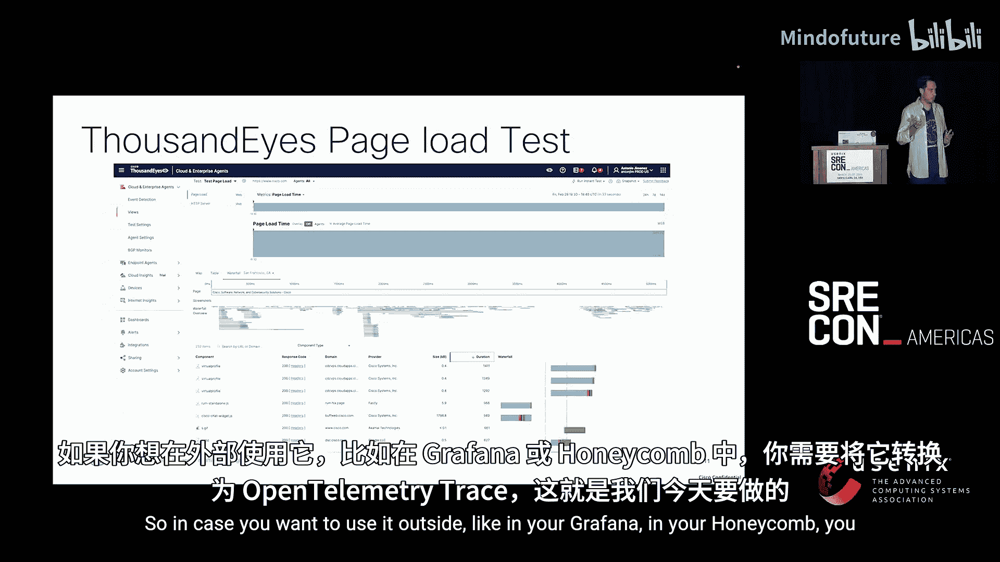
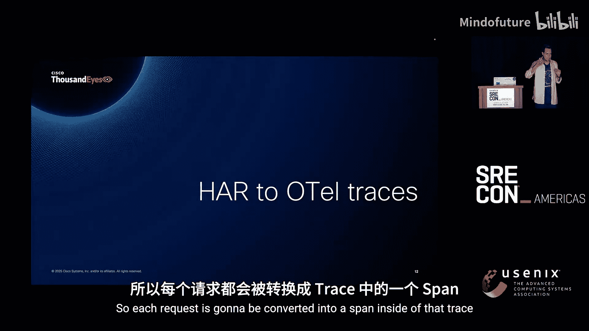
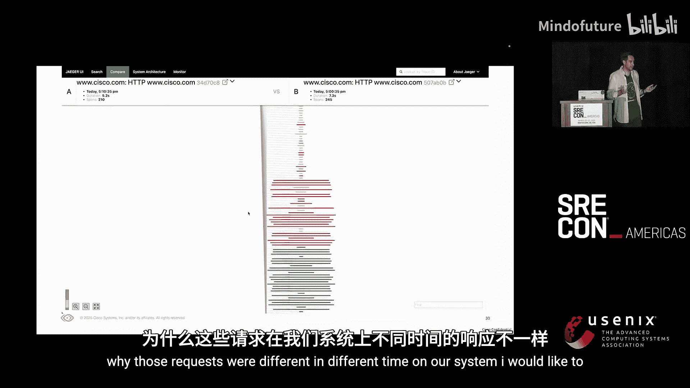
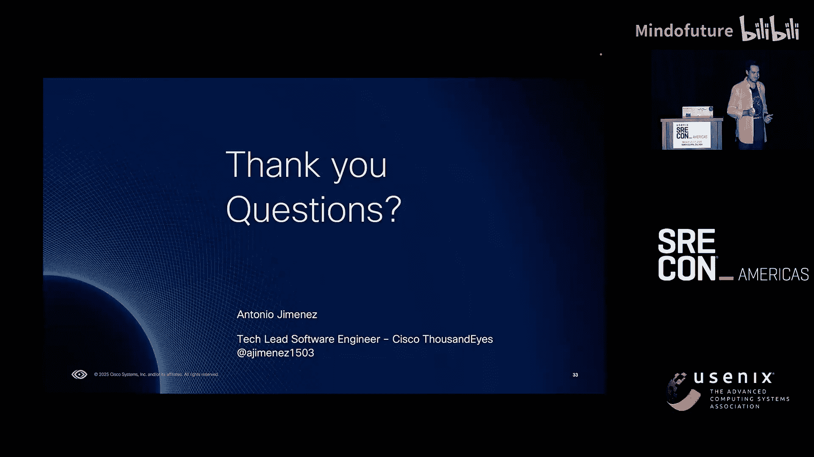

# SRE大会-2025-美洲-｜-srecon-｜-分布式-｜-缓存-｜-OpenTelemetry-｜-安全-｜-AIOps-p45-P45-From-HAR-to-OpenTelemetry-Trace---Redefining-Browser-Observability--BV1TmLDz7EZZ_p45-

。

Thank you so much， everyone， for staying here the last day， almost the last hour。 So I appreciated。

 But the question is， who want to learn about open telemedtry today。

 So raise your hand if you want to learn， O， that is spirit。 O。😊。

Today we' are going to talk about from hard to open teleed traits in order to enhance observability。

Before starting， I would like to transmit my message， so we want to improve our monitoring。

 debuing and optimization of web application because we have the heart in one side。

 but if we convert into a trace， we can take the observability that can benefit in order to debu it and improve monitoring。

Let's go through that agenda today。We are going to start with an introduction about open telemetry。

 about the heart， so maybe some of you don't know what a heart is for sure you have used it。

 but you don't maybe remember the name。And let's talk also about Thor andize。

 I'm going to display all of those using a Thorized use case。Later。

 I'm going to explain how we are really converting hard into traces。

Our architecture inside thousandsize how we are exporting those traces to our customer。

 let's end with a demo so you see how the value is and with a lesser。So cool。

 you now know the topic that we are going to talk， let's meet the speaker， as he mentioned。

 coming from Spain， working for thousand night during the last years and then specializedize on the observability field。

Let's go to introduction。If you don't mind scanning the following curve code。

 I would like to know what came to your mind when you hear about open telemetry。

Some people might think about observability。Other might also remember about open source。

 Of course it is a vendor agnostic open source framework that allowed to us to manage telemetry data So you can collect all the telemetry data from your services from your infrastructure and then process the data and export it to the different observability back and platform back that today I mean。

 this week there were many on the on the booth which is great。😊，Thank you so much for those answers。

So。If I go now about my。definition， it's a open source observability framework。

That to manage telemetry data today we are going to focus on traces but there are other signals like metrics and logs。

 and they are also talking about profiling， so stay tuned。

I cannot talk about open telemetry without talking about the collector for me。

 it's like the main pillar of telemetry。It allowed us to receive data in a variety of different protocols and formats like Prometheus。

 Jaer。OTLP， which is the open telemetry standard format。

 but you can also query a Prometheus or you can query a database or read from a file up to you and then you process that data here。

 you can enrich that data filter out also you decide and last but not least。

 you export that data to your observability platform or you maybe want to write into a file As I said before it is up to you。

 you configure it。 you make it There are plenty of models already created by the community but you can build also your own。

 It is on quite easy。 I encourage you all of you to do it。Let's talk now about the ha。

 So how many of you know what a Ha or X TTP archive file is， So raise your hand。 Okay。

 how many of you have used it during the last week， the last month。No one right。

It is a tool that usually we use for debug in our web page， but in local。

 so when there is like a problem so the supporting team ask you like。

 can you send me your heart so I can see what's going on there？

So it contain all the interaction of your web page， like what is going on。

 all the requests that have been performed。And it's usually in Jasonson format and it contains sensitive data like cookies。

 headers with their email or maybe headers with your name or。Password， so things like that。

 bear in mind。It's look like like that in general， so it's an adjacentO format that contain all the requests that are going when you are loading your page。

 so you're going to have like HTTP version， you're going to have like the method that was requested。

 the response code， URL， all that data quite useful。Now， let's move 2009。

In0ands is an application to monitor the network， it might sound quite generic。

 but that reality so we monitor the network all around the globe。

 we have aN in all the globe like Cloud AN and then we have what we call enterprise AN that we can have them in your own infrastructure。

 making sure that your network topology is working properly。

It's in real time because who wants tweet Nte an outage first。

 your customer or you right so here it's a picture that they really like it that describe how many outages are now in the war like Monday。

com， Microsoft in Belgium so you can see how useful that tool is。

Let now emphasize on the paid load test inside your thoughtsize。

It is used to simulate what a web page will do when loading a page。

 so here we can find out like the time to load the page。

 the completion of that one and all the requests performed to load that one。

Here it's the heart actually so what you're seeing there is a heart that we are representing as a waterfall。

 but that day that's only inside of thousand eyes， so in case you want to use it outside like in your grafaa in your hocomon you need to convert it into open limited tray and this is what we are going to do today。

How is that transformation， So each request is going to be convert to a sp inside of that trace。

And that S span is going to contain the following field。

 iss going to have a name that is going to have like the method and the target that we are targeting。

The kind is going to be always client while because we are calling the server。

 we are calling the what page， so we are doing a request to them。

We are going to have the start time and end time， which is key to understand when there is like perform issues。

It is going to be like a status O in case it was successfully。

 but the status failed if there was any error， and also we're going to have the TracyD and Espanadeade。

 those are autogene by us。There was a session this week about semantic convention Open telemetry。

 Super useful。 We use semantic convention because that give extra meaning to the data。

So we have for the span attribute we are gonna have like the HTTP request method， server address。

 server Paul about the host the URL full， So which one was the URL that you were hitting and then response code super useful to know the problem So we are using those attribute。

 but imagine if someone prefer to use like status code only or status code underscore HtTP So if we follow all of us the same rules。

 the semantic convention is gonna to be useful and is going to add extra meaning to our data and this is how the observability again the different platform receiving when IBM is trying to receive it。

 they understand that this is HTtP request with the following fields any any observability again。

That's why it is that useful。You might be thinking also about the headers。

 So open telemetry consider them as optional。 The reason behind is because they might contain sensitive data。

 which is a risk to ex extreme outside。 As you might know， you might be thinking about redacted。

 but it might fail also。In T ice we are not streaming those header for tourism。

 risk about sensitive data and they might be became quite huge。

 and what we are interested on is on understanding the performance issue。

 not really the header that went sent or not。And let's finish it with the resource attitude。

A resource attitude for the people that don't know then is a way to identify。

the resource producing that telemetry data so here we are going identify the resource as thousandize the test and the agent running that network test so we are going to have your thousandized account ID your test type name and ID and also the agent that was running here we are gonna to have information like the AN name。

 AN location AN type all those things and then a permalink link because it's super useful when you are debugging a problem just identify the problem but you are going to need to jump into thousandized to have the whole picture。

 the whole overview about that issue about that network issue that's this jump through the permalink link。

So we already know how a trace look like， let's see an example here we are going to have for the add resource attribute。

 all the spans for each span we are going to have like the time， the name， the span attribute。

And then this is just Jasonson， but when you realize how useful it is on your observability back。

 you're going to need it。Let's jump now into the architecture。 I hope it's not really deep。

 but you get an understanding of how we are using it。In009。

 we have our agent generating all the test data， all that test data contained the heart。

And then we are receiving our trace collector， so we are using open telemetry collector to in reality the trace collector process all the data and it's sent to the integrations collector in the integration collector is where we are routing like that data point is going to go to that observability again that data point is going to go to the other one how we know that the user decide like all the telemetry data from that test is going to go to that observability again and they are creating an integration to make that connection。

Let's zoom in a little bit。Here， the data is received from Kafka I mentioned。

 and we are converting it right ast from the hard to our open telemetry trays。

Later we go to the processor and we filter out the data because here you can in mind that thousands X is running thousands of tests。

 millions of tests with millions of agents。 so we need to filter out the data that is not gonna be sent anywhere。

 why do you want to process we are gonna en that data on the attribute processor。

 So we only receive the test I， but we want to know also the test site， the test name。

 Also the agent location， all the data is super useful to know if the agent is and the problem is only on San Francisco。

 but not in Spain， you need to know that information right。And later。

 we are going to batch it for performance reasons。We export it to the integrations collector。

 The integrations collector is going to process that data。When they process。

 a data point is going to go a destination to two observeserv Vi again for redundancy for because you are doing our migration for any reason。

We need to duplicate that data point plus adding a new attribute integration ID。

Because on the O TLP routing， which is an extension of the O TLP exporter。 what we do is， okay。

 we decide that integration is， I mean， that data point belong to that integration is gonna go to that observed ability。

 let's say Grfaana that the other one is going to honion。 The other one is going to IBN istana。

 So you're gonna realize that we need to route that data。Let's take a look back。

We also have the concept of extensions in the collector。

 extension and components that are accessible through all the models of our collector。

 and here we have like the help check， so in Kubernetes you you need to know when your collector is ready so the production readiness。

 sorry the check readiness， you also need the storage。

We are calling getting all the data from our metadata service， all the integration， all the tests。

 all the agents， and we are storing it there in aca。Later we have the B event B。

 this is a popS system that we are publishing data and we are receiving from other components like every time that data point is filter out。

 we are sending that popS system and then in the metrics collector so in the metrics extension。

 we are receiving that event and then increment counter。We have also the century。

It is used to every panic or every erroring go they are sending to century。

 And then the metric is like we observe our own observability system。

 So we know all the metrics about filtering data out， data receive， data， send and explore and so on。

Something that I would like to highlight that I forgot is why do we have two collector instead of having one first one of course。

 like they are different business domain， the first one is the trace domain like processing the trace data and converting and the other one is the integration。

Also， they scale at a different piece。 So integrations collector scale depend on how much data we receive from our test。

 and the integrations collector scale depending on how many integration the user have created。

Let's go to demo。 Let's go to the fun part。So we are going to create 1 thousand tests。

That is going to go to Fi。com， so it is going to load the Fi。com web page。

And that first and is what to give us。All the all the time sorry the time that's required to run that page load in Ci。

com， also the completion errors like timeout and then we are going to have of course our heart the heart is going contain as I mentioned all the requests needed to load that web page。

 but that data just leave in thousand night， but if you need to that data in other places you don't have it that way we are using open telemedity traces。

So now we are going to go to create an integration to decide， okay。

 the data from that test I want to send into Y， so I go to open telemetry integration。

 I select my target。I select the type traces。 I select the test， and then just create it。

And now all the data is going to flow to younger。In Ja。

 you have the capability to visualize all the traces and this is how a trace is going to look like you're going to have all the requests appearing there as a different span and for each request you're going have what we mentioned before。

 you're going to have the resource attribute which is going to identify thousand I and the span attribute which is going identify that a specific request like the response response code and the TP method。

 all those things are going to appear there。Let's also take that streamshot that visuals only a single span。

 and we can go one by one。In the text we are going to have， as we mentioned， the request method。

 like in that case is going to be a get response code 200 server address that we are hitting on the server port。

And then we are gonna have the kind and the URL。 That is for that single request。

 that information we are gonna have for every single request。 And then for the。

Pro processs tag as its calling Ja， but they are the resource attribute。 Its identify5 thousand I。

 So your account， your data model version， the permalink link， your agent， your test。

 all that information is there。Okay that's cool but how do we take advantage so each observability is going to have their own benefit。

 I just use Jaggurt for that demo， but here we're gonna to have things like let's only sell for traces which mean like page load that are having errors and then you're gonna to see all the traces that are having errors how useful is that right？

And then you go there and see， okay， there was a bad request when loading Cico dot com in that specific span。

 in that specific request。 And now you're going to see what your customer really are facing。

But another use cases is timing， why some page load are taking five seconds。

 why other are taking seven。The cool thing about also observability platform is like you can compare two traces。

 You can say， okay， that trace took， as you can see there 5 seconds。 And the other taking7 seconds。

 That's a big different。😊，Why is that happening， So you go there and compare it And you see that there。

 there were  two10。Epans on one side， but there were 2，45 on the other side。 Why are those different。

 So you can go now one by one understanding why those requests were different in different time on our system。

I would like to end up that presentation with a lesson learned about that project。Traccing。

 everyone is talking about microservices， how they are connecting each other。

 but there are plenty of other use cases。 This is just another use cases。

 We can convert a hard inter open telemetry trace and debug it。Open telemetry。

 there is a huge community behind working forward to make it better， so they were quite helpful。

 you can make questions to them， you can create Github issues。

 we even contribute in a couple of issues that we have discovered。And the audio collector。

 we were having。A session before talking about the collector， it's a mature product。

It's hard at the beginning to start like creating a processor， creating a receiver。 It's really hard。

 But once you create some of them， it's glued together perfectly。 I mean， it's work really well。

 I really encourage you all of you to try。And the last but not least。

 what was our key message at the beginning。 We want to improve monitoring our system。

 We want to identify euro affairs， and we want to。Have more inside of our Web application。

Thank you so much for your time today。 I hope it was useful。

 And let me know if you have any question。😊。

