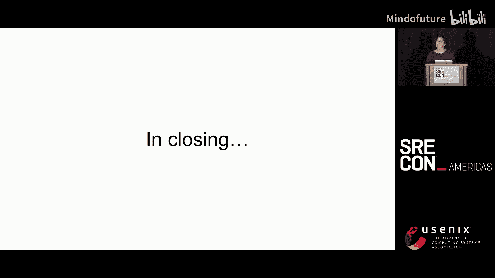
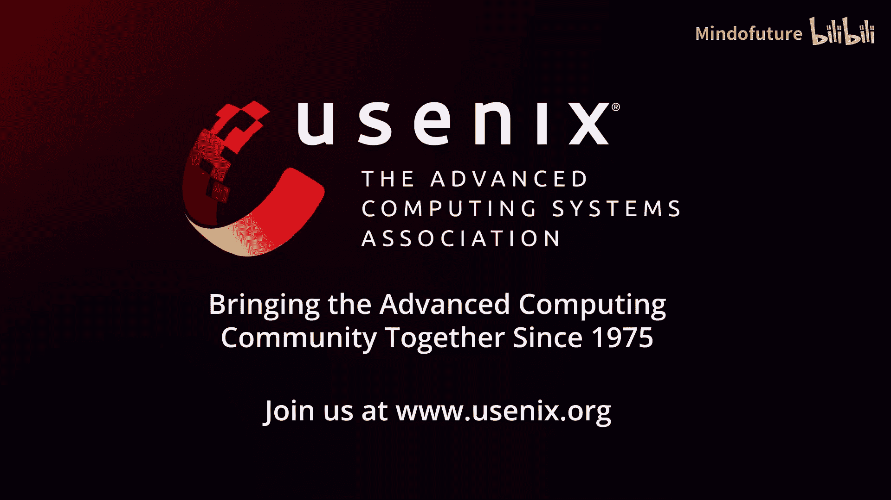

# SRE大会-2025-美洲-｜-srecon-｜-分布式-｜-缓存-｜-OpenTelemetry-｜-安全-｜-AIOps-p46-P46-Technical-Debt-as-Theory-Building-and-Practice--BV1TmLDz7EZZ_p46-

。

Hi。奥慢。My name is Yvonne Lamb and I will be talking to you about tech debt when I was talking with Dan and Laura about this talk I said you do realize that I am not going to do the influenceary one weird trick thing right like I can't tell anybody how to get their tech debt fixed and that's the thing people will always want to know they said they understood that so that is why I'm here and I am speaking both as an engineer who tries to get tech debt addressed and also as a senior enough engineer that people think I can get their tech debt addressed which you know sometimes I get lucky and I can and that's super nice。

Okay， so me， the professional version。I'm a little bit of a ringer here because I've never held a job with an SRE title most of the companies I've worked for have been tech startup Ih somewhere between 40 people and 400 people in size so I've never worked in big tech while I'm somewhat informed about how things go there from books and blogs and blue sky and whatever it's not my world and it's not my direct experience。

 I mean I may say something about big tech， but you know there are plenty of people here who know way more about it than I do。

嗯。And also me， just to give you an idea of what I'm like as a speaker and sort of the idiosyncrasies of the point of view that I'm likely to bring up in this talk。

 I am an extremely mediocre rower and Coxen。So what that means to those of you who don't know about rowing is that I spend a lot of time trying to coordinate with other people in a boat and figure out how to row together and make the boat row well when we can't really talk to each other and as a Coxan。

 I am the little tiny person that sits in the front of an eight and tells people like like into power10 right here and you know I expect them to do it and I have to convey a lot of information to get them to act very quickly so for me that is too useful perspectives to have and it's a way that I've been teaching myself or relearning how to work with other people my friend Jay Kafki when we were in graduate school described me as disastrously forthright and that is pretty true Sarah Quinn who is an online friend who also happens to live in my neighborhood。

She's a sociologist at the University of Washington， said， wow， you are the most academic。

 nona person I've encountered and my friend Ben Rosengart。

 who is also an online friend the first time we met， he sort of looked at me and said。

 so are you the kind of person who tends to work on tech stuff when you're on a non-tech team and non-tech stuff when you're a tech team when you're on a tech team and I was like。

 oh and he's like okay we can be friends now？So。That's kind of where I， that's kind of where I stand。

 I'm a little bit not one thing or another。 Oh， and when Nile was helping me do a review of my C。

 He's just like， you know， you're not really very legible。 I mean， this in the kindest possible way。

 And I'm like。like， and I sort of winced， and I sort of laughed because it is true。

 And it is something that I work on。 So to be really clear。

 this is not a talk about how you talk to your boss or a PM or。

 you know that other team over there about tech debt。

 right Like this is a talk about using metaphor to think about the shape of your tech debt so that you have a better understanding of the stakes and the possible approaches that。

 you know， you can then think about how to convey to someone else。 Like I think a lot of times。😊。

We skip the step of trying to use a metaphor that makes sense to us and kind of pretend like we're filling out a form。

 So we try to drop straight to， okay， what is the form asking for， like， you know。

 like value to customers or， you know， business value or you know， whatever it is and， you know。

 we don't。Really sit down and think through like， okay。

 how do I think about this and how am I going and then take the second step of how am I going to translate this to a metaphor that makes sense you know for my context。

 whether that's your org or the business or you know I don't know your boss is an avid golf player。

 whatever right like the way that you convey those stakes will probably involve metaphor。

 but I can't tell you what that metaphor is because I don't know where you work and I don't know what your business means are。

So I didn't notice until I was pulling。The screenshot for the slide。

 But this is me almost exactly four years ago by the date， right so。

I wrote a Twitter thread which is now archived at Blue Sky I Masteddon almost four years ago to the day where I was ranting about tech debt。

 and I don't remember what motivated this， but I remember that I was in a mood and it was just like。

 look I really think that housework is the right metaphor for tech debt for the thing we call tech debt。

 which I am calling tech debt， but like you we can't use that metaphor because we mostly you know in tech you know it's mostly been made up of people who don't do housework or manage housework being done and this kind of got this huge reaction and even now the thread goes sort of viral sometimes like it just comes back。

 somebody finds it and it haunts me a little bit but。I think it's。

 you know it made me feel good about giving this talk because it's like， okay。

 tech debt is clearly something that people have a bunch of energy around。And， you know。

 the response to the thread made me think a lot about how we use metaphors to communicate and to think。

So second second social media slide。 So this is so a friend knows that I'm doing this， by the way。

 I did ask him， but this is absolutely not to embarrass Fred， but when I saw his post about how。

 you know， just any you know， like just any random comment about a tech thing like can just provoke you know。

 this long stream of consciousness。😊，Disertation practically about it。 But， you know， it's like。

 if I have to make this into a talk， like， I am going to be jumping up and down on this for a couple of weeks to try to like get it。

 you know， get it into a shape where。I can convey to people who can't stop me every other word。 like。

 what am I doing， What am I like， what am I even talking about， but to me。

It's such a great example of how we can be very fluent talking about something when the stakes are low。

 But when the stakes get even a little bit higher， right， like we totally we just like， you know。

 we freeze or we do something weird， right， Like to me。

 that's one of the things that makes dealing with tech debt hard is just the difficulty of talking about it to different audiences。

 right， Like we can all go on for ages about the tech debt in our infrastructures， you know。

 you know， or in our organizations。And we have lots of opinions and we can share them with。

 you know our professional colleagues at the conference bar。

 but when somebody with even like a little tiny bit of power to help us make it go away says， okay。

I get you're upset about this。 Walk me through it。 Like， why does it need to go？ And we。

 we're just sort of like， oh， it's bad。hich is， you know， not an ideal response。

 but in some ways that's actually a better response than the thing that I have definitely done and that I have seen other people do where we just kind of go to the weeds right in front of this person and we start reeling off details and negative consequences while their eyes glaze over。

Like。You know， it's like， and like and we can't stop like， at least when I get like that。

 I can't stop。 I don't know about you。 Maybe you have more self control， right。

 But that response feels terrible to me because。It makes it makes it feel harder to me about having the conversation that needs to happen because I feel like I've kind of messed up this first opportunity where。

 you know， it's like， okay， they gave me an opening and I completely ran them over okay。

 I'm just going to need to take some time to recover and we will have to regroup and try to try this again。

 but I'm a little more together。So origin of tech debt as a concept。The canonical story is that。

It was coined as a。I don't know。I don't know whether as a linguistic unit， by War Cunningham in 1992。

 there is a video where he's being interviewed and he talks a little bit about this。He was。

 so I will hit the high points of the video and not try to play it now because I。It's interesting。

You can watch it on your own， but he was very much influenced by reading Laoff and Johnson's metaphors we lived by at the time。

 he was working on a small talk project for a financial services firm。

 which to me says something very specific about his context。

And he was using debt as a way of explaining the need to refactor the product in the light of new information in the light of new knowledge that they got by shipping the product and like letting people use it。

 right， And he was trying to make the point that a little debt speeds development。

 So it was good to release let people use it。But they also needed the prompt rerite in order to。

Incorporate the new things that they had learned。 And his quote was every minute spent on not quite right code counts his interest on the debt。

 So that was kind of the reason why he picked that metaphor。 Like he was in a， in a。

 in a context where he felt that。That a financial metaphor would really resonate with people。Um。

sortrt of a hand wavy definition of technet， But it's one that I like is Jean Kims， where， you know。

 technet is just that thing you feel the next time you go。😊，To do something and try to make a change。

 And it's just like all of that stuff that gets in the way， right。

 Like all of that stuff where it's like， oh right。 And I have to do that。

 And I have to do this other thing。 And I have to do this other other thing。

 And I don't know about you。 But I definitely have ADHD。 And so it's like。

 when you give me a big long list of things that I have to do。

before I can do the thing that I set out to do。 it's like yeah。

 we don't like that and it's like it was like why don't we go see what's going on on blue sky for a minute。

 and then we'll just come back to this。 So I kind of like I definitely feel Dean Kim's definition of like it's what you feel when you're like。

 okay， I need to go make this change only I can't。 the one problem I have with it is that I think it focuses too much on things that people did wrong with wrong in big quotes like。

There's too much emphasis on like what you didn't do or you didn't do right。

 And I think that there's kind of a category of tech debt that we talk about like as working engineers where。

 you know， like it's really like， okay， like somebody did this thing， it probably made sense。

For a while。 and you know， now for some reason it just doesn't make sense anymore。

 we need to make it go away。 and it's like， okay， but how so Michael Feaths。

 who is the legacy code guy， tells a story about asking a colleague what he was working on。

 and the colleague was like， I'm writing more legacy code。And， you know， again， I， you know， like。

 like， I sort of have this position that tech debt is this kind of thing。 like。

 we just accumulate it by existing。嗯。They're trying to do things。So tech debt is metaphor。

One of the coaches at the boathouse where I row is he got his undergraduate degree in anthropology and he wrote a thesis about rowing that I read and it's organized around the idea of social concepts of you know things that make sense to a particular community of practice or social group and that helped me structure this talk so and I really appreciate that I also appreciate the fact that he was right there the time that my rowing partner and I flipped our boat and he had to fish us out of Lake Union that was recently。

 so it is a recent memory。It was 44 degrees in the water。 That's cold。

 So tech debt is pretty clearly a social concept。 Like， you know， we're here talking about it。

 And like， we don't have to have go into a long conversation about。😊，What it is like， you know。

 we could have a conversation about this kind of tech debt or that kind of tech debt。

 But we kind of know what the right social response is when somebody says， I have tech debt。 Like。

 you know， nobody' is going to be like， oh， that that' really good。But it's not。

Only a social concept in one way， right， and it's。Like I think different organizations have different ideas about what tech debt is or how they want to operationally define tech debt and it's also。

Not only a social concept， but like it's also an aesthetic concept。

Or on unpractical one and so forth。You know， when I was putting this together。

 one of the things I was thinking about was like， so how powerful a social concept is it。RightI mean。

 like how much explanatory power does it have to say tech debt？And I think the answer is， well。

 it's powerful enough that we kind of know what it is。

 we kind of know what response is expected of us when somebody says tech debt。

 but in order to do something concrete with it， know， it's not a magic word。

 we can't just say tech debt and expect people to jump on it right I mean。

 in order to get it addressed， we have to talk about it with more specificity and clarity I so one of my old bosses like to talk about pre work and premeeting and stuff like that。

 And I' I'm not really fond of the concept of prework， because I feel like。

 look it's all work like we need to do this like why are you making up this other name for it。

But there is a sense in which I am going to talk about pre work， because。

What I'm talking about is the work we need to do to understand a piece of tech debt in a way so that we can that will help us talk about it with other people。

 right like not the details of it， like I am 99% certain that any person in this room， if I said。

 tell me about your your tech debt in detail like they could do it like you would not have trouble telling me everything that's wrong all of the details about your tech debt。

 but is that the conversation that's going to help you get it fixed。

 And I think and I kind of think the answer is like most of the time no。You know。

 when people say this thing is tech debt， like they expect a particular response and they're mostly disappointed because like they're not getting it。

 like we're not getting it。嗯。And you know， to me， that speaks to a lot of things about their context。

 But it also says that the metaphor， you know， like we're kind of expecting the metaphor to do work that it's not doing。

 So we need to do some human work around that to get to， you know。

 to convey what we mean and not just lean on the metaphor to to make it happen， right。You know。

 it's like tech De is a social concept， but it's not a social concept that exists out there with no room for individual interpretation or interventions。

 And you know like even organizational ones like all kinds of layers of like what do you really mean by that。

 So I think and I tend to think as engineers， we we tend towards the thinking kind of thinking that I've been known to call like throw another abstraction in the canoe like when things get messy。

 we just kind of look for another abstraction to put on top of it to hide the mess。

 And I'm just not convinced that tech debt is that kind of abstraction。Or you know。

 not the way we want it to be。 like， I mean， you know。

 I think a lot of people would like it if they could just say。

 this is tech debt and we'd all be like， yes， okay， it's tech out。 we're going to go fix it。

And you know， I don't think that I mean like that doesn't happen like people are pretty unhappy about it。

 So this is kind of my picture of the world。 It is probably not the right picture because it looks too mathematical。

 This is not intended as a commutative diagram like for those of you who do mathy things it's supposed to be an illustration of a constellation of ideas that I've been thinking about and I will explain about Susan Lee star and Him's law in the next couple of slides。

 but what I want to lay out is my argument for using housework as a metaphor to think about tech debt right like and to be clear。

 it might not be the metaphor you use to convince your org to let you do something about it。

 but it might be the metaphor that you use to figure out stakes approaches and like you know what the next level of metaphor is right so。

You know like housework works really well for me， it seems to resonate for a lot of other people。

 I don't think it's the only way to do it， but you know。 they didn't ask other people。 They asked me。

 So here you go。 And to be clear， I'm using housework in the sense of taking care of our physical surroundings。

 which is a definition that comes from。Somebody who works with people to do housework when they have physical or mental or emotional conditions that。

Just make house work hard for them and that's a。That's an account， I guess。

 called team Unfuck your Habit。 There will be more about them later。

 But why do I think housework and tech debt are related。 Like， how did I even get here？

 And the short answer is that I think tech debt and housework both share in qualities of infrastructure。

So on the left side of that diagram， we have， we had。

 I had Hiram's law squraed in traditional mathematician by a bunch of eras。 So Hiram's law states。

With a sufficient number of users of an API， it does not matter what you promise in the contract。

 All observable behaviors of your system will be depended on by somebody。Right you know。

 like a really common example of this is performance right like people are going to rely on the observable performance of your service no matter what the contract says。

 you know， it's like if you get way more performant or way less performance will congratulations。

 their timeouts may not do the thing that they used to do and people will be cranky right so Hiram's law was coined by Hiram Wright when he worked at Google。

And。He worked on a team and I learned this from Laura Nolan when I was working on this talk。

 he worked on a team that specialized in looking for large scale patterns in Google's codebase and automatically generating change requests to bring them into line with whatever their desired practice was so I have the feeling that he knew the hard way about people depending on observable behaviors。

Like， I have worked across a lot of repoos before， never that many。 And I just sort of feel like， oh。

 God， I mean like this like。It would be awesome to be successful at this job and the thought of trying to do the job is really terrifying。

嗯。So I think he knows whereof he speaks so I apologize for the wall of text。

 but this is Susan Lee Star's properties of infrastructure。

 Starr was an American sociologist and she's best known for her work on infrastructure and standards in which she applied traditional ethnographic techniques and ideas to studying digital infrastructures and there is there are links in my slide notes which I will release after this talk anyways。

 Star's point is that relational that infrastructure is relational in the sense that it really depends on a point of view and an actor so an infrastructural thing can be top of mind for some people and like nowhere on the stack for others I think the example she gives is that if you're an engineer working on the electrical grid。

 then that's your focus like that's the thing that you care about but if you're somebody trying to use your electrical。

Stuff to cook dinner， right？That infrastructure is just the thing you plug into， right like you know。

 that it's like you like your stove is plugged in in better work。 You're going to cook dinner。

And to run quickly through her properties of infrastructure。

you know that it's embedded into and inside and with other structures like organizations and software and products。

 all kinds of things， right like it's transparent to use in that it invisibly supports tasks like the electric stove。

A lot of us just， you know， like， we don't think about a lot of infrastructural things。 And。

 you know， we kind of resent it when people don't。Don't think about the things that we support except when they break。

 And it's like， I'm sorry to break it to you。 that is a property of infrastructure。

So infrastructure has reached our scope， meaning that it extends beyond a single site or an event。

 it's learned as part of membership in a community of practice， right。Like all of us here， I mean。

 how many like how many people have started a new job and they're like， oh， well。

 we have Kubernetes and you look at it and you're like， what the？Yeah， see。

And it and their path dependencies on previous practices， like it doesn't just appear out of nowhere。

 right， Like there's there a bunch of stuff。 It's like， well， you know。

 this thing is this way because of this decision that got made in the past that is was really to work around that。

 But that no longer exists。 And then you're just sort of like， okay， just， yeah， right。嗯。And。

So infrastructures also work with other infrastructures through shared interfaces。

 which is what it means to be part of a community of practice or conventions or practice。

 it's built on what came before， and it becomes visible on breakdown my favorite。

And it's also fixed modularly， not all at once， which I think is a very interesting point that we could talk a lot more about。

 but not right now。So here's my argument in a slide。

Tech debt and housework share qualities with infrastructure that make housework a powerful metaphor for thinking about tech debt。

So， and I'm going to be very specific here。 so to me， I totally get why people want to talk about。

About tech debt in a financial sense， like sometimes that can be really powerful because business leaders understand。

 you know， risk。 they understand。You know， like things like interest， but I don't think that way。

 I have to do a bunch of work to get to the point where like I have a nicely packaged set of things that I can then apply。

 you know， that metaphor to like at Che， we had a bunch of corporate values and one of them was do the right hard thing。

 And as you can imagine， like we argued a lot about like what the right hard thing was。 but。You know。

 and it's a hard argument to win unless， you know， like you can be clear about what you think the stakes are and argue for them。

 like you can't， you know， like I I feel like a lot of times people want to fill out a form。

And you know just like apply the meme and it's like， well， you can't apply the meme。

 I think you actually there is something to be explained。嗯。So there are lots of people， by the way。

 like in the discussion track today， there were a lot of people from Fintech there and you know like they really disagree about the they would not agree with me about housework being like a good thinking metaphor like they are so used to dealing with debt for them and they know way more about debt than I do right I was planning to read David Graber's book on debt before giving this talk it did not happen but you know they know more about financialized debt than I do。

 So you know that makes it a powerful metaphor for them。

 one thing I do think is that part of the reason why financial things appear to be so legible is that there is a whole bunch of infrastructure built up around them like。

You know， there is record keeping and laws and regulation and specificity right like even pretty small organizations。

 generally employ people who work on maintaining a certain amount of clarity around financial debt。

 like whereas if you ask an SE about tech debt like usually we're just like we saw。

 we rant or we launch into a horror story right there are times and places for all of those。

 but you know they're not necessarily the utterances that will help us think through our tech debt and get us help and especially not from decision makers。

Okay， examples of horror stories。We're going to do this。

 This is not an exact mapping of housework to tap that story， by the way。

 and on a different day I might put different stories with different lessons。Okay。

 the toilet or people want maybe need to see a positive change。 This is the story that when I said。

 I'm going to do this。 and my partner was like， you are not。And I was like yes， yes I am。

 So here we have a picture of a bathroom with a toilet in it， it is my toilet。

 it is not a particularly elaborate toilet， but it is extremely water efficient We do not have this toilet because we deliberately set out to upgrade I just want to point this out。

Does is this starting to sound familiar to anybody right， The old toilet was fine。

 but it was original to the house and it wasn't water efficientff。

 but it's not like there's ever a good time to replace a toilet。 So you know。

 we talked about it for years and we're just like， well， I mean。

 it's just not that big a piece of work and we'd have to get somebody out and you would have to find somebody and like I don't know you know。

 so it just didn't happen right。The reason why we have this toilet。Is that。

We had a side sewer go out。 now， I think I can look around and sort of tell who's a homeowner here because。

 or especially a US homeowner。 So this might require some explanation， right。

 Like so a side sewer is the part of the sewer line that runs from the street to your house。

 I learned from Nile yesterday that it's called a drop in Ireland。 And critically in the US。

 the thing that matters is that if anything goes wrong with it。

 it is your problem as the homeowner right， so。And。

Things that go wrong with side sewers are expensive because they are very deep like they I think like regulation is6 to8 feet underground。

 And so you know there's time for a lot of stuff to accumulate on top of your side sewer。Anyways。

 it's not like there's ever a good time to replace the sides somewhere。

 but I extra special resented having to do it in the two weeks， between， you know， like in two weeks。

Like right after Thanksgiving and a little bit before Christmas。

 like it was not fun and replacing it involved， digging from the street level then under a six foot rock wall。

 then up and inclinedline to the house。 Like it was， it was a lot of work and the plumbers。

 like it took weeks just， you know， between people's vacations and。😊，U。You know。

 just the amount of work and things that they found along the way。

But the plumbers were at the point of starting to put everything back when we realized that being able to flush is really important。

But we were also going to feel really bad about having spent all this money only to have everything look exactly the same as when we started。

Right， like like see， okay， like people I recognize it。

 So we decided to have the plumbers install a new toilet for us while they were there。

 And since it was sort of a spur of the moment decision， we just took the toilet that they had。

 which was a fairly fancy very water official when we were like， right， you know。

 like this is nothing compared to to the cost of replacing a side sewer。😊。

So there is a story that goes with this， which is package repo at Chef。

So when I started on the release engineering team at Chef， our first big project。

 like the way that we thought oh sorry our first big project and the way we thought about our first big project was to replace our bespoke manually generated Gens built pipelines with ones that were standard built with code and deploy using Che right like that's pretty good like I mean it was pretty good for 2013 like and we were really excited about doing this。

 but what excited our internal users about this work was they were told and you'll get external facing package repos for customers。

Right。We weren't doing the work we were doing to give them package reos。

 But package reposs were definitely the thing that people were most focused on。 Like。

 it was actually a little bit weird because， you know， people would ask me， you know。

 like I would give a status report。 and then people would be like。

 so how are those package reposs coming。 And it's just like。You know， like it was just。

 it was just a mind shift to have to be like， right， that's the thing they care about。 We need。

 you know， like we need to talk about that。You， but it was very effective。

 Like people were very were very patient and very happy once they got their package repo。

 So I had a couple of takeaways from this。 The first 1， I feel like is one that most people know。

 which is you need to find a win for your internal customers。😊，Um。And。

That's hard for infrastructural work， like it's not just tech debt。

 like a lot of infrastructure work is like this。It's just not the kind of thing that your internal customers necessarily get all that excited about。

 really someone I know who might even be here， I thought I heard their voice。

 but I didn't see them was talking about how their team after a whole lot of work started being able to support IPP IPV6 for their company's customers and they were so proud and they announced it at a company meeting。

 people didn't know what it meant and and that's really disappointing right it can really help both you and your internal customers to have a win that they get excited about。

Whenever I say that， somebody thinks I'm talking about， you know。

 like how you should do more work in order to make it so that people。

 so your customers can get a new shiny。 And it's like， no， that's not what I'm saying at all。 right。

 Like technically， there's no reason why we couldn't have just given them。

Given them in package repos right away。 But we had to get to， you know。

 like our argument was package repos don't mean anything unless you have a reliable build process where you don't get the thing where you have like。

Not， you know， like。10 pipelines run， but， and， and you get 9 packages uploaded。

 but one of them fails。 Like， what does that even mean， that's an indeterminate state。

 Somebody would have to do something about that。Um。So， and for me。

 one thing that made this project nice to work on was that the team was a pretty good mixture of people who had been at chef for a while。

 So they knew all the lore and the people who didn't and didn't have any attachment to the way things were。

 So， you know， it was not， you know， like we could have replaced our toilet。 And， you know。

 we could have taken a weekend and done it。 there would have been feelings。 right。

 Like having the plumbers do it。 That was a good choice。So the fridge or path dependence。

This is my fridge。 It does have helmetls of content management written on the whiteboard。

 and I will happily argue that， but not now。You will notice that the area over the fridge is weird。

 That's because there used to be a cabinet there。When our previous fridge died and we had to replace it。

 what we found out is that to make a very long story short， American fridges have gotten bigger。

My house was built in 1947。 I can tell you that doors do not get bigger just because fridges get bigger。

So the only fridge we could find that would fit through our doors。

It had all the features we wanted was an expensive。

 imported one from Australia and it was too tall for the space。 and we were just like fine。

 we'll take the cabinet out。 we don't really use it。

 It's over the fridge and getting the old fridge out was also a thing and it convinced me that they must have put it in the kitchen when there were no when the house was being remodeled and there were no moldings。

 So story， it was easy to install。 So I was working at a midsside startup and my team inherited the carro and feeding of the package repo that customers used to install the things that they had paid for。

When we took it over， the person who did the handoff casually said， oh， well， you know。

 we have to do this in a hurry。 So we picked a thing that would be easy to install using the workflow we already had。

 So basically， they picked the package repo because it had a helm chart。

And once we started running it， we found out that thing had all kinds of problems。

 one of which is that deleting things from it was hard and it' hard enough to take like a day or two。

 And you know I think it should be a little bit hard to delete packages from a package repo。

 but two days hard is kind of a lot anyways， during one of our fights with a thing one of my teammates found out by watching a talk that that software was only accidentally a package。

Repo， what it really was supposed to be was mirroring for other package repos。

 which kind of explains like why it was so hard to delete anything。 and it took a year to get rid of。

 but I wasn't there by then。So my takeaways。 And it sounds depressing to say。

 like nothing would have saved us， but it is， in fact true that all the critical decisions about this thing had been made。

 you know， before we ever got to it。 And I want to be clear that， you know。

 I kind of make fun of the installing it because it's easy to install。 But in fact。

 it worked fine most of the time。 I mean， there were things about it that didn't work。 but。

Those things also changed when my team took it over because we were different people we had we knew about how packages got uploaded like so people came to us with different problems because they knew that we wouldn't shrug them off and I have a rant about how our industry prioritizes the getting started experience and the advanced experience but does nothing for the middle I'm not going there because it's a whole different talk but I'm saying it so I can put the boundary there and move along。

One thing that this project did was make me really determined to stop people as much as I could from making the same kind of mistake we did where we just installed the thing because it was easy。

 And I was like， so when I stand up a new service or something。

 I try to make it really clear like what it is and what it does and what I meant for it to do。

 So like it's really clear that it's like， look if you use this for something else。You know。

 just like you're kind of taking your life into your own hands， like it might work for you。

 it might not。 you know， you might be stretching the use case。U。

And so that's the thing that I've tried to do。The closet。 Or do we have to fix this all right now。

 So this is a photograph of my bedroom closet from the outside。 As you can see。

 it sticks out from the side of the house。 What you can't see is that this is the northeast corner of the house。

 So it's the coldest darkest place to put a closet。

 The reason why that closet is there is that in the 80s。

 somebody who lived in the house decided that they wanted another closet。

 So they they or someone they hired took asaz all and they cut a hole in the external wall of the house。

😊，Then they built out a closet， stuck a roof and some siding on it。

 and set up a terrifying inside light that involves lamp cord and extension cord。

 and I did not show you a picture because I know that there are amateur electricians here and that you would just take one look at it and like not hear another word I said。

It is not good， but it is a working closet that is around eight degrees Fahrenheit colder than the rest of the house in the winter。

 and I do not use the terrifying light because I do not want to be a crispy critter。

We also found out that the inside edge leaked under certain circumstances。

 but you know the thing is it's like like， you know， this is technet， right， I mean。

 it seems like replacing this is a major thing and like how good would it feel to get like a closet that isn't stupid。

Even if you think this closet is really stupid。So what we tried to do was when we worked on other things in the house。

 we've tried to fix various things about the closet as appropriate。

 like we had the roof fixed and we had flashing put on the edge so that it does not leak。

My story about that goes with this is Solars1 you1 support at Che。So this was a saga。

So when I worked at Chef， we supported our product on some old and pretty esoteric platforms。

 so we had to have physical hardware for them。And。When we were replacing the entire build system to make it more uniform and more reliable。

 ops came up and's like， by the way， you know those solarlaris build machines。

 they're really expensive to run， they've got this really big power draw and they're not like anything else that runs in that data center and so we're kind of special and it's very expensive to be special。

But you know， so one of my teammates at the time was Scott Hayne。

 who knew all about weird and esoteric platforms。 And so， you know。

 he worked with ops and they found you know， a less crazy solareris machine to build on and you know。

 you know that we did not that we would not have to support via eBay。 And so they got them。

 And this was great。You laugh， but I am serious。 So they， so they made a plan。 They announced it。

 it was great。 they thought everybody is going to be happy until one of the devs said， okay。

 because we currently build on Solaris， Pret ancient。

 we accidentally get binaries that will run on Solaris 10 you1。 you know。

 will the new hardware do that。 And we are just like。😊，we don't know。 And I。

 so I fired back a question that I thought was perfectly reasonable。 It's like。

 was anybody running chef on Soiers 10 you want And like， no， I mean， like nobody knows。 Like。

 that was the problem。 So we went down two parallel paths。

Scott's task was to job Scott's job was to figure out like。

 can we build something on the new hardware that will work that will work on Cers 11。

 My job was to figure out whether like whether we needed to。And I thought， oh， someone must know。 No。

 no， not at all。 It wasn't in Salesforce as far as I could tell。 And I started asking around。 And。

 you know， if you really want to freak out your customer。Teams ask， so does anybody use that。

 Do we still need to build on build things that run on that， because they they will be like。

 it's like we can't we can't cut people off。 It's like I don't want to cut people off。

 but I don't want to support them if they don't exist either。And you know， it just went on like。

 we just kept finding new things。 like I asked our brand new project manager。

 product manager about this。 And he started running around like a headless chicken。

 which was nice because I had company。 But it wasn't really helpful because it's like， well。

 I asked because I thought you might know。 if you don't know。

 I can run around like a headless chicken and you don't need to do that。

 somebody told me about a new telemetry project at Che。 So I went to ask Chris Doherty。

 who was a guy running that and said，😊，You know， like what。

 and then he started laughing at me and he's like， so we get all of the OH data。

 which is the part that Ver Che knows what you're running on back。

 but we get it back in the form of a binary database blog。So we can't query it。 sorry。

 like and I was just sort of like what do you mean like this is all very depressing。 I mean。

 the good news is that Scott figured out a magic solution because Solars really wants to be very backward compatible so we could build on it。

 but like like none of us were happy like this was not really satisfy。U。

My takeaways like keep asking both like do we really have to do this and can we do this like be pragmatic but also be very intentional about it we got a lot of value back we got a lot of value back going back to these questions like do we have to do this。

 you know can we do this？It didn't feel good。 right Like， we just had to make a lot of trade offs。

 We found so many things along the way that we wanted to fix。

 And we just had to put our heads down and say， like， like。

 we are trying to answer some very specific questions。 We're going to keep doing that and。

Keeping an eye on the problem space。Will help you， right。

 And since a lot of people don't know what that is。 I threw a slide up on the definition。

 It's a term that I heard from Indie Young。 And it basically means a problem space is sort of like the whole context of the person。

Or you know who might try to use your thing， right。And it sounds like the answer is obvious like。

 well， they're trying to run chef on Srs 10 you1。 But it kind of isn't like， who are they。

 Is there only one day or more than one day， Like， you know。

 like what we were really trying to do was like， support our customers on。The esoteric platforms。

 but on the necessary。Essooteric platforms in the most effective way possible。

So my spice store or finding places for things。So when I showed Nile this slide， he was like。

 but but you know， okay。That it's like dishes， laundry， trash。

 stuff that has stuff that stuff that doesn't have a home。

 There's more of it than everything else put together， right。

 I just want to mention that Captain A team fuck your habit and Casey Davis are all people who are really good at talking about doing work and keeping up when you are emotionally depressed。

 have physical。Disabilities， just you know， people aren't who don't normally who don't necessarily who are not necessarily at 100%。

 like you know， we deserve nice places to live too。And so this， find homes for stuff。

So one of my close friends has moments when she talks about retiring and spending the rest of her life designing the perfect spice rack。

 I don't need a perfect spice rack。 Like we settled on jars in a door labeled on top with the name of the spice where I can skim and you will notice that some of the lids are not labeled。

 That's fine。 We don't use those enough to care if we start doing it， I'll label them。😊。

It doesn't have to be perfect because spices live in a door， coffee， we know where they are。

 and we can find them when we need them。Examples， right？

A good example of this is Etsy's deployator because I love this story right like they did not stand up the GoI for deployator because they had a perfect deploy system and a perfect UI。

 which is what a lot of us would do right like they stood it up because they needed to make a division between the part that people at the back end that needed a lot of work and the frontend that people need in order to do their work。

Okay， and I say I'm running low on time， so I'm going to skip this giant story。

 but you should totally go and read the story about the open source helm chart。嗯。

I do want to talk briefly about- I'm sorry， I have to show you this picture。

This is what happens when we make a plan to。For getting rid of tech debt before you know。

 when we get out over our skis and do it and we don't tell people， you know。

 and we don't get people on board with this is the problem， this is。You know。

 this is a problem and convince them to get on board with during the problems so that they can find the problem。

 a home and。Get the right people on board like what happens when we make a plan is that it is like this poor cat who has been denuded of all of his adorable fluuffiness and he does not look like a happy cat。

Like so don't do that。Okay， so what does all this mean？So our story so far is that。

That housework tech at and。Infrastructure are all connected and tech debt and housework。

Kind of rhyme with each other and how we can think about them because of their infrastructural properties that。

Thinking about tech du。You know， with and against the labor of keeping and maintaining a house it's actually like I find it useful to think about right like it's a very rich area。

 like I have made all of these examples and people are a， I see that。 and it's like， yeah， I mean。

 are these the examples you would necessarily want to use to explain things to you know your boss or your boss's boss or you know the PM maybe maybe not。

 I don't know Like there's probably a metaphor that resonates more for them， but this metaphor。

 having a rich metaphor of your own can help you do the thinking so that you can figure out the stakes。

 you can figure out like like what could we do like do we have to do anything at all。

 Like it gives you more handles to play with。 And you know。

 if if your company's metaphor resonates with you to that extent。

 that is awesome that that has never been the case for me any place I've ever worked。

And housework is just a way to build a theory or a model。So not every talk that I write has a theory。

 but this one does right， Like， this talk is seriously thinking about theories。

 I'm thinking about like， what makes a good theory， like。

 how do we build one and how do we use a theory to help us communicate。

So the title of this talk is a riff on a beautiful paper by the scholar Bell Hooks。

Called theory is liberatory practice， which is about black feminist theory and how it gets squished between。

Feminist theory that come out of mostly mostly white academic spaces。 On the one hand。

 as spaces were' trying to think。And generalize about your lived experience like is considered impractical These contexts aren't the same and the stakes are definitely not the same。

 but I love the combination of thought and emotion that hooks invest in the effort to understand as an individual and the effort to share and use and question that understanding with other people like you know。

 I really love that she says let me begin to say that I came to theory because I was hurting like I came to theory desperate wanting to comprehend。

U。So part of what makes tech debt talk difficult to talk about is just that it like we all have so many feelings about it。

 right， Like we notice this， you know， like we know this。 like we are all just sort of like， oh。

 yeah。 we could talk about this for a really long time。And I think that on some level。

 those are feelings about entropy and it's fine to have feelings about entropy like entropy is big right like the second law of thermodynamics says that systems tend towards increased entropy also known as greater disorder like this is a big fight we're fighting here like that's a pretty reasonable thing to have feelings about something that I want to throw out there is that you know we shouldn't think about what a collective response to that looks like like what should we demand not just of you know our families and and our workplaces。

 but you know also of our professional communities of our professional organizations like what would it look like to support to have support for our doing this kind of work as opposed to people relying on the fact that you know a lot of us are mission- drivenriven people with ADHD and you know we go running towards the fire。

So I want to close with a speech from one of my favorite plays， Arcadia by Tom Stopper。

 It's a beautiful play about chaos theory and history and how we know things。

 And it's above all a play about entropy。 All of the characters， whether they know it or not。

 are dealing with entropy。 And this is spoken by a character who does know it。

 He's a mathematician who has a big pile of data and is trying to understand how it all fits together。

😊，The unpredictable and the predictable unfold together to make everything the way it is。

 It's how nature creates itself on every scale。 The snowflake and the snowstorm。

 It makes me so happy。😊，To be at the beginning again， knowing almost nothing。

 people were talking about the end of physics。 Relativity and quantum looked as if they were going to clean up the whole problem between them。

 a theory of everything。But they only explain the very big and the very small。you know， the universe。

 the elementary particles， right， the ordinary size stuff， which is our lives。

 the things people write poetry about clouds， daffodils， waterfalls。

 and what happens on a cup of coffee when the cream goes in。

 these things are full of mystery as in mysterious to us as the heavens were to the Greeks。

 we can't even predict the next drip from a dripping tap when it gets irregular。

Each drip sets up the conditions for the next。 the smallest variation blows prediction apart。

 and the weather is unpredictable the same way will always be unpredictable。

When you push the numbers through the computer， you can see it on the screen。 The future is disorder。

A door like this has cracked open five or six times since we got up on our high legs。

It's the best possible time to be alive when almost everything you thought you knew is wrong。

 Thank you。

