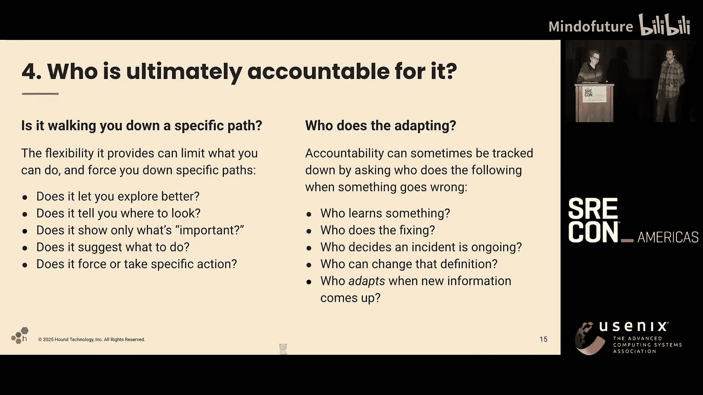
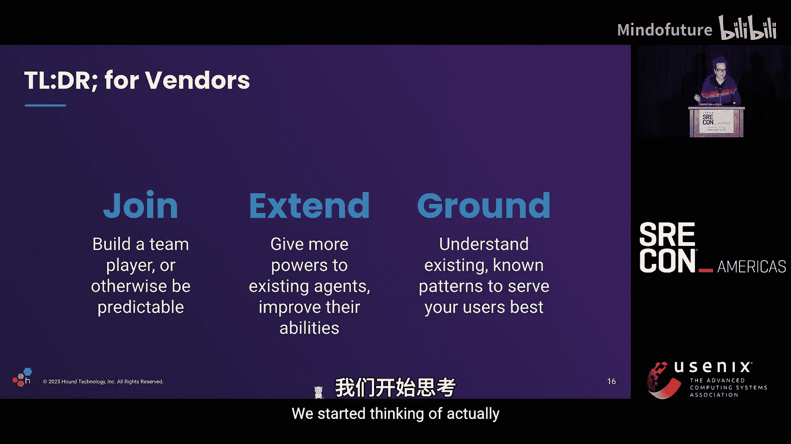
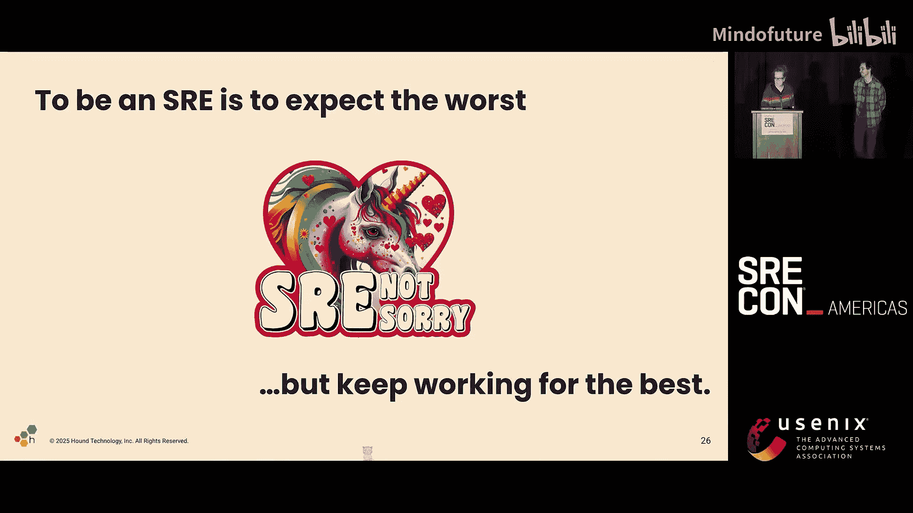
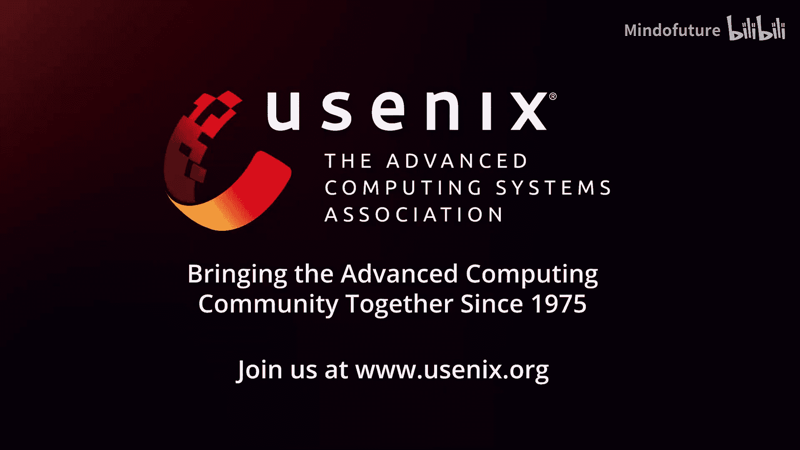

# SRE大会-2025-美洲-｜-srecon-｜-分布式-｜-缓存-｜-OpenTelemetry-｜-安全-｜-AIOps-p47-P47-AIOps---Prove-It!-An-Open-Letter-to-Vendors-Selling-AI-for-SREs--BV1TmLDz7EZZ_p47-

。

嗯。Thanks for that lovely introduction。And thank you to Fred for stepping in。😊。

How many people here saw this were like， oh， God， another AI talk。Oh， god。 It's okay。

 This is a safe space。 You're allowed to hate it。 I do， too。 I started off pretty cynical。

 It is my default stance。 I will say that。 but I have come on a long journey when it comes to this AI stuff。

😊，I know I'm not the only one here。There's a lot of hype。 And I think to people like us。

 think one of our superpowers is that we are extremely， I don't want to say allergic， but。

We find it very off putting。 We find hype very off putting。 And underneath the hype is a reality。

 though， that it is the advent of a new kind of computer and a lot of things are changing。

 which is why I think it is so important。😊，嗯。That we。Change a little bit with it。This。

 the origin story of this talk was Lex Neva of Sssri Weekly was talking to me about how every day he gets pitches from vendors selling their AI Sri thing。

 and they read like advertisements。😊，And Lex writes back， basically going to show me the money。

It showed me the evidence and never hears from them again。And。He write， he wrote this lovely。 Well。

 it was actually based on an email that he was literally sending to all these AI S E vendors。

 I encourage you to write it。 I dropped the link there。

 He's basically just like the way to gain an S's confidence is examples， data。😊。

Let me know that you know how the thing could fail and again。Here's nothing back。

 a couple brief shortly after he wrote this blog post， Lex went to work at NviDdia。

 so he is now getting paid lots of money and has lots of NAs。

 which is why my dear friend Fred is presenting this with me。😀。

So I went online and I checked for all the AI ofers and the kind of claims they were giving us。

 And I saw stuff like this is gonna be your new S， your S companion。 It answers every questions。

 reviews pull request， proactively monitors and alerts about in front。 Sounds kind of nice。

 adaptaptive learning and zero maintenance mechanism that reduces firefighting。

 starting to doubt it a little bit。😊，Adaptive learning and quick automatic root cause identification。

 now， no， I have feelings。Root cause as a service， like， hell yeah。Yeah。

 all of Le's money goes into that。Full understanding of the app finds the root causes。

 suggests the fixes， generates post incident analysis。 Finally。

 someone has full understanding of the app。 I can go on vacation， great。😊。

AIS SRs going from supervised to unsupervised work， eventually doing most of the work autonomously。

 absolutely great。 This is really interesting， right。😊，As journalists would say。Big of true， or。

 as we would say。就。When I was talking with Lex about this， I started getting flashbacks。

 and I realized。For the first。Three or four years of honeycomb。

 I had a tab open the entire time with this blog post of John All Spaz。

 which was called an open Let to Mon metricss and alerting companies。

This will be an unsolved problem。 always， don't tell me how your software is going to fix it for me。

 Show me you're trying to build a product that is going to join my team as an awesome team member。

 Tell me how what you're building is going to make my people better。 And I。😊，Obviously。

 this was a huge inspiration for everything we've been building at honeycomb。But it really。

9ine times out of 10 It is so resonant today。 I really wanted to just see like an open letter to all AI。

 Sre and AI ops companies because it's so resonant。 This is not it's not 10 times out of 10。

 but nine times out of 10 when you're hearing people freaking out getting anxiety and just like angst like for me。

 it's been a really useful test to just substitute AI with automation because so much is not actually new。

 It's just an accelerated version of what we've been dealing with ever since looms were invented to replace weavers。

😊，And the interesting part about doing that sort of substitution is that we have a lot of experience putting automation in practice。

 deploying it coming from before computers like there was automation already。

 and so there's a set of questions I like to ask myself that I think we should ask ourselves every time we're given a kind of new automation tasks that would be in there and that works exceedingly well still with AI agents。

 especially the ones that are like root cause as a service。The first one is。

 are you supervising or being augmented？We've all seen probably at this point。

 the ideas is something like the Tesla selfdriving car where you have to have your hands on the steering wheel。

 And if you don't， it stops being there。 your job is to make sure that the car doesn't make a mistake。

 and people don't like to do that right They were having videos online of you wedge and orange or a water bottle on the steering wheel。

 and then you can watch a movie while the car is driving itself。

 We know that being in a kind of supervision mode does not work well。

 It is true with the Tesla self-driving cars。 It was true with airplanes。

 it was true in the 80s when Binbridge published the ironies of automation。

 And it is true when it's also coppit and you're just looking at the code and going like yes， no。

 yes， no， you are the supervisor and you are being taken out of the active work。

And all of this sort of comes back to this image or this is something called Fs list。

 it is the idea that the humans are good at one thing and machines are good at one thing。

 so you let the machine do the good thing and you let the humans do the good thing。

 and that puts you usually in the supervision seat of looking at it and having a bit of judgment that the machine doesn't have。

This is wrong。 This is not necessarily how it works。

 The things we're looking for is more of a joint system of team work。

 The machine is supposed to give more capacities to the humans。

 The humans is going to steer the machine in the right direction。

 but we are all stuck together in the same system。 a notebook with text on it is part of that system。

 This is how we make decisions。 This is how we communicate。

 This is how we do this stuff and people need to be involved to stay current with what they have。

Where you are in the loop kind of matters， right if you are in front of the AI。

 you're going to get different results that if you are behind the AI and supervising。

 if you have a team of three people making decisions。

 they're going to work differently than a single person if you put one AI in the group it's going to be different when someone tells you there's a human in the loop。

Ask where it is in the loop light， because otherwise you might just be the scapegoat for decisions rather than really part of a team with it。

Another one is like， what are the perspectives that it makes in。

Each of these agent has a limited universe。 David Woods talked about that。 There are limitations。

 If the only thing you plug into your AI are going to be your observability data about your systems and the components。

 you are never going to get a suggestion out of the agent that tells you how to rework your team structure。

 It doesn't know about your team。 So these things are inherent limitations that you have in there。

 Likewise， it's going to have limited operations and what it can do the same way that you can limit the permissions of a user in your system。

It will not know about major sections of your social technical system。 It will ignore many of them。

And one of the risks about that is that if what you have is something that is made to act and look like an agent。

 like a person that you can talk to and do everything， but it has the capacity of a limited tool。

 you're having the wrong interface， which is why the image here is trying to drive a bicycle with a PlayStation 5 controller。

This is often what we're being sold， something with the ability of a tool。

 but the interface of talking to someone， and that's extremely misleading。

 and that contains inherentent risks。Yeah， so many of these really boil down to is it making you better at your job the long you interact with it or is it making you worse at your job the long you interact with it Another one is how good is it at delivering what it promised nothing ever delivers what it promises this is why marketing and engineering are to very different organizations。

It won't be perfect even if you need it to be。 One of a common trope and incident response。

 though was heroes， people who get so used to doing the diving save， right。

 They know everything about the system and they end up becoming these very very critical bottlenecks in all emergencies。

 They can't go away on vacation。 They can't get married and going on honeymoons ask me what it's like to be on a beach in Hawaii。

3 a and getting a call from your CTO because they can't get Mongoty be back up。

This is a huge anti pattern with people， it's going to be just as big of an anti pattern with AI agents。

 if your agents are taking some type of issues and handling all of them，Are they becoming heroes？

 What do you do if they break or misbehave if your people no longer know how to debug it？

It's also possible that AI could remove large portions of our jobs。Or all of our jobs themselves。

 but if they try， they're going to create new needs， new challenges， new needs for expertise。

 any addition that you make is not going to do just。What you want or what you expect。

Surprises are sort of apart for the course。And one of the interesting things as well is always who is ultimately accountable for it。

When you are using some sort of technical solution。

 there's this sort of angle between augmenting the person or augmenting the machine。

 When you augment the machine， the sort of thing that tends to happen is like the basic common operations get done at a higher pace。

 They're faster， you can do a lot more with the same amount of effort。

 The difference when you augment a human is that generally you take the most challenging tasks and you're able to make them a lot easier。

 and that has a bit of a different。alignment in what it provokes。

 because if you have augmented only the machines all the time and they start breaking。

 then you're never in pace again。 If you are augmenting the humans。

 there is a broader range of things you can do that you can deal with。

And one of the things that I like to do when we are being given tools about operations and whatnot is asked like。

 does it let me explore better Can I see the whole richness of everything。

 but just go through it with more ease getting a full perspective in the context along with it or maybe it tells me where to look It shows all the data but there's a little highlight where I can put my eyes and I still see what's around。

 but it drive my attention somewhere more restrictive it filters out the things you don't want to see it goes like here's relevant information And now if I want to challenge that information。

 it's up to me to make the effort to go look elsewhere because it's not shown to be And then in some cases it's gonna to be even more restrictive。

 It's going to tell you like somethings happening， you should maybe do this operation。

 restart whatever install upgrade changes configuration and now I'm taking a bit even more out of the context and all I have to judge is this narrow path that the automation has chosen for me。

In some cases， you're going to get the worst part of it， which is just like， do this thing。

 It tells me what to do。 There's no alternative。 I am here to be the automation hands。

The issue with that is that it's walking you down a very specific path。

 but who does the adapting is how you know who's responsible for the outcomes of it。

 it could be who learns something out of an incident when something goes wrong。

 who does the fixing right the AI did the wrong thing， who goes behind and fixes it。

 does the AI fix itself， who puts the new guardrails in place。

 who even decides that there's an incident right now and the wrong thing is happening。

Who can change the definition of what is an incident that this is the new normal is okay。

Who adapts when your information comes up？And the thing that's interesting is that if you take these two columns together on the left。

 you can be put on a path where you don't have the agency of the ownership。

 you are given a set of consequences， and then you are told to own them。

 but you aren't given the opportunity to do the proper thing。 So you have to really。

 really think about that when you are handed automation。

Overall， like if I had to do a tool long， didn't read for vendors。

 it would be these three keywords join I want you to build a team player。

 This is what you're advertising It needs to be able to act like one。

 If it is not able to act like one， then do the right thing and just be the tool you are actually able to be。

 do not look like a person when you have the tool' capacity。In my mind。

 this is why we see a lot of people like trading prompt information like their magic and temptationations。

 They are people trying to force the AI to do the exact thing they want because they have the ability of a tool and we're trying to make them predictable enough to use them in a very specific context and this is going to happen in this as part of the challenge and we go。

 the nondeterminism is fantastic， but we're still struggling to contain it because a tool that you can predict is not a good tool。

 It's just a thing that can。So chaos。 Second one is extend。

 right give more powers to existing agents， integrate the workflow。

 give them new abilities or improve them。 And the last one is grounding your information Again。

 these patterns are known。 Theres a long history of studying them。

 even if like AI has plenty of new ways of doing things。

 They're fundamentally often the similar patterns。 And so you need to be able to show that you've explored this thought about this rather than trying it on me in my organization。

 And I do all the out for your fucking around。Yeah， so Fred and I started working on this talk。

 and at some point， they upgraded us to the closing keynote， which is very nice to them。

 but we started thinking of。😊。

Actually。Vendors don't actually give a shit about all this nice advice that we're pulling together for them。

But or we don't expect them to。 maybe they will。 we do expect you to care， right。

 We do expect you to care a lot。 and， and I feel like that there's a moral authority that。

People in this room have by willing to take the thing earlier when it said that the person who is accountable is the person who does the adapting。

Oof， that hits me in the fields。 There's a moral authority that you accrue when you're willing to。

Do the hard things to run towards the fire， to be woken up in the middle of the night。

 not that we're all like glamour as a hero culture。

 but I feel like people who do hard things earn the right to ask the organization to change in certain ways。

We have long been the guardians of risk。 I was thinking about all the ways that this role has changed over the past as long as I came from I was like one of the very last generation of ops folks who would get a call on a phone。

 middle the night， call a taxi to go to the Kolo to flip a power switch on the Myypolo primary when it went down because we didn't have remote hands。

 you know it was like 19 I got to do that I'm like， well。

 this is what I'm doing for the rest of my life。Surprise we've long and what I think that our role really boils down to is this。

 we are the guardians， we're the shepherds of risk。For complex software systems。

And AI is a bunch of very complex software systems， and we are needed more than ever。

 There is an unprecedented amount of risk to be evaluated and guarded against。

But to truly meet this moment， I think we also have to evolve。

There's no way to talk about risk management without acknowledging that for most companies。

 the biggest low level ongoing existential risk that they face is not innovating。

 not moving fast enough。You can run out ofns for reliability。

 but you can also run out ofns in your bank account。Yes。

Preures are not just technical No they are also financial leadership organizational and proper handling of risk is being able to handle these tradeoffs and not necessarily hold fast for one position it's easy to become the sort a department of no I think if we haven't felt we we're doing it we've maybe felt it with the security team at the places we work at and that's often a model we don't want to be and it's a model the security teams themselves don't want to be Yeah I really feel like that is the single biggest reasons that like ops departments like our endangered species because they were you know they were seen as the Department of No。

 they were seen as a cost center and increasingly when you've got technical teams。

 all of us are in the business of generating value you're if you're in the business of being a pure cost but it's not a great place to sit。

This is a season of great change and where there is change， is there is opportunity。

 the stuff is changing so fast， dude， two years ago， generative AI is coming out。

 and I think it was really easy for a lot of us to write it off as just fancy autocomplete because that's what it was。

😊，That's not what it is now， honestly， anyone who makes confident statements about the future more than a year or two out is full of shit。

And the more confident they are， the less you should listen to them。

I really get being exhausted by the gold rush like I am too and the fact that AI seems to be just invading every space。

 nothing is immune， like I've been on honeycomb sales calls when we bring out the topic of AI and people just their eyes just baz over and they're just like。

 oh， you too。I'm developing a bit of a callous for these topics。

 the way that everybody feels that they have to slap AI on some bullshit I was telling Fred I'm like feel anymore I see AI and next feature it just tells me it's alpha quality because as soon as something is dependable and reliable it works really well they don't call it AI anymore nobody is like Gmail AI I bad filters。

 no they've been AI for 20 years and。😊，Yeah， it's one of the things that to me lines up with the idea of if your AI respects its limits and its well usable。

 it becomes a tool。 exactly Spm is a tool。 Spm filtering is a tool。 It's AI technology。

 It's well constraintsstrain。 It does this one thing。 It gains a name。

 It stops being AI because we know how to use it and it is well instrumented。Yeah。

 there is some interesting like the， the advent of nondeminism into a software engineering discipline that is predicated on determinism is super interesting。

 What are APIs， even if you can't rely on the answer。 It's super interesting。😊。

And I don't have the answer， right， What I do know is that the future is being created right now and the future needs。

People like us， people who are critics。People who are naysayers。

 people who are always thinking about how shit is going to break。

But in order to be part of the conversation， we do we need to appreciate the opportunity we need to。

Overcome our tendency sometimes to always look how it will fail and。Now move past that。

 even if you don't believe this， even if you don't want it to be true。

People with money think that it's true。I sit in this really weird place now， between。

Between like people， I feel like you all are right people right this feels like home to me。

 I sit between engineers and managers and execs and board members and venture capitalists。

 and they see the world very differently than we do。You know。

 VCs are now they're like well we see the world as being there are pre AI companies。

 pre LLM and postLOM and next time we go out for money。

 we are going to be being compared again in terms of efficiency next to startups that we're founded you know postLOM and are doing just as much stuff with only five people and even if we don't think that's true。

People are going to be looking at us and going， you know， with their skeptical hats on。And。Honestly。

 if there's one lesson that I would take away from my career。

 its that whenever you're being asked to do something。From up above。Doesn't make sense to you。

It's probably coming from someone who's facing a set of pressures and expectations。

That you don't know about or don't understand and this is where there's maybe an opportunity to be。

Empathetic with that level of we don't know the pressures。

 but that's what we learn to do in incident reviews。

 when something weird and completely stupid happens。

 you're told to be blame aware and sort of go like what made it reasonable at the time。

 So if you're asked to slap AI in a way that doesn't make sense。 It is possible that your execs。

 your people above you are reacting to similar pressures and then you can become an a lie in doing it in a nontid way。

 because it is a stupid demand sometimes you just need to articulate in a proper way。

 this was true before then I was working in a company before where director of engineering drops by is like we have six months to migrate away from A into GCP。

 And the Enfr team is just like this is fucking stupid。 We're not doing it And for like four months。

 their sandbagging is like we're not doing it。 It's just like not。 You can fire the entire team。

 You're stuck not having your migration。 Who gets a shit。And at the fourth month。

 the director finally goes and says， just like， we have funding， but it's contenttingent and moving。

 And the in is like， fucking finally， we're going to do it six weeks it's done。

Which is why the corollary to this is。Come on， you guys。 Like I I have， I have。

 It's uncanny how similar a story I have like at parse， which has been about 10 years。

 I can talk about this。 now， right， you know， so many times at parse。

 I felt like they were just asking me to do things。 I I didn't make sense。

 And so I spent all my time fighting with my boss。 And if he had just told me we're really scared that Facebook was going shut parse down。

 if we don't find weight， I would have been like。😰，I could have helped， right。

 instead of fighting him the whole way I could have helped。And I know that like there's。There。

Transparency can be hard， but I really do think it's worth it。

 especially I mean Fred said a phrase we were out there madly rehearsing an hour ago。

 he was like SRE is a high context role we thrive on context and we can be trusted right there's so much sensitive data。

 sensitive shit that goes on so like let's show up。

 let's show that we can be trusted but then let's expect some fucking transparency as well if people can't trust you with a true story about what's going on then they maybe don't deserve your labor。

There's one thing we're good at is seriess。 It's learning what needs to be learned， figuring it out。

 Whatever it is。 I read this piece by Annieella the other day， and I really recommend looking it up。

 It's called the software engineering， identity crisis。

 and it's so it really speaks to so many of the like the emotional reactions that those of us who have built our careers。

 Much of our lives on being builders， craft peopleop， you know， and this sort of like the feeling of。

😊，You know。beinging a supervisor doesn't feel as good， you know， and I was in love with it。

 the essay all the way to end at the end， the very end， she was like。

 and the engineer manager pendulum shows us a possible path。 and I'm just like， well， shit。

 I like it even more now。😊，If the history of technology tells us anything。

 it's that the skills we have spent a lifetime building and mastering。

Will still have relevance if they expand to embrace the new。As S seriess， to be in Ses。

 expect the worst。This is their great strength can also be our downfall。You know。

 I tell this joke a lot about how ops engineers don't usually start companies because。

It you need to be able to suspend disbelief to envision something dramatically better than it exists。

 and I just don't really have the fact that it's like a cosmic accident of the universe and Christine。

 the entire time has been like， well， maybe this will work and it was like here are 10 ways it dont want you know。

And this is a huge balance in general generally for the whole AI rush of people chasing huge rewards and then us seeing a huge amount of risk and we're gonna be always focused on the risk because this is what we do and the execs are going be or the founders are going to be focusing on the rewards because this is what they do what they do and at some point if you want to be able to articulate properly between both these。

 you have to have that understanding to be able to meet them where they are so there's a hope of them meeting you where you are which of course can break down on either sites。

 at least we're giving ourselves a change if we're not like breaking it down on our and going like this I'm out。

 I'm just not touching this ever there's a need to sort of do a bit of work towards them to understand what's going on in order to be able to have the conversation where you have a bit of that control and ability to steer how it is being implemented in your business。

Yeah。Which is why I would like， there's a lot of。Fear and anxiety in the world today for very good reasons。

 But I would like to challenge each of us。Here today。

 to think a little bit about the role that we want to play in the future of for industry。

Don't just read a bunch of white papers about risks and complicated cognitive factors and then sit back and assume it will never work。

Don't just lead with critique and stop there， at least try to understand why some people are so excited。

 and for God's sake， don't let your own identity to get wound up and attached to。AI failing。

I really think that I see people do that if you find yourself rooting for it to fail because the idea of AI succeeding fills you with fear and anxiety。

 just I challenge you to turn that into curiosity。Yeah when I saw this slide。

 I just saw it tried by voting and it thought fuck bun， come on。I don't like it。This is not。

 this is stupid， I don't like I know where this is going， it's not going to end well， but。

There's a bunch of engineers at work who are trying it， who are kind of believing in it。

 And once again， if I just tell them like what you're doing is stupid you're an incompetent engineer they don't believe in it。

 it's just going end in tears。 It's like it's not going work right It's still the same thing as being in an incident or sort of going like why is it making sense for them if I want to have any chance of them using the tool properly。

 I have to be able to understand where they're coming from what are the pressures and it is dire out there for junior engineers who just think like I have to turn code faster than before because otherwise I'm going to lose my house。

And yeah， I still think my coding is kind of stupid。 I don't like it。 I'm not gonna to do。

 It's not how I work。 but I can't understand where they're coming from because I'm in a different place in my career with a different level of authority and a different backing for everything。

 And I want to try it to know how it's gonna fuck up as well and walk it with them like。

At some point， it's just like， this is how people work。

 You have to understand how they work to design things properly for them。 Like。

 you have to have that give and take。 That dialogue is necessary to get good solutions。

 If you just go and think the operators or neuronsons。They're going going to get good results。

 If think the engineers are more。 and they're not going to get good results。 And so， yeah。

 I like the face that is upside down。 It comforts me。But that's not' going to have to try it。

 just to hate it better， maybe。 I' with a life bloglog it。😀あ。And finally。

 do you have moral ethical objections or qualms about AI and its effect on artists？The environment。

I do too。I think it matters even more to become。An expert。

 or at least up close and personal with this stuff， you can't ship principles。嗯。

Can't help solve solve collective action problems by opting out of them。

There was a great phrase earlier I don't remember who did it。

 but like you can't stop a train by jumping in front of it， that was me。That was。I like that。

If you want your critique to be heard， it needs to be an informed critique。

Society is full of people just throwing stones from the outside。We're pretty immune to them。

 we can shrug them off。As haters。Here's going to hate。Criitiques from the inside can cut deep。So。

Conclusion。ESRs expect the worst， but keep working for like the best results anyway。

 it's the mix between like pessimism， but pragmaticism at the same time。

Any questions？

