# 【Sriniously】从第一性原理出发的后端开发 ｜ Backend from first principles p01 1. 从基本原理出发的后端路线图 -BV17aq1BUEhf_p1-

Backend engineering is a very wide scope and when I say backend engineering it is much more than building a set of Cr APIs the way I think backend engineering is about building reliable scalable all tolerant and maintainable code bases and efficient systems。

And if one way to start today to learn back in development， there are a lot of resources and。

At least 100 resources。But how do you decide what to learn。

 how do you prioritize how do you see the big picture when and how all these different concepts come together and this is the reason it takes people years to get their head around a lot of these concepts and principles。

 because people primarily start with a limited scope of training whether it is from a college or a boot camp or a simple Crpi course。

And they eventually build on top of that with trial and error and with help of other developers over time now I am a banking engineer。

And I have faced this struggle initially when I started out I have to constantly search for resources learn from other developers I have read a lot of books on backend development I have studied hundreds of open source code basis to see how people in the industry are building stuff and it was a very time consuming procedure and the second problem is people start with backend development from a particular language or frameworks point of view it could be express or Springwood or rubion rails and the problem with that is。

You look at the problems that you solve with the lens of your particular language and ecosystem and there are blind spots in that。

 let's imagine you have to switch to a different language。

 let's say you are working with rubion rails for years and one day your company decided to migrate to golan for performance reasons in that situation。

 how much of your knowledge can you transfer if you don't understand the underlying systems So here I have decided to put together a comprehensive list of videos which are based on foundational concepts of a backend system and these are from various books that I've read over the years。

 the open source code base will start with a very highlel understanding of how backend systems work behind the scenes will look at how a request from browser flows through different hops the network firewalls or the internet and how it is routed to our backend server that is situated in a remote AWS server and how it responds through the request and will look at what the。

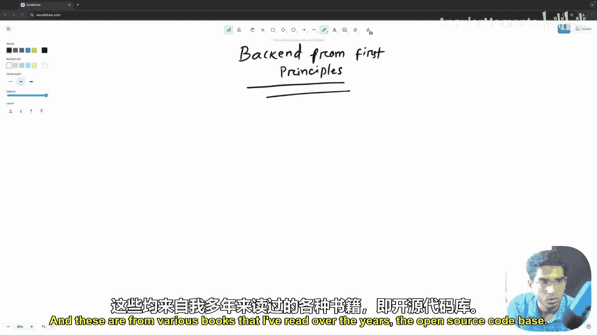

like and that should give us a pretty vivid idea of how systems communicate。

 how a client communicates with the server and how the server responds from there well move to understanding S3TP protocol。

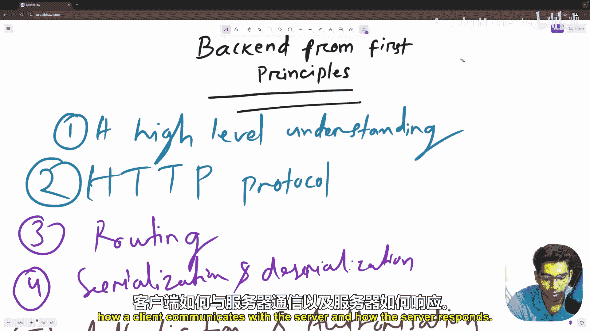

What is the role it plays and how the communication is established through StDP and how htTP raw messages look like and what are the StTP headers。

 what are the role of the headers， the different types of headers like request headers or representational headers。

 general headers and security headers and we'll look at different types of htTP methods get method post would delete and when to use them and what are the semantics and what are the principles behind them will look at what is the course flow and how does it work will look at how simple request differs from a preflight to and how a pref requestflow looks like from our browser to the server and back to our browser well look at STP responses。

 the structure of it and different status codes that server returns and when to return which type of code and what are the most commonly used StTP status codes then we'll look at StTP caching。

 what are the different types of caching techniques using STP we have E tags we have。

Max age headers then we'll look at the differences between STP1。1 and STTP 2。0 and STTP3。

0 and what are the differences between them we will look at how content negotiation looks like between client and server using different headers we'll see how persistent connections work in STTP we look at STP compression different types of compression techniques like GZ and defflat and Vr and which is the commonly used technique will'll see the security aspect of it the SSLTls and3tps then we'll move on to routing how routing maps URLls to server I logic and what is the connection between routing and STTP methods different components of routes like path parameters and very parameters different types of routes static routes。

 dynamic routes nested routes， hierarchical routes catch all wildcard routes and regular expressionbased routes how to do APA versioning using STp different types of versioning techniques we'll see what is the best way to deprecate route and what does the best practices in the industry we look at the benefits of route grouping and。

How it helps with versioning permissions and shared middleware we'll see how to secure routes。

 how to optimize route matching performance then we'll move over to serialization and decialization this basically means how before sending it over to the net our server translates the data into a particular format and after receiving the data from let's say client over the internet and how and how it translates the data receipt from the client over the internet to its own native format it is called decialization and we will see what is the need of it and how it helps with the interoperability standard the different formats that are used in serialization decialization we have textbased formats which is JSON or XmL we have binary formats which is pro above and what are performance differences between these two and when to use which one we look at how different programming languages implement serialization and decialization we will explore a popular textbased format for serialization and Dization which is Json the structure of JSsonN the different data types like strings number。

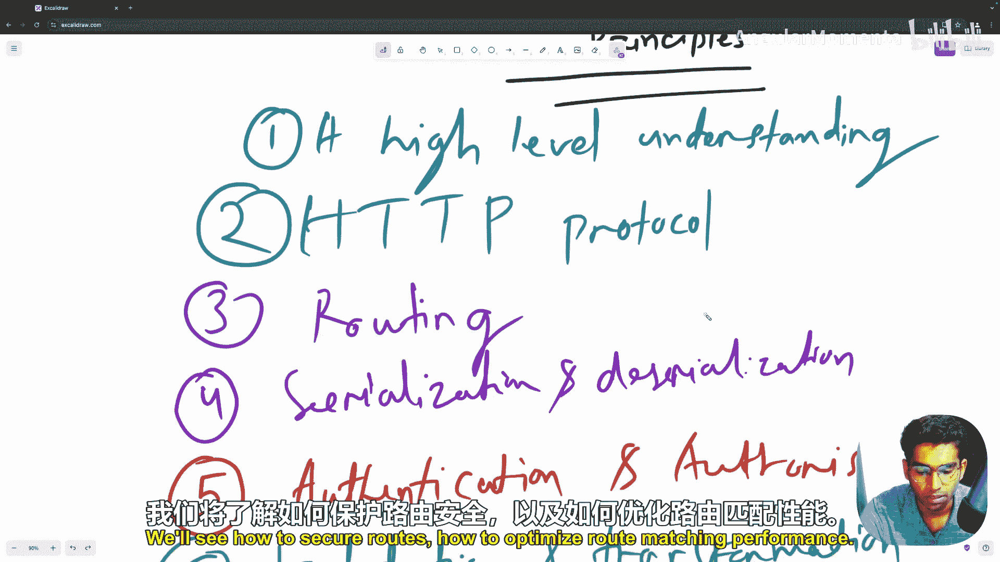

Willms errors and objects， how serializing of nested objection collections are handled in JSON。

 how decialalizing into data structures the native data structures works like in let's say Python dictionary or golanstruct or jascript object what are the common errors while dealing with JSON like handling missing or extra fields dealing with null values or date serialization issues and time zone issues and how to implement custom serialization while before sending or serializing data into JSON we' look at error handling any serialization and decialalization for example in invalid data。

 data conversion errors unknown fields， look at the security concerns of it like injection attacks why to do validation before decialization and JSON schemas before processing data using JSON schema validation we'll see the performance aspect of it like reducing the serialized data through compression and eliminating unnecessary fields like serialization performance between textbased and binary formats like JSON versus。

bo the tradeoffs between readability and performance because in text based format you can easily check the payload and see that does not work the same in binary formats。

 but binary formats are faster so when we use a binary format and when we use a text based format that is a valid tradeoff then we'll move to authentication authorization Why do we use it different types of authentication like straightforwardful state layers we have basic authentication token authentications well look at sessions GWTs cookies we'll deep dive1 Outh protocol and Open IDconect we'll see how API keys work how multifactor authentications were what is salting hashing and different cryptographic techniques used in authorization。

 we'll explore Aback Rrbac reback we'll look at what are the best practices in security like securityuring cookies avoiding CSRfS MITM like audit logging which basically means recording authentication authorization events for audits。

And monitoring fail login attempts， privilege escalation and access to sensitive resources will look at a fascinatingscating authenticated related error messages。

 preventing information leak to attackers through detailed error messages handling edge cases。

 for example， consistency in responses across different failure modes like rate limiting account lockout will see how to avoid timing attacks。

 for example， attackers can exploit time differences in error responses to infer valid credentials。

 for example， an error for a wrong password might take longer than an error for a valid user name because to check for a password you have to do some kind of hashing or some use some kind of cryptography technique which takes a little bit of time so people can general the tiny bit of timing difference between them and guess passwords。

Even though that is very difficult but we don't want to keep any security halls。

 then the next topic we will explore is validation and transformation at different types of validation like syntactic validation。

 for example， checking whether Eing is an email or not or it is a valid phone number or not or whether it is a valid date format or not there is semantic validation for example a date or a date of birth cannot be in the future or。

The age of a person should be between 1 and 120。 These are called semantic validations。

 Then we have type validation， for example， checking the input values match expected types。

 whether it is a string or not whether it is an inte or not whether it is an area or not whether it is in object or not these types of checks are called type validation we'll see what are the best practices for validation what is the difference between client side validation and what is the need of server side validation。

 the importance of server side validation even if client side validation is already implemented because client side validation improves user experience by providing instant feedback。

 but server side validation is the true security implementation because that is the gate to it to your business logic。

 we look at the importance of failing fast by reducing unnecessary processing by returning early and well look at why to keep consistency between frontend validation and packing validation then there is transformation for example typecasting converting string to number or number to string because in query parameters or path parameters。

 whatever see。I a string but let's say we are expecting an ID field which is a number。

 so before we send it to our handlers we have to convert that string into a number so that step is called a transformation which we have to take care of in our validation pipeline and different date formats。

 for example， the front end might send a different format or we might be expecting a timestamp so that also has to taken care of in the validation pipeline then there is normalization for example。

 converting an email to lowercase or trimming white space from a string or adding country code to a phone number these are called normalizations then there is sanitization for security issues。

 for example we have to sanitize a string that is submitted by the user to prevent attacks likeQL injection then there is complex validation logic for example relationships let's say user submitted a form and it has two fields one is password and another is conform passwords so we have to check whether the two strings are the same or not so that is a relationshipbased validation then there is conditional validation。

So let's say in the form there are two fields one is partner name and this again is married which is a booleion true or false so a partner field might only be required if the married is true so that is a conditional validation so these kinds of checks we have to do then there is chain validation like converting a string to lower case then revoing special characters and then checking its length then we look at error handling in validation like sending meaningful error messages to front end so that the user can fix them。

And aggregating all validation errors in one response for client site display or askating error messages。

 So instead of saying invalid password， we'll have to say invalid credentials to prevent different types of attacks。

 then we will see how to gracefully handle failed transformations， for example。

 an invalid Json and failed rate conversion and how to let the user know name meaningful message then we'll look at the performance tradeoffs of validation and how to optimize it by returning early avoiding red validations。

 then our next stop is going to be middlewares well look at what is a middleware and when to use them what are the common use cases or middlewares。

 the role of a middleware in a request cycle， for example。

 a prerequest middleware or a postre middleware， the flow of middlewares， for example。

 techniques like chain a middleware is exhibited in a sequence passing control to the next middleware until request reaches its final handler。

 how to order middleware is appropriately， For example。

 we have to go in this order we have to log the request we have to check whether the user is。

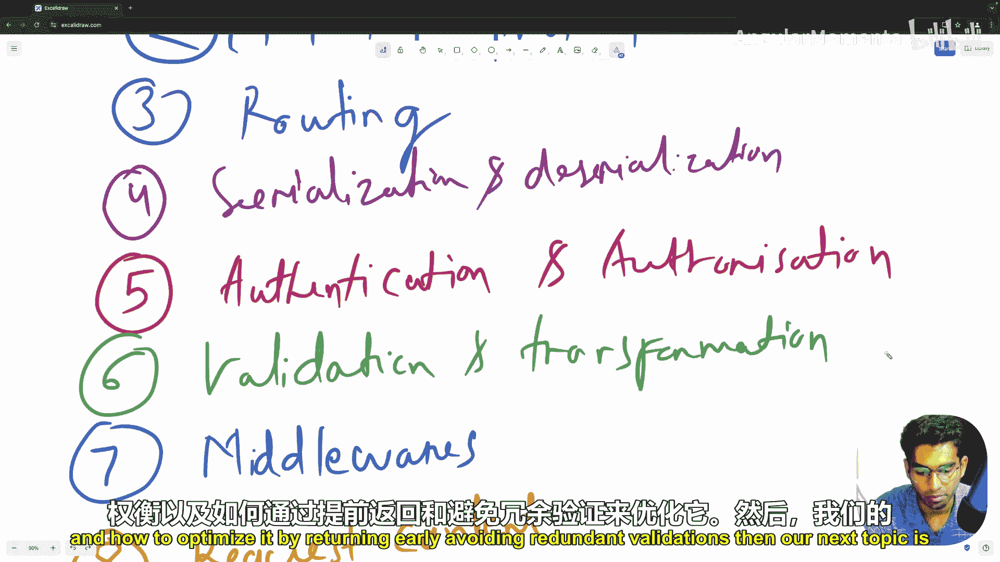

Authenticated or not we have to do validation and we have to do route handling and then we have to do error handling So this order matters in middleware flow。

 we'll see how the next function works in middlewares and exiting middlewares early how middlewares can start circuit the request pipeline by handling four or4 errors well look at some of the common middlewares like security middlewares which add security headers like xcont type or strict transport security or content security policy or middlewares which add appropriate course headers to every single request or response and middlewares to avoid CSRf attack middlewares to rate limit then we have authentication middlewares to reuse the route protecting logic across our apps then we have logging and monitoring middlewares for request logging or structure logging for observability or easier debugging in production then we have error handling middlewares which catches and formats application level errors for consistent API responses then we have compression or performance。

Liated middlewares， which basically compressrises response bodies to reduce the size of data sent over the networks Then we have data passing middlewares。

 passing incoming request bodies like JO URL encoded forms and file uploads and multiperform data for the file uploads then we'll look at the performance and scalability aspect of middlewares like what are the best practices to keep middlewares lightweight and efficient ensuring middleware is applied in the correct order or how middleware order can affect the performance and security of the application The next topic is going to be request context request context basically means the metadata that is often passed through application middlewares controllers and services it is kind of a requestcoed state the state is only valid for that request So here well explore the life cycle of a request maintaining state for the duration of request sharing data across different layers of the application without coupling how context provides a temporary requestco state we look at what are the different components of a request context the request。

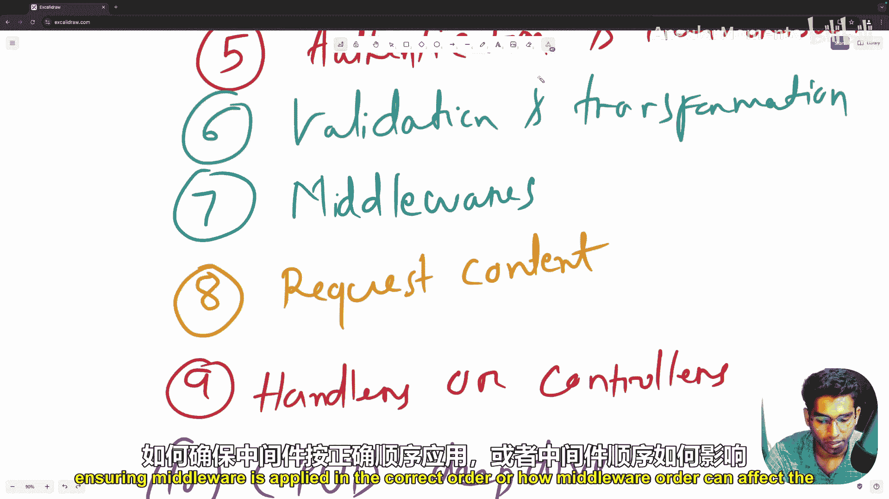

Data， for example， thestrtB method， the URL headers the query parameters and the body and there is the session and user information For example in the authentication middleware we fetch the user information and then we add it to the request context So for that request scope the user's information is injected into the context then we have tracking and logging information like unique request Is or trace ids then we have request specific data like custom data injected during the request life cycle like caching data per checks we'll look at what are the use cases for example authentication rate limiting tracing logging we'll explore the connection between middlewares and request context we'll see what are the different types of timeouts。

 the request timeouts custom timeouts cancellation signals。

You'll see what are the best practices like keeping it lightweight to prevent memory overhead。

 ensuring context status is cleaned up after request lifecycle to prevent memory leaks。

 avoiding tightly coupling components through context or over relylying on it for passing data then we'll move to handlers and controllers the MVC pattern and what handlers and controllers and services the responsibilities of all of them and reducing code with middleware then we have centralized error handling in handlers and consistent success and error formats and how to implement them in controllers。

 then well look at the different types of crowd operations like how crowd operations map httP methods and what are the common API is associated with each method for example post method is usually used or creation and submissions and the status code is usually to01 created or a 400 if it's a bad request and get requests are usually associated with fetching a list of resources are fetching a single resource and we have put and pass to update resources and delete to delete resources we look at。

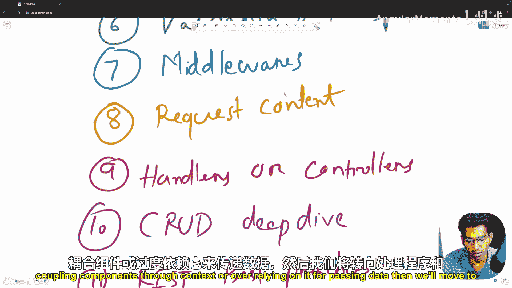

How to implement pagination and how to implement a search API。

 how to do sorting and how to do filtering and we'll see what are the best practices， example。

 strict validation， consistent response formatting。

 limiting payload reing sensitive fields error handling authentication and authorization then we'll explore what is the rest architecture and what are the best practices for implementinging list Apis。

 the principle of designing as around resources and sticking to STP semantics and best practices for filtering and pagination what are the different types of versioning like Uri versioning header versioning query string media type we'll see how to design APIs with open APIs back in mind we'll see content negotiation。

 capturing exceptions and providing meaningful messages supporting clientet caching ets and optimizing large requests and responses to that well move on to a very important topic which are databases databases will look at relational and nonrelational what are the differences and to when to use which。

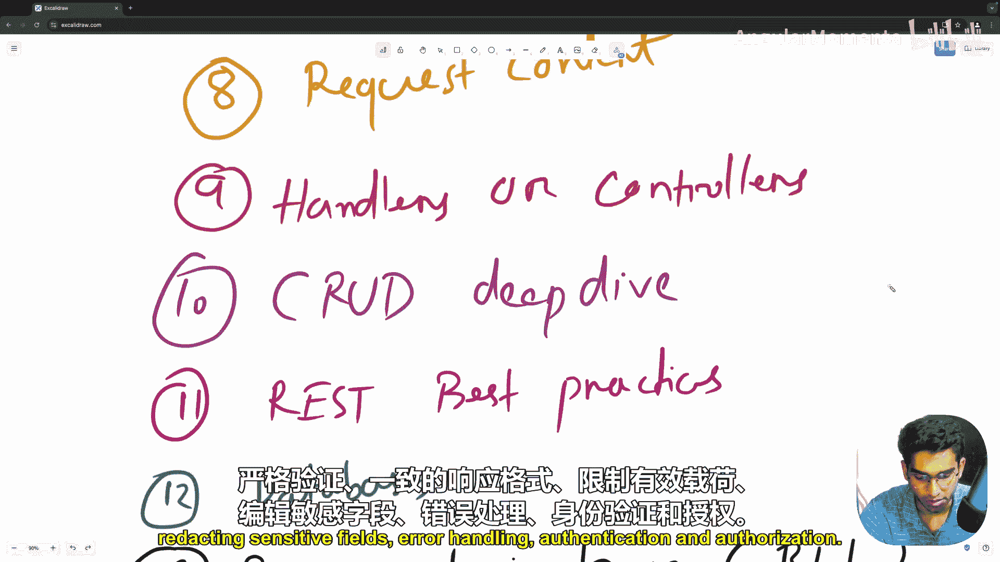

We look at some of the theoretical concepts like acid and CapurM will take a look at basic querying and joins and database design best practices like schema design indexing。

 we look at different optimization methods like query optimization caching connection pooling then we have data integrity like constraints and validations transaction and concurrency we'll see how Oms work。

 whether to use an orm， what other tradeoffs and we'll look at what our database migrations to that will move on to business logic layer which is also called VLL。

 what is the role of it， what are different layers of a request cycle。

 for example we have validation layer， we have routing we have middle layers and we have handlers and controllers which all of them fall under presentation layer because they deal with users data whether it is accepting user data or sending a user data so those are part of a presentation layer after that we have business logic layer which is the middle one which deals with our core business logic。

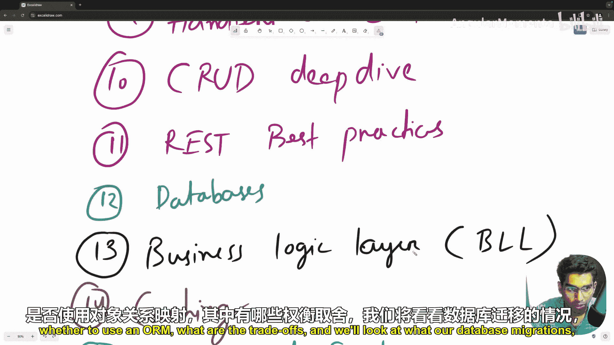

And after that we have the data access layer which deals with databases perform queryaring or inserts our deletions and business logic layer uses the data access layer behind the scenes we'll look at different design principles like separation of concerns single responsibility of enclo dependence in version。

 what are the components of a business logic layer。

 for example we have services we have domain models which represent core entities like a user or and order then we have business tools then we have business validation logic。

 we'll look at service layer design best practices。

 well look at how to handle errors properly and how to propagate those errors from our service layer to our presentation layer after that we have caching。

 we'll discuss what is the need of caching and how it differs from database persistence。

 what are the different types of caching we have in memorymory caching browser caching database caching and what is the need of clientet caching and service side caching the different caching strategies for example。

 Ca aside right through right behind or write back read through the different ca eviction strategies for example。

ULF few Ttl and F need for cache in validation like manual ca in validation time to live in validation or even batchsh invalid validation the different levels of caching level1 which is in memory level2 which is network distributor and there is the hierarchical caching which combines level1 and level 2 caching strategies where frequently used data is stored in a fast small cache which is level level1 cache and the less frequently used data is stored in a slower or large cache which is the level2 cache we'll see how caching for web apps looks like that is caching static assets or caching API responses using headers we'll see how to cache with databases for example query caching like storing the results of heavy joins in Redis and will look at cache hit and cache misraio and how to optimize them after that will'll move on transactional emails but are the use of them what are the common use cases the anatomy of a transactional email。

 the subject， the pre header， the body header main content CT foot。

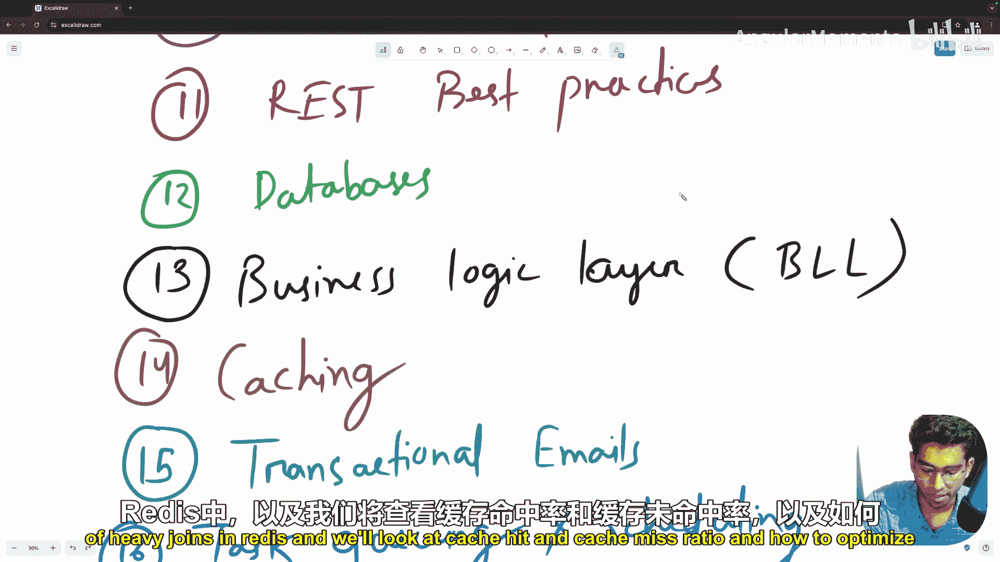

And how to personalize with different dynamic parameters， then we have taskqueing MC Duing。

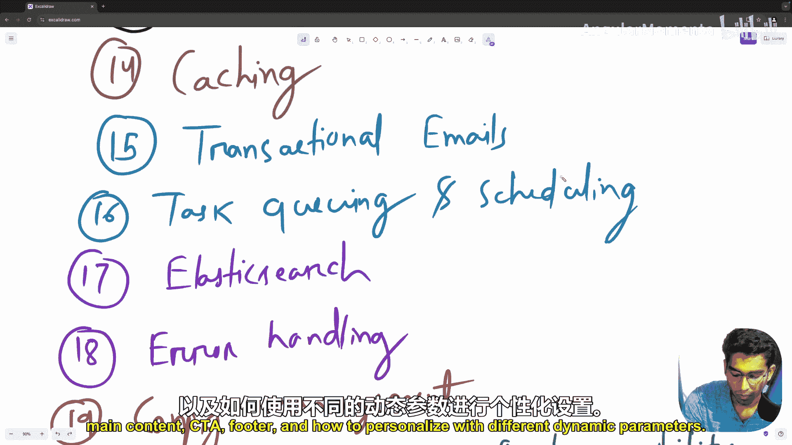

What are the common use cases， for example， queuing might be used for sending emails or processing image files and third party API integration like payment processing or web hosts or offloading heavy computation like batchge processing。

 for example a user clicks a button to clear all my data。To clear all the user data。

 we have to call we have to execute different queries for different tables to clear all the user data and that might take some time。

 So instead of blocking the request， we return the response instantly and we trigger a background job by pushing into the task queue we look at scheduling what other use cases。

 for example， for example， running database backups recurring notifications and reminders data synchronation or maintenance related issues。

 for example， clearing logs or caches， the different components of a task queue that is the producer queue consumer broker backend the flow of a task dependency。

 for example， it might be chain dependency or it might have parent childild relationship we look at task groups executing multiple task concurrently and waiting for all of them to complete at the same time。

 we look at how to handle errors and implement retice in task queues we look at task prioritization and rate limiting。

 for example， giving importance to task like payment processing before reproces task like sending notifications After that we'll move on。

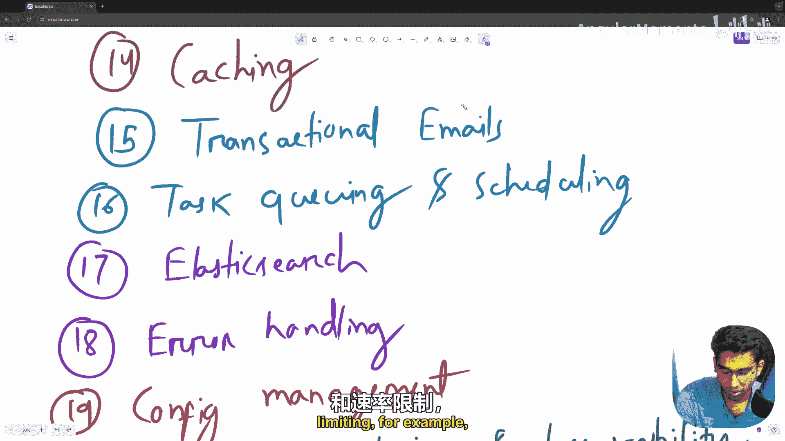

lasticse， Why do it use elasticasticse and how does it work behind the scenes the different techniques that are used。

 for example inverter index term frequency and inverse document frequency segments and shards what are the use cases of elastic search for example。

 providing a typehead experience or log analytics or social media search for example。

 full text search for user profiles post comments we'll see how to create and manage indexes we'll see how to search and query different types of searching basic searching full text search relevant scoring we'll see how to optimize search performance by taking text versus keyword fields。

 understanding analyzers and boosting and pagination we'll take a look at some of the advanced search patterns。

 for example， filtering aggregation fuzzy search then we'll see how Kiana works and how to use elasticastic search in a user friendlyly way and if in best practices for example defining field mappings explicitly optimizing the number of shards indexing data and batches and avoiding wildcard then we have error handling the different types of errors in our apps。

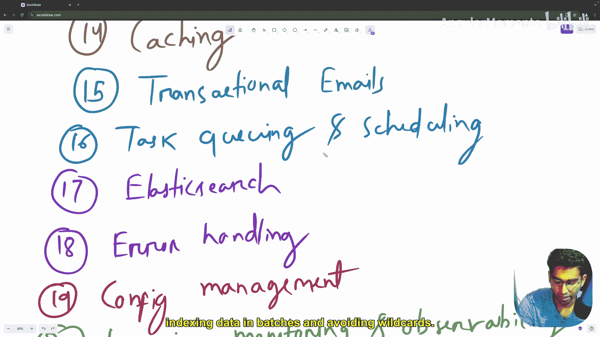

It be syntax errors， runtime errors， logical errors and different error handling strategies。

 for example， failsa or fail fast graceful degradation or prevention of errors。

 different practices for error handling， for example， catching early not swallowing errors。

 custom error types failing gracefully logging errors and using stack traces will look at how global error handlingrs work well see how to appropriately handle user facing errors like providing friendly error messages and providing actionable feedbacks willll see the importance of monitoring logging in error handling and different tools like sent or E case stack and different error alerts like emailbased alerts and sgbased alerts After that we have config management What is exactly config management and how does it help with flexibility and decouples environment specific settings from application logic and what are the use cases for example。

 different environments using config management， safely managing sensitive data such as API keys。

 database passwords and。

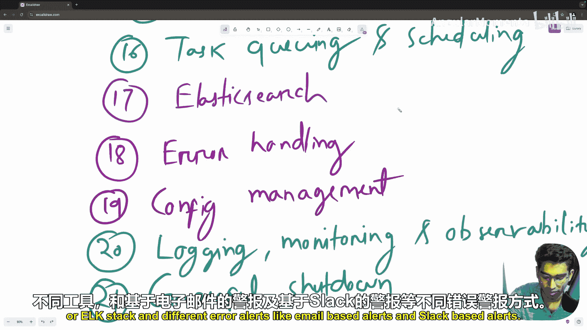

It certificates dynamically enabling and disabling features without changing codebase What are the best practices of conflict management。

  different types of conflicts， for example， static conflicts like Db credentials and API points。

 dynamic conflicts like feature flags， rate limits and sensitive conflicts like credentials。

 token secrets and different sources of conflictts for example it could be dot andV file or a Json or Yal and what are the differences between using environment variables versus command line flags versus static files after that we have logging。

 monitoring and observability， a very important topic will see what are the differences between logging。

 tracing， monitoring and observability the different types of logging like system logging application access security logs the different levels of logs like debug info1 error fatal。

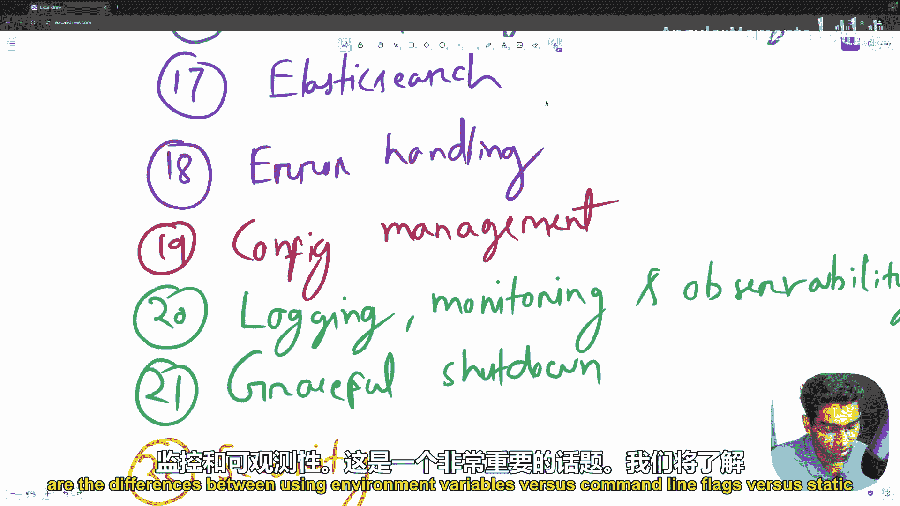

And we'll see the difference between structure logging and unstructured logging and the best practices for logging like centralized logging。

 log rotation and retention， contextual and meaningful logs and avoiding sensitive data like passwords and API keys then we will look at monitoring different types of monitoring like infrastructure monitoring application performance monitoring up time monitoring the different tools that are used in monitoring like Prometheus Grrafaa and how to manage alerts and notifications by defining thresholds creating alerts and avoiding alert fatigue by only creating actionable alerts and ensuring that alerts are meaningful and necessary then we'll take a look at observability the three pillars of observability which are logs。

 metrics and traces， the best practices around it， the security and compliance of log management that will move on to graceful shutdown。

 Why do we need graceful shutdown and how does it work behind the scenes but are the different use cases for example you might need it when server restart or or scaling in cloud environments or。

services or long-running jobs， how it works like signal handling S signal and signals。

 What are the different steps of graceful shutdown For example it starts with capturing a signal and then it stops accepting requests then it completes any inf requests and then it closes external resources like database connections or any open files etc and at last it terminates the app After that will move on to security。

 the different aspects of security in a backend code base avoiding different security attacks like S skill injection。

 noise scale injection CSRf broken authentication inec decialization and principles of a secure software design for example least privilege defense and depth fail security defaults。

 separation of duties， security by design then we'll look at the importance of input validation and sanitization and rate limits and content security policy course and same site cookie and the importance of monitoring events After that we have scaling and performance。

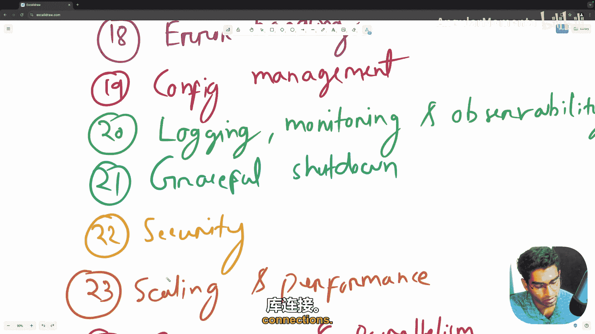

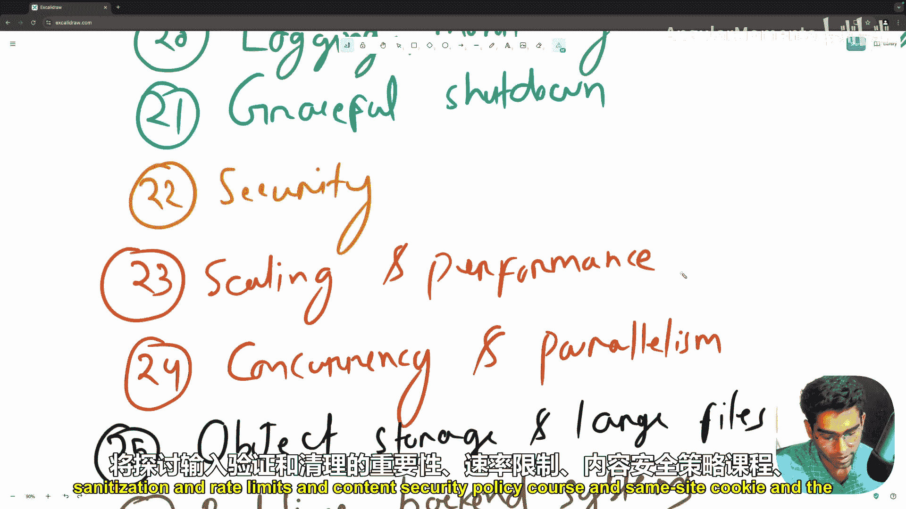

The different metrics of performance like response time resource utilization。

 identifying bottlenecks， caching and database optimization， for example。

 avoiding n plus one query problems and ensuring proper use of joins and using lazy loading where appropriate。

 Then we have using database indexes to speed of read operations on frequent query fields like indexing foreign keys or search fields。

 how to process data in batches to minimize database load and improve performance for large data sets。

 how to avoid memory leak like closing file handles database connections or cleaning up after long process。

 minimizing network overhead by reducing payload size and using compression will look at how to do performance testing and profiling we look at some of the best practices for writing performance code like focusing on writing clear and maintainable code first without premature optimization and writing modular code to make it easier to optimize individual components without affecting the entire system。

 ensuring that if a particular resource under load or unavailable， the system digs。

fully without crashing and how to offload noncritical tasks like sending emails or log to background processes or task queues to free of resources for more critical operations then we have concurrenency and parallelism What are the difference between concurrenency and parallelism and how concurrency helps in iObound tasks and how parallelism helps in CPU bound tasks then we have object storage and large files we look at some of the common use cases when we use object storage like AWSS3 and how to manage large files with chunking and streaming and we look at multipart file uploads then we have real time backend systems where we take a look at web sockets or server and events and pubs of architecture that we have testing and core quality here we take a look at different types of testing unit testing integration testing end to end testing functional testing regression testing performance testing load and stress testing user acceptance testing security testing will take a look at what is test driven development how to automate tests in。

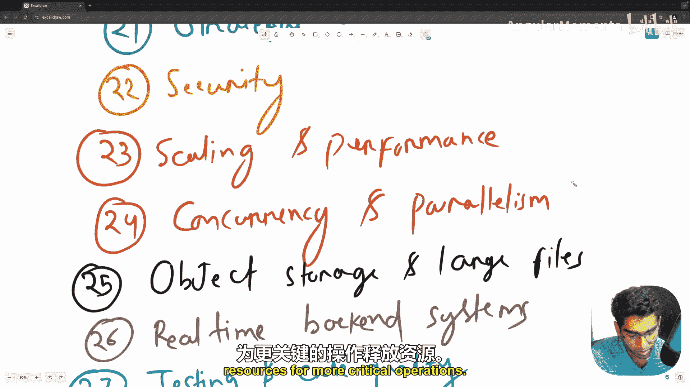

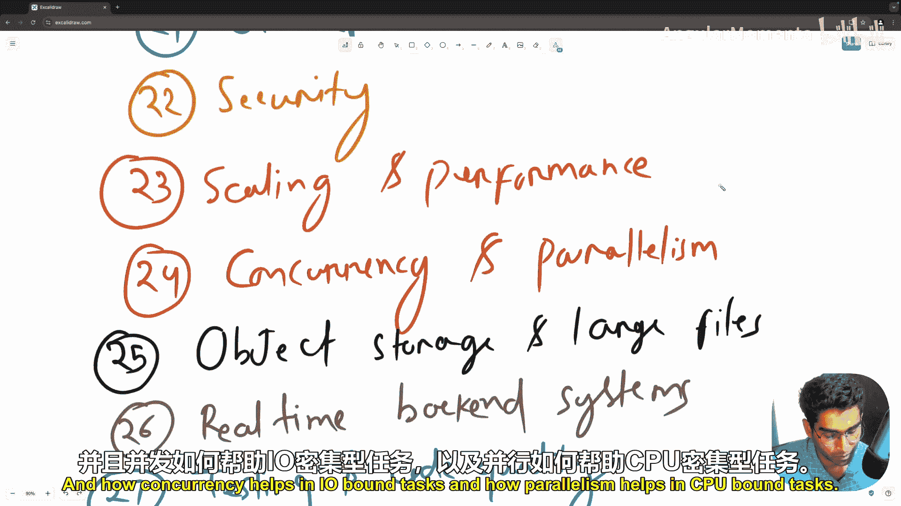

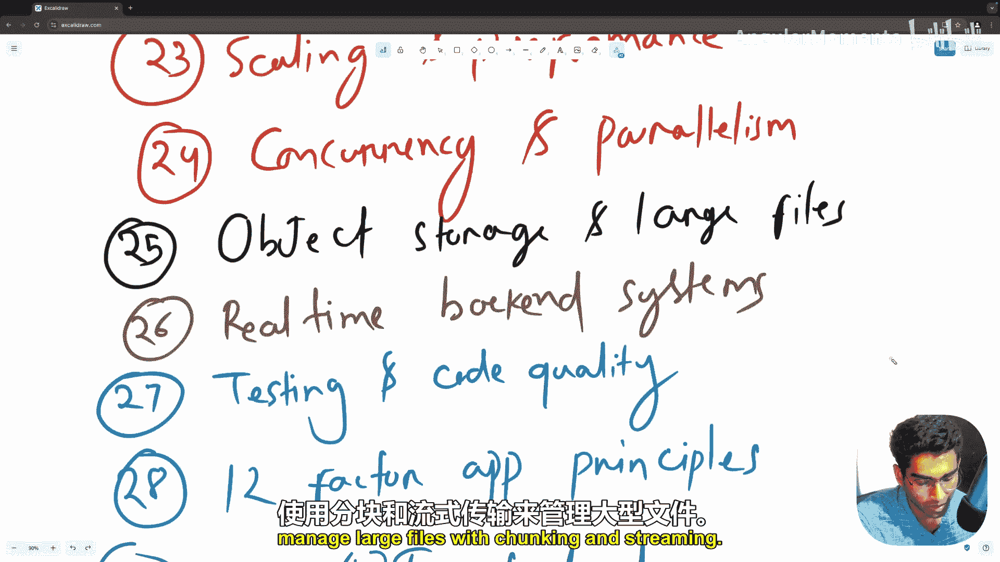

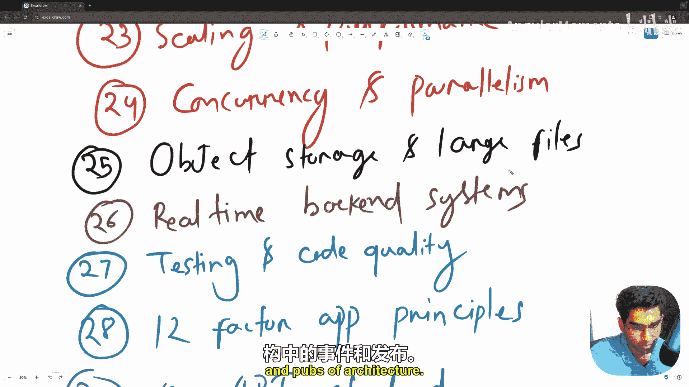

ID environments how to manage code quality with external lnting and formatting tools and what are the measures of code quality and coverage like quality metrics likecyclmatic complexity which measures complexity of a function by counting the number of possible paths through the code and we have maintainability index which basically quantifies how easy it is to maintain a code based on the complexity lines of code and other factors then we'll take a look at a very interesting set of principles which is called 12 factor app after that well move on to open API standards what is the need of this standards and why should we stick to it what are the benefits of it what are the use cases like documentation automation and the ecosystem surrounding it like swagger code and postman and what is the history the swagger to open API transition and what are the different versions that are currently active。

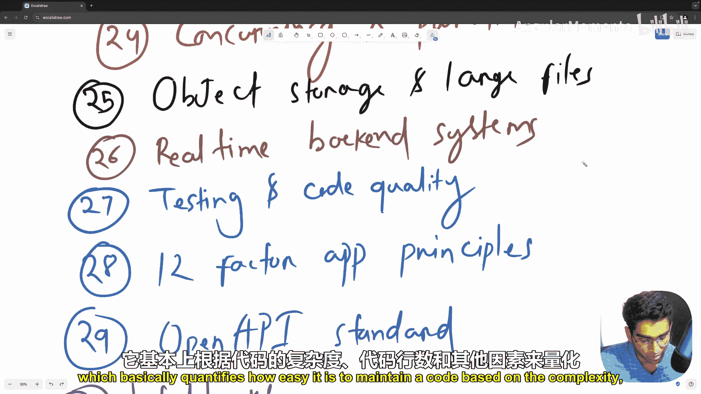

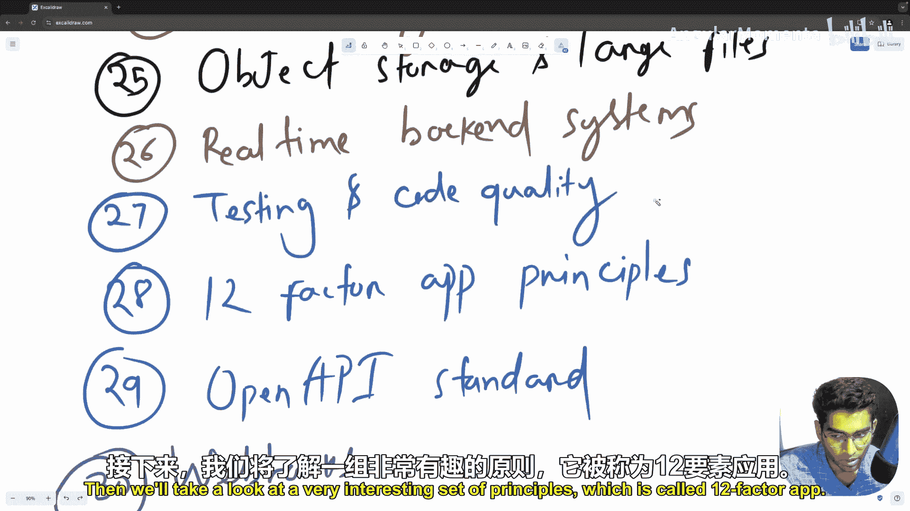

And what are the key concepts of open API documents， for example， there is API pass。

 the request and response definition there is parameters。

 there is keyma and what is the structure of an open API document there is metada there is path there is components there is security definitions and there is responses we'll see what are the new features of open API 3。

0 and 3。1 what are the tools surrounding Open API for example， Fler UI Co postman。

 what are the best practices like avoiding duplication and sticking to standards we'll look at very interesting development method which is API first development where you define your open API standard or write your open API spec first and then you start creating APIs After that we'll move on to web hookooks。

 what are the use cases of web hooks like extending notifications third party integrations what are the differences between API versus web hook for the same use case for example for API we might have to use polling which is clientside initiated compared to web hooks which is pushing which is server initiated what are the key。

Components of webhs， for example， the web H URL event triggers payload StTP method。

 the response handling one of the best practices surrounding webhs like webh signature verification like using Sttps and quick response re logic。

 logging how to test web hooks with NG real world use cases like Skype payment processing Giub web hooks Sla Discord to Liu etc and at last we'll take a look at what are some Devopps concepts backend engineers should be familiar with for example。

 some of the core concepts like continuous integration， continuous delivery。

 continuous deployment Devopps practices like infrastructure is code。

 config management version control that different tools surrounding Devops for example。

 creating containers with Docker or orchestrating container with Kubernetes and CicCD pipelines and how to scale your service horizontal scaling versus vertical scaling and different deployment strategies like red grid deployment。

 rolling deployment etc。 and that's about it。This is all the concepts that we are going to cover in the next 30 or 40 videos。

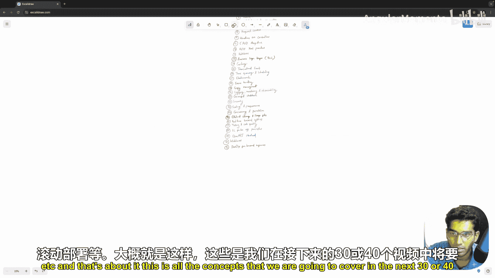

Stay tuned。