# 【Sriniously】从第一性原理出发的后端开发 ｜ Backend from first principles p02 2. 踏上真正的后端工程师之路 -BV17aq1BUEhf_p2-

Now， before we get to the meat of it， I want you to know exactly what to expect from these videos and how to learn from them。

So let's get our expectations clear。

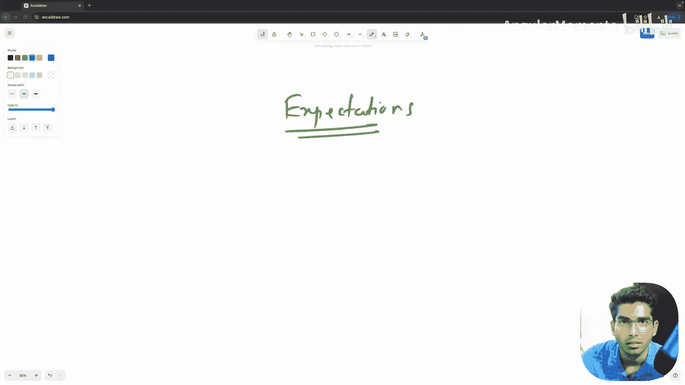

In this particular playlist， which you are currently watching。

I want to tell everyone the story of back in engineering， the philosophyhi behind it。

 the big questions and the inner workings and the collaborations between different components and machines。

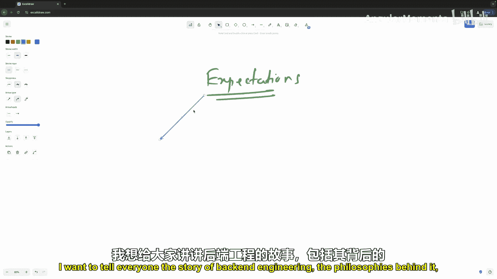

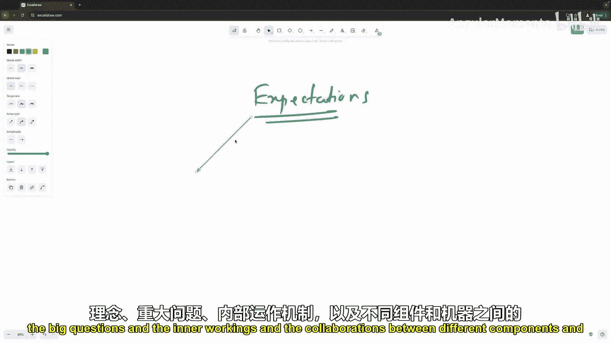

The narration will help you see the big picture of a production grade backened and help you appreciate the concepts that are abstracted by the languages。

 run times， primworks and libraries that you use every day。So let's write it down。

So this playlist is about this。Dorry and。We knows。Right。

And this is the first step towards being a back engineer with language agnostic skills， right？

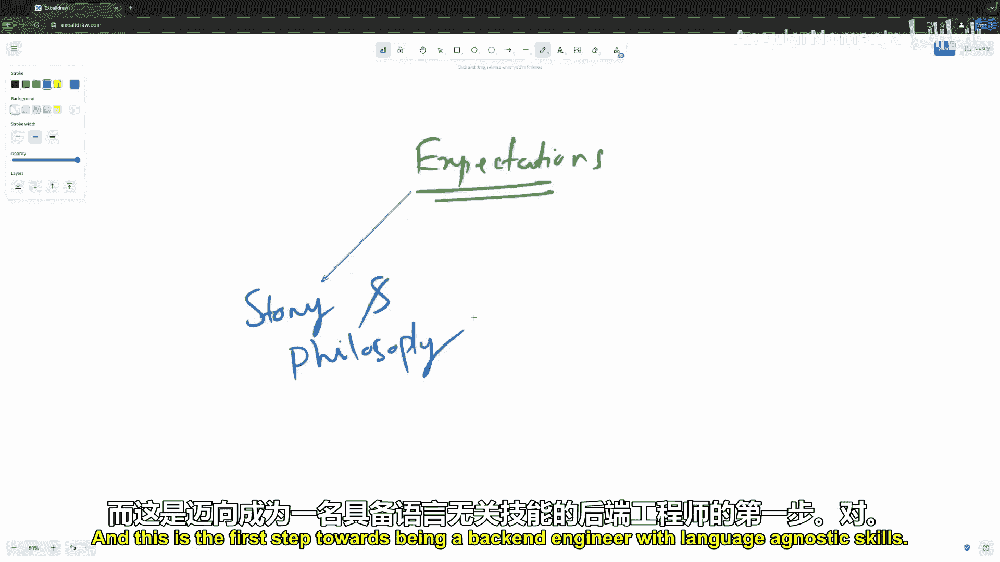

Skills which are beyond framers or ORMs or any particular library that you use and work with every day。

Once you have the foundations clear， once you start to see the common patterns behind every backend application and understand the philosophies。

 how the dots connect together。Now， that is the best time to talk about implementations。

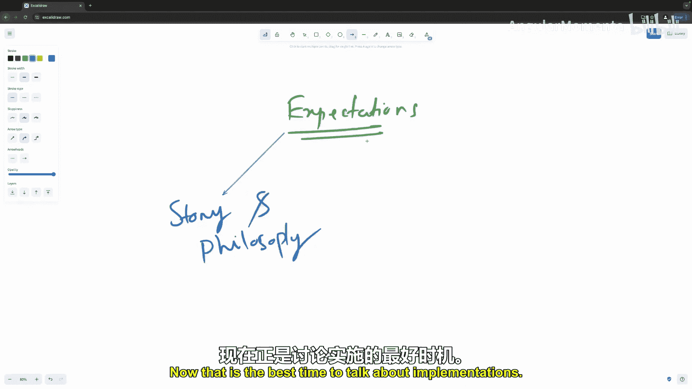

To see how all these principles come together to create a complete backend application。

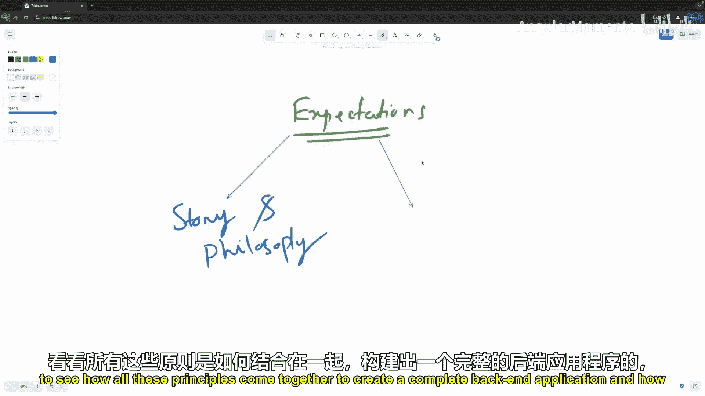

And how all of them look and work in actual code。So， let's write it down。联明。

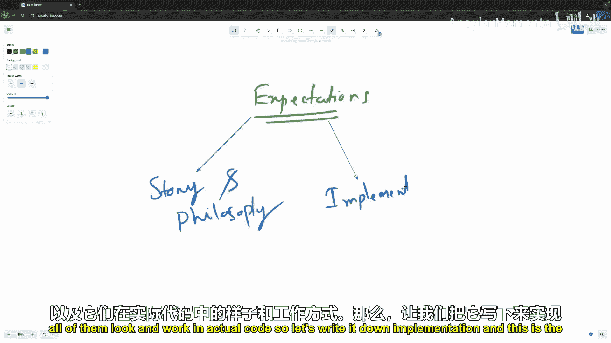

Dation。And。😔，This is the point where we have to choose our language， our ecosystem。And at this point。

I am planning on releasing two versions， one in nodeds and the second one in Golan。

 since those are the two languages that I have firsthand experience in that I work with every day。

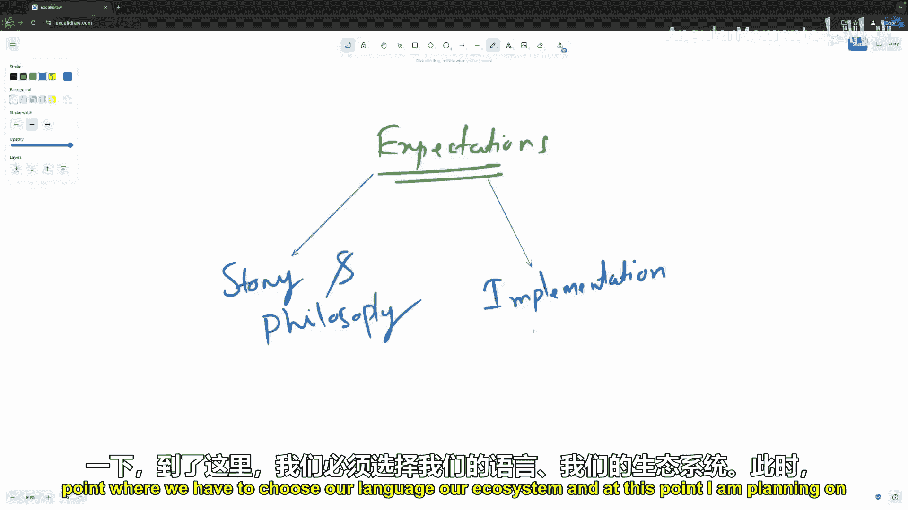

Now。In this phase， which will be again another playlist。

We will pick each principle and deep dive on it in that particular language and the surrounding ecosystem so in a way most videos of this playlist will have an associated implementation specific video in the next playlist right for example in one of the principles we will talk about databases and drivers and migrations and all the concepts surrounding databases that backend engineergens deal with day to day so the node J and goallan playlist will have an implementation of that where we deep dive on let's say Postgres with the JavaScriptscript driver Postgres Js or the goal and driver PGX and cover every single concept around that。

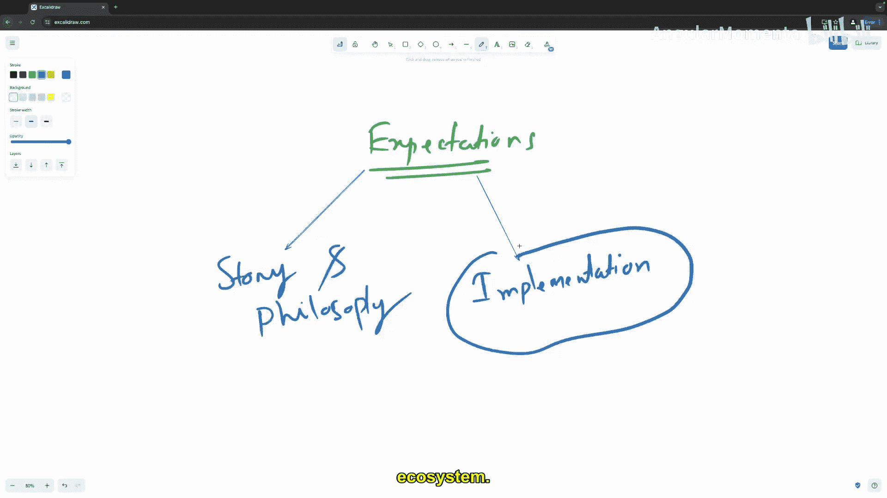

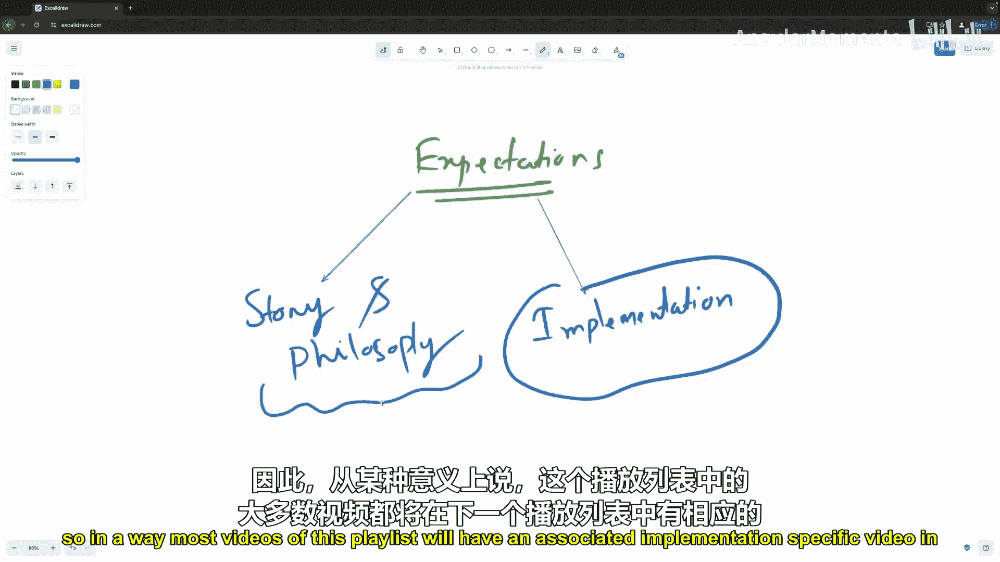

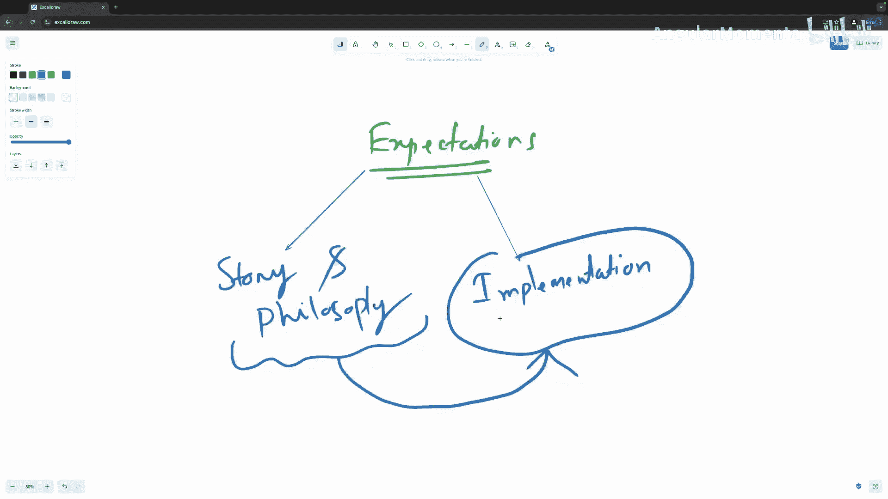

Now， in the third phase， this is where everything comes together。

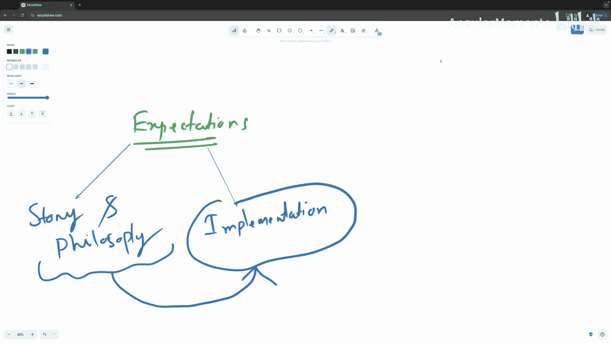

All our concepts， all our language specific deep dives， all our philosophies。

 and now here we will build production grid projects from end to end with all the industry standards and best practices。

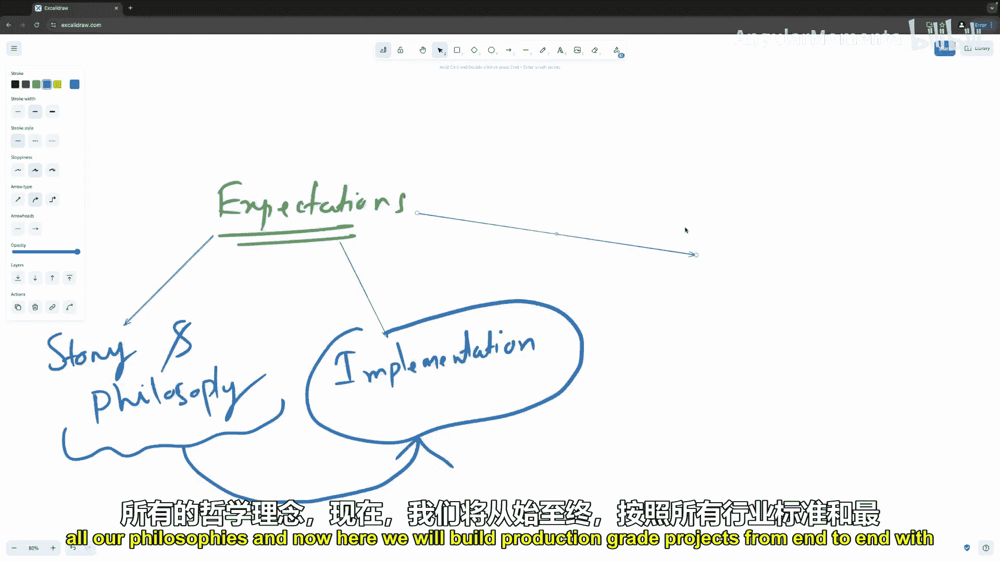

We will build quite a few of these projects， which you can follow along if you want。

 so let's write it down。Production。11。Proics。

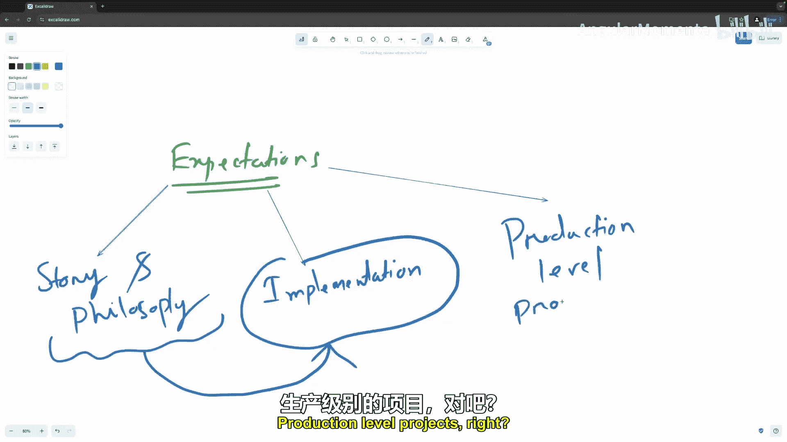

By the end of this journey。That is， if you decide to take it。

 And if you internalized everything and followed along with all the projects。

 you should be safely able to call yourself a back engineer。

 and you should be able to go out there and build real systems， systems that scale。

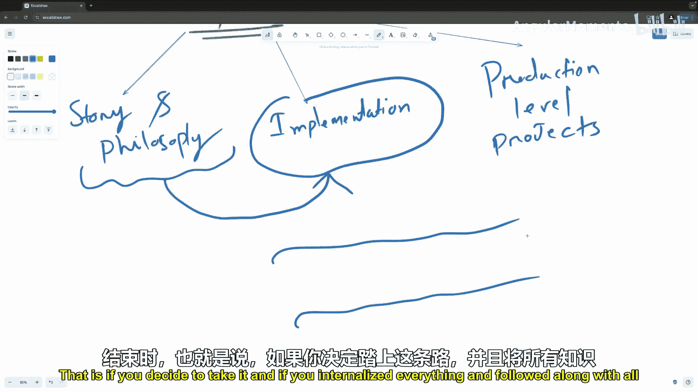

Systems that start from zero users and scale to a million users。

 systems that people can maintain over a long period of time。 So with those expectations。

 let's start。

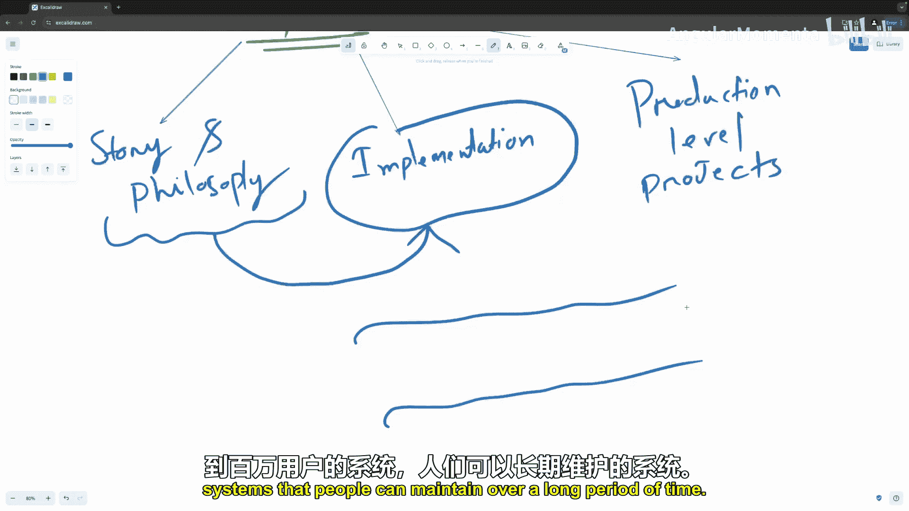

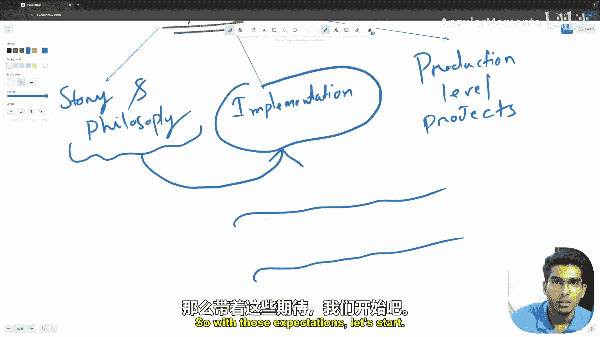