# 【Sriniously】从第一性原理出发的后端开发 ｜ Backend from first principles p03 3. 什么是后端，它们如何运作以及我们为何需要它们？ -BV17aq1BUEhf_p3-

Let's picture it backend in its traditional definition is a computer which is listening for H TDP or web socket or GRPC or any other kind of request to an open port。

 whether it is 80 or 4，4，3。Which is accessible over the internet。

So that clients or other fronttains can connect to it。

 send data to it or receive data depending on the kind of request and we call it server because it provides or it serves some kind of content。

 whether it is static files like images or JavaScript files or HTML files or it would be JO。

And it also accepts data if the slide sends something。

 Now that is a fair definition of what a backend is and how it works。

 but I want you to get a holistic view to actually see the components physically how they work behind the scenes。

 So let's go through this whole flow。 Now I have a backend server which is deployed in AWS。

 So let's take that as an example。点も。Use。And is some sample data， the backend is survey。

 So let's do it one more time。 and this time open the network toolbar and if we refresh one more time。

 let's disable cache so that we get the appropriate status score Al so this is the request which starts from our browser and reaches our server and we receive this response。

 Now we will cover request and response in a later video for now let's look at how the whole flow looks like。

 So let's trace it out let's trace how our request starts from our browser and reaches our server。

 So the first thing that you can see is the domain name。 So if we can see it this is the domain name。

Senuously dot X I。 and this is a subdomain。 So the first thing that comes to mind is we should take a look at our DNS server。

 Now this is my DNANS server， and this part is the important part where we have defined different types of records。

 Now DNS itself is a huge topic。 So instead of going too deep into that I'll just give the basics here。

 Now to oversimplify it， DNS has different types of records。

 you can use a records to point a particular IP。 and you can use Cname records to point a particular domain or subdomain So along with my other existing domains and sub domainomains。

 the thing to focus here is this part。 Now， if you see here， we have two a records。

 and one of them is backend demo。 and it is pointing to a particular IP address and where is this IP address coming from。

 So this IP address is an easy instance， which is in AS。 Now this is my AS console。 Let's go to EC2。

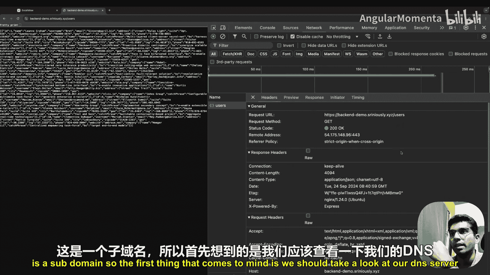

And then， for instances。And this is the deployed instance Now if you see here。

 this is the public IP address that we just saw in our DNS config， So that particular sub domainin。

 which is back in demo points to this IP address and our request reaches here to our EC2 instance through this IP and before it reaches our server or the particular computer。

It goes through a file which is the AWS native file。

 The file has to allow some kind of request to go through。 Now， if you look here。

 this is the security group that is assigned to our AWS instance。

Which basically means that using this， we can specify what are the ports we want to allow。

What are the ports that we want to be accessible over the internet right So you can see we have allowed three different kinds of ports and we use this port to log into our AWS instance to terminals or command prompt so that we can do different kinds of operations and the HtTps and StTP port Now this is the important part our request goes to the domain server which points to our AWS instance IP and through the IP reaches the AWS instance and before going into the computer it passes through these firewalls So if we don't allow these two ports like 44。

3 for allowing https traffic or 82 allowttP traffic if we don't allow it the AWS will block it right here and our request won't be able to reach our server So this is an important part And finally after this our request reaches to our computer Now after our request reaches here into our AWS instance we are using something called a reverse proxy。

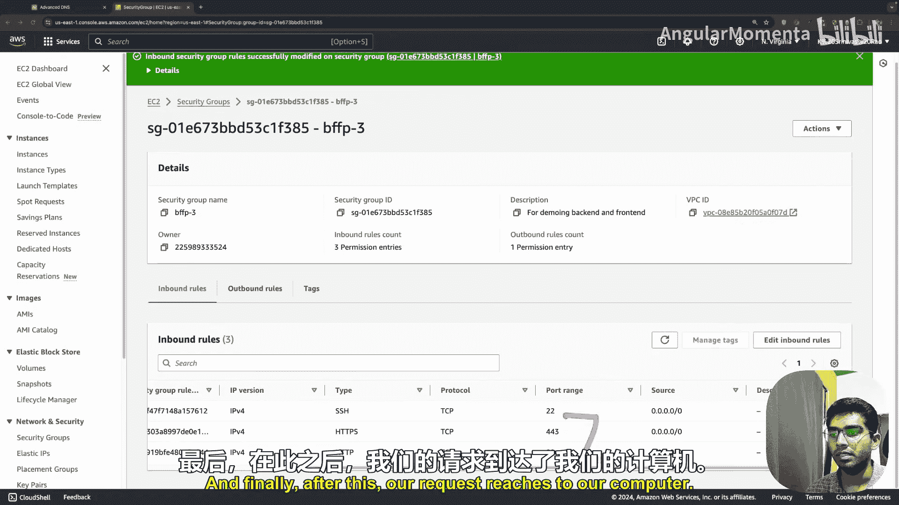

Which basically means it is a server which sits in front of other servers so that we can manage different types of redirects or confits from a centralized space instead of changing the conx in every single server。

 So for that we are using Nngx。 and this is how con looks like。There are a lot of stuff here。

 but the parts to focus here is we are using something called Cbo to assign SS certificates automatically。

 but not something to worry about in this demo the parts to focus here is it is listening for port 80 in our AWS instance and it is redirecting。

That request to port443， so which is an Https request。 So that part is managed by Surboard。

 and the part that we have configure is this。 So what we' are saying is this is my domain name so we can define it using the field server name this is our subd back in demo and whatever request that comes to this domain so which is already routed by DNS server so it will reach this instance So that is not something you have to worry about and what we are saying is whatever request that comes to this domain our engine X conflict will redirect those requests to our local host 3001 which is the port our server is running on our node server is running on and this is the final redirection So if we take a look at our processes it to。

y子。2。L we are using PN2 to manage our processes。So we can see here that we have two processor running one for front end and another for backing。

 and this is a node server。 So this is the final hop。 And if you want。

 we can also check this if you just to call local host。0hous1 slash users。

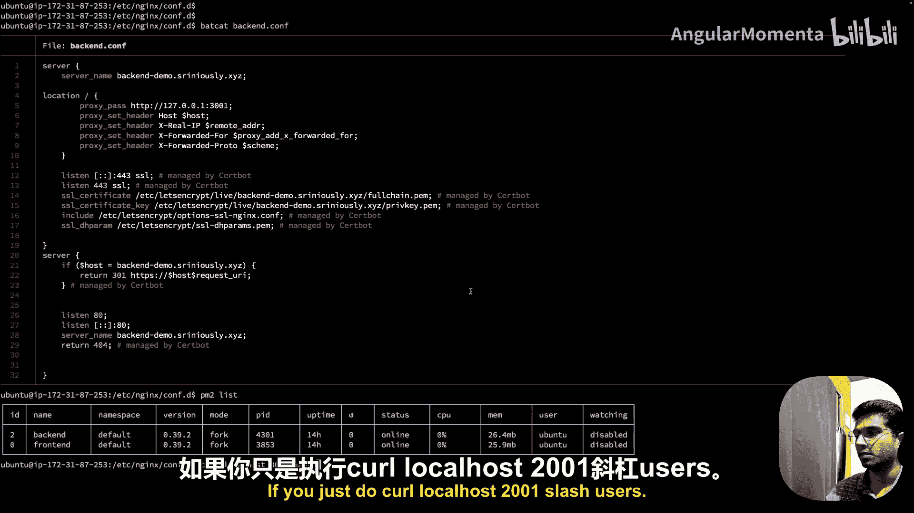

And we will get the same response。 So from the point of view of this instance， our server。

 our node server is running in local host， and we are using N X and domain names to route requests to our local server over the Internet。

 So if you were to summarize our request starts here in the browser， it goes to our。The N S server。

 then that goes to our。AW S servers。 and it goes through a firewall。

 And that reaches our AW S instance， right， And that request is then reaches N Gen X。

 And that finally fors that request are。Local host 3001 final server。

 So it goes through all these hops until it finally reaches our server。

 So when were developing in our local host， you can just open your browser and go to local host 3000 last users and you'll see the same response。

 and we saw that in our AWs instance Also if， if you call to our server， where get the same response。

 Now， you should have a fair idea of how Iquis looks like and how Iquis travels over the Internet and reaches our server。

 But why exactly do we need these backends， I'll give an example， imagine。

You're scrolling through your Instagram feed and you come across your friend's posts as usually you like them。

 you click on the like button。 and on the other side。

 your friend gets a notification that you like their post。

 So between you clicking on the like button and your friend getting the notification what exactly happened Now that is where the concept of back and comes into play。

 You click on the like button。 the app sends a request to the server。

 The server passes that request and sees who is the user and it finds your name or your I or whatever and。

Then it persists and save that the data the action of you liking it。

 It has the server has to save it in some kind of way， usually in a database。

 it saves that information and then it checks who is the user the user who's post to light and it finds that user's ID and it sends a notification it triggers some kind of action that sends a notification to that user and the user gets a notification in their phone all this interaction that happened between you clicking on the like button and your friend receiving the notification there has to be some kind of server a centralized computer that has to have all kinds of information about all the users because if you look at your app。

 it is designed， it is customized according to your needs and your profile and all the people you follow right and all the actions that you can perform on your account Similarlyly。

 that is the case for your friend。 they only receive the notification that is intended for them。 but。

😊，A server has to have all kinds of information right。

 all kinds of information of all kinds of state， so it has to be centralized and from whatever we have seen till now。

If you try to。Condensed down。 And we tried to strip it down the responsibility and the use of backckend to a single word。

It'll be this。对的。The need to fetch data， the need to receive data and the need to persist data somewhere and any kind of actions and every kind of action that deals with data and if you ask me why not just do everything on the front end right？

Since that is also some kind of device or some kind of computer depending on what you are using So why not do it here。

 why not connect the database here and why not do every kind of actions that servers do。

 And since everything is distributed everywhere we'll have better performance right technically and that is an excellent question So in order to understand that why can we use all those functionalities in front end。

 we have to see how frontends actually work behind the scenes Now like our earlier back in demo。

 let's do a demo for how frontend works from end to end。

 this is a next Gs application that I have deployed in the same AWs EC2 instance open the network tool again。

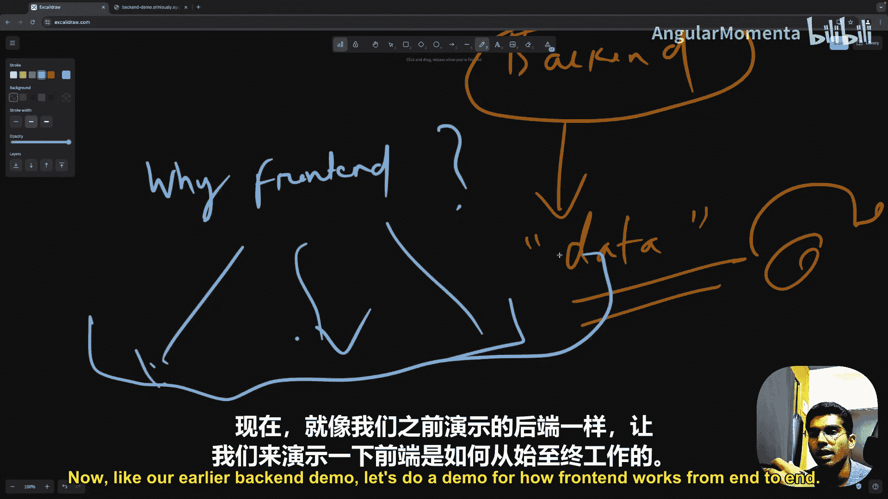

And let's hit the fish。And what we see here is the first document that the browser fetches。

 We look at this。 It calls this domain name。And if you look at the response， it is an HTMLml file。

 the browser fetches the HTMLl file and all the resources， for example。

 all these jascript and all the images， the fonts and the CSss files all of those different things are fetched in different different requests after we have our primary HTMLl file and in our record we see that we have an entry for this subdomain。

 which is frontend demo and it points to this particular IP address。

 And if you trace that we land here which is the AS E2 instance。

 and we can see that this is the same public IP address next as usual the port 443 and the port 80 has to be allowed for https and HttP traffic to get through to our server。

 And finally the request la here our EC2 instance And if you look at the engines confi this is what it looks like。

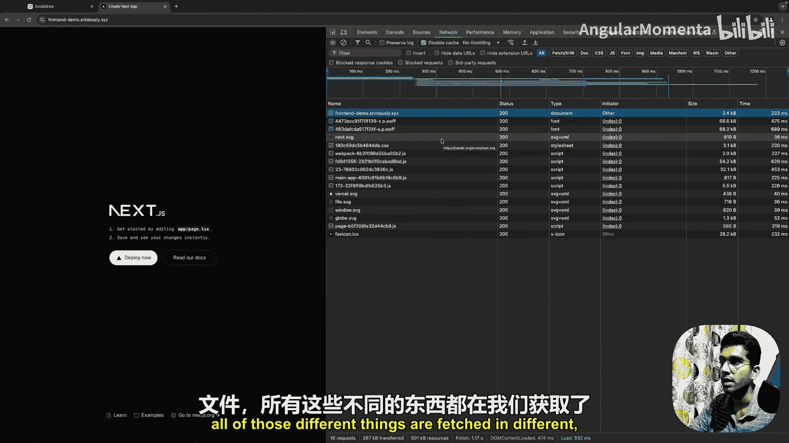

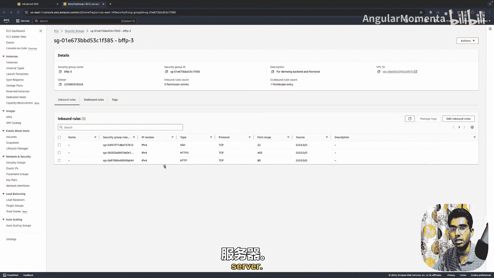

Again， most of the things are the same as it was in our backend server。

 we have the same server word configs， but the thing that is different is。

Here we are listening for this domain， which is the frontend demo and whatever traffic that comes to here。

 we are redirecting to the local host 3000。 instead of redirecting to 3001。

 we are redirecting to port 3000 and finally the request reaches our frontend X JS server。

 which search the files， which is the GS file， the CSS file and the HTMLm file which are sent over the net to our browser and after going through all of that after we receive our main HTMLl file。

 what the browser does is it goes through all these resources， the Javavet files。

 the CSss files and the forms and it fetches them 1 by1 once it fetches all the CSss which we can see here。

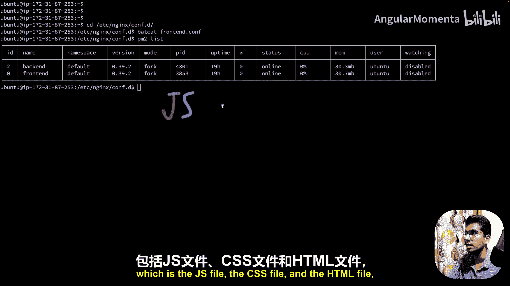

It paints a window。That's how we get all these styles。

 the background black and these fonts and these button styles。

 And once the browser fetches all the jascript files。

 that's when it hydrates all the eventlessness for buttons and all any kind of interactions that we have in this page。

 For example， if you click on this button， this is what it happens Itdirects to another page that happened because the browser fetch all the jascript added all the eventlessness。

 And that's how the button started working。 So what do you notice here。

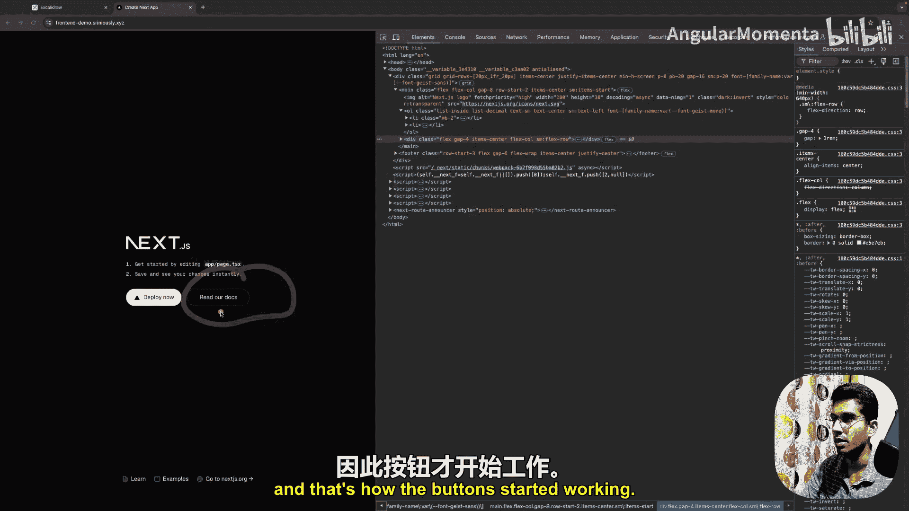

Whatever front end logic that you have written， whatever the jascript that you have written is all fetched by the browser。

R our server， and it is executed by the browser in our machine in clients machines， right。

 So the browser is our run time。Compared to our traditional backends， which we saw earlier。

 the one in  A is easy to instance where we sent a request。

 the server processed the request and sent us the result so the actual processing happened on the server。

Right and it is exactly the opposite for front end where it sends the code。

 but the browser runs the code， whatever logic that is done， it is run by the browser。

 So that is a key difference to notice here。 Now there are a couple of issues that we find here right because。

Browser runtimes are often sandbox environments， which means they are isolated from our operating systems。

 the processes and the file system， everything is an isolated environment。

 which means the code can only access limited amount of resources for example the dom which is the document object and browser APIs for example local storage or cookies and external APIs。

 but only if the external API has all the required amount of headers we have not covered course here which we will in a future video in much more depth but。

You can imagine course as a policy， a security policy of browsers which restricts jascript code to call external APIs。

 which is not the same as the current domain， for example。

 we have this frontend app in this domain which is frontend Nemo do do X so we can only call resources or we can only fetch resources and call external APIs which are in the same domain if we try to call a different domain then the browser will block the request because of course policy and there are ways to get around that which are through a headers which will explore later and if you think about it all these sandboxing and security restrictions make sense because essentially what a browser is doing is it is fetching code from a remote server and executing it in the user's browser。

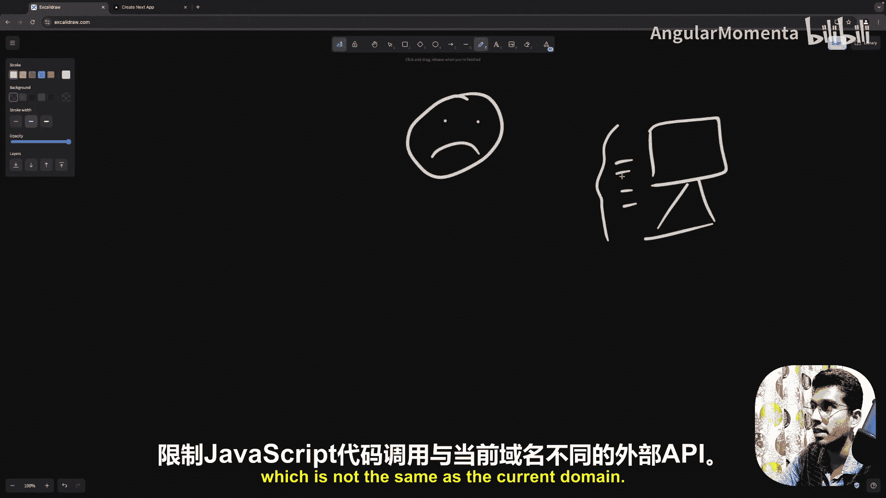

And if it's not careful enough or isolated enough， the remote code can easily access data or files from users computer。

 which is not a good thing。 For example， imagine you go to a website and you have no idea what is the front end code of their website and if browsers did not isolate environments that code can easily get access to your file system copy all your files your sensitive details and send it to their servers right So that is a very scary idea。

 that's why browsers have all these security policies。

 Now coming back to our original question why can't we write back in logic in front end So the first thing obviously is security reasons。

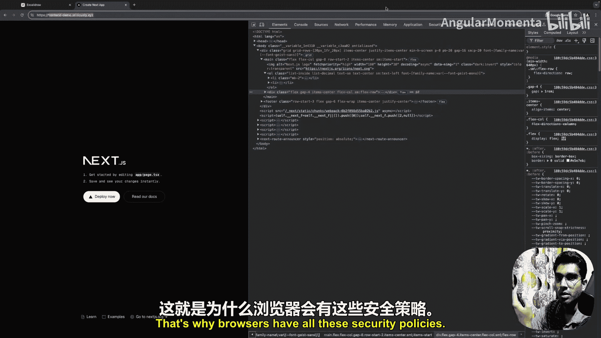

Security reasons。Because the security policies of browsers are so restricted and oftentimes a backend needs to access underlying file system。

 whether it's to write to a log file or access environment variables and browsers won't allow that。

 that is a huge restriction for a backend server。 The second thing is you cannot call external APIs whenever you want unless that API has all the appropriate coreheaders And since we don't have control over all external APIs。

 this is also a big deal breaker because backend servers often need to connect to other servers and fetch data from multiple places so we cannot have this restriction。

 Now the third thing is。Datases。Now the server runtime has access to all native database drivers。

 for example， Pg for Postgrares and Mongodb and that allows it to communicate efficiently with databases。

 these drivers are returned to work in environments that can handle socket connections handle binary data and maintain persistent connections things that browsers cannot do and we will explore later how backend servers communicate with databases but to simplify it backend servers maintain a list of connection which is often called a connection pool to our database server。

So that it does not have to create and destroy connections again and again。

Because back in servers receive thousands and thousands of requests in seconds and if they do the connecting and destroying logic with each request。

 the database server is going to get overwhelmed and it cannot handle that load So drivers are written in a way that can maintain a list of connections and browsers are not designed to maintain persistent connections to databases and even if they were each user would need to open their own direct connection to their database overwhelming their database server with too many connections。

 there is also no easy way to manage connection pullinging or efficient query execution from the browser environments。

 Now the last thing is。Computing power。Frontend applications as we use them are everywhere。

 It could be a smartphone。 It could be a desktop。 It could be a laptop and any kind of environments that we can imagine。

 even a computer， which has a 256 Mf Ram and with a single core processor and the user might not have enough computing power to perform some heavy business logic and things will start to lag and sometimes break because of the load。

 So for that reason， if it's a centralized backend server。

 which serves and caters to a large number of clients。

 we can easily increase its memory and CPU whenever we want。 and we can easily delete the load。

 we can continue this list as long as we want。 But this should give you a fair idea that keeping backend logic in front end is not a good idea。

😊，That is assuming if we can do it in the first place right now we have seen what the backend is。

 why do we need it and how does it work on a very high level Now this is a very good place to be in before we start our journey of learning back in engineering Now let's explore what are these principles and why we should learn in this particular way。

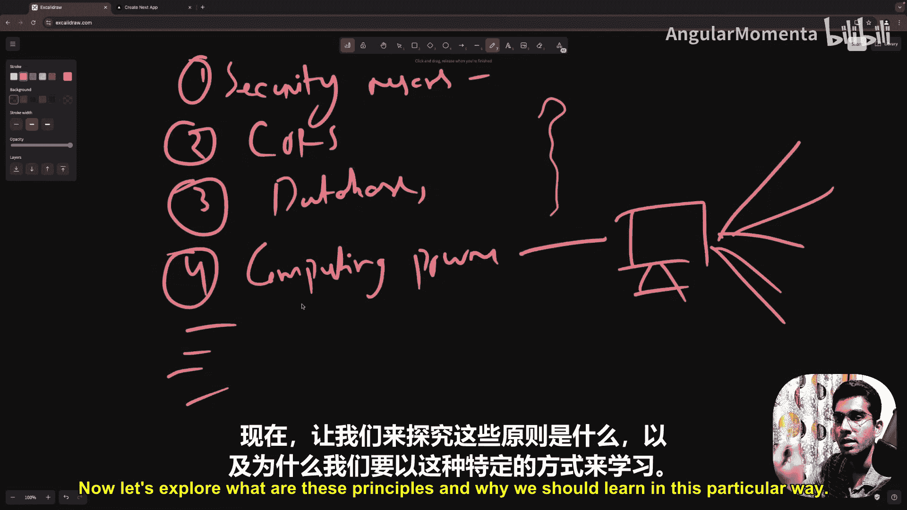