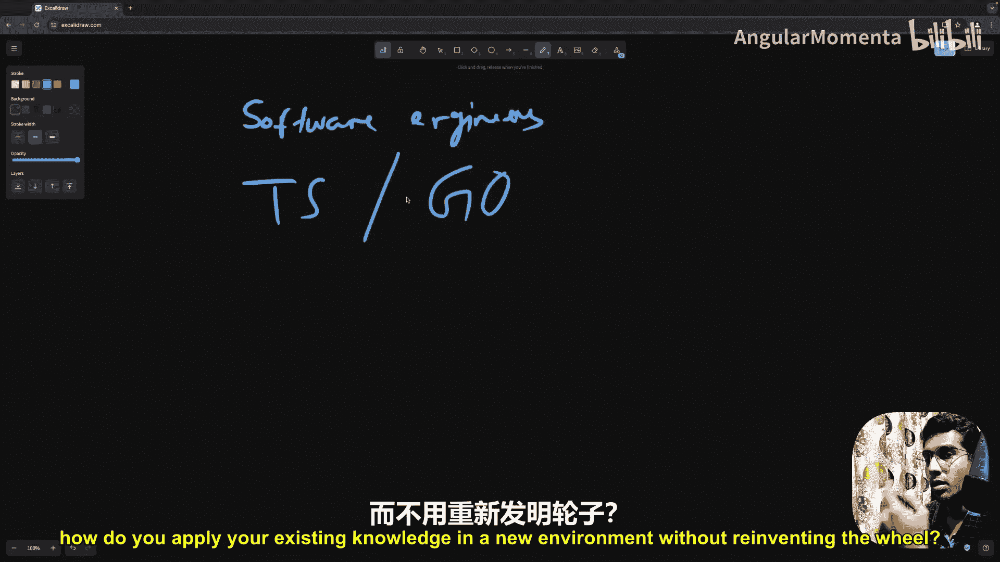
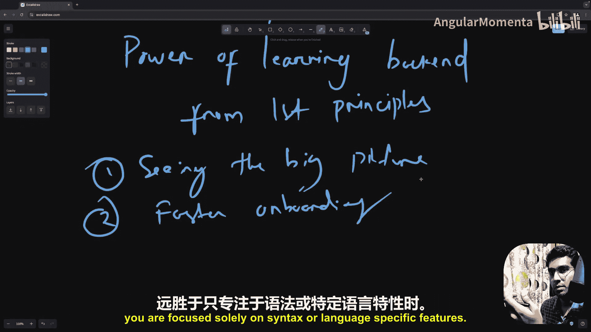
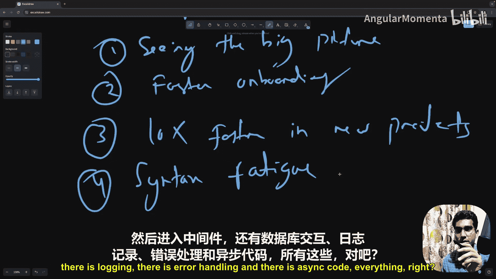
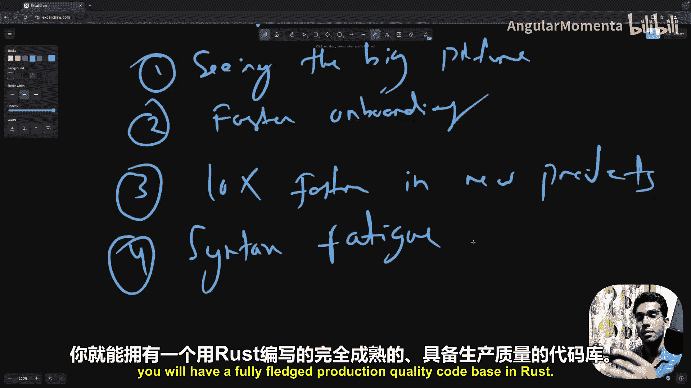
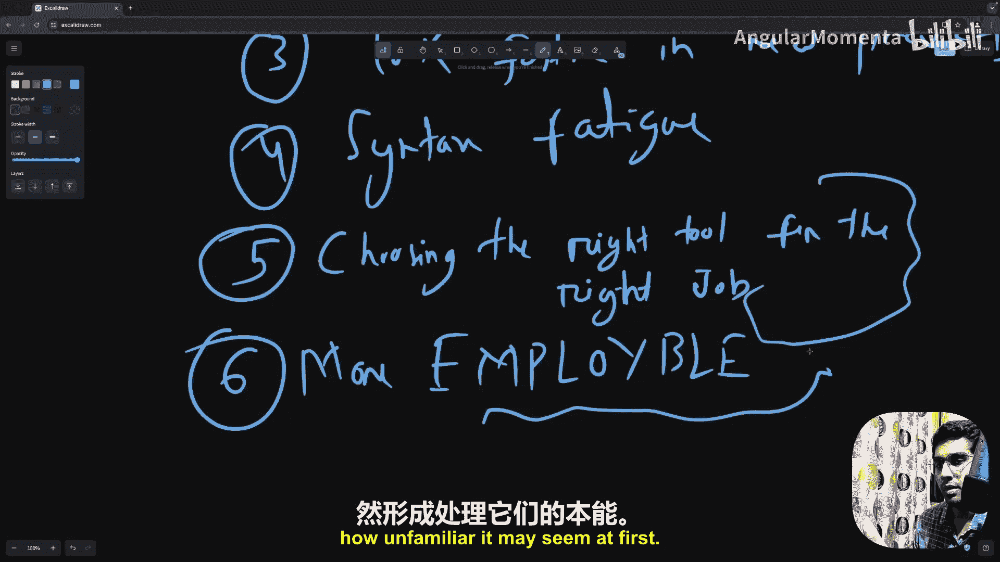
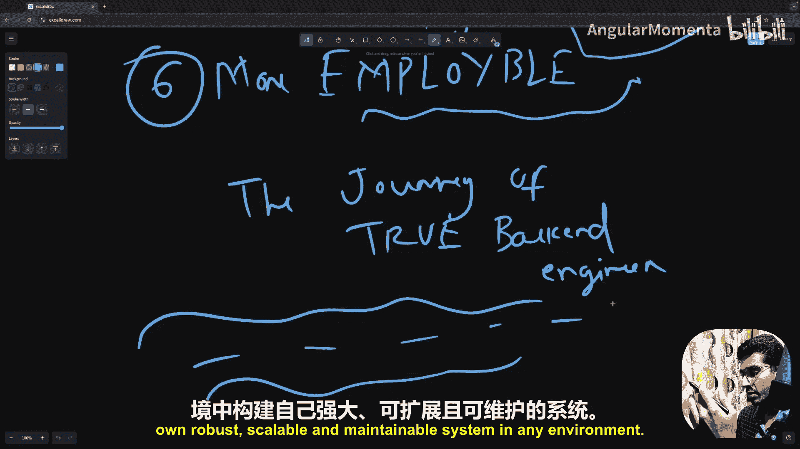
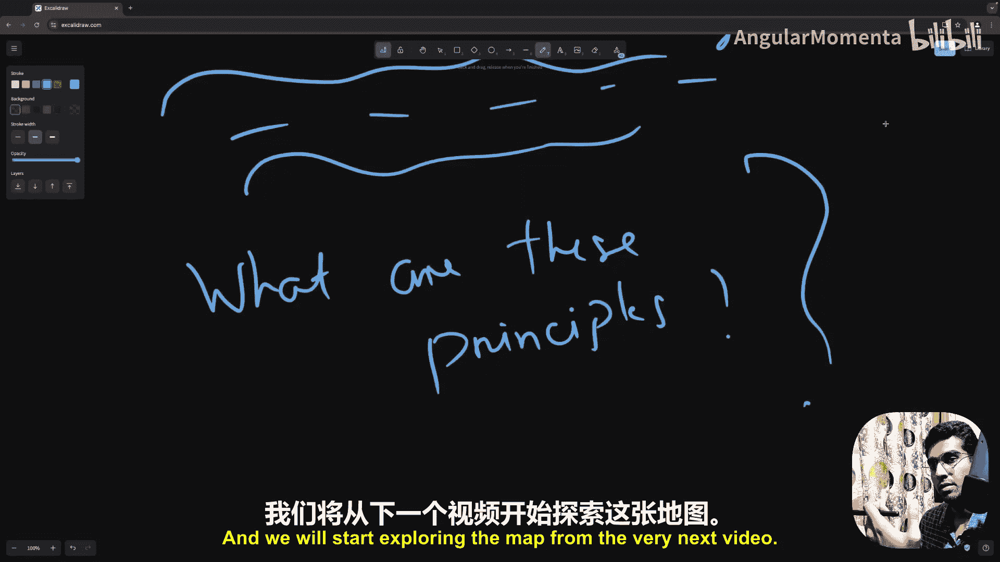

# 【Sriniously】从第一性原理出发的后端开发 ｜ Backend from first principles p04 4. 从第一性原理学习后端工程的优势 -BV17aq1BUEhf_p4-

Imagine you are a newly joined software engineer。Perhaps a front end developer by trade。

And you've been asked to fix a bug in the backend code base。

 And what are some challenges you can face probably the backend is written in a language you're unfamiliar with。

 or maybe it's a language you know， but the bigger question is where do you even start where do you look for the issue without getting lost in the complexity of the code。

 or let's imagine you've been task to create an API from scratch in this situation。

 How do you form the mental map of the codebase stick to the standards and ensure you're not breaking anything One scenario could be。

 you are a backend engineer in typepesscript or golan and you're suddenly asked to jump into a different language。

 Let's say rust or Python。 Now， how do you get up to speed quickly without wasting hourss looking through docs of different libraries。

 Let's say fast API or pedantic or for rust， It it could be axiom or any other library。

 It could be an orm like SQl alcheme or diesel， So the question is how do you apply your existing knowledge in a new environment without reinventing the wheel。

Now， this is where learning back in from first principles becomes invaluable。

 The ability to break down complex systems into their most basic and universal components gives you a massive edge。

 like one seeing。The big picture。RightWhen you enter in the existing codeway。

 instead of being overwhelmed by its structure or the complexity of its engineering。

 you can mentally separate out the different parts of the system and work on them in an isolated way you'll be able to identify the core logic。

 the routing layers， the database connections and the overengineered pieces and by filtering out these noises。

 you can start making changes or fixing bugs with confidence and this is something you might have noticed in senior engineers or Cs or Cs。

 they can just look at any code or any particular codeway and they'll quickly get a fair idea of what's going on or where the bug could be because a human brain is very good at picking up patternss。

 senior engineers or Cs， they subconsciously pick up these patternss So they don't have to actually use this deliberately but my question is why wait for years of experience you can deliberately practice from day one and get good at this in let's say six months or one year。

Now， the second thing is。Faster onboarding。When you understand the first principles behind back in engineering。

 like how StTP works， how databases interact with As or how requests flow through the middleware。

 you can dive into any language or framework and find your way around it。

 You no longer need to spend hours going over library specific dos。

 once you have learned the core concept behind authentication or routing or middleware and database interaction。

 The syntax is secondary。 You'll be able to cut through the noise focusing on the logic instead of the syntax。

 This allows you to develop a deep sense of familiarity with the code waste much faster than if you focus solely on syntax or language specific features。

 Now， the third thing is。

Thenix faster。In new projects。When you start a new project from scratch。

 having back knowledge grounded in first principles helps you move with incredible speed and precision。

 You'll be able to create MVps with production quality code far faster because you'll be working from a deep understanding of the systems needs。

 not just following boilerplate tutorials。 You'll know how to structure your route set up database connections and implement critical functionalities like caching or error handling or logging without constantly referencing documentations。

 And the fourth is。😊，Sax。Pique。Learning a new language can be overwhelming enough。

But if you' are unsure of what concepts to learn next after grasping the syntax or if you don't know how to apply that syntax to solve actual problems back in engineering problems can lead to frustration or even burnout。

 First principles reduce this syntax fatigue because once you understand the fundamental building blocks。

 switching between languages is no longer a daunting task。 You know， the problems you are solving。

 And now is' just about applying the right syntax and libraries。 So， for example。

 you work as an node developer and you want to transition into a rust back in engineer， right， so。

How do you do it， You'll obviously look for a complete end to end project of how to create a back in in rust。

 at least four and five hours。 And it has to also maintain all the production quality standards。 Now。

 the problem with that is， rust is a fairly in new language and。

The amount of resources that we have are nods the amount of project based resources。

That we don't have for rust。 So how do you get good at it， right？ and you constantly worry about it。

 I am not finding any projects。 I am not finding any good resources。 You are good at basic syntax。

 right， how to handle different types of data structures and rust and write basic programs。

 But how to you cross that threshold and actually build an end to end production quality project。

 So this is where the principles come in。 So imagine you understand the different layers of the backend。

 for example， you start from routing and you go to middleware and there is database interactions。

 There is logging， there is error handling and there is acing code， everything， right。

 you understand all the different components clearly as concepts and in nodes。

 So what is the next step， you understand basic syntax for rust， right。

 So you start a rust project with whatever project layout that is recommended by the community。

 and you target each component separately。 You know how a production quality code looks like for routing。

 You know how it looks like。

For validationid and how do you know how it looks like for data interactions and repository pattern and handlers and authentication authorization。

 you know all the good patterns。 Now you just have to convert your rust based syntax into that pattern。

 let's say you want to tackle validation So you go look up how to do validation in rust you most rarely will find a library or some kind of standard library pattern of implementing validations。

 Now you know the syntax and you already know what are the best practices and patterns and you now you mix them up now you have a module of validation in rust which is production quality。

 And now you keep repeating this pattern for every single module。

 let's say for authentication and for all your rest logic。

 and in no time in two three days you will have a fully fledged production quality code base in rust。

 Now the next thing is choosing the right tool for the right job And this is something I see engineers face a lot of problems with every day right。

we are stuck with our labels。 We think we are a node Js backend developer or we are a rubby backend developer when we face a requirement that we have to build this model which has to have very high concurrency demands or a very low latency demands So we are stuck with whatever language that we usually work with and the confidence to reach out for the best tool we cannot get hold of that by understanding the core problems back in engineering solves data persistence or re security scaling you'll also gain the ability to choose the right tool for the right job。

 you won't be limited by your framework or your language or your library you'll know exactly which tool to use which language to use and which framework to use you'll understand when it makes sense to use something like Redis for caching or Postgre for relational data or mongo for unstructured data or let's say Kaafka for realtime event streaming independent of the text tag you're currently working with and the last thing is。

More。And liable。And this is what most of us want right in today's rapidly changing text landscape。

 being able to apply your back knowledge across languages and frameworks makes you incredibly versatile and thus more employable  employers want engineers who can think critically independently who can join any team and begin contributing value quickly。

By mastering backend principles， you become that adaptable engineer who is not confined by a specific language or spa。

 but instead has the ability to solve problems in any environment。 Now。

 the good news is that you don't need to wait for years of experience to develop these skills。

 You can start deliberately practicingrac today， By focusing on the core concepts that remain the same across every backend system like routing database or authentication。

 you can build your own internal compass for navigating new territories。

 The goal is not just to solve problems when they arise， but to do so with confidence and efficiency。

 And with time， you will develop a natural instinct for approaching any backend code base or project。

 no matter how unfamiliar it may seem at first。 Now learning back and from first principles elevates you from a frame of specific developer to a true softwareer engineer。

 One who is not limited by a particular stack or tool set。

 but understands the core problems back in engineering solves。

 This freedom allows you to explore new。😊。

anguages， frameworkworks and architectures with ease and positions you as a valuable asset in any engineering team。

 So whether youre a front and developer looking to expand your skill set or a backend engineer wanting to transition into a new language learning back in from first principles will supercharge your growth and empower you to build your own robust scalable and maintainable system in any environment。

 So what are these principles anyway。 And when I say principles。

 I don't mean a list of rules by first principles， I mean some foundational blocks or foundational components around which the rest of the code base revolves at all times。

 no matter how small or how big it is a generic map of the backend engineering territory。

 which helps you find the way and we will start exploring the map from the very next video。

