# 【Sriniously】从第一性原理出发的后端开发 ｜ Backend from first principles p05 5. 后端工程师的HTTP入门，一切从这里开始 -BV17aq1BUEhf_p5-

Bagon is huge。 And if we start discussing every single component that could be part of it。

 we will be stuck here for years。 So what we will do is we will only discuss those topics which are used in majority of the code basis。

 let's say 90% of them with that in mind， let's talk about HttP protocol the medium through which our browsers talk to our servers either to send data or to receive data from it。

 And as I said， there are a lot of other waste and protocols which clients and servers use to communicate with each other。

 and httP being one of the most used ones。 We will focus on that。

 Now there are two ideas which are at the heart of htTP protocol。The first one being tastelessness。

 what does it mean Tlessness basically means it has no memory of past interactions。

So each HttP request carries all the necessary information for the server to process it。

 such as headers or URLs and methods which you will see in a bit and after the server respond it forgets about the request the client makes another request the server treats it as a new and unrelated event and it also means selfcontain request since the server does not remember past request each request must include all the necessary data such as authentication tokens or session information to handle that specific interaction for example。

 in the case of accessing a user profile， the client has to provide credentials like cookies or tokens on every request for the server to know which user is requesting the data。

So what are the benefits of that what are the benefits of this stateless model the obvious one being simplicity stateless design simplifies server architecture because the server does not need to store session information which would otherwise require additional resources and complexity and it also means scalability stateless protocol makes it easy to distribute requests across multiple servers because no single server needs to keep track of a session and if the server crashes it does not affect the state client interaction as there is no session or memory of a request that needs to be restored and having said that because as TTp is stateless developers often implements state management techniques like cookies or sessions or tokens to maintain continuity in interactions where needed like user logins or shopping cardss and will explore those soon in this series and the second idA client server model in。

Typical STTP request flow there is a client and there is a server always the client typically is a web browser or an application which initiates the communication by sending a request to the server The client is responsible for for providing all information needed by the server such as the URL the resource or the headers and everything。

And then there is a server。Which hosts resources like websites or APIs or other content and waits for incoming requests from the clients When the server receives a request。

 it processes it and sends back the appropriate response。

 such as a web page or data or error message or a J file or a text file or any other kind of content。

 Another， thing to remember here is。STTP protocol states that communication is always initiated by the client to get some kind of response by the server and throughout our discussion we can go ahead and safely assume that STTP and STTPS are interchangeable because STTTPS to oversimplified。

Just a more secure version of STTP but the underlying principles are the same with more security features like encryption and security certificates or ELS stuff like that which borders too much into the network engineering domain also to send some kind of request or receive some kind of response was the client and the server need to establish some kind of connection mechanism right otherwise how are they going to communicate what is a medium of the communication and for that STTP uses TCP。

BCB。Wwhich is a protocol which is a transmission protocol。

 essentially StTP does not require the underlying transport protocol to be connection based。

 It only requires it to be reliable and not lose messages at minimum presenting an error in such cases among the two most common transport protocols on the internet which are TCP and UDP TCP is considered to be more reliable SgtP therefore relies on the TCP standard。

 which is connection based Now this is called an osi model which is often referred when we are talking about sending and receiving data over a network right and we as backend engineers often deal with this layer the top layer。

The layer 7， application layer。And so。A lot of discussions， for example。

 the recent one which we talked about the TCP handshake and establishing connections and Tl S encryptions。

They often border into these layers。So。They are mostly network engineering concepts。

 of course it it's good to know about those， but if we start exploring those。

 it'll be a rabbit hole and we'll have to cover a lot of concepts right so what we'll do is we'll focus on the application layer with a brief about you know what happens in the network layer like as I said StTP uses TP and PCP use something like a three way handshake it which if you are curious about you can just look up and study more on that Now throughout the years we had different versions of StTP which kept redefining how clients and servers send and receive data。

In STP 1。0， each request opened a new connection， this led to inefficiencies since a connection had to be established and closed for every request and response。

 which slowed performance in STP 1。1 they introduced something called a persistent connections allowing multiple request and responses over the same connection over the same TCP connection that is established before sending the request which significantly improved performance it also added stuff like chunk transfer encoding and better caching mechanisms in STP2。

0 they introduced multiplexing， allowing multiple request or responses over a single connection it uses something called binary framing instead of text and supports header compression with H packac or and server push allowing servers to send resources before the client request them Now in STP3。

0 built on quick protocol a transport layer protocol over UDB instead of TCP it is designed over。UDP。

 which improved performance with faster connection establishment。

 reduced latency and better handling of packet loss。

It also continues to support multiplexing without head of line blocking。

 which is still an issue in ST 2。0 now and that's a rabbit hole if you get too much into the network stuff。

 all you need to remember is that from all these discussions。

That client and servers establish some kind of network connection and messages are sent and received。

 That's all you need to remember for now。 Now that we mention message。

 let's look at what StTP messages look like request messages or response messages a request message is basically the one that is sent by the client and a response message is the one that is received by the client from the server。

 So this is what a request message looks like in Sttp。

 and this is what a response message looks like。 I intentionally took more complex messages which had more parameters and so that we can cover different different components1 by one。

 So on a high level， I'll just explain what is what in this right this part this is called a request method。

 this is the resource URL， the one we are requesting from the server This is the SttP version which says we are using S version 1。

1 which is currently the most used one。This is the host。Right which is our domain。

The front end domain。And these are this。All of these things these are called headers right well talk about headers soon there will be a blank line here after all the headers to signify that the headers are over and body starts this is called a request body and some information the client wants to send to a server。

And in the response message， again we have the GDPtP version the status code and the value of the status quo。

 which basically means the status quo 200 means okay， right？And we have， again。

 some response headers。 After that， there is a blank line， and we have the response body。

So let's talk about StTP headers first。This is very important since it's the major part of the request here and the responses on a high level what we can see is headers are basically key value pairs。

 key value pairs of different different parameters that is send a request are receipt or a response that is the first definition and the next question is why do we need headers Why not send all these values in the you know the URL or we have this request body here why send why create a different section just for sending more information or more metadata about the request or the response why create another level of abstraction and in order to understand that let's take a real example we send parcels rightques and we receive them the address or the phone number of the recipient and different details the state the pin code and all of these things do we keep it inside the package or do we write。

On top， and。We write it on top。 why， because the one who is taking the parcel from the sender and to the receiver。

 they need to know different informations in order to successfully。

Transmit the package through different modes of transmission。

And if we kept all those information inside the parcel， they have to open that， right and。

Which does not make any sense， but just for the sake of the example。

 they have to open that and they have to see who is the recipient again and again。

 So let's say another person wants to see their address So again they have to open there so。

Keeping the metadata， the address and the information of the recipient on top of the parcel gives a quick way of checking different metadata about the package。

 SDV headers can be thought of something like that but they have more uses before we go into the use cases let's see what are some different kinds of headers that we see So as you can see there are a lot of different types of headers So can we categorize them。

 can we categorize them in different types of headers。

 So let's see the first category can request headers which are send by the client to the server to provide some kind of information about the request itself it could be user agent which identifies what kind of client is that it is a browser or it is it is postmail or it is some kind of server or it is a mobile app we have authorization which sends different credentials like bear token to the server to identify the user accept headers which provides informations like what。

Of content we are expecting， whether it is a JSson whether it is a text。

 whether it is an HTMLml file。 So request headers helps server understand the client's environment。

 its preferences and its capabilities。 Then we have general headers which are used in both request and response which have some metadata about the message itself。

 for example， the date of the message and different caching mechanisms like no cache or message and the connection information。

 whether to keep it alive or to close it。 So general headers have some kind of information about the request message or the response message then we have headers。

 which primarily deal with the representation of the resource being transmitted。

 whether it could be a request body or a response message the content type describes the media type the request or the response it could be JSson or it could be Hml the content length describe the size of the resource in by。

The content encoding specifies any encoding like j or def flare。 Then we have E type。

 a unique identifier， which is mostly used for caching。 So representation headers。

Provides information about the body of the message or the response。

 ensuring the clients and servers know how to interpret and process request or the response。

 Then we have security headers which used to enhance the security of the request and response by controlling behaviors like content loading cookies and encryption HST ensures that the client only communicates with the server over Https preventing protocol downgrade attack Con security policy restricts the sources from which content like jascript or Css and images can be loaded。

 helping prevent cross site scripting attack Xre options prevents the webpage from being embedded in iframe mitigating clickjaing attack X content type options ensures that the browser does not try to guess the mime type of the content preventing mime types sniffing attacks that cookie with httP only or secure flags secure cookies by making them inaccessible to jascript and ensuring they are sent over Https security headers helps protect the client and server。

From a variety of attacks by controlling how the browser behaves with resources and enforcing security policies now there are two ideas that we see her while talking about SttP headers one is extensibility。

St TP is highly extensible because headers can be easily added or customized without altering the underlying protocol we only have to add some kind of metadata and the whole flow of the interaction changes depending on that。

 Now， headers can be defined and used for various purposes。

 making SttP adaptable to new technologies and use case， for instance， security enhancements。

 as we just talked about headers like strict transport security and for security connections。

 Custom headers， developers can create custom headers like X custom header for specific application for their own use cases Con negotiation。

 the accept and accept language and accept encoding headers allows servers to serve different versions of the content depending on the client's preference。

 So the next part is the idea of remote control。 StP headers act as kind of remote control on the server side。

 They allow the client to send instructions or preferences to the server。😊。

Influencing how the server responds or processes requests， for example， content type negotiations。

Cllineients can request specific formats using accept header and the server can respond with the appropriate format if the client says I want the HTML format。

 the server sends the HTML and if the client says they want JSson then the server sends the JO format。

 then caching an expiration control， the server can use headers like cache control or expires to control。

 how long a resource should be cache by the client。Then authentication。

 the client can authenticate itself to the server through authorization header influencing access control decisions。

 right， So these provide。More capabilities on top of our messages。

 which are very useful in a lot of instances。 Now we have some kind of idea about the headers in StTP and we will explore them in more depth when you are going through the demos Let's move on to the next component of your hTT message right the StTP method STP methods exist to represent different kinds of actions static decline like a browser or in API consumer can request on a server instead of every request doing the same thing methods define the intent。

The keyword node here is the。Intent， the intent of the interaction。

This gives clear semantic meaning to each type of action。

And it is pretty intuitive in that sense we use get request to fetch some kind of data from the server and it should not modify anything on the server we use post to create some data in the server and post requests have a body which makes sense because how else should you send the user data to the server then we have patch。

Which is used to update some data for example， you have a user's profile page where they can update their name。

 and this also has a request body to send the data to the server。

We also have put which also used to update data but what sets it apart from patches whatever data that comes in request body should completely replace the previous instance basically patch can be thought of as an append action or a selective replacement while put is a complete replacement even though a lot of times developers use put when they should be using patch and go against the semantics so the thumb rule is always use patch unless you have a specific use case for put then we have delete method and as the name suggests we use this to delete some kind of resource from the server and one relevantent idea that we have in the context of stt methods is the idea of inputpotent and non-impotent and what the idea of dimpotent means is these st methods can be called multiple times and we can expect the same kind of result for example。

We generally consider the methods get are put。Or。Delete。

In the category of it important methods because just think about it。

 you are trying to fetch some data from the server right it does not matter how many times you fetch it。

 The data should be same you should not be able to modify any kind of data in the server so get is obviously important and then we have put because put completely replaces the resource in the server。

 so it does not matter how many times you replace an old data with the new data。

Itll the result will be the same， right， So that is also considered as it imported。

 Then we have delete。 You can only delete a resource from the server once， because after that。

 it is already deleted。 You cannot perform the action multiple times and expect different results。

 right， The result will always be the same。 The resource can only be deleted once。

And then we have the idea of non item important， usually we consider post request to be non item important because once you submit a request to create some data。

 let's say。A user can create a note using your app right they submitted a post request to create a new note and the first time they submit the request their request goes through the response is successful and a new note is created。

And when they do it a second time we create a new note right there are two different results for the same kind of request so thats why we consider pose to be a non idpotent method because it produces different results for the same kind of request after all the JTB methods we have one other method which is called the options method and this has a very interesting use case which is used in the course flow right we discuss this before in brief。

Cs flow， which is part of the same origin policy。Wwhichch browsers have now options method。

 this method you probably won't use directly as a developer。

 but you will see them once in a while in your browser network tab in pref request So the options method is used to fetch the capabilities of the server for a crossorig request also known as course。

 which is used because browsers have same origin policy。

 which means by default browsers follow the same origin policy which restricts web pages from making request to a domain different from theirs different from the one serving the webage and course is a security mechanism and post by browsers to control how web applications interact with resources posted on different domains which are crossor。

And without course， browsers block the request made from a web application running on one origin like example dot co to a different origin like A do another example dot com for security reasons Co allows servers to specify who can access their resources and how in a crossor request there are primarily two types of flows One is a simple request flow and another one is a three flighter request flow First let's look at the simple request Imagine our client our frontend is at the domain example do com and our server is at the domain Api do example do com and we make a get request which looks something like this。

 This is how the flow looks like the client sends a request the browser automatically adds the origin header to indicate the origin of the request the request uses simple method which are usually get post or head and then it reaches the server。

The server checks for the origin header against its cost policy。 if the origin is allowed。

The server includes the access control allow origin header in the response and it sends the response。

 The server response with the resource and includes the necessary course headers， for example。

 access control allow origin header and this is what the response looks like it has the appropriate course header。

 which the browser looks for while it passes the response， it sees that our domain。

 which is the example docom， is different from the host domain。

 which is the API dot another domain docom and since these two are different。

 the browser checks whether the server's response has this header or not。

 whether it responds with this particular header access control allow origin。

 If the server response with the domain of the client。Example dot com。

 or it would also respond with star， which means allow all origins， right。

 If either of those two conditions are true， then the browser lets the response go through to the client to whatever the jascript client requesting the resource。

 And imagine， imagine if the response look like this， the client send the request。

 the server got the request and assuming the server did not add the corresponding course headers or assuming the server did not allow this particular domain as the client。

 Then what the server does， it excludes this particular header from the response。

 So the response looks something like this。 And when the browser finally passes it。

 it sees that it sees the absence of this header and what it does it。

 it blocks this particular response from being passed。

 you will get an error in our console and we will see the error in the network tab as a coursear error。

And this is how a simple request flow looks like Next we have a prefed request flow for a crossorin request and how does a browser distinguish between a simple request flow and a prefed request flow So these are the three conditions the browser checks before it decides it has to do a pref request which basically means it has to do a request before the original request to enquire some stuff to enquire some capabilities and to let the server know about some capabilities right and when does a request qualify as a prefed request One is the method is not get post or head example it is a put request or a delete request and it is either our situation right it either of these conditions have to be true。

 then it will be considered as a prefed request So the first condition is obviously it has to be crossorin request which means our domain and the server domain has to be different。

And the second condition is one of these three and after that it will be a course request and inside that it will be prefed request。

 So the first condition is it has to be either a put request or a delete request or the request includes some non simpleimple headers none simple headers are basically anything apart from our general headers or request header So one example could be an authorization header or some custom headers right and the third one is。

Od。The request has a content type other than application form URL encoded or multipart or text plane。

 These are called general content types or simple content types。 So if assuming our application。

Our client request the data to be in Json。In that case it will be considered as a preflighted request and if you are a front end engineer or a backend engineer you know that mostly we deal with JSO data right so most of our requests are considered as a prefed request this are the three conditions either of them have to be satisfied before we move on before the browser moves on to make a pref request what does a preflight request looks like this is when we finally see the use of options method right a pref request is made with an options method and preflight request looks something like this it has the method as options it has the appropriate resource URL and the StTP version it has the host header which is the header of our API the origin the domain of the front end and this header access control request method so it is basically asking the server whether this method is supported for this URL or not so it is saying I am。

makingking a crossorigin request and do you support this put method for this route right and it also asks whether you support this particular header or not if it is needed and the browser sends the options request to the server the request does not include actual data right this does not include any request body or anything it is just a general inquiry to the server about its capabilities and after that if the server is properly handling course flow if the server supports crossorigin requests it responds something like this and if the server does not handle course request then it won't respond with this and the request will be automatically blocked by our browser and if it does handle it it requests with something like this what it says is this is the status code of the response which means there is no content this is just a general information used to 04 when there is no content then。

These are the four important headers it responds with The first one is the excess control allow origin。

 It says， yes， I allow the clients domain mean， which is example dot com as a cross origin as a valid crossor request it can either respond with this or it can respond with is star。

 which basically means I allow all types of clients to make request to me。

 This is the one valid condition it is browser checks it。

 The next is we asked whether you allow put request for this resource or not。 So the server is yes。

 I allow these two different kinds of method。 It is the put method and delete method for this resource for this particular route right and the browser checks it off。

 The next one is we asked whether you allow authorization header and the server is yes。

 I allow authorization header and then it is also checked off。And the last one is access control Mac。

 What this means is the server says。Don't make any more pref request to me it says these。

 these confits， whatever I responded with， these will be the same for at least the next 24 hours so you don't have to keep making more pref request for every route before you send the original request So this saves some bandwidth for both our server and clients So this is the pref request that the browser makes and the server response with the appropriate headers the browser checks off all these conditions and then the browser since the final request is the original request that the client wanted to make and the server response according to the original request with whatever the operations are required but this is how the typical course flow looks like and now that we understood the theory let let's look at the real demo Okay now before we start let me make this clear that we won't be looking at any code because as I said we are learning from first principles and。

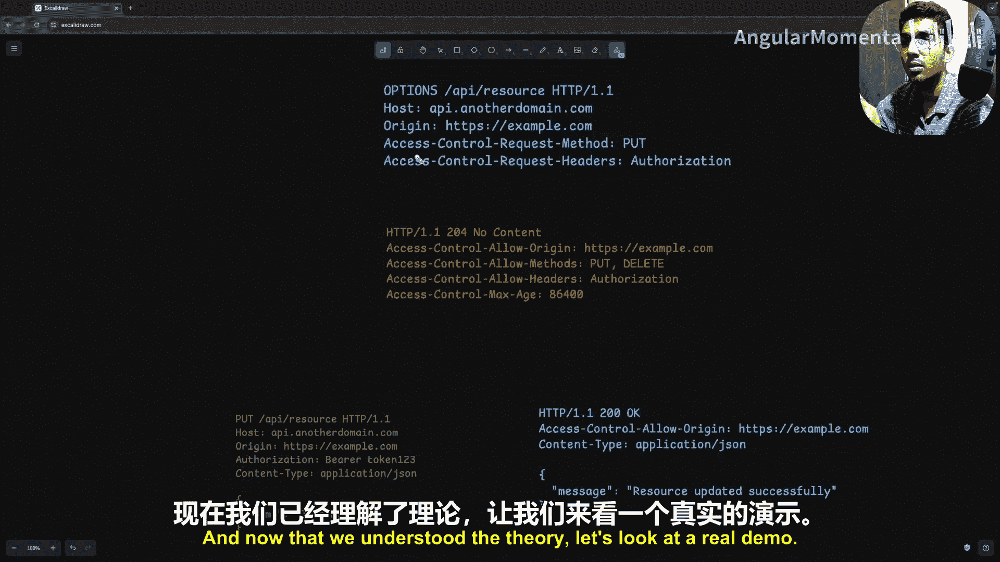

rule for that is we try to understand the concepts first how the underlying mechanism works before we dive into code。

 before we understand the how， but first we have to understand what for all these demos that we are going to do in this video and and all the other videos in this series we won't be looking at any code。

Does not matter what language the server is written in， what framework it is written in。

 I'll explain what I am changing in the server， what I have done in the server for all it matters。

 It can be implemented in any language。 That's that and。

This is a tool Its called burbsuit and it is used by ethical hackers， if you may。

 it has a lot of features as you can see， but primarily what we are going to use it for is StDP interdecepting or visualizing STP traffic and it offers a quite a nice set of features for that with that。

What I have here is I have a simple front end app again it could be in any language and what I want to show is one for our courseflow。

 one is the simple request and one is the free flight request and how they look like in actual browser environment so let's file the first simple request。

Okay， so we got this response that we are rendering here and let's inspect the request and response for now。

 right？So you go here。This is what the request and response looks like right we already took a look at all these components right the method and the URL and all these headers and the response the status code and the response headers the response body so let's focus on the course here What is the first parameter for a request to be considered as a cross origin request by the browser。

The first thing is the origin， so this is our local host 5 and 73。And the host， right。

 This is our APIs， which is running on the port 3000 of local host since the host and the origin are running。

On different ports。In local host by the browser this is considered as a cross origin request and according to the same origin policy we can only make request from local host 5173 to local host 5173 right since we are not it is considered as a cross origin request the headers to focus here is origin header let me minimize this。

So the the headers to focus here is the origin header， which is our origin。

 the front end origin and the host， the domain or the port that you want to connect to which is the APIpis right for the request these are the two important headers now lets go to the response now the thing to focus here is this header right as I had explained。

The browser makes a crossor request。 and when it gets the response。

 it checks whether it has the access control allow origin header or not。

 or whether it has the appropriate port or the domain。 So it has the front ends port right， the 5，1。

7，3， or it could also have star So in that case， the browser lets the response through and it does not block it since according to the course headers。

 response is now expected this response is now allowed。

 And now that's why we are able to get the response and now we are able to render it in our front end let's see what happens if we remove this header this access control allow origin header from the server for a simple request。

 let me just go and make this change。 Okay， I have went ahead and made the change in the server。

 now it won't return the appropriate core header， the access control allow origin。

 Let me refresh this。And let's clear this history so that we can focus on the particular request。

 Now， let's file the same request again。 And before we do。

 let's disable caching so that we can see what a new request looks like， right。

 So let me file this the browser block this response， right， It says course error。

 and why let's inspect。This request in response。So here if you see。

 we have a crossor request because our origin is 5173 and the host is 3001 and the server does not return an access control allow origin header right because we removed it and for that reason the browser has blocked the request because of Co server。

 So this is how the simple request flow looks like and now let's move on our prefed request right Okay I have gone ahead and enable the course again so that we can test the pre flight request flow away let me file this。

Alled， as you can see here。The first request that went through was the options request right the P flight request and then the original request went through。

 let's look at them one by one how the whole floor looked like okay， for the pre flight request。

 as we have already discussed， the method was options and it is a cross origin request because the refer and the origin。

Are different ports， right？ And for that。What the server responded with。

 it responded with status quo 20，4， no content， because it is just a general inquiry， right。

 pref request are general enquiries， they don't have request bodies or response bodies and the server responded with access control allow origin with the fronts domain or port。

 right makes the browser allow the response to go through It is the first condition。 And before that。

 let's see why a pref request was fired， right， why， why this is not considered a simple request。

 He investigate the original request。 What was the conditions。 It is not a simple method。

 which is get post or head right that is that was one of the conditions。 So it is already satisfied。

 but let's look at others。 It also has a authorization header that also counts it out of a simple request right that is the second one and the third one is。

The content type is application Json， and it is sending a Json request body， right。

 all the three conditions are satisfied， but even if one of them was satisfied。

 it would have still fired a pre flight request for this。 Let's go back to our options。

 Pre flight request analysis。 The first one was。It allowed the client's domain so that the browser lets the response to go through the second one。

Excccess control allow methods。 So the server is。All these methods get post put delete。

 These methods are allowed for the server。 It lets the client know the capabilities of the server。

 The third thing is access control allowed headers。

 it says these are the two headers which are not simple headers that are supported by the server。

 which is the content type。And authorization since the client asked for them。

 if you look at this access control request method put the client is asking with the pref request whether the put method is allowed or not and whether these two headers authorization and content type these two headers are allowed or not。

 So for that the server is responding with these headers， it says get post put delete is allowed。

 it also says content type and authorization is also allowed。

 we have also set the max H for the access control to 0 for testing purposes， right。

 because if you cache this for let's say5 minutes。 then pref request won't be fired That's why this is used for and the content length is0 because there is no content。

 Since the pref request was successful， it returned to 04， it is a success status code。

 the browser let the response go through and it fired the original request which is the put method and this is the original request。

It helps put method， the resource URL， the origin and the authorization header。

 the host the request body and it responded with the response body and that's how the preflight request flow looks like so the simple request and the preflight request flow combined they make the whole course flow and this is all you have to understand how course works behind the scenes and why these headers are important and how browsers react to them okay moving on the next component that I want to cover is response code this part this 200 okay what are this and why are the needed St response chs exist to communicate the result of a request in a standardized way now you can just look at the response code and see whether the request was successful or not or what is the state of the server without looking into the body。

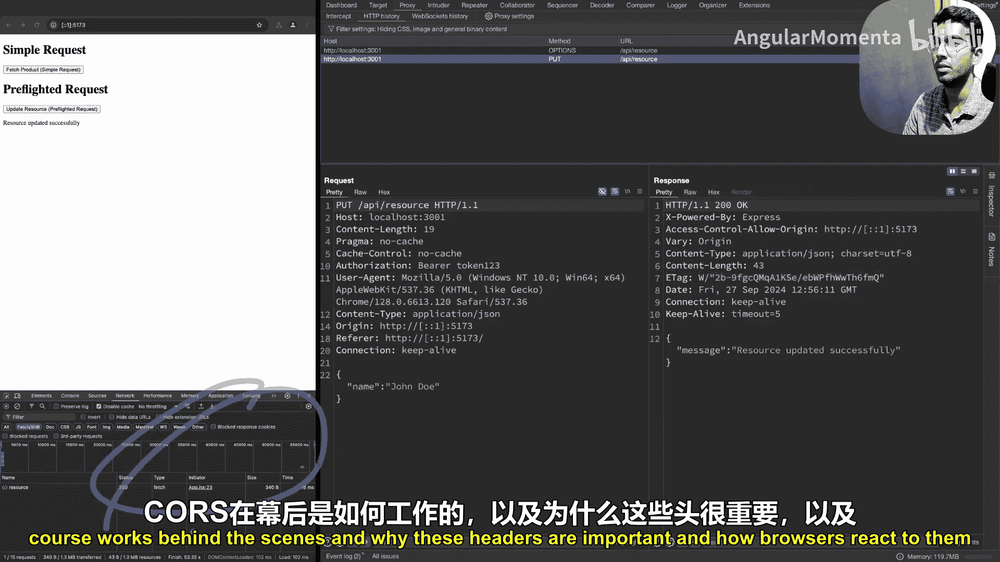

Without judging from the response message that okay， so if the request was successful。

 then I would have expected this structure。 if the request was unsuccessful。

 then I would have expected this structure。 if the server crashed。

 then I would have expected a null object right we don't have to make those decisions。

 we can judge by these status scores they quickly inform the client whether the request was successful resulted in an error or requires further action。

 They also help clients handle errors by providing specific codes to identify the problem For example。

 unauthorized access will return 401。 So now the clients can check whether it is 40。

1 and it can log the user out saying you have to log in again。

 right those kinds of actions they can be judged with response course or imagine。

 let's say it was a bad request error because of some invalid value through a form submission then the client can ask their user to make changes to their form submission and resubmit。

Dending on those status code， which is like 400 also standardization SttP response codes are standardized across all web services。

 enabling consistency in how servers communicate with different clients regardless of the platform or language used it does not matter whether you are making a server in Python or golan or rust or jascript or rubby you have to follow this standard if the request was successful you have to return 200 if if you created something you have to return to 01 these are the standards and you have to follow them Now before SttP status quo。

 clients would have to guess the outcome of a request based on the content of the response as I said leading to inconsistencies and inefficiencies SttP status code solve this by providing a universal language that all clients and servers understand streamlining interactions and error handling on high level response codes are3 digit numbers they could either start with one。

2，3，4 or5。And depending on the starting digit， we categorize them as different level of errors or different types of errors on a high level。

The digits starting with one are informational responses2 success responses。

3 are redirection 5 or server errors，4 are client errorsers response codes starting with one this code is sent by the server to indicate that it has received the headers and the client can proceed to send the request body and when is it used commonly used in large uploads。

 the client sends the headers first and if the server is okay with the request it sends10 continuous so the client can send the rest of the body also there is which is all uses used for switching protocols we have a use case for that this indicates that the server is switching protocols as requested by the client such as upgrading from Sttp to web socket this is not the mostly used response codes that you will encounter on your day to day life so let's focus on these four which you will see a lot of times especially to4 and5200 series as you know are used for success response。

And under that， we have three mostly used ones。 One is 200。And 20，1 and 2，0，4。

200 is the most common code。 It indicates that the request was successful and the server is returning the requested resource or performing the requested action。

 For example， successful get requests where a resource is retrieved 2，0，1。

It indicates that the request has been fulfilled and resulted in a creation of a new resource。

 For example， post request or new form submissions。

 That's where servers use this response to indicate that the a new resource has been created。

Then we have 20，4 that we just saw in a course flow when we send options request a pref request and the server responds with 2。

0，4 saying that there is no content， but these are the information in the form of headers This also indicates that the request was successful。

 but there is no content。 We also sometimes use it for delete request right the client makes a delete request。

 you delete the particular resource， but the server says okay， I have deleted it。

 but there is no content to return right you can just assume that the request was successful then we have 300 and in 300。

 the mostly used ones are 30，1。3，0，2， and 3，0，4。3，0，1 means moved permanently。

Which means the requested resource has been permanently moved to a new URL and the future request should use this new URL。

 for example， let's say initially you had a route called user。

And eventually you decided to move that route to sla person。

 so in order to maintain backwards compatibility so that old users or old applications that are still using this route。

 don't break what you do is you add a 301 response for this routes and redirect them to。

This last person route， So it is a permanent redirect。 The next one is 302。

 which means temporary redirect。 The requested resource is temporarily located at a different URL。

 but the client should continue to use the original URL for future requests。

 So when do we use this let's imagine you are running a campaign or something and for those couple of hours you want to redirect redirect a particular route to a new route for caching new traffic or showing a different Ui or something like that but you don't want to stick to that right you want to revert the changes So you want to say to the client that for now I am making a redirect。

 but later on you should use the original route only and then we have 304 which says not modified it indicates that the resource has not been modified since the last time the client requested it and this will see soon in a bit in a when we explore our caching demo and when we use。

This is mostly used in conjunction with conditional get request request to allow efficient caching rate when we are using Et to let the client know that the response is not modified。

 it should use the cache to one only instead of downloading the new response So it just says that it is not modified so you should keep using your old response the cached response then we have the 400 series errors and as a backend engineer I think you will mostly deal with these errors because these are the client errors or errors that are triggered because of something some behavior from client So let's see what are the common ones the first one。

Is 400。And what this means is it says bad request and when does it trigger or when should we fire it。

 for example， when the client sends invalid data or illogical data or something related to data right for example you are expecting a number and the client sends an array or a string right you are expecting an email but the client send a phone number。

 something like that it's a bad request that's what it says and youre letting the client know that there is something wrong with your request format So fix it and make a new request The next one is 401 which is which means unauthorized。

When should you far this when a request requires authentication。

 but the client has either failed to provide valid credentials or has not authenticated at all。

 so let's say you are expecting a JWT token and either if the JWT token has expired or if the client has not send the token in the first place so in those scenarios you want to say that you are unauthorized that's when you respond with this status quo 401 next up we have 403。

And it says forbidden， which means the server understood the request， but it refuses to authorize。

 and this can happen even if the client is authenticated。 For example。

 when a user tries to access a resource， they don't have permission to access。

 So let's say you are a user A and you are trying to delete a resource of user B。

 So that's when the services， you don't have the necessary permissions to perform this action。

 So you are forbidden40，3。 Next up， we have 40，4， and it means not found。

 I think this is the most famous status code 40，4。 This is fired when the client requests a resource that is unavailable either because the URL is incorrect or the resource has been deleted。

 So in those cases， the services is 40，4， It is not found。 Then we have 4，0，5。

 which means method not allowed when does it get fired。

 when an invalid atB method is used such as trying to put to a resource that only accepts get or post。

This often happens because of typos right we are working on front end and instead of doing a put request。

 we do a pass request or instead of doing a post request， we do a put request So in those scenario。

 services405 which means whether not allowed then we have 4，0。

9 which means conflict this has a number of use cases。

 one of which we can imagine is let's say in your app you are allowing users to create folders right and the condition is the folder names has to be unique they cannot create two folders with the same name when they try to create a new folder when they submit a post request you check whether the folder is already existing or not if it is you can respond with this error 40。

9 conflict so the client will understand that a folder with that name already exists and it should try with a new folder name right it means conflict and at last we have 4 to9 which means。

To many requests and this is mostly used when we are trying to rate limit the client's request rate limit basically means if a client tries to make too many requests in a particular interval。

 let's say in your server you have configured it to allow at most。60 degrees width。

Or a client in one second。 And if the client tries to exceed that。

 you can respond with this response code。 It says 4 to 9 to many requests。 Okay。

 let's move on to the 500 cities， and we have the most famous one， which is the 500。

 which means internal server error。 This is often used for unexpected conditions in server。

 something， some process broke or some exceptions were raised， which were not handled in the server。

 So something unexpected happen at the server。So instead of， you know。

 just returning a empty response or just breaking or hanging the request。

 we respond with 500 internal server errors。 The client knows that something went wrong with the server。

 then we have 50，1， which means not implemented， for example。

 when the server does not support the requested SDP method or functionality， but。

It plans to edit soon。 So that's when we add a 501， which means currently it is not supported。

 It might be in the future。Right， so we are trying to get that intention through to the client so that it is not implemented yet。

 Then we have 5，0，2。 right， It means bad gateway。 We usually see this in proxies like N X。

 It means when a server acts as a proxy， like in a load balance system or reverse proxy and upstream server returns an ill valid response。

 So that's when 5，0，2 is return。 This is not something we are return intentionally。

 This is handled mostly by proxy and load balancers。 Then we have 50，3s。

Which means service unavailable when the service is down。

 when the service is temporarily unable to handle the request。

 such as during high traffic or when it is going maintenance， So that's when you return 5，0。

3 to let the client know that the service is unavailable right now and it should try again later At last we have 5。

0，4。Which means gateway  timeout。 It is similar to 50，2。

 but this specifically means that the upstream server fail to respond within timeout period。

 let's say you have you're using Nngx and Enngx could not get a response from our original server。

 which is running behind it。 So that's when Nng response with 50 for gateway timeout。

 that it did not receive any response from our original server。 That's why it says timeout。 Okay。

 that's all that's pretty much all the response scores。

 you need to know to work with 95% of use cases。 Now， in order to solidify our understanding。

 let's look at a quick demo where we look at some of these responses。 Okay， now again。

 we have a friendend app for this demo where we are trying to emulate some of the response course and there is a server running。

 which will respond with different status scoress so what we'll do is let's just fire all of these requests。

 then we will examine what。

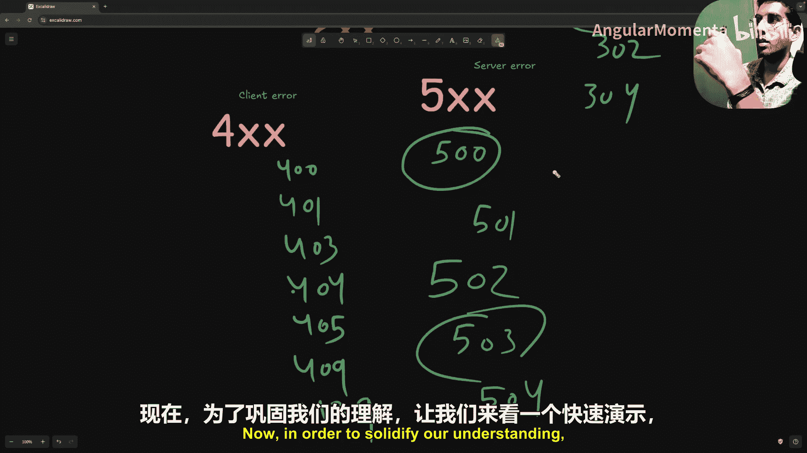

The responses look like。You let me go ahead。And。对你老机。Lied。你信酸。😔，Alright。

 we haveified all these requests。 Let's go through one by one。 So as you can see。

 we have all these options request before each original request。

 because because these are cross original requests。

 the browser need to do re flight request to support those。

 Let's go through all the original requests，1 by one to see what are the responses looks like。 Okay。

 the first one was render， okay。As I said， this is a successful response。

 which means request was successful right the status code is 200。And the next one。Is a post request。

 which says 20，1， which means created and the server response。

 even though it is a mock request and a mock response is what usually it looks like the resource was created successfully。

 and and the status quo is 20，1。 Then we have 40，1 bad request。

There is by request missing required data。Then we have， then we have 401， which means unauthorized。

 which it typically means either you have not included the token。

The J token or the cookie or whatever authentication mechanism you are using。

 whether you are not you have not included that or even if you have it has expired or it is not valid anymore Next we have forbidden which means you are trying to perform some action which are not authorized to do right that's why it says 403 forbidden you do not have access Next up we have 40。

4， which means not found and the server says something like not found the requested resource could not be found next。

We have 40，9 conflict， which is resource already exists。

 So this could happen when as our previous example。

 maybe you already have a folder and you are trying to create a folder with with the same name again。

 So that's why the services resource already exists right。Then we have internal server error。

Which is 500 and the server just says internal server error without letting the client know too much of the information for security reasons。

 Then we have 5，0，3 service unavailable please tag later right。

 thats pretty much covers most of the status sports that we have discussed and that we saw in this demo。

 Okay，  moving on， let's explore another interesting concept， H TP caching。

 What does H TP caching mean H TP caching is a technique to store copies of responses for reuse。

 reducing the need to repeated request to the server。 This improves load time reduces bandwidth。

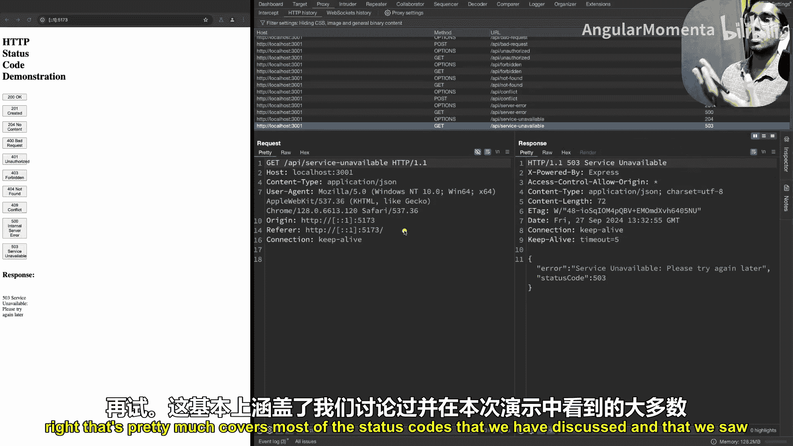

And decreases server load right because the client does not need to download a lot of data and the server does not need to send a lot of data if the data has not changed this client can just reuse the old data right that's what caching means reusing the old data if the data has not changed in order to understand this。

 let's just go through a demo instead of going it theoretically how it looks like practically in a browser environment。

 Okay let's go through the request cycle and understand how caching work by following the trail。

 let let me just do a refresh。 So when we first render the page we are doing a fetch operation。

 So let's start from there。 Okay， we fired all these request and what you want is the last one right because these are just javascript file and Cs and stuff。

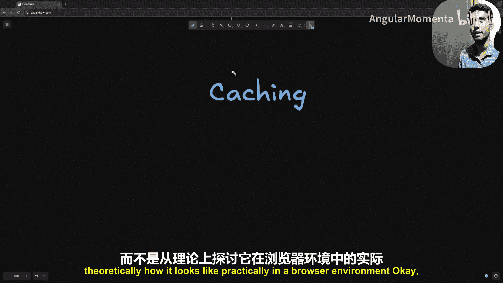

O。What happened in the last request。叻子。We did a get request to this endpoint API resource。

 and there is nothing else in the request address that we should focus on right now， right let come。

 let's come to the response。 What did the server respond with。The first important thing is this one。

 cache control。What it says is。You should maintain the cash for this resource for maximum 10 seconds。

 right This is the first important header。 The next is E tag。

Etag is basically a hash so for the sake of this example we are using a random number。

 but E tagags are usually hashes which are computed from a response。 For example。

 the server might have taken this response hashed it and sent us that hash in the form of E tagag right and we will see what is the use of that in the next request the next important header is last modified with this what the server is trying to say is this is the last time this request was modified and judging from this time and date we can decide whether we should use the old resource the cache resource or request for a new one these are the three important headers that we are going to use for caching okay。

So that is the initial request and in this request the server responded with the 200 along with the requested resource。

 whatever that is we won't focus on that。 we are just seeing there is a response body all that。

What happens when we do a fetch operation for the same resource， right， let's do a fetch。O。

 what happened here。Let's look at the response。 Let's focus on the request。 first。

 We are again doing a get request to this endpoint。

 And now the headers to focus in the request is this。These two headers。

 if none match and if modified since what we are trying to say to the server is if the E tag。

 the hashed version of the response object， the E tag of the requested resource is not the same as this one。

 which we have with us in the browser， or if the request has been modified after this。

 which means we have the outdated version， right， we are saying if the E tag does not match。

 or if the request has been modified after this， then send us a new resource。

 then send us the updated resource。 Otherwise， I will just use my cached version。

 which I have with me in the browser cache。 And to that what server says is it response with 30，4。

 not modified， and we just talked about different response course right and 30，4 meant。

 the requested resource has not been modified since what the server did was it checked the if none match header。

 which is which is the E tag。And it also checked the last modified。

 And since the resource matched either the E tag or the last modified， it send the client  a 3，0。

4 response， which means the requested resource has not been modified ever since from the last time you fetch it so you can use。

 you can go ahead and use your cached version。 Let's update the resource for now， let's clear this。

And let's fire an update resource。Okay， what happened here。 Let's explore the first request。 Okay。

 Ily we should have done a pass request or put request， But for the sake of this example again。

 we just paid a request a post request。 Okay， we updated the resource and the server responded with 200 okay。

 and it also sent us a newly tag right，2，9，4，3。 And after that， the client。

Did a new get request in this， as you can see， the client send the old E tag， which was 3，1，4。

1 our cached version。 So client did a get request with the old E tag and the last modified sense。

To the server and the server responded with 200 instead of 304 because the resource has been modified after that right because we did a update resource request and the server responded with 2943。

 which is the updated E tagag the last modified etc and let's go ahead again do a fetch request。Okay。

 and what do we have here， We are again using the Etag that was just provided by the server in this request。

 right the resource 200 and the server provided us it with a new Etag we are using that Et and the last modified value and we are doing another gets So the server checked it again。

 And since it is the latest version of the resource， it again responded with 304 not modified。

 So this is how you handle caching using the httP protocol using different headers in server and client。

 even though in a production setting， it gets a lot complicated because the server has to manually implement and manage all these E tags。

 and if by mistake forgot to update an E tagag right then the client will continue to use the cache version with the outdated resource which is not a good idea nowadays we have better solutions for caching light for example。

 react query which is a complete client。caching so the client has the complete power over when it wants to use a cache resource and when it wants to refresh right avert interval and all these powerful capabilities which is in my opinion。

 a much better solution compared to the traditional httP based caching。

 but it is good to know that we have this option if our use case is simple enough。

 then we can go ahead and use httP based caching moving on Another important topic that usually comes up in client server model in HttP is content negotiation we already looked at some of these heads。

 for example， accept the content type application Js on etc。

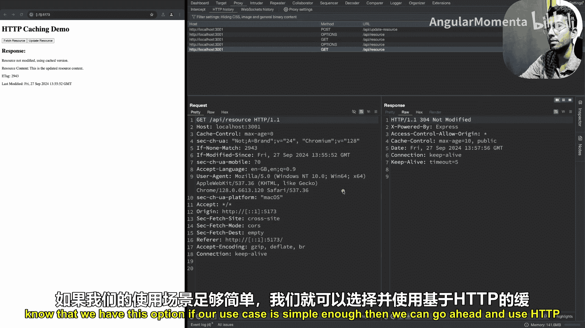

So this is an important topic to understand how clients and servers exchange information about different types and encoding and representation of the content。

 This is basically a mechanism using which client and server agree on the best format to exchange data。

 The client can indicate its preferred format like Json or XML or HTMLm and the server will try to respond with a compatible format。

Or if not available a fallback format， that is the whole idea to look at a high level we have generally three types of content negotiation。

 One is a media type， which means the client specifies the desired format through the accept header which is application Json or XML then we have the language negotiation the client requests content in a specific language using the accept language header。

It could be English or Spanish。 Then we have encoing negotiation， right？

The client specifies which encoding it supports using the accept encoding header。

Like Jesus or deflate。And the server responds with that compression format。

 we have a topic which is STP compression which is also part of this topic only so we will quickly see that also in the demo that is the whole idea and let's just jump into the demo to understand how it works and again there is a server running which will help us understand different types of content negotiation and this is a friend in line。

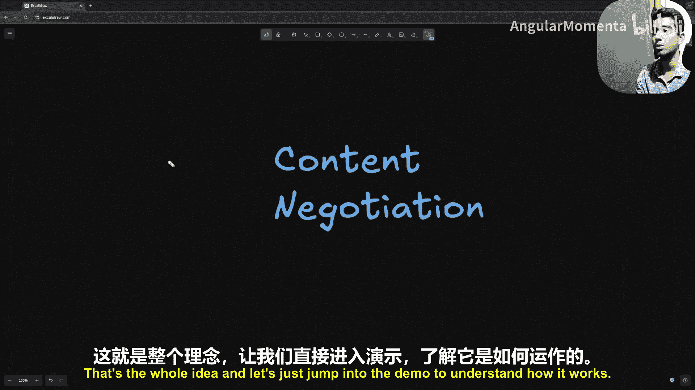

Through which we will communicate with our server。 So let's just try out different types of requests and we'll see how the headers differ and how the responses differ depending on the types of headers the client is sending。

 Okay， let's first just try the default one， which is which is a language is English。

 The format is Json and the preferred encoding is Jesus。So let's do a fetch resource。

 And this is what the request and response looks like。So it was a late request to this endpoint。

And what we said is the language we are saying is English。

 We are sending that information using the accept language header。

That we prefer the English language。Then what we are saying is the format is Json right。

 we send that with accept application Json and there is the encoding header， right。

That we are seeing except encoding the browser supports these kinds of encodings that J default we are in Z2D So we said we are expecting English and in Json format。

 So this how this is how the server is it it is sending us a Json。And。It is in English。

 so let's try one thing， let's make it to Spanish and see how the response differs。

I made it Spanish and I did another fetch。Okay， so let's see how this differs in this the only thing that changed was instead of accept language English in the header the client said accepted language is Spanish。

 So depending on that the server was able to update the response So instead of sending it in English since the client prefers Spanish the server responded with Spanish and what if we change the format from Json to Xml and we do a fetch。

And we look at this。 What change here。We are saying we accepted format is X M L and the accepted languages Spanish。

 this the XMl format and the language is Spanish and on a high level， this。

 these are the benefits of using content negotiation based headers， right。

 the client can let the server know what are its preferences。

 whether it is the data format or the language of the data。 And depending on that。

 the server can decide to send according to that format。

 It can make the life of the client easier by。Stickking to the preferences。

 those are the primarily two type of content negotiations while we are discussing content negotiation。

 there is one interesting topic which falls another same umbrella。

 which is ht TP based compression It could be either j defflat or other formats right So let's look at why do we need compression。

 And how does it work。 But now what I've done is I've gone ahead and replace the JO response with a very large file file of 11000 entries。

 Now let's file the request。Okay， this is the response and the size is 3。

8 since it's a very large file。And let's look how the response looks like。

This is what it looks like because we are compressing the file on the server side with Gep encoding right here it says content encoding it Gip because the client says it accepts encoding of Gip one of the encoding formats Now why do we use it to show that let me just go and disable compression in the server side okay。

And now that I have disabled the compression， let's file the same request again。And as you can see。

 the significant increase in the size， it's the same file right it's the same file with 11000 entries And because we are using compression。

 the file size was 3。8 m and now that we have dis it the file size becomes 26 that's a huge increase in size and imagine every client having to download that file it cause a lot of waste of bandwidth and that is why we need compression so that if the response size is very large we can compress it to a format and on the client side。

 the browser can decompress it and it will get the same response and this is another important topic which we won't really work with it's good to know that it exists behind the scenes in the early days of StDP specifically SttP 1。

0 each request response cycle required a separate connection to the server Now this created。

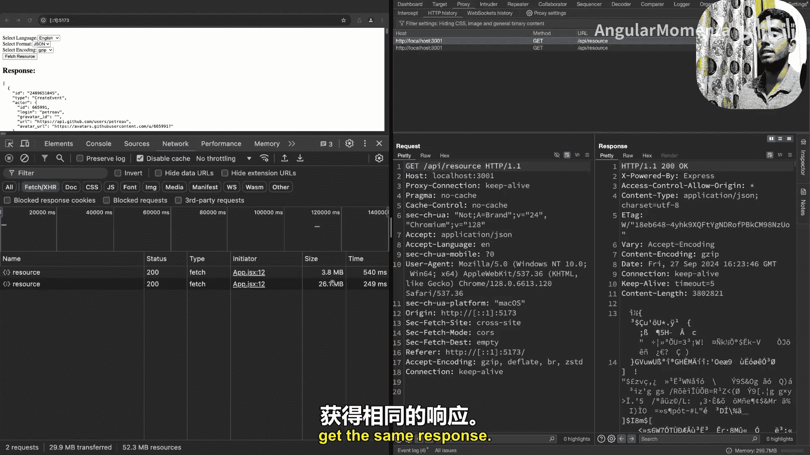

Inefficiencies since establishing and closing TCP connections is resource intensive and slow to address this persistent connections were introduced in HtP 1。

1 Now with persistent connections， a single TCP connection can be reused for multiple requests and responses avoiding the overhead of opening and closing a collection for every interaction and for achieving that they introduced this header。

Gold， give believe。AKeep alive is the mechanism that enables persistent connections It allows the client and server to reuse the same connection for multiple request responses until one of them decides to close it so what are some key points to remember here in STB1。

1 connections are persistent by default we won't have to do anything explicitly about them meaning they remain open for further requests unless explicitly closed。

And multiple STB request and responses can be sent over a single connection This reduces latency and saves resources as fewer connection need to be established Now the second thing is the keep alive header while persistent connections are default in STP 1。

1 the connection keep alive header is still sometimes used to explicitly ask the server to keep the connection open。

This header can also include option like how long the connection should remain open with a timeout or how many requests can be sent before the connection is closed with the max value。

 Now the third thing is when connection is set to close and when that is specified the connection is closed after the responses send This is the behavior in SttP 1。

0 by default and it can still be explicitly enforced in SttP 1。

1 that is some amount of information you just have to understand but you usually won't be working with them the default values work fine one last topic that I want to cover is handling large request and responses how server takes in large requests like files。

 video files， image files， audio files， any kind of file which are very large compared to our typical Json and how client can receive large responses in the same way So let's just jump into the demo and see how it usually works now here。

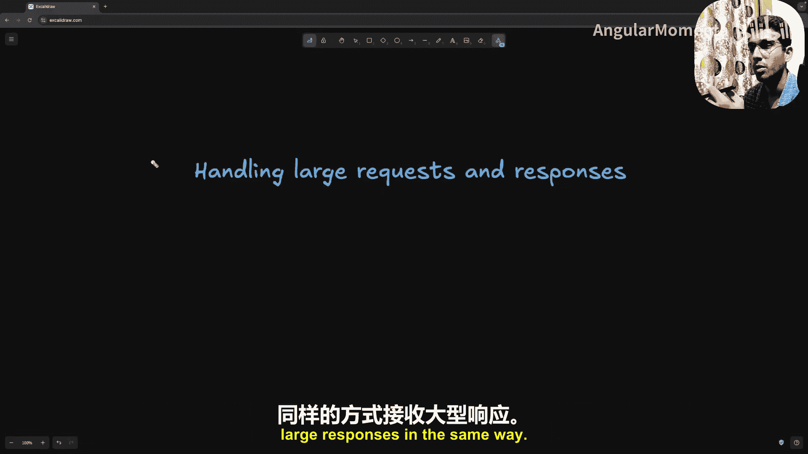

We have two examples in one， we will see how clients can send large requests to the server。

And in the second one we will see how servers can send large responses to the client。

 First one is multipart request multipart is usually used for sending large files or any kind of files to the server from the client and the difference between a typical JSson request body is in multipart request the file the data of the file the binary data is transfer to the server in parts in different parts That's why it is called multipart request So let's see how it looks like I select the picture and。

L on upload file。Now， let's look at the response of this。 Here is what the request looks like。

 It is a post request。And we are specifying a content length and our content type is multi part form data。

And this is the important part， the boundary and why we need this is since our binary data。

 the binary data of the file is transferred in parts。

 we want to specify what is going to be the delimitative what will separate the parts right we need some kind of code that will separate the parts so we are saying this will be our delimiter and if we do a search here。

We have the delimit at the start of the binary data and the next occurrence is。At the end of it。

 when the all the binary data ends in the request body right that is the use of the boundary parameter and that is how we transfer a large file to the server and the server can read the file responds with the some details of the file in order to say that the upload was successful。

 The idea is whenever we want to transfer large files to the server。

 we should use multipart requests okay。Now， the second thing is receiving large responses from the ceremeter。

For this demo I have used a large text file in the server side and we want to stream the data to the client side in chunks that is what we want to do。

So， let's start the。So let's start the request and see how it looks like we click on stream data。

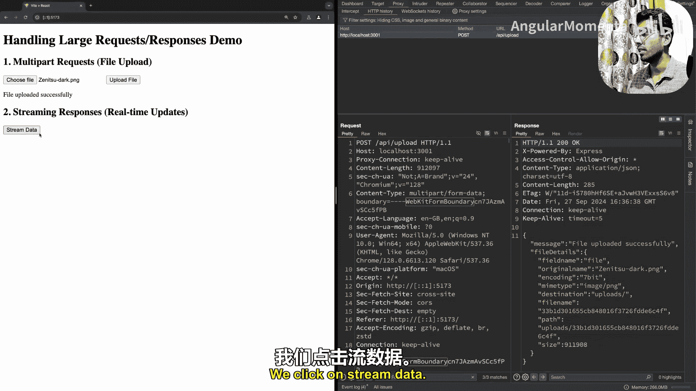

そ么。As you can see， this is the first chunk。Okay， so if you go here。

You can see that we are receiving chunks continuously from the server in different different requests so the request is pretty much a normal request。

 it is a get request。 let's look at the response。 what the response looks like these are the three important things that we have to consider one is content type It is saying that it is not a text container it is a text event stream which says it will stream the data to the client through different events and the second one is connection keep alive it says keep the connection alive until all the data is sent and if you here we are still receiving the chunks and we can keep scrolling and scrolling and until the file is completely transferred the server will keep sending the data in chunks and how does it work because of these headers the content type text event stream and the connection keep alive right and the client keeps app all the data that it is receiving from the server and constructing this whole text file。

And that is how we transfer a large file from a server to the client using chunk transfer or text event stream And the last thing before we end this lesson。

 I just want to give a brief idea about these terms mean SSL or TlS or Stps even though we don't explicitly work with them it's good to know what are these SL was the original protocol for securing communications between client like a web browser and server。

 it encrypts data so that does sensitive information like passwords or credit card numbers it be intercepted by attackers right it was the original encryption mechanism between client and server Now currently SSL is outdated due to some security vulnerabilities and has been replaced by。

TlS so this is the modern version of the encryption that client and servers use for data transmission。

 TlS is a modern and more secure version of SSL It encrypts data in transit。

 ensuring that any data sent between the client and server is protected from interception and tamperring how it works is TlS use certificates to authenticate the server and establish and encrypted connection preventing eavesdropping and data bridges。

 TlS is continuously updated with newer versions offering better security。

 the current recommended version is Tls1 point and what is Sttps S Sttps S is basically SttP。

 but more security features which is which are provided by SSL or TlS initially it was SL and nowadays TlS the underlying mechanism is TlS andttps is the one which uses TlS how it works is when you visit a website using。

Shouldt be。PLS encrypts the communication between your browser and the server。

 This protects sensitive data like login credentials from being intercepted by the attackers and that much information is more than enough on this topic that's all you need to know about PLS and StPS to work on application level Great we talked about a lot of stuff I hope you are able to digest that and I hope you rewach some of the sections so that you are able to internalize all of them and overly this is all you need to know about HttP。

At least of course， there are more stuff to read if you want on SDP or TlS or PCB protocol。

 different different components of SDP， but in order to work on back in systems。

If you understand this much， if you internalize this much and you can visualize the whole flow of all the components that we talked about today。

 then you're good to go， you'll be able to understand all you need to understand and you will be able to debug most of the stuff now that you understand how the system works behind the scenes and what are the components that come into play in different different flows that's all about HT。

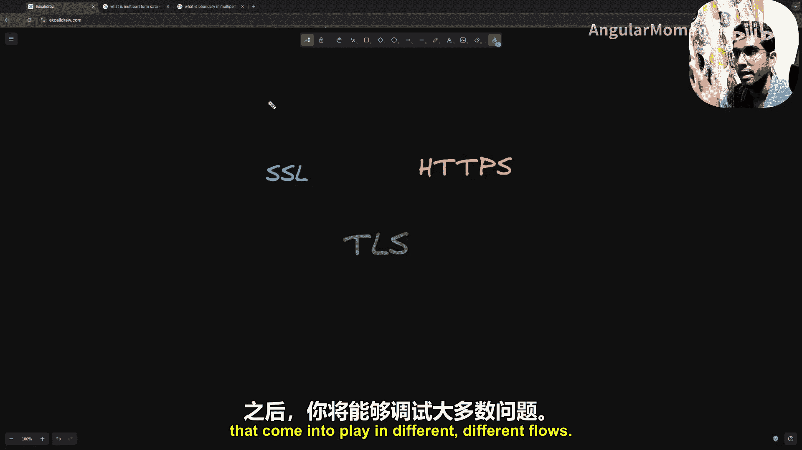