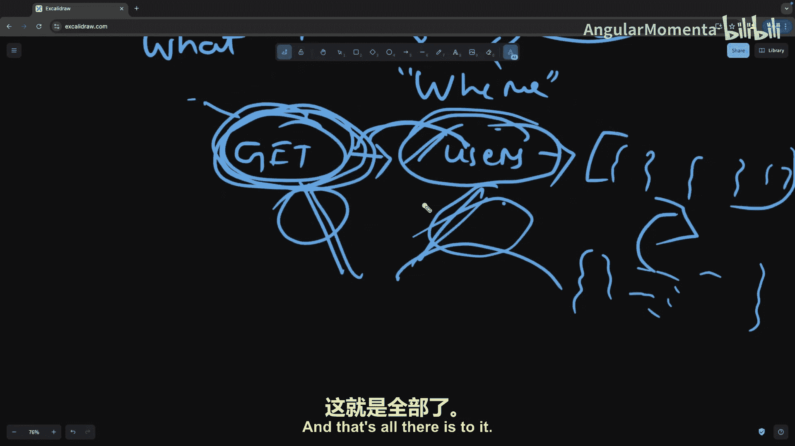
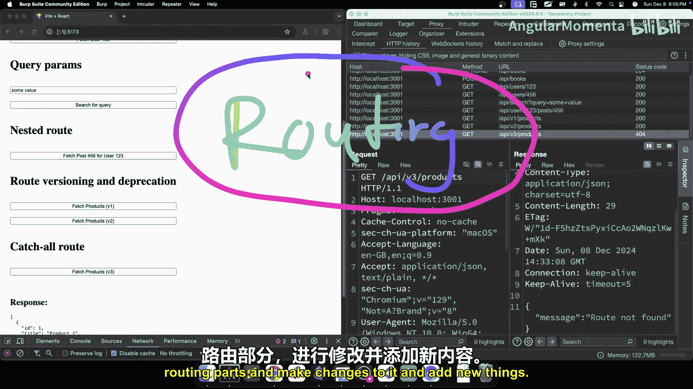

# 【Sriniously】从第一性原理出发的后端开发 ｜ Backend from first principles p06 6. 后端中的路由是什么？请求如何找到归途 -BV17aq1BUEhf_p6-

Next we have is routing in the previous video we talked about different htTP methods and how they are important in the STP semantic so in a way all these STP methods they describe your intent which we already talked about and you can say these STP methods they express the what of a request。

Your intent， your action， what do you want to do on that particular resource or what do you want to tell your server that your intention is whether you want to fetch some data or add some data or update some data or delete some data and the role of routing is it expresses the where。

Of request。 where do you want to send your intention。

Where or which resource you want to perform your action or your intent on you need to tell the server where do you want to go。

 for example you have a request and the method is get right your intention is fetching or getting some data from the server。

And your route path or the URL passes s users。And the server sends you an array of users。喂。

So what you are saying is I want to fetch some data， you want to fetch some data。

 your action is fetching。And from where or what kind of data， right， this is the resource。

This is the route， whatever you want to call it。And。The combination of these two， your intention。

 your action and your route， the URL parameters， the address。

 the server takes this and this and maps it to a particular handler or a set of instructions and it performs all the business logic the database operations and whatever is needed and returns to the data and to summarize it you can say that routing is basically mapping URL parameters to a server side logic and that's all the is and here we have our familiar birthit interface and we have a react app which we will use to demonstrate some of these routing concepts so I'll just go ahead and file some a and then we can jump in and do some analysis so the first request was a get request and if we look at the request and response this part we are already familiar with this is thettP method。

These are intent or the action we want to perform， which is get or fetching。Now， that this part。This。

Is what we call the route， right？The address of our request where do you want to go in the server which is in this case slash API slash books books is called a resource and we learn more about resource when we study about rest API concepts for now we can just assume this is a route right and this is a route so this is our action this is the address you want to go to in the server and when we send this request and the request goes through the server responds with this data。

Whatever the response it does not matter and for the sake of this demo we are just sending some pillars but typically this is what happens you send the request the server does some kind of authentication ifs there then it sends the data and then in the next request which is a post request here the intention is post the SttP method is post the route is still the same slash a slash books the request goes through。

It creates another book or whatever the resources， and it returns all the resources again in the response right So if you notice here。

In the previous request and in this request this route part is the same。

 so what happened is in the previous request the request was a get method and the route was slash API slash books。

And in this request， it's a post method， right？And the route is still the same slash aPA slash books。

 So what happens in the server is these two things the method and the route these two things are kind of a key which map to a particular handler in the server right the server first checks what the method is then it checks the route and it concatenates these two and forms a unique routing logic right this is a unique path and this is another unique path these two will never clash right these methods say differentiate between the two routes and now that we know what basic routing is we can jump into different types of routing right and the first two examples that we discussed the slash apa s books for get and post these kind of routing or routes are called static routes right and why they call static routes for obvious reasons because they don't have any variable parameters inside the route and what do I mean by variable for example this part slash aPA s books this will stay consistent。

This is a constant right we don't have to think about a dynamic parameter inside this route this is constant we are always going to use this string slash a s books whenever we make the request nothing changes in that and it is always going to return this kind of response thats why its called a static route its a constant or it is a particular string which never changes and it always returns the same kind of data so in that case what is a dynamic route so lets fire these two requests now。

And if we look at the first one， so here if you see the method is get and the route is slash ap s users slash 123 and in this case this is supposed to express the ID of the user the application of this API endpoint is we can fetch details of a one particular user using the ID of the user inside the route parameter and when we make this request。

The server can extract this particular ID from the route path and it can do whatever operation it wants to do like fetching the user from the database and returning the details of the user in this case we just the server is just fetching the user ID and returning it in the response to express that it got the user ID from the route in in this video we are not going to get too much into the code and we just want to understand the concepts behind it but just to give you an idea this is what the route matching part in the server looks like the server is basically saying let's say the handler is called route or let's say it's called。

R right， R dot。Get。And in the matching part， it is saying it's a string slash API slash users。Slash。

Golin。Iり。This part matches the method in the server and this part this part matches the route So the server is saying if any request with the method get and with the route slash API slash users and in the next part any kind of string right this fallen ID it basically means any kind of string that comes in this format route it to this handler。

 whatever handler is waiting to respond to that kind of route right to the thing to remember is this convention you'll find in any kind of server it does not matter it's Java or python or node J or goang rust it does not matter this just a convention you find this is what I've seen the industry where practice mostly column which says it's a dynamic parameter that the user is going to send in place of ID the user this is when the request comes in our case request was slash API slash users and slash1 to 3。

The request got routed to this part。It matched with the get right here we were sending a get request and in the next part it matched the first slash a then the next one slash users and it is a string right it looks like a number but in route parameters or in route parts。

 whatever number special characters everything is converted into a string because this thing this gets inserted into this slot。

This dynamic parameter slot， which we are calling us ID if you read it。

 it's clearly readable right you can read it like you are saying fetch me some data because it's get and where is that data that isnt slash API slash users and whose data that is it is of the user with I 1 to3 right it's clearly readable that's the whole idea of rest Apis because it it it provides a human readable construct routing This is called dynamic route and the terminology that we use this part is called route parameter or path parameters it is something to remember we have like two different types of parameters that is a little confusing one is these kinds of parameters these kinds of dynamic parameters are called path parameters because they go right after the forward slash it is part of the route that's why they are called path parameters or route parameters。

And the next one， we have query parameters。 So for this， we can just type out something。 It's a。

Some value。 And let's hit the CP。And we。We look into this API。 this is what it looks like。

 this is the method and this is the route right this whole part is the route。Basically。

 the route is s API。lastlash search。Question mark。Qu理。It pulls2。Some plus value。

And now I realize this is more read here than here。😔，Anyway，Me too So this part， we understand。

 right， This is the route slash a pay slash search。

 This is the address that we want to go into the server。 This is the。

Part that server uses to match including the method and this route。

 this is the part the server uses to match it to some handler and it performs the logic and returns some data which is not important the thing to focus here is the query part here。

The question mark and the key and the value this is called query parameter from testant technology and next is the application why do you use it because in post requests or input requests we have the body of the request right we get to use the body。

And we can use the body to send some kind of data send parameters that we want to attach into the request。

 we have some kind of container to send some user defined values into the server。

 but in case of get request in rest APIs get requests don't have a body you want to send some value in the get request so lets say you can say that we can send those values in the past parameters right but。

Pth parameters serve a particular purpose right they serve as a semantic expression right in the previous request that we saw we were saying slash API slash users slash1 to3 and the semantic meaning here is we want to fetch the details of a user whose I want to that is a semantic expression in the path parameter but if we want to say we want to call this API which is slash a s search and we want to say the search value is some random value that the user has typed into the input box how do you want to send it let's suppose we want to send it in the path parameter what will it look like slash API search and slash the value in this case it will be some value。

嗯。Value。Technically technicalically it's possible you can do this but it's very hard to maintain and it defeats the whole purpose of rest A providing semantic expressions to EpN points it defs the whole purpose that's why we have this concept called query parameters in query parameters we can send a set of key value pairs in a request typically we use it with get request because we don't have a body to send data in so in get request we get this thing called query parameters which are key value pairs that we can send to the server to let to send some kind of metada about the request for example let's say its a request about fetching paginated data you want to fetch a list of books which are paginated we have not gotten into pagination yet but I'm pretty sure you must have encountered it at some point they basically look like this so let's says say end point which fetches a list of。

Books in pigaginated format。 So it looks something like the slash API slash books。

And when you hit it， the server returns an object or adjacent J。And inside data。

 you have whatever the list of an array of books。And it returns some set of metada about the response right and it looks something like this like。

Dobe。Current page。And total pages。Things like this。 It depends on the implementation。

 but something like this。 So the purpose of this is。And you also will limit here。

But preserve this is。The server will page the data the response and it will send a chunk of data lets say the limit is 20 there is some kind of default limit so what the server will do is it will send 20 books from the start。

And it will let you know how many books are there in total let's say 100 books and what is the current page which is the page1 and what are the total pages and if you divide 100 by 20 it will be like 5 pages right these are all the kinds of values we will receive from the server and the client can use this parameters use this response metadata to make the subsequent requests accordingly according to the client needs how how can it fetch the next page in the next page it can do slash API。

Last books。And in the query parameter it can do page equals to2 right because by default the server send the page1 we did not have to send any request any query parameter for the value of page or limit but in the second request we want we want to tell the server that we want the response for page2 so in a get request we can send that information using query parameters this is one application usually API send different kinds of parameters in the query for example you want to filter by some user different parameters you want to sort it what is the order you want to sort in whether it is ascending or descending all these kinds of information will go inside query parameters in in the form of key value so that is basically the uses and the definition of query parameters and this is what the API typically looks like next we have is nested route。

This is not really a type of routing its just a practice that you will see everywhere because in rest APIs for a semantic expression we often have to resort to nesting right nesting different types of resources and the nested route is typically the result of that and if we hit this API and want to see。

What it looks like this is what the request and response looks like so what it says is is the get request and this the route we can say this is the static part of the route and this one dynamic route parameter or path parameter and this is the second dynamic parameter and the application of this is and why do we do this because again to express the semantic meaning so what we are saying here is we want to do a get operation on this。

Ro， right， let's say slash a slash users。With the user whose ID is 1。

23 you want to fetch the details of this user so theally the first part expresses that we are fetching information or data which is related to this user and the second part says we are again fetching the posts of that user and to go one level deep again we are fetching a particular post which is the post with ID 4。

56， we can stop at different phases here let's see so the first part the static part is slash apa slash user。

This is a static part and this in itself is one route which we saw earlier it it it returns a result right if you do slash a pay slash users it will return list of all users because thats the handler of that match is doing right？

If we go one level deep again， slash API/lash users。slash 1。

2 3 and this is a unique route in itself because we added a dynamic parameter and in the server side it will see the get method and it will match with a different handler right and that handler will return the information of this user whose ID is 123。

So this is。One level of nesting。We can go further， which is slash API slash users slash 1。

23 and slash posts。And now at this point， what this sees。

 its a get method and where it will match with a handler。Which returns。

All posts of a particular user because we stopped here right and this expresses a different meaning altogether。

We are fetching the posts of a user with ID 1 to3， all the users posts， right？And in this demo。

 what we are doing is slash API。Flash users。Slash 1，2，3。Le boosts。Bless。4，5，6。

And what this is saying。We want to fetch data of user with ID 1 to 3。What do you want to fetch。

 We want to fetch the posts。And not all posts we want to fetch a particular post with the ID456 so for obvious reasons this is called a nested route right because we nest different types of information in different levels to express different semantic meanings and it results in different kinds of responses right thats all there is to it in nested routing it is pretty convenient and you will see it getting used pretty much everywhere if the API is even has a medium level of complexity next up we have an interesting concept called route versioning and application so let's just file these two APIs and well jump into the concept of that。

Okay。So if you look into this。So this looks pretty much like our early request。

 except it has this keyword， which is v1。It says API slash v1 slash products and if you look at the second request it says V2。

 right？So this is called route versioning， it is a very common practice in APIN points servers which has a rest API interface and the the use of this is。

If we look at these two requests and responses for that。

 well understand why do we use versioning in servers right in APN points？

If we look at the response of this， we are saying slash a page， slash V1 products。

 and this is what the response looks like it has。Buildre data and it has an array and each array has an object adjacent。

With I name， price， I name， price， right。And in the second request， which is the V2 request。

We have again data and we have ID title price right in the first one we had ID name price in the second one we have ID title price and now it is a pretty trivial example usually the use of versioning is let's say you have an API end point and you are returning data in a particular format right and later on new requirements came in let's say you were earlier serving a web app and future in the future you are serving a react native app right an Android app or a Fltter app or that entity or that device you had to change the response of your data So your first option is changing the whole route right changing the whole route matching parts or let's say you can say slash API slash new products right or what you can do is。

You can add that to your versioning you can say in the version one of our API we were serving responses in this format and new requirements came in and in version 2 we are serving in this format one thing it expresses your intention very clearly you have the version 1 of response version one of response and you have version2 of response The second part is you did not have to change your whole route you did not have to do slash API slash new products using this versioning concept you can eventually deprecate v1。

You can， let's say。Send a notice to your front end engineers that after the V2 is released V1 is ded so in the next release all the engineers can eventually migrate to v2 so they have this window a particular window where they have the opportunity to migrate the V endpoints to the V2 format and eventually you will completely get rid of V1 and you will make the V2 to V1。

so you have a very stable and complete workflow to add new structure to your API endpoint。

 add breaking changes to your API endpoint using this workflow and your engineers your client having window where they have the opportunity to migrate into the new structure that is the use of route version and deprecation in the end we have something called catch all route so if we hit this。

And if you look at the requesting response。So we what we are doing here is we are sending requests to a route。

Which the server does not serve for right we are doing slash a page slash v3 slash products at this point the server does not serve responses for this route right it does not have a handler it does not cater to requests coming into this endpoint so typically what the server will do is in the end after serving all the different routes on all the methods associated with those route in the end it will do slash star。

Whatever request after going through all the previous route matching algorithms， whatever request。

Reaches here this part， it will be mapped to handler and that handler will。

Send a user friendly message that this route which you are requesting。This route does not exist。

 right this route route not found。 So instead of just sending a null response。

 which is the default behavior if you don't do a catch all handling。

We are just sending a user friendly message to let the client know that we don't cater to this endpoint that's all catchall route is about and with that we have covered pretty much all the concepts that one needs to know before diving deep into different kinds of routing and all the components of routing like query parameters。

 path parameters and all the nested dynamic parameters and that's all pretty much you need to know to get into a backend core base and understand the routing parts and make changes to it and add new things。

