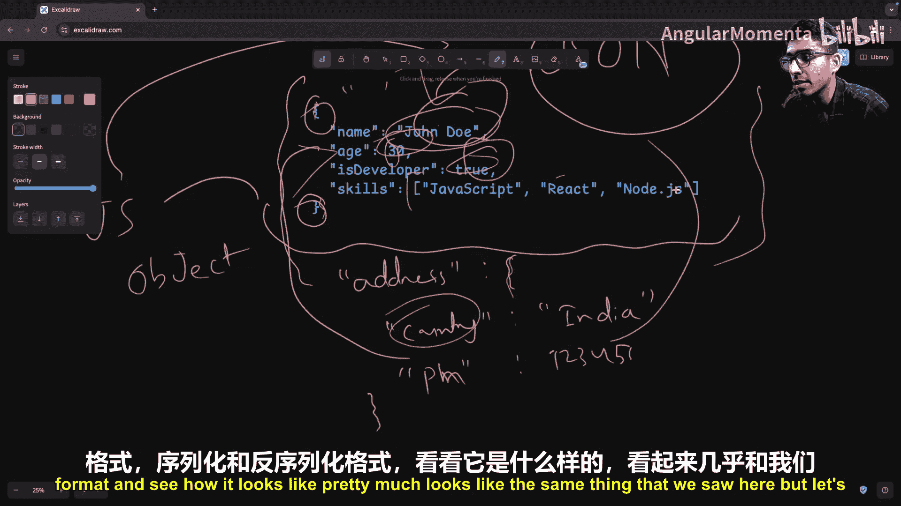
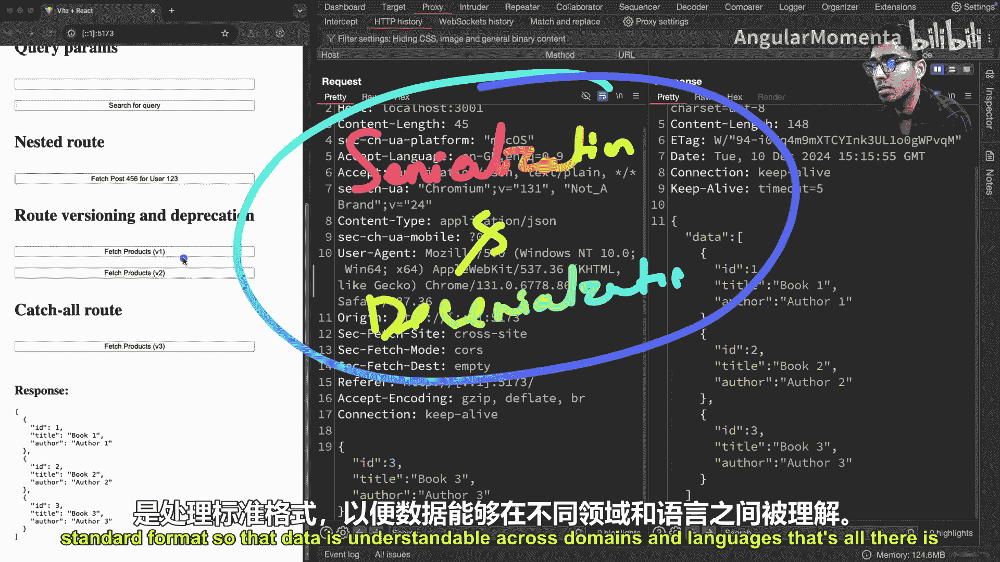

# 【Sriniously】从第一性原理出发的后端开发 ｜ Backend from first principles p07 7. 后端工程师的序列化与反序列化 -BV17aq1BUEhf_p7-

What is serialization and dereization。 Okay， let's look at this。

 We have already discussed this that usually we have a client。 Let's say if we have this client。

It's a browser or it。 It's a browser。It chrom。And this is called。Rdon。

 right in our typical technical language。And usually， we communicate with a server。

That's running in your local host， or it's running somewhere remote in cloud in AWS or GCP， or Azure。

Anyway， and the client communicates with the server through some means of network communication。

 It can be through S TP， right our traditional rest API and points。

 or it can be through GRP or it can be through web soet。

 We have different means of communications for client and servers to communicate with each other。

 for this example， and throughout this series since we are focusing on S T TP or our traditional rest API file communication。

 Let's assume this client is a javascript app can we react or angular view any jascript framework or library。

 It's a jascript app usually most of the client side apps are built with jascript。

 highly interactive app in order to send a request to the server。

 The client has to make an S TP request， which we have already discussed in the previous videos looks something like this。

Get。The， the， the URL and U T P。8。domain dot com slash path。Something like this。

Whetherer a get request or if it's a post request， we have the URL and below we have the headers and below that。

你 have的。Request body。 And this is how frontend sends the data the request with all the information that is required or the client wants to send to the server。

 This is how client sends information to the server and the server response with some response which the client is able to pass and。

Make sense of。So the thing to notice here and the thing to focus here in this chapter are in this session is how client and server can make sense of the data that is being received or the data that is being sent。

 for example， in our case， the client is a jascript app。And the server can be a P stamp。 right。

 The web server is built with rust language。都。In jascript。Let's say we are sending this object。

 right， and we have name。Is some spring。We are sending this。And after we send this。

In the request body， and it reaches the server， which is a rust server。How does this server。

Take this data and is able to make sense of it。 It It is able to make sense of it in its own format。

 in its own data types。 because javascript and rust have completely different data types。

 Javavascript is a completely dynamic language that is not compiled on the other side。

 rust is very strict when it comes to types， and it is a compiled language。

 The all the data types are completely different from javascript。 So how does this happen。

 How one data type that is transmitted over a network。

Is able to reach another machine that is somewhere else in the Internet。

 And it is able to make sense of that data and perform some business logic and send some response。

And the client is again， able to make sense of that response。

And able to show some U I or perform some business logic。 How does this all come together。

 So before we talk about data transmission over the Internet。

 it's very good to have some knowledge about O S I model。😊，If you are a C student。

 you might have already come across it。If you're not。

 then we don't have to completely master it or understand every aspect of it like IP P packets or data prints。

 et cetera， et cetera。 But having a good high level overview or a high level understanding of how these。

O S I layers different layers of network。Communicate with each other over the Internet to transmit some kind of data over。

哈对。Right。We have different types of layers called application layers and network layers。

 right There are a lot of good resources in YouTube or any other platform that you can look up and just get a high level understanding of OI model and going to deep into this is out of scope for this video and will probably take too much time and people who are way better than me have playing this in a way better format。

 And now assuming you have a high level understanding of OI models or just are aware of what this model is and how it helps make sense of data transmission over the Internet。

 Now， the layer on top is called application layer。And after all， the layers。

The bottom layer is called physical layer。Or you can call it top call bottom does not matter。 right。

 These two are on the， in the opposite end of each other。Right。

 and the same thing happens in the server side here in the server， we have application layer。

And in the bottom here， physical layer。And there are layers in between。 Now。

 imagine if you were asked to solve this problem， the problem that we have two machines。That are。

In different locations。And they are connected over the Internet， right， let's say， over the cloud。

And you are asked， you have to come up with some way or some technique or some protocol to go with the technical terminology。

You have to come up with a bay so that clients or one machine is able to send data。

To another machine。 And they should be able to pass the data and make sense of it in a way that it is language agnostic and a very obvious and common solution that you might come up with is figuring out a common。

Standard。Whi is just a fancy way of saying you will come up with some set of rules and you will ask both the clients and the server to agree that this is the standard or this is the format that the client should send the data in or the server should send the responsive so that client does what it needs to do during the execution of the session of the user and when sending data to the server it ask forms or converts whatever the logic is from that language let's say from JavaScript。

To this standard， this format。And sense it over the network。

And when receiving the server takes the data from that standard and converts it into its own standard。

 let's say its rust， so it converts it into astruct。In lut。

And it understands the data format and whatever it needs to do。

 and when sending the response it converts that data， let's say from a rust。Bed。Into this standard。

 this common format and send it over the internet， and again the client reads it and passeses it into JavaScript and its able to do whatever needs to do this part。

This is a solution， what is the solution， the solution is summing up with a serialization。Standard。

Common standard that the both client and the server agree to send and receive data and to summarize this whole thing。

Cialization and decialization is basically converting to and from data to a common format so that during transmission or storage we get to the storage part but from this example we can say that this serialization and dealization is basically converting data from end to a common format while transmission so that it is domain agnostic are in this case language agno that machines and servers and clients from different domains and different languages from different environments are able to make sense of that data and are able to respond to that data and before we dive deep into the serialization standard I just want to make a note here that which I have already mentioned that backend is a huge domain and there are a lot of technologies。

 hundreds of technology that is used in the industry so it's impossible to understand the concepts when all of those technologies what we will do in this video and in this。

Plists will go with the most use technologies， for example， for the data transmission。

 There are a lot of technologies getting use， for example， SG TP and web sockets， and you have GRPC。

Et cetera， et ceter。 So we'll go with Ht TP since rest APIs are still the most common means of communication over the Internet between clients and servers。

 And as a backend engineer， if you are aware and have good experience in H T TP。

 then you're good to go。 You can learn all these other technologies along the way。

 You need something which is used all of the industry to get started and get some experience and you can learn technologies as you progress over your career in the same way for databases。

 we have a lot of different types of databases， we have relational。Right， we have non relational。

In relation， we have。Wse grace， we have myscul。 We have eskeite。8ight。Same way in non relational。

 we have Mongodbi。We have Dy D from AW S。A lot of different options for databases。

 But in this playlist， we will go with postgra。ItsOne of the most popular relational databases。

 And is used by a lot of companies。 and mostly the first choice these days for a lot of startups and enterprise servers in the same way。

 we have。Different types of serialization standards。Cilialization。Standards。

And we will go with a popular one， the one that gets used。I won't give a number。

 but if I had to give a number， I'll say 80% of the time， which is Json。

Is one of the most popular serialization and desialization standards that gets used for client and thorough communication。

We have other standards for serialization disrilation that does not necessarily gets used for STTP communication but definitely gets used for serialization。

 for example， we have YaL。We have X， M L。And inside serialization standards， these three。

 including JSson and Xml， Yal， these things are called。Next。Based。Filation。Right。

We have another type of civilization standard， which is called binary format。By native format， and。

In binary format， we have all again different types and the most popular one is called Protobuuff。

We have other formats also like ARO， eta， etc ce。For serialization standards we have text based and binary format and inside text based we have different types called JSON YamL XMl and for now we will only focus on JSON since that's the most popular choice for STV based communication between clients and servers now that's clear。

Let's jump into JO。 And this is what a typical JO。Object it looks like。

So to give you a little context JasonO stands for JavaScript object notation and you can read more about JO's history and its evolution from other resources。

 but just to give an idea of JasonO from the looks of it and from the behavior looks very similar to a JavaScript object。

And。That's why you can understand why it's name like that jascript object notation。

 but is not limited to jascript and it is used everywhere。

 you will find JSson in configuration files and of course during S transmission during client sensor you will find JO in log file Json is a very popular choice for logging application data or server data during runtime it has a lot of use cases for this use case we are going to focus on Sw transmission of course this is what a typical Json looks like and the looks of it you can understand it' completely human readable and that is one of the strong points of JSO it was made to be human readable and the data types are also pretty fundamental if you are even a little familiar with different programming concepts for example things to focus series we have a starting calibs and an ending one and all the keys are inside double codes so this is one rule you have to follow the keys will be inside double codes and。

They will be strings you cannot make any other data as a key key will be inside double codes and they will be strings and in the value it can be a string or it can be a number it can be a boion or it can be an array or it can be another object right JO can be a nested object also for example let's say you have here an address field inside the same JO。

You have a colon here。And you can start another color basis here。 You can write country。

You can say it's a string， it's India and new phone number， right phone number。

And it can be a number， something。3port by 6。And you have to provide ending calibs。

This is the typical structure of JSON， that's all there is to it。

You and find a lot of concepts in JO， these are the things you have to remember that has to starting calib braces and ending calib braces。

And the keys。Will have to be inside double quotes and there will there will be strings。

 and in the value， you can provide an string， a number， a boion or an array or a nested object。

 which will again have the same characteristics of the。Initial object right。

 there will be keys which shall be inside double quotes and there will be strings and they will have values again in the same characteristics。

So that's all you need to know about JSO。This is one of the most popular serialization standard that we use during client and server communication so let's just see a simple demo In fact let's just see our earlier demo that we saw in the previous video and this time we'll focus on the request and response format the serialization and reseialization format and see how it looks like pretty much looks like the same thing that we saw here but let's just see in a real environment here we have our ver suite interface and this is the earlier demo that we saw in our previous video but this time we'll hit an API and focus on the data format that gets transmitted and the data format that gets received from the client and from the server so let's just hit the post API。

That was here， Post bookss。And let's go to SGDB history and open this one。

And let's expand this and go to the request and this there is a post request and we are calling this path API slash books。

 This is the data that we are sending so let's just focus on the request first here we can see our earlier discussed JSson format。

 We have a cas and we have all the keys that are double quoted。And those are strings。

 and we have a number here and two strings like I D， title and author。

This thing gets transmitted over the network。 Now one thing that I want to mention here is if you went deep into the Oi model。

 so you must have come across that from application layer to it gets converted into data frames and it etcter etc it gets converted into Ivy packets and there is transmission layer and in the end it gets converted into bits with 0。

1，0，1 stuff stuff network related stuff right so。As a bat engineer。

 the thing you have to focus here is the mental model you should have is you can assume that you have this client。

And you have this server。Right， the client has to adhere to a particular standard。

 Let's say this is Json。And the server has to understand this standard called JsonN。We transmit this。

 The server understands this。And return some data again， in。

JsonN format with respect to your knowledge of Oi model， which has different different layers。

 which the data gets converted into different different formats from data frames to IP packets to physical bits that gets transmitted with voltage signals over optical fiber etc etc ce。

 the mental model to have in application layer gets converted into Json as a backend engineer that's all your responsibility is does not matter what format it gets converted into after this point。

 That is not of your concern。 So it gets converted into different different formats and then in the n0101 and then again it reaches the server reaches 0。

101 etc reads all the bits and does all the net related stuff。

 then it again gets converted into Json only in the server side also does not matter what the intermediary steps converted the data into that does not matter before receiving before in the receiving end of the server that data again gets converted into this Json format only。

And the server only gets to read the Json。 So you don't have to worry about all the intermediary steps。

 Now， that's clear。 This is the request Json that the client sends。

And the server understands this and it takes this Id and all this information and adds it here。

And responds with another Json， right， It's another Json。

So again we have the opening caliase and ending caliase， we have one key。

 which is an array and each array has an object again it is also in JSson format you can see all the keys are in double quotes。

And it has values in number and string formats。 and this is an array。

 and it's received by the client。 and the client understands it。 And if you see here。

 we are rendering it here。 So the client is able to receive this data from the server and it is able to make sense of it。

 it is able to pass it and it is able to render it in its own way in this case it is jascript。

 but it can be PhP also its a This is how Json flow looks like in client server model in real life scenarios。

 it does not have a lot of concepts realizing in disrelation do not have a lot of concepts。

 it is a phenomena in the back and world that that exists you have to know that it exists and JO getting transmitted by the client to the server。

 the server， passing it， understanding it， making sense of it and responding it appropriate data to the client and again。

 the client passing it understanding it， making sense of it。 This whole flow。Is called serialization。

And。Vsulation。So again to summarize serialization and decalization are the techniques using which data is converted into a common format。

 a standard format so that clients can send data to the server in that format and the servers can receive the data make sense of it par and perform the business logic and send the data again in that common format so that the client can again do the same thing serialization and decalization are basically dealing with standard format so that data is understandable across domains and language that's all there is to it in serialization and decalization。

