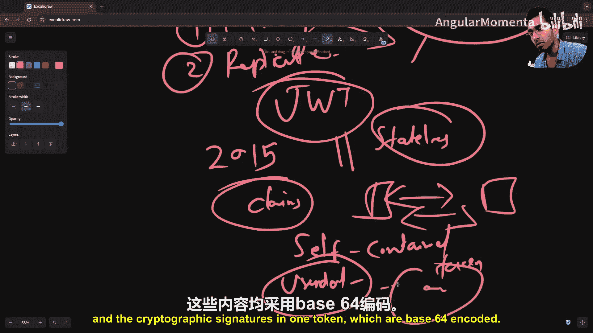
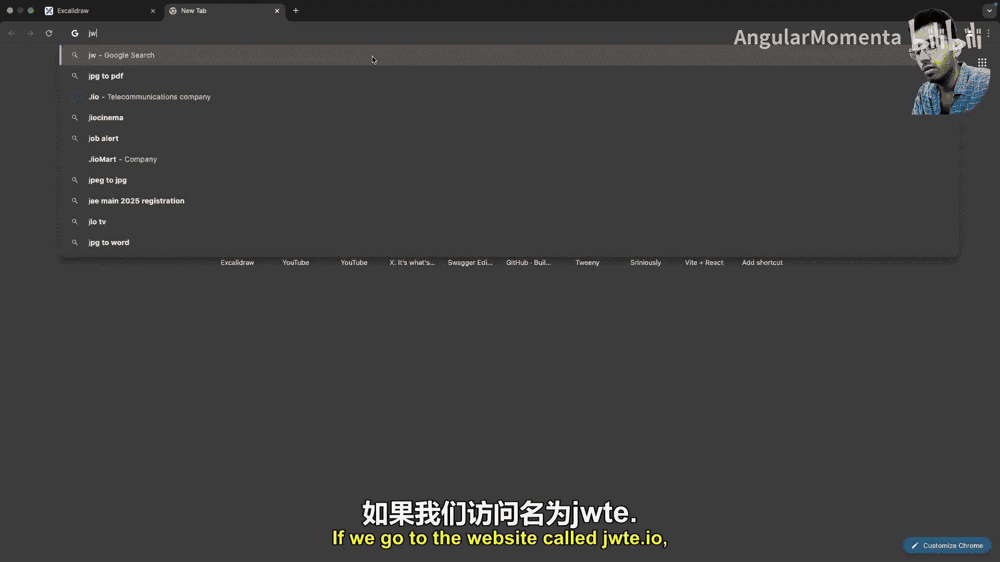
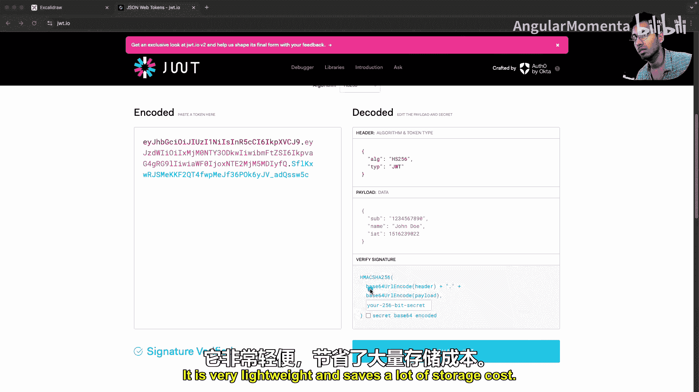
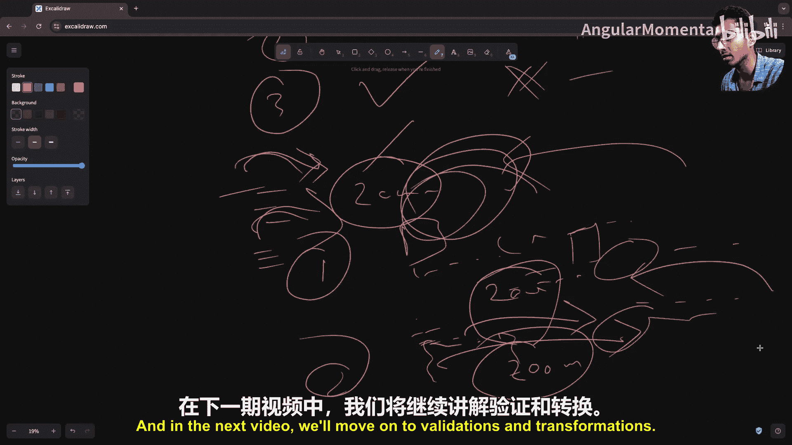

# 【Sriniously】从第一性原理出发的后端开发 ｜ Backend from first principles p08 8. 后端工程师的认证与授权 -BV17aq1BUEhf_p8-

And finally my favorite topic which is authentication and authorization and this is probably one of those areas which we encounter every day I'm pretty sure all of us have used authentication screens before we have logged into different platforms you have signed up into different platforms those are basically called the authentication flows and to summarize everything in two sentences。

 authentication can be explained as something a mechanism to assign an identity to a subject。

to say in the technical terms and basically to answer the question of who are you the basically means who are you in a given context in a given context the context can be a platform。

 operating system or your phone， anything。This the answer to this question。

 the process of finding the answer to this question is called authentication in the same way。

 the answer to this question which is what can you do in that context in that platform in that operating system。

 all your capabilities， all your permissions to say in the technical jargon， those things。

 the process of finding the answer of the question， what can you do in a particular context。

That process is called authorization， those are the two sentence summaries of the whole topic。

And this is what we are going to talk about in this video and we dive into different aspects different components of authentication and authorization basically have a general high level and a technical understanding of how it works what is the importance what are the different things that make up and build the whole authentication and authorization flows and everything surrounding it now before we dive in let's have some historical context of authentication so first we are going to start with authentication right？

And for authentication let's have some historical context of what was the use of it。

 how did we reach here and how did we reach to the modern methods of authentication so the story start somewhere in pre industrial societies and here authentication was pretty intrinsic by that I mean it was implied。

So an identity of a person or a subject was the same as the subject's recognition and what that means is someone someone who is already respected in the community。

 let's say a village elder could vouch for a person and deals。

 whatever deals were made during those times were sealed with a handshake。

 an act of symbolizing mutual recognition and agreement。

 even though it is pretty elementary this method leveraged a form of authentication based on human contextual trust it was based on humans it was based on trust and that's how people started the initial methods of authentication。

But as populations grew interactions extended beyond familiar circles like beyond this society beyond this village implicit trust mechanisms fail to scale this cannot scale it because this person who is this whoever this is in the community。

 the elder village elder that guy is not trusted in all the communities in all over the society in different different countries or continents this method cannot scale so this marked the beginning of his search for explicit authentication explicit os initially we said this was implicit o which is based on trust people needed proofs of identity that could function independently of personal acquaintance independently of any person and that led to that led to seals and cryographic era so by the medieval period society needed。

I a society society na system that scale beyond personal recognition which we talked about earlier just based on people of trusted reputation who can vouch for other people or other subjects or other deals so society na system which which can scale beyond that and during those times people came up with this system which is called a seal it was wax seal people who have watched different movies or series of historical times you must have come across this this some seal and this was you know attached to different letters or different agreements as some form of authentication or you know some form of agreement and it was one form of early cryptographic mechanism a seal which was of a unique pattern and this is put on documents which acted as signatures today we have signature digital signatures and handwriting based signatures this was one kind of。

signature during the medieval period and these seals function as the first widely adopted authentication tokens you can say these were one kind of authentication tokens during those times and they were kind of a physical representations of identity that relied on possession something you have if you have this seal you have this in your possession then you are said to be authenticated and you can verify yourself using those seals seals had their vulnerabilities they were ro to forgery marking the first recorder instance of authentication bypass attacks so we have in the modern times different types of authentication attacks one of those kinds of a bypass attack a bypass attack basically a means skipping the authentication with malicious intense forging these kinds of seals for malicious intense was one kind of bypass attacks during the medieval period and this led to the evolution of more sophisticated mechanisms including。

Things like watermarks and encrypted cords right used in different trade documentation setting a foundation for cryptographic thinking people started thinking more about chds。

 how chs can evolve to prevent different kinds of attacks and forgeries and frauds and that led to。

The next data， which was。Pass phrases and shared secrets so we can sail during the times of industrial。

Revolution during that industrial revolution。A lot of progress happened in terms of machines。

In terms of machines， a lot of progress happened and the whole world started to change and at the same time。

AtThe same time communications systems also started to get upgrades。

 communications systems also started to progress they started to evolve into more secure and more advanced form of communications and during those times is technology called telegraph was introduced and telegraph became a critical infrastructure and with it came the need for secure message validation and operators whoever was operating these telegraphs they used pre-agred pass phrases you can say you can call it also password but theres some form of pass phrases and that is an early form of shared secrets and these password phrases where the same as static passwords like they are not dynamic they decided on one static string one static password and they used it as a pass among them。

And that relied on the principle of， we can say。Something you know earlier the principle was something you possessed。

 something you possessed， which was a wax seal， a some kind of token that you possessed that you can show to verify yourself and that got evolved into something you know which is which is much better in terms of security and that was one step into the evolution of which in the modern times you know as password。

That time it was calledpaphs and that the principle whole principle of authentication changed into something you know which is insider brain or in some form of communication in either written or verbal and after that we can save we can skip all that to the modern times of computation computation computational architecture and all the modern authentication that we know of and the first form of computation which we already know is mainframes。

Main films in the somewhere in mid 20th century and authentication ended its first digital phase so in there is a story called in 1961 researchers at MIT's project Mac they were working with something called compatible time sharinghar systems also known as CTSs and they introduced the concept of passwords for multius systems basically they were trying to come up with some kind of system which will allow multiple users to use a computer without sharing the data without sharing a user data between each other between each other and。

What they did was they stored password in plain text which was in itself a very critical vulnerability and that came into view when one of them printed the password file in plain text because it was a plain text file you can print the password and that was the time when that vulnerability came into place and people got aware of that and this incident the printing of the password file this incident marked the genesis of secure password storage mechanisms right now we have this philosophy that password should not be stored in plain text and this incident of someone printing the password file in a printer that was the initial idea that motivated people to the philosophy of lowering passwords securely and that led to different innovations like hashing that you use pretty frequently today to store passwords in our databases and different cryptographic algorithm。

Whi transformed passwords into irreversible fixed length representations。The hassing is basically。

Cryptographically， so you can say there is some kind of algorithm this does some kind of computation。

 you provide it a plain text string。Provide it and in turn， it returns you a hashed string。

A hashstr basically means it has a computational algorithm。It will transform that string。

 the plain text into a fixed length， the length wont change it does not matter you provided a3 character string or a100 character string。

 the length of the hash will stay the same depending on the hashing algorithm and it will provide you the same result for the same string every time that was the promise of the hashing algorithm。

So these kinds of algorithms started to emerge during this era。

And authentication began to align with the principles of confidentiality， integrity and availability。

 the core tenets of information security and then in the 1970s an explosion in cryptography research driven by the work of great people like Whitphi Dy and Martin Heman。

 the people who have come up with cryptographic algorithms。

 their invention of the Dfi Heman key exchange introduced the concept of asymmetric asymmetric cryptography enabling two parties to establish a shared secret over untrusted medium that was the first time asymmetric cryptographic technique asymmetric cryptography began the backbone of modern authentication protocols。

 all the protocols that we have now those are all based on asymmetric key cryptography and they are also called P public key infrastructure systems and this era also gave the rise to。

Protocols like Kbs， which introduced ticket-based authentication and Kbs relied on trusted third parties to issue tickets that verified both the user and service identity。

 which is a precursor to tokenbased authentication systems that we have now and we will shortly look at those token-based authentication methods right now we are just exploring how all the dots connect together how the historical context led to what we have today led to what we use today all the different algorithms。

 mechanisms， methods and standard practices moving on if we go forward during around 1990s when the internet was growing a need for scalable scalable authentication methods was also rising simple user name and password-based systems were not enough and they were not strong enough against brute force and dictionary attacks that are newly coming during those times。

And that led to something called that we have MFA， which is multi factor authentication。

So MFA came with the idea of a combination of different principles， it combined。

 let's say three things， one thing is something you know with something you have with。

 something you are。Basically， something you know can be passwords or passwords or pins。

Something you have can be cards， smart cards or OTB generators。

And something you are that is your personal identification it can be biometric data。

 biometric data like fingerprints or retina scans and M came with this revolution of combining different principles。

 different level layers of principles that provide a combined security to all kinds of authentication applications and because of that biometric authentication emerged as a groundbreaking development leveraging pattern recognition algorithms and statistical models to identify users based on unique physical traits。

However， biometric systems introduce challenges of false positives， negatives and template security。

So that was also not enough biometrics security was not the one step solution or all the problems that were emerging during those times and after that you can say we are finally into the modern times modern times we can which we can call 21st century the time that we live today and in the 21st century the rise of things like cloud computing and mobile devices and API based architectures they demanded advanced authentication frameworks none of the above authentication methods or frameworks or principles were enough so we needed more advanced more technically robust implementations of authentication and during and because of those demands a lot of different authentication components or authentication techniques emerged and among those we can save some of the important things ares os。

2 these are the ones that we still use today and these are the most popular ones these are I am just talking about the different components of authentication that we are going to discuss soon。

Another thing is JWTs。Then we have zero trust architecture we also have。😔。

or password less password less authentication system like web authentication eliminate passwords entirely relying on public key and private key stored in hardware devices will discuss os to engineeringability shortly and then this and this is the time that we live now and this is what the future looks like as of now during the time I record this video we have a couple of candidates for the future of authentication world we have decentralized identity decentralized identity that that is created using popular technologies like blockchain they offer a they offer a lot of features robust features for authentication people are still they are still in early stages now and people are still experimenting they are promising and a potential candidate for future authentication then the second is behavioral biometrics we have this concept called。

Post quantum cryptography so post quantum cryptography is basically the idea that once quantum computers start getting used heavily。

 they are going to break all the cryptographic algorithms that we have now that provide the sense of security that we have that our data our passwords。

 our sensitive data is secure because of these algorithms we have RSA and different different types of public key private key algorithms that are very difficult to break。

With the hardware with the computation capability of systems that we possess today so once quantum computers get used heavily once they get common enough all these algorithms cryptographic algorithms they are going to break because quantum computers are very very very fast in terms of what we have today and these algorithms are not made for that this concept called post quantum cryptography is basically cryptographic techniques that are even secure for quantum computers and we already have some algorithms as of my knowledge and you can read up on that all in all this is pretty much all the historical context that we have of authentication in our knowledge with that let's move on to the technical part the interesting part that you as a backend engineer should have the knowledge of before I jump into authentication I want to introduce three components that we are going to discuss again and again。

In this whole video so I feel it's better to introduce them right now before we start anything so that you have some kind of context or some kind of familiarity when you hear them and these three are very important in all the authentication on authorization flows though they are sessions JWTs cookies and we'll discuss what are they let's start with sessions when the web started when the whole internet game started。

HttP。Protocol that we have that we use for our client server communication if you have watched my httP video then you'll understand what I'm talking about HttP emerged as the backbone of all the communications between client and servers and by design by design SttP was stateless stateless stateless which basically means httP treated every request as an isolated interaction so it did not remember what was what was your previous request every request had enough and all the information that the server needed to perform the business logic that's what it basically means for a stateless protocol it has it had or it has no memory of any past exchanges and this was enough and this was ideal even for the earlier web the web that we started with which mostly consisted of static pages static images and data that people most。

Read about just you look at a website， you read something and you move on。Readable data。

Patic data that you can call。And people did not need continuity。

 people did not need memory between different requests， that was not a need when it was designed。

However， however， when we evolved。😔，As the web transition into dynamic content and it happened very soon and when it evolved into dynamic content。

 the statelessness， statelessness of STTP became a bottleneck how because we had different types of websites。

 highly interactive websites， websites like e-commerce sites which need to remember what are the items in your cart。

That is one example of the interaction or how could a user remain logged in while navigating between different pages that was another need and these questions mar the beginning of stateful interactions in the web stateful interaction it was the need for stateful interactions otherwise modern website modern needs of technology was not met thats why we need the web to be stateful which STtTP was not and thats why the concept of session came into play a session basically provided a way to establish temporary server site context for each user and it has some kind of memory about the user that the server can have。

To remember the user when the user makes a request next time， so how did it work？

First part was session creation when a user logged in the server created a unique session ID and it stored it alongside the relevant user data。

 whatever the user's role name， whatever the data the server needed to do different kinds of operation again and again。

 it stored it with the session ID。Whatever the car items of the user is。

 all those information that the server needed repeatedly， it stored it。In a persistent store。

 it can be a database or it can be a redis store， which is in memory。

Persistence store compared to database， which is a Pvis persistent store so the server stored the session ID with all the user data。

 the card items。or whether the user is authenticated or not。

 all these different kinds of information with the session ID is stored in some kind of persistent store and the second phase is。

The session ID， this key unique key was sent to the client which is a browser。

 the server is somewhere in the remote it is somewhere in the cloud and the session ID is sent to the user on a browser as a cookie we will see what a cookie is but it is sent to the user as a cookie and all the requests and all the request that the client made after that after the session being created included that cookie with those requests so that the cookie can have the session ID and using this session ID server can fetch this information all the CA items users data from this persistent story can be read is or database basically this session ID enable the web to have some kind of memory enable the servers to have some kind of memory。

For the sake of the user， for the sake of the client。And in the third phase， you can say。

These sessions were shortlift which means they had an expiry date so let's say if the session's expiry date is 15 minutes so after 15 minutes the user sends this session ID to the server and they expired so the server creates another session and sends session ID stores the user data in the Per store and that's how it works again and again that's how this whole session thing works and initially initially sessions started with file based sessions those where the early session implementations and that stored data in files on the server。

Even though they were simple， that approach suffered from scalability issues as the number of users grew。

And server started to implement implement database packed sessions to handle large user bases and to make the server scalable。

 Ssson's data moved to databases， which provided faster lookups and persistent storage across server restarts。

 that data stored in the databases and even though the server restarted。The session became available。

 the session stayed available to the server。And eventually we we move to distributed architectures and during this era。

The session storage， the persistent store where the servers store the sessions and the users's information move to distributed storage。

 a distributed storage like that we have Redis， which is a in memoryory store in memory store basically means storing data in RA compared to hard disk thats a online explanation or MemC which is also another in memoryory store and servers started to use these。

These were comparatively faster as compared to Db lookups because they were in memory stores that is how the storage evolution of sessions happened and we still use sessions even today。

For the same purpose to provide some kind of memory to our servers moving on then we have is JWTs and this is a very popular technology in the current times these are very popular and we will see why they become popular what are the advantages that they offered as compared to our traditional session based authentication approach what are the additional benefits of using JWTs that cause their popularity so containing our earlier session discussion。

By the mid200 by the mid2000s， web applications grown into globally distributed systems。

And stateful systems， stateful systems， even though they were effective， they caused a bottle link。

Because firsting。Meory。Maintaining session data for millions of users became costly。

So we right now we are talking about what led to the emergence of GWTs so first thing is。

Retaining session data for thousands and millions and billions of users became a large overhead for a lot of servers。

Second thing is。Replication。What this means is in distributed architectures。

 synchronizing session data across servers or regions， one server could be in one part of the world。

 another server could be in the opposite part of the world。

 so synchronizing the user data across these servers from different regions introduced latency so the authentication flow introduced latency。

whichch is basically means delays in authenticating the user and consistency challenges because of the synchronizing need and that led to the birth of JWTs。

JWT because developers sought a solution that could offload state from the server while maintaining security and integrity。

Thats how people came up with JWs， the JWs which were formalized in the 2015。

 were a stateless mechanism， stateless， this is the word to focus on stateless。

There is stateless mechanism for transferring claims we will see what claims are shortly。

Tsferring claims in a stateless manner between different parties let's say two systems transferring claims in a stateless manner between two parties or two systems and the key innovation here was self contained GWs were self contained。

Tokens Jwt tokens contain user data， stuff like user ID their role and the cryptographic signatures in one token which are base 64 encoded if we go to the website called jwt。

o。

We can take a look at what a JWT looks like so this is what a JWT looks like。

This is the whole base 64 encode JWT stringing and JWT has three parts。So， to get a high level idea。

 we can look at the parts which are first parts the header。

 the header basically specifies metadata metadata such as the signing algorithm。

Which can help the server to get some information on what was a signing algorithm that is used while the JWT was being created。

So the first part the header basically contains metadata about the JWT itself stuff like the signing algorithm and the second part which is the pay of data。

 the data of the user the data that we store in the JWD the data that we actually need this also has some kind of format that we typically follow so the first thing is sub sub is the field where we usually store the users ID we store the user ID and the user ID can be in any context it can be user ID from your database it can be user ID from an odd provider it can be any user ID from any context this is just a storage mechanism you store the user I of the user in the sub field in the IET field this stores when the JWT was issued that is the information the IET field stores which means basically means issued at thats the full form of IED and then we have option fields which you can store the name of the user。

And the role of the user， whether the user is an admin is a member it is a role of editor or a viewer or writer or whatever the role is you can store information like that different kinds of information and different kinds of pills inside the payload this is the part where you can store information and the last part is the signature or the JWT to verify that whether you are the one who issued it whether this data has been tampered or not and you can do that with a secret key that you can generate and key for yourself only you have an access to it if someone makes any change to the JWWT and you verify that JWT with your secret key then the validation will fail because someone made some changes to the JWT and it is not tamper proof anymore and now you know that so that is not a JW valid JWT anymore that's how you can verify users' data in a stateless manner now you don't have to store the session information anymore。

Whole session verification mechanism just became stateless it happens with every request it is very lightweight and saves a lot of storage cost so these are the advantages that JW is offered that made a lot of things in the authentication workflow very simple the first thing was statelessness which basically enabled no server side storage costs second thing was scalability scalability scalability basically means a lot of servers these days use the microservice architecture and distributed architecture and which means。

A cookie issued from one server cannot be used for a server which is in another domain as in a microservice architecture so using technology such as JWT enable a client to send the JWT to different different servers and all the servers will have the secret key of the JWT using which they can decode the JWT and verify the user's identity now a lot of servers a server can be scaled to a lot of instances and they won't have to worry about user authentication anymore all the servers can do the user authentication at the same time using a shared secret key and that was one of the major benefits of JWs which and the third thing is the portability and because because of the lightweight nature because of the URL friendly nature because of the base 64 encoding string format JWTs could be passed between different systems they could be stored in local storage even though you should。

do that they should they could be stored in cookies in a lot of different limited space storage systems they are very portable you can send them in URL values and a lot of other advantages that JW is offered in terms of portability and on top of that they also introduced some challenges one challenge was token the of token since JW was stateless so stateless there is no stored mechanism that the server used to validate the user's identity if someone has access to your JW now they can impersonate as you they can use your JW to perform actions on behalf of you that is the one disadvantage of JWs and there is no mechanism from the server side to invalidate that token。

Until it expired manually， unless unless the server changed its secret。

 the secret using which the server verified all the users now the problem with that is if the server changes the secret to in it one token now all the users of that platformtum of that system will have to log in again and get new JWities just because the server wanted to invalidvi it token of one user。

 that is one thing。Second thing was revocation so for some reason if the server wanted to revoke some users access or some users access to the platform or access in different systems。

 the server could not do that because JWTs since they are stateless you have no way to track the status of a JWT token until they are expired you cannot really do anything so these are the two major disadvantages that came up because of JWT because of the use of JWs。

Even though these days we found some kind of solution for that， for example。

 for the first thing and the second thing together we use a hybrid approach of using GWs so using a hybrid approach again raises some questions first I will tell you what a hybrid approach is which he came up with to build the above two advantages so this is how it works。

The user logs in and the server sends it at token， a JWT token， which the user stores in its system。

And with every subsequent request to the server the user sensor JW is in either a authorization header or in any other form or a quick key or anything and that's how the server gets the JWT it verifies the JWT with its secret key and make sure the user has proper access or it can identify the user that's how it works in a JWT based workflow so in a hybrid approach what we do is we combine statelessness with stateness what it means is in a JWT typical workflow we don't make an additional lookup in our storage the storage could be a database lookup or a in memorymory lookup like Redis or MCache we don't do that we verify the JWT with a secret key and we find out who the user is using the user ID that is stored inside the JWT。

That's it， we don't do any additional storage lookup。

Now in the hybrid approach what happens after you verify the GWs after you have the verification step past you maintain a blacklist of GWs in your persistent storage again it could be a database call or a in memorymory call for Redis orMcast and using that you can temporarily block some users revoke access for some users in case of some users' account being hacked or some users doing some malicious activity you can temporarily block their access using a blacklist。

Now the question it raises is。The whole point of using JW was this statelessness and if you are doing a persistent storage lookup for checking the validity of the JWD why not do the statelessness。

 why not do the stateful approach in the first place which can provide disadvantage and it is considered more secure。

So these are the kinds of questions that we frequently see in the industry typically the advises don't think about all these different authentication strategies and all go with a Earth provider we have a lot of different different types of authentication providers we have odd zero we have the modern alternatives like Clark and all that's their headache that's their headache to worry about what technologies what components of authentication to use which is more secure which is a more secure way which are more secure techniques and everything starting from the algorithm to has to solve all the different parts all the different headaches of authentication which which creates a secure authentication system that's their headache it's very important if you are building a medium to a large complex system it's a good idea to go with an external Earth provider even though it's a good idea if you are learning back in engineering to implement your own Earth understand how the different。

Work and understand the tradeoffs understand the advantages and disadvantages everything After that in a production system go with author provider go with an author provider unless you are very confident about your authentication workflows okay that is my two cents about what you should do with all this confusion about what is right what is not right now and the third thing that you have is cookie and we have already discussed and talked about using cookies in in the earlier two examples for example in the session based authentication first ill explain what a cookies cookie is basically some way of storing a piece of information it can be any string any value it is one way of storing this information in a user's browser from the server side that is the important part。

Using cookies， using cookies servers now can store some information in clientss browsers from this side。

 so this is a very nice features offered by browsers so using the HTTP request workflow。

A server can store some kind of information in the user's browser given given certain conditions。

 conditions that that cookie is only accessible to that server。

 a server cannot see other server's cookies so that is a nice feature that is a nice security feature offered by the browser so using this whole mechanism cookies is and all a cookie set by one server in a client's browser。

Will be sent in all the subsequent requests to that server so this whole workplay of cookies the server stored the cookie in the users browser and the cookie being sent to the server with every subsequent request from the users browser this whole workplay enables that。

During the authentication workflow come here during the authentication workflow first a user a client authenticates with username and password to the server to the server and if the authentication is successful the server thats a cookie we can say a cookie with the authorization token it looks something like a JWT token or a session ID it can be whatever depends on the implementation it stores it in the client's cookies and in subsequent request the client's browser it can be Chrome Firefox opera。

 whatever it is。Tends this information this cookie to the server so that the server can validate authenticity of the token and it can authorize it can it can identify the user and it can authorize the user and do all the workflows that comes after the authentication so cookie is a very nice way to automate the process of server sending the token to the client and the client sending the token back to the server with every subsequent request。

All of this can be done from the server side using the mechanism called cookies because the server has access to clients cookies that is stored in the browser from the server side that is the part to focus on and that was about three major components of modern authentication now let's move on to different types of authentication types we pretty much already have discussed what are the two major types of authentication but here we can keep that as a topic at hand and discuss them at a very high level the first part is。

Stateful authentication and the second is stateless， we have also other methods of authentication。

We have API key based authentication we also have worth 2。

0 based authentication and these are pretty much all the major types of authentication that I can think of that we use as backend in in our day today lives okay let's dive into each of these types and see how they work and what are the advantages disadvantages and when should you use which one and everything about them pretty much okay let's get into stateful authentication first one is as stateful all in all this is what stateful authentication typically looks like。

We have client here， it is a browser， let's say it is a browser， it's a Chrome。

 we have the client here。Planed。And we have the server here， okay， first step。During authentication。

 the client sends username and password。To the server， username or password or email or password。

 whatever the authentication mechanism is to the server。

 the server checks the validity and the correctness of the password and the username on the email Denult if they are correct if the user is eligible to authenticate into the platform the server generates a session ID we have talked about sessions already and this workflow also already but let's just discuss it again。

A session ID。And the user's data， whatever it is and bundles them user data bundles them and stores in Redis。

 it can be a database also but mostly platforms use Redis because of the fast free time fast access time of the Redis as compared to our traditional databases okay and it stores in the Redis and it sends the session ID back to the client back to the client in a cookie。

In a cookie store it inside a cookie， a HtTP only cookie。

 which means JavaScript cannot access the cookie， JavaScript cannot access the value of this session ID。

And the service sends the session ID to the client back in a cookie。

And because of the nature of the cookie， because of the nature of the subsequent request attachment quality of the cookie。

 what happens is all the requests that happened after that one。Well have this cookie。

Where the session ID is present and the server will get this cookie。

This server will take that session ID and it will check the existence of that session ID in Redis the expiry of that and the user's data and everything and you can identify the user it can authorize the user or whatever it wants to do and the user can has the ability to call APA that's how the typical stateful authentication workflow works and the session ID can be any cryptographically random string it can be JWT token whatever it depends on the implementation and that's all about stateful authentication moving on to stateless authentication。

Thats stateless and this is how stateless authentication works we have a client again its a browser and we have a server the user sends the username or password。

 the email and password and password in the first request while the user is trying to log in the server checks the authenticity of the username and password and if they are correct if they are correct the server generates a signed JWT token signed GWT token with a secret key the server has its own secret key using which it can sign JWDs and it can verify JWTs this is very important。

It has to be stored somewhere securely so that it can sign or verify JWs and the server creates a new JW token which has the user's information things like user ID user role etc and it sends the JWT back to the client okay then in all the next requests if the client wants to identify itself it wants to authorize itself what it can do is it can send the JWT back。

In a header you can send in any way， but the standard is you can send in a header called authorization。

And you paste the JWt here。And you send it to the server。

 the server extracts this token and it tries to verify it using the secret key that it has and it verifies it and then it can find out the user's ID and if the verification is successful the authentication is successful and the user can have a successful API response otherwise the server will throw an error called unauthorized or forbidden or whatever the convention is and that's how way stateless authentication works because because it's called stateless because in a stateful authentication we need to look up a persistent store it can be a database or it can be a。

And in a stateless authentication， whatever information that we need about the user it stored in the token itself。

In the JWT token itself， which is a s token。which is a signed token and to verify the authenticity of the token we have a secret key so it is a self sustainabletain selfcon token which has the user' information that is why it is called a stateless token or a stateless method of authentication now when should you choose which one so to answer that you have to understand the pros and cons of both the different kinds of authentication mechanisms in a stateful authentication system the pros are you have the pros are。

First you have centralized control， you have centralized control over all the sessions。

 you have real-time information of all the active sessions of your users right because you have a persistentence store to verify to get that kind of information and using that you can easily revoke access of a user you can revoke a session you can log out to user because you have the session you have the control in your hands and it is well suited for applications with modern traffic and strict session requirements and in my opinion most applications should go with a stateful authentication because of the secure nature and the convenience of revoking tokens and revoking access of users and having realtime information about all the users access and the challenges of a stateful authentication is of course the limited scalability issues and the higher operational complexity with distributed systems when you have multiple servers in multiple regions in all you have latency issues in all so those are some。

the challenges of stateful authentication in large systems in the same way a stateless authentication has pros the cons of stateful authentication are the pros of stateless authentication the prose life scalability and no sessions stored dependency and its ideal for distributed architectures and mobile friendly applications where cookies are not a thing and all those cons of stateful authentication are the pros of。

Tateless authentication but the cons are here is token revocation is complex and that is one major issue that once you issue a JW token until it expires you have no of revoking access of that user and it could be due to various regions because the user's account might get compromised and the user contacted you using a support channels that the user wants to revoke that session the user wants to stop access to their account so you don't have any way of doing that apart from changing your secret key of the JWT which will make all the users of your platform to log out which is a serious inconvenience。

So what can you do in these cases， you can devise a hybrid approach where。The main web app。

 the main web app which runs in a browser， you can choose stateful authentication for those clients。

 you can have a hybrid approach where you authenticate your browsers。

 your web apps using a stateful nature and the servers and clients that use your APIs in mobile apps。

where mobile appss or third party integrations between different servers they can adopt a state stateless authentication for scalability and simplicity so you can have a hybrid approach like this to be the cons of both the authentication methods and now the third type of authentication method that we can discuss is API key based API key based authentication caters to a completely different set of use cases as compared to the stateful and stateless authentication。

So the primary reason people came up with API key based authentication and before we get into that let me explain how it works so this is how it works you go to a platform and you have access to the platform and you in the UI what to do is you go and click on generate an API key okay you can generate an API key then you will get an cryptographically random string cryptographically safe random string some some some string and you can use that string to gain access to the server which cater us to this UI。

This server which is responsible for this UI now you can directly gain access to this server using this API key This is primarily why people came up with a concept of API keys so to give you one example everyone is familiar with the interface of Chag right so in Cha GT you can open and you can type something in the search bar and you will get a response you will get a response that is the UI okay that is the Ui that we interact with but to cater to that Ui there is somewhere in in the cloud not one server there are a lot of servers those are the servers that are responsible to send the response back to the client and client renders that text in your UI。

in a very nice user friendly way so that you can read and you get what you are looking for thats how the typical interaction works but open AI the company that created Cha GPT they also have feature call API keys P keys and why do people use that so that。

People who don't want to use Cha GPT， people who have different use cases of the the model。

 the LLM model that powers Cha GPT， it can be any model GPT for GPT 3。5 and all。

They want programmatic access to the server， they want to let's say they might want to create a different UI for their use case and they want the server's response。

 the chargeB server response in that UI， how can they do that？Or they want the server response。

 the response of ChaGbT programmatically in their server， they don't want their UI。

 they are building some server， they want the response of open AIs Cha GbT and different models in the server。

 programmatically okay not in terms of UI， they need access in terms of programs。

For these kinds of use cases to provide access to your server， not your UI， not your platform。

 to provide access to your server to a different set of users。In a confined manner。

In a permission based manner， in a expiry based manner to provide that kind of access。

 people have come up with API keys so that I can use this key。

 whatever key that has been generated with some set of permissions。

 some set of expiry date I can use this key and I can attach this key in some way in headers or depending on the server's implementation I can send this key back to the chargeability server。

 whatever the server that has provided me with this key and I can do all the operations that the server's native platform can do I can also do using the APIs Okay I can get the access to the server using the API key that is the primary use case of API keys and people have come up with it for different different advantages。

 First thing is they are easy to generate easy to generate you just go to the Ui you click on generate and that's it you get an API key and you can use that API key to programmatically access the server。

Second thing， they are ideal for machine to machine communication。

What machine to machine communication means is。What we generally see or what we generally use is client to machine communication what you can say client to server communication here we have a UI。

 we interact with our mouse， we interact with your keyboard we interact visually with the server right with the UI and the UI sends programmatic request to the server and the server does the business logic and sends a response tag and the user renders those information renders those responses so that we can understand and we can again interact with it That's how the interaction works it's visual interaction It's client its its human interaction There is another kind of interaction which is called machine to machine interaction machine to machine interaction So let's say I have a server okay I have a server。

whichch to which I have a UI here for my platform and this is the server for my platform and this server wants to use the Cha GPs capabilities so let's say in my UI the user types something some string and the US sensor request to my server and says summarize this for me summarize this paragraph for me what I want to do I want to use the existing capabilities of Cha GpT server so that I can summarize that paragraph and send it back to the user now this is called a machine to machine communication because my server which machine there is no UI here there is no human interaction here everything is done programmatically I have written code here in whatever programming languages and that's how the server is running so this server uses the API key that I have generated using Cha GPT platform interface。

My server is using this API key to make a request to the chat GT server and it identifies my identity it authorizes myself。

 then my identity， whatever plan I have whatever quota I have remaining whatever access I have using this API all these information is maintained in the server site chat GT server and they can identify they can find out that those information using the API key okay and I can use this key。

And I can get response from the charge ofT server and I can send the response back to my UI so this is how a machine to machine interaction looks like I can use my server to make requests to other servers and get that response。

So it is different from like visual interaction or human interaction or UI to machine interaction A keys are ideal for these kinds of interactions because because if you imagine。

In our typical inner stateful or stateless based authentication methods， we need visual triggers。

 we need human triggers because there is a login form where we manually have to type it out the username and password have to send this request there is some sort of validation happens and the send backWT token and you have to save that and all this complex interaction requires some kind of human interface and that's why they are called trying to serve interaction and in the machine to machine interaction it simple workflow is you provide the machine a secret key it says that in whatever environment variable or some kind of secureQ storage and it sends that in all the request to identify itself instead of doing all the username password token and all this workflows。

And API keys are ideal for those kinds of interactions。

 for programmatic interactions or machine to machine interactions now lets get into our last major I of authentication which is worth 2。

0 or open ID connect。The work is called okay， Y。😔，Do we need this why did we come up with it and everything surrounding it up until now up until now we have discussed different types of authentic state poolol and stateless and API keys and all we have a very simple setup right we create an account with username and password and every time you have to provide that authenticate yourself and you get a token and you get to null and that's how the whole workflow works and the more platforms you visit the more sites you visit in your computer in your system。

The more credentials you create the more credentials you have to remember or the more credentials you have to maintain if you use a password manager this approach became a little problematic by first thing is security risks reusing password was very common during the initial error now I hope people have become more aware of this and they use automatic password generators and password managers to maintain their passwords but。

During their initial internet era reusing password slide 12345 or the string password was very common and a single breach compromised a lot of accounts the first thing with this password based approach was securityD risks reusing the same kind of passwords in multiple platforms are multiple websites the second thing is fatigue。

All this huge number of accounts to manage was very overwhelming for a single user and that gave rise to what we call its a very important concept in oath。

 it is called delegation de sorry delegation what delegation means is we quickly came to a class of problem。

Problem， for example。Websites， one website started needing access to other websites resources。

For example。It travel app， it travel app like a hotel booking or a train booking app。

It needed access to access to Gmail， your Gmail account to scan your flight tickets to programmatically scan your flight tickets。

 that is one example of one platform， one website needing access to a resource of other platform the same way。

A social media app。It can be anything Facebook or Twitter。

Anything there is social media app that wants to import contacts contacts from other platform。

 it can be another social media platform or it can be your Google contacts anything right。

 it wants to import resource。One platform wants to import resource from another platform programmatically see now you see the pattern this was a problem that this was a use case that we started to see which eventually gave rise to what so initially what happened was the initial solution that people came up with this issue of how one platform or one website can get access to resources of another platform this is how users users came up with the solution。

They what they did was they shared passwords， they started sharing passwords and this was disastrous。

 this led to so many disastrous because。Sharing a password meant giving full access。

 giving access to everything in your account， everything in your system and there is no way to limit permissions and the second thing was it was impossible to revoke access it is impossible to revoke access without changing your password everywhere since users used passwords same passwords everywhere and providing your password to one platform so that that platform can access the resource of another platform meant if you wanted to revoke the access permanently from your site you have to change your password not just in this site you have to change your password from all sites because now one platform has access to your password and it can do anything it wants which is a huge security issue that came up with this solution of sharing passwords for giving platforms access to resources of another platform okay that was the solution people came up。

th initially， right now we have a problem that we called。Delegation problem。A delegation problem。

 which basically means。Providing access of one platform to another platform。

 providing resources of one platform to another platform programmatically by a user and that was the time in 2007 the birth of os happened。

Which basically meant open authorization。And it was not just a protocol。

 it was a very revolutionary idea， it made so many things easier。

 so many things easier in our programming world that we have now。

So historically what happened was a couple of engineers。

 a couple of engineers from companies like Google or Twitter started working on standardizing a way so that users can access user can share access from one platform to another platform which is a delegation problem and what they did was they were trying to find a way to do that without sharing passwords which was a huge security risk。

So they came up with a technique of sharing tokens。Seharing tokens to share access。

The idea was this token has specific permission so a password has all access to your user account while token has specific access to a specific part of your account for example if you share your Google password with me I can I can I have access to everything I can view your Google Photo I can see your Google Maps history and I can look at all your contacts and I can see your calendar。

 I can add to your calendar， I can remove everything I delete everything I can do everything I can why won't using that password but let's say if you share it token and that token only has capability to read my contacts not delete my contact not add to my read my contacts now I have permission for a specific part of a specific platform that you access that you have that I can access now I can read your Google's contacts so that was the idea that。

They came up with sharing tokens instead of passwords。

 so there are different components of the technique that they came up with first was the resource owner。

 the second was the client third was resource server。And the fourth was authorization servera。

And first thing with the resource owner， the user who owns the data。 So in this case。

 let's say is you。You are the resource owner who is the client， the app that is requesting access。

 for example。We have a social media app let's say it's Facebook and it is requesting access for your contacts from your Google account。

 So in this case client is your client in this case is Facebook who is the resource server in this case it is your Google account which is the Google server the resource server who is the authorization server。

 This is the server who issues the token the token for authenticating the user。

This is the token that is issued by the authorization server after authenticating the user so this is how the typical flow of worths 1。

0 look like so we are still talking about worth 1。0 we are yet to reach the worth 2。

0 which came after this for a couple of reasons that well discuss these were the worth 1。

0 flow look like first the client redirects the user redirects the user to the authorization server server okay redirects the client to the odd server the client the client who is the client in this case it is Facebook Facebook redirected you to the authorization server now what happens next the user authenticates and grants permission you click on yes I allow and these are the permissions that I want to give this server and you do that after that is successful in the third step the authorization server the server that you authenticated that you give all the permissions to。

That authorization server sensoror token。To the client client who is this client in this case it is Facebook it sends the token to Facebook now the client uses the token whatever token it got from the author server it uses the token to access the resources what is the resource in this case your context which is in your Google server so that's how Facebook a client gets access to another platform which is Google in this case another platform's resource which are contacts in this case programmatically without you sharing the password with specific setup permissions so worth 1。

0 solve this problem in a very beautiful way。which eradicated the problem of sharing the password to share X。

 but then the Oths 1。0 protocol evolved and we ended up with oathth。2。0。

Which came around 2010 or so worth 1。0 was pretty revolutionary。

 it was pretty useful but it had some limitations one of this was it was one of it was it was very complex for developers to implement the whole flow was pretty complicated for developers at that time second。

It used cryptographic signature， it used cryptographic signatures， which was very error prone。

 so these are the two limitations， technical limitations that what Earth 2。0 did was was thing。

It introduced better tokens。Ithich is much， much， much more simpler in the whole O workflow。

It is more vulnerable but it made implementations more simple second it allowed developers。

 it allowed developers to choose flows based on the app type。

Depending on whether your app is a mobile or it is a serverside app or it is a device only app or like for example。

 a device code app， for example， a smart TV depending on different different use case depending on your device that you are using these techniques on。

 it provided different flows， a couple of flows that you might hear is。Oth codeflow。

 authorization codeflow for server side apps， server side apps， second implicit flow。

 implicit flow for browser based apps， which is now discouraged due to security risks。

 third client credentials flow for machine to machine communication。

 machine to machine communication like communication between two servers without any involvement of user or browsers or any human interactions。

And for this device codeflow device cordflow is used in in devices where we have limited input where we don't have inputs like keyboards and mouse and all。

 for example， one of a major example is smart TV。Smart TV authentication uses a flow called device codeflow and worth 2。

0 came with all these features it came with bart token and it came with all these different types of clothes for different types of devices depending on where you are implementing your authentication。

But one thing that I missed to say here was worth was great for authorization。

 was great for authorization。But it did not solve the issue of authentication so if you remember authentication is providing an identity saying who you are and authorization is saying what can you do what all permissions do you have what all capabilities do you have in the platform and authentication is who are you in the platform what is your identity what is your name what is your ID authorization is what is your permission okay so what solve the issue of authorization using delegation but it did not solve the issue of authentication so thats when in 2014 also people came up with open ID Connect or simply called OIDC which was built on top of worth 2。

0s security mechanisms to fill the gap of authentication in the whole authorization workflow。

So this is how it works what OIC did on top of OSth was OpenI Connect extended worths 2。

0 by introducing verticals ID token we did not have that in worthth 2。

0 and the ID token was typically a JW we have already discussed JW for the reasons for reasons like this because we will keep coming across JWT is in multiple areas of authentication and author that's why we discussed about JW is in the initial part of the video so what OpenI Connect did was it introduced a concept called ID token in the Oth 2。

0 overflow and ID token was nothing but a JWT which had information like user ID when they logged in which happened because the field issued that and they issuing authority who issued the token who was the authority who was the platform that issued the token to this user and all this information that was in the JW。

The JWT also had information like the user's name and the user's email and all the information that the needing party wants from the other platform and because of OpenI Connect now you can go to any platform and major pretty much all the platforms have this feature now you can do sign in with Google sign in Facebook sign in with Discord and those features use Open ID Connect behind the scenes to take your identity from let's say you do sign in with Google so what happens is it takes your identity。

 your email in your Google image， your Google profile picture。

 your name and all whatever the profile information it asks for it takes your identity from Google and it stores in their database or it just uses that to identify you to authenticate you using Google without having its own authentication mechanisms so that's。

The use of Open ID Connect， it introduced a layer of identification on top of worth 2。0。

So this is how a typical open ID connect based workflow works for the client in this case。

 so let's say you went a platform， you went to a platform for note taking。

The client and you click on sign in with Google， so this client the note taking app。

It redirects you to the authorization server we discussed about the authorization server just before it redirects you to the authorization server。

The user logs in into the Google account since they did sign in with Google。

 they log in using the Google account from the Google's author server， not from the client server。

 they do it from the Google's author server， they log in they。

Provide whatever permissions that was asked by the client， for example。

 reading the user's email or the name or the profile picture， whatever。

 you grant those permissions and the authorization server sends two things a authorization code。

 an authorization code。And an ID token back to the client to the note taking platform。

 then what the client does in the second step it uses the code and an ID token is optional at this stage in some workflow and when the client uses the H code。

 the authorization code in the second step it exchanges the authorization code with the server with the resource server or a access token or a access token on behalf of the user and in ID token if did not get the ID token in the first step it gets an ID token in the second step and the ID token will have JWTs and inside the JWT itll have the user's ID user's name different values of the user and the access token using the access token the note taking server。

 the client can do different different operations on behalf of the user in the resource server so now let's say the note taking server asked for Google keeps access。

All the notes that you have in your Google keep it asked for that access during the authorization workflow so and you granted that access now when everything is done it used the o code to get this access token now the note taking server can store this token this access token and it can get all your notes from Google server using this access token on behalf of you now that's the use of Openid Connect now the client platform the note taking platform can authenticate on behalf of you it can pose as you it can appear as you to the Google server and it can ask for stuff whatever the stuff it asked permission from you not any kind of stuff only this stuff it has permission for in this case all the notes from your Google Keep so that's how the whole workflow works so you can imagine worth 2。

0 and Open ID Connect together as security guards or keymakers。Of their digital age。

 of their digital modern age。They ensure that no one， not a user or a platform， gets more access。

hen they need or then they have asked for in the first place from the user。

 so they only get access to those resources that they have access for that they have permission for and protocols like or 2。

0 and openedcon make sure that it happens it stays like that and together these two revolutionary technologies have transformed the internet from a password sharing chaos into a secure into a secure modern interconnected system。

And because of these two technologies we have so many new features in so many platforms that we can integrate one system into another we can do different types of resource sharing we can type do different types of permission sharing in all those different things that can happen because of or 2。

0 and Open IDcon now the question is when should you use which type of authentication now that we discuss the four major types of authentication that we use in the modern age that you should be aware of as a backend engineer which technique which type of authentication that you use in which kind of situation。

This can help you decide on that， so these are some of the thumb rules。

Stful authentication using a session ID or a GW taken any persistent stories you use stateful authentication for typically all your web appbased authentication workflows which comprise of pretty much a large portion of our SaSbased models that's a stateful authentication is ideal for that kind of scenario where user specific session data is stored on the server state stateless authentication is ideal for APIs or scalable systems which have distributed servers all over the world and where tokens carry users in for users data。

 we have both authentications， this is ideal for thirdparty integrations and providing login via external providers like Google Facebook Discord and all we have API keybased authentication which is ideal for server to server or machine to machine communication or a let's say single purpose client access to APIs。

's pretty much all the four kinds of authentication and a simple thumb rule to decide you on when to use what in my experience you will use stateful authentication and stateless authentication most of your times when you're building your APIpis okay and with that we have pretty much talked about everything that you need to know as a backend engineer about authentication that you need to understand about authentication and now we can move on to authoration it is not as vast as authentication but you can still in highlevel idea of what it is about as I have already mentioned the oneline explanation of authorization is authentication is basically the who which means who the identity of the user and authorization is the permissions of the user what a user can do and authentication is who the user is in the platform those are the two questions that can help you understand the。

Between authentication and authorization now moving on to authorization what was the need of it。

 why did people come up with this concept called authorization ciling back to our earlier example。

 let's say we have a user that logged into our system， we have a server and。

Let's say it's a note taking platform it's a note taking platform and the user logged into our platform or logged into our server using the appropriate credentials so it provided the email or password or whatever the credentials need are and it authenticator itself into the platform now it can create notes it can delete node it can update notes whatever the typical functionality of a note taking platform is that's one part second part comes is you as the creator of this platform is a creator of this platform you need to。

Your platform has an ability or let's say a delete feature and the delete feature actually does not delete the note permanently。

 it stores the note in kind of a recycle bin。or a trash can so the user has the ability they can either deleted permanently or it will get automatically deleted after 30 days after 30 days let's say all these nodes move into another zone they are deleted for the user but you dont get permanently deleted from the database they move into another zone let's call this dead zone it all the nodes after 30 days they move into this zone called dead zone okay and now the requirement is you as a creator of the node taking platform you want to access these nodes programmatically using another UI called admin UI so you as the administrator youre the creator UI or another UI called creator UI you as an administrator of this platform or a creator of this platform。

1ant to have。Some permission， some capability which are not granted to all the users of this platform。

 which are not granted to every user， you want special permissions for this platform and you want to create another UI for yourself in for this case one solution for that is one solution for that is you can let's say come up with a random string。

And you can send this string with is each API and using that you can say that okay so the server will identify that this is coming from the creator give you the access to those capabilities which are not accessible to all the users now the problem with that is。

This is this has security flaws since you are sending this special string this is this gomo string in your APIs if someone intercepts this string they get hold of this string they can do a lot of disastrous thing to your platform they can entirely clean the D they can mess with other users data they can do a lot of there is a huge security risk with this approach that is the first part the second part is what if you want to give the same level of access the same level of special access to other users other users let's say to your friends people who regularly maintain the platform you want to give them these special permissions so now you have to either give that string through them or you will create more strings and add the support in your server to allow for those strings or the special permissions now as you can see the system just got more complicated than it was before and it is very difficult to manage the。

Access now and it is more prone to security flaws use cases like this use cases like this。

 I have oversimplified the use case， but all in all what you can say is providing。

Specific permissions。Providing specific permissions to specific users on a platform is basically called authorization。

What authorization means is not all users in the platform have the same level of access。

 not all users can do can do the same thing some users have different capabilities some users have more capabilities some users have less capabilities some users have completely different set of capabilities than the other users and if you are building a multitenant architecture let's say you are providing users to create organization and in that organization you and users the admin to provide different permissions to different kinds of members so you want to provide you want to provide the admin the capabilities so that the admin can assign read or write permission to some users on only read permissions to some users so because of the need of these kinds of scenarios people came up with authorization techniques and one of the most。

Hous ones that we use still in the modern age that you as a backend engineer should be familiar with is Rrb。

 which stands for。Roll based access control okay and it is called role based access control because this is how it typically works in a typical part platform we have different roles one can be user role it can be an admin role it can be a moderator role we have different roles and different roles are assigned different set of permissions let's say a user role is only assigned read permission an admin role is assigned read and write permission。

Same way a moderator role is only assigned， read and write permission。

dependepending on the role and you can create your own custom roles with its own setup permissions on different different kinds of resources。

 let's say on notes users have read， write and delete but on a different resource。

 let's say accessing the dead zone nodes。That permission is only right to admin you can go as granular as you want using different roles and permissions and that's all there is to it in our back end authorization so this is how a typical workflow works so in a platform a user registers or a user signs up。

And the server assigns it role， let's say it assigns it a user role， or depending on the use case。

 it assigns it a admin role， and in the subsequent request once the user sends its token or it could be session ID using session ID using stateful authentication or a JWT using stateless authentication。

 whatever the means of authentication it is it sends its identification。

And the server can deduce what is the role of the user using that token or it can do a database lookup and see what the assigned role of that user is。

 whether the role is user or the role is admin。Pending on the role of that user that is deduced early in the request cycle and it is passed on to the next set of middlewares we'll talk about middlewares and how the middleware chain works in the in a future video but imagine in the first entry point the server checks your identity and checks your role and it attaches that information so that the next set of code the next set of logic that next set of logic can have access to this information so that they can decide whether a user has access to the dead zone notes。

And the user will have access to the deadlineonn if the role is admin and if the user role is user。

 if the role is user then the API will fail and it will server will send error call forbidden with statusus 403 which means you don't have enough permission to perform this task or access this resource that's the whole idea of Arb rolebased access control that's pretty much all you need to know about authorization and Arb since we are talking about authentication authorization and it's in the context of backend ingeniness two things that I want people to know these two things is sending appropriate error messages in the authentication workflow and some info about timing attacks so the first thing error messages during the course of authentication there will be instances when you have to send messages to the client the user logs in with a certain email and you could not find that email in your database and。

You send a very helpful message called user not found or let's say the email was found but the password is incorrect。

 so you sent a friendly message called incorrect password the same way the user tried invalid credentials for。

Sometimes for invalidvari credentials for a few times and you send a message account logged due to too many failed attempts and while these messages are helpful for legitimate users they also provide attackers with clues for example if the error indicates user not found the attacker learns that the username does not exist and if they are trying to breach users some users account they will move on to the next user they will try with a different email and they will keep moving on to the next users if they have a certain list of users that they want to breach。

The same way if you send a message called incorrect password。

 now the attacker knows that the username was correct and now they only have to breach the password so they will try a list of passwords using brute forcing or dictionary attacks and they attack surface will increase because they had some kind of confirmation from you as a server as a backend engineer you should be aware that never send specific messages when it is about authentication never send friendly messages like these always keep any message related to authentication generic so you can do you can say authentication failed you can do authentication failed or all the three cases does not matter what happens what kind of authentication failure happens always send a generic message to the client so that the attacker is always confused if it's an attacker it's confused that。

What is the next set of actions they should take to bridge the system that's one important thing you have to remember always send generic error messages during your authentication workflows during your authentication lifecycle。

 do not send friendly client friendly or user friendly error messages。Particularly in this workflow。

 you can send user friendly error messages。During other workflows like validations or other APIs in the security world。

 there is another kind of attack even though it is rare， is called a timing attack。

And how it works is。In a typical authentication workflow， when the user submits their credential。

 the email。And the password first the server verifies the username or the email or the username whatever it is provided for the first field。

 it verifies it if it tries to find if it exists if the user exists in the platform。

Then the next step is if they are handling it， they check if the account is locked or if the account is suspended for a few time because of a couple of invalid credentials that the user has tried with in the nearpa so servers have this mechanism where they lock a particular user account for some time for two minutes or four minutes or a day。

 if they try too many invalid authentication attempts so the second step is first step is find user。

 second step is check if they are locked if they are not locked。

 third step is comparing the password， the provided password with the stored hash the stored hash that the server has stored in the database because passwords are not stored in plaind when you sign up into a platform your password is taken their hashed into a particular cryptographically safe string。

Then they are stored in the database and there is no way to get the plain text value of that password even for the server right the server can only encrypt that password into a particular string and then it can store that password so that so that the next time you provide your password it can compare it can hash that password it can encrypt that password into the same form。

 it can fetch the previously stored password from the database and then it can compare those two。

That's the way servers check if the password is correct or not that's the typical workflow of checking if the user has provided correct password or not they take the provided password。

 they hash it using the same algorithms using the same key and they check that version with a stored hashed version in the database and they check if they are same or not theyre not same then the password is incorrect that is the third step checked password and now the problem here is if the username is invalid if the username is invalid in the first step the system will terminate there only and you will get some response that user not found and that will have a faster response time as compared to the system failing at the third step and the third step where username is valid but the password is incorrect in this case the response will have some kind of delay because it fail in the third step and the system will take a little longer due to the。

Additional step of hashing the password hashing the password takes a little longer than doing the other operations that's why if the username is invalid the system will have a faster response if the password is invalid system will have a little delay in the response and using that parameter that delay whatever 200 milliseconds or whatever the delays attackers can can find out whether that username was correct or not or at what step the server fail to authenticate and they can find if the username was invalid or the password was invalid and they can use this strategy and they can use this information to further strategize their attack plan they can decide whether to target on the username or to target on the password。

based on bru force or dictionary attacks and all so what you can do is as a backend engineer to defend against these kinds of timing attacks you can you have to make sure that authentication systems must introduce measures to equalize the response times one method you can use is constant time operations there are some cryptographically secure constant time comparison functions for password hashes these functions ensure that execution time does not vary based on the input similarity。

That is one method you can use。The second method that you can use is you can simulate a response delay using whatever programming language that you are using if you are using nodeds you can do set timeout or if you are using go line you can do time not sleep so you can do a simulation so that。

Even in case of username not matching the system does not send a response immediately。

 it simulates some kind of response like 200 milliseconds of delay and then sends a response so that the attackers cannot measure the timing differences between a username failing and a password failing because you are simulating a fake delay these are the two major kinds of security related information that you should have in mind while you are implementing authentication and authorization and with that that's all about authentication and authorization that you should know as a backend engineer and the next video will move on to validationations and transformations。

