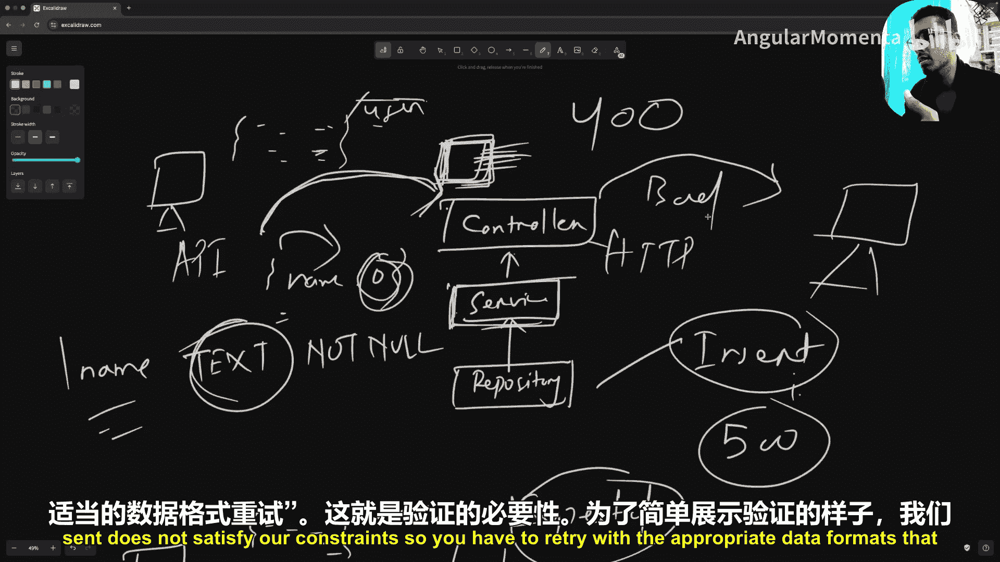
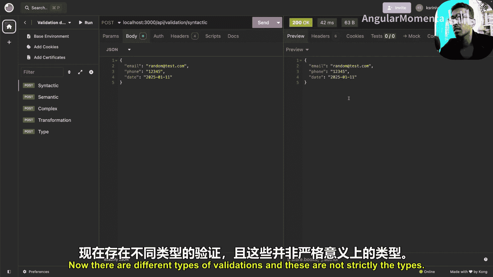
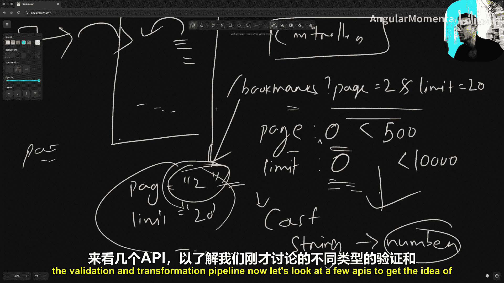
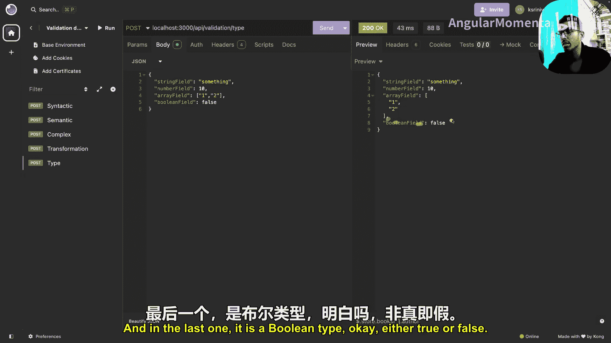
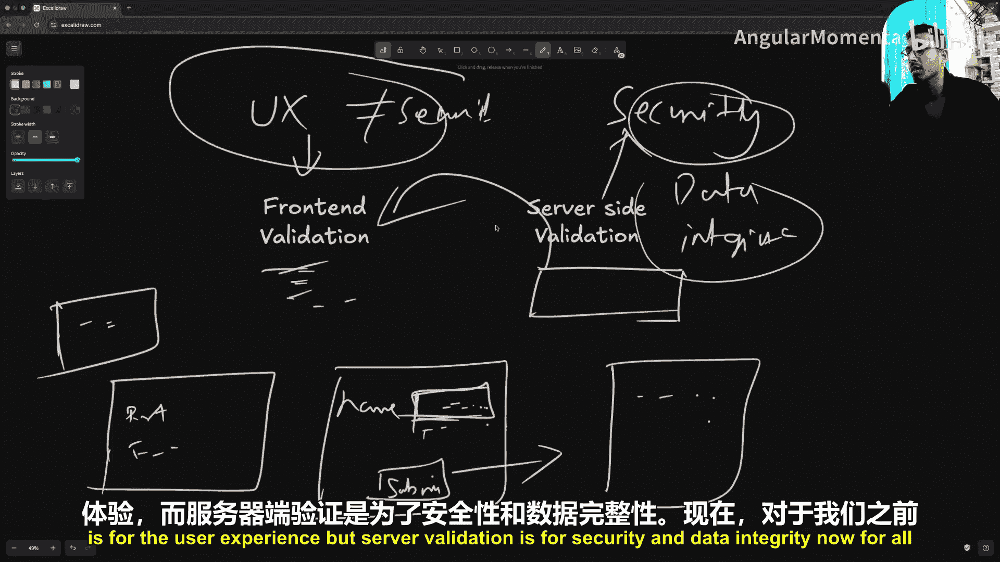
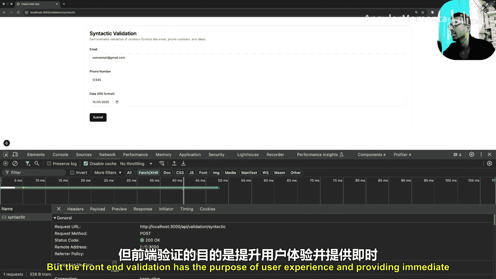
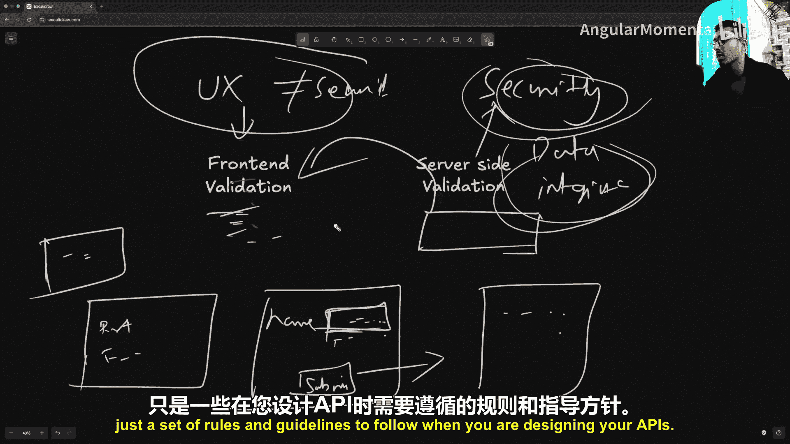

# 【Sriniously】从第一性原理出发的后端开发 ｜ Backend from first principles p09 9. 后端工程师的验证与转换 -BV17aq1BUEhf_p9-

Validations and transformation。 This video is just about。Keeping a set of things。

 a set of rules or guidelines in mind。While you are designing your API。

 these are mostly related to data integrity and security。

 thats where validations and transformations come into play。

So let's understand where exactly do we use it。 This。

 we have already discussed in a typical backend architecture。

 We have different different layers of execution。So the bottom layer。😔。

Is mostly called the repository layer， which mostly deals with database connections and database query executions and insertions。

 deletions and everything related to data it could be。A traditional relational database。

 or it could be Redis or any other kind of database。

 a some kind of persistent storage and above that we have our service layer service layer and this layer typically deals with executing your business logic different different things that you might do in a typical A execution。

right。😔，So， it could be calling。One or two repository methods。

And sending a notification to different different devices and sending an email to users and storing data。

And making a web call， etc cetera， etc cea。 service basically defines all the functionality that an API call usually has a typical service method calls one or more methods from repository layer。

To interact with the databases。Above that we have R we have control layers。😔。

And in this layer it calls whatever the method that is defined in the service layer which executes all the business logic。

 it calls the repository methods and it sends email notifications。

 whatever everything that an API is expected to do and all the data that the API is expected to return。

 So all of that responsibility falls upon the service layer and the controller layer。

Calls the service layer， whatever method that is associated with that particular API。

It calls that method and whatever data is returned from that service method。Is returned to the user。

In that HttP connection， the reason we separate out controller layer and the service layer is because we want to keep the httP related stuff in a different layer。

HTDP related stuff as in what error code to return or what success code to return to the client and what what format the data is expected to be written in that API and what are the validations that we need to do that well see soon and all these data related stuff and all the httP logic related stuff we want to separate out into a differently layer that's why we keep the control earlier。

It deals with all the data that comes from clients and all the data that goes out to the client and internally it calls the service layer and service layer internally might call the repository layer and it might not depending on the requirements and that's how a typical API call looks like it it reaches the controller layer and controller layer interacts with the service layer service layer interact with the repository layer。

And whatever data is returned from the service layer is returned to the user whoever is making the APII call。

Is a very simplified execution call now， where exactly do we have validation and transformation ideally。

Validations and transformations happen somewhere here at this point， the。The point where。

The data that is sent by the client， it is typically a JSson payload。

And the point where the data reaches the server。Wwhich is the controller it first it goes to the route matching algorithm。

 whatever route is matched， it calls the respective controller method of that route。

 whatever controller method is assigned to that route matching pattern。No。

After the route is matched and before we start executing whatever business logic we have in the controller layer。

The first step that we do is the validations and transformations。At this point。

 at exactly this point， before any significant logic is run or executed in the control earlier。

 before calling the service methods or before executing the business logic。

 this is where we do validations and transformations。 Now。

 what is the idea behind validations and transformation。 Why are we talking about it。

 So imagine this is our server。 And we have different different plans all over the world。

 different different users。 And。All of them make A goals。

They make SGtP connections and they make API calls。どうです？あラ原ラ。Now。

 the idea behind validations and transformation is。Whatever data， whatever Json payload。

These clients are sending whatever query parameters is。

Whatever query parameters these clients are sending or whatever path parameters also。

Any kind of data it can be JSson below， it can be query parameters， it can be path parameters。

 it can be headers， whatever， all these kinds of data before they enter into our server。

 the first entry point which as you know after the route is matched。

And it calls the associatedsociator。Controller method before that happens， we want to make sure。

All this data， the G on the query parameters， the path parameters， all these data are in the。

Expected format they are in the expected format， which means we want to make sure that whatever data this particular API needs。

 the user is sending that data in the exact format that the API expects in。

Which means let's say it's a JSON payload and we want a name field call name。

 we want a field call named and we have this requirement for this A。

 we are expecting one JSsonN Pload in the request body and inside the JSON we are expecting a field call name which is a string and there could be other restrictions also we want a string whose length is between five characters。

 200 characters。And it we can be as specific as possible。

 but thats the basic idea Now if we have an APA that has a requirement like this。

We want to make sure that when the data reaches and before we start executing。

 before we go into the service layer， before we start calling the database methods。

 we before we do anything significant， we want to make sure that the structure of the data is in the exact format that we expect so。

When the JSO reaches at this entry point， we execute our validation and transformation pipeline。

So which is basically a middleware function or some kind of utility function that we use that we reuse in every A and we provided a particular schema that we want to validate against。

Wwhichch make sure it goes through all the fields of that JSON so we are saying we are expecting a field call name。

 so it checks whether there is a field called name in that JON payload。

 then it sends an error right away to the client that the name field is required which is not provided in the JSON payload。

In the same way。If the name field is present， then it goes one level deep。

 it checks the value of the name， it checks whether the name field is a string or not。

 whether we are sending an array in the name field when the is expecting a sting。

Then it checks that type of the data if the data is string or not。If it is sting， then it continues。

 if it is not distinct， then it sends an error message to the client that they are expecting a string。

 but you are sending an error you are sending a bullion。Whatever the data the client is sending up。

 then if that value of that name fill its string。Then it goes inside。

 it checks the length of the field。The length of the value， so our requirement。

 our the restriction that we have put on this field is。

The length should be 5 characterss to 100 characterss and if the condition does not satisfy if the client is sending a huge field if it is sending a whole paragraph。

Then we immediately send an error that the length is too long。

 Similarlyly if the client is sending a two character string。

 then we also send an error that the expected length is not matched whatever the customized error messages now the whole idea is with this example we just made sure that this payload this data structure that this API needs to do whatever database operation it needs to do to execute whatever business logic it needs to execute we just made sure that the data is at least in the expected format and the reason we do it at the entry point is because we don't have any unexpected state or our system does not break under unexpected circumstances。

And。By unexpected， I mean， let's imagine we did not have this validation pipeline。

And the client sent this payload。 the the client sent this Json。With name as value0。

 instead of hising it send the value name as0。Now what happened as in our previous demo？

As we know here we are doing validations。 let's say we did not do validations here。

 So the data reached here， the Json with this value name as 0。

The data is here in the controller layer and since we are not doing validations the controller layer in turn calls a service layer and it executes whatever the business logic is and the service layer in turn calls a repository method we are creating a new document we are creating a new row in the database for some kind of entity let's say its a book name so we are expecting the name of the book and depending on that we are creating a new row。

In the database now because we did not do validation at the entry point of our server。

 now what happens is。The data reaches here up to the repository method and the repository method executes the database query。

 Its some kind of insert query。And it inserts this name into the new book table because we are creating a new book with the name that the user has provided with。

Now， usually in relational databases we have data type constraints when we are creating a table。

 we usually tell the database what the type of the data is going to be for that field now when creating the book table we must have done something like this we created a column and the name of the column is name its a bit confusing but for the sake of this example the name of the column is the string name。

And the data type for this is， let's imagine it's a postg database， we can say。

The data type is text and it is not well。And since this is the database level constrain for the data type。

 which is expecting a string。In the Postgre nomenclature， it is expecting a text data type。Yeah。

 since we are inserting a number data。Since the client provided us with the number value。

We executed this insertion operation with the value 0。Now what happens？The database call fail。

 of course， Postgres validates all the data types before doing any kind of operation。

And the database call fails， depending on the error handling situation of the server。

 the client will get a 500。Wch means internal server error。

 which basically says something went wrong in the server。

 something unexpected happened in the server now that is a very poor user experience to have in a basic form API now this is why we want to make sure whatever data that the API needs that the service method needs。

We want to measure at the entry point that it is of the exact same structure of the exact same restrictions that our business logic needs before we do anything significant with it so that if the data does not satisfy those constraints。

 we can send an error code。Of 400， which means bad request。

By the client we can say the data that you have sent does not satisfy our constraints。

 so you have to retry with the appropriate data formats that is the need of validations to show a simple example of how validations look like we have a server running。

In this address in local host。 and we are making an API call。

 This is insomnia We can use this tool to make API requests and we are making a post request to this。

Endpoint slash a page slash valuation slash syntactic and in the body we are sending a empty Json pillow Now if we execute this we get this error which are a set of values in an array it is it the API is expecting three fields。

 one email， one phone and one date。And all of them are required。

 and since we are sending an empty JSON Pload。The A is throwing is an error right away that these three fields are required and you are not providing them。

Now， if let's go ahead and provide these fields。 So you write email， let's provide some random。Sting。

For the email part。 And then we have phone， the phone also， let's do some number， random number。

 And then we have。A date。 The date， let's provide a date。 It's date's 2025。It's 11 since my。0，1，11。

 and if we execute this， we get two errors。That the email is invalid。

 invalid email format and in the phone fill， it's saying it's expecting a string。

 but it received a number。 Okay， so let's go ahead and satisfy this constraints for the email structure。

 we can use to test dot com let's go ahead and now the email field is satisfied。

 it just says for the phone。 now for the phone， let's make this string。 And if we run this。

The success code is 200。 there are different types of valuations and these are not strictly the types。

There could be， of course， more number of types， depending on the requirement， but。Overallly。

 these are the three types that you will encounter most of the types。 the first one is syntactic。

 what is syntactic violation。In here we have validations like validating whether a provide sting is an email or not。

 which means。The validation algorithm， whatever， depending on the whatever language you are using。

 whatever library that you are using， that validation logic， that validation algorithm will check。

Whether the provided string。Satisfies this particular structure。

Emails have this particular structure that there is this initial value。

 let's say this call first and there is this character special character， which is at the rate。

And there is a domain， which typically follows some name followed by some top level domain。

 which couldn be dot com dot co dot in anything the like thousands of different types of domain name The email follows a typical structure like this。

So this validation algorithm will check whether this provider string follows this structure or not。

 if it doesn't， it throws an error。Similarly， validating phone numbers also fall in syntactic validation because that also has to follow a particular structure。

It can be。The country code。Followed by a 10 digit。Number。And it can be any country codes。

 a list of country codes all over the world， and depending on the country code。

 how many digits follow the country code。Those types of validation。

 they foreigners inctic validation in the same way we have， lets say， dates。

Dates also have a particular structure， and they also fall a syntactic validation。

 whether it provider is string。Falls into this structure。

 whatever structure that A is expecting in let's say it expects in this format， the year， then month。

Then， they。So， whether this string follows this structure or not。

 these are some examples of syntactic validation， then we have semantic validation。

 semantic validation basically means whether the provided data makes sense or not， for example。

 let's say we have a form for data birth。In the fronted。And the user can provide it their data worth。

And the backend will say that in database through the API call。Now。

 we want to make sure that whatever data that user provides， whatever data the user provides。

It makes sense in a semantic way， which means user cannot provide a date which is in the future。

 let's say today's date is 11。1 turn25。And if the user provides a date， is is like 13，0，1。And do you。

Which does not make sense right your date of birth cannot be in future so validating these kinds of patterns in data falls under a semantic validation。

 we want to make sure that the data。Whatever the data is provided by the user makes sense in a semantic way in the same way if we have a field called age which takes the age of the user and if the user provides an age lets say called 365 so our validation pipeline should reject this because an age 365 does not make sense at least not yet it might in the future but as of now this age does not make sense in a semantic way。

So these kinds of validations fall under semantic validation。 Now， the third type is type validation。

 type validation is our。Basic validation of validating， whether the data type match or not。

 So whether the particular field is a string or not， whether it is a number。It is a bullion。

Or it is an array or a custom。Gson payload and that Json can have other primary data types like string number。

 billion array， etctera， etc ce。These kinds of validations are called type validation。Overall。

 these are the different different kinds of validation that you will encounter while you are designing APIs and as I said these are not things that you should that you need to understand or you need to remember these are。

thingshs that you just have to keep in your mind while you're designing your APIs。

 like how strict you want to be with your data。And。

How strict you want to be with your validation pipeline and how specific you want to be since the title of the video also contains the term transformation。

 let's talk about transformation。Now， as I said， before reaching， before reaching our。

Controller layer， whatever data that is coming from the user。Needs to go through this pipeline。

It is called validation and。Transformation pipeline。 So， validation we。

Have already understood which basically means confirming whatever data that the APA is expecting the user data satisfies that structure and validations can be as specific as possible and as loose as possible depending on the requirement Now that is validation Now transformation means we want to execute some operations on the data that is provided by the user depending on the success or failure of the validation pipeline or any other default executions Now that is a little complicated to get our heads around。

 so let's say an example So in a typical pageaginated a we send different different query parameters in the in the query string so we have this aPA the end point is let's say slash bookmarks a s bookmarks and we want to send query parameters these ones page as to and limit as let's say。

These are called query parameters and since in the start of the video we talked about we should validate everything that is coming from the client before it reaches our service layer before we execute any significant logic now we have to validate our query parameters so this is how we can define our validation logic。

We want to say that page is a field which will be coming in a query parameter， which is a number。

Which a number， which should be greater than 0。And smaller than depending on a requirement。

 let's say for in this case， it can be should be smaller than 500。

 same way limit limit can should be greater than 0。And it should be smaller than say 10。

000 at a time， only 10，000 data can be returned from the server。These are our requirements now。

Coming back， we are saying page is a number which has to satisfy this constant。

 same a limit is a number which has to satisfy this constant， but we already know that page。

And limit our query parameters and all the query parameters are strings by default when the reach are server。

From the user's browser or from any client。They are strings by default because query parameter。

 all the values in the query parameters are strings。 They don't have any other data type by default。

 They can satisfy the structure of any other data type， but。

Their value will always be string when the reach are server in this case， what happens？

This is how we receive our data， receive page as the string2 and limit as the string 20 from this now because of our validation requirements。

 this fails this fails because we are saying we are expecting a number the first requirement is it should be a number then we check the value whether it is greater than0 whether it is more than 500 etc cea。

 etc ceter， but it fails on the first requirement because it is a string and the APIPA fails and the user will get an error that page should be a string page should be a number but we are receiving a string。

 something like that depending on your error message syntax。Now， in this case。

 there was no error from the client because it is a query parameter， of course all the fields。

 all the values of the fields will be in string format by default。

It is the server's responsibility to transform this data into a into our expected type。

 you can also say it is the server responsibility to cast the data type cast basically means。

Forcing one data type。To get converted into another data type。

 So in this example we are we have to cast a string data type into a number and then we can execute our validation requirements。

 So this phase is called a transformation。Because the data that we are getting from the client has to go through some kind of changes before we can execute our validations。

 it can be other way also after validation we can execute some operations to transform that data into a structure which is expected by the server。

So this process of converting data into a desirable format is called transformation and usually we pair validations and transformation in a single pipeline so that the data layer。

 the input data layer all the logic in the input data layer stays in the same place and we don't have to look in different different places。

To find out what all the requirements are and what are the operations that we are executing on the data before doing any business logic。

 all the requirements of our validations and all the operations that we are doing through transformation。

 stays in one place， which is called a validation and transformation pipeline。

 Now let's look at a few APIpis to get the idea of different different flavors of validations and transformation that we just talked about。

 we have already seen the syntactic validation in the demo that we saw earlier in this video。

We executed this API with different different values and we got errors and we kept fixing those errors and we got a successful response of 200 Basically we had to provide a string which satisfies an email structure we had to provide a phone number and we had to provide date which has this structure a valid date structure and after that the API was successful and this is an example of syntact evaluation because we had to stick to particular structures of data。

It was email， phone and date in this case。 it can be different。

 different other kinds of data in the same way， let's see what is semantic validations。

let's execute this so we are getting this validation error and validations also have this advantage that even if the client hits this API without any value。

 they can get some kind of documentation with the errors that these are the fields that are expected in this API which the client is not providing。

So that is a very nice way of figuring it out if theip documentation is not available in the first place。

The error messages， the validations， error messages are a very nice way to figure out what are the expected fields and what are the expected values in those fields that the API is demanding from you Okay in this case。

 we sent an empty payload and we got these errors。So the A is expecting two fields。

 one as date of birth， which says is required。And the second one is H， it says。Expected number is。No。

No。Let's provide these values，2。This CP。 So the first field is date of births。 And for this。

 let's provide a date in 1995， the month is soon and some random data is 12。 Let's execute this。

 and the date birth was satisfied。😔，And now it says age is required。

 So let's also provide an age age is。 let's say what。 And when we send this， the A is successful。

 and we are getting the。Same value that we have sent now。Since this demo is about semantic Val。

 let's change these values instead of 1995。Let's make it the year 2026 as a date of birth end Sunday this。

Now we get this out of that date birth。Cannot be in the future。

This is what we had talked about earlier。The semantic validation checks that whether。

The value of a field。Makes sense or not in a semantic way。

 Since the data birth of a person cannot be in the future。

 we are throwing this error for this field that data birth cannot be in the future in the same way。

 let's re this and let's make the age 4，13 instead instead of 40 Let's make it 4，30。

 and then we get this error number must be less than or equal to 10 a logical age for a person at this time is from 1 to 1。

20。 even though a one year old1 be hitting our APA。 But still they're accepting ages from 1 to 1。

 That's why it's called semantic validation， we are checking whether。

The values provided in different different fields make sense in a semantic way or not。

 Okay in this one， let's hit this。 This A is expecting three fields， one password。

And then it is password confirmation。And the thirdline is married or not。Okay。

 now let's provide these values S password system called random and password formation。

At that thing and。Or mattered， mattered。pause and this let's hit this。 Now。

 this is another kind of validation check that we usually do。So in most of the platforms。

 we have a password field and a confirm password field just for。

Securreed regions and to check the integrity of the data。

 whether the user has provided valid data or not。So the requirement is always that the password confirmation value should always match the password value。

Right。And since we are sending different different strings in these two fields。

 That's why the A is returning the error that passwords don't match for this field。

 password confirmation for the password field， it is returning an error that string must contain at least8 characters。

 That is the requirement of the password。 Now， let's fix this to satisfy the constraints。 India。

 we have six characters。 Let's add。One more and let's copy this。

pastse this here so that these two fields match。And when we hit run this。Now， it is。True。

 the I pay is successful。 Now， what happens if we do merit as true than this。

 we get another error that the API is expecting another field called partner。

 If the field merit is true。 it says partner name is required when merit is true。

 So if we provide the value is true。 we also have to provide a name in the field partner because the user is saying it is merit。

 It's provide another field， is called partner and。

Surund this and we get a successful response with all the fields that we have provided。

And in this particular example， it is called complex because depending on the requirements of the service layer。

 we can define our validation constraints。In the first one。

 we are saying that two fields should have the same value。That's what this constraint was about。

In the second one， we are seeing the partner field is optional。When merit is false。

 but if the merit field is2， the user also have to provide another field call partner with the name of the partner。

So we can also do these complex pipelines inside our validation pipeline。When dealing with user data。

Moving on to our transformation example。Let's run this and it says email phone date。

 It requires three fields。 So let's provide three fields。

 Let's just copy this one from our earlier demo。And。The at it here。

 let me send this and in order to see how the transformation works in this particular API。

Let's make this email change the cases of this email lets say a and in the and then when we run this we are getting this value now。

 what I want to show here is the user is sending data。

 then an unexpected format in a particular structure if the structure is of an email。But inside that。

 it has lowercase and it has uppercase。And in the phone number also， it is。

 it does not provide the character plus。Before the phone number and the date， it。

Provides this particular date structure。 And when we send this to server。

The server does some transformation， it changes the data according to the requirements of the service layer。

And because of that， even though we sent the value of the email with different different cases。

 lowercase and uppercase。When we got the value back twa was in all lower case because the server in the validation pipeline it transformed the value into lowercase before doing any kind of executions on the data Now that's the reason we got this email which is in all lowercase in the same way for the phone field。

 whatever value we sent in this field。It added this character plus before the value。

 and it sent it back to us。 samee by the date will it calculated in a different format and sent it back。

 This is some example of transformation。After the client sends some data in the period。

 the server can do some kind of operations on the data to transform it into a different format。

For the convenience of the service layer or for the requirements of the service layer before performing any kind of executions on it in the same way。

 let's run the example of type valuations and when you run this we get4 errors we the is expecting four fields when is string field when is number failed when is error fail and when is will。

 So let's first provide all these values。Then we'll see what are the variation errors。The first one。

 let's say string be string field。 and the string is。SomethingAnd let's just copy this and paste it。

 This is a number field， and this is an array field。 and this is a bullan field。

 And let's hit this APII。Now， this error is gone。 Now。

 the number field is saying expected number received string。

 The error field is saying expected array received string， same for the bulloleion field。

 this is an example of type validation。 That's why this。

We are showing a demo of how the server can enforce different different data types from the client so we order to fix these errors。

We make this some valid， say10。 And when you hit this that is gone。

 we have an array and boin error this。 we can send an error。You can send an edit。Value 1 and 2。

 and for the boolean field， we can send pulse。 And now when we run this， we are getting mores。

 which says inside the array field。The element0， it is expected to be a string。

 but we are sending numbers。Now to fix this， let's make these string Now， when we done this。

We are getting all the values that we had provided。The string field has string value。

 the number field has number value。 the error field has error value but for each element of the array。

 we can also enforce different validation constant。

 which in this case was each element should be of type string and in the last one it is a bullan type Okay either true or false And the last thing that I want to bring into attention is this concept Sometimes there are confusions and people sometimes do this mistake of replacing front end。

Validation with backend validation。This mistake happens because usually in a typical platform。

We have forms and inside forms， we do some kind of validation。For example。

 let's say we have this form。 we have this form， and there is a fill called name and it's an input box。

 and the user has to type some name and if。It's valid if the name。

Satisfies whatever requirements that we have either the minimum or maximum number of characters or the data type matching。

 whatever else it is if it is successful。Then when the user clicks on the submitit button。We got了 a笔。

If the validation is not successful， we show some errors in the form itself that this stereotype does not satisfy our constraints and。

When it does satisfy the constraints， we call the a and the backend does whatever stuff that it needs to do。

 right。Now， the thing to keep in mind is for all interactions， for all APIs。

 we need both the front end validation and the server side validation。

 our backend validation because。Ftend validation， the reason we use frontend validation is for U。

 which means user experience。 Red validation is not for security or data integrity。

 It is for user experience。 we want to give some immediate feedback to the user that something is wrong with the data and the data that you are expecting does not match the data that you have provided。

 It is not about security back in validation。Did you do。

That is for security and data integrity That the reason it does not matter what kind of validations your front end does。

Whether it does or whether it doesn't because a typical server can have different different clients。

 it can have a very convenient web app which can do different different types of validation but as we saw it can also have a API client waste interface for example。

 something like postman or something like insomnia there there is no concept of validation right because we are directly interacting with our APIpis there is no front end interface that acts as a proxy to our API which acts as a user interface in that case there is no front end validation at all So if the backend depends on the front end validation for security purpose or for the data integrity purpose our server will break when the client changes that's why this is a very important concept when we are talking about validation and transformation it does not matter what the client is when you are designing your APIs。

You have to be as strict and as specific as possible in your server side violation logic。

Without thinking of what the client validation will look like because as I said client validation is for the user experience but server validation is for security and data decor now for all the API examples that we saw earlier in the API client insomnia we also a we also have a complementary frontend interface to deal with those APIs for all the different different types syntactic semantic type transformation and complex。

Now let's see how printedin and backend violations work together。 Now inside this。

 let's provide some email。Sa some E。Let's provide wrong values first。

 then we can see whether it works or not。In the phone number also let's provide some 1，2，34。

5 and date we already have a date selector so we can choose any date Now lets do submit in this case we did not make any API calls yet because the front end detected that there is something wrong with this field and it is a front end side validation it is the client side validation now to satisfy this we have to make this a proper email can this。

That gmail dot com。And then when we do submit， we do a proper API call and when you see the payload。

 it is sending these。And in the P it is hitting this， and it is a。You're getting it 200 response。

 which a success response。These client side validation and server side validation work together。

The client side violation provides a proper user experience。

 provides immediate feedback to the client to the user and the serverside violation performs different different security checks and it is a mandatory violation which has the purpose of security and data integrity but the front end violation has the purpose of user experience and providing immediate feedbacks now that's pretty much all there is to talk about violations and transformation it is not a very complex topic or a very large topic。

 just a set of rules and guidelines to follow when you are designing your Apis。

