# 【Sriniously】从第一性原理出发的后端开发 ｜ Backend from first principles p10 10. 什么是控制器、服务、仓库、中间件和请求上下文？ -BV17aq1BUEhf_p10-

In this video， we are going to cover three topics， endless services and repository pattern。

 middle errors and request context。Initially， the plan was to cover each topic in different different videos。

 So this。Was supposed to be three videos， but since these three topics are so closely related with each other。

In fact， pretty much all the topics are closely related to each other since we are talking about backends here。

But I cannot go ahead and make a hundred0 hours with。So in this case， these are in this case。

 these are very closely related to each other。And it will be easier to explain all three of them in the same context instead of repeating the same thing again and again in different different videos。

That's the reason we are going to cover all three of the topics in this same video。

 Now let's talk about handr services and repositories。

 I know that I have talked about this topic in different different videos I have mentioned it in fact I have even explained it a little bit in other videos so it might sound a little bit repetitive。

 but I have never officially covered this topic， so this is a time that we can do that okay。

So let's start with client and Sarah。We have our client here， and we have say server here。 Okay。

 this our client server， and we communicate with each other over S T T B。 Now。

 when a client sends a request， when it sends a request， it reaches our server。

 So the moment it reaches our server。And。😔，Until the moment it receives a response。

 there are a lot of things happening in the server。And we call that a request life cycle。

We already talked about the request life cycle。External to the server。

 like what happens at this point the sending the request and sending the response。

 but we have not covered the request lifecycle inside the server。

 What happens inside the server throughout the lifecycle of the request so let's cover that。

What happens。Now， the request reaches here。And。We have our， the entry point of the server。The entry。

 the moment our operating system。Forwards that particular httP request to the particular port。

 it can be 3000， it can be 4000 any port that your server is running your operating system forwards that request。

To your server and the request reaches your server that is the entry point of your request。

 Now what happens your server must be doing some kind of listen on some particular part and thats how it gets the request。

At the start of the request， what happens we have routing。After the request reaches are server and。

 we have roing mechanisms。 We have different different routes， for example。🎼Users。

 then we have users slash 1，2，3， We have dynamic routes and etc cea。 cetera。

 We have already talked about routing and all It reaches our routing algorithm。

And depending on the routing algorithm。We map that request to a particular handler。

 handler is basically。Any function that we have predefined that is supposed to handle the request of that APA We have mapped some kind of function for this as a handler for this route。

Now， we have。The concept of handlers or controllers， services and repositories。

 And why do we have three separate components， Why don't we only have a single handler。

 which does all the stuff。 And the thing is， we can have that。 There is no。

Requirement that we have to separate out the responsibilities into three different components。

 There is no hard requirement。 It is just a design pattern。So that your core base is scalable。

 it is more maintainable and it is easier to add features and it is easier to debug things right now lets see what are the responsibilities of these three components the first level once we get the request here from the routing algorithm it reaches the handler or the controller。

So we have here handle slash controller。What is the responsibility of this， we get the request？

And in pretty much all the servers。Does not matter you are dealing with golan or nodes or Python。

 Those are the three languages that I have personally used。

 so I am not aware how the pattern works in other language。

 but I am pretty sure is an established pattern at in each handler you will receive at least two objects or two variables depending on what programming language that you are using you will receive two objects or two variables one is the。

Request object，1 is the。The response object and the handler。

Can take out values from that XTp request from the request object。And it can send responses。

 and it can modify response headles， et cetera， et cetera， using the response subject。

This is why we get these two objects。 and we don't necessarily add these two objects ourselves the。

The run time， the programming language that you are using。If you are using go。

 then go provides these two objects to you by default。

On your handlerrss parameters and similarly for nodes also。

 if you are using express or anything like that， you will get this request and response provided to you。

 you don't have to add them， you will get them for each request。

Now what happens at the entry point of handler what is the first thing that comes to your mind that we need to find what is the request about。

 we already know that what is this A supposed to do because this A was routed to a particular route above here and we got this in this particular handle so we know that what particular A that this client is trying to call。

We already have that part of the information Now we want to take out different different values so that we can process the request and send the response accordingly。

We can do different database operations。 We can do external logics。 We can do external API calls。

 We can do we can send emails。 We can send notifications。

 We can do a lot of things inside our processing logic and we have to send a response or we don't have to send a response depending on what kind of request it is if it is a delete request。

 then restful standards say that you have to send a response code of 2，0。

4 no content with an empty response body depending on that， we can decide what response Now。

 at the end point， what is the first thing that comes to your mind that you have to take out the data from this request object that is the first responsibility of a handler of a controller。

So this is what you have to gain in mind again this is not a necessary requirement。

 you can do everything in your handlerr slash controller but in a typical fact in architecture this is how we structure to make it more scalable。

Now， in the first entry point of your controller or a handler。

 your responsibility is taking out the data from the request object。

Depending on what kind of request it is， if it is a get request， if it is a get request。

 do you have to take out the query parameters that if it is a post request。

 you have to take out the request body， Similarlyly for delete。

 we can take out the request body and for put our。Btch， we can also take out the request body。

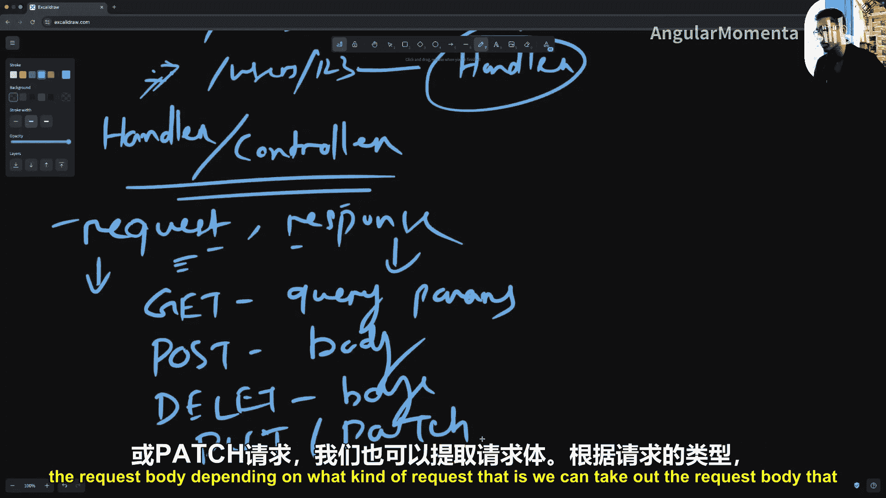

Depending on what kind of request that is we can ti the request body。

 that is the first responsibility of a handler or a controller。Now。

 we have already talked about serialization and deization and there is a reason we are following this order we are trying to trace。

The flow of the request from top to bottom， right。The request started from the client and that's why the first thing that we covered was。

How St TP life cycle works， right， Then we went into routing。

 then we went into serialization and decentization， then validation and transformations。ettera， etca。

 right we are following the request from the top until it reaches our repository or our database layer。

We already know that we have to some kind of serialization and decsialization at this point because the request the client sensor request and that request is serialized into a JSON format because it has to travel over the internet and JSON is a serializable format that is used across front end and backend boundaries。

And there are other serial formats， but Jason is the most popular one as of now。Now。

 the first thing that we have to do is in the controller layer。

 depending on your programming languages， the implementations might be different。

 but this is a common pattern。The first thing that you have to do is。

D serialalize the Json object that you received from the request into your native data format。 Now。

 if it is an or backend， then you might not necessarily do this step。

 there will be a middleware somewhere somewhere upstream before the routing happens which DCize all the Jsson into jascript objects。

 right That's why we have。Json dot body parel etc etc terminal middleverse in our Jhas。

 So that's why we don't necessarily do this step at the handler layer。

 But in other programming languages like go or Python， we have to do this step explicitly。

 We have to decsealize whatever Json。That we receive in the request into a our native format。

 So if its a an go app， we have to disreize into a native stock。 if it is a python app。

 we have to disreize into a dictionary or a class。And similarly， for rust， we can de into astruct。

Et cea， et cetera。 right。 We have two。Take the JSON data and convert into a format that we can understand that our programming language can understand。

That it has to follow its native data format。 This is the first thing that the handler does takes out the data from the request object。

 and it DCses into。The native format of the programming language that you are using。誰ど？Foster。Okay。

 this is also called binding。Depending on what framework that you are using。

 but most of the frameworks use this term logic， which is called binding。

The re body enter your native format。And。And at this step， if the DC re fields are some error occurs。

 then。We send a request。 we send a response to the client with the status quo of 400。

 which says bad request。Use the error code of 400 to tell the client that。This request is not valid。

 If Something is wrong with this request payload。We send the40 request and we terminate the request at this point we don't。

Continue， we don't proceed ahead。First thing， now second thing。And again。

 I am talking about an ideal production grade back in pattern okay。Depending on the implementation。

 you might not have a validation layer but。We have already talked about validations and transformation in a previous video and the advice is you should validate everything that is coming inside。

Your server from an external kind， everything starting from your path parameters to your request query body。

Do your request query parameters， etca， cea， everything that you can validate and be as specific as possible while you're validating it。

We've already covered these things in our validation transformation video。

 Now that's the second thing that happens here。 once we have decsialized the data into a native format。

 now we understand the data our programming language can make sense of the data it cannot make sense of the JSON data because that is a serializable format and not every programming language。

 Javascript has a very good support for JSON because JON is inspired by the jascript object and it has first less support for JSON but then you come to other programming languages you don't have as smooth integration with JONs we have to do a lot of manual processing。

now at the second step， we do validations and transformations。

 we take the data that we have bound here through our native format。

 let's say we are using go programmingage now we have a struct if we are using Python now we have a class or a dictionary which contains。

All the data that the client has sent， but in our own programming language format。

The client is using jascript It has sent using Json， but now we have astruct in go。

 which contains the same data in a different representation， but with the same values。

 Now we take that data。And we validate it。 We validate it。

 We make sure that all the data that the client has sent。 It is in the expected format。

 All the mandatory values are sent。 All the values that are sent are in the expected format。

 There is no malicious intent。 There is no。Missing values， etca。

 etc ce everything that we do in a validation pipeline after we validate it we also optionally do a transformation What does transformation mean transformation is basically after we validate the data that has come from the client we do some kind of modifications to make it convenient for our server to process the data for example。

 we can set defaults let's say we have a get a pay。

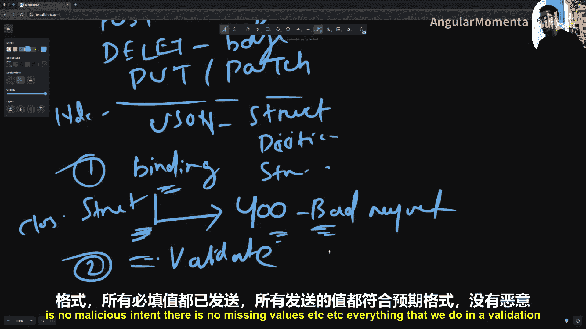

We have a get day where we are fetching all the books。You're pitching all the books。

And there is a query parameter that a client can send， which is sort。And in the value can be name R。

By date， the created date of the book， right these are the values that the client can send。

And the requirement is， and this is a good pattern that you should establish in your back and half that。

Very parameters。You should try your best to do all the query parameters optional。

That should be your requirement that is a good pattern to establish early in your API design and willll cover all about API designs。

 all the best practices， restful architecture and everything in the next video that is all about API designs and principles and how to think about APIs how to design them。

 etc， etc。So there you will have all your doubts cleared about this， how to structure this。

 how to start about this， but just a info for the sake of this video that you should try to make all your query parameters in your as optional。

And coming back to transformation， as it is the requirement。

 the client can send two values in the sort query parameter either a name or date。

And if the client senses name， you have to sort all the books by the name of the books。

Or if it sends date， then you have to sort by the date of the book。What did that a book was created？

Now in that transformation pipeline， let's say this request went through the validation and the client did not send any query parameters it to send last books。

 there is the URL。It did not send any。Qury parameters in the validation pipeline。

 it goes through because you have made all the query parameters optional。As a good pet。

So the validation pipeline succeeds， you don't get any errors。

 you don't send any foreigned bad requesters to a client it goes through now it reaches your task submission pipeline。

Now， you want to make it convenient for your。Daabs layer to process the data。

 and that is the reason in the transformation pipeline。

 what you can do if the client has not sent any query parameters， you can set defaults。

 you can set defaults here， which means in the transformation pipeline what you will do you will check if there is if there are no query parameters past you。

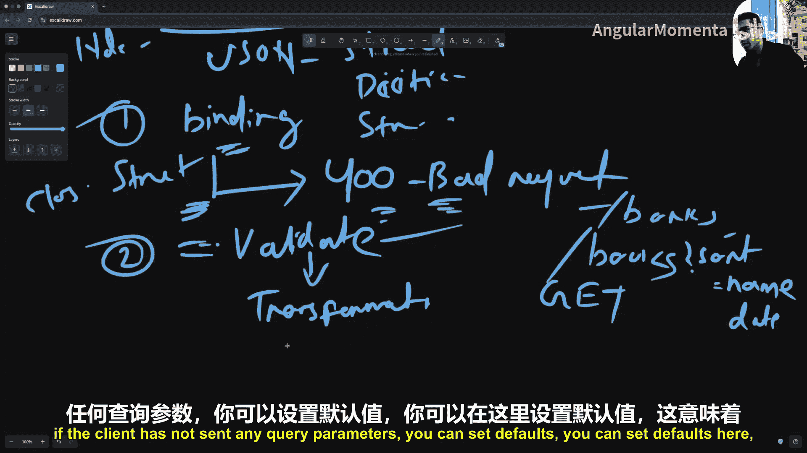

Set the value of sort as。D。Or depending on the requirements you can also set to name。

 that's why we use transformation pipeline so that we can do a couple of operations。

On the data that we have received from the client before it goes to the database layer or before it goes to the service layer so that we can make it more intuitive and more。

Convenient for our downstream layers to process the data in a more expected way。

 Let's say we did not pass anything。 Then the service layer has to check if the sort field is passed and not if it not passed。

 then do this。 If it is passed， then do this。 then we have a condition branch there。

 So I a load of inconvenience， but still doing this makes your code lot more readable。

 it makes your code follow an expected path。Of processing。

 that's why we have validation in a transformation by。 We won't go too deep into this。

 We have already covered this in the previous。 That's the second thing your handler does。

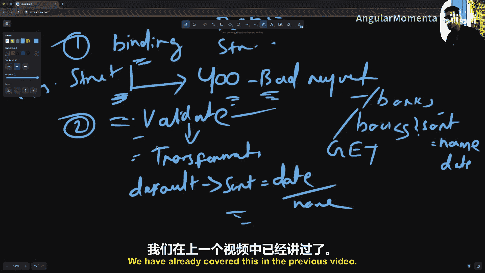

Now， you have taken out the request object， the request information from the request object。

Then we have validated the data。 You have transformed the data according to your convenience。

 Now you have a solid data format。That is ready to get processed。

 That is ready to get processed by your downstream layers。 Now， at this point， what happens。

 the controller layer， controller layer。

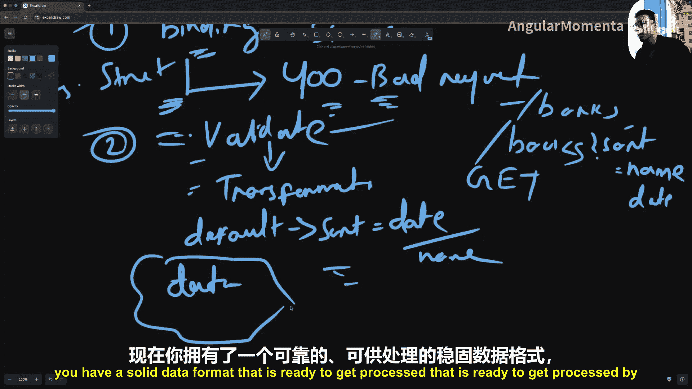

Calls the service layer with all the data that it has properly validated and transformed。

 It passes that data to the service layer and all the information that the service layer might need to process that data。

 For example， the authentication information like user I， the user permissions， etca， etc cetera。

 pass all those data。 And then the service layer starts processing。 Now。

 what happens in the service layer。 Now， the service layer ideally。

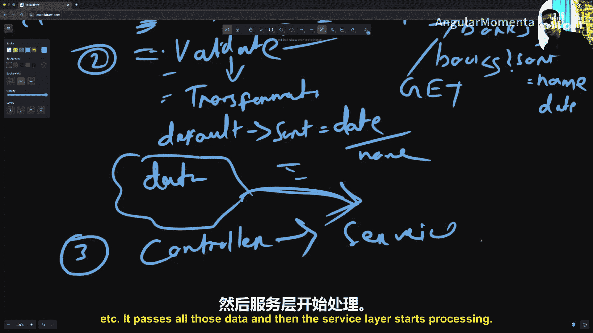

Should not deal with any kind of。HTD B related stuff。

 we try to limit all hDB related stuff in the control earlier for good reasons that well explore a little bit later。

Now， the service layer is just a function。 you can think of service layer。

Just just a function that has nothing to do with any kind of back in front end interaction or such。

If you take a look at your service method， then。From one look。

 you should not be able to tell that this is a function that is being used in an API。

That is a good pattern to follow your service layer should be in an isolated manner。

 should be doing all the processing and then returning the data it should take some data。

 process it and determine some data。Without worrying about it。

Was response code to return to the client what kind of data it is receiving should the validation。

 etc ce。 You should not have to worry about all those stuff。That is the responsibility。

 the handler layer。 That's where we draw the line。The responsibility line now what happens in the service layer。

It takes all the data that is needed to process and that is needed to do all the operations that we want to do then what it does it calls the repository method for your database operations if that is needed there are of course service methods for example if this service is only supposed to send an email。

To some client or to some user， then what it does in the data。

It might be receiving the email address， and it takes that email address。 It executes the logic。

 which sends the email to the client， and it then。Returns a response that。Looks something like this。

 Succs is true。To your handler back， it can also do something like this without calling the reposititive method。

 We also have services like this if it needs to deal with databases。

 whether it needs to persist some data or whether it needs to fetch some data from the database。

Then it uses the repository layer for that kind of information。Now， at this point， what happens。

 we have the repository， we have the repository layer。Other database layer。

 depending on what terminology that you and your team is using， the rear again， takes the data。

 whatever data that needs to be inserted or whatever data that needs to be fetched。

 Now all the requirements of the data， for example， we received。

The parameters sought from upstream from our handler， which either has a value name or has a value8。

It takes the data service layer takes the data from the handler and it passes the data to the repository layer and the repository layer takes the data and it。

Construct the database query， the sole responsibility of repository layer is it takes whatever the data that has to be inserted。

 or it takes all the filtering data， the sorting data， whatever data that is needed to fetch。

Data from the database。Take all of data。It constructs the database query and it returns whatever the result that was written by the database。

 it has a single responsibility。Take some data， performs a database operation returns。Again。

 the requirement is。One repository method should only return one kind of data。

 which means let's say you have two repository methods。

 one for getting all books and one for getting a single book then。Ideally。

 you should not pass an optional parameter in the same function。

 And depending on the optional parameter， you should not return a single book or you should not return all books。

 You should not do that。 Reository methods have a single responsibility if that repository method needs to return all books。

 then it should return all books and it it to return a single book then it needs to take the idea of their book and it needs to return the single book。

 That's how you should design your repository methods so that the service layer。

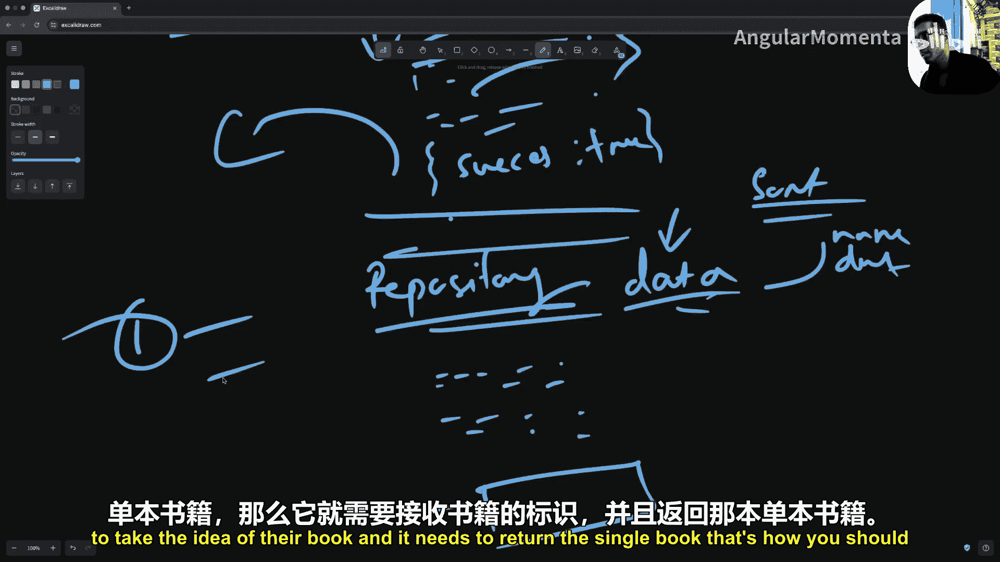

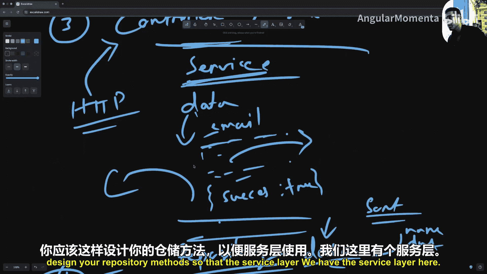

We have the service layer here。 The service layer has also service layer also has the responsibility to orchestra。

 which means it can take the different different data that is returned by the different different repository methods and it can like merge those data take the necessary fields for different different results and it can return that data to the handler。

 that's the responsibility of the service layer。A service layer can use multiple repository methods。

 It can do different different operations to merge different types of data from the database and a etc cea a service layer can do a lot of things inside this if one service method。

 but a repository method should do a single thing is fetch some data depending on the requirements or insert some data depending on the requirement or delete some data depending on the requirement。

And service layer orchestra its depend if theository method， or it does external API calling。

 it sends notification， it sends like an email to your user etc ce et cetera。

 It does everything that an APIN needs to do。All the actual processing of the API happens in the service here。

Handlers deal with data formats， the input data formats， the output data formats。

The actual processing happens in the service layer。

All a database calls happens in the reposory layer。 That's how we isolate the three layers。Okay。

 now the service layer called the repository layer for fetching all the books depending on the sort parameter。

It got the response from the repository layer， and it returned that response to our handler or to our controller。

 and we are back from the service layer。 The controller layer called the service layer。

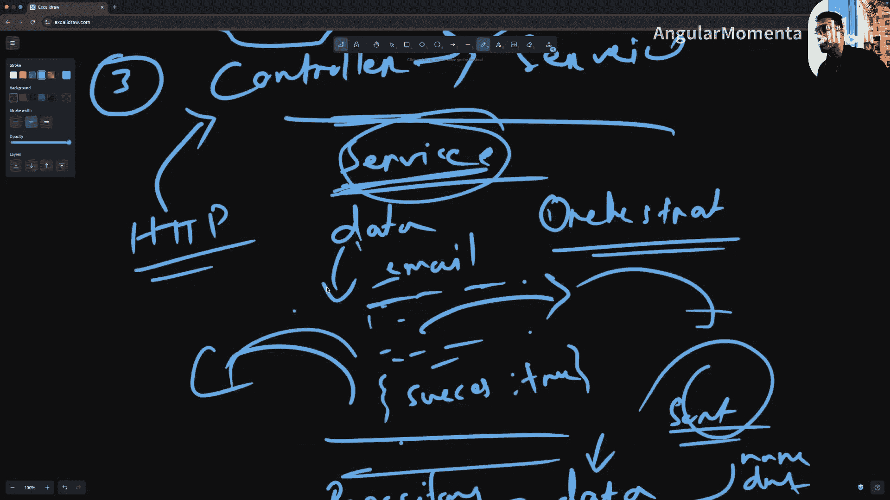

And it returned the data， the service layer returned the data。

 And now we are back at the controller layer。 Okay， Now what all happened1。

We did the binding of the data from the request in the controller layer， we did validations and。Dos。

给啊。Third thing， what it did call service layer， which did the actual processing of the data fourth we got the data。

 what the next thing to do send response。To the client so as you can see the controller layer actually controls the data flow from client to server。

 from server to client。It got the data。 It did some validation transformation and processed the data。

 and now it will send the response in appropriate response back。

Your our user back to the client and depending on the success or failure of the service method。

 whether we were able to process that data or not。The controller layer decides on a appropriate response。

 It can be 200 chs。 It can be 200，2，0，1，2，0，4， depending on the success。

 It can be any of the 200 cities codes， or if there was a failure。Then it can also be 400。

 if it is a client failure， it will be 400。 If it is a server failure， it can also be 500。

And it is the responsibility of the controller layer to decide an appropriate response code and send an appropriate error message。

If it is an error or send an appropriate success message with the success data， in this case。

 it it will return all the books。An area of books。With a response code of 200 because it it was successfully able to fetch all the books。

And then it will send the data back to the client。That's how the request life cycle looks for a single vehicle。

And that's how handlers slash controllers， services and repositories integrate or cooperate with each other。

2 process data。From a client and send an appropriate response back。 That's how we。 That's how good。

 Next up， we have Middlewe in the same context。 Now。

 where do Middlewe come in in this whole picture of a request life cycle。

Now let's do the whole request lifecycl again， but this time we'll use middlewares and we'll understand how middlewares work and where do they actually come in okay we have a client。

Let's not imagine client now。 Let say we get their request from a client。No。

The moment we get a request， the moment the request reaches our entry point。

 the moment the operating system powers our request to the entry point our server。

From that moment on， B can have different different functions。Different。

 different functions in between。Like， let's imagine these are break points。

 These are boundaries of different different functions， and we can have this function。

 Then somewhere we can have our routing route matching stuff。Where we forward a particular pay call。

 depending on which route it wants to go， we can have routing here， then。Again， after routing。

 we can also have middlewares here。It these are just different different boundaries。 here。

 then we'll have our。Handler service。Repository axis。Then after this， also， we can have。

Middleers here until the response is sent back to the client。 Now。

 let's imagine what's happening here。What are these boundaries Okay。

 we have these boundaries We are we are already familiar about this part we are doing routing here and this part we that we just saw that the hard handler takes a request。

 it takes out the unnecessary data test violation transformation。

 It causes the service layer service layer does the processing by using the repository layer for database operations。

 Then it sends the response back。 then the handler sends the response back to the client。标的。

Understood this part and this part。 Now， what are these things。

 What are these functions that are coming in between。

We call these function cells middleverse and from the name you can take some meaning out of it that these functions are supposed to be executed somewhere in the middle。

 somewhere in the middle of what。

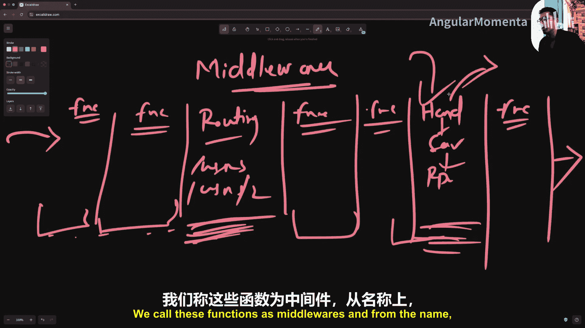

In the middle of these things， in the middle of routing in the middle of。

Handler services and repositories and in the middle of sending the response back to the client。

These functions are executed in the middle boundaries。

Of different different execution environments or different different execution contexts。

 That's what they are called middlewares。 Now， why do we use them， What do they actually do。

 Middlewares also like normal handles that。We have already discussed that a handler typically a handler receives two things。

 a request and a response by default in its parameters。

Which is provided by our programming language or our framework or our library。

 whatever that we are using to build a server。These two objects request object and the response。

That is provided。To the handler by default， by the runtime environment。In case of middle yearss also。

 since these are also one kind of handlers， but with a one。Additional capability。

 these also get a request。 these also get a response object。

 but these also get another thing called next next is a function。And we'll come back to next soon。

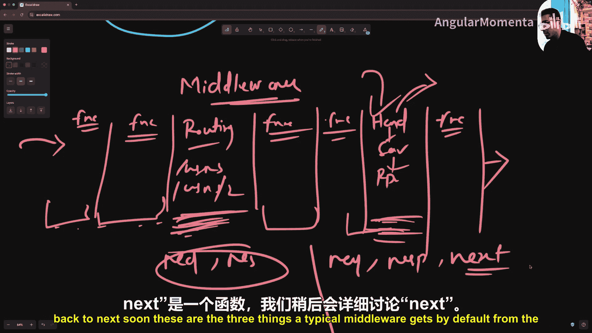

These are the three things a typical middleware gets by default from the runtime from the language runtime。

 it gets three things， one the request object， one the response object to modifying the response and stuff and one is the next function and the use of next function is。

We have these boundaries that we saw that there can be one middleware。

 there can be another middleware。And then there is the routing。

 then there is the multiple middleverse here， or there cannot be a middle from the routing。

 we can straight up go to handler。Right。We can also skip these middlewares all the middlewares are optional。

 that's something you have to keep in mind middlewares are optional functions that depending on your requirement that you can implement。

 that you can execute these things may be there and they may not be there。Okay。

 depending on your requirement， middleverse receive three objects。

 which are request response and next， next is a function， which is basically。

Passes the execution from one middleware to the next middleware to cross this boundary from one middleware to next middleware。

 the runtime gives us one function called next。 And as the name sounds。

 we are just proceeding to the next middleware or the next execution function。

We cannot always say the next middleer， because。If we focus on this execution。

 this is going from one middleware to our routing， or if we。

Focus on here is going from one middleer to our handler。

 That's why next function passes the execution to the next context。

 Whatever the context next is supposed to process the request or is supposed to process the response。

 next function。Concert。Well， that's the use of next function。

 It just passes the execution to the next processing context。 and that's all about next。Okay。No。

Since a middleware receives a request object and a response object， you can already imagine that。

A middle can。Take out values from your request and it can send a response back to the client from this point only。

The request may not reach our routing part。 The request may not reach to the routing algorithm。

 and it may not reach to the handlers， which is far ahead in the request life cycle。

 This middleware can do some logic and it can send a response back to the client from this point also。

 because it receive a response object from the runtime。 That is the capability of a middleware。

It can take values out from request， it can modify the values of the request and it can also send back a response to the client that's the capabilities of a middleware now why do we use middleware Okay why not do everything in the handlers only。

 Why do we use different different things。Now， the obvious answer is because the same reason we use functions。

 Why do we use function so that。We don't have to write the same set of lines。

The same set of lines of execution all the time in different different places。

 we can just write those few lines in one function。 we can tag that in in one environment。

 then we can call that function again and again in different different places。

dependepending on the requirement， you can pass different different parameter to it and change the order of the execution or the result of the execution。

 But we can reuse that code in different different places。

 That's the reason we use functions in programming。

Same way we use middleware so that we can do some logic。

In our whole API request lifecycle again and again in different， different requests。So。

As a backend application， your app receives thousands or depending on the scale。

 depending on the popularity of your platform。It might be receiving thousands and millions and billions of requests every day。

 and because of that you have to do some kind of common operations。

 you have to do some kind of security operations， logging operations and authentication operations and data passing operations。

What all requests now。You also， as a huge bagend application， you also have hundreds and。

Sometimes thousands of API endpoints now for each API endpoint。

 you will have handler there is no way avoiding that you have to write different different handlers or different different API endpoints。

That is that。No。If we don't have middle layers， we have to perform the same set of operations for each handler we have to duplicate that code for each handler。

And at this point， you might also say that we can write a function and we can call that function in every handler。

You can do that， but this that is still some kind of。

Dupplication in that you have to call that function in every handler。

That is the reason to minimize that code duplication， to minimize that redund。Be delegate。

The responsibility of dealing with some common operations， whether it is security。

 whether it is logging， whether it is data passing， whether it is compression， all these different。

 different common operations， we delegate those parts。

To a different component of our request life cycle。And we call that middle layer functions。

Middleware functions because they will be placed in the middle before it reaches the appropriate component before it reaches the handler。

And they will do these common operations and depending on the result of those operations。

 it can they can even send a response back to the client before that request reaches our handlers so that we don't waste our precious server resources。

That's why I use middlewares number one requirement being to reduce code duplication。 Now。

 the second thing to keep in mind is the order of middleware。Is important。This order is important。

 because。As a request from our client reaches here at the entry point and starting from this every middleware using next function passes the execution to the next middleware。

 it passes to the next middleware， then it passes the routing then routing passes the execution to the next middleware then then then。

 then then until a response is sent back to the client。

 This all happens using the next a middleware can use next function to pass the execution to the next middleware。

If there is one this order of passing the execution to all the different different middlewe is important that's how a request will be processed。

 the order is important。 Now these are some examples where we use middlewe typically in a packet application for let's say security purpose security purpose can we let's say we have different different middles let's say we have course then we have security headers to add security headers then we have authentication middleware then we have rate limits let's see what is of these middlewe to then we'll understand why they are a middleware instead of a common function we have already understood course course is basically a security mechanism。

 a privacy mechanism followed by the browsers which states that your application that is running in the browser can access resources outside of your own origin which means if you have domain example do co then you can only access。

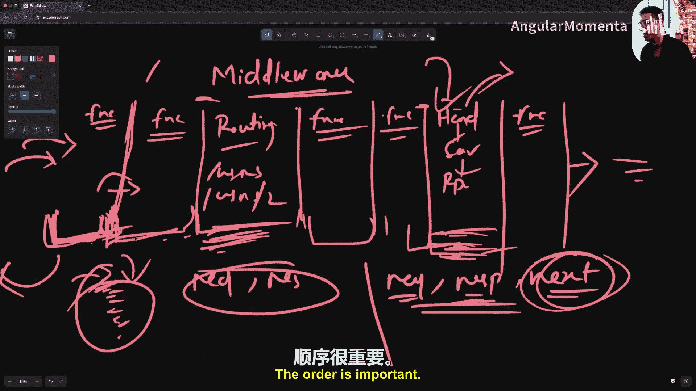

Soces from example dot com。That is a restriction browser poses on you as a client now to。Bypass that。

 not bypass necessarily， but if the resource， the remote resource sends a header。

 the remote resource sends an appropriate header which says that your client is allowed。

To access the resources from this server in that case， the browser won't block the response。

Don't block the ticket。That's why we have course so that we can limit what kind of clients at least web apps can communicate with our servers。

Now on the server side， what happens is。Your server gets the request from the client and it has to check the origin of the request where it is coming from that is automatically given to us where runtime we receive an origin value。

From where the request is coming from。And depending on the origin value。And depending on what。

Are the origins that we are allowing to communicate with us。

We can set some headers if it is an allowed origin that is if it is the front end domain。

 that is our front end platform that is trying to communicate with our backend platform。

 if that the is true if it is our front end platform In that case we want to add the appropriate headers we have covered this whole workflow in our HtTP video in the backend from first principles playlist that you can watch to understand how the whole courseflows we don't want to go too deep into this since it is about a different topic Now we want to add this particular headers that will tell the browsers that it is allowed this request should be allowed in the same origin policy。

Now， we want that to happen if the origin matches our friended origin。

 if that condition passes through we and want to add those headers。

And then we want to pass that on to the next middlewares， as we have already seen。

 as we have already seen here， each middleware does something and passes that request to the next middleer。

 or it can send the response back to the client at this point in the coarse middleware。

 What happens it。

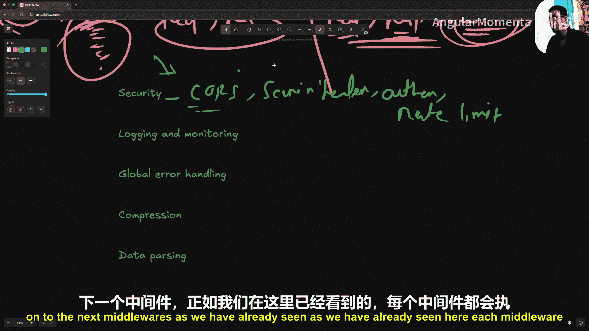

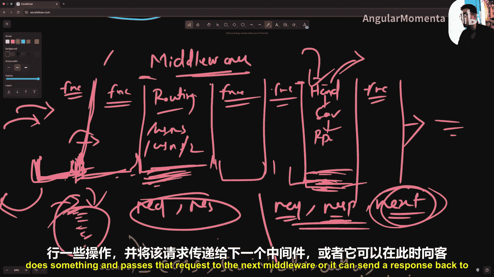

Guess the request it takes out the origin。 It checks if it is our funded domain。

 if it is our funded domain， it adds。Some headers to our response to our response object。

 It adds our some response headers that these the allowed origins and etc ce then。

It passes that to the next execution environment or the next middle layer。If it does not match。

 then we don't add any headers and the browser will block the request by default when we send the response back to the client。

Now， the question is， why did we make this as a middleware because this is a function？

That needs to happen， that needs to get executed for each API call that our server will receive。

That is the first requirement。 We want to reduce the code duplication。

 It needs to deal with the request object or the response object In this case， it it deals with both。

 It takes the origin after the request。 It modifies the response address。

 There is a second requirement。 is some code that needs to run for each request。

 and it needs to deal with the request and response object。

That's why meve made this a middleware so that we don't have to do this for each handler。ok。

This is the perfect requirement for a middleware， that's why course is usually implemented in the middleware layer。

 not in the handler layer。Okay， similarly we have security headers from the server。

 we can set different different security headers， for example， con security policy etctera。

 etc ceter， and we want to set that for each J call that we receive。

That's why we also made this air middleer。It gets the request。

 it adds the appropriate security headers， and it forwards that the next middleware。Similarly。

 we have authentication。We make authentication as a middleware because we don't want to duplicate the function of getting the token usually when we authenticate。

 we take that token if you have seen the authentication authorization video and the packetend from force principles playlist and then you will understand this usually in authentication we take some kind of token can be J it can be sessionite etc from the request object and from the headers or from the payload or whatever your implementation is。

We do some kind of logic to verify whether it is proper credentials or not。

 whether it is a proper token or not， depending on the success or failure of that。

 If it is a failure， then we send。A 4，0，1 unauthorized error code to the client right from here without going to our handler layers without forwarding the request to the next middleware。

 we immediately send an error code back to the client and we terminate the request right there。

Or if it is success， what we do， we authenticate， we take out whatever details is needed。

 for example， the user I。Or the permission or the role of the user。

 whether this user is admin or not。ett cetera， etc ceter。 We take this。

 We add this to our request context。 and that's the reason the request context is our next topic of discussion。

 We add this information to our request context and we forward it the next middle where。

 we don't send the response back to the client immediately。That we do only in case of failures。

That's the reason we make authentication as a middleware so that for each request and for each request it verifies the credentials or the token and accordingly it terms the execution or it passes the execution with the appropriate metator like user id and user role to the next meware。

Similarly， rate limits， rate limits we implement so that one client cannot do a lot of request in a short amount of time。

Be。We decide a reasonable number of requests that a client can send。In a particular period。

And we add a middleware which checks that we do that with IP addresses， we check that。

Whether this IP address has made more than 30 A calls in the last two seconds， something like that。

 we decide the threshold ourselves， we decide the thresholds of the time in what time period you want to check。

 we also decide the threshold of the A calls， whether it is 30 A calls， whether it is 500 A course。

 etc。And according to that， P implement our rate limit。 If the client exceeds the limit what to do。

 we send an error code of 4，2，9。Which basically we send when there are too many requests from the client。

 we send an error code of 4 to 9 back to the client saying there are too many requests in this short period of time。

If the client has not exceeded the limits， then we pass the execution to the next middleite using the next function。

So that's some of the examples of the security middlewares。 Similarlyly。

 we have logging middleverses and monitoring logging middlewares， logging and monitoring middlewares。

 which basically every time we get an H TP request， let's say we got got a get request。

 we can do some kind of logging in our server in our terminal or whether。诶 love费。

So that we can later on it helps us debug information， it helps us in reports etc etc cetera。

 to track different different parameters for each request this middle layer gets different different parameters out of that request。

 for example， what is the path we are trying， which is users。What is the request method。

 which is get。What are the query parameters， What is the request word etc etc we can log a lot of information for each request so that it is easier to deer and it is easier to audit and etca etca Okay that is the example of logging middle error。

We also have global error handling and is very important。

 you feel every back application should some kind of should have some kind of global error handling so that what happens。

 it does not matter。At what point some error occurs in your application。

 it can happen in the handler layer， it can happen in the service layer or it can happen in any of the middleware that are executing in between in between different different function boundaries。

In all these different different execution environments does not matter at what point an error occurs。

This middleddleer。Can get that error， it will get that error， that generic error， whatever happened。

And from that， what it can do， it can find out whether this is a client error or not。

 we can define different different parameters or different different fields inside errors to indicate whether this error was a client error or this other server error。

 something went wrong in a error execution depending on that it can send a over100 errors or 500 errors and it can send a properly structured error message which usually has a message or some kind of code so that the front end can render different different user friendly messages depending on the code。

Or the I sometimes also called I and the status back to our client。

 So the goal of the global error handling middleware is。

 it takes out an unstructured error from anywhere from our app。

 and since it is a middleware it has access to that。

 And because of the nature of global error handling middleware。

 usually what we do in our middleware lifecycl， we have different middleware a different different points right。

 it is the entry point is the first middleware What happens。

 And this the last middleware Usually what happens。

 we keep the error handling middleware at the last three send a response back to our client because in all these different executions。

 error might happen in any of these cases。 So that last middleware can get that it can check whether some error occurred if it did then it can properly structure that error and send a properly structured error message back to the client。

 That's the reason we use error middleware error global error handling middleware at the last point of our execution as。

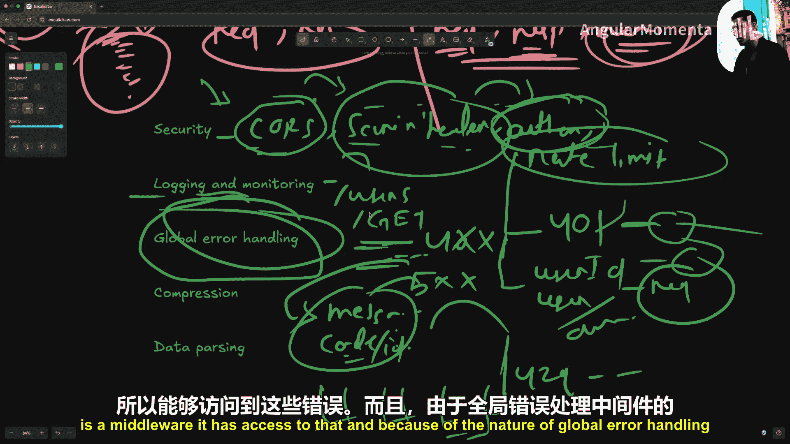

Last middleware。 And as I said。The ordering or middleware is important。

Because if you use  a middleer somewhere in the middle， then。

If some error happens in our handler at this point。

 then the error middleware won't have access to that error because the execution of that middleware was happening here。

But our error occurred somewhere in the here， and the request flows this way。 Okay， it flows one way。

 We cannot get the error back here。That's the reason we should think more about how we are ordering our middleers。

 Now， coming back， we similarly have compression middleers so that if we have a large response。

 let's say we have a Json which have thousands and thousands of fields we can use some kind of compression algorithm like Jesus etca。

 et cetera。 The compress that response and send the response back typically modern browsers have the capability to decompress that response back to a format that browsers can understand that clients can understand。

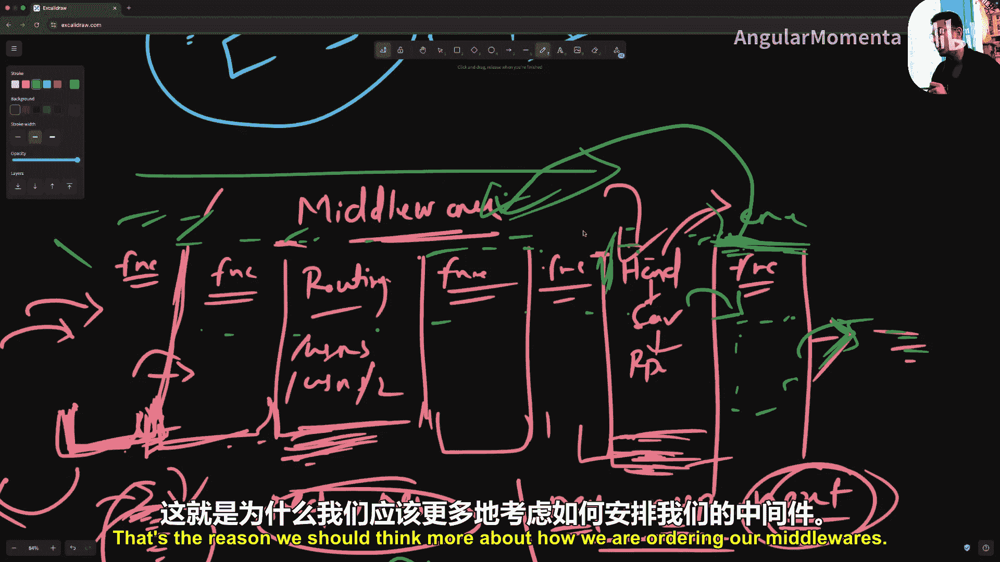

So that during the transit a compressed format is in use。

 but during the client D relation process that compressed format is again converted into a proper client format。

 for example， a jascript project as a test right。We also use middleware in case of compression， etc。

 Similarlyly for data passing， the process of serialization and DCization。

 we can also delegate that to a middleware so that we don't have to do that in different handlers of course that depends on the requirement of your backend on your code base and what are the standards that you use what are the styling standards that you are using。

 but you can also do that you can delegate the variation transformation into a different middleware data passing that binding of data the serialization and DCization data to a different middleware。

 So these are all the examples of how middleware work。 and as I said。

 the ordering of middleware is important。 That's the reason typically in our request lifecycle。

 the force middleware that gets executed is coursearse because。

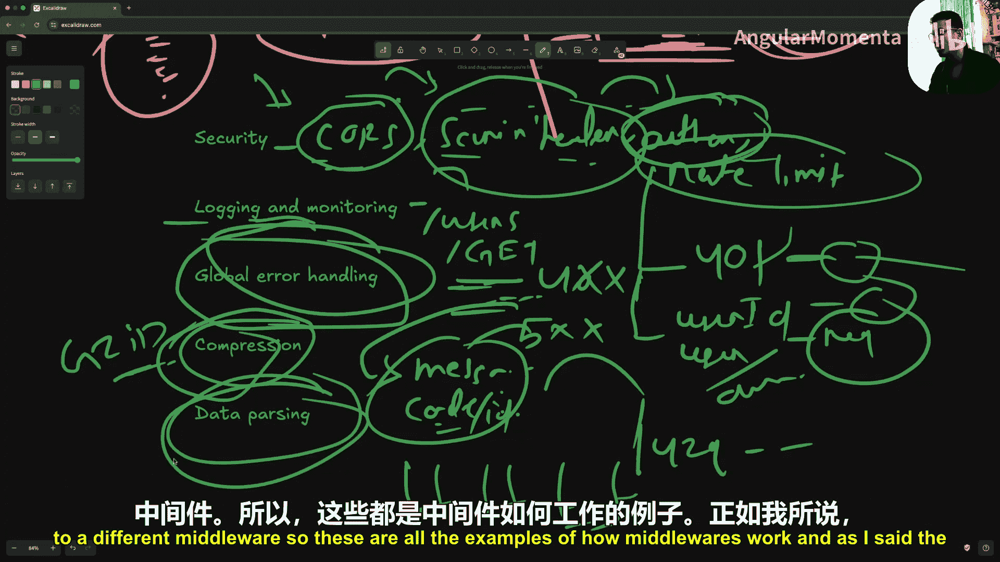

If it is coming from an origin that is not supposed to have access to your server。In that case。

 you want to find out that information at the early stage of your request so that you can term the request right here。

That the reason， course。Is executede。The o。Then we usually execute some kind of logging middleware。

 Then we have authentication。 then at the end we have global letter handling， as I said。

 the ordering of middleware is important depending on how you are structuring your application。

And what are your requirements， you should spend some time in thinking at what order these requests。

Has to be modified or at what order， the request life cycle should follow。

To provide a appropriate experience to the client， which is making the API good。

And that's pretty much all about middleerss。 Now， somewhere at this point， Some at this point。

 we talked about the authentication middleer and how it stores some kind of information like the user I D and the user role in some kind of storage。

 and it passes that to the next middleer to the next handler。

 and that part is called a request context is called a request context。

 request context is also something that you will see in a lot of backend applications。

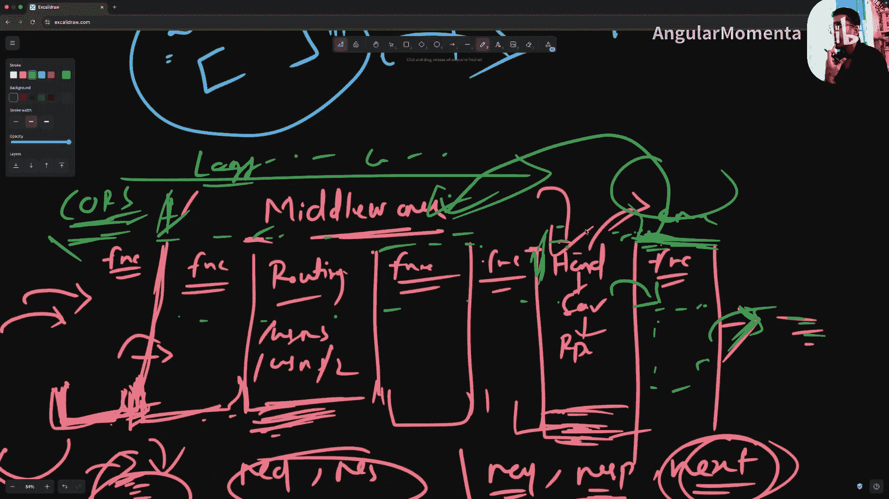

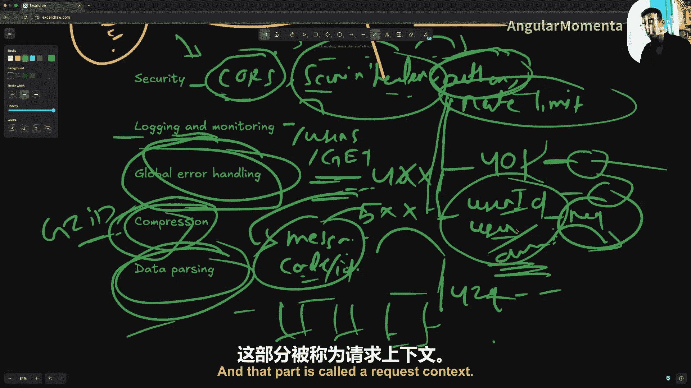

It is not whether we are using node JS or Golan or Python， etctera， etc cea。 every framework。

 every language， every library provides some kind of request context implementation。

Request context can be an abstract concept， but it is also a concrete implementation。

 The implementation logic might vary depending on what language or environment that you are using。

 but this concept kind of remains to say across different different languages so what is this concept exactly a request concept is basically some kind of storage or some kind of state that is scoped for a particular request that is scope for a particular request that is limited to a particular request so each request so let's say you have a server you have a client a client across the world you have hundreds and thousands of client and each of them send different different different different requests。

Hundreds and thousands of requests for each client。Each of these API goals。

 each of these request will have a context attached to them。

 depending on the implementation of your H D D P server。 Each of them will have some kind of context。

And why do we have this context so that we can have。

Some kind of storage or some kind of state attached。

Which is accessible across our middleware and handler boundary。 So as you saw somewhere early here。

 when the request reaches here， and until the response is sent back to the client。

 there are different different function boundaries。

 Usually we have different different middleware that are crossing here。 There is a course middleware。

 There is a logging middleware。 Then we have routing。 Then we have authentication middleware。

 then we have some kind of middleware that is limited the application。

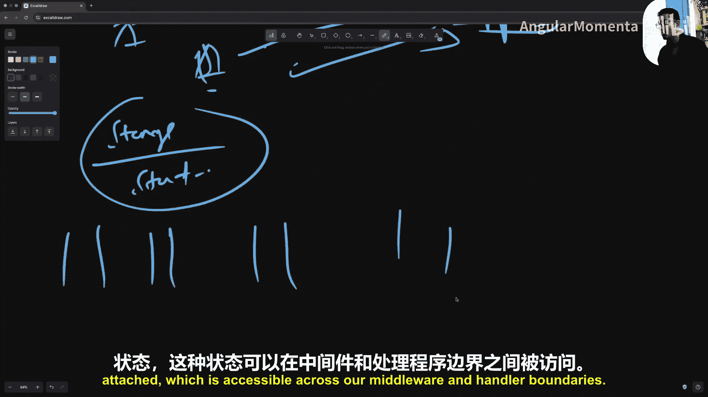

Some kind of permission checks。 Then we have our handler logic。 Then at the end。

 we have global error handling middle etc etca until responses is sent back to the client。

 We have different different middle ways。Now， a context， a context is typically some kind of storage。

 usually a key value pair。 we store some kind of key value pairs inside the context so that this information is accessible by all these different different execution environments。

 It is accessible in all these middlewares。 Now， this middleware can set some value in this context。

 Now， this value will be accessible to this middleware at this point without explicitly passing those values directly without coupling the system together too closely。

Thats the reason we have some kind of state which is accessible by all these middlewares and all these handlers。

 all of them receive this context， this context or also call a state。

Which is limited to this request and is accessible by all the execution commands。

 all the middlewares， all the handlers， et cetera， et cetera。 Okay。

 so that our system is not closely coupled。 We have this state is accessible by all of them。

 which is modifiable by all of them。 some kind of storage。For the sake of convenience。

 So in this example， what we did in the authentication middleware， what we did。

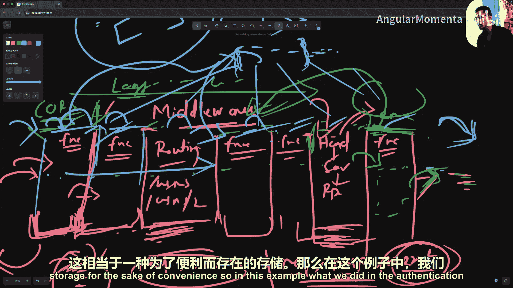

We verified the credentials of the user if it was a login attempt。

It is the first time the user was logging in。 we verified the credentials。

 the email and the password。And and if it was successful。

We created a user if it was an already existing user， we took out the user ID。

And we also took out the role。 The role can be user。

or admin or sales any role depending on your Rbic implementation。

 we have already discussed Rb in our authentication and authorization video from there you can understand what are roles and why do we use them and also about different different authentication methods we have some kind of authentication mechanism and using which after the authentication is successful。

 we have different different information， we have the idea of the user for our platform。

 we have the role of the user， whether it is a user， it is a admin， etctera， et cea。

 we have a sales or different permissions， whether it the user has read permission for this resource。

 whether it is a right permission， etc cea， etc cetera。

 All this metada about the request and it is only limited to this request this particular STP request。

That this will be stored in the context。So that let's say your authentication middle set these values inside the context。

 So later on， downstream， your handlers， your handlers， which is going to insert。

So it is a API which is a post API to the slash books endpoint so what your handler can do somewhere upstream your authentication middleware verified the credentials of the user verified the token of the user and it found out these information and it saved those information in the request context Now what happens in the handler。

When the execution reaches your handler， the handler can take out this information， the user I。

 the user role， etctera， etc ce。What it can do。I want to insert a book。

It want to insert a book into the database so a book table might have a field called user ID so instead of taking the value of user ID from the client from the user payload instead of doing that what we do we take the user ID from the authentication information。

From the result of this successful authentication， we can take out。

Who is the user that is making this API call？And that's how we take the user ID and we insert that into the database and why do we do this Because if we take the user ID from the client a client with a malicious intent。

 client with a malicious intent can send the user ID of some other user。

To do unexpected operations in our server as the reason when we want to access the user ID when we want to store or when we want to check different different user related information。

 we take that information out of the authentication middleware， we save that into a context。

And in the downstream methods in the handlers and in the next middle West。

 we take that user ID and we perform different different permission checks。

In the database layer or in independent aic layers， depending on that information。

Whether the user has permission to insert a book or not。

 we can take that from this if the user is an user， if the user is an admin etcter。

 so all in all a context is just a shared state that is accessible to all the middleware and handlers。

So that our system is launched closely coupled and we have some kind of state。

 some kind of stories that is limited to one request， Similarlyly。

 we can use the request context to store the request ID。So initially somewhere upstream。

 we can have a middleware， which let's say somewhere here。

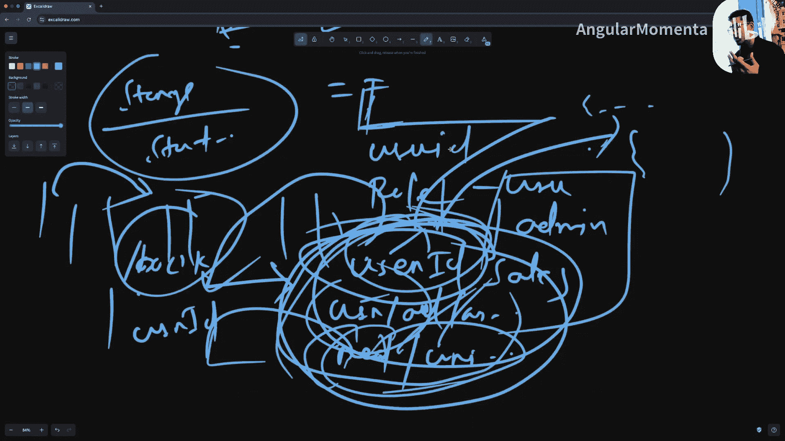

We have a middler somewhere here where we generate a unique I。 let's say a U U I。

 we generate a U U I and save that in the context。 So throughout the execution of this request lifecycl。

 we use this particular I。 We take that out from our context and we use that in different different information。

 We can log the I here。 and we can use the I to make API calls to different different services。

 Let's say it's a microservice。So we can take that ID and we can call that API with this ID in somewhere in the header let's say x request ID or something like that so that。

When we are auditing our logs or when we are reviewing our logs。

 where we are debugging something we can trace the request where it started from。

 which service it started from of all the services that it called etca， etc ce。

 right and we can do that because we have a shared state which is called request context where we can save information for that request。

that is another example of when we use request context。

Request context we also use to send cancellation signals and abot signals and deadlines to our downstream external services so that our service does not hang up。

But by july。These are all the use case of request context that we typically have in a backend server。

 Well that's all about handler services， repositories， middleware and request context。

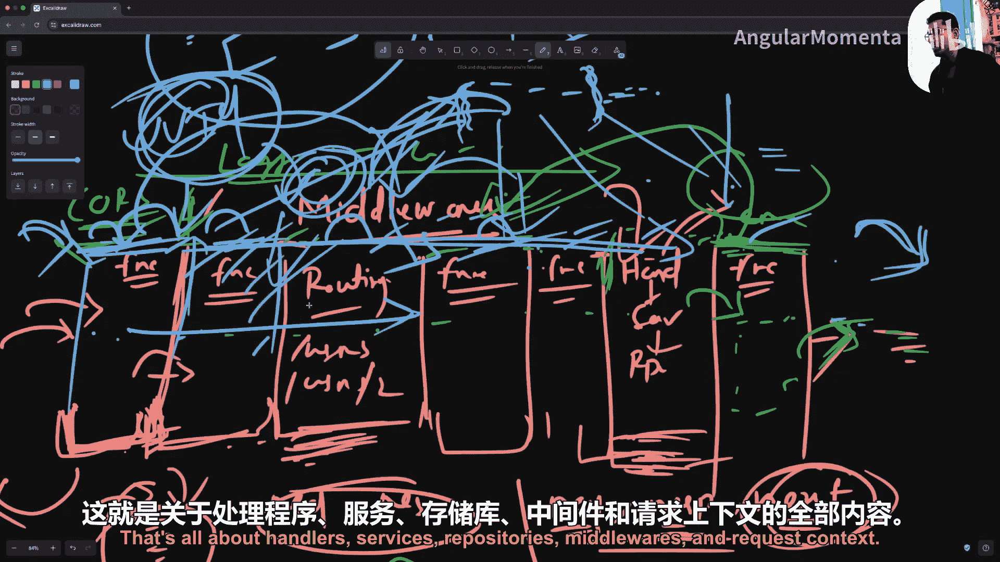