# 【Sriniously】从第一性原理出发的后端开发 ｜ Backend from first principles p11 11. 完整的REST API设计 -BV17aq1BUEhf_p11-

EP design is something that as a backend engineer， you will spend a lot of time working on and thinking about。

 and it is one of the most important videos in this playlist。And in this video。

 we are going to talk a lot about。Designing APIs， a lot of concepts surrounding APIs in general。

 and willll be mostly focusing on rest API There are different。

Technologies that people use to build As。We have。RRPC calls and we have Graph Ql， et cea， et cea。

 So in this one， we are going to only focus on rest A， one of the most used API standards。 Now。

 the problem with API design is we have all these resources and we also have this common standard。

 which is called a rest A or restful API standard。And years of research and many， many developers。

 particularly back engineers experience over the years and。But still， even now。

 when someone is learning back in or in the early stages of their journey into back in engineering。

 they still get confused by certain questions， Que like should the UI path segment be plural or singular。

Or when updating a resource， should you call patch or should you call put。

It different different HTTP methods。And also， if it's a noncur operation。

 meaning if it's not a fetch operation or create operation or an update operation or a delete operation。

 it's it's a custom action， something that you want the server to perform。It's called an action call。

 So which method should you use since it， it sounds like updates should do go with patch or put or since it's creating something should you post。

 etc ceter。 cea。 like questions like these。 And also what H T T P status code to use for different different scenarios。

 a lot of questions like these。 even now， we still get confused about all these questions。

 And the reason is。Then people are developing these standards， these widespread HtTP API standards。

The state of the Internet and the state of the Web。

And the state of the clients and the state of the servers were very different from what we have today。

 and previously when these standards were being developed， we were heavily using MP。

 also known as multi page applications。And these days。

 if you are aware of the front end side of the ecosystem。

 then we heavily make use of single page applications where in the first API call the browser makes a request and downloads all the ja that is required required and it performs all the routing on the client side using the browsers。

Path and URL， etctera， etc cea。 Now， it's a completely client set， client heavy application。 Now。

 the purpose of this video。Is to standardize not to create new standards， but。

As the standards already exist to extract certain rules and guidelines from these existing standards。

 we aim to stick to these guidelines to make it as convenient as possible for everyone to follow a single standard and a consistent styling pattern。

When designing API designing API is designing payloads and documentation， etc cetera， etc。

 everything surrounding API design。This way， we won't have to question these issues anymore。

 these common issues that backend ingenness face in day to day lives。

We can simply move forward with our development。Now we already have these standards in place and by sticking to them。

 we can focus on our business logic instead of worrying about whether our API is restful or not or whether we are following the latest industry standards or not etc cea。

 So in this video we will explore API design from end to end。

 starting from how to design your resources， how to design your routes。

 how to return success responses， how to return error responses with status quo to use what kind of data to accept and much much more essentially everything related to API design so that we can concentrate on our business logic。

After this video， we can move on from standards and well get into execution phase before we start about the technical stuff。

 the actual API designing part， let's talk a little bit about the history of where we are coming from and why we are talking about it so that we have a little more context So in 1990 Team Bnerly started a project called the World wideide web to share knowledge。

With the whole world， that was the initial motivation for starting what we call a internet today。

 And this project was built to facilitate the sharing of knowledge。And information globally。

 And with that goal。Teamonely， within a year or so。

 invented all these different concepts or technologies。 First one， U are I。

What we call is uniform resource identifier， Second one。ST TP。

 the S T TP protocol that we use underneath。To communicate between client and servers。

 we have already covered how our childP works and etc in previous video so you can check that out third。

HtM L H Tm L is basically the markup language， which we use to construct web pages。

What you can call is the skeleton of a page4， the first web server，5。The first web browser and sixth。

 the first what you see is what you get editor， an S M L editor。

 which was built directly into the browser。 Now he built all these things which we still use today。

 by the way， and we use the advanced and the more developed version of all these technologies。

 We still use Us。 we still use make use of H TP protocols。 Now， it started with H T TP 1。

1 then now we have H T TP 2。0 and 3。0 etc cetera et cea。 we still make use of H T ML。

we still use HTMLmL we have a lot of different types of web servers these days。

 we have a lot of different types of browsers these days etc ce etca。

 and we also have the browsers in build HTML editor。

So he invented and he came up with all these new technologies and concepts within a year or so。

 but soon now the problem arises。The problem was。The project， which was known as the World wide Web。

 was headed towards breakdown because of the exponential growth of its user base。

 within a short period of time， A lot of users， a lot of people started using this new technology。

 which is known as the World wide Web。And the creator team Benly， he had not accounted for。

All these scale， all this number of users when he was building the project。

 this was not accounted for。 So to scale the web to accommodate this large user base。New techniques。

 standards and components had to be introduced。 The previous one。

 the all the mindsets and all the technologies and all the planning that went behind。

ACreeding or coming up with all these technologies was not enough to scale a web。

To account for the huge user base that it was acquiring every day， it was scaling exponential。 Now。

 at this point， we have one other major contributor to the project web。 So around 1993， Roy Fielding。

 the co founder of the Apache H TD P server project。

Became concerned about the Web's scalability problem that we just talked about。

 The Web was not ready to accommodate this large user base。

 the thousands and thousands of users and people that were using the World wide Web project every day to address this issue and make the World wide Web more scalable。

 He proposed a couple of constraints。That could help achieve the goal。

And these constraints are number one client server。

 which we still follow by the way the client server model。

 this constraint basically emphasizes the separation of concerns between the client and the server。

The client handles all the user interface， the user experience while the server manages data storage and business logic。

 which we also call as the front end and backend。This separation allows each component to evolve independently and to improve scalability。

 Thus the first constraint。 The second constraint is uniform interface。

 This constraint simplifies the overall system architecture by establishing a standardized way。

A standardized way of components， different different components that the web comprises of do communicate with each other。

 It also includes four subcons， which are called resource identification。

Resource manipulation through a representation。Self descriptive messages and hypermedia as the engine of application state。

 We have also sub constraints under this one， the uniform interface。

 the philosophy of uniform interface， The uniformity provides a consistent interface across all the services。

 Third one， layered system。 Now， this says that the architecture composed of hierarchical layers。

 and each layer can only see and interact with the immediate layer below it。

And this allows for better scalability， security and the ability to add intermediate components like load balancers and proxy servers。

 etca， which we use today to scale our web applications to cater to millions of users。And and。

 and this happens without affecting the system's core functionality now。

Fourth cache cache responses from the server must be explicitly labeled as the cacheable or noncash flow。

 That's what this cons is。 The server should label different different responses as whether it should be cached or not by the client and when the client need they can cache the responses which helps reduce the server load improve network efficiency and enhance the user experience by providing faster response times。

Now， fifth one is stateless。 Now， stateless we have already covered in a much more depth in the previous video。

 I think it was the HtV video。This basically means that each request from the client to the server you must contain all the information necessary to understand the and process the request。

 The server basically will not remember what your previous request was about with each request you have to include all the information necessary so that the server can identify you and the server can。

Take your data， understand it and process it。 That's what stateless means。

And the server does not store any client context between requests。And this， in turn。

 improves reliability， scalability and visibility since any server can handle the request。

 Let's say you are scaling your web application。And you have added two more servers。

 and there is a load balancer in between， which forwards your traffic。

 depending on different algorithm like round robin， etc cea， etc cetera。

And because of this streetless constraint。All the servers can。

Process request from the same client because of the statelessness， nature of the web。

 because all the requests consist all the information that the server needs to process。

The data and the sixth one， which is code on demand。 which is an optional one。

Which means that servers can temporarily extend client functionality by transferring executable code like JavaScript to the client。

And this is only an optional constraint in rest architecture。

Because it provides flexibility to add client set functionality when we need it while maintaining other constraints and et cetera。

 et cetera。 This is not something you will see getting used heavily。

 These six are basically all the constraints that Ro fielding came up with to solve the problem of scalability in web。

 and later on， fielding worked with team burnsly and both of them together worked。

To increase the scalability of web and to standardize their designs。

 and together they wrote a specification for the new version of HttP。Which we do they know at。HtDP 1。

1， the first major version， the first standard version of the HDP protocol。

 and then in the year 2000 after the scalability crisis of web was averted field Roy field named and described the web's architectural style。

🎼In his PhD dissertation and it was called as rest representational state transfer。

 which was rawy Fields PhD dissertation that was a name that fielding gave to his description of the webs architectural style and which today we know as rest A and if you go and search Roy fielding rest paper you can directly open this and read the first document that was written about rest A by raw Fielding and you can get more inside more context than what led them to come up with all these patterns come up with all these concepts etc cea right it is a must if you're a Ba engineer reading this gives you a lot of context about。

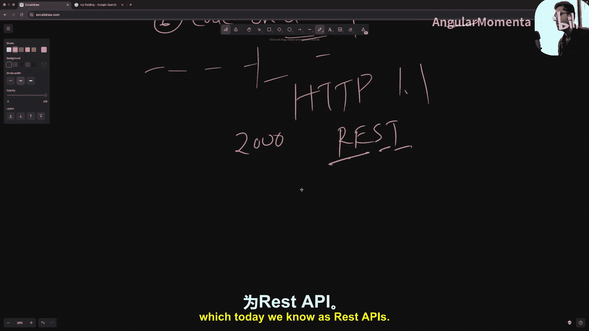

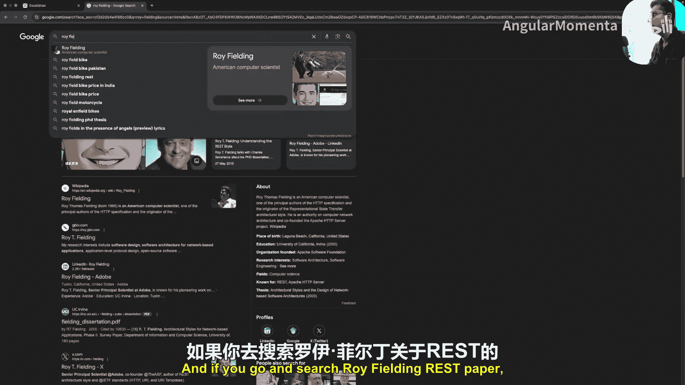

🎼Where all these technologies originated from all these technologies patent standards that we have today。

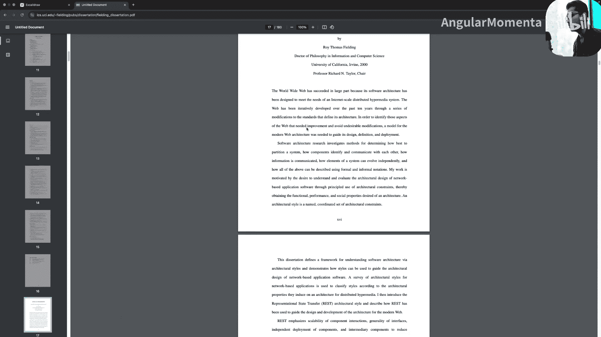

Great， now that brings us to。Why is it called a rest A A， What does it actually mean。

 If you read the paper that was written by Roy Fielding， you will definitely get the idea。

 Why was he calling it rest architecture or restful architecture or rest A。

But if you want to make it brief。Why the name rest， Why the name representational state transfer。

Then we can come up with some points。Number one is？Read presentation。The first part of this name。

 Ari。Which means representation。 This basically means that resources on the Internet。

 resources on the web， which means data or objects are represented in a specific format。

Yet they have a specific representation， depending on the specific servers and specific clients。

 and these representations can be in various formats。

 It can be in Json that is the most popular representation format that we have these days。

 but we also have X M L and we also have H M L so。Different different representations。

 depending on different different contexts。 For example。

 a server to server communication will depend on the Json based representation。

While a server to client based communication depend on the H T M L based communication， right。

 That's what representation means when we are talking about webs architecture。

 the rest A architecture。 the same resource can have different representation based on the client's needs。

 So a user， for example， let's say we have a user resource。

 which might have different different fields an I D field a。Name field a。Created at real， et cetera。

 et cetera。 So let's say we have a。User resource。A database resource， let's assume。

 So a user resource， this can have different different representation。

 depending on different different clients。 Let's say this can be represented as a Json， right。

For an A A client， let's say another server is making a request to get this object or get this resource。

 Then this can have a Json based representation， but。If we want to send some UI data to the browser。

Then we can represent this as an HTMLM document or some kind of HTMLl representation for the client which is a web browser。

 So that's what we mean by representation in the restful architecture coming back to the second part state representational state transfer。

 So what do we mean by state here state basically refers to the current condition or attributes of a particular resource。

 the current property of a resource， The state of the resource and each resource。

 let's say we have a user resource here。 So each resource has a state that can be transferred between client and server and the state is driven by the resource representation。

 So taking an example， let's say we have a ecommercecommerce site。 let's say we have Amazon。

 we have Amazon and we have a shopping cart in the cart， we have a couple of items。

 So a shopping cards。State includes all items， the quantities of the items and the total price so that we can call as a state of a particular resource of a particular module that we have in our web application。

That is transferred between a client and a server with each API call and。The last part， which is。

Transfer， representational state transfer。 The third part talks about transfer。

 What does transfer mean。So transfer basically indicates the movement of resource。

 the movement of resource representations between client and server。

So obviously since we have a client server model， the primary intention of that is sending data between client in server and the client in server can exchange different representations of the same resource we have a client here and we have a server here。

And the transfer of data happens through a common standard， which is。H TDP。

 and we have different different methods associated with that， which is get post， put， delete。

 patch options， head， et cetera， et cetera。 right， We have all these different different methods。

Which will we use。To send data between client and server， for example， when you get the web page。

 when you send a get request to a server。For everyage you are transferring a representation from server to client using a common htTP method。

 which is get So when we combine this when we combine all these three elements which is called representational state transfer or also known as rest or restful or rest A。

 this describes an architectural style where one resources are represented in different formats。

 we have different different formats， we have Json HTMLml we have Xml etc， eta。

 first thing is resources have different different formats。Second。

 the state of these resources can be transferred between server and client client and server first is the format of the resource。

 and the second is the state of the resource， third client and servers。

Communicate between each other by sharing these representations of a resource。

The representations can be different， but the idea is client in server。

 communicate with each other using these representations。 And third， the system。

 this whole system follows specific cons， specific constraints to make the whole workflow more scalable at which we have already discussed。

 So that's what we mean。By restful API or rest architecture that's the history behind where and when and how we came up with this whole architecture。

 this whole model of representing resources and transferring resources between client and servers and formats。

 etc etc， right these is all the theory that you need to understand on a very high level you don't need to remember any of it。

 but this gives you a little bit of context of where and how we came up with all these things and where are we currently。

Let's start with a URL。 And this is what a typical high level structure of a URL looks like。

 Now in any website that we visit。 this part， what we call is the scheme。

Whether it it can be a tP or it can be a straight P S， the secure version， the encrypted version。

Then we have the authority or the domain， it can also have a subdin。

 but in this case we have the main domain， which is strenly dot xY is it。

Then we have the resource or the path。 So this part。

Is called the resource that we are trying to access and this symbol。

 the first slash symbol represents a hierarchical relationship between different resources and then we have the query parameters which we use in usually get APIs。

To pass some kind of key value pairs to give more information to server about。Some kind of filters。

 parameters， ettera， et cetera。 Then we have fragments。

This section usually navigates you to a particular section of a web page。

 If this is present in the URL。 When you first time navigate to a page， if you have a fragment。

Then the browser scrolls you to that part of the page。

So this is what a typical website URL looks like。 Now we since we are talking about APIs and rest As starting from this what would an API URL or an API route will look like so we can start from this we will obviously have the scheme So let's imagine we have the encrypted version the secure version S T then we will have a subdomain So I'm talking about the industrial standard right this is not a rule。

This is more of a standard or best practices。That most companies follow。

When they are implementing when they are creating their backends。

 so usually it starts with a subdomain of the min。With the subdoit。Of A。So API dot， let's say。

 example， example dot com this。Is the subdommin part， subdmin part。

Then we have version most As implement or follow some kind of version pattern and usually through routes。

 So this will follow something like v1 or v2 etc cetera etctera。

 then we reach the path or the resource that we are trying to access。

So let's imagine it is a it is an API， which is like good reads。 If you are aware of good read。

 it's a。Platform where there are a lot of books。 There are a lot of authors and books are associated with authors。

 We can provide you reviews， feedbacks， etctera， etctera。

 It's a whole community about readers and authors and books， etc cetera。If this A is。Of good groupss。

Then。N A P， which fetches all the list of books， will have something of a structure like this。

 So then we write the name of the resource。 So book。Now。

 the first rule is in an API when you are designing a route。

 when you are designing an API in the path segment， whatever resource that you are providing。

 whatever resource your client is trying to access or whatever resource the backend is serving。

That should always be in the plural form。It is a standard that all the resources in your parts segment of the URL should be a plural form。

So ideal， it should be books。 Okay， then we have this API。

 which has the subdo A A dot example dot com Schlash。 we have the versioning here。

 and then we have books。 This is an API to list all the books to fetch the list of all books。

 Similarlyly， we can have another API。 So let's say we remove this， this this。

 let's say we have another API， which fetches。A single book。 So up to this point。

 we have bit constant， right， Of course， the we can have different different versions of the same APA。

 but for the sake of this example。 Let's imagine up to this point we are in the version  one only and this part is constant。

 we will have the scheme as T P S， then we will have the sub domainomain A dot example dot com。

 Then we will have the versioning which is the V1。 But in the second APA。

 we want to fetch the information for a single book。 So what will the path look like。

 Now there is one mistake here， which most people will do is。

Since we are fetching the information of a single book， people。Make this as a singular。Right。

They make this slash book or then whatever the book ideas et etctera， et cetera。

You should not do that because even though you are fetching the information of a single book。

 but the resource that it is concerned about this resource， which is the book resource。

That is represented as a plural noun。When we are dealing with path segments in the URL。

 So even if this is about a single book， we have to put。We have to make it plural here。

 so it will still be books， then we have the ID。Now， since。We are talking about URLls。

 One thing that you have to keep in mind when you are designing a base are the readability。

 the representation of URLrs in browsers or different different client environments。

 couple of things that you have to remember is you should not put spaces or underscore etc cea。

 etc cetera， these characters in a URL， whether it can be a slug or whether it can be an ID whatever part that you are dealing with for a route。

 you should not put spaces or underscore in a URL。The tumbler list。

If you have a phrase which has piecess and you want to put that into the URL， let's say。

We have this API and we want to fetch the information of a single book and we want to fetch the information using a slug of the book。

 Now slug is basically the name。Or some property of the book。

 Let's say the name of this book is Harry。Ptter， the name of this book is Harry Potter now。

The slug of this book will be a human readable representation of some property of that resource。

Which is ideal to put inside a URL。Which means。First thing that we do to convert this into a slug is we make all of this a small case。

 even though we can put capital case， but because the URL will be traveling to different different environments。

 it will travel to different server environments， different client environments。

 different operating system we don't want to mess with the case mismatch， etc cea， etc cetera。

 right So the first thing that we will do is we make。Both of this as small cases。

The first change is the water。Okay， this is a first second， every time we have a space。

 we will replace that with a hyphen。😊，Now we have the final slu， which is。Harry， what。

 And now we can put this into a URL。 So slash book slash。海丽。😊。

One thing that I mentioned a while bag is I said whenever we use this character。

 the for slash character in a URL in an API route in a path segment。

 this means there is a hierarchical relationship between these resources。So。For example， this API。

 this says that we have a resource， a collection of resource which are called books。In our server。

 in our database or wherever your storage is and。That is a first level of hierarchy。

 the second level of hierarchy is we want to access one particular resource from that collection of resource that resides in our database or some kind of storage。

So this is what I meant whenever we use the path segment。

 you have to think of this as a hierarchical relationship between different resources。 Okay。

 so I think that's pretty much all the primer about URLs that we need to talk about right now。

Will of course explore more about how to design your routes in different different As when we get to the demo part okay so moving on another important concept that we have when we are talking about rust basis item potency this is a very important theoretical concept of course it has a practical implication。

 but the concept of item potency basically means。The property of certain operations in which performing the same action multiple times has the same effect as performing at once。

Which means an action。Which you have performed using an API call It does not matter how many times you perform that action。

 the effect the side effect， the change that happens in that environment remains the same。

 It does not matter how many times you perform that action。 That's what we mean by item potency。

 So in this context in the context where we are talking about rest As item potency basically means it does not matter how many times the client performs a particular request。

The outcome。The result of that request in the server environment remains the same。

So even if I call an a once or I call a thousand times。The outcome of that。

 the result of that should be the same if we call a particular API or a particular action is item important now as you already know when talking about different different actions that we can perform using API calls。

V。Come to the concept of H T TP methods。 And in the previous video of H T T B。

 we have already discussed this in depth， What are the different types of methods， how they work。

 What are the properties， etc cetera。 So we have around five major kinds of methods that we use。

To handle different， different data operations。 Okay， we have get， we have。Po we have put， we have。

pattch and we have delete。 these are the five major methods。

 We have other methods also had and options that's a translator， which。Head is used to。

Ptch the headers information and options is used to options is used in our course flow to find out whether the origin is allowed or not etca。

 etcter， right but major these are the five kinds of methods that you use for data transfer between clients and servers now relating the concept of item potency to SV methods gives us a lot of insights into which method should we use in which context。

Okay， now the get call。Which we usually use to fetch some information from the server。 Now。

 this method is used to。Retrive data from a server。

And it is item potent a get method or a get action on a server is considered as item potent because it does not matter how many times you perform a get request you will get the same outcome right let's say we in the previous example we are fetching a list of books we are fetching a list of books So it does not matter how many times you call is API youll get a list of books and now you must be thinking what if while you are making these API calls someone else creates another book and the result changes the response of the API changes in the subsequent calls of the getta K and。

That's true。 but that is not what we consider when we are talking about item inputted I inputted basically means from the client using an API call。

 what side effect can you cause in the server and whether that side effect is different with each API call or that remains same during the first API call or the。

1000 A gone。OkayNow and because of that reason the get call is considered item button。

 it does not matter how many times you fetch some information you do not make any change with your API goal in the server and management。

It is just a fetch operation。 That's why the get is called an item Put method。Similarly。

 the patch method and the put method， these two methods that we generally use to update some data in the server to update a particular resource or。

A part of a resource， we use patch when we we want to update a part of a resource。

 let's say a single field or two， three fields of a resource in the server。

 in that case we use patch we use put when we want to completely replace the representation of resource in the server using the client payload。

So let's say we have a user object in the server。 It has ID。 It has name。It has。Created at etctera。

 et cetera。 And for an update operation， if we want to update the name of the user。

If you want to use the patch method， then we can just send the name field with a new value of the name and the server will handle it accordingly。

 it will just update the name。But using put method， what it does， we have to send both the ID。

 the name that created all the fields in that payload so that the server can take that payload and completely replace it with whatever instance of that user object the server has currently now it is true that most of the time put and patch is used interchangeably and that is fine that is fine to some extent。

As long as you are using your API internally， but let's imagine。

You are building some kind of public API in that case， you have to implement your API specs。

In a way that sticks to the standard as much as it can。 so that other people， other engineers。

 who want to integrate your repair， do not get confused because they assume that you are following a standard。

 but you are not。 So if you are using put。When you should be using patch。

 then that gives some kind of wrong assumption。And it might be a confusing situation， but again。

 it does not cause as much of a harm because obviously from the behavior of the path。

 people can tell whether it is a patch operation happening or a put operation arm。But yes。

 you should always try to stick to the standard， stick to the semantic standard that the rest A B offers。

 So if you want to。Update a particular resource partially then use patch if you want to completely replay。

The representation of the resource， then newsput。Now。

 patch input are also called as itemed because let's say。

We are updating the name of the user with a new value。 Let's say the previous name of the user was a。

And we want to replace it with the new pillar， which is B。Okay。

So we make our first API call and we send this payload。Okay。

 and the name of the user becomes from a to B， that is the side effect that we caused using our API in the first API。

 what happens in the second API， the name of the user is already B。

 but we make the same API with the same payload now from B。It again， changes to B。 Okay。

 Now that continues。 It does not matter how many times you call it A。 It can be thousand0。

 It can be million， but the result will be same。 After each operation。

 the state of the user remains the same。 The name is still B。

You are not causing different side effects with each JPI called That's the reason patch and put any kind of update operation with the same pillar will obviously be item。

Now we have rule out， get， and patch。And put as itemed methods next tab is delete。 Now。

 what do you think delete is， whether it is itemed or not。Now imagine again。

 we have this user object which has an ID name and created at field and we make a delete APII call to the server and we deleted this user。

 This user does not exist。That is the result of the first API call。

 what happens in the second A call you make the same request。To delete the API to delete the user。

Which has the I D as one。You made the same API call in the first pillar with the user ID 1。

 and you are making the same API call again。With the user at， you want to delete this user。

In the second。Since this user is already deleted， the server checks your payload。

 it checks whether the user exists or not。And it sends an error that this user does not exist。

 It sends you a 404 error。Since you are trying to perform some action on an entity which does not exist that the reason you are getting a4 error error。

 but did you cause any side effect in the second Apigo。

 you did not because in the first A goal you deleted the user and the second A nothing really happened the server just checked whether the user exists or not and it sent you an error but nothing really changed no state of the entity changed in the server。

It had no side effects thus's the reason it does not matter how many times you call this delete tapecon。

You can call it a million times。 You will get the same error million times that this user does not exist。

 you only。Made the change in the first step equal。 and that's the reason delete is also considered as an item button method。

 At last， we reach post。Now， this is the only method in the StTP semantics。

 which is considered as a non idpotent method。Because when we use a post request。

 usually the post request is used when we want to create a new resource or a new entity in the server。

So taking from our previous example， which。我这不给别。If you want to create a new book。

 we want to add a new book to our inventory。In that case。

 we'll send the name of the book and some kind of description， some kind of。Weight dimensions。

 et cetera。 different properties of the book。 and we will take this failure， put it in the。Body。

 and we send this to the server in a。Potcom。And the server receives it。

 it takes the payload and it performs some kind of database operation and it it inserts that entity into the database。

 It creates a new book now。That's， that's what happened in the first A In the second A call。

 Let's imagine you made the same payload the same name description weight dimensions， et cetera。

 ettera。 You just took the call of that request and you executed that call again。

 You made the same a call again。 What happens。 Now， there is a chance that。嗯。

In this API the name has to be unique if that is one condition that your server is following or your database is following。

 then you might get an error， which is the name cannot be duplicated etc et。

 but for the sake of this example and it for the sake of real world scenario。

 it is often the case that names can be duplicated right multiple books can have the same name right。

The that's， that's the reason we are differentiate between different books。From their IDs。

 not from their names。So that's the reason when you make the same API call in the second time。

 What happens the server takes your payload， it performs the same operation and it inserts it into the database。

 Now you have the second book with the same information but with a different I Is are usually generated at the database level whether a U U ID or some kind of serial value 1。

2，3，4 etc Is have generated the database level That's the reason you can have multiple books with the same kind of properties name description weight dimensions。

 etc ce ce。 but the Is will be different。 That' the reason an error does not occur That's the second API call。

And this is the pattern with each API I call， you are creating a new book。 And when you。

If you call this API a thousand times， you will have1 thousand new books。No。What we discussed。

 what is the property of what is the condition of item emergencyency。

 just side effects that you cause in the server。Should not be different with each request， right？

 But is the opposite happening for the postcode， right。

 with each API call you are creating a new book， the side effects are changing。

And that's the reason post request post methods are called non item button methods。 Now。

 one more thing about post is。Whenever we have a noncur operation。An operation。

 an action that does not fall under any of the methods that is defined by SD P spec。

 It is not a fetch operation。 It is not an update operation， not a create operation。

 not a delete operation。 It does not fall under any of the methods in that scenario because of the existence of scenarios like these。

The SD P spec， the SD A spec has made the post method as open ended。

 which means whenever you find yourself in a scenario where you cannot put some action some。

Action in any of the existing methods， then you can put that。Under the post call in the post method。

 So let's imagine we have an A pay， which says we。With is like， send E mail。We have this API。

 And when we call this。We can send an email。2 a。Client。

 so let's say the payload and the body of this API call looks something like this target is。

Some email address， right。 And when we make this API call。

 the server takes it and extracts the payload。The target email and sends the email that is basically the functionality of this A。

 Now， the point that I am going to make here is what S DP method that you would assign to this action or this A because its a send email。

 but is this a fetch operation。It's not right it is some kind of action youre going to tell a server that do perform this action。

 whether it is a creative operation， its not， it is not an update or delete operation either。

That's the reason it is called a custom action in the SDP restator。

 so whenever we have scenarios like these， whenever we have custom actions。

 the operations or API calls which we cannot categorize under any of the current operations。

 those are the situations that we can make use of the post method。

Which is meant to be used for custom actions as for the SD P specification and that's pretty much all about HtTP methods when we are talking about rest P。

Now let's move on to some demo， right？How exactly do you start with your repair design。

How do you actually design the interface for your A， the interface that other clients。

 whether it is server based clients or browser based clients any kind of clients can talk to can interact the first thing。

If you are a backing engineer， the forest thing。Before you start codinging。

 before you write any of the business logic， the first thing you should do while creating an APIPA is designing the interface for the APA。

 the interface should be intuitive。 It should be delightful to use， and it should not be vague。

It should follow most of the standards of rest。 And the reason for that is the reason for following standards。

 the reason for following。Restful standards is to eliminate confusion。

 Eli assumptions or any kind of human related errorsbs in your whole workflow。 What that means is。

Let's say you are designing your APAs and you did not follow any of the standards。

And whenever you should have used put， you used post and you used delete operation to perform fetch operation exerciseer right。

 you messed up the API interface completely intentionally。 Now， as a result， someone， the consumer。

Whoever that is， any engineer who is integrating your Apay， the only way。

The only way for them to find out all the behavior of your A starting from the successful w and the error behavior and how the payloads are structured how the data is structured and what method to call as a error。

 the complete API integration workflow for them to figure it out completely they have only two options。

 they have to either read your code if it is open source or it is someone within your organization has access to your code。

 or they have to try out different methods and see as a result of their de， if it is expected or not。

And you can see this that that that's a lot of room for error。

A lot of room for confusions and assumptions， et cetera， cetera。 Now。

 having a common standard and following a particular standard in your workflow。

 especially when you are designing API interfaces， gives you and all the consumers of your APIpis。

 The advantage that they do not have to do any kind of guess work。

 most of the behaviors are already defined in the standard。

 So assuming that assuming the standards are。At least 80% followed in most cases。

 the the effort and the time to integrate the APA decreases a lot when you follow standards and there are less bugs。

 there are less confusions and there are less synap calls with the whoever is integrating your A。

 etc cetera cetera， because all the you have been following all the standards。

 the documentation are in place， you have an interactive APA playground etc ceter， et ce。

 Now there is almost no room for errors or confusions right that is the advantage of following standards following best practices So that。

The creator of the APIPA and the consumer of the APA already。

Have come some kind of knowledge that this API will have these kinds of behaviors and there is no guesswork involved there。

 The first thing， what is the first thing that you should do as a backend engineer when you're creating an API you should start with is from your UI design interface。

 it could be Figma or any other kind of software that your designer or your product aim uses to build wireframes or user stories etc etc。

 Now that's the place you should start with when you're designing an API because when you follow the wireframe。

 you have an idea that how the end user， not the frontend engineer。

 the engineerial consumer API will interact with it you but you will have an idea that how the end user。

 the users who are going to use your platform。Are going to interact with data in general。

 So usually this is how it works。 You have your users。 They interact with your platform。

 The platform is built by your。Bun and engineer。And your front end engineer consumes whatever API that you have built and you in turn。

 interact with different different databases et cetera， as well。 like the D level。 So in a way。

 when you look at the wire frames， the designs of how the users are going to interact with your platform。

 you have a very good understanding of how the user， the first level。

Of consumption are related to the last the low level of consumption， which is the database， right。

And forgetting about all these middlemen。That comes into play whenever we have the whole Saas platform。

 etc cetera。 Once you have the clarity on how your users。Are related to your data。

And that' is an excellent point to start your actual A interface design。

 because at this point you will find out what are the resources so since we are talking about restty the first important concept。

 the first important entity。That we should cover is resources now the resources are basically any kind of nouns that you can identify from your wire frames or by talking to your clients by understanding the requirements。

After you understood all the requirements， whether by from the whether from the wire frames or from talking to different people。

 the product people or client people， etc cea。 et cetera。

 Once you have the requirements from those requirements， whatever noun you can find。Okay。

 of of course， this is an oversimplified definition of what are resources in a backend workflow。

 but mostly this rule works。 This is kind of a thumb rule。

 So whatever nouns you can find from there are your resources So imagine it is a。

Project you are working on a project which is a project management Sas。

 a project management platform。Okay， something like Gira or linear， et cetera， etc cetera。

You're working on a product。Very is similar to G R linear is a project management platform。

 Now after going through all the wire frames， all the figma designs and after talking to your clients。

 your product people， you can analyze your requirements and you can find out some of the nouns that come up in those requirements。

 What could be some of the nouns。The obvious ones are since it is a project management platform。

 it will have projects， right This is the first no。What is the second known your users。Obviously。

 it's a project management platform it you have users， users are another noun。

Then you can have orations。 Use can be part of different different oration。 So that is another。

Re that you can come up with。Then each project will have tasks associated with it。 as another noun。

 then task can be。Organized with different， different tags， sort of tags are another noun。Similarly。

 as you can see the pattern， once you have analyzed your Figma designs。

 you can easily come up with these resources and you can note it down and once you have all the resources noted down you have figured out。

What are the different different resources that your backend that your platform will have？

Thenouns the top level entities After this usually you jump into that database schema right since this video is only about the rest D side of it。

 which usually comes after you have done with your D schema designs。

 the next video of course deals with all the D schema designs and different different concepts or databases So build skip this part how you design your D schema。

 how you interact with your databases， all the concepts surrounding as a test we'll leave this for the next video willll focus only on the restD part。

 This is what the workflow looks like once you have identified all the resources from your Figma designs。

 you jump into your D schema design。And after you are done with your D schema design you get to your API interface design part since we are not talking about the D schema design at all in this video we'll just do a very quick schema design so that we can continue to the rest API phase of the API design workflow since we have skipped the database schema design part which will cover in the next video let's imagine you are done with your database schema design and you have these three tables。

Since it's a project management platform， you started with these three tables。

 you have the or table where you will keep track of all the Or that exist in your platform。

 Then you have project。 What are all the projects that exist within。In organizationation。

 then you have task。Inside task， you will keep track of what are all the tasks that are created inside a project so。

For the sake of this demo and for the sake of this video we are building the API interface for a project management platform and we will get started with this schema design。

 we have an organization table， we have project table a task table with this we will start our API design Now the next thing to do we have already gone through our Figma designs and understood all the requirements we have come up with all the nouns。

 all the resources that we have to create and using the resources we have created all the database schemas and now we have database tables now we have we already know the resources of our platform。

Now we need to create APIs for that。The next thing to do since we already have this schema。

 the next thing to do is finding out what are the actions that client a typical client who will interact with your Apay needs to perform on our server。

What are the actions and you can get started with some template actions using our crowd API end points right a typical resource will have fetch allll get a single resource update。

 delete， create etc right using that you you will list out all the actions that you need to the users need to perform using your API which we usually call us crowd operations。

 create， read， update and delete and after you know all the actions you will jump into the API interface design part。

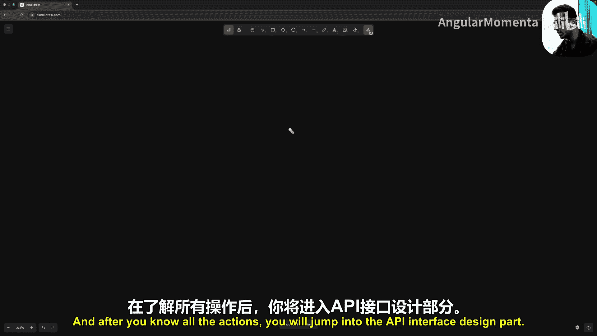

And for the API interface design part， we'll use this tool， which is called insomnia。

 It's an alternative to postman。It is an alternative to postmen， but。It has lesser features。

And it said lighter in weight as compared to postman。

 So we'll make use of this tool to design the interface of A。

 What should the A of these platforms look like， right？ Remember。

 we are designing the interface for this API， which means that。

We are designing how clients who are going to consume our A are going to integrate our repay what the APIs will look like。

 how they will interact with our A， etctera， etctera， right the interface point。

 we are designing the interface point not the execution point。

 which includes writing whatever programming language that you are writing a server and etca et cetera。

 your actual business logic， your database interactions etctera etc。

 we are not going to cover that in this part we are only going to be concerned about the design of your APA。

With that， let's start。 So we have identified three major resources in Arabia， which are。

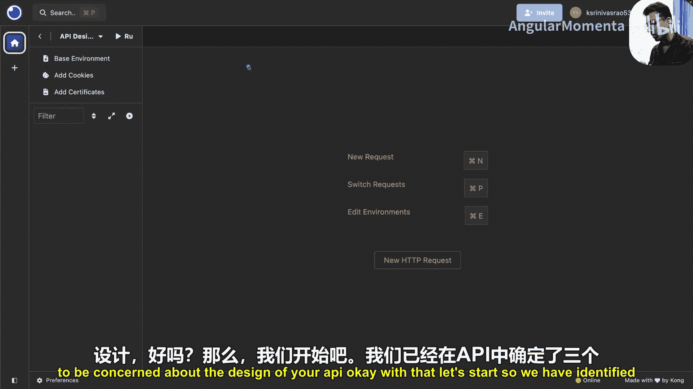

Ordination， project and task right so we have to design APA surrounding these three resources starting with oration and we have also identified what are the actions that clients need to perform with a A so according to those we have come up with five different kinds of actions for organization create organization get all organization get a single organization。

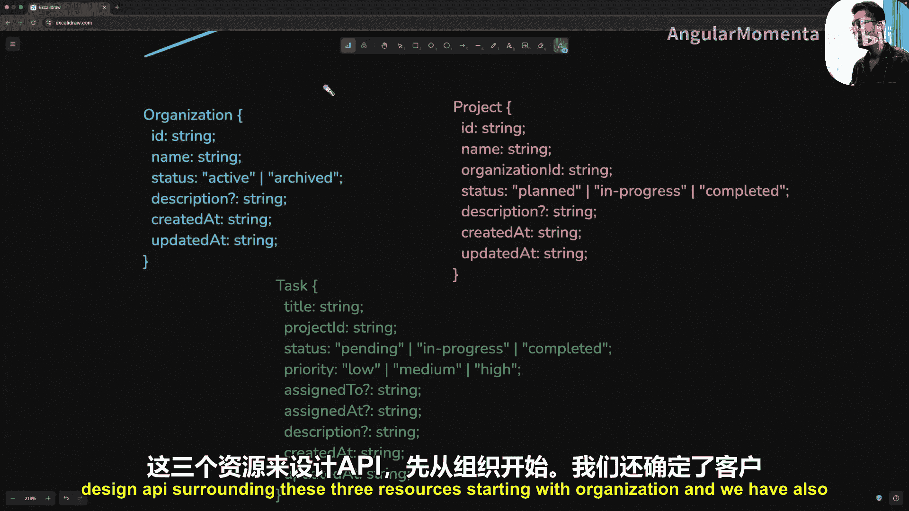

And update or， delete or， etc tri。 right， so let's start how the A will look like。

 I will create a new S T TP request。 So the first， let's design the get all organizations A。

 So itll be get A because we are doing a fetch operation， right。

 now the next thing is well write the。URL of our server。 Now。

 this is subject to change when you go to production， the domain will change。

 the scheme will change from HTP to StTPS S。 And since I am running it in local host。

 the scheme is St TP and the domain is local host and my server is running on port 2000。That's that。

 And since it is just a demo， we have not integrated versioning here。

 but usually As will have some kind versions here slash V1， then the actual path will come。

But here we are not doing versioning as of now。 So we are done with the URL part。

 Now comes the important part。 The actual route， the actual path segment， which is going to。

Identify what is that that we are trying to fetch from the servers since it is an API。

 so let's rename this to list orations it list all oration。

So this is what it looks like right as Ive already said。

 we don't put capital case in the path segment， so we write oration and we have already mentioned that。

It should always be plural in the resource part， so it will be orations。

This is what a typical list resource API looks like。 you have the domain， you have the versioning。

 if it exists。And then the resource name in plural。

So this is ideally the list I and when we call this。We are getting the empty response。

The empty response。 So let's jump into the second E。

 which is the create orination a then well have a better idea about how the get one works right create or and this will be a。

Post operation， because we are creating a resource in the server。 right It's a create operation。

 That's why we are using the method post。Let's just copy this。诶。Business now， here。

Our URL looks pretty much the same for list orations and for create oration and the reason for that is the server differentiates between these two API calls using the SttB method if it is a post method then this route goes towards the controller which handles creating an organization and if it is a get call with the same URL it goes to the controller which deals with listing all the orations right So this is what a typical create operation for a particular resource looks like we have the as usual the server's address and slash the name of the resource in plural form now。

This is a post call so we have to attach the payload。

 the data that the server needs to create an oration。

 so if we look at the organization schema we have to exclude these three fields。

 these are Data handle field slide the ID that created it and updated it these are handled from the server side so we exclude these from the payload。

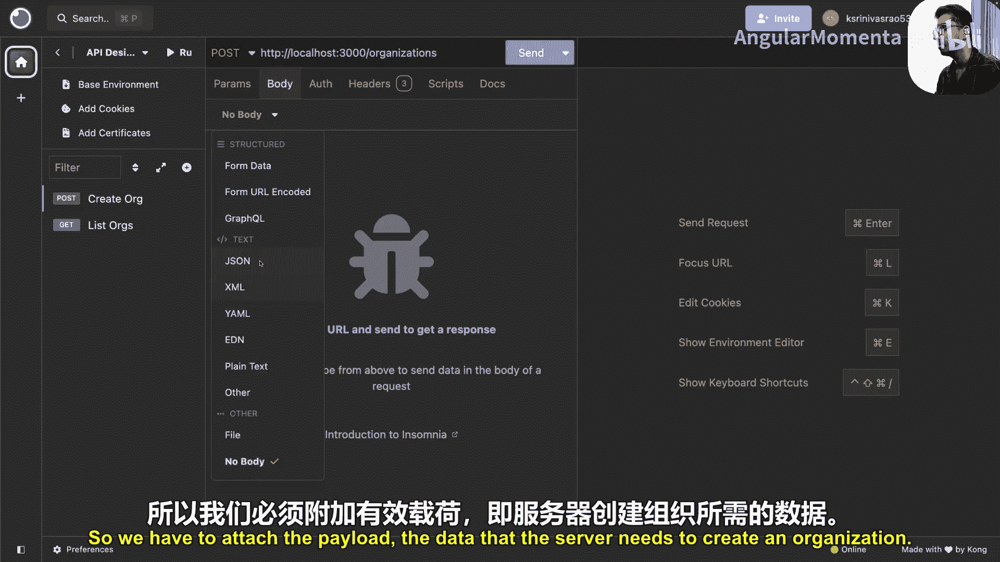

Now， these three fields， the name， the status and the description。

 These three fields can be passed from the client side using a payload。

 So let's pass these three name status and description name will provide as。

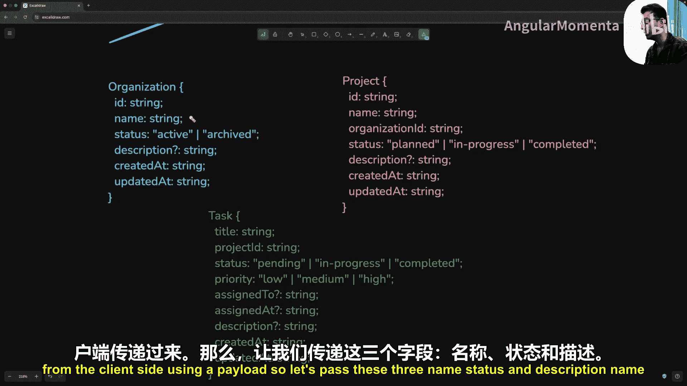

One status， since it's a JSson pillar， we have to wrap all the fields in double codes。

Second is status， status， let's say is active。 and the last one is description is some。

 sum description， right， and these are payload。And when we run this， we get this。

We have an ID which is created in the server side。And we have the created it。

 which is also created in the server side。 and then we have the names， status and description。

 which we had passed in the payload that is provided here。

 So this is the first thing that we should notice here in a typical post A called。

After calling the response is usually 20，1， which we return when we create a resource in the server。

 if a new resource is created， then we return the status quo as 201， which means。Itated。Okay。

 and then we return that newly created entity as it is in the successor response。

 That's why we have received the newly created organization here。😊。

This is what the typical post interaction looks like now going back to our earlier。List orination。

 when we call this now， Now we are getting the entry， the oration that we created。

 the oration that we created just now using the postcode。

Here the status quo is 200 because 200 will return 200 status code when it is a successful response。

20，1 is when we create something but 20，0 is when it is just a successful response we are sending some kind of data etc etca。

Right right。This。Another thing to focus here is what's happening here We have a data field。

 We have a total field， we have a page field， we have total pages etc cetera。

 etc ceter and this thing is called pageagination the terminology is pagination and why do we actually need pagination the need for pagination pagination is basically a technique which is used in server side when we are doing some kind of API call where a list of a particular resources return in this case we are requesting a list of organization whenever we have an API call like this which returns a list of some kind of resource and depending on the requirement we use this technique we implement this technique which is called pagination what it does。

It does not return all the resources that exist in the database in the server side in that particular request。

 right it returns a particular portion of the data in the response。Yeah， and since at this point。

 we only have one organization， so I cannot show you the difference。

 but we'll create a couple of organization see how the pagination works， right。

 So let's understand the theory first。This is the this is why we use pagination。

If we have a lot of data in the database and when the client makes an API call。

So we only return a particular portion of that data in the response so that first thing。

JO serialization and disulation， as we have already covered in the previous sum video。

 that is a heavy operation right so if we let's say send a thousand organization in the response。

 so serializing1 thousand0 organizations into a payload which is transferable across internet。

Is a resource habit task right it can introduce some kind of delay in our API it can have some kind of performance impact。

 So that is one reason the second is if the server takes a little longer to send the response then the client whatever the front end platform that is requesting that is using this A that will also have some kind of perceived delay and the user。

 the end user who is using the platform they will notice a difference right they will notice there is some kind of three seconds and4 seconds of delay that is happening because the client is fetching10 organizations in the list A call。

Even though even though the on the first look， on the first look when someone is using the platform。

 they will only see， let's say a 10 or 20 oration， right？If they want to see more or。

 they'll obviously have to scroll Now， because of that kind of scenario。

 people have come up with this technique called pagination in pagination。

 What happens in the initial call， you return some portion of data。

 usually from the first and sorted by some parameter。 Let's say the created at parameter。

You return the latest 10 organization in the first a right then when the user。

 the end user clicks on page2 or if it's an infinite scroll scrolls down。You make another API。

 and you say。This part I already have， give me the next portion， this portion of the data。

And then you take this and you show it to the user Similarlyly， when the user goes in page 3。

 you ask for this portion and you saw this data。 And this is how it works at at once you only fetch。

 let's say 20 or 30 ors and show it to the user。 so the user is also not overwhelmed network is not overwhelmed and the client and server perform better。

 and that is the advantage of pagination。And this often used。

Whenever we are implementing some kind of list pay。 So in this case， we are listing。Organization。

 right。 That's why we have implemented pagination here。 Now， the second thing to notice here is。

What are the fields that we are returning from in a paginated response。 The first part is data。

 whatever portion of the data we have to return that we return in the data field。

 The second is total。 Now， this total field returns the total count of all our nations that。

Is in the database。And using this information。The client can show some kind of metadata to the user that you have around 50 oration。

 but at this page you are only viewing 10 right， It can show some kind of U I like this 10 of 50 something something。

 So for representation purpose for U purpose， we return。

A field which which shows the total count of all the resources that exist in our database which is independent of what portion of the data we are returning。

 it is independent of the page response next is we return the page field which page which portion of data that the server is returning for this response this response which page it is associated with which portion it is right we have to assign some kind of number。

Some kind of identifier the portion of the data that we are asking from the server。

 That' the reason we call it a page and in this。The survey is saying this response is for page1。

 you are doing page1。 Then we return total pages。 How many pages in total there are and we can use this to show some kind of nice U interactions or if it's an infinite scroll。

 we can check for each time we are making the vehicle。

 we can check whether the page and the total pages if they are both same。

 then we stop making the a So because now that we know that we have reached the end of the pages right so this also provide some nice functionalities it helps the front end make some decisions about whether to make the next a call not etc ce et。

this is what a typical。Paaginated response looks like。

Now let's go to the create way and create a few more organizationss， right？Let's say nation 2。

 nation 3， nation 4， nation 5 okay。We've greeted。5 ordinations。

 And when we go to the list API and we call this， we are getting all five now that we have。

Around five ors， how do we access， let's see how the pagin actually works。

And how the client can ask for different different portions of the data using different different parameters。

 since it is a get call， the only way we can send data from client to server。

 some kind of payload data is using query parameters。

 Now the server takes two kind of parameters for controlling how the pagination works。

 The first one is limit limit basically means what is the count of data that you want in each response。

Since we have five entries， five orations， what if field do limit is to each time we only want two orations。

The second parameter is page which portion of the data that you want by default。

 if you don't send page and limit， the server should。And remember。

 since we are in designing the interface。Try to focus what are the points the server should implement right if the client does not send anything in limited page。

 the server should set some kind of default values for these。

So by default the server sets the value of page as1 if the client does not send any kind of parameter in the page parameter。

 same way the limit will be set to something like 10 or 20 if the client does not send it。

 but here we are explicitly sending it。So let's make this request。

 What happens when we do limit2 and when we make this request。

 the server returns us to organizations sorted by created at the latest organizations。

 That's why we are getting ordnation 5 and ordnation 4 because that's the order that we created we first created ordation 4 then ordnation 5。

 That's why we are getting in this order。Second。In total。

 the server is returning how many entries are present in the database。Yes， we have five organs。

 but we are returning to。Okay， because the client has passed the limit to。

 then which portion of the data that the server is returning。

 which is which page the server is returning， which is page1。And how many pages are there in total。

 there are three pages， because if the limit is 2 and the total number of ordinations are5。Then。

 then to send all the data to clients， the server has to make three pages in the first page there will be two entries the second which there will be two entries in the last page there will be one it。

That's how pagination works。 So when we do page as 2 and we keep the limit as 2 and then we make this request。

 This is what we get。 We get ordination 3 and ordination 2 in the response， basically。We have this。

W data portion where we have， let's say， Oration 5，4，3，2， and 1。 When we make page as one。

 we get Ordation 5 and oration 4， basically this portion。When we make pages 2。

 we get this portion3 and 2。And in the last， when we'll make page 3。

 we should ideally get only the nation one because in the。In the last page， there is only one entry。

Let's change this to page 3， and we got orordination one and the single response。

 because we are asking， give us the page 3， the last portion of the data。So the total is 5。

 the current page is 3 and the total page is 3。These are basically the met data about。

What is the current state of pagination And this is how the client can and the client should interact with your Apays you should allow for a limit。

Prameter and a page parameter so that the client can conditionally and programmatically access different different portions of the data。

 So that's pretty much all about pagination， how the server should implement pagination。对。

A typical list APA also has other parameters。 Let's say let's get rid of these get rid of these。

 We don't want to look at pagination anymore。 And when we send this we get all the5 organization because by default。

 the server sets the limit S 10 or some random value because even if the client does not send anything in the limit parameter。

 the server should set some number as limit and page 1 S default parameters right now let's talk about sort in a typical list APA the server should also support sorting and this is how it looks like we can pass one parameter。

What defining。By which field we want to sort by。This is typically it is sold by。

And here we can provide the name of the field that we want to sort by。 So here。

 let's say we want to sort by name。 You are saying we want to sort by name。 And when we send this。

 you're getting our nation 5，4，3，2，1。😊，No difference as of now。 Now， let's add another piter。

 which is called salt order and。Here， let's send as sending。 And when we do that。Here as you can see。

 by default， the server was returning all the organizations in the descending order。So by now。

 you should have realized this rule。The rule LED。The server should ideally。

 ideally take as many as it can send defaults。 and by saying defaults。

 I mean it should not depend on the client to send obvious files， for example， in a list API。

By default， even if the client does not send anything。

 we still got a response right we did not get any validation that you are missing this parameter we were missing the page parameter that made our whole experience way better because we did not have to pass obvious fields。

Ovious fields are such as page。 If the client does not pass。The any explicit page。

 the server should set the default pages 1， Similarlyly for limit。 If limit is not passed。

 you should set a default limit， either 10 or 20 something， same way。

 even if the client does not do any kind of manual or explicit sorting。

 the server should do some kind of sorting by default so that the response of the data does not change between different different API。

 If you don't sort by some parameter in the server before sending the response each time the client makes an API equal。

 it will get。The response in a random order， because the database does not store entries in any kind of sequence。

 we have to explicitly do sorts。That is the reason by default， if you are creating an API。

 especially a list A。You should have some kind of default sort parameters。

 so by default what we usually do we take the created at field。

 take the created at field and we sort by this field and sort by what order we sort by descending order。

This is the natural state， the default state of sorting， even if the client does not pass anything。

 because it's a obvious response， right， we want to list all the entities。

 all the resources in the descending order of their creation。

 basically all the latest entries that is a natural thing to assume from the server side。

That is the reason this is considered a same default when it comes to sorting scenarios in list As but。

If the client does want to do some kind of explicit setting。

 the server should also support two parameters for sort， one is sought by。

By which field of the resource that you want to sort by。It can be name， it can be status。

 it can be ID D etctera。 it depends on your implementation。

 but it should have some fields from the resource entry。Same way， you should take another parameter。

 which is called sort order。What order the client wants the sorting to happen by default again。

 Even if the client passes is sort by field， you will still have to set the default。 that sort order。

 If not pass， you should set it as descending。 That is the reason when we did not pass any sort order。

 We still got our data or response sorted by name in descending order。

 because descending is the default state of sort order that the service sets if the client does not send any sort orders。

 but。If the client sends ascending a sort order， then the server takes that into account。

 it takes the field， it sorts names in ascending order that's why we got our 1，2，3，4。

5 in the ascending order。This is how sorting is implemented in a typical list a。

 we have covered paginations。 we have covered sorting。

 There is one last thing that is usually supported in a list a which is called。Redering。

So let's remove this。 and， And what filtering means is。Even if it's a list API。

 the client wants to filter that list by some parameters right so let's say let's go and create an oration in the body we see oration as6 and in the status instead of active。

 we do。Archid， and we create this。 and this is created。 and we got a 2，0，1 response。

 Now we go to list。 And when we send this， we are getting this。Ordination 6， the latest one， right。

And the state is archived。 Now， what if。The client has some kind of button。

 some kind of switch using which the user can。Filter the list by saying I only want all the organizations whose statuses are active or whose statuses are archived。

 basically some kind of filter functionality。And this is how we add support for filterration in a typical list。

 So we take the name of the field。 So let's say the client wants to filter by status。

So we add a parameter， which calls status。And inside this， the client can pass。

What is the status that it wants to filter by？So， if。We pass archived and when we send this。

 we only get the list。Of all the organizationss whose status is archived。

Same way if you pass active and when we send this we only got all the ordations which has the statuses active and this is called filter。

And is just one field we can also filter by other fields， so let's say。

We add another parameter and the filter is name。One the list of all orations whose name is let's say org and when we send this we are getting only one response because in this scenario in this example we only have one or which has the name or4。

That's the reason the APA is returning this okay。So with that， we have covered pagination。

Piltering and sorting。All the features that a typical list A should have。Now moving on。

 let's create an update API， create a new request， and it is a patch request right。

The thing is I have personally not used a put implementation of an update a as much because usually what we do we take some fields of a resource of an entity and want to update those we never want to replace the whole entity with a payload that is passed from the client。

it was usually a practice when we were building MP multip applications。

 but in the single page applications where the data is mostly Json heavy。

We usually pass partial fields of a resource， and you only want to update those fields。

 So mostly you will see patch getting used for update appears instead of put。

 And that is usually best practice， because if it partial fields。

 then patch conveys that semantic meaning in a。Better way as compared to put。

 which is a little confusing。 but mostly developers use put and patch interchangeably， so。

Try to stick the standards use patch whenever you are updating partial fields of a resource。 Okay。

 it's a patch request and we have to provide the server URL。

 So the server URL is this one paste it here are nations now which our nation that we want to update。

 So this is where a dynamic parameter comes into play。

 We have already explored water dynamic parameters， etc ce cea in our routing video so。

But now we'll just go ahead and use it。 So dynamic parameter is usually some kind of string that we can arbitrarily pass。

 So let's fetch the list。 and let's say we want to。Up to this。

 we want to update the status of Oration 6。 So let's copy the I and we take the I and let's rename this to date oration okay。

And as usual， this is the servers address。 We have the path。

 which is the plural form of the resource orations。And after this， we write at the slash。

 we paste the ID of the oration。And this is a valid route for a patch a vehicle Okay。

 we want to update a single ornation。 thats why we are passing the ID of the ornation in the dynamic parameter。

 Now the patch request takes a body。And we'll send a Json inside the Json。

Want to update the status of the organization。 and the status is the existing statuses archived。

 We want to make it active。 Okay， and let's call this。 And we call this。 We are getting。

The alterdination 6。And the status is active。 We have successfully updated it the。

Updated the value of the status file and when we go to the list a call and we call this。

 you are getting the statuses active or Or nation 6。

Now the typical response for an update or a patch API call the success response the client sends the payload in the body and the server sends a 200 response since it did not create any resource it is a successful API call thats why it is sending 200 the response the successful response and in the response we are sending the updated data of the organization this what the。

Difficult practice looks like for a patch a vehicle。 Now， similarly。

 what if we want to fetch the information of a。Single organization。

 you want to patch the information。 So that's why itll be a get call。

 So let's first copy copy this and create a new request。Let's rename this to get get org。

 and this is a get call。 and let's paste this one and getting the information of a single oration and updating the information of a single oration and deleting a single orations。

 mostly what you will see。😊，All these three As， the get， update and delete for a single organization。

 the route will look similar。Well have the server's address。

 well have the path parameter with a plural form of the resource and with a slash with the form slash。

 well have the ID in that dynamic parameters please。This is what the route will look like。

 And since it's a get call， we don't pass anybody or anything and we can just execute it and we got the information of the oration。

 we have passed the idea of the oration 6 and we got the oration 6 with status for 200 because this is just a successful response。

 We did not create anything we just fetch。Information， okay， at last we have a delete call。

 we want to delete an alternation。 So let's create an HTP request and rename this to mark and the method is delete。

Space this， as I said， the get call， update call and delete call of a single oration A will look similar。

 the route will look similar， the only thing that will differentiate them is the method。

Whether it is a get method， whether it is a patch method or it is a delete method okay and we are not sending anybody we are just in sending the ID of the organization in the dynamic parameter and we execute this and when we execute this we do not get anything。

The response is empty， but we got a different status quo， which is， which is 2，0，4。

Which means no content。 The server is saying that。Whatever operation that you are trying to do it was successful。

 That's why the status quo starts with 200 series right 200 series。

 all the chs in the 200 series are success responses。

Whatever you are trying to do you are trying to delete resource that was successful。

 but there is no content I can send you because it is a delete operation and it is successful you successfully deleted the ordination There is no information about the ordnation that I can send you that is what the server is saying。

That's why we did not get any response in the response of the delete A call。

 and this is the usual practice whenever we have a delete a call。

 we send an empty response with status quo 2，0，4。 And now when we go back and we get。

The list ordnation， we are getting the ordination from ordnation 5 because we delete the ornation 6 and what happens when we come to the get call。

 the get single ordination API call and we run this。We are getting。

Oration not found as an error message。 and in the status quo， in the status quo， we are getting 404。

So this is an ideal use case for。Status 404 which basically says that you are requesting a particular entity。

 you are requesting a particular entity a particular resource which has the ID this one and that resource does not exist in the server since we have already deleted this that does not exist in the server。

That's why we are adding returning error code of 404， which means resource not bound but。

In the list API call， we do not get any error， even if there are no organizations in the list。

 it is empty。 We still do not get an error because。In list a vehicle。

 we are not requesting for a particular resource。 We are requesting a list of the resource， right。

 a list of ordations。 That is the reason we never send。4 or4 responses in listed vehicles。

A 404 response is usually sent when the client is sending a particular resource ID D a particular resource。

 a single resource or a bunch of resource in different different representations。

When the client request for a particular number of resources or a single resource。

 that is the use case when we should send a 404， but if it is a list API call and we don't have any data。

 let's say the filter does not match any data， let's say in the parameters we pass a filter。

So we pass status filter。 And here instead of active and archive， we pass some。

Random value random value。 And when we execute this， we are getting。Data。As an M array。

And total is 0 page 1， total pages 0。 This is the kind of response we get in a list a vehicle。

 This response code is still 200， because is a this is a list a vehicle。 If you notice this。

 we are not requesting a particular organization， a particular resource。

 That is the reason we should not throw or over here， even if we have no data for this filter。

 we do not say resource not found。We say the data is empty this is a thumb rule that you have to remember that if it's a list API call and there is no data you should return an empty area with 200 response instead of returning 404404 is only returned when the client is requesting for a particular entity which does not exist in the server okay with that we have covered all the current operations grid basically means create read in the read we have get and list。

We have update and we have delete crowd operations。 We have covered all the crowd operations。

 and this is how the typical crowd operations based API design interface will look like。 Now。

 what if we have a custom action by custom action， I mean we want to perform some action on the server。

Which does not fall under any of these categories。 It is not a create operation。

 It is not a gate operation or an update or a delete operation。

 It is a particular action that we want to perform on a single Oration entry。

 Let's say this Ordation 5， and we want to archive。Orutomation 5， okay。

Now archiving an organization you can on the first look。

 you can imagine that if we update the status field of an organization to status archived then it is archived right so ideally it should fall under a patch right but that is not the case you want to perform some action you don't want to update an entity even though at the end of the day it is。

Updating the entity， you are an updating ordnination 5 from status active to archived。

 but at the end of the day， it is in custom action。

 because let's say you want to archive ordnation 5 you want to make the status from active to archived。

 Now this is the action that you want to perform。 but you cannot simply just update the status field。

 because when an ordination is archived。 a lot of operations will have to be performed。

 maybe all the projects that resides under that ordination will also have to get removed and deleted some kind of operation。

 maybe the users that are involved in that ordination have to be sent notifications or they have to be sent emails right and all the tasks that fall under all the projects that fall under all the ordnation。

 they have to be deleted right a lot of actions have to performed from server site。

 when a particular ordination。Iarch account。That is a reason updating the status field of an organization from active to archived is not actually archiving an or it at the end of the day isnt。

Customation， you want to archive an alteration So now。

We have a use case where we want to perform some kind of custom action。 In this case。

 the action is1 to。Archiive a particular ordination you want to perform this custom action on the server side for a particular ordination right now as I have mentioned before。

 whenever we have a use case which does not fall under any of the card flows it is not a create get delete or update method then we can use post with the custom action。

To construct an API call， to execute that custom action in the service set。

So let's do that in the next a。 We'll create a new request， and let's rename this to archive。

 archive oration。And here from the name， also。You can see that。Up until here we have Cr endpoints。

 we have delete get update create list right from the names you can see that these are crowd operations。

But at the end， we have archive。This is not a crowd operation。

 That's why we are classifying it as a custom action。Now， how do you perform clusterster action。

We make it a post column。If make it a post call， then we take。Let's say's execute this。

 let's remove this and the ID of our nation 5 is this。

 we take this ID space this year and before that we need the server address。What about。the address。

 let's space this here。 And here we have the service address here， there is the。

Root path with the orations。 Then we have passed which oration like we are to archive oration 5。

 That's why we are passing the I D of oration 5 then。

At last we want to write the action that we want to perform。

 So in this case it is an archive operation it is an archive action we have written archive now we have the route ready。

And if you notice here， this completely follows a hierarchical relationship that we had mentioned earlier。

We have the service address。 So ignore this part from this path segment。

 We can see that we have all orinations inside all organizationation。

 We have a single particular organizationation。 And for that organization。

 we want to perform some action。 So it is a clear hierarchical path that your A endpoint should ideally form。

 Now， when we execute this， we are getting a response and in the response， we have the ordation 5。

And the statuses archived we have made our nation 5 from status active to status archived as a custom action with post end point right。

 and even though we have used post here， we still got the response code as 200。

That's the reason you should not blindly assume that every post call will have the response code of 2。

0，1， which is the creator response code， because there could be also custom actions。

 custom actions like these。Which will return 200 because they did not create any resource。

 They will return。200 for custom API calls for custom action based API calls。 Okay， now with that。

 we have covered all the API end points for the schema or the data model organizations。 Okay。

 now with that， we have covered all the API end points for。

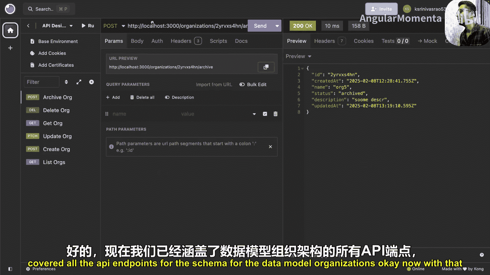

Ordination， bichema。Now， let's move on to projects。 It will do。

This one more time so that you can internalize all the pads that we are using while designing our endpoints。

All the patterns that we are using while designing the interface of our API。Okay， good， so now let's。

Continue designing all the APAs for projects at projects end points。 going back to insomnia。

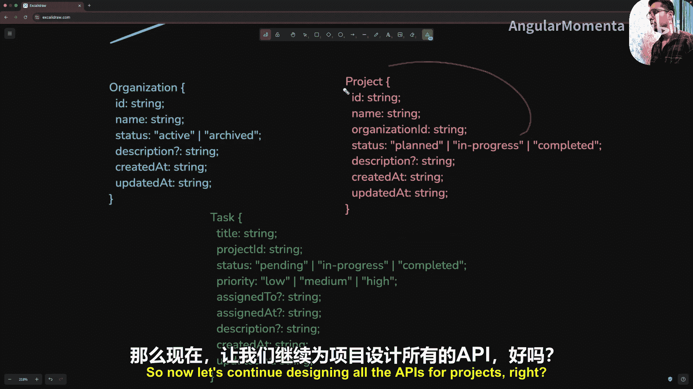

What I have done here， I have created a folder called OG and Ive moved all the ordination based endpoints inside the OG folder so that it' is easier to manage now that it will be creating all endpoints for projects。

 this part is categorize as ornation endpoints Now we can minimize this create another folder and we'll name this as project and under this let's this let's create our first request。

Which will be a post request。 and this time will do this ales faster since Ive already explained all the concepts behind it in the previous endpoint creation flows。

 So this time we just focus on the patterns， but will move faster。So we have the service address。

 which is H TDP， local host。And the poll is 3000 slash since we are designing now the endpoint4 project。

That's why， as our patent is， the plural form of the resource in small case。Which gives us。Projects。

 okay， now this is for the poster vehicle okay。Now， this route is ready now Now。

 what should go in the body since post request， we are creating a new project。

 What should go in the body adjacent payload。

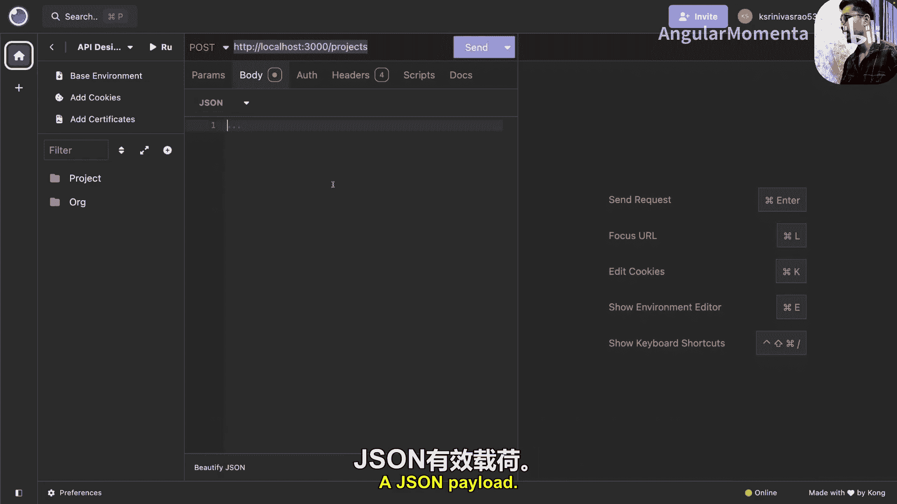

In the JSO payload， we can basically send name， automationation ID status description because the I D created it and updated are server handle fields we do not accept that from the client payload。

We are only accepting name Oration ID status and description， so name will be some project name。

 then Oration ID will be some Or ID that is already existing and the status will be let's say planned and the discretionary be some kind of description。

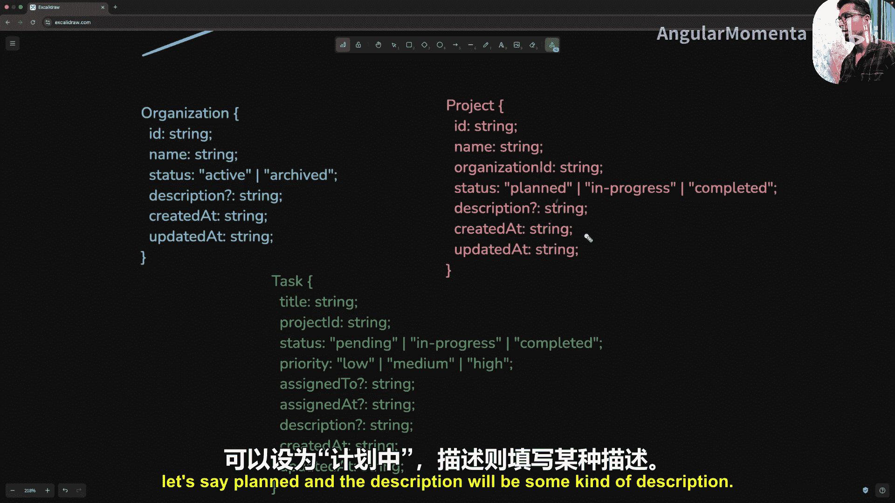

So， let's come here and。Name is， let's say， Ra 1。 Then we have。

Organization I D H I D is some random I D。 But now let's not worry about that。Then we have status。

 let's say。Planned and in the end， we have description the description we can pass somewhere。 Okay。

 now we have the payload ready。 now another thing to notice here is any kind of Json payloads。

 whether it is a Json any kind of JSson data， whether it is a payload that we send from client to server or it is a response that we receive from server to client。

It should always follow the fields should always follow camel case right that is a common standard when it comes to JO。

 so that is something you have to keep in mind whether you are accepting payloads or you are giving responses from server side always try to stick to JON standards if you are using JON as your serialization format。

That way， clients do not have to do a lot of guesswork because it is already established pattern that JO fields always follow camel case。

Now let's hit this and we got a status 201 because a new project is created and we got all the fields that have passed and the project entity that is created the typical create using post let's go ahead and let's create another request and it will be a let's rename this to create project and will theyname this one to。

List。Right okay。😔，And this will be as usual a get call and we can copy the route of the post call because as Ive already mentioned。

 the routes of create a resource and list resource will most of the time look similar。

And routes of get a single resource， update a single resource and delete a single resource will most of the time look similar because of the semantic meaning。

That comes with them right so we don't have to make any other changes here。It is a list call。

 And when we send this， the server census， all the projects that is inside the database。 Okay。

 so in the create one， we can create a few more project2。Pro 3， and in the list。

 we can go ahead and we can do different different parameters。In pass limit。As one， right。

 if we pass limit is one。 we only get one response。

 But when we add page with limit and page is2 here， we are getting project 3。

But when we are sending limit1 and page2 we ideal get project2 because it is the next portion of the data that we are fetching from the server。

 Similarlyly this will also have sorts， this will also filters that we have already discussed in the previous endpoint while we are dealing with list orations endpoint right we have create projects and we have list projects Now another thing I want to mention here is when you are designing a P for a particular platform right as long as you are inside a single project。

So all the APIs inside that project does not matter what the resources are here we have two resources we have ordination and we have project but across different resources。

 your query parameters and your JSON payload should look similar and what I mean by that is let's say in the grid oration if you see the body。

You can see the name the project has an ornation has name and it has description and we are expecting those fields from the client now similarly in the create project also we have name and we also have description that we are expecting from the client Now the point I'm trying to make here is。

You should always try to be consistent when it comes to the JSON payloads So in the create Or API you made description the key of description like this。

 So in the create project API also we have to you should keep the key similar you should not go ahead and DC right this also expresses that this field is associated with the description field but since you already have an API where the JSON payload contains a description field from that point done all the APIs that you design should follow a consistent pattern and if its a description field then you should only。

Then you should try to match that。 You should not try to。Rename fields。

When the context is the same because because usually what happens when a front end engineer when some kind of client right。

 they integrate your A。They consume one a， they integrate1 a and from that point on。

That front engineer， that client， they make a lot of assumptions of how your API functions。

They make assumptions that let's say this is a grid ordination API， right。From this point on。

When they want to integrate the project endpoints， they will make a lot of assumptions that the since the project also has a name field。

 since the project also has a description field。This is what the payload will look like for a project。

 and it did look like that because that's the way you have designed it。

But imagine if you made the description field as DSSE。

And the client the front end engineer without looking at the docs without looking at the specs of your。

 they executed the API right with the description field and they get a validation error Now。

 of course， during development kind of these kinds of things happen and thats totally fine but the point is you should not waste the people who are integrating yourpay you should not waste their time。

And you should not waste their effort。 You should not make them do guess work。

 right yourpay should always follow a consistent pattern。

 whether it comes to routes or whether it comes to payloads， whether it comes to responses。

Always follow consistent pattern。 Once you create an a， stick to that standard。

 whatever tellingyling you that you have followed， St to that。

 not make arbitrary decisions across different different resources for different different endpoints。

 right， always be consistent。 That's one of the most important characteristic of a good pack engineer。

 The consistency of。Sttyling when it comes to APA design。Similarly。

 for list for create ordination here， we followed this pattern where the route is orations。

 the plural form of the resource Now for the project part。

 let's say if we had did just project right now the person who is integrating your A judging and assuming from your create ordination A they'll assume that the create project a must also follow the plural form right because that's what the ordination a followed So if you do not follow the same style if you do not be consistent then they'll also get an error that then they have to figure out there have to read the specs there have to read the documentation etc。

 etc ce， right which is a lot of drag and that is the reason that is the importance of sticking to a particular style sticking to a global standard Now let's move on。

 let's create the rest of the we also have a。Get A。 Let's create the rest of the A。

 We also have a get project A。So， what we can do。Copy this paste this。 We have projects。

 And up to this point， we have to pass the project I D because it is a single project fetching API。

 It is a get API， which fetches a single projects。 That's why in the dynamic parameter。

 we have to pass the I D of the project。Now， let's execute this list projects。

 And it' this parameters。When I execute this， let's copy some ID。And in this。

 let's rename this one tool project。 And let's paste this side。 And when we execute this。

 we got the response for a single project， right。Ideally， with the response code of 200。Similarly。

 let's go ahead and。Ged the update。'sRename this project， okay。And here also， we can。

 let's copy the get project。 And here we can paste it。 as I've already mentioned。

 the routes of get single resource， update single resource and delete single resource will always look similar because of the semantic meaning that they represent behind the scenes。

 Now， this is an update。A pay， so well do patch because we are sending partial fields right and this will require require some kind of body。

 So this， what should we update the description， Let's update the description。

 We are say the description is the existing description is some random value will change it。

So in the body， we can send partial fields。 So we just need to send the value of the new description field。

 And here we can say that new。Okay and when we send this， we got a 20， when we send this。

 we got a 200 response because it is a patch request and we got the updated entity。

And as you can see， their description is new description。 Yeah， that's their typical B of of patch。

Similarly， let's implement the delete request on this one inside project， new request。

 and let's rename。 let's rename this to delete。Project。

And we can just copy this because it is a single project API。😔。

And we make this method as delete and there will be no body， etc， right， and I can send this。

And as you will， since it is a delete method， we got a 2，0，4。 no content response。

 and there is nothing in the response because it is a delete request。 And at last。

 we have a custom action。So in case of project we have a requirement that the client。

 the front end can clone a particular project and when they clone it what happens that project。

 all the values of that project gets cloned in a new project whether different ID is created in the database with that other operations might also get executed in the server side which we don't know about。

That is the reason it is a custom action。And it is not a create action。

 We could have also done that the client could also call the create project A and it could take all the values from the existing project。

 It could pass all of them in the payload and create a new project with all the same values。

 It could simulate a cloning operation， but but we don't know what clone means on the server side right a project clone can also mean that we have to take all the tasks that are inside that project and we have to also clone them right and maybe we have to send an email to the owner of the project that your project have been cloned etc the server maybe has to perform a lot of other operations when a project is clone That is the reason we cannot simulate cloning operation using just a create project APA right we have to explicitly create an endpoint。

With the custom action for clo。So let's go ahead and do that。 Let's create。Anyone。

🎼Let's rename this balloon。And this will be a post column， as you already know。

 all the custom actions which do not fall under any grid operations are categorized under post。

Because post is an open ended method when it comes to rest A specification。

 So let's copy this one because the allowed will be similar。

 We want to clone this particular project， right。Let's past this at the end。

 which is write the name of the action。This is how we design a custom action best API。

We have the server's address， we have the resource in the plural form。

 we have the particular resource that we want to perform the action on and at last the name of the action this is what the structure of the A looks like and it does not have any payload for this use case but maybe you can take payloads maybe you can take some feels that the client wants to over for a clone operation。

Now， when we execute this， we get a project not found in 404 response because we already deleted this project。

So let's go ahead and pick up a new project and replace this Id。 and then we execute this。

 and we got it。2，0，1 response。 Now， as I said， you cannot assume from the method that since it' is the post method。

 itll be a 2，0，1 response。 or since it is a custom action， it cannot return  to 0，1。

 because depending on what happens on the server side。

 the response code might change because during cloning the server creates a new project。

 That's why the server returned a response which says 2，0，1。

Which means I created a new resource for you。 Okay， the got  Q0。

1 response and the newly created resource。 and the name is project 2 loan and all the fields。😊。

That are similar to the project2 entry that we had Next。

 This is the custom action based API for projects end point。And with that。

 all the endpoints of project resource are completed hopefully by now you are able to establish all the patternss that goes behind designing all these a。

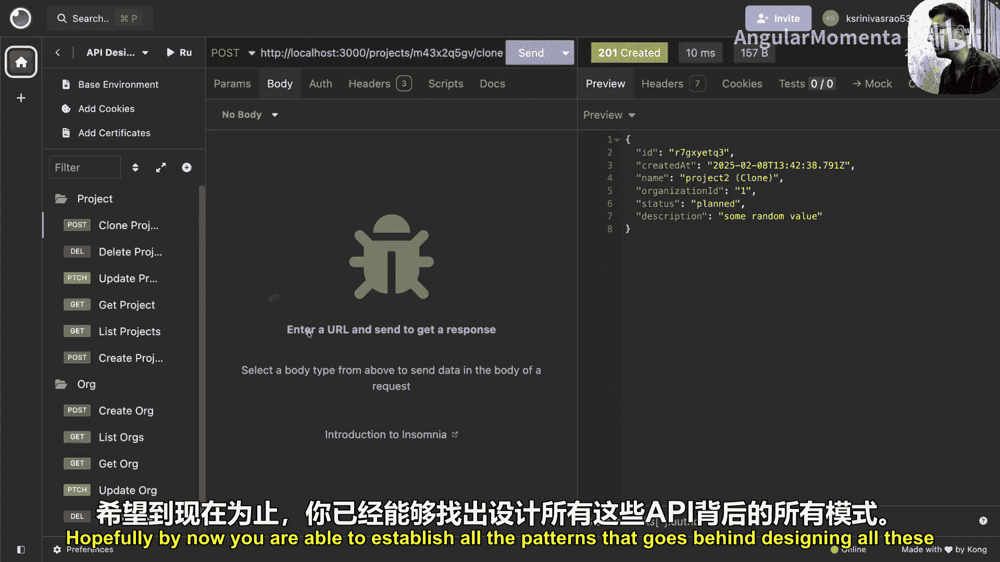

And if you were to design all the APA for tasks。 So you would follow the same kind of pattern， right。

 youll have a list API。 you will have a great single task API。

 you will have delete update and you'll have some kind of custom action， right。

 The patterns are same does not matter how many resources。

 Do you have The patterns still remain the same。With these patterns。

 you can go out and design as many a as you want， right The basics are the same。

 The foundation is still the same。 Now， with that out of the way。

 there are a couple of things that you have to keep in mind while you are creating a a to provide a。

Good experience to whoever is integrating your repairs and whoever is maintaining your repairs always try to provide an interactive documentation for your repairs for example。

 start integrating swagger tools like swagger re which provide an interactive playground for trying out your repairs right。

Start planning that from your initial planning so that even so that you can use it to test your replaces and whoever is integrating your res。

 they can use it as a form of documentation and as a form of testing。It， that's the first thing。

This is very important。 And one of the most important things that sets you apart as a backend engineer。

 how consistently and how frequently you create， maintain and update your。

Open API or swagger documentation。 Second thing is， make your APIs intuitive and consistent。

 which I have already mentioned。All your routes。All the patterns when it comes to your dynamic parameters when you or custom actions or JN payloads。

 all of them should follow a single pattern。 So if you are following the global pattern。

 the global standards of R pay， then that's great right。

 but even if you are not following that for some reason for some random reason that I cannot understand。

Even if you cannot follow it， but。Pollow something， right。And stick to it。

 Do not change your styling。 Do not change your patterns of your API in different different endpoints across different different resources。

 That is a huge pain point for whoever is trying to integrate your APIpis。 Keep the behavior。

 Keep the data format， Keep the naming everything consistent and intuitive。 Third。

 provide same defaults and by this， I mean， as we saw in the pagination API， right。

 even if the client does not pass a default page， the server sets the default page S 1。

 if the client does not pass a limit parameter。 The default limit is 10 or 20。

If the client does not part pass a sort field， the default field is created it。

 If the sort order is not passed， the default sort order is descending Similarlyly for post calls。

 let's say there is a post operation in that case only require。

The amount of information that you absolutely need。To create the entity。

Otherwise provide some same defaults， so even if its a postcode， there are some fields， for example。

 in our earlier create Or A， there is a field for status if you see here the organization has a field for status which can have active or archived。

But judging from the business logic， judging from common sense， right。

 you can assume that when an organization is created by default， it should be an active state， right。

 So from the client， if the client does not pass the status field， the server should by default。

 set the status set active because it is a same default。 that part， you can assume。

 and it is a safe assumption。 So for feels like status。 you can。Take some status entry。

 which makes most sense for your use case and provide that as a same default so that。

For creating an organization， even if the client just passes name and a description。

 and since the description is optional here， even if the client just passes a name。

 this organization is successfully created with statusus active because on the server side you have provided same defaults thats what we mean by same defaults both in data vehicles in poster vehicles。

 Similarlyly always avoid abbreviations like DS C for description et cetera， et cea。

 right because the amount of information you have while creating a page while creating the interface for yourpay。

Is not the same amount of information that the people will have who are integrating your replaces。

 right， So you cannot assume that if you provided some kind of abbreviation。Or some kind of shot。

For of a field， the people will be able to understand that and will be able to provide a appropriate entry for that field。

And that is the reason keep your fieldss， whether it is payloads or whether it is query parameters。

 keep them intuitive。 keep them readable and do not use abbreviations and stuff these are just a couple of things that you have to keep in mind while designing your API interfaces and that is pretty much all that I have about API designing。

 hopefully itll help you make decisions， make good decisions。

 make decisions faster and stick to a particular standards so that it is easier for people who are maintaining your Apis and it is easier for people who are integrating and consuming your A in the future as a backend engineer that's your responsibility to provide delightful to provide intuitive Apis and always remember that an API a rest at least is designed in the initial form。

 It is not quoted or it is not programmed right away。😊，At the first。

 at the first phase of the APII creation， it is designed。

Give to make a lot of decisions to design your APIs。 you cannot right away jump into programming。

 That is the reason if you start with an open API playground like Swagger or some kind of A clients like insomnia or postman to design the interface for your Apays。

 it will provide you more insights into how your clients or how the consumers of your Apays are going to use it and that will make you think and that will make you make your Apays in a much better way in a much more intuitive way and that is the reason before getting into the coding part the programming of the API part。

 regardless of the programming language that you are using， whether it is go。

 whether it is not just or any other language。You should dedicate a separate session。

 a separate session for just designing your interface。

The designing the interface for our as without thinking about programming languages。

 That's the reason in this video we did not talk about programming languages or language specific or framework specific implementation at all right we only focus on designing the interface for our apas with this will end this video and ideally and hopefully you should be able to create delightful and intuitive apas from now on。

😊。

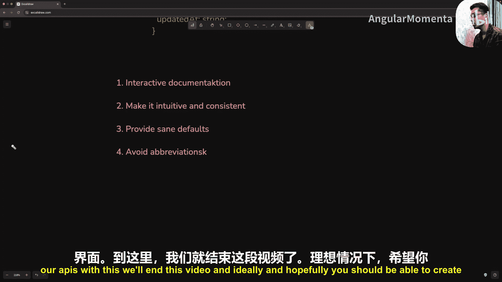