# 【Sriniously】从第一性原理出发的后端开发 ｜ Backend from first principles p12 12. 精通Postgres数据库管理 -BV17aq1BUEhf_p12-

In this video， we are going to talk about databases when you are dealing with backend systems。

 interacting and handling databases is one of the most important and one of the most frequent operation that you are going to perform。

So understanding all the concepts surrounding it is crucial to be efficient in your job。

 So let's start with the question， why， why do we need databases in the first place now， at its core。

A database is simply a way to persist information across different different sessions to talk in a very high level。

And what that means is， and persistence basically means storing data in a way so that it survives even after the program that created it has been stopped。

 So， for example， think of your to do list step， right。

 you add an entry and you can check off all the task that you have already finished， et cetera。

 ettera。 like that's the basic functionality and expectation。Pro me to do app。Now。

 when you do some operation， when you create an item or you even check off an item and you close there and when you open it again。

 you find all the information， this state of the data that you left it it's the same venue。

Visit again when you come back to the app。 So that's what we mean when you say persistence。

 The information has to be there in the same expected state。

Even after a considerable amount of time has passed or across different different physical locations。

 that's what we mean by persistence。 If you did not have persistence every time you open the app。

 you'd have to create new to do list items and you'd lose all your progress。

 whatever task you had created previously， etc cetera。 right。

 Perence is a very important thing and we use it in our day to day lives a lot。 Now。

 what is a database when what do we mean。When we say the word database。

Them database is surprisingly very， very broad in the simplelic sense， any kind of structure。

 any kind of structured storage。Can be considered as a database， for example。

You have a smartphone and in your phone you have a contact list right of different different people and that list can be considered as a database in the same way if you are a developer。

 you must be familiar with the concept of local storage。Which is offered by every browser， so。

We can check that out right now if we open this， the developer tools。

 and when we go application and we can check the local storage， and it has some entries， right。

 since we are using this website called Xcal draw， the website has stored some entries in the。

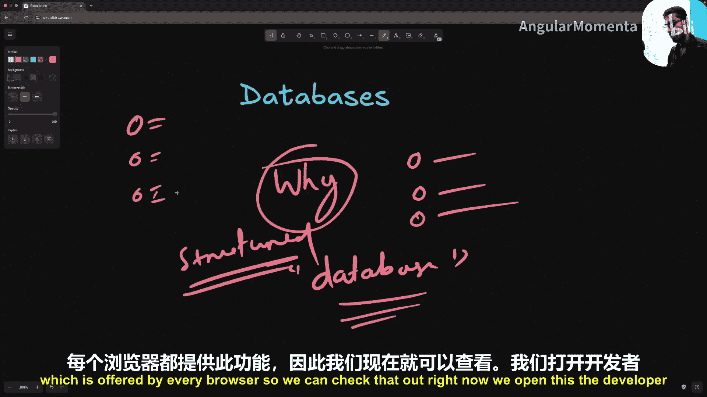

Format of key value store。 It also has a s storage。 It also has a cookie storage， et cea， et cetera。

 like all these different， different types of storage mechanisms。

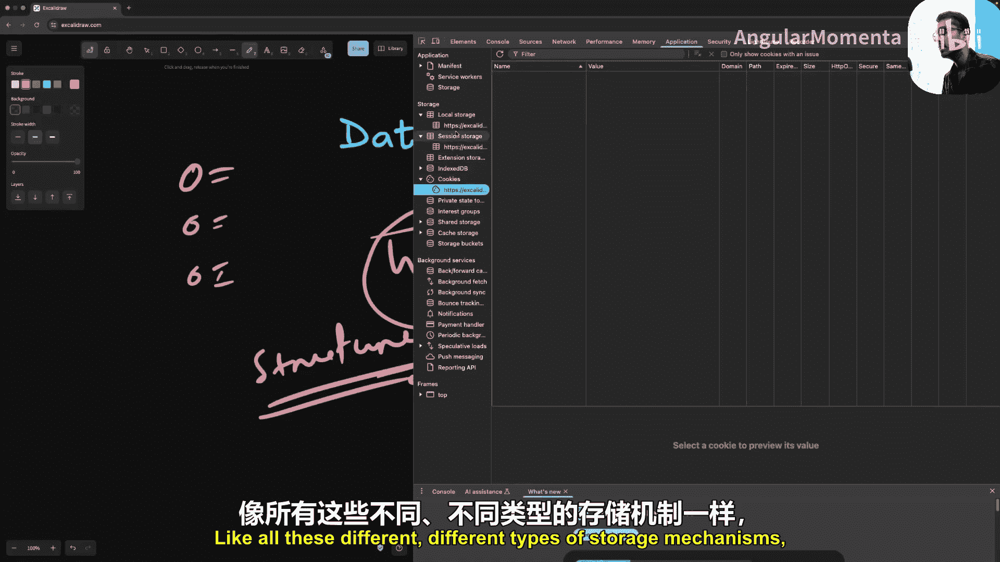

They are also considered as a database。 And even if you take a simple text file where you just jot down notes and you can refer to those notes later on。

Even that can be considered as it。Very， very basic database。

 So if we try to derive that patterns from all these examples。

Daabase basically means is some kind of system， some kind of persistent system。

 which offers ways to create， read， update and delete data from it。

 That's a very basic and high level example of database。

 which is not limited to what you mean when we say database in the context of backing systems databasease is very generic term。

Which means a persistence layer， which provides operations of gr， create， read， delete and update。

 but。When we say database in the context of back in systems， in the context of servers。

 right in typical developer。Conext when we mention database there。

 what we mean is disk based databases dis based and by this I mean hard disk it can be H SSDs or whatever modern technology of storage we have available but why this storage。

 why disk based databases。Because disk storage， whether it's a traditional hard drive or a modern solid state drive are also known as SST。

Is relatively cheap when compared to other means of storage， for example， when we consider Ram。

 which is also considered as a main memory or the primary memory when we take into account our CPU unit right you from a computer science background you must have known that we have a CPU unit which can access the primary memory and it can also access the secondary memory which we also call us disk waste memory。

Right， which uses either a hard drive or a SSD。 Now， Ram is very fast。 It's called main memory。

 and it is very， very fast as compared to the。This based alternative， but the problem is。

Ram based storage。It's relatively costly， and we don't have as much supply。As you do。

 when it comes to this waste。 So if you check the configuration of your system。

 whether it is a Windows based Linux Mac does not matter。

 If you check the configuration of your system。Most people have something like 8 GBM or 16 GBM or 32 GBM。

 or if you're。On the higher end of the consumer。You must be having 64 R max max 1，28 G B of Ram。

Right，But when it comes to hard disk when it comes to a secondary storage， most people。

 since hard disks are relatively cheap these days， most people。

 they have storage starting from 5 p G B up to 2 d B。

ItThat's the average storage people have in their laptops in their systems， right。

 and you can see the pattern we when it comes to the storage space。We have limited amount of Ram。

 We have limited amount of primary memory， but we have a lot of space when it comes to dis basedd memory。

 our secondary memory and trade of is Ram is very fast when it comes to data retrieval or data saving and dis space storage is relatively slow because of the way the data is stored and because of the way the data is fetched。

 And that's the reason when。😊，We use caching mechanismsisms， either in red is or in memory caches。

 et et cea。 whenever we talk about caching。We talk about storage in Ramm or storage in primary memory。

Because fetching data or saving data from primary memory from our cache is very。

 very fast when it comes to fetching data from our databases， which are disk based storages。

 also a secondary storage， but when it comes to databases。

 the thing that matters most is we need more space and we can be fair amount of trade off when it comes to speed and that's the reason。

Most databases， at least when it comes to traditional databases like relational or non relational databases。

They are based on disk based storage or secondary storage。

 that's where they actually store their data and the format they store their data。

 the way they store their data， all the algorithms surrounding it etc ce tricera。

 that's a very technically deep area and we are not going to cover that in this video。

 we just want to keep this relevant for a。Back in engineer， right， on the application level。

 the only thing you need to know is。Cashching technologies like Redis， etc ce。

 they stored their data in primary memory or Ram and databases。

 traditional databases like Postgras or Mongo debi which we cover next all these relational or non relational databases。

 they store their data in disk or secondary memory， because disk based storages offer more capacity。

At less price， but at the cost of less speed that it is clear we are talking about databases in the context of disk base storage and that too。

 in the context of。Beckon systems。now we come to a term which is known as PB also known as database management system Now what is a database management system。

Just storing our data， whatever data we have， just storing it in some kind of disk storage that is not enough。

 Of course we also need different different ways of retrieving that data or making changes to that data or deleting that data right all these different different operations that has to be done and that has to be done in a very efficient way since we are talking about hundreds and thousands of G of data right So we need these operations create read update and delete operations and that too in a very efficient map and that's the reason we have softwares we have software systems called us DVMS software。

And whose sole responsibility is to efficiently provide all these grid operations to this。

To the clients or to the users whoever is using it and storing the do data， of course。

 they also have a lot of other responsibilities like security and scaling their database systems and load balancing。

 etca et cea， right， but on a very high level。They have two responsibilities storing the data and providing different different operations to the client or the user。

 primarily grid operations， create， read， update and delete。 So in a way。

 some of the responsibilities of D BMS S that we can point out is。Bst。Data organization。

 they need to efficiently organize the data so that fetching， updating and creating more data， etca。

 cea， all these operations are efficient second access， as I've already mentioned。

 they have to provide methods to do grid operations， create， read， update and delete。Third integrity。

 Now it's a technical term。 but what it basically means is。的。Accuracy of the data。

 the validity of the data， well see what all these different different buzzwords mean when we actually go into examples。

So this just means that data is correct whatever data that we are storing that data is valid。

 that data is not corrupt， so to give you a very high level example it's an ecommercecommer platform and we want to store all the order details of customers and each order will have some kind of payment information。

How much was the order， et cetera， et cetera， right， And in the database。

 we are storing the payment amount。As a number。 So it's the responsibility of our database management system or our DDM is softwareer。

To maintain the integrity of the data so that no one can insert。Anything in that field。

 we if we have a payment field， then。For this field， we want only。Number did， right。

 We want some kind of numerical amount。 So someone， if someone triess to store a string。

 something like。Let's say something。 And if they try to insert it here， that should fail。

 the DBMS softwareer should not allow it because。It's their responsibility to maintain the integrity of the data。

 the correctness of the data， the validity of the data， right。

 It has a lot of meanings in a lot of contexts。But this what it means。 The data has to be accurate。

 The data has to be consistent。 Now， fourth is security。

 It basically means protecting the data from unauthorized access databases。

 w software have different different users，  different different roles， etc cea， etc cetera。

 for the sake of protecting the access to the data， right？

 So that's a very high level overview of what are the different responsibilities of a database management system。

 Now， here we have a question。 Why do we need。This D BM S software。

 why not use just simple text files or any kind of file and store all our data in text format inside it。

And when people were coming up with these concepts of databases。

 or before people came up with these concepts of。Daabase management system。

 This is how people started with。 They try to store all the data in text files。 right。 Now。

 the problem with storing your data index text files is there are a couple of problems。First thing。

 passing thing， So if we are going to store our data in a text file。

Every time you wanted to find a specific data point。

 let's say it's a customer database and you're storing all the details of your customer。

In a database inside that text file as plain textex。

 And every time you wanted to find a specific customer， you'd have to write code。Application code。

 It can be any programming language， Python， Java， Javascript。

 go rust can be any programming language。You have the right code in that programming language in your application level。

 in your backend go。To past the text file。Split the lines。

 So if we have a text file and we have different different lines。

 you have to pass all the entries of this text file and you have to split these lines。

And we have to compare each field。 And this whole process is very slow。

 If you are familiar with passing data from our file system in different different programming languages。

 languagegus like rust are relatively faster when it comes to passing。Kind of operations。

 But languages like jascript Python are relatively slower。As compared to rust， they are fast。

But compared to a highly perform language like rust， they are relatively slow。

 So if your programming language is something like JavaScript or rubbi。

 then you will also face a huge performance hit。And also doing all this passing thing is very error pro。

If something goes wrong， you can corrupt your data。

 You can provide wrong information to your customers， et cea， et cetera。

 Like par itself is not an efficient solution because how slow the operation is and how errorprone it is。

 second thing is。There is no structure。 Text files do not have a formal structure。

 You cannot enforce that data has to be in this particular structure in this file， right text。

Fileles are very fluid。 and you can store any。Amount of text in any format。

 you just have to dump it there。 there is no structure。

And that makes it very difficult to enforce consistency in data。

 You cannot enforce something like this。Particular field will only have number。

You cannot enforce that rule right since it is all text files since it is all string。

 it will take any kind of data and itll put it there right it cannot promise any kind of data consistency。

 Third thing， concurrency by concurrency， What do we mean what happens if two people。

At the same time， try to update the same text file at whose update is going to be considered as LED legit and whose update is going to be。

Going to get discarded， obviously the last one。Who updated this text file。

 only their update is going to persist， because let's say。We have a text file， and we have an entry。

 let's say amount， right amount。 and we have something like40。

 Two people are trying to access it for the sake of modification。

 They want to modify this vehicle amount。So the first thing they will do obviously is read the file right they need to read the file before they make any changes they cannot just put some arbitrary amount they want to increase the amount so one person wants to increase the amount by 20 another person wants to decrease the amount by 20。

Now， what happens？Both of them read the data， right both of them read the data at the same time。

 they start their operation at the same time。Okay， they both have the initial entry of 40。

 So the first person， they increase the amount， so they do 60 and the second person。

 they want to decrease the amount。 So they do it 20。 and they save it Now。

 even though both of them started at the same time because it was a read operation when they save it。

 of course， there is going to be。Some kind of first comes first serve kind of situation。

 You cannot tell beforehand that。This update is going to persist， or this update is going to persist。

 It all depends on what CPUU cycle it is earn and， and 1 thousand00 different parameters， right。So。

 depending on the。Andmin of the system。At the end of this operation。

 at the end of both of these operations， the value it might be 60 or it might be 20。

And there is no consistency here。 That's what you mean by concurrency。 when two different users try。

To do some kind of modification at the same time， to the same data。

 you need some kind of concurrency mechanisms inside that software。

 inside that database softwareer to efficiently to accurately manage the whole interaction。

To provide a consistent result right and a simple text file simply cannot do that。

 So these are overall all the challenges that people faced and if you try to do that today you will also face the same challenges after some time after your data grows。

RightAnd because of all these challenges， because of all these limitations of simply sortoring your database in a text file。

Webble came up with softers like D BM S。 and now that we are talking about D BM S。

 we have finally reached the stage where we can talk about different types of D BM S software。

On a very high level， we have two types， the major two types，1。Is relational。

 and the other is the opposite non relation relational database basically means a database system which organizes data。

In tables。Rs and columns。 Okay， and relationships between different different tables are defined using concepts like foreign key。

 et cetera。 right， some of the key features of relational database。Data is structured。

And data is inserted into a database。Which have。Predefined， predefined schema。

You cannot just arbitrarily insert or push any kind of data into your database。

That particular data should have a particular schema， which basically means。

It should have a corresponding table， and that table will have a very strict schema。

 you have to beforehand define all the columns。Of a table and all the data types of those columns。

 right， everything has to be preded。You cannot do。Anything on the flat， It is a very strict system。

 And because of that strict schema enforcing， the advantage it offers is。Data integrity。

 which basically means at any point of time， you can bet on the state of your data。 You know what。

Is the data type of a particular columnies what are the different relationships between different different tables and a lot of different things the data in your tables always have a consistent state they will always have an accurate state similarly we have nonrelational and next in order to interact with this database we generally use the language SQL also known as structured query language in the same way we have non-relational databases。

So some examples of relational databases。Which you might have already heard Mysql， postgra。

 SQ server， etc cetera， etc cea， right we have a lot of different different relational database types。

Similarly， we have non relational。 you must have heard about Mongo debi。

 one of the most famous databases in the non relational。Doomain and the difference between these is。

 while relational databases。Pce you to have a consistent schema。

A very expected schema before you can put data inside。Your database， right？

You have to have a prettyd schema。But non relationlational databases do not enforce anything such as that。

You can put any kind of data and do entries of a same table。

 we don't use that on table in the non relationlational domain。

 but if you are doing a sidewise sort comparison then a table is called a collection in Mongo Dbe right and inside a collection。

Each entry in relational。It is called rows and in nonrelational or Mongodabe it is called a document in relational domain each row will have the same kind of data。

 the structure of the rows will always be the same but in nonrelational domain each document can follow a different structure that's the primary advantage but sometimes disadvantage when it comes to the no SQL domain。

 The advantage is obviously it has a very flexible schema。

 So if you are doing some kind of prototype， you want to move fast。

 you don't want to spend time figuring out your database schema and forcing the schema。

 maintaining it etc cea， etc cetera。 then you can go with something like Mongodobe and move very fast without thinking about your database schema you can push data on the fly。

 you can fetch any kind of data etc， et cea right the flexibility can be an advantage in some scenarios。

 So if you want to take an example let's say we have a CRM。

CRM also known as customer relationship management software。 And inside this。

 what usually happens is it needs to maintain accurate and consistent data about customers data like contacts and all the sales opportunity details。

 etctera， etc cea， right。And this data， this critical data is more suited to be inside a relational system。

 A relational database like Postgres is a very good choice because it provides strong data integrity and allows for complex queries and analyze relationships between customers So a CRM system。

😊，Is a very good candidate when you are trying to decide between a relational database and a non relational database。

In the same way。If we want to find a use case for a non relational database。

 we can take an example like C M S， also known as content management system。

 So content management systems are used to。Push content from a remote site to different different content distribution system。

 For example， let's say you have。A blogging platform。So every time you want to add a new article。

If you have website， you don't want to open your code base and write a new file and push it to Github and deploy it etcet etca。

 right you can pull the data in your website dynamically from a content management system。

 it can be something like sanity etc etc like we have a lot of css in the market。

 So you can pull that data from a content management system and you can render that data。

 So every time you want to add a new article， you just have to log into your CMS system。

And write that blog or article in the markdown format and save it。

And the next time someone refreshrees your website， the new article will be fetched。

So when you have a use case like this， the content that am needs to store that is not really structured。

 so an article can have an image， it can have a code blog， it can have。

A you embedding plaitized like is content can be of a lot of types。So in non relational database。

 something like the Mongodobi makes a lot of sense。When。

You don't know beforehand what are all the different types of data that are going to be stored here you just want to take everything and dump it here。

Right， so in these use cases， Mongodobe makes a lot of sense。 but even though。

Databases like Mongo DV。They offer a lot of flexibility。

They can also present challenges in terms of data integrity。

 which is a very important concept when it comes database systems because they often lack the strong constraints and relationships of relational databases is easier to introduce inconsistencies into the data since。

The schema of the data， the integrity of the data is not enforced at the database level。

You have to do it at the application level， which adds more complexity to your code。

 and of course it is more error prone。Since application code is generally changed a lot。

 and it's very easy to miss something to introduce new bugs to your code base。

 So now we have to make a choice we are going to learn about databases。

 and there are a lot of options in the market。 We have relational。

 We have non relational in inside relational。 We have Mysql。 We have postgres。

 We have Site and scale server。A lot of different， different products and all of them pretty much offer the same kind of features。

 and all of them can skill when it comes to。Implementing in in your production systems。

 So we have to make a choice here。 What database are we going to proceed with？

 And when you have a situation like this， going with Pogra makes a lot of sense， why。

A couple of reasons。 One， it is open source and free， right， It is not a proprietary software。

 It is completely open source。 You can go and look at the source code of the postgra。

 even though you won't necessarily be doing that。But still。It is an open source softwareer。

 and a lot of companies prefer open source softers so that they can host it。

 They can deploy it in their own premises， in their own server etc cetera。a。 right， second。

 the post list。DVM system。It sticks to the SQ standard。

 so you can take any SQ query and you can run it on it post grid system， and it will。

Perform the same way it performs in a different database system like Mysql or IQl server because the Postgres database system sticks to theQ standard。

 So in the future， if you want to migrate your database to a different system。

Then you won't have to do a lot of work。 Let's say you want to migrate to my for some reason。

 right so。Since Postgres is SQL compliant and you have written all your migration statements。

 all your create update statements in fetch statements in standard SQL format。

 then you can just change your database and do some minor changes and you can easily switch from Postgres to MyCql。

That's one of the other reasons to go with Postgres。

 It is very easy to migrate to a different system if you need it。

3 it is very extensible which means it offers a lot of features if you go to the Postgres documentation it is around 100 pages long and it offers a lot of features pretty much covers every single use case a typical SAas might encounter and it also has a very good extension based system so you can customize it depending on your own needs fourth it is known for its reliability and scalability and fifth I think this is the one thing that makes it easy to make the decision it has very good JsonN support。

Now， as we discussed just before this that one of the primary reasons to go with something like Mongo Dbi。

 a non relational database is you can take any kind of data so when we see any kind of data。

We mostly in Json any kind of JsonN because in JON you can pretty store any kind of data right。

 it can be number， it can be string other Jsons that are embedded inside it arrays， etc cetera。

 etc cetera， right so you can store any kind of JsonN as a document in a nosql database in a Mongoev database in the same way。

Since Postgs offers a Json data type and it has very good indexing and query capabilities for Json fields。

There is no other reason to go for a different database just for dynamic data right you can use Postgres with JSO fields for your needs of dynamic data as we saw in the previous examples of a content management system。

If you have some kind of content that you're getting from the user and you want to save it in your database。

And you don't have a strict schema for that content。 We can go with a typical JSO schema。

And dump whatever content that is coming from the user there and you when you want to render it。

 you can fetch it from there and you render it， right？

There is no need to switch to a non-relational database just for the needs of your dynamic data and because of all these features。

 Postgres is pretty much the number one choice when it comes to at least what I have seen a lot of startups and a lot of big companies also stick with Postgres and Postgres is usually their first choice and even though if you do your own research you will find a lot of articles where you'll see Mysql has a lot of performance benefits。

 etc etc But until you are serving millions of users and you want to optimize a very specific bottlene of your application you don't really need to think about whether you should go with MyQql or whether you should go with Postgres since the rich set of features and the very good JO support of Postgres Postgress should be your first choice in pretty much all your projects and that's the reason in this video we are going to go with Postgres。

Whatever all we are going to learn about databases， we will learn in the context of Postgres。

 And with that， I want to give a note here that there are already thousands of free resources available on YouTube elsewhere like Uudemy。

You have peer resources and you have hundreds of free resources that cover the basics of SQL and postgQ。

 right？SQL is when we say SQL it is the language that we use to query and Postgres is the database system。

 the software on which we execute our SQL queries right so there are a lot of course three courses available right in YouTubetu for both SQL and Postgres right so instead of repeating the same thing instead of doing all the createable select the basics of order by group by all the basics of SQL and the basics of Postgres again in this video we are going to save some time and we are only going to stick with some concepts that are very relevant when it comes to backend systems and we are going to leave the basics so that you can learn it elsewhere。

So if you want't， you can pause this video right now。And just search YouTube SQL basics。

You will get videos from1 hour to 20 hours and same for Postgres basics so you can choose a video according to your own comfort。

What amount of comprehensiveness that you need， You can watch a video of1 R and come back to this video。

Or you can。Spend a couple of days learning about a skill basics and postgre basics and come back to this video。

 right， So that is one of the prerequisite before you proceed to the next section。

 So you're going to skip all the basics so that you can do your own research。 This is table plus。

 It is a。😊。

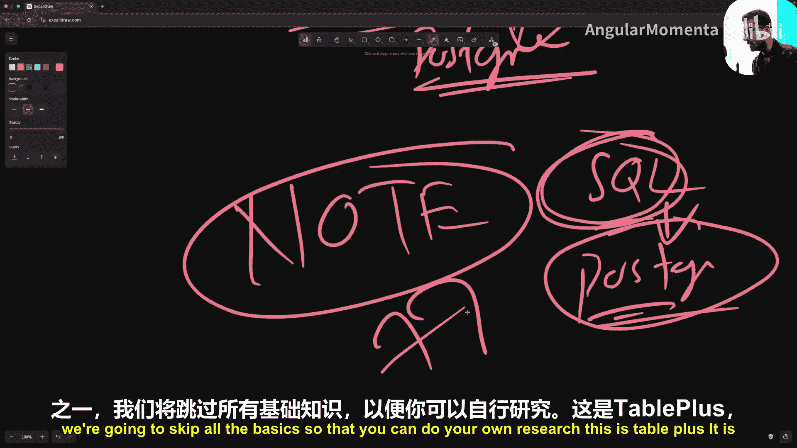

Graphal software for interacting with your databases。 And it has a very modern。U I feel。

This is the software that I use on my day to day basis for all my database query operations and exploring etc。

 right。So we'll be using this in this entire video to go through different different demos and to explore different different concepts。

Now， starting with。What are all the different different data types that we have available in Postgres I just want to bring this even though just before this I mentioned that we won't be covering the basics of Postgres and basics of SQL in this video but I feel this is an important piece of information that we have to cover before we proceed so that we don't have to repeat this again when we are actually talking about。

Our back in system， right。Now we won't be going very deep into each data we'll just do a very high level introduction this is a createable query if you are already familiar with the SQL language then you will recognize this。

 this is how we create a table。In any relational database， whether it is post G Myql。

 etc cetera cetera。 right now we are creating a table whose name is data types of demo and these are all the fields which basically means these are all the columns that are going to be in this table。

What一ろ？Right， so starting with we have serial。What does serial mean？It is just an integer data type。

 but each time we add a new entry。Into the table， this will increment the value。 So by default。

 let's say it starts with0 right the next time you insert a row。

 And if you omit this I field in your insert statement。

Value of this column for that row is going to be one same way the next time you enter something。

 Itll be 2，3，4， right， And usually we use serial or big serial。 So there is another version。

 which basically has more capacity， the maximum。Number that you can store in big city。

Is a lot higher when it comes to serial， so usually。When you are dealing with production systems。

 we go with big serial when we want to make ID。I that primary。So， primary key is basically。

A unique field using which we can identify a particular row in a table right now serial is an endteger which is going to be automatically incrementing。

With each entry in our table then we have small end， we have big int and we have integer。

 all these three are basically integers， just that the capacity as I said the maximum number that you can store in integer so this is how the scale works。

We have intesger， which is less than small and， which is less than big。 So depending on your need。

You can either go with integer small end or bigant same we have disimal and numeric。

 which are mostly considered identical。You can use either of them。

 They pretty much behave the same way。It， and the。Purpose of this is what does this pen and this two means is it basically says you can store a。

Numbered， you can store a number。In。This format， right on the right side of the decimal point。

There will always be two numbers， right， That's what this two means。

On the right side of the decimal point， there will always be two numbers。And what this pen means is。

Across all these numbers in this。Complete number across all these numbers in this numerical representation。

 the maximum amount you can store is 10。 so you can store something like 1，2，3，4，5，6，7，8 dot。9，0。

 right。Now， if you count it， we have 10 numbers。 We cannot store something like 3 here。

 We cannot add something like this because the maximum we can store is。In numbers。

Across this whole numerical representation right and on the right side， we have two numbers。

This is what this means。 and the question mostly people ask is。

What is the difference between decimal or numeric， something like this as compared to something like real or double precision or flow right now the difference is a little complicated floating point numbers。

 they can be real double float， whatever you call them。They are represented。

In a very different manner， as compared to the decimal counterparts。

 which we have been decimal and numeric。租。The thumb rule that you should have is if accuracy is an important aspect。

For that period。So let's say you are soing in information like price for a feel like price accuracy is very important。

 right， because it is going to be involved in a lot of calculations and a lot of things can go wrong if you have。

Different different representations of the same number in different different systems， et cetera。

 et cetera。 right， The accuracy is very important when it comes to a field like price。

 So in this case， you should always go with decimal。

You should always stick with either decimal or numeric。

 but standard says you can go with decimal right so if accuracy is an important aspect。

 then always go with decimal。Because floating point representations can have different different values across different different systems because of the way they are stored because of the way they are processed。

They were a very different algorithm， when it comes to。Rendering or at the same time。

 let's say you have a feel like size， right， and it is a size of a area。

 It can be something like 567。8987， something like this， right， some fractional number。

 some floating point number， where accuracy， let's say if 8，987。Turns into 9，0，0， or  8，9，6，7。

 something like this。 very small discrepancies in the accuracy or the representation of the number does not impact。

A lot of difference in your systems。When you have numbers like this。

 you should go with floating points right now if you have a question like if decimals are always accurate。

 then why shouldn't we always go with decimals And the reason is because decimals always have accurate representation of their value and because floating points。

Don't have that kind of accuracy。 Floing points are considered faster when it comes to such storage。

 when it comes to performing different different calculations， etc cetera， etc cetera。

 right floating points。Are very fast， that is the reason in a lot of scientific computation based domains。

 floating points are preferred as compared to disimals or disimal representations。

So you should always evaluate what kind of value that you are going to store and it is not something that is going to have a lot of impact if there are small discrepancies in the representation of the number。

tThen you should go with float because they are very fast to process and very preferable in these kinds of scenarios。

 but if it is a value like price or something very critical where accuracy matters a lot。

 then always go with decs right that covers pretty much all the floating point data types then we have a very interesting category which are string categories。

And we have three types in that。 We have care， ver care and text。

 Now all these three data types store text。 that is the similarity between the three data types。

 The difference is when we say care 10 and inside this field， if we say store something like a B。

If you store something like this inside a data type， which is declared as this and the length。

Is defined 10。 Then what the database system will do is it will pad。Extraite spaces in that field。

Before saving， because we have defined。The length is 10 and it is a character derivative right that is the property of character derivative type。

Whatever length that you have defined does not matter the。Actual value that you are trying to insert。

It'll always try to store the same length。If you don't provide the same length， then it will just。

Paad some empty spaces， right， inside whatever way it is represented。 it will add some empty spaces。

 and it that's how it will store it。 And that is the reason people came up with another standard which is called verca sorry variable character。

 Now， the way it works is when we say the length is 2，55， what it means。

255 is the maximum length that you can store in this field。But if you store something like this A B。

Then the length will be2 right。 It won't add extra spaces just to make up for this 255 length。

If you store a smaller value， then it'll be2。 if you store something like A B D， then it'll be 4。

 et cetera， et cetera。 right， depending on what value are actually being inserted into the database。

 it'll adjust itself just that the maximum。Amount the maximum number that you installed。Yes 255。

 you cannot exceed that if you do， then you will get a database level error。Now。

 the last thing is text， which is a very modern alternative to verca。

 so imagine verca without any length field。Basically any amount of text， a text of any length。

 Thats what text means you dont enforce any length on this field you can store a text of any length。

 usually it has some kind of parliament like 250 MB or something something you can do your own research for that。

 but。And when we say 250 m of text， it is a very， very。

 very long text right usually we won't be needing that much， but that's what it means。

 Now the question is。When you want to store a string。

 which you should go with the first thing is never choose care right it it is a very old standard。

 people used to do it way back， So either go with backer or text you can use care if you know beforehand that the length is always going to be the same right it cannot be variable So let's say you are storing the chs of all the days of a week。

 So the values can be a mo or T U or w as you get my point right。

 if you have a requirement where you know that you have。

All these values and all of them have the same length。

Then you can go with a data like here to and this way。

You won't be wasting a lot of space because of the variable length of different different entries of the data。

 right？Only go with care if you have a use case like this， but。If it is a general text。

 let's say name of a customer， name of a product， etc ceera。 et cetera， or a description， etc cea。

 etc et cea。 Then either go with verare or text now。

How do you choose V versus text What I believe personally is you should always go with text because。

If you go。Explore the documentation of Bogs。 they themselves recommend that always use text which is the model alternative of verka top length。

Because most people， what they confuse with is if you use vca with 255。

 this is going to perform better。As compared to if you like text or you cannot index a field will cover index shortly。

 but you believe you cannot index a field of type text。

There are a lot of misconceptions around this because other databases。

 databases like Mysql SQl server， Sqite， they have different different conventions the way they operate。

The way they function are very different。From Postgres and when people switch between definitive databases。

 they get confused or they are misguided so if you explore the official documentation of Postgres。

 they recommend that always go with text there is pretty much no performance difference between Vca or text and the second thing which is my personal opinion that using something like Vca 255 which is by the way a convention。

From bicycle。That people from my， which has a very popular database and that has a convention of using Verca 2 55。

 And that's the reason a lot of people still use this。

And 255 is where at least when it comes to postgre， 255 has a meaning。

In the context of a Mysql database， but when it comes to postgre。

People just use the number 255 as a random number， right it has no meaning whatsoever in a postg database and people just use it without thinking just because the way it has always been done and that's why I personally believe instead of going with a random number like 255 go with text and。

And the reason is。Let's say later on， you want to increase the length。For some use。

 let's say you are dealing with a field called description and you just set the lens this 25 where as verka。

So later on you want to increase the length， so to cater to that requirement。

 you have to do a database level migration。Which effects。A lot of data and a lot riskier。

 of course migrations are performed on a daily day basis。

 but still you should always avoid a database level migration if you can， right。

And that's the reason using something like text and enforcing the length or whatever it is on your application level。

And since we are not in the data engineering domain， we are not in the data analyst domain。

People in those domains， they usually deal with SQL directly right they have some kind of interface and they write SQL directly and they see that result of the SQL data directly as a right right SQL is their first point of interaction but as back in ingenious when we are dealing with back systems we usually interact with SQL databases。

Through。A driver right we have different different drivers depending on what programming language that you are talking about and that is how we interact with the database thread driver and we have a lot of application code when we are dealing with the data。

That's the reason we can enforce the length or whatever constraint it is。

On the application code so that our database migrations。

 all the database system database statements are simpler to read and simpler to maintain。

 So let's say someone new， some new comes over and they look at this。 they see vacca 2 55。

 and they think that this has some meaning。 even though the。Person who just created it。

They just add it without thinking， right， it is just a random number for them。But。

Some when new comes over， they will think there is some meaning to this number or there is some meaning to this 10 number。

 they will try to understand where this is coming from。 and since there is no documentation。

 they will try to dig through the code etctera， etc there is a lot of headache that comes with it。

Because。The number。A number like this， A number like this。

This represents that it has some kind of meaning， even though it doesn't。

Most of the times right so instead of this， if you go with just text。

 then it is a lot simpler to read。A lot simpler to write these migration statements。

 all the SL statements， because you won't have to think about this lens and all。

And if someone new comes over and they read it， they just think that it is a text field。

 it is a character field， right there is no exter meaninging to this。

So those are some of the concepts surrounding string fields， string data drives in postgre moving on。

 we have booleion， we can store true or false in this field， we have date。

 we can just store the date in this and we have time。Where we can store that time。

 right in our minute seconds format。Then we have timestamp for storing the information of date and time at the same time。

 then we have timetamps which is extra Z at the end。

 which just means store that time zone information also in this soial store timet and 8 time zone information。

Then we have an interval。For storing like 10 days or one week as a test， like those kinds of data。

Then we have U U I D。 U I D is a very popular choice when it comes to making table primary keys。

 right because of their U R friendliness and their unique nature。

 So that's the reason Postgres offers a native U I D type right inside the database。

 Then we have Json and Json B， As I mentioned before， Postgres offers。Native J。

And we have an extra type which is called Json B， also known as Json binary。

 And the primary difference between Json and Json B is。When we use a field called JSson。

 this will be stored as a plain text， a plain text with the key value format that we usually see when we are reading JSO。

But when we use this Json B， this will be converted into a different format。

Posgres will serialize it into its own native JSON format for efficiency purpose so that it can perform better it can perform a lot of query capabilities。

 etctera， etc， right。Theres something that is limited to Postgres。

 it is not an SQ standard and most of the times you should go with JsonV because of the performance advantage that it offers then we have the error types you can store an area of different different data types like and store an error of vintageger you can store an array of JSO data time whatever all the different different data types that we have then we have some other random data types like storing network addresses Mac addresses and geometrical points Xml etcs that we don't really use on a data but if you do want to use it you can export the official documentation and you'll find more information on that and this is how we insert data into our database via right insert into the table name and order of all the fields that we want to insert the data。

And then we provide all the values in the same order that we wrote our fields in right and this is how we are inserting all the data。

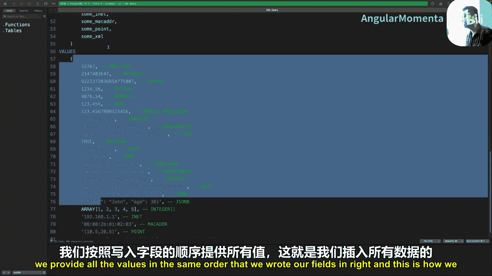

This is an example， small integer。 This is an integer， big integer。 as you can see。

 it is a lot higher than a normal integer than you have decimal。 We have real。

Dt precision with basically floating point representations。 Then we have character， verca and text。

 and we have bullion。 We can either pass through or false here。 We have date。

We have time an hour minute seconds format， we have timest where we have the date and the time we have times stampamps where we have date time and the times on information then we have interval have U ID this is what a typical U ID looks like we have J on J on B。

And while inserting， even though Json and Json B looks the same。

 but Postgra serializes Json B into a different format for faster processing and faster retrieve。

 right？Then we have array。 Then we have IP addresses， Mac addresses。

 geometricical points and XML and right， all the data types that we basically saw。

 And that's pretty much all about all the data types that we are going to deal with as backend engineers in a typical database system。

 Next up， what we are going to do is we are going to。

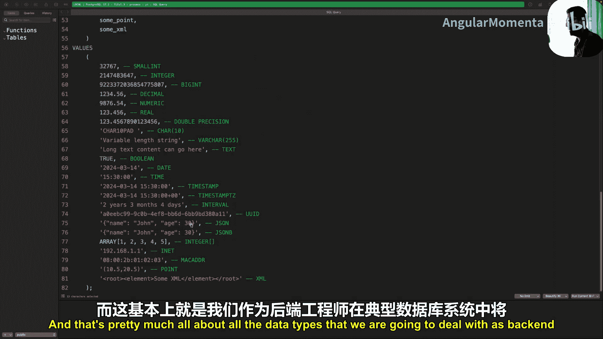

Design the database of a project management。Platform in the previous video， we created。The APIs。

 we designed， remodel the APIs of a project management platform， similarly。

To understand different concepts of databases and different relevant concepts。

 not just theoretical concepts are very advanced concepts that we don't necessarily use on a day to day basis。

 but very relevant concepts in database systems， especially in Postgres。

 we are going to design a database of a project management platform。

And we are also going to write queries for different different As using the same databases。 Now。

 before we get into that， just want to bring up one topic， which are。

knownown as migrations in backend systems， especially in production systems。

 you don't necessarily just open a softwareer like table plus and use start writing queries， right。

 you cannot do that because if something goes wrong or even if something does not go wrong， but。

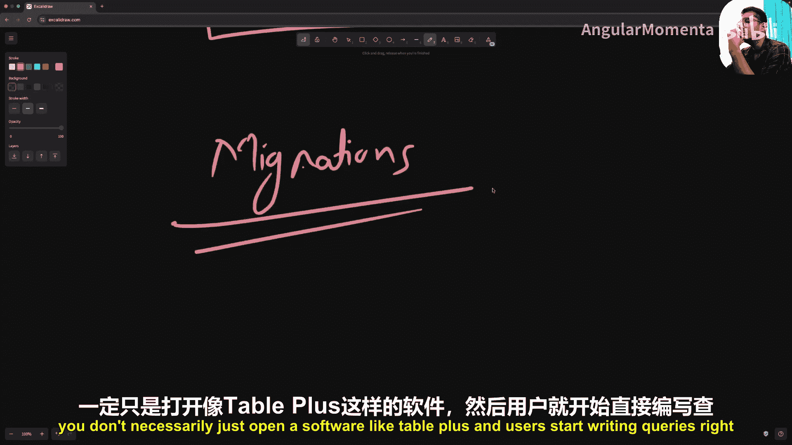

There is no way to track what all changes that are applied to a particular database over time or who applied it。

 right？There is no way to control。The version or the control the state of the databases across different different times right and that is the reason most database systems follow something call as database migrations Now database migrations are basically different different files let's say we have1 dot sQl give a folder which are called migrations inside the folder database。

 right。

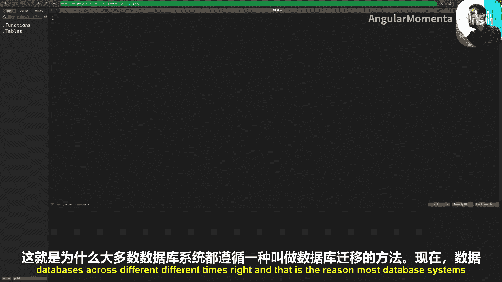

You have a folder structure like this。 you have D folder inside that you have migrations。

And inside that， you have different different files。 You have one doscu。 You have two doscu。Yeah。

3 door Sq， et， et cetera。 right， And in each file， you have a couple of SQ statements。

 normal SQ statements， nothing fancy， right， You have createable or create index or drop table。

 etc cetera， et cetera。 And with that， you have a tool。 Usually it's a command line tool。

 We have a lot of command line tools for。Performing migrations and maintaining migrations。

 for example， we have B B mate or we have go migrate， right， A lot of this famous tools。Now。

 what this tool does。It goes to this location， DB migrations and goes through all these files in this sequential manner。

And because of that。We write the names of these files in a sequential manner。

 Either we perform some kind of numerical series 1，2，3。

Or we add dates times stamps and since timests follow a single。F。

 that's the reason we get sequentialial files， right， Okay， now what this tool does。

 it goes through all those files in that sequence and applies all the SQL statements basically executes all these SQL queries on that particular databases。

 whatever database that you have configured in your environment。 it executes all this。

SQL statements on that database inside migration。 Also， we have two kinds of migration。

 We have up migrations and we have down migrations。 Now。

 some of the modern approaches of handling databases。

 they don't really believe they don't really implement down migrations。

 But this is the standard way of operating right， you have up migrations up migrations are basically whatever change that you want to do。

 you want to create a new table So you write， create table， etc， et cea。

 you want to create a new type。 Let's say you want to create a new enum type。 you write。

 create type in etca， et。 Then you want to create some indexes， whatever all the create statements。

 you write one by one right with proper SQl syntax or postg syntax。

 Then depending on the tool Let's say。A tool like D B mate， where it does， it divides the same file。

 the same SQ file。 let's say1 IQ into two sections。

 one section with a comment for up migrations and another section for down migrations。 Now。

 the purpose of down migration is。Whatever change you did in your up migrations。

 whatever change you applied to the database in the down migration。

 you have to revert all those changes。So that the reason for having this feature called down migration is。

 let's say you applied some migrations， you applied some changes to your database systems and something goes wrong right or something breaks in your production system or anything can go wrong。

What you want to do， you want to roll back the previous version of the database without any changes。

 right， the state has to be the same for that to happen。

 you have to have down migrations so that all the changes that you did in a top migration。

 the down migrations can re that so that you can go to a previous state， you can roll back。Okay。

That's a a migration workflows。 You have a tool。And that tool。

Usually creates a table called schema or something like that in your database and using which it tracks that which is the current version of the database right。

 let's say you have1 SD 2 re 3 SD， right。Then in your schema table， you will have something like4。

 right， current schema is 4 because for。Is the latest changes that you have applied in your database when you come back and you want to add another file or 5 dot Sql before you apply that file before you opt that migration。

 your current database schema will still have four， right。That's how the tool works。

 You have a migration tool， which goes through all your SQL files。

 applies all SQL queries on your databases， one by one。If we to send up migration。

Then it applies all the changes if it is a dull migration。

 It rewards all those changes for that version。 Now， the question is why do we need migrations。

 There are a couple of reasons。 One reason as I've already mentioned。

 you cannot just open a graphical tool and execute a skill statements because that's very hard to keep track of what are all the changes that you've made right unless you want to save it to a particular file and you want to commit to kit。

 etc ce。 et ce。 And after all those things， youll come up with your own migration system。

 That's why we have this concept called migrations。 a couple of advantages of using migration is one。

 as I said。Keeping track of database。Changes， keeping track of database changes over time right you have a file。

 you have a lot of files in a particular folder which is committed to your version control system。

 let's say it's Git or Gitla bit bucket， whatever platform that you follow to version controller code usually your migration statements stay with your code and you commit to Gi Github whatever platform you follow。

And over the time， you keep adding new migration files to the same folder。

 and that's how you keep track of all the changes that are happening to your database schema。

 second is rollback。 As I already mentioned， if something goes wrong。

 you can roll back to a particular version。 that's pretty much all there is to it。

 Mis are a system using which you apply new changes on top of your databases， you can add new。Tables。

 you can modify tables， you can create indexes， you can create triggers， et cetera， et cea。

 right Whatever change that you want to perform on a database。

 you have to create a new migration for it。Because relational databases follow a particular。

Strict schema you cannot just insert data randomly into the databases。 You have to。

For our particular schema， that is the reason we have this migration statements to make changes through the database over time using any command line to。

Now we will start modeling our database for our project management platform and for that。

 we will write migrations。 Okay， here I have my V code open。

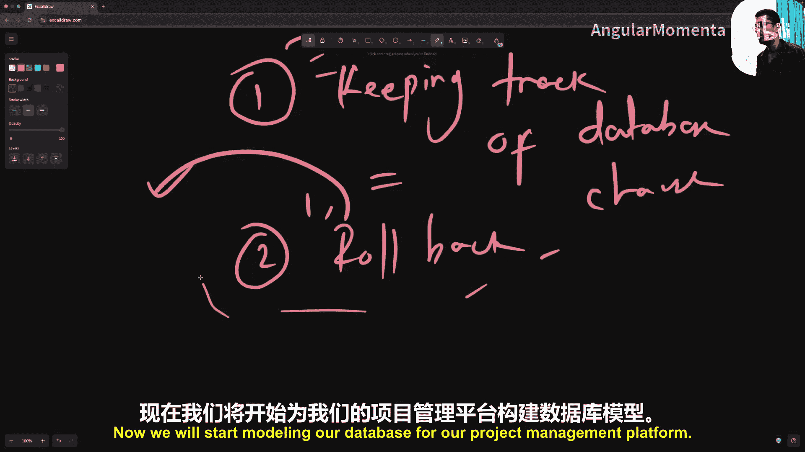

This where we will write all our SQL statements to model our database， right？

For the sake of migration we are going to use DBM it's a command line migration tool that helps applying all the changes to our database right and for that we have to provide the URL of our database to the tool and for that we have to create a new environment file dot Tnv。

And inside that， we can create a variable called database URL and the tool will pick up the value。

Of our exposedg database URL from this location Okay， so to create our first migration。

 DBM offers a command， we can write DBM new create users that sounds right So press enter it creates a new folder called DB inside that another folder called migrations and inside that a migration file。

So as I said， it can follow a sequential number like 1，2，3，4，5 or timests。

 whichever sequence that you want to prefer。Right in this case， it's adding a time stamp。

 then the name of our file， which is create user table。😊，So now it's empty。

 we'll add our migration statements here。Pretty soon。 So this how， as I mentioned。

This section is for writing out down migrations， whatever。

A skill statements that we write after this comment are。Considered as down migrations。

And whatever SQ statements that we write before this down migration and after this up migration are considered as our up migrations right now to save some time Ill just paste all the SQ statements and then we can go through that one by one Ive pasted all the SQ queries that are needed to perform this migration the up migrations and create all the necessary tables so lets explore all these statements one by one to understand all the concepts surrounding it。

The first thing that you notice is we are creating。Some data types call this enums。

 right now enums are。Basically， all those values for which。

You have a predefined set of allowed values， for example。

 we have a field called status in the project table and for that we only want to allow these three values the project status can either be active or completed or achieved。

Active or completed or archived。Right， in the same way， for。Tasks in the task table。

 the task status either can be pending in progress completed or cancelled。Same way for members。

 they either can have the role owner， admin or member， the reason for using a data type called Eum。

Instead of just going with our standard text because。First thing。

 data integrity data integrity when we say in the context of databases， we mean。

We leave the responsibility of checking the validity。

 the checking the accuracy of the data to the database instead of our application code。

 because we created types， this inum types and we used these types let's say we created this type called project status and as you can see we used it here right in the status field thats the type of the status field is our custom inum type which is project status because we did this whenever we insert data。

Or whenever we are trying to update data in the project table and in the field of status。

 if we try to insert any random sting or。那这。We try to insert。We have active， completed or archived。

 We try to insert something， something if。We try to insert some random string like this。

 We will get a database level error。 We don't have to check this in our application code。

 We can leave that responsibility for the database。 We can check it in our application code。

That is a decreasing the scope of the error。But still。

 to make it more robust and make it more secure。We can provide a set of allowed values and we can use that custom type for any field。

Then whenever we insert some data， whenever we update some data。

 the database will check whether that data， whatever value that we are providing for the projects status。

Whether it is one of these。If it is not， then we'll get a database level error。 Okay。

 the first thing is data integrity。 The second thing is documentation。 And I think this part。

 the second point is more important than the first point， because the first point。

 data integrity this we can do in our application code。

We since we are talking in the context of backendons。

 we have a programming language in our hand and we can validate it whether whatever status that is coming from the user that is coming from the front end or whatever application code。

 whether it is one of these strings or not active completed or archived。

 we can do that in our application code。But another advantage of using enMs in our migration statements is when you are going through your old migration statements for debugging something or let's say you are onboarding a new team member and your team and they are going through the database migration statements to understand what all changes that the project went through over the last couple of months or the last couple of years and they want to understand what is the state of the database。

 what are the past states of the database what changes happened over the time etca。

 et ce right and when they are doing that， when they are going through all the database migration statements if they come across this table called projects and they see the field status。

And if it is of type text， but in our application code， we are only doing active completed archive。

Now there is no way for them to find out this piece of information that you cannot put any arbitrary text into your status field。

It has to be either of these three， right？So to find out that piece of inversion。

 they have to go through all the application code they have to see what what are all the places where this field is used and to track down all those use cases then they can boil it down to these three values。

Which is a lot of headache， right？So using enM type provides some kind of documentation for you for your team members for your future team members so that at one glance you can tell what are all allowed fields that can be in a particular field。

Which makes everything very easy to understand。So that's all about enum fields。

 we are creating three enum types and this is a syntax you right create type the name of the enum。

And we write as inum and inside the braces， we provide all the allowed values。 We create three types。

 three enum types。 and we are going to use this in our future tables。 Now， moving on。

 we are creating a user table since it's a project management platform， of course。

 well have users right。 So that's the first table we are starting with we are creating a table called users。

 And if you notice this each table has some default fields。 we have I， we have created it。

 we have updated it。 same for user profile。 we have I created it updated it。 projects。

 we have I created it updated。 So each table has this kind of metadata kind of field。

 the I is not really a metta。 it is the primary key and by primary key。😊，I mean， using this I。

We can uniquely identify a particular row in this table， right let's say。We want to find out。

 let's say in our backend API， we have a requirement that we want the information of user。 Okay。

 since it's a U U I， let's generate a random U U I。Let's paste it as a comment here， yes。Now。

 if we have a requirement in our backend， we have a API which takes the user ID in a dynamic parameter and we have to return the details of that user。

So this is the idea of that user。And we have to find out the information of the user using this ID。

 Now， if we don't make a particular field， let's say the I field。パイメリキ okay。We don't assign the。

Condogniition primary key to a particular field。 There is a couple of things that can happen。

This primary key property。Has some implicit properties。

 Those properties are if you write primary key for a particular field。

 that field cannot be null or null， and it also has a unique constraint。

 So relational databases have this concept called constraints。

 right you can apply a particular condition， particular。Property to a field。

And that property or that condition will protect that field from going corrupt。

 that's a very high level definition。 We'll see what that means when we encounter more examples。

 So when we say primary key it means it implicitly has these two properties not null and unique though so this field cannot be null and this will always be unique if there is another entry with the same value it inserted into this table we will get a database level errors and because of this implicit properties and some other foreign key behavior we use this property called primary key for our I field。

 So each table will have a field by convention called I and we will assign the property。

Primary Q to that。Viual help us fetch different， different information of the user。Okay。

 now what you are saying， we have a field ID， it is a type Uu ID and it will be a primary key for this table。

end。By default， if that is not provided when an insert statement is executed by default generator random U I。

This is what this means this by default natively provided by Postgres。

 So if we don't provide the ID field， which we generally don't。

 we leave it to Postgres the database system。To generate a random I for us and to assign it to that row next。

 we have another field called email and it is of type text。 it is not null。

One thing to keep in mind is by default， all the fields。

In a Postgre table can have null values unless you explicitly specify that it cannot have null values。

 More than 70% of your tables fields should have the N null constraint， right。

 because this not null constraint enables the database to have a consistent state。

 if you don't add this， then the application can push null values into that table。

 even though you don't do it。Intentionally because a lot of database interactions are also dealt with automated scripts so that script can have a bug and you end up with a lot of null values in your database which makes things very。

 very difficult right so for a lot of reasons like that。

All is try to stick to normald unless you have。Reason for that field to be null。That's the reason。

We are writing not null here， we have a field called email。

 it is of type text and it cannot be null and we have a constraint call unique but this means is each dough。

Of this table will have a unique email the moment you try to push another row with the same email address that already exists in the table。

 we will get a database level error that it violates the unique constraint。

And since email is something that we don't want to create two users with the same email。

 we are applying this constrain called Uni。 Next， we have a field called full name。

 It is of type text again， not null。 Then we have password hash。

 It is again of type text and not nu since we don't directly store the plain text value of the password。

 We hash the password and store it。So it's called pass re hassh。 just a name， then。

We have two other fields created it and updated it。

And the reason is we want to know when this user was created when was the first time this user was created in our database that is the reason we maintain this field called created it and usually you dont manually insert it we are providing this default property and we are saying if created it is not passed by default you can take the current timest and you can put it in that row okay and it is of type timestamp with time zone。

Okay， this is of type timet with time zone。 This will have the date。

 the time and the time zone information， samee way updated it。

We create this field so that we can keep track of when was the last time we updated some field of this row。

Okay。And that can have some use cases， for example。

 if you have a table in your front end and you want to display all the users in the order of。

When was the last time？Their name was updated something like this， right so in that case。

 you can use this updated at property。2 sword by。 And that's all about user table。

 Some of the other things to notice here is。All our tables have。This plural form。

 right we have users， we have user profiles projects， and that is a standard。

 A lot of people also prefer the singular form user user profile project， etc cea。

 It's a matter of what your team has decided and what your company has decided。

 but the industry standard is to mostly stick with in the plural form。Second thing。

 all the table names and all the field names will be small case and snakes and by that I mean if it is a single word。

 it will have small case of course as we have users ID email rate all small case。

If it has multiple words， let's say fully password hash created updated it。

 then we'll use snake case。 If you are coming from other programming languages or etc cetera。

 you might have the instinct to go with camel case， right。

 you might want to write something like full name with N capital。

 and you want to merge and get it of the snake case， but that is not a good idea because。

In postgress， everything is case insensitive by nature。 So even if you write camel case。

 postgre will take it as。 So if you write something like this will。

Name was Grace will understand this will name。Unless you write it like this full name with quotes and when youre writing your application code using double codes again and again can be very difficult and make the code very ugly That's the reason we always try to stick with small case you make everything small case and if we have multiple wordss we stick with snake case so that we can avoid using double quotes to make postg understand case sensitivity that's some of the things that you have to remember moving on we have another table。

Call user profiles。 Now， if you check the command it says one to one relationship with users。 Now。

 you might have a question like， why are we creating a different table for storing information of the user right Why don't we store all these information in the same table and the reason for that is you when youre designing a database。

 you have to take into account some of the different different situations that you might。

Moify your data。So if you think about a user， the only times。

You are going to make changes to a user's entry in the users table when they are modifying their profile and their profile can have a lot of other information for the sake of this example we have just limited to their image URL。

 their by or their phone number， but user can have other fields also right they can have their social media accounts and they can have their。

Websites and their projects， etc cea。 cea。 A lot of different information a user profile can have。

 And because of that， we in the future， we have to make a lot of migrations to the user table itself and。

You have to constantly modify the users's row again and again。And。

We don't necessarily have to do that if we abstract out the user's profile information into a different table which can scale over time。

 which can get bigger over time and。Which does not affect the primary user table directly。

These are some of the abuse cases that people with one to one relationship for storing users profile information for storing user preference for storing metada。

 etctera， etc cetera。 right this is a common convention that you will see when it comes to modeling a database。

So we have a table called user profiles inside this wheel store。

The information of the user for this what we can do is we don't necessarily have to create another ID field because it is a one to one relationship with another table。

Each entry of。That table or each row of that table will only have one row in this table。

 that's why it's called one to one relationship and because of that we can get rid of。This I D。

 and we can make the user I， which is the foreign key in this table as the primary key。

 so we can write U U I D then。Instead of not null， we can write primary key。

 and we can also get rid of this unique thing now。This user ID field is both the primary key and the foreign key in this table。

 and we have some other fields for storing the image URL， the bio。

 the phone number and if you notice we are not writing Nll here because these can be optional fields A user can choose not to have a bio。

 they can choose not to provide the phone number or to have a image customized image etc ce。

 etca right that is the reason we are not writing Nll in these fields。Moving on。

 we then have another table called projects。 Now， the same thing happens here。

 We have a primary key with I， and we are generating a default random I each time we enter a new project into the database samee way we have the name of the project。

 which is not null， and we have the description of the project， which can be null。

 we don't care much of the description， but we have to have the name of the project。

That's why we are writing Nanel here。姊咩。We have a status field which is using our custom enum type with project status。

Is not null。 And if we don't provide any value for this field by default。

 it will be in the active state。 Okay， usually when we are going with enum types。

 we provide a default value with one entries of that en to make things easier for us so that we don't have to explicitly push that value from our application code。

 Then we have an owner I D， which is a foreign key and we write it like this。 It is a。

Not a level field and says it references the user table。And this is a contrain that。

On delete restrict。 And this is what it means this owner I is the foreign key for its stable。

 and it references the user table。And usually， this is how we write users I。

 And because the I field is the primary key in the user table， we can omit。This part。

 and we can only say references users like we are doing here。 and it means。

Oner ID references the ID field in the user table， user table。Now the second part。

 we are putting a condition here saying that on delete restrict this is also known as referential integrity。

 which basically means that we can protect the data across different tables。

Using the relationship between those tables， in this case。

 what we are saying if someone deletes this particular user， which user。

The user whose Id is in this table the project table as the owner I。

 So let's say we have a users's table and we have project table in I D field， we have。

That's for the sake of this example， let's say we have Is 1。And in projects field。

 we have another entry owner I in this row owner I is one。 So this user has created a project。

 that's why。In the project table， we have a。Which has a field called owner IDd。

And the value is1 when we write on delete restrict。

 what it means is if someone tries to delete this user， this user whose ID is1。

The database system will check whether this user has some corresponding rows in projects field since it has what it will do is it will check what is the referential integrity constraint。

What is the condition we are mentioning here since we are saying restrict。

 it will fail that operation。 you cannot delete a user unless you delete the project first。

 That's what it means using referential integrity， we can put some restrictions on some operations on some tables using the relationship between those tables。

And inside referential integrity， we have a couple of constraints， one is on delete restrict。

Second is ondulate cascade and what ondlet cascade means。

Let's say if we had instead of undulate rest， we had undulate cascade。

So when someone deletes a particular user， their database system will check if there are entries in the project table which has owner ID1。

 it will also delete those projects instead of restricting a little cascade。

 which means itll delete the user and all the associated projects from the project table。

 they also have another condition called set null and set default。

 which basically means if someone deletes a particular user。

Then owner ID in case of Sin null will be set null， but since we are saying not null here。

 and if we try to set null， then we'll get a database level error and this operationion will not go through same way set default will try to set the default value if some default value provided while creating the table。

 These are pretty much all the referent integrity constraints that we use on a derivative basis to protect our data from going corrupt。

To protect our data from going inaculate right So this basically means we cannot delete a user as long as they have some associated projects in the project table because of this statement on delete restrict and owner I D is a foreign key。

 and similarly， we have created it and updated it。  moving on， we have tasks， which another table。

And in the same way， we have a primary key called ID。

And we have a foreign key here called project ID。Is of type U Uid because。

The primary of projects is I and I is of type I and since we will be storing the values of I here。

This is also U U I D。And we are saying normal。Which means there cannot exist a task without an associated project I that cannot be an often task。

 That is what we are saying here。 it cannot be null。 Then we have the foreign key constraint。

 the referential integrated thing we are saying it references projects and since we have oitted the field。

 it will check which is the primary key。In project table， since ID is the primary key。

I D is the funnel key here。 Then we have the referential integrity constant。

 You are saying on delete cascade now。As Ive already mentioned on delete cascade means if we have a project with ID1 and if we have a task with ID D2 and project ID1 is the project row。

 this is a task row。And if we delete the project row with ID1。

 it will check that project 1 has associated tasks in the task table。

 So what it will do is since we are red on delete cascadet it will delete all the tasks which are associated with the project ID 1 because of referential integrity is a very useful concept in relational databases then moving on we have the title field is of type text and not and description which can min and of type text。

Then we have the priority， which is an inte。We can only store 1，2，3，4， et cetera cea。

 and it cannot be null。By default， if the application does not pass any values。

 we are setting the value1， then in the end we have a constraint of check posters or any relational systems。

 we have different different constraints。1 we have already seen is unique， so。

For that field in the whole table， you can have only one value for a particular field。

 and that value will be unique across the whole table。Then we have Nt null。

 which enforces the condition that you cannot set null in this field。Similarly。

 we have another constraint。 These are called constraints or conditions that we are putting on a particular field。

Similarly， we have check constanttrain， which。Basically。

 using which we can put a particular condition on a field， a custom condition。And the operation。

The transaction will only go through as long as this condition is true。That's what Je means。

So if we see here， you are saying when we are trying to insert the priority field。

 if you do not pass anything， set the default as one， but if you do pass anything。

 we are checking that。The value should be either 1 to 5。

 That is the condition that they are putting here。The value of priority should be 1 to 5 so that no one can insert some random value like 55 into the priority field。

We're only considering from value1 to 5 moving on we have a field called status and is a custom minimum type which we created at the start is of task status and it can have pending in progress completed canceled So the status will have our custom type task status it cannot be null and by default the application if it does not pass anything。

 we are setting the value of pending here。 then we have a due date which is of type date we are not considering time here or time zone just considering date here then we have assigned to we again have a foreign key condition。

 So assigned to is a foreign key which references user' I from the user type and。The constraint。

 the referential integrity constraint that we are putting here is if the user of that I is deleted and that user' ID is present in the assigned to field in the task table then for that row we are setting the value of assign to is null thats what this means。

 and similarly we have created it and updated it the nice thing about the foreign key constraint is because you have written that assign to。

Or in this case， owner I D right since these are foreign keys and by default relational databases have this contrain called foreign key constrain because of that。

 you cannot enter anything into the assigned to feed if you try to enter some random string or some random U U I D it can be a valid U U I D。

 but。That U U I has to be present in the user table as a valid I。 If that is not present。

 then your insertion will fail。K， that's what we mean by foreign key constraint。

 If you write references users。This make sure that this U U I。

 whatever U I that you are passing for this field， this has a corresponding user entry in the users field。

 Another thing to notice here is this pattern。Its called1 domain many because we are writing project ID here。

 which is a foreign key， which references the ID field in the process table。

 which basically means that if we have a project with ID1 that can have multiple tasks right multiple tasks in the task table which refers to this project using the field project ID in the task table right？

It can， itll be one here and same way itll be one here。 It will be one here。 It will be one here。

 right， One project can have multiple tasks in that task table。 That's why it's called one to many。

Relationship， And this is how we implement it。The first kind of relationship which is one to one relationship。

 the way we implement that is we take the primary key of the main table and we create another table and we make the primary key of the main table as the primary key of the second table also。

But instead of writing just I we write the name of the table with ID so because we had the table called users for a one to one relationship with the user profile table。

 what we did， we wrote I and we used the user's primary key from this table as a primary key in this table and instead of just writing I we wrote it as user I。

Is the primary key in this step， This is how implemented one to one relationship。

And the way we implement one to many relationships is we take the ID field and we create another table。

 but we don't make that as a primary key。 we keep that as a foreign key only and we refer to that。

Using the。I D primary key， right， That's how we implement one to many relationship。 And the next one。

 we'll see how we implement many to many relationship。 So moving on。

This is the last table is called project members。 The reason we are creating this table is we want to keep track of what are all the projects that a user is part of At the same time。

 we also want to keep track of to keep track of what are all the users that are associated with the project so you can。

Look at it both ways and when you have a condition like that， when you have a condition。

 when you take the same thing and you can look at it both ways and it makes sense。

That's how we know that it is a many domain many relationship， because if we have a user。

That user can be part of。Multiple projects at the same time， right。

 you can be part of multiple projects at the same time。 Sam way if we have a project。

 that project can have multiple users at the same time， right。

 a project cannot be limited to a single user。 same way user cannot be limited to a single project。

That's why projects and users have many to many relationship。

 and we want to keep track of that relationship by。Reading a different table。

And usually we call this table as linking table and we implement this pattern when we are implementing men to man relationship。

By creating a different table。For the sake of maintaining the relationship between two tables。

 that's why it's called a linking table。 And this is how we do it。

We have to make some changes to that。Instead of creating an I D here， what we will do。

 well remove this。 Well remove this row。Well take foreign keys from both the tables。

 So what we'll do is。We have project I here and we have user ID here。

 Project I is a reference to the ID field in the project table and we are seeing on delete cascade thus as the referenceential integrity constraint same way user ID is a foreign key which references the user table and the referenceial integrity cons is the same thing on delete cascadet。

 which basically means the project is deleted delete all entries in the project member table same way the user is deleted delete on the entries in the project member table。

And in the end what we will do instead of writing unique we write primary key primary key and what this means is this is a composite primary key in the technical terms。

 so it is a combination of two fields which are foreign keys referencing primary keys of two other tables and we take those two and we create the primary key。

So if a user is part of a project， then that will have one entry in project members table。

Let's say you have user table and you have project table。And。You have users 1，2，3 and projects 1，2，3。

 and we want to maintain a relationship that let's say through some user journey。

User1 was added to project， and we want to maintain this relationship in our projects members table。

What we can do， we take project I D since it's a minute relationship， what we do。

We take the project ID。Which is do。Yeah， this is the project I D and。Detect the user I， which is one。

 right。Take the user id is one， and this combined will have one entry in the project members relationship because user  one being part of project 2 is a single event at that cannot be duplicated。

 Use 1 cannot be part of project 2 multiple times same way。

Project 2 cannot have user one multiple times。 Okay， That's the reason what we did。

We took this combination project。2 and user  one， we took this。 we said that。

These two combined will be the primary key for this table， because。

Amer implicitly enforces some constraints， constraints like unique。And not。So， what we are saying。

 this combination can only have one entry in this table。

 which shall be a unique entry and that cannot be null and because it is a primary key using this combination we can uniquely identify this row。

In this table， here， this is the crux of how we implement many many relationship。

Inpost groupss or any relational database using a linking table。

Wwhichch have a composite primary key of the two tables that we are trying to link the rest of the things remain same we have created at and upgraded that and we have a roll field which is again a custom minimumum so we are saying it is a member role which we have created if we go to the top we are saying member role it can be owner admin or member。

So。If a user is part of a project in that project， whatever characteristics that user will have or whatever project characteristicss for that user it will have all those informations we can store in the project member step and because role is specific to the situation where a user is part of a project。

 that's why we we have kept the information of role in this table。Okay， and by default。

 we are setting the role member。 and that's pretty much all our。

Up migrations same way as I mentioned， we have to mention our down migrations。

 all the changes that we did。 We created a couple of types， we created a couple of tables。 Now。

 in the down migrations， what you have to do， we have to re that so that when we want to roll down to a particular version using these statements。

 our database can do the rollback。 we have to explicitly say that these are the down migrations that the database tool。

 the migration tool can use。😊，To roll back to a previous version。

And we are simply dropping all the tables。 and after dropping all the tables。

 we are dropping all the types in the reverse or that we created them。

 that's pretty much all the tables。So let's go ahead and apply these migrations to our database so that we can see if it works or not and to apply it。

 DBM has a command。 you can write DM and we can write up。And is applying this migration file。

 and it says applied in this millisechcons。And then we'll go here， if we do a refresh。

 and you can see。Expand it a little bit。 These are all the。Tables that we just created。

 You can go here and you can check the schema。 It has project I user I role。

CmaA projects have all these schemas， right， since we have not inserted any databases yet。

 all these entries are empty， all these tables are empty。

And you can also see there is a special table called schema migrations。

 And this one is created by D B Mi。 As I've already mentioned， all these migration tools。

 they have to keep track of what is the current state of the database so that。😊。

They can decide what migrations to apply。It after this， after our first migration。

 if you create a different file。The database tool will check what is the current version and it will start applying the migrations from that point on。

Instead of duplicating the migrations。And because if it tries to execute the same statements again。

 it will get an error from Postgres that this table already exists。

 You cannot run the same statements again。Does the reason。

The migration tool maintains a table called schema migration。And in that。

Has a single field called version and it keeps ti up What is the current version or the migration that we have now that we have our tables ready。

 we want to insert some data into it Now in production environments when you actually deploy this backend you will have normal user flows people will come to your platform they'll use the front end to sign up with forms and they'll create projects with different forms you have this pre defined flows when the data will come into your database but。

When you are creating your backend， when you're modeling your data for a backend engineer。

 when you want to test。All those changes。 and you want to see how the user interactions will look like Basically for testing purposess in development environments。

 you want to put some test data into your database so that you have something to test with before you deploy。

Or whatever changes that you made in the database for that purpose， we have a concept called less。

Ceding and seeing basically means you write some script， usually you create another migration。

Or you can put it in the same migration also， but the best practices says you create different migration file for seeding data。

 seeding test data test data into your database。AndIt's called see basically see means putting some test data into your database for testing purposes in development environments。

 So let's create another migration file with the command be be made new seat。Da see data and move。

Theent， it creates another fight called the timest and the C data。

 because this timet is greater than the previous one。 This will be sequentially arranged。

 and now this is an empty。 What I'll do is I'll again paste some SsQ statements to save some time。

 Then we can go through what's happening there。 how we are inserting the data for seeding purposess。

 these are all the SQl queries using which we are putting some test data into our database into our tables。

 So there is nothing special here。Basic SQl queries。 If you have already explored the basics of SQl。

 the basics of Postg， Well you understand it。 If you are not， then please do it。 Ill make。

Understanding this video much easier。 So what you are doing。

 we are using a C T also call common table expression to make it more readable。 So we are。

Creating an intermediate table called inserted users and in that we are inserting some test data into the user table。

 targetinging some sample emails， some names， some password hashes。

 and we are inserting it and we are returning to fields for this SQ query execution。

 the Is and the emails。Of the inserted users and we are taking that and this is an intermediate tip。

All inserted profiles， what we are doing here is by taking the inserted user table。

And using this from inserted users， we are doing select。

Select the I D of the user and we are putting the image since the avatar URL you have mentioned here。

 we are putting some static image URL and for the bio， we are doing a case with。

 So if email is something like this， then put this bio if email is something like this。

 then put this bio or this put this bio otherwise put some logic to put different different bios for different different users then for the phone field。

 we are just inserting。Some random phone number， then moving on。

Same way we are inserting some projects and etca， et cetera， using SQ queries。 Yeah， just normal C。

 So let's go ahead and apply these migrations on our database so that we have some data to test with。

For applying the migrations， we can do D mat。And you do it。

 it applies seedss all the data into a database and we can go to our tool and we can open any table So as you can see projects have some entries。

 we can click on a row projects， project members， users。

 all the tables have some sub entries and you can check the entries of the table for users we have this I email。

 full name， password hash for second user we have these entries when you go to user profiles。

 we have this user ID after URL bio。

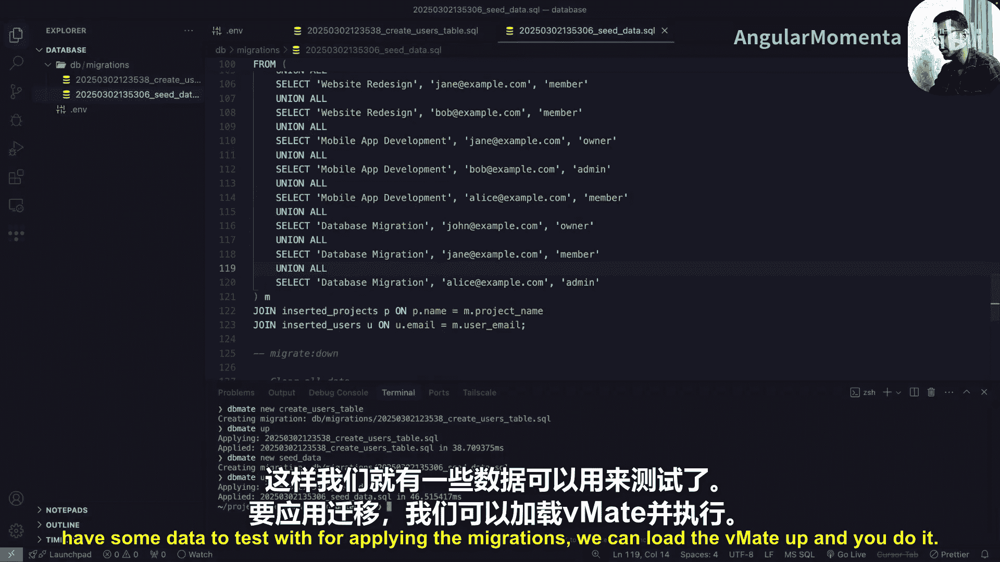

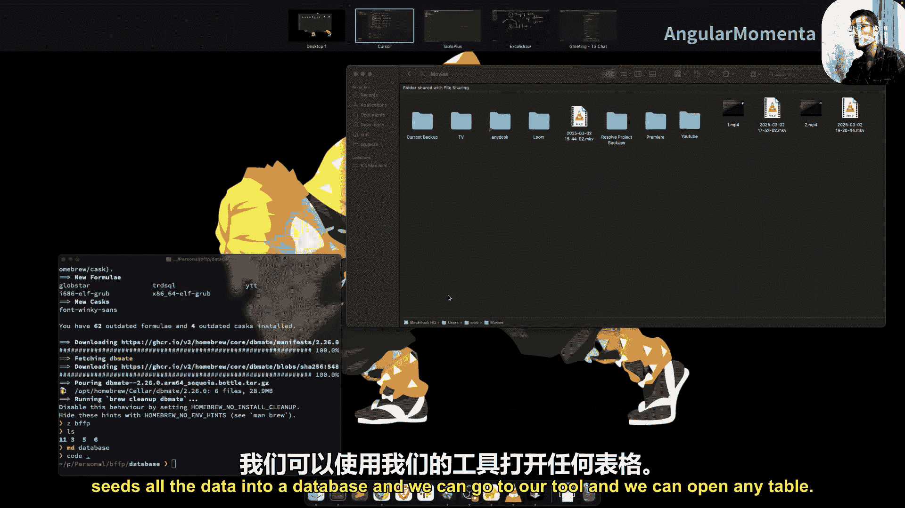

the second user this is the bio third user this is the bio， et cetera， et cetera。

 Like same we also have projects right， So our seeing is successful and we have some data so that we can start testing now。

 Now， let's say we have created the tables。 We have done some seeding。

And now we want to build some API for the first API that you want to build is。

 you want to fetch the list of all users and you want to send it to the fund for that we can write a simple query and to select from users。

And we can execute this and we'll get all the entries， right。

 the all the users that exist in the user table now。What we want to do is for each user。

 we also want to send the profile information which is on a different table right we have the user profile table so for each user we want to fetch the profile information from the user profile table and we want to embed that。

Into the user row and you want to send it to the funder in a single vehicle we don't want the user to make a different call for fetching the profile information。

 That's why we are emitmiending the profile information before we send it。

 So let's write the  query for that。 usually when we write Sq queries always start from。From section。

 right， instead of the select section so that you know exactly where you are drawing your data from。

 So we write。From users。YouAnd this is called an alias。

And assigning an alias usually a one letter or two letter alias to a particular table name inside an SQL query makes it more convenient to refer to that table again and again in that query right that's why we use alias Now from users table。

 we want the information of the user。Next thing what we want is we want users profile information。

 which ist a different table。Okay， and it is in the user profile table。Now。

 the thing that connects these two tables， as we already know， is the foreign key。

 So each user profile entry each row in the user profile table。Has a field called user ID。

 which is a foreign key， which refers to the primary key of the user step。So what we can do。

 we can use the join operation to join the user table with the user profile table on a condition which is the user ID should be the same。

And to write that， we can say left join。And the reason we are using left join is because for some reason if the user profile in the user profile table。

 there is not an entry for a particular user it is possible in our in our back system。

 it is possible that the user has never edited their user profile that's why we have never created an entry for them in the user profile table。

So in these situations， if we go with inner join， we will get an。MD result。

 because what innerjo does each condition for a particular condition。

 there should be an entry for both the tables。Since in this case。

 we want the user information in any case， right in any case。

It does not matter whether they have the profile information in the user profile table or not。

 but we want the user's information anyway。That's the reason we are going with left join so that even if there isn't an entry in the user profile table。

 we will still get the value of the user's information from the user table。Yeah。

 that's the logic behind going a left join。 And most of the times we'll be using inner joints and left joints when we are writing as fillilberries。

 those are the mostly used joins。 You want to join with the user profile table and we'll name it。

Eliaas U P and the condition for the joinings on。The join condition is you dot ID the ID field in the user table should be the same as the user I field in the user profile table。

 This is the condition this is the condition on which we are joining both these tables。

 Now we know where we are drawing our data from Okay we have joined two tables we have join table and now what we can do we can select in the select phase we will see what are the data that we want to fetch Now that we know where we are drawing our data from we will see what data we are drawing from。

What will'll do， We want to fetch everything from the user rope。 So we'll say。U dot star comma。

 we want to add another field in each row called profile。Su。

For that field what you want we the corresponding row from the user profiles。

Table and you want to convert it into a JSO and you want to embed it into a field in the user row call this profile。

Okay， for that， what we can do， be write。Json B， which basically converts a particular row。

Into agSson， it is a in will function provided by postgres and we can use that to convert it。

And we can write， take U P dot star， which means take the corresponding row from the user profile table。

 convert it into a JSson and name it as profile before returning。 Okay， we have our query now。 Now。

 let's try running it。 and when we run it。Let's see what the data looks like。

And this is what the later looks like。We have all the fields from the user table。

 we have ID email full name post hash created at updated and we have an extra field called profile。

 which is a JSO and that has all the information from the user profile table。

Now using this query in a single API we can send the user's data and the user profile data from a single database call using joins another thing to notice here is whatever data。

 whenever we run a particular query in any relational data the data that we get returned is in a random format they don't follow any particular format so because of that whenever we run a select query。

 whenever we are returning a list of data points in two or front end we have to sort it by default using some column and usually what we do。

We sorted by the。Created it column because we want to return the data。

In the reverse order of when they were created so that the user can see all the latest users。

 So for that what unitite order by U dot created it。

 we want to take the created a field from the user table and we want to sort by that and we want to sort by descend name because we want the latest entries and when you do that。

And run it， we get all the users in the reverse order of how or when they were created。

And this is what the query for an API of get all users looks like。 So if we have an API。

 something like this slash v1 slash users， if we have an endpoint which is a get endpoint our backend can use a query like this。

A database query like this to return all the data to the user， of course。

 there will be other processing that will happen the serialization detation。

 depending on what language that you are using。If you are using something like Javascript or typeyscript or nos。

 then the serialization overhead is not that much。 but if you are using something like go。

 then it has to dealize into its own struct， then thatstruct will be sent。

By serializing into a Jsson format。Before it gets。Sent over the Internet to our fronted。 right。

 These are a typical getall users endpoint looks like。 Now， let's see another endpoint。

 which is something like slash V1 slash users slash。A particular user ID okay。

 so we will write it as user ID well get it as a dynamic parameter in our APIPA and we can pass that user ID to our database query。

As a parameterized query， we will see what parameterized query means。

 But if you don't understand this part， this was a previous video where。We have。

T a deep dive on APII designing and what are dynamic parameters， how we design these APII points eta。

 etca， etc cetera。 So let's jump into what this query will look like。Catching the information。

 the profile information and the user information of a particular user。

 given a user I D from our dynamic parameter。 before we get into that， let's understand what is。

诶 better。terized queries parameterized query is basically a safety mechanism provided by databases。

 which basically means before running a query， you can。Provide a particular slot。

 you can provide a particular slot and you tell the database that this is your query。

And at this position， there is an empty slot， but。Before I execute the query。

 I will provide the information in this lot。Now， the catch is whatever information I provide here。

It will be a string。You cannot。Paarse it， you cannot parse it to render it as a database action call。

Right。Itll just be a string。 So if someone passes something very dangerous like。

So we have a query and inside the slot， if you pass like let's say delete from users。

 a query which deletes everything deletes all the users in the database that will not be considered as a SQL query。

Because the way parameterized query works is whatever you pass in this lot。

 they are considered as a string okay they are escaped in the technical term and it is a safety mechanism to avoid situations avoid vulnerabilities like SQL injection where if you are constructing your query。

Instead of using parameters， you are constructing by concatenating different different strings。

 You are constructstricting your sQ query instead of using parameters。

Then you can be victiming to SQ injection。Okay， so this is a very important concept。

 You can do your own research to understand。How his fiiliation works， et cea。 et cea。

 But to simplify everything。Whenever you have a dynamic value。In this case。

 we want to fetch the information of a single user using the I of that user。

So the ID of the user is the dynamic value here， so what we want to do we want to keep a particular slot in our query and we tell the database that when we run this query we are going to provide the ID of the user but for now it is just an empty slot and when we provide the ID it it should just be considered as a user's ID just a simple string。

 nothing else no more power should be given to this particular string okay。

Does the use of parameterized query？It makes it query more secure to execute。

 and most of the times whatever database driver， whatever library that you are using。

 whether it node J or go rust Python， whatever it is。Your？Database driver， your O RM。

 they have capabilities to handle all these slots with parameters and etc cetera， etc cea。

Since we are not getting into code or any specific programming language here。

Well be looking at how parameters work in the Sq editor itself。 Fortunately， the this table plus。

 the software that we are using to。rite our queries and to see our results， etc cea etc cetera。

 they are providing an interface to provide parameters to our query。 so we can see how it works。

 but in real world， when we're actually building backons。

You will handle parameters using your library using your driver。

 whatever driver that you are using okay。With that。

 let's write a query to get the information of a single user for that we don't really need to change much。

 We still want all the information of the user from the user table。

 We still want all the information of the user from the profile table using this Json conversion the only thing that will change is we want to filter by a user' ID want a single users information now for that we want to add a where clause and right where user' ID U dot ID is equals to a parameter So this is where we are assigning a slot。

 an empty slot we are telling that。This is the name of the variable this is called user ID and this is the whole query and we are saying that this is the query and this is an empty slot and when we run this query will provide you the value of this slot so that you can do your comparison and show us the results so let's run this。

And we are shown this dialogue。So that we can pass the actual value of the user ID。But as I said。

 in your actual backend environment， you'll be handling this in code in your particular driver or library。

 So for this， let's wrap this。 We have to wrap it in single codes。Right， all the thingsings in。

SQL have to be wrapped in single code to be interpreted as strings。

 Thats why we are wrapping it in string and we are pasting the U U I of the user。

I the UID I past it here and then lets run this and when we run this we get the information of a single user and you can check is the user's ID we are still getting all the information from the user table and we are still getting all the information from the profile table but in this case。

We are only getting the information of a single user。Using our parameters with the same value。

 So this， if you remember。Was for the endpoint， B1。Slash users。Slash。Wellen。User。I D， so ideally。

 while routing。When the front makes the I call with the appropriate。You very value。

This will be routed to a particular handler。 The handle will pass it to your service。

 The service will pass it to a repository， and it will pass the user I。

 the actual user I and you will take the U I and you pass it in the。

Appropriate parameter using the slot thing that I mentioned。 And after you get this result。

 you'll get the result like this。 and this will get serialized and transferred over to the friend in Jsson format Now going back to the getal user API。

 the getall user query， what if。We want to provide some dynamic filters or some dynamic sort。

 usually。In As like these， where we fetch array of entities like get all users， get all projects。

 get all tasks。In the same A， we also have to support some kind of dynamic sorting or some kind of dynamic filtering or both at the same time。

 Now， the problem is without。Using these queries without constructing these queries in a proper OM or using a programming language constructing the SQL query ourselves。

Showing that part of the mechanism in a SQ editor is a little difficult。

 but we can imagine how the query。Might get constructed in an actual programming language when we are actually writing our back end code。

And we can focus on just the skill query part without focusing too much on how we are going to construct the query。

 So if you want to go back to the earlier query， which was kal users。

 So when we remove the where clause。And when we run this。

 we are getting all the list of all the users just as we had before。Now。

 we want to add some dynamic sorts and some dynamic filters。 Now。

 let's see what all fields we have in the user table。 We have I D email， pull name， pass hash。

Lets say we want to add a filter condition and we want to filter by the name and our condition will be we will pass a first letter of the name and we want to return all those users。

Who have the first letter adds that particular letter， whatever the front end is passing。

 that is going to be our filter condition。And for sort。

 we want to take the sort order from the user and we want to take this field。

🎼By which the user wants to sort the result okay and as I said its a little difficult showing how the query is going to be constructed because what happens in an actual backend this let's say these are query。

 these are query payload and。It's a page added query， right？

 So user can send these all query parameters。 They can send a page query parameter。

 if they don't send it by default， we are going to set。

Pages1 same way they are going to send a limit parameter。 If they don't send it。

 we set it as something like 10 or 20， whatever makes sense in your use case。

 then we come to the filtering part。So as I said， for the filter。

 you want to filter by the first letter of the name。

So let's say take a query parameter called letter。And if they don't pass it， then in this case。

 we don't set any default。 If they don't pass it， then we set it as null。

Or in an actual backend system， we don't include this in our query itself。 Okay。

 when they are constructing our query dynamically， we check that if the user has passed this query parameter and not。

 if they have passed， we include it in the where clause。 If they have not。

 then we don't include it at all。 Okay， that's how we do it in an actual backend system。 samee way。

 we check the。Sot conditions。 Now， the first thing is we want to check。 let's say， sort by。

If we check if this query parameter is present or not， if this is present。

 then we consider that as a sorting parameter， Usually we don't allow the user to pass any field as sort parameters。

We give them some options that you can either pass， let's say， full name or。

By email or by created ads。Okay。We give them some options。

 some fields from the table that we allow user to pass。 And depending on that。

 we give them the result。And the last thing that we allow them is sought order。

 What is the order that you want to result in， whether it is ascending order or ascending order。

 Now for these two fields， what we do。We check if the user has passed a sword by parameter。

Then we consider that for the sorting mechanism if they have not by default we take created at as the default sorting plan。

 same we check if they have pass sort order or not if they have we consider whether it is asing or descending if they have not by default we take descending。

 So if the user has not passed any of this what do we end up with we end up with these query parameters by default which that the page is one limit as 10。

Sot by created at and order by descending right by default， we anyway give them results as per this。

 but we also give them the option to customize how they want the results right now with that。

 let's see how we can construct the query we have our filter。

 which we are considering as the first letter of the name we have our sort and we allow them to sort by email or full name or created at。

And we also want to pageaginate this since it is a list of all users whenever we are creating list As。

 we should most of the time try to pageaginate it unless we have a particular reason we have a particular user interface where we don't want to pageagin it。

But most of the time we should mention it okay， now going back to our query。

 we have this normal query now what we want to do， we want to add some more capabilities to this。

 So the first thing is we want to add the filter condition。

We want to give users the ability to filter by the first letter of the name of the user。

So what we can do we say where you dot pull name I like I like means the skill operator like。

 but it is case insensitive， so it does not matter there is uppercase or lowercase it will still try to match the pattern okay I like。

And inside this， what we do， we pass a parameterized query and the parameter query will be say letter。

Then we concatenate with， let's say the percentage sign。

 let's run this query and let's provide the letter。

J and let's run this and we are getting two results because these two users have the first letter of the name starting with J。

 That's where we're getting these results。 Now let's try to run this with another letter。

 let's say X for this， we don't get any results because we don't have any users who have names starting with X same way if we try to run it with something like a we get the user Alice Brown right So the filter part is working as expected。

And for those who are not familiar with the basics of SQL。

 what this we are doing is we are taking the parameter query whatever is coming from the front end and we are concatenating that with this symbol。

This person is symbol what this means is。Take the letter， whatever the first letter is。

 so if we pass J， this is what happens J and the percentage is symbol。And this goes to the， I like。

Patttern matching。 So what we're saying。Give us all the names which is starting with the letter J。

 but we don't care whatever comes after that。 Okay。

 that's the reason we are getting all the users who have the false letter with J。 Yeah。

 now we have our filter condition implemented。 Let's go ahead and implement our sort conditions。

 So as you can see， we are adding the default sort condition created at descending here。Now。

 what we want to do， we want to make it dynamic。 So we want to say order by is a parameterized query。

 You want to say do button。And as order， we also want to make it a parameter。

 you're saying sort order。 Okay， we have our sort conditions。

 Let's check this and we have three parameters to fill now。

So lets provide it as J and for the sort by in the back end we have to construct this parameter in a way that it matches the existing query since we are using aliases in our existing query。

 we have to provide the sort condition in the same way what we want do。

 we want to sort by the emails of the user。So the parameter we should pass is U dot image， right。

 because we have to match the alias that is existing in this query。

Same way sorted we want to say descending and let's run this and we are getting two results。

 John Doe and Jane Smith and this is how it is sorted。John comes first， then comes chain。

 So let's try to run this again， but this time make it ascending Now chain comes first and John comes again。

 So our thought conditions are also working as expected。 Now the last thing。

We also want to pageate this query since it is a list of all users。

 we want to pageaginage this query Now in the end we can write the user is trying to fetch page1。

We have page and limit for the concept of page If you want to fetch the first page in the query。

 we have to add something like offset set and we want to take also a parameter for here。

 So we write page page range you want page。 Now the second thing is we also want to take the limit and for the limit you also take a limit parameter and now let's run this we have two more parameters for now we want page as0。

 Now in the actual backend， the user will pass pages from one to whatever the maximum amount and we are setting also the page number is one。

 but since we are talking about the actual database query here。

 we have to pass the first page as0 right the offset starts from0。

 That's how we want to differentiate between the actual database query and whatever is set for the experience of the user。

So we want to start from the opposite 0。Then the limit is one。

 since we are only getting two results for this query。

 we want to check if the pagination is working as expected or not。

 That's why we are setting the limit is one。 And when we are run this。

We are getting Jane Smith as the first result。 And when we try to run this again。 But this time。

 we want page。The second pitch。In the back end concept， it is the page2 in the database concept。

 it is offset 1。 and when we run this， we are getting John Okay。

 so the pageagination concept is also working。And as I mentioned， these things will change。

A fair amount when you are actually writing the Excel  query in your backend because you have to construct all these queries dynamicly you using your programming language。

 But to understand what happens at the database level， this example is pretty much enough。

 so far we have。

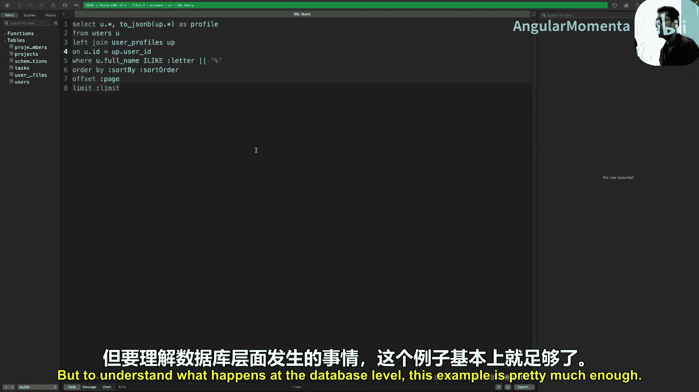

T what the database query looks like。For this API， get all users and this API get a single user。

 Now let's proceed to。Reading a user， which is？Post slash it based slash users。

 Let's see what the query for this will look like。 if you're already familiar with。

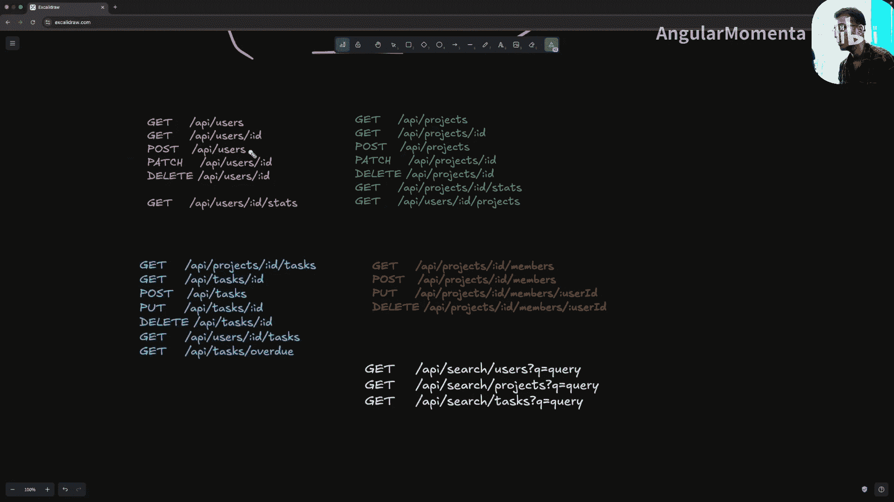

SqL basics。 This is a simple insert operation。 What we want to do is want to do when。Insert call。

 insert into。Users， you want to in insert to user a table。

 And what are the columns that we are passing， We are passing email and phone name。And password hash。

Which we read in our back end code。 But for the sake of this example。

 we are just passing the password hash。 Second， we want to pass the actual values。

 and let's use parameterized queries here for email。Then， or name。

And then what password And at this this camel case password hash。 And in the end。

 we want to return what。All users that were created using this query。For that。

 we can do returning stuff。 So return all the users， all the rows that were created using this query。

 So let's try to run this。 We have to pass all the parameters and in single codes。

 since these are all strings， right？ So for email， we can do something like test。Gmail点COm。😔。

And for the full name， it can do test test and for the password， any random stream。

Let' the sake of this example。 And let's run this。And we run it。

 We are getting a single row as a result， because we are doing returning star。

And we just created one user we are getting a single user entry。

 a new user was created and were getting all the information for that user and when we go to the user table。

 we can see that a new user with test at Zmail docomm is created and is in that table。

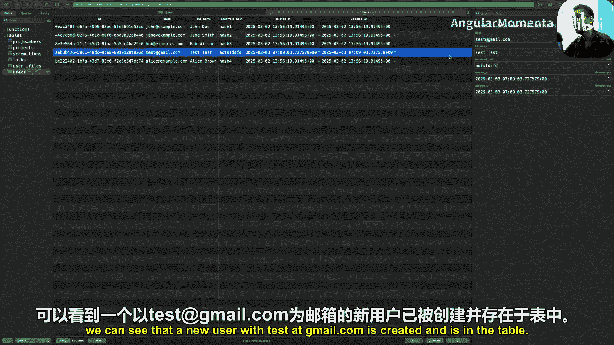

给。And this， this corresponding to the post slash a slash users API。Since we are creating a user。

 so we did insert operation and created a user and return the response in this API。

 Let's now let's get to。A better user。

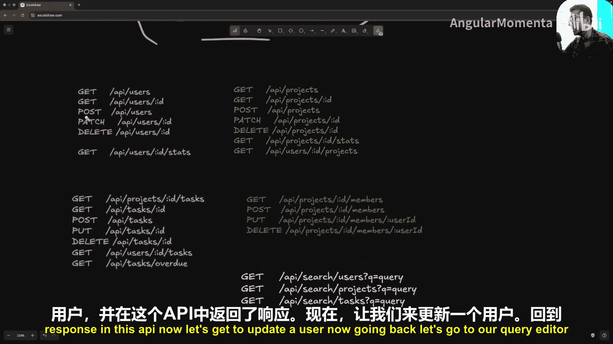

Now， going back， let's go to our query editor。😔，Minimise this now， as I mentioned before。

 in our actual back end code， we will be constructing these Sque queries dynamically。

 depending on what。Are the parameters that is。Passed from the user Okay， so for the for the update A。

 what the EPA usually looks like is it is a patchache pay。

And we are giving the user to update certain properties of their profile。 Okay， we are。

Trying to update the user profiles table。 and we are giving the user a form。

 some kind of form in the UI to update their profile so they can update their bio。

 they can update their phone number or they can update their。Image URL in the field of URL or this。

 we want to make the payload partial and by that I mean。

They can pass either all the three fields or they can pass a single field。

 but depending on what are the fields they are passing。

We only have to update that fit for all other fields。

 we don't touch that Okay so in the programming language depending on what you are using。

 we check what other fields that the user has passed。And from a set of allowed fields。

 So let's say we check if bio is present， then take the latest entry。 what the user has passed。

 the latest value of bio and update that in the database。

 same way we check the phone number is passed。Ud it。But Avatar URL is not passed。

 then don't touch it， keep it the same。So with that understanding， going back to our SQL queryator。

 what query we can write is after going through our backend code。

 we have seen that the user has only passed bio and phone number。

So this is what the query is going to look like after getting constructed。

 Okay we say update user profiles。Then set bio equals to， this is going to be parameterized。Ready。

Bio equals to biocomma。 They have also passed polymermer and phone equals to。

We' are going to pass these values in our parameterized queries and we also have to pass for which user we want to update usually will take this as a dynamic parameter。

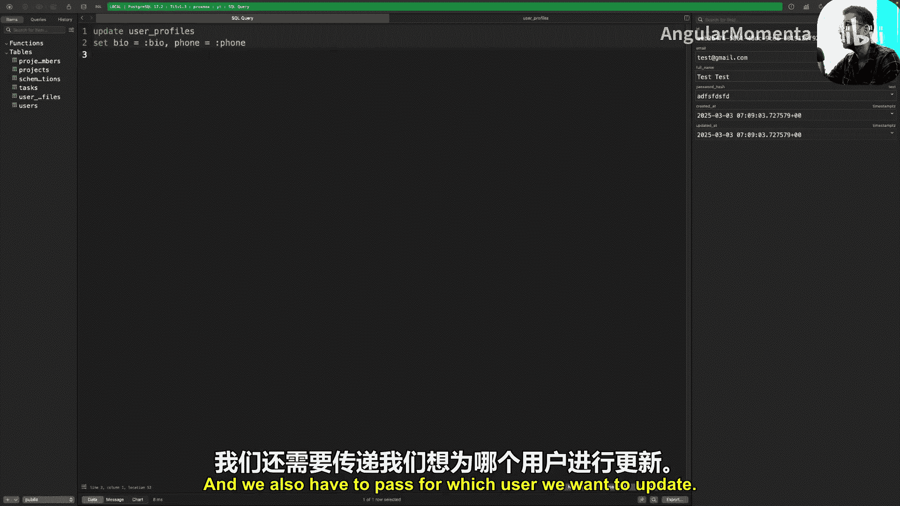

On the URL， as you can see here。Were taking the ID of the user from the URL。

 So that's what we will pass in our database right and we want to update the information。

 the profile information of a single user right。

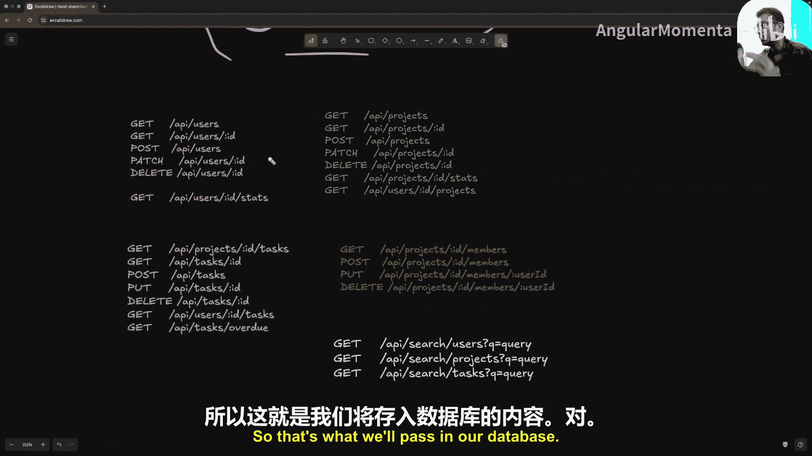

So we have to pass that in our parameterized query。For that， we can write where user I。

 which is a field in the user profile table equals to a parameter called user I。And in the end。

 we are saying whatever row that you have did return the latest value of the row。

And then let's run this and for bio， we are seeing updated bio for phone number passing a new phone number and we run this。

And when you check it， you can see the bio is updated and the phone number is also updated this particular user and that's how an update user API will look like。

 Now I want to show something else if you notice here。

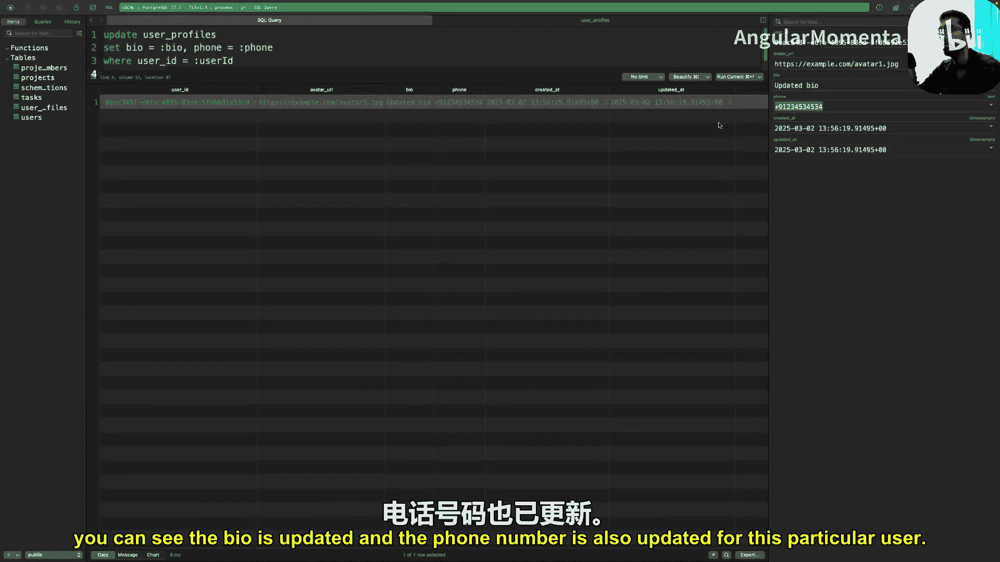

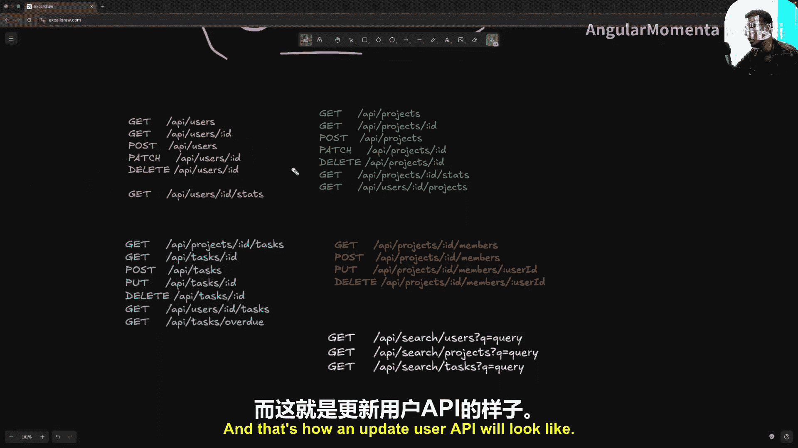

We have a field called updated at and the purpose of keeping this field in a table is。

Every time a particular row is updated， we also have to update this field corresponding to that row。

To the current time step， the time step when the row was updated。 and if we check the field。

This same as the created it。 this is the same as when the user was first created。

 it is not updated since we just updated the value。Right now。

This should have the current timest which it is not now usually there are two ways of achieving this first is the manual way every time you are doing an update operation you can explicitly set the value of updated column to the current timest using your application code you can pass another parameterized query and you can say updated at equals to updated at okay you can do that or you can。

Use another feature of databases called。TriggersAnd what triggers to is you can set a particular condition。

And when that condition is met， you can perform some action。

 that the whole idea of using triggers at database levels。

 so what we are trying to do here is we will set up a workflow using which what we will say is。

Every time we are updating a particular row in any table。

 we want to set the updated at field of that row。To the latest timet using triggers。

 we want to make that change so that we don't have to manually change the updated at fill every time we update the information of a particular user。

For that， we have to write another migration。 That is one change that we want to make。

 The second thing that you should know about， which is very important concept is。Indexs or indices。

 What is database indexing is is a very important concept。

 and it affects the performance of your queries a lot。 Okay。

 so we have to understand what is indexing and we have to implement it in our own database using a migration Now。

 let's understand what indexing is in the first place。 So going back to our earlier query。

 So if we go to the history tab here。And let's check what was earlier query。

 So let's say this one okay， and it close this and run this。 Okay， now this one。😔，And。

 this is a select query。For the list of all users。Yeah， and if you notice here。

 we are using some conditions here。 Let's try to find out what are conditions that we are using。

 The first thing that you notice is we are joining with another table， and here。

We are saying the ID of the user table should be same as the user ID in the user profile table。

This is the join condition here， and it is an equality condition。

Same way Another thing that we are doing here is we are sorting by the email field in the user table and we are sorting in the order of ascending the second thing to notice。

 and I'll explain why we are drawing attention to this part right now these are the。Two things now。

 coming back to what are database indexes index is basically means by the normal definition。

 if you' are familiar with the。

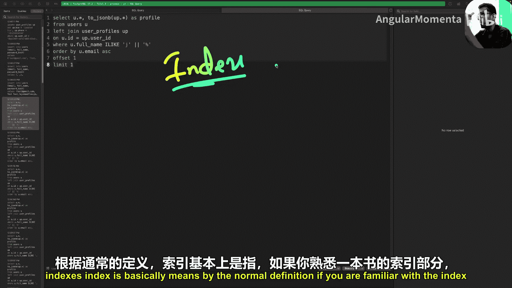

Index section of a book。 So we Google it。 let's say book index。

 This is a typical index section of any book。 And what we see here is the writer of the book or whoever the publisher is。

 they have created an index section where bias they are saying。

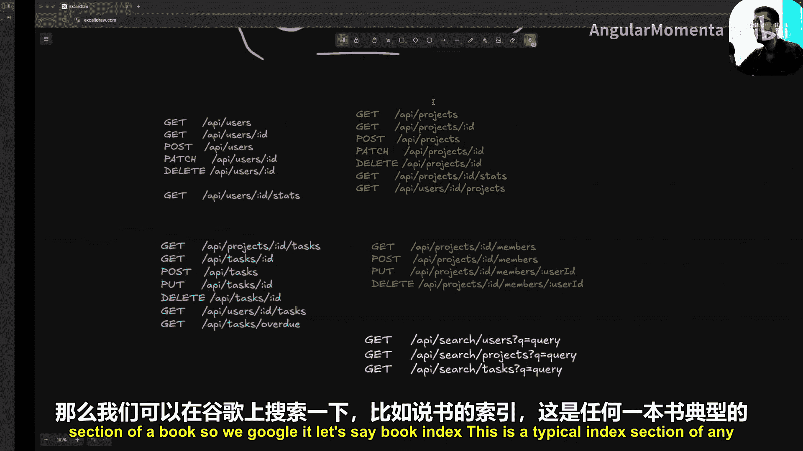

You can find chapter 1 starting from page 8 and chapter 2， starting from page 29， chapter 3。

 starting from page 35。et cetera， etc cea， right all the chapters are given here and corresponding page number where you will find the starting of that chapter and because of this index section。

If someone wants to directly skip to Chapt 4。They don't have to open the book and they don't have to go page by page。

 page by page。 Let's say the book has around。 so it says 82。 Let's say the book has around100 pages。

So to find the chapter 4。The user does not have to go through 50 pages one by one in order to reach chapter 4。

Just to find the location of the chapter 4。They don't have to manually ski through 50 pages just for the sake of finding the location of a certain page。

 right， they can directly refer to the index。 They can see that chapter 4 starts from page 54。

 and they can directly jump to page 54 right in the same when we are talking about databases。

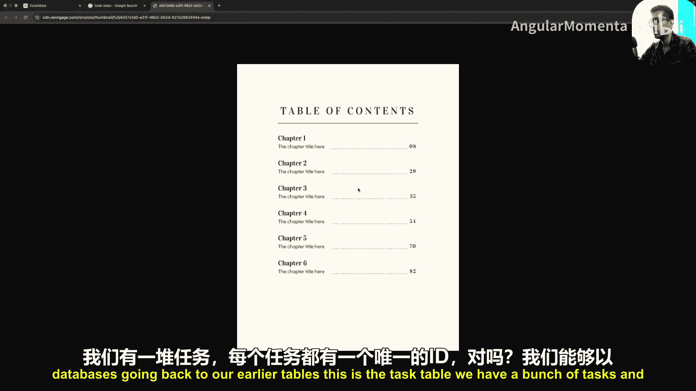

Going back to our earlier tables， this is the task table。

 we have a bunch of tasks and every task has a single ID right？

And we can see all the results in this particular format because it is a softer which fetches all the rows from a database and shows us in a sequential manner。

 but when the database stores our data， it is not in a sequential manner right every entry in a row might be somewhere else since in the earlier part of this video we have discussed that the databases。

That we are talking about relational or non relational。These are disk based databases。

 which means the database takes our data and stores it somewhere in the disk somewhere right it can be anywhere。

In a very efficient format， it follows a lot of algorithms。

 a lot of complex systems goes behind where to store which data， etc cea， etc cea。

 but on a very high level on a very simple way of understanding。

 we can assume that each row is stored somewhere in that disk， right。

If we have a query where we want to find out。The information of this particular task with this particular ID which we can pass in a parameterized query。

And you want to phase the information of this particular task。

 What is the brute force without thinking about indexes， What is the brute force way。

The database system has a bunch of tasks and it has stored all the tasks in different different locations right in a。

Physical hard disk， when it gets a query， which says that we want the information of this particular task。

 what it has to do。 It has to go through all the tasks one by one。To find out if the I matches this。

 if the I matches this， if the I matches this， etc cetera， ceter。 and finally。

 when it reaches this I okay， it， it has a match， it it can see that the I that we have passed。

It accurately matches this particular ID。And then what it does。

 it returns the information of this particular id to us， and we have our result。Now。

 what happened is we sent a query the database did a sequential scan， it went through all the tasks。

1 by one in different different locations of the disk， as I said。

 the database system has a very complex way of storing the data in database， right。

 and it went it went to all those locations and it checked whether the I matches， this item。

 whether the I matches， this item， etc cea， et cetera。 and until。

At the end it found a match and it returned the information， which， as you can already see。

 is a very tedious and a very time taking and a very inefficient solution。Okay， now。

 since we only have around6 entries in this table， it might not seem a lot。 It is a lot fast， but。

Imagine if we had a thousand entries or a million entries or a billion entries in the table。

 then going through all those。Items 1 by one， and checking。From different。

 different locations of the disk。Can take a lot of time and can make the query very inefficient。

 So for that purpose。What the database offers is a feature called index。

 what index does in the same way a book index。Gives us all the page numbers。

For a particular chapter on chapter 4， we can directly see that it starts from page 28。

 same way on a very high level not to go into the technical deep dive of how indexes work。

 how B words， etc cea， et cea， which you can do your own research for。

 but just for understanding the practical purpose of index。

W we use indexes for each ID so we will understand how index is actually implemented practically but for each ID so we can index a particular field of a particular table。

 lets say if we index by ID。So what an index contains is for each ID you have the location here okay。

 for each I like this okay for each I from here for each ID， it has an table for each ID。

 it has the corresponding location。Of the row， it where exactly in the disk in the hard disk。

The information of this particular task is stored。So it has another table。

 a lookup table where it stores the idea of the task and the location of the task same as the idea of the second task location of the second task etc cetera。

 etc ceter， now that it has an index like this when it gets a query which says that we want the information of this particular task what it does instead of looking through all the items all that tasks in the disk from different different locations one by one what it does。

 it refers to the index。It tries to check whether。This exists in the index or not。

 So as you can see the index is a direct axis。 It is not stored in different different parts of the disk。

 It is stored at one place sequentially so it does it is very fast to go through all the entries so it checks whether it matches the first one。

 the second one， the third one， the fourth one， the fifth one and it finally finds that this entry so it is somewhere here this one matches it So it directly finds this entry in a very short time and in the corresponding lookup value it finds the location where exactly the information for this task is stored in the hard disk and it gets the location goes to that location directly and returns whatever value it is stored in that location directly to our user whoever made the database query in the first place。

Now， as you can see， compared to the previous operation。

 which was a sequential lookup going through different different locations across the hard disk and trying to find out whether the I D that we have passed matches the。

Current idea or noded， etc cea， etc cea， and final return the result as compared to this approach where we have a lookup table where we are storing the ID of each item。

And the location of that item。And we are directly giving the result of that to the user。

 That is the purpose of index。 index is basically a。Lookup table。

You can imagine it as a lookup table， which has information for a particular field and the location of the particular row。

For that field now that is the first property of the index。

 it has a lookup table and it can directly access whatever value that you have passed from this table and it can find the corresponding location of the entry。

 It can return you the result。 The second property of the index is the order of the index。

 it can be either ascending it can be descending。So if you remember in the previous query where we are saying we want to return the list of all users sorted by descending order right now for that query to perform as efficiently as possible because we have a requirement like that what we can do first thing is we want to create an index on created at right we want to take the field instead of ID we are taking the index created at and we want to index that field so that when we execute that query the database can instantly find all the created a fields and the corresponding row。

For that created at field and it can return it second thing is。

Because the sort order is also in the picture， we also have to decide in what order we want to index either ascing or descending or both of them we can create different different indices。

 but it all depends on our requirement so。As you can see by default。

 we are returning this descending order of created at so when creating the index we can say that we want to create an index on the field created at。

In that descending order。 so that when we execute that query， which has order by created at。

And descending the index can quickly。Go through all the created at field that is already ordered in descending order and it can quickly return that result instead of if it had all the created at field in ascing order。

 then it will have to go through all of that and you have to rearrange and do a so and then return right depending on our requirement we can customize the behavior of the indices that's a very high level introduction to indices So what you have to remember is every time you are using a where clause or a join condition and depending on what is the frequency that you are doing that what is the frequency that you are doing the join condition or the where clause you can decide to create an index on that condition so that the subsequent queries are faster because how the database does the lookup。

So the two things that we saw one thing is we have to create trigger so that the updated at field is automatically updated every time we update a particular row of the user second is we have to create indexes so that the join conditions and where clauses and the sorting conditions are faster okay so let's go ahead and create a migration which covers all these I have gone ahead and create a new migration file using DBm and pasteed all the index create statements and that triggers so let's go through and understand what's happening here what are exactly doing here。

So in the first section， you can see in upper migrations。We are creating a bunch of indices。

 the first one， we are creating an index on the email field in the user table because we have。

 let's imagine we have an API where we have to find a particular user。

By the email or we have a database query we where we are joining the user table。With the task table。

 depending on the email of the user right in the join condition。

We have the condition where we are matching the email。Because we have a requirement like that。

 we decided that we want to index the email field of the user table so that in join conditions and in the where clause。

 we can quickly find the corresponding user given a particular email using the index。

And that was the reasoning behind using email。Or indexing email from the user table。

 So this the syntax looks like is a generic SQL syntax， same way。

We are creating an index on the created field for the user table in descending order。

 because if you remember the select query， the gettall users API。

Where we are by default returning all the users sorted by the created field in descending order since we have an API like that and it is pretty frequently called。

That's the reason we want to optimize the query execution of that particular database query by creating an index on the created ad field in the descending order so that the database can do a fetch operation。

Very fast as compared to a fetch operation without using indices same way。For the task table。

 we are creating an index on the project ID。So if you remember going back to our first migration where we created that table。

 we have the task table and we have project I D here。 Okay， and this is a foreign key。

 So imagine we have an API where we are fetching。All the tasks of a particular project right and for that APA we have to create a database query where we have to take the project table and we have to join it we have to left join it with the task table depending on the I field of the project table and the project I field in the task table that is going to be a join condition right these two has to match now as I said that whatever field is involved in your join conditions are in your warehouse clause if you index that field that operation is going to be much faster now by default。

Whatever field is the primary key of the table that is by default automatically indexed。

By your database right you don't have to manually do it。 So in the join condition。

 two fields are involved the I D field and the project I D field from the project table and the task table。

 So since I D field is the primary key in the project table， we don't have to think about this。

 This is automatically indexed by the database。But in the task table we have the field project ID is a foreign key and this is involved in the join condition and since it is involved in the join condition we want to index it because it is not indexed by default since it is a foreign key it is not the primary key in this table。

So that is the reasoning behind indexing in this migration we are creating an index on the project tiD field on the task table because we have a join condition where we want to fetch all the tasks of a particular project right for that we have to make a left join in the left join we have a condition where we are matching by the project I and that is the reason we want to make that operation little faster that is why we are indexing by project tiD field in that task table same way。

In the task table， we have an assigned to。Okay， this is also a foreign key。

So imagine another repeat where we want to fetch。All the tasks of a particular user。

 So this assigned to is a foreign key which references the user table。

 So this will have a corresponding entry in the user table with I D of that user right so to implement that what we have to do。

 we have to take。The user table。 and we have to join it at the task table on the condition that。

Assign2 has to match users dot ID right since ID is the primary key of the user table we don't have to think about that。

 but in this table assign to is a foreign key。So we have to index this field to make the join operation of joining user table with task table a little faster。

That's why。We are creating an index on the assign to field in the task table okay。Next。

 we are creating an index on the created a field in descending order in that。Task field。

 because the same reasoning。If you want to return the list of all tasks。

To show it on our front end by default the A returns all the tasks sorted by the created a field in descending order because we want to return all the latest tasks and we can fetch all the latest tasks by sorting all the tasks in descending order。

And to fetch all the tasks in descending order to make that operation a little faster。

 we are creating an index on the created it field in the task table in descending order right same way we are creating an index on the status field because in the get all task API。

 let's say we have a filter condition in the filter condition what we are doing we want to fetch all tasks So if we go to task status we are creating an custom image type and we have four types of status pending in progress completed and canceled。

 Now let's imagine in the get all task API we want to fetch all tasks which have the status pending。

We have a requirement like that and the front end， the user can pass any dynamic status the pending progress completed。

 whatever right。And we want to quickly fetch all the tasks depending on what is the status of this task。

And because the status field was involved in a ver clause。

 what is the condition for creating an index or what is a thumb rule if that field is involved in join condition or in a ver clause or in a sort condition these three are your primary guidance on when you should consider creating an index for that field since status field is used in a where clause。

 we can consider creating an index on the status field in that task table now another thing is you should not create an index right away whenever you have a condition that field is used in a ver clause or a join condition or a sort by。

You have to see and you have to evaluate how frequently that query is being called or if the performance trade off is worth it or not since to maintain an index the database at all times has to take that field。

 let's say we have the project ID field in the task table budget ID and in the lookup we have all the locations of the task right we have all these entries。

To maintain this index。To have the latest state of all the tasks in that index。

 what the database has to do every time you do an insert task or every time you do an update task。

 this index has to be accurately maintain and to maintain that every time you do an insert or update the database has to do some kind of operation to store the latest state of the task in the index table right and which adds some kind of overhead。

 some kind of overhead。Even though it is not a lot and it depends。What is the size of your database。

 how many entries do you have in your database？Index operations。Themselves。

Can add some kind of overhead。So as a backend engineer。

 you have to evaluate this conditions that whether creating an index is worth it or not， whether the。

Overhead of maintaining an index is worth it or not。

And that depends on how frequently your database query is executed and what kind of user experience that you want to provide as a triath lie。

 you have to consider a lot of parameters， but on a very high level。

Without thinking about all these micro optim variations。

 you can take these three parameters that whether that field is involved in a joint condition or a where clause or a。

Sot operation。If it is and you see that that query is frequently called。

 then you can go ahead and create an index on that。 And if you in the future。

 you see that that query is not being frequently called。

 then you can just go ahead and delete that index， right， Okay， but as a start。

 you can consider creating it and monitoring your performance etc cea， etc cetera。

 So you may we are creating。An index for project I in project members。

 We are creating an index on user I project members， etctera cetera。 right， the same logic。

 the same kind of reasoning applies everywhere。 Yeah， that's pretty much all about index。 Now。

 coming to the trigger part。 As said we want to automate the operation of every time we update a particular row in any table。

 we also want to update the updated field。Of that row so that we don't have to do it manually from our application code。

For that， what you are doing， we are creating a function in Postgres we have the ability to create custom functions。

And we are creating a function and we are naming it something。

 and we are seeing it returns a trigger， and we are starting a transaction。

And what we are saying is take the row and the updated field of that row and update it to the current timest and return the new row。

 whatever with the new value of the updated field and now we have a custom function that is ready to use。

Next， what we are doing， we are creating triggers on different different tables， right。

 we are taking all the。Different different tables， users， user profiles for project tasks。

 and we are creating triggers on each table what you are doing we are naming the trigger something。

So that it is easier to drop the trigger later on in a。You know， down migrations。

And what you are doing， you are saying every time we are doing some kind of update operations on this table。

 go to that row， whatever row is updated in that operation and execute this function and what this function does it takes the updated that field and sets it to the current time step okay and with that setup what happens every time we do an update operation。

This will automatically update the updated at field for that row。Now， that's pretty much it。

 We are creating triggers for all the tables。 and in the down migrations， we are。

Deleting all the triggers， we're deleting the function and we are deleting all the indexes。

That we created。 then we can go ahead and execute these migrations for that we can do D made。

And this is applied。

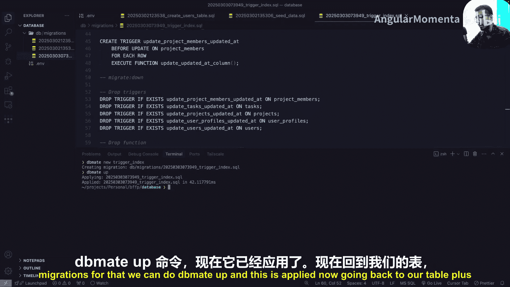

Now， going back to our table plus， let's do that update operation again， right So we remove this。

This was our earlier update operation， right？And let's execute this。

 say updated bio3 and let's apply it。And go to this row。 And now when you see the updated at。

 you can see that this is the current time when I am recording this video and this is the current date and time that timest accurately matches。

 So our trigger accurately worked right we did some kind of update operation。

On this particular row and this field is automatically upgraded。 and that's the use of triggers。

 Now with that， we have upgraded。

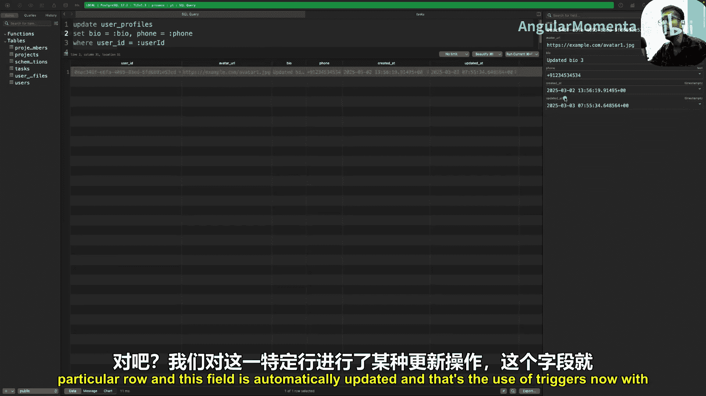

Daabase queries for all these Apis。 Okay， now going through each of these As and creating a databaseque is going to take a lot of time。

 at least a few hours more。 And I don't want to make this video longer than what it already is。

 So you can go ahead and with all the。Reaing that I have explained here and all the SQL basics and the Postgres basics that you have already learned。

 you can go ahead and create the database queries for all these As， right。

And you can see how the join conditions work， how the indexes are coming into place。

 how the triggers are working， etc cea， etc ce right and that's pretty much all you need to know And of course that's not all you need to know。

 but that's pretty much 80% of what you are going to be doing as a backend engineer while you are dealing with databases you're going to take a and you're going to analyze what all payload is coming from the user and you have to construct a dynamic query depending on that you have to use parameterized queries to securely pass。

Whatever user value that you have。And you have to execute that query。

 and you have to return the data。 right， that's a very high level。

Walk through of what you' are going to be doing as a backend engineer when it comes to databases。

Of course， there are a lot of other things。But this pretty much covers on a very high level。

 the most of the things that you will be doing。

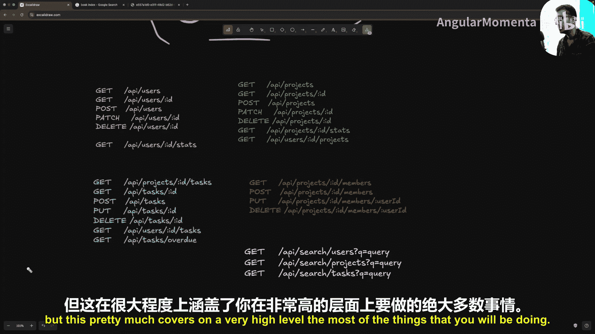