# 【Sriniously】从第一性原理出发的后端开发 ｜ Backend from first principles p13 13. 缓存，一切背后的秘密 -BV17aq1BUEhf_p13-

What exactly is caching to simplify it in one sentence。 Caching is a mechanism using which。

We decrease the amount of time and effort it takes to perform some amount of work。

 That is the online line explanation of what exactly is cashing。

And a more technical definition of that would be caching is basically keeping a subset of some data let say we have a primary。

Data and when we keep a subset， not the whole data， a subset of that data。

 depending on the uses of the data， the frequency of the users and the probability of the next user' time etc etc。

 depending on lot of parameters when we keep a subset of some data in a location which is faster to access which takes less time and also it is easier which means it is it also takes less effort。

 So technical speaking caching is a mechanism using which we can decrease the amount of time and the effort it takes to retrieve or to do some kind of operation。

There is a technical definition of what you mean when we say caching and this single mechanism or this single technique is a huge factor in a load of high performance applications。

 So let's go through a couple of examples and understand where exactly people use caching and how does it exactly impact the performance of the application and how important。

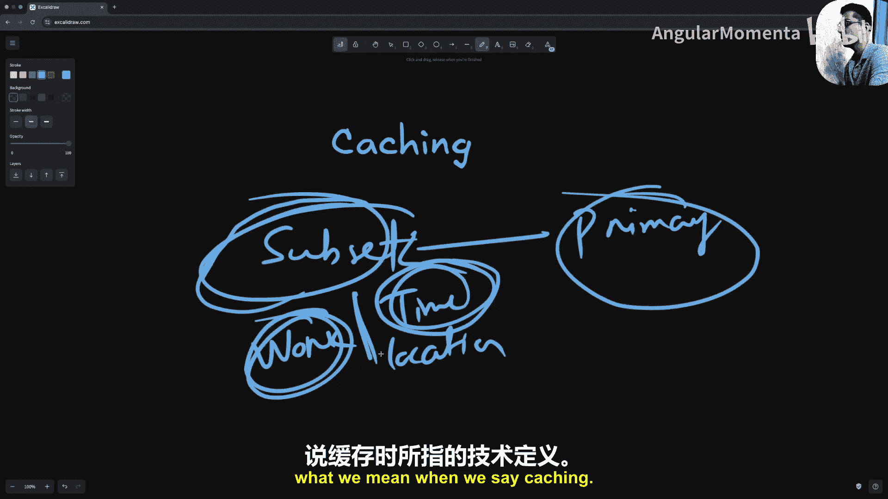

It is。 And to give you a hint， it is very important。

 at least when it comes to high performance applications。

 which track latency into digit microseconds or milliseconds。 Okay， let's take the example of Google。

Ptty much all of us。Use or have used Google search。In our browsers。

 And what exactly happens when you。Search some query in Google。

 Let's say you type something in Google in the search bar， and you hit and enter。

And that query is processed by Google search engine engine。

They have a pretty complex algorithm and workflow。Which every query boost through that typically involves crawling。

 indexing and ranking billions and billions of web pages and that whole process is pretty expensive。

 And when we say expensive computationalally expensive It takes a lot of computing power。

 a lot of CPU， a lot of memory resources etc cea， etc cea。

 And let's say a query like what is a weather today and queries like these are such millions and millions of times every day。

 And without caching without implementing this mechanism called caching。Google servers。

 they would need to recompute all the results for every single query for every single query involving the current weather of that location and which will lead to a very high latency and of course。

 a very high server load every single query would require going through all the index running all the ranking algorithms and fetching the results。

 which would in turn significantly slow down the response terms Now。

 when we insert caching in this So what Google does the search engines。

It uses it it distributed in memory caching system。To store。

 we'll see what is in memory caching system soon。 but that's how Google does。

 It use it distributed in memory caching system distributed in the sense。

 the servers of the casing system are spread across the whole world。

 They are not just concentrated in a single location， but they are spread across all over the world。

 and those cache servers。 They store the results， whatever results are written by all those ranking algorithms and all those different different algorithms that。

Are involved in the whole Google search workflow。 They get cached or they get stored in the servers。

 And when a user searches， the system first checks whether the results of that particular query。

 Let's say you search the weather。In some city of India。

So the system checks whether the results of that is present in the cache or not。

 if the query is cached， that means it is a cache hit it that's what we call it' a technical term whenever we find the data that we are looking for the cache。

 we call it a cache hit if the system finds it， it returns the results。Instantly。

 it retrieving data from a cache is very fast as the one of the reasons we use cash in the first place。

 right。And we'll see why exactly fetching data from cache is fast as compared to our traditional databases like dis space databases。

 right， which is saw in the previous video。We'll soon get into that。Well。

 for now we are just going through some examples to understand the gravity or the understand the importance of caching。

In different different platforms。 And let's say the system does not find the result right the query that the user typed that has not been typed before。

 So the system， the cache， it does not have the data So what it does it goes through the normal workflow all the ranking。

 all the sorting whatever algorithms are involved and then it takes that result and it cachees it so that the next time the same user of or some other user tries to type the same query。

 then those results can be fetched from the cache and can be returned to the user。That's one example。

Taking another example， say another popular platform。 and we take Netflix。 How exactly does Netflix。

 a huge and a global streaming platform。Whi delivers different different kinds of content like movies series and animationimes etca。

 etc， how does it deliver the content to millions of users all over the world and it seemss large and when we say large it can be multiple terabytes because the way these streaming platforms work is。

For a single video， let's say， for a single movie， it stores different， different resolutions。

Let's say we have a movie called Mo1。 then it goes through a process called encoding。

 and it prepares different， different resolutions。For different different devices and different different network speeds。

 So for a high level expansion， let's say it has a thousand80 p。Resolution and net 4，7，20 p。

 another 4，4 EP exerciseerer， right， And depending on your natural speed and depending on which device you' are trying to access the content of Netflix。

 it dynamically sends。An optimized version of that content for or that movie。

 right so that you don't waste your bandwidth and the load gets decreased on the Netflix server。

 Also， that's all about the encoding part。 But talking about how does it exactly sense or delivers。

Hundreds and thousands of terabytes of data to millions of users spread across all over the world right since Netflix is a global streaming platform and that。

 too， with minimal amount of buffering and decreasing server load so that Netflix server don't crash and the way it does is it uses something called Cdns and CdN also known as content delivery network。

 the way the work is Netflix has its own servers It own originating servers。

 let's say it's somewhere in the US in US there is there are different different data centers and different different locations where it has its own servers and so on server racks。

 which store the actual movies here we have the actual movies but what it does。

 it goes an external mile and what it does we have our。

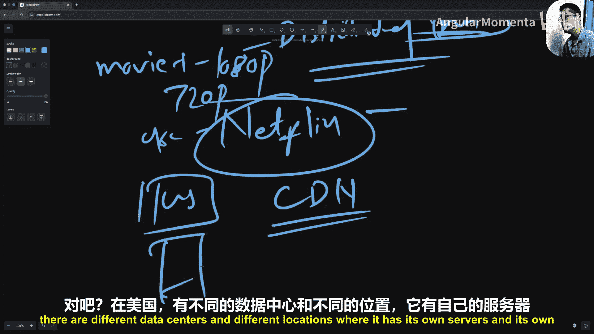

Word here， Let's imagine is our whole world。 So at different different locations。

 different different locations all over the world。And those locations are， of course。

 chosen by the infrastructure that is available and how much network connectivity gets a threat and a lot of parameters。

To all over the world， there are different different locations and these are called edge locations。

 edge locations， edge， right？These are called edge locations because these servers are strategically placed。

So that the latency of the user's connection in that region。

 let's say there is a server in this part of the world。Then for this region， the latency。

 the latency of data or whatever request are served from this server。Is going to be minimal， right？

 Let's say we have US somewhere here， minimal as compared to。

All the requests going through the originating server which is situated in US and that part of the data center serving requests from all over the world。

 then that will be a situation where。All the people who are in US， they will have low buffering time。

 because geographically speaking。They are closer to the service。That are serving the content。 So。

 of course， their latency is going to be very less as compared to people from the other side of the world。

 right， let's say from India。 And that is the reason this is a strategy that a lot of companies use。

 right not just Netflix C D or content delivery networks are。

Very common and a lot of companies and a lot of small and big companies use them to efficiently deliver different different content。

 It can be video files。 it can be images， it can be also web web pages right web pages which consist of static assets like jascript tml or C etc etc those kinds of assets are also served from different different Cds when you use a platform like versal。

 they also have an edge networks like this and their servers are also spread across all of the world So when you make a request to a server to a frontend app which is deployed in versal So depending on your location that。

Request is served from the closest regional server。

To you instead of going to the originating server right Cds are very common and this is how Netflix the global streaming platform serves billions and billions of users with hundreds and thousands of detes of data every single minute using this concept called caching the content at edge locations right we again come to this concept called caching if you remember the definition of is called。

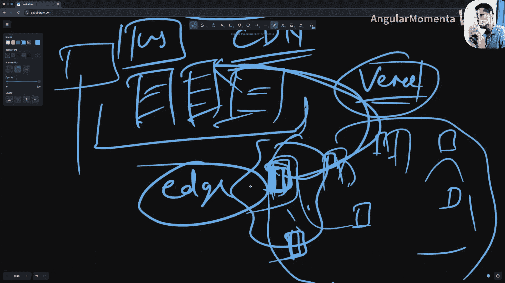

北京 a。Subset of a primary storage， and placing it。In a way that accessing data from this source is much。

 much faster than accessing data from the primary storage。

 So taking the example of Netflix Netflix takes some。Data， a subset of the data。 Of course。

 it does not cache all the data of the Netflix storage in all the a locations that would incur a lot of cost。

 And， of course， a lot of resources。 also it， they use a lot of algorithms。

 machine learning algorithms， depending on what type of content。People of that region are watching。

 right， They do a lot of trend analysis and lot of real time data， et cetera， ettera。 right。

 A lot of。A computation goes behind deciding what data， what subset of the data to cache。

So that the amount of time and effort。Can we decrease to excess that data， right？

You cannot just put everything in cash right that defeats the whole purpose。

 And caching is also more expensive than storing the data in secondary storage or disk based storage。

And that is the reason we don't put everything in cache memory， right？

These storages are relatively cheaper and also offer a lot of capacity。 Now。

 moving on to a third example。

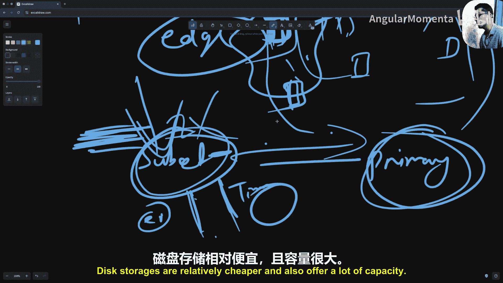

Let's take a platform called X or also previously known as Twitter。 Okay And for this。

 you can take any social media examples。 So this example can be applicable to Facebook also。

 and you can say Liedin or YouTube videos， etc ce。 et cetera， right。

The same all these social media platforms implement the same kind of strategy for let's say if you are familiar with how Twitter the platform works。

 Twitter has a section called trending topics。RightAnd what Twitter does or what X does is it identifies trending topics by analyzing millions and millions of tweets in real time。

 it analyze all the tweets that people are making all over the world and it extracts some kind of patents and some kind of trends and it calculates and that calculation is very expensive。

 it takes a lot of machine learningbased algorithms it takes a lot of GPus and lot of infrastructure and it also involves processing a large amount of data terabytes and terabytes of data because we are talking about analyzing tweets of people。

 millions and millions of people all over the world So that is a reason to avoid doing this computation of this large amount of data and to use this much amount of resources to avoid doing that again and again because。

Every time， let's imagine。If Twitter did all this calculation。

 every time some user went to the trending section of the u。 Then， of course。

 the several crash in minutes or seconds because there are like billions of people。 and if。

Even half of them are trying to access the trend section and every user triggers this calculation。

 this expensive calculation， of course the server cannot handle that and they will crash。

 So what Twitter does， of course， to avoid doing this computation， this heavy computation。

For each request， it cachees。 Okay， and by now， you can see the pattern right every time there is a situation。

Where it's either about doing a lot of heavy。Computation or heavy amount of data。

When we have situations like these， when we want to avoid doing a lot of computation again and again。

 and when we want to avoid sending large amounts of data to a lot of users。

 these are the two scenarios， the common two scenarios when caching comes into play。

So coming back to the Twitter example， Twitter cachees all these trending topics because for a trend to change in a particular region。

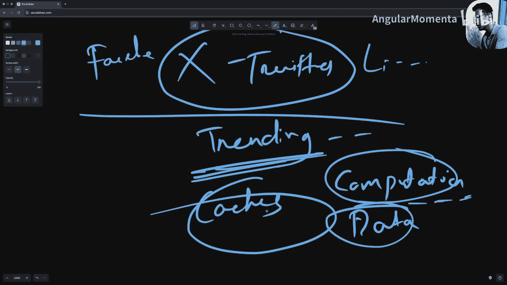

Let's say you are in some country and that country has ongoing elections。

So elections being the trending topic in Twitter is not something which is subject to change in。

 let's say， seconds or minutes， right， at least it will。

Stay in trend section for a couple of hours or a couple of days。

 And that is the reason since it is not dynamically changed。

 It is not subject to minutes and hours of change。 That is the reason it is very safe to cache the trending section of Twitter。

 So what Twitter does。It takes all this data， all this millions and billions of tweets and every few minutes。

 so we of course， we cannot know what is the exact algorithm or what is the exact duration that Twitter does all this computation or what computations exactly Twitter does。

But。Taking a rough estimation for the sake of this example， every few minutes， every few minutes。

 Twitter takes all these data from different different regions。

 and it executes different different algorithms。 Okay， on a very high level， speaking。

 different different machine learning algorithms and trend detection algorithms。 well。

 a lot of those complicated stuff。And it stores them in a， in memory cache。

 something like Reddis will see what are some。Famous and popular in memoryory cache technologies。

But red is is。One of them。 And it is very famous。 So let's imagine filter。

Calcs all these trending topics， and it stores it in an in memory key value store based database like Redis。

 And when the users request it。Then it takes that data from the cache instead of computing all of that again。

 it takes that data from the cache and sends the user that is the reason the moment you open your phone。

 you get that data instantly you do not see any kind of delay you do not see any kind of。

Significant loading time。🎼Of course， if you have a very bad internet connection。

 you'll see loadal signal。 But if you have a generally fast internet connection， it's pretty fast。

 the whole U I interaction。 And with those three examples。

 we kind of have a pattern here that every time we want to avoid doing some kind of。

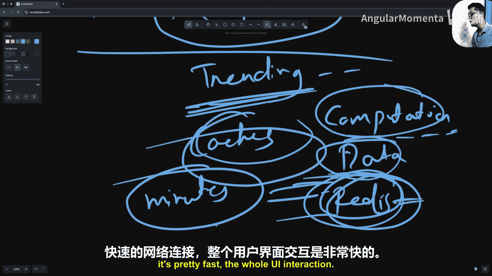

Ay。Computation or some kind of heavy data when we want to avoidvert these two kinds of situation we resort to what we call as caching and now that we know caching is an important concept and it is implemented everywhere so on a high level and since we want to limit the context to。

Especially back in engineering， something all the concepts that you as a backend engineer are going to deal with on your day to day life are on your day to day development。

 because of that， we want to limit the context of caching。

 because if you go around and start to find the use。

 the implementation of caching in different different context。

 starting from hardware to software to browsers， etc ce cea。It's going to take a lot of time， and。

Of course， it is。Very good to have that knowledge， but。

It is very difficult to cover all of that in a single video。 So we'll keep it relevant。

 on a high level， when we talk about caching， you'll see three levels of caching。

 At least you'll notice these three caching more frequently as compared to other kinds of caching as a backend engineer。

 Those three are first is network level。 Second， harder and third is softwareer based is not purely softer based of course。

 softer based caching also uses harder based caching to provide the performance。

 but it's called softer based caching because of the interaction And because of the the means of interaction。

 you'll be dealing with some kind of library some kind of softwareer to interact with this ca。

 That's why it's called softwareer based caching， but it's， of course。

 not purely softwareer based caching。 It is it works。😊，With the hardwared base cache。 Okay。

 now going into each of that， let's start with network cache。 So inside network cache also。

 there are different different use cases， a lot of use cases of caching。

 but the two major ones that you'll see frequently。啊。The first one is Cds。

 as I just explained in the Netflix example， how Netflix serves and delivers all these heavy terabbits and terabtes of content to use all of the world there。

We discuss sds briefly， so here well go a little more deep into Cds。And the second thing is DNS。

 DNS is also something we use a lot everyday day。 You don't really notice the use。

 but it is happening， right。And caching is also a very important part when it comes to DN query。

 So let's explore these two things， which fall network level caches。 The first one is C DM。

 also known as content delivery network。 The whole idea of C Ds or content delivery networks are to cache。

Content on servers that are geographically as said geographically closer to the end users thats why they are also called edge nodes or edge servers or edge computing any kind of edge word that you notice that basically means it is happening in a server that is closest to you。

Instead of a single server or single servers in a particular region or the originating server。

the sians make use of this concert that。The content will be stored。

 They will be cached and served from the servers that are closest to the users。

To minimize the amount of latency and minimize the amount of computation or the amount of resources。

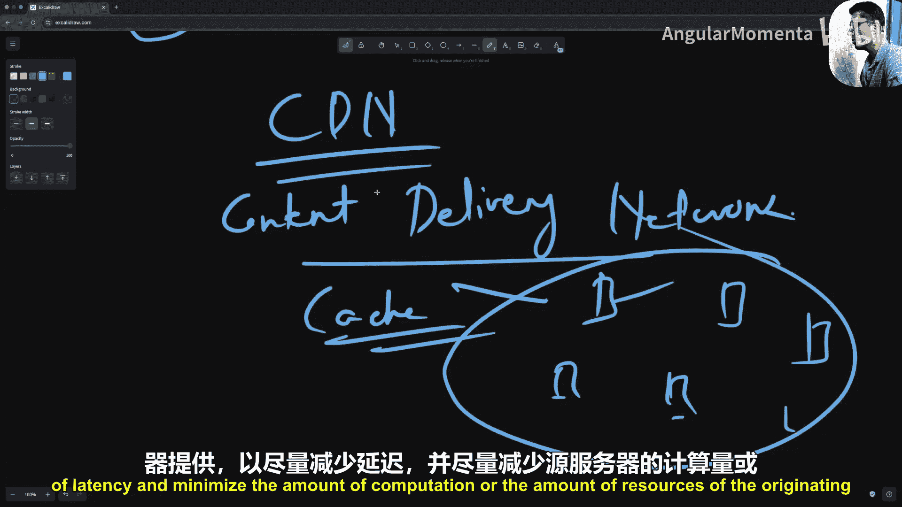

Of the originating server on a high level， this is how Cds work。 So let's imagine a user。

Makes a request， and it request for some kind of resource， a resource， like an image。Orレ video。

Or a web page， right， some kind of resource。By entering a URL in their browser。

 okay that's how we typically access some kind of data over the internet right through the URL of our browser。

And that browser， that browser sends a DNA query。

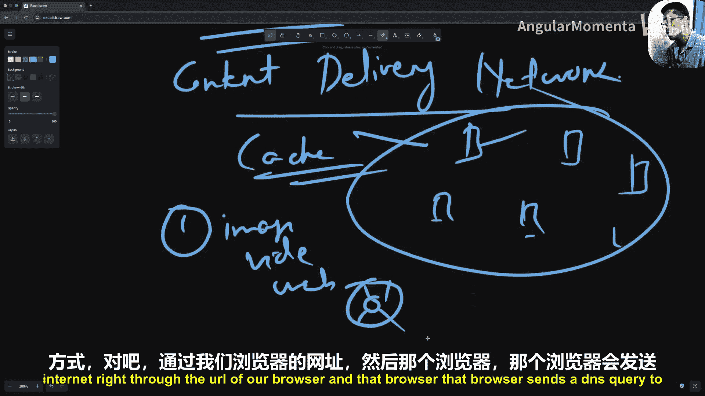

To resolve the domain name， whatever the domain name that we have typed of that image of that video or that web page。

 the browser sends a DNS query to resolve that domain name into an IP address because that's the use case of DNS rate DNS names take domain names and convert them into IP addresses so that our browsers can access the actual location of the server right now next what happens the CdN domain name system the。

CdN's DNA system routes that particular request to the nearest P P B is also called as point of presence。

 and it is just a fancy term It just basically means a particular region where there are multiple edge servers。

These service that。We are seeing here there are multiple edge servers in a particular region。

 and that concentrated region is called P O P or point of presence for that region it P O P is just a collection of multiple edge servers for a particular region。

 Now what happens the sians。DNS system， it routes the request to the nearest PP the nearest region。

 which has multiple edge server so that it can solve the country So that is the responsibility of the DNS system because that's why DNS is a very important component when it comes to CdN and it routes the request depending on multiple parameters parameters like users geographic location and the network conditions。

 whether the user has a stable internet connection or it has a bad internet connection。

 it has a bad internet connection depending on that it might route to a different PP or different edge server。

 So because this edge server may only have the content of the highest quality。

 let's say you have a bad internet connection and this particular P P or point of presence this only has thousand8 pixel formats of the video this is just a rough example。

 So depending on new network condition the DNS system the CdN DNANS system。

It will check that since you have a bad internet connection， it will route it to a PP。

Which has videos of lesser qualities so that you can load that resource with minimum amount of buffering。

给。For example， if a user in New York requests a particular resource， an image or video or webage。

 the C DN， the C DN system will direct the request to your P O P near New York。Right。

 that's how the requests are routed to the nearest pupy。

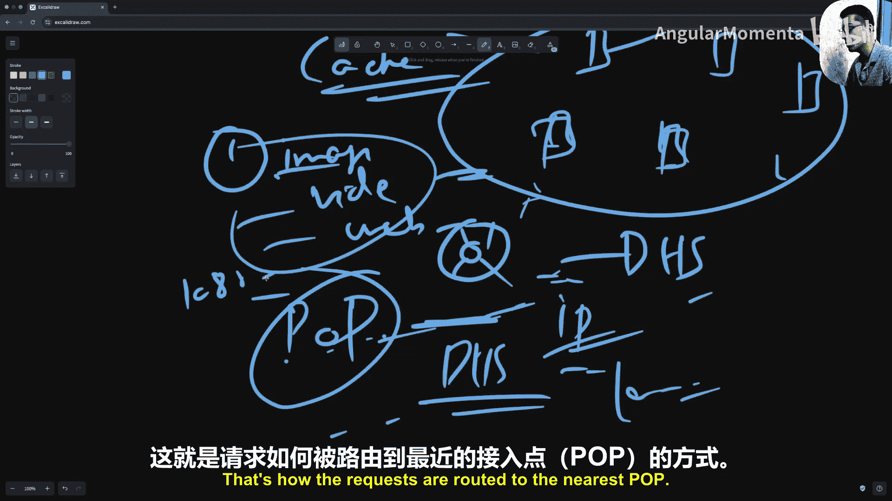

Using DNS next， what happens the a server， once it reaches the PO P。

 which basically means a collection of a servers。 Now here。

 what happens it checks if the requested content that particular video。

 that particular web page or image or whatever that is， whether it is in the cache or not。

If it is already cached or not。Depending on that， it is either a cache hit or a cache miss。

 So as I already said， if whatever we are looking for， if it's already in the cache。

 then we call it a cache hit。 it's not， then it's called a cache miss。 if it is a cache hit。

 it finds the resource。 and it just sends the request to the user， right， it is the happy path。

 But if it is a cache miss， What happens， the content is not in the cache。 So the edge server。

 whatever edge。

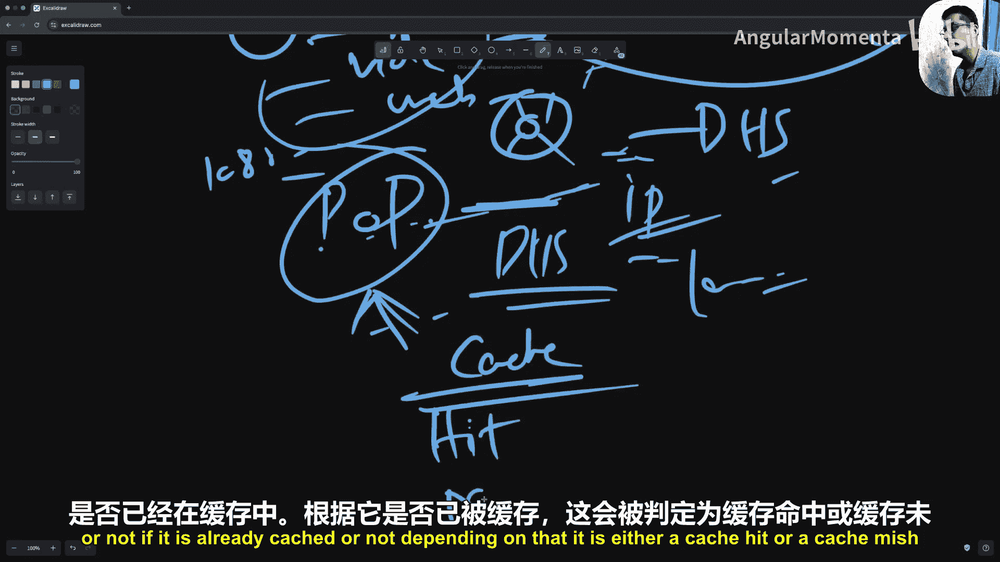

Server that is handling this particular request。 It fetches it from the originating server。

 Let's say the originating servers are somewhere in US right and the user is in India。

 So it is the responsibility of that a server to fetch it from the US servers。The originating server。

 where the actual resource is present。 Of course， the cache also has the copy of the resource。

That is not a fake resource， but all resource。 Basically we are talking about originating servers have all the resources。

 So that Cds can fetch from them and serve uses the content。

 And that's how typically a C D and a content delivery network works using DN S and point of presence and originating server and all these buzzwords。

 C Ds also use a concept called T DL time to live。

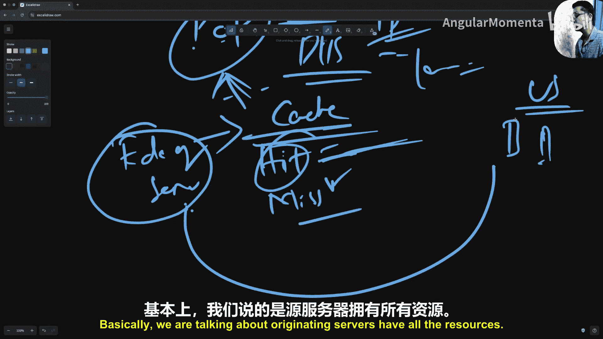

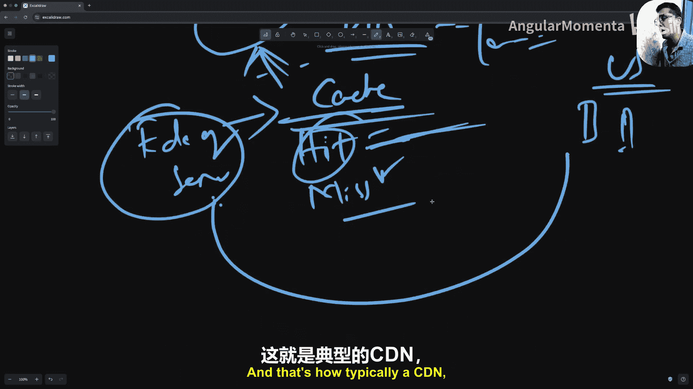

so depending on that they decide how long to keep a particular piece of content so usually companies decide some kind of fair duration right this content should only be cached for the next few hours because after that it might have a new version or there might be regional changes etc etc cea right so it is a safe default so that after this amount of time if a new request comes then instead of serving the old con it fetches from the originating server a fresh con and serves it with a new detail time to leave。

The way typical Cn workflows。

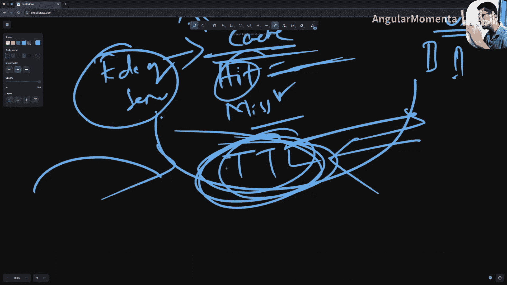

And it is considered as a network level cache。 The second use case of caching when comes to network layer is。

DN S BN Sque。They also make heavy uses of caching。To minimize the latency of all the DN S fairries that are happening from billions and billions of users at the same time。

 So let's imagine another user scenario so that it's easier to keep track of how DNS。

Actually works And where exactly does it actually implement the caching workflow。

 So let's imagine a user enters something in the URLs say a domain name example dot com right in their browser and their press enter。

What happens？ The first thing on we are just only focusing a DNS part。 of course。

 when you type something in the URL bar a lot of things happen。

 but we'll be focusing on just the DNS part。So the users divide。

 so after you hit enter the user's device， whatever the device it is， the laptop or the smartphone。

 it sends a DNS。Qually and it sends it to a recursive resolver。 It's a technical term。

 We'll see what it means。 It sends the DN query to a recursive resolver。And this resolver。

Is typically provided by the users ISP ISP basically means whatever company it is you are taking your internet connection from So if you are from India it could be geo it could be ACT or it could be AL right so that is your ISP now this resolver this recursive resolver this is provided by your ISP your internet service provided。

Or it could also be provided by some third party DN S providers。

Like Google has a public DNS provider or Cloudflare also has a public public DNS provider。

 etc cetera， et cea。 right So it can be either of that。

 It can be your IP or it can be a public DNS provider like Google or Cloudflare。 Now， second thing。

 what happens， the DNS query is routed to your recursive resolver。

 which can be in your ISP or a public DNS server like Google or Cloudflare， It doesn't matter。

 We'll see what exactly happens， once the query reaches the recursive resolver。

 The recursive resolver， it does the following steps。

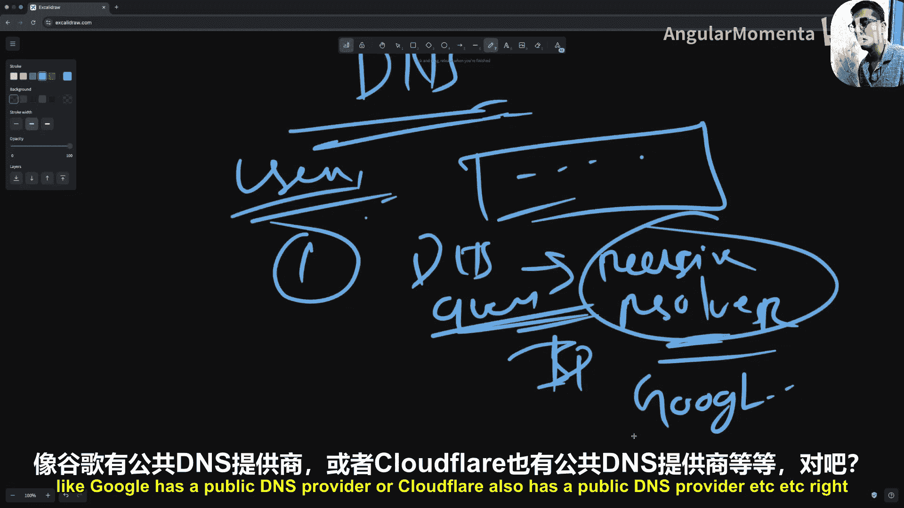

First thing what it does。

It first checks the local cash to see if。It already has that particular IP right some random IP it checks once it has the query it checks whether it already has that particular IP cached in its local system when you say local it means without accessing a remote storage or anything like that。

In its local primary storage or secondary storage or display storage whatever。

 right in its own system。It checks whether it has the entry for this IP in its local cache or not。

 depending on that， either it is a cache hit or a cache miss。

If it is a cache hit the resolver immediately returns the result and what is the result in this case the DNS query was to check what is the IP of example do com so it checks whether example dot co is in its local cache or node if it does then finds the corresponding IP address and it returns it to the user our browser or to our smartphone or whatever it is but if it is a miss if it did not find it in its local cache it sends that query to others what are these others we proceed to the third appear if it does not have the result if it if it does not have the corresponding IP for that particular domain example do co it misses it here it is a cache miss and it varies other resolves and。

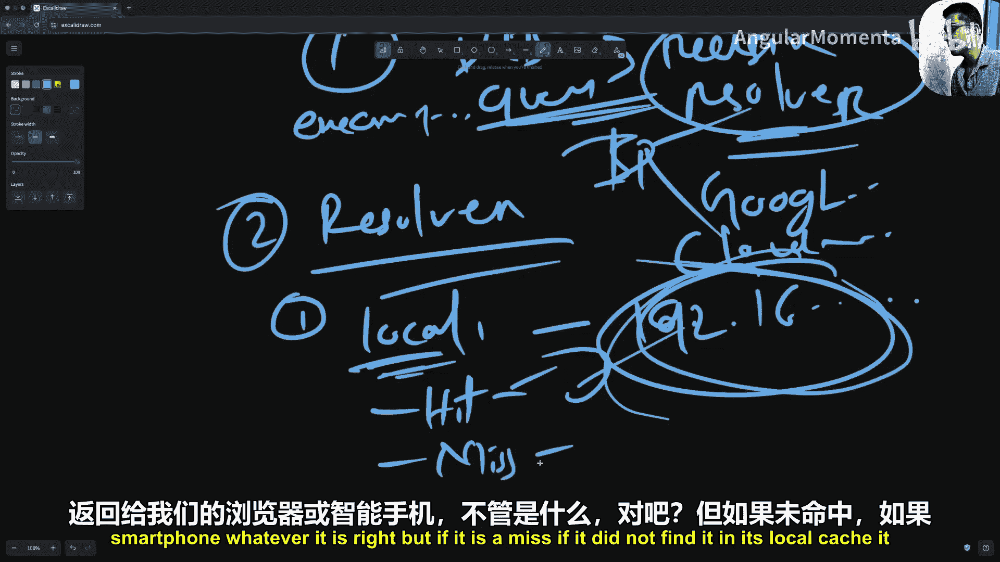

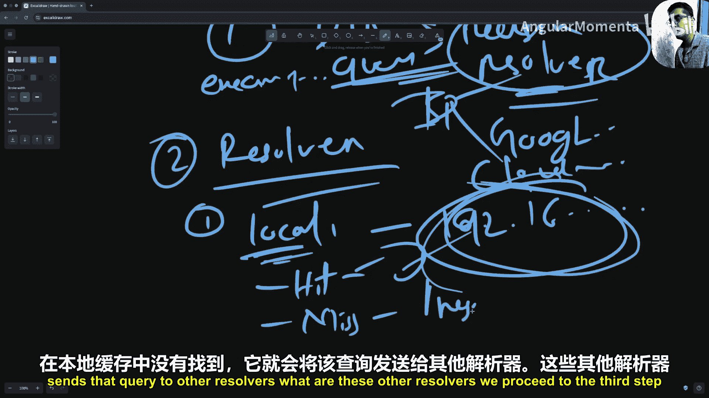

It is called querying the root ser。 there are a lot of route servers， I think 13 or 14。

 I don't know the exact figure， but these are called route servers。

 there are multiple route servers spread all over the world。

 and they don't necessarily have the particular IP P then they don't have the result for what is the I address of example do com。

 But what they do have is。They have the address of the top level domains。Right。

Top level domains like dot co。Dot co dot in， eta。 They have the addresses or referrals for these top level domains or these top level domain servers。

 Okay， we are talking about other servers now。 Now， since it is example dot com， it sends the。

Address or the reference of that dot com top level server。Next， you proceed。

 it reaches the top level server for dot com Okay， the T LD， T LD or the。Dot com。

Tall level domain right and from there that also does not have the Hy of example of course。

Then this sends the address for the authoritative called authoritative name server for。Example。

Dot com。It has the address for the authoritative name server for example。com。

 and it sends the address of that。Then what happens， the recursive resolver， right。

 we are still talking about the recursive resolver。

 which has the responsibility of finding theip of this particular domain and it is called recursive because it goes deep and deep and deep into different different servers until it finds the I。

 That's why it's called a recursive resolver。And at last。

 we reach the actual authoritative name server for example do com。

 And from there we can take the iPads whatever IP address address it is can take that and it returns it where exactly caching comes into play here。

 DNS heavily depends on caching because of how much of work it is to recursively reach out to different different servers and finally get the IP That's the reason DNS heavily depends on caches。

 so that it does not have to do all this work for every single request so that it has some kind of local cache which it can use for further request。

 It only wants to do it once for a certain amount of time right So most operating systems。

 it can be Windows or Mac or Linuxux maintain some kind of local。Guess。For Ds。

And when a user request a particular domain， the OS S， the operating system。

Checks its local cache first。 Okay， before it goes to your ISP， thecursive recursive resolver。

 et cetera， et cetera。 It checks its local cache。 If it can find it。

 then it skips going to the query resolver， the recursive resolver and immediately finds theip and goes to that And whatever the normal browser flow is。

 Then then next level， if it does not find。The entry for that particular domain。

Then the next level of cache is browsers， of course， browsers。

Most of the modern web browsers like Chrome Firefox， they maintain their own DNS cache。

After our operating system， the next hierarchy， the next level of caching is implemented by our browsers。

 They have their own local cache or DNS。So， that。If our operating system cannot provide a corresponding iPads。

 browsers also try to maintain their own cache， they check if they have the iPads of a particular domain from some previous request if it does。

 then they can skip going to the recursive query resolver and they can immediately access the website。

That's the next level。 The next level of cache is from the resolver。

 the recursive resolver that we talked about which recursively tries to find the iPads until it finds it in some server。

 whether it is the root server， the authorit name server or whatever that recursive resolver。

Which is provided， either provided by I SB or something like。Google public DNS， or Cloudflare。

these components， they which are known as recursive resolvers， they also maintain their own cache。

So that if for some request， they can find the corresponding entry， they can immediately return it。

So that they can skip going to all these different different servers to find theip it and beyond that also。

When we talked about authoritative name servers， they also have some kind of cache。

 not all of them implemented， but some of them do。And using which they can also skip going to skip making further requests to further servers right So as you can see。

 DNS also implements caching heavily in multiple layers Next we have is the harder level caching。

 So if you're from a computer science background you would be already familiar with all these concepts What is11 cache or is L2 cache L3 cache what is main memory。

 what is hardest， et cetera， etc cea。 So caching is also implemented at harder level。

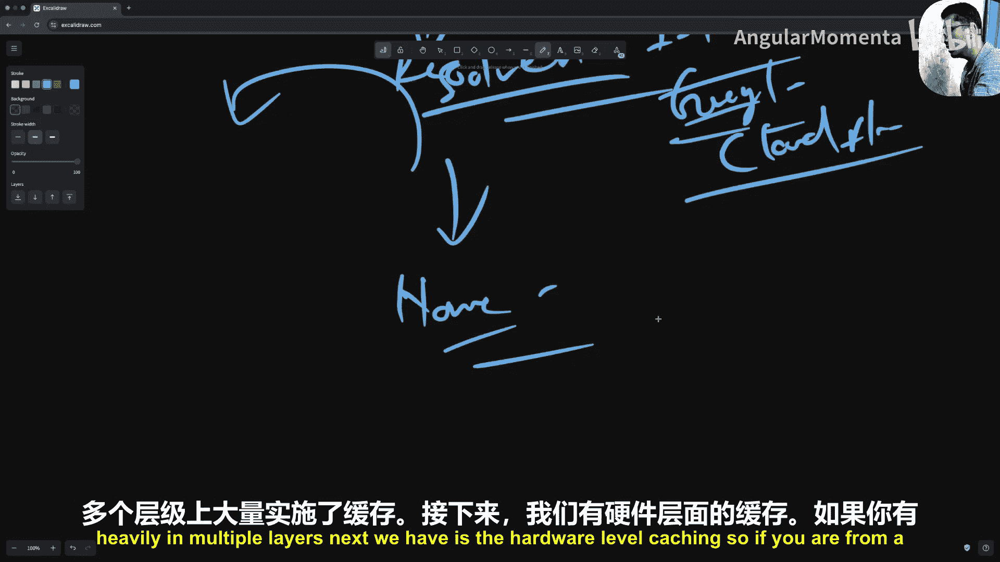

To make computations faster and to make a lot of CPU level operations faster。

 So on a high level without going into too much technical side of it。

 you can see that we have here our CPU chips。Which to the actual processing。

Then we have multiple layers of caches。 We have the Lone cache here and the L2 cache。

 and we also have the L3 cache， which。Is a memory unit which is shared between different different caches。

 right， This memory is shared between different different C P units。Then， we have the。

Tam or random access memory， which is also called a main memory。

And then we have the secondary storage hard disk and cache attached So what exactly happens C keeps these memory units also called as Lone cache l to cache and L3 cache so that it can cache some of the repeated computations or some data which are frequently used or which are going to be used say to give an example if you are familiar with the concepts of arrays。

 the reason errorss are a very good data structures for sequential excesses whenever you start traversing the elements of the array from a particular direction。

 let's say you have one，2，3，4，5 here。The moment you start traversing here。

CPUs are different different computing units inside your processing units what they do through different predictive algorithms they take the entire memory unit and they put it in some cache right can be alone cache I do cache depending on the predictive algorithm。

And thus' the reason， accessing elements sequentially in an array is a very fast operation because of predictive algorithms of the processing unit。

 That is just one example of how harder level cache works。

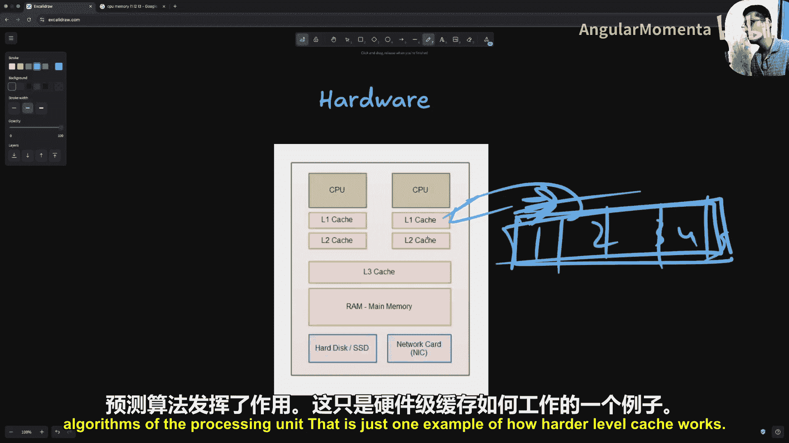

The thing that we want to focus here。Is this part the random axis memory or the main memory。

It's considered。 And whenever we talk about major caching technologies， say Redis。

Or Mem cached these are called in memoryory key value store based databases and they are called in memory databases because they store data in your main memory or the random access memory and it is called random access memory because compared to hard disks or SSDs in which you can access the data in a mechanical way So if you take hard disks。

 for example， there is some kind of head which revolves around the disk and it finally finds the data it is a mechanical operation。

And compared to that main memory or random access memory。

 it has a bunch of capacitors and all and through the use of electrical signals and with the direct access of different different parts of the memory addresses through their addresses。

 it can directly access the data with a single electrical signal and that is the reason it is called random access memory。

Which means it does not matter from what direction you try to access the data。

 The speed and the time is going to be the。

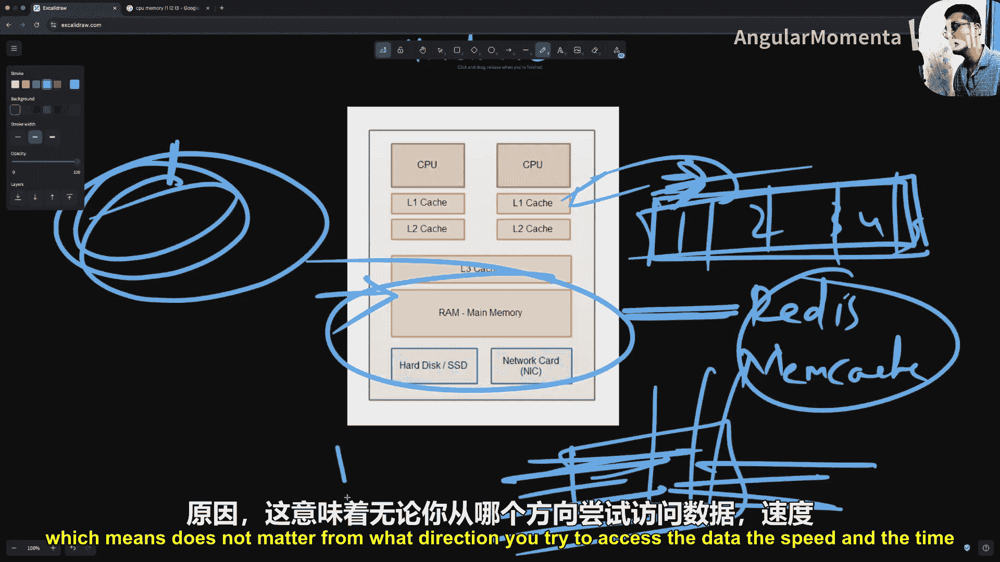

Almost constant。 That's why it's called a random access memory。 and it is very fast。Do x data。

From this part of the memory。 But the problem is we don't have random access memory or the main memory in abundance。

 even though we have speed。At our disposal， when it comes to random access memory。

 they have limited capacity and also they are volatile in nature。

Which means whenever you turn off your power， whatever data is stored in random access memory。

 it goes away it clears， it starts fresh whenever you start your computer。

Because of their volatile nature and because of the way they are created。

 at least from the harder level， they are created with a trade of that we are trading off non volatility and capacity for speed right so that's the reason we cannot completely replace。

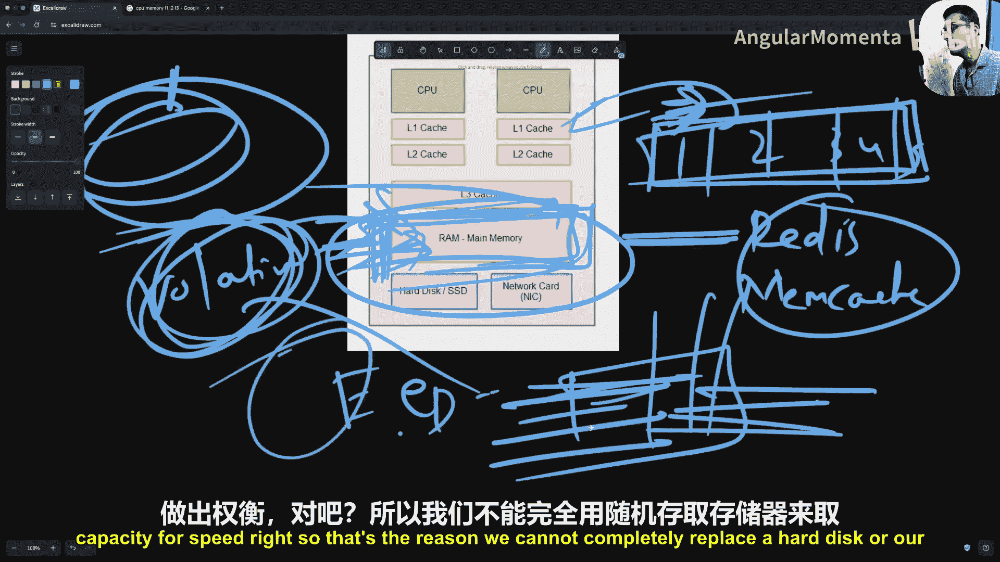

Har disk or our traditional disk space storage with random access memory。 right They have their use。

 They are fast when it comes to data access and data retrieval。

 but they are not a replacement for our secondary storage。

 storing data in secondary storage is permanent， permanent， permanent in the sense。

 they are not volatile。Does not matter whether your program is accessing it or not。

 or whether your computer is on or not， the data persists there because it is physically writing the data in that disk。

That is the reason hard disk or secondary storage have their use and primary storages have their own use。

Tary storage have very fast data access time。And secondaryly storages have slower data access。

 but they provide the safety of persistence and that is the reason。

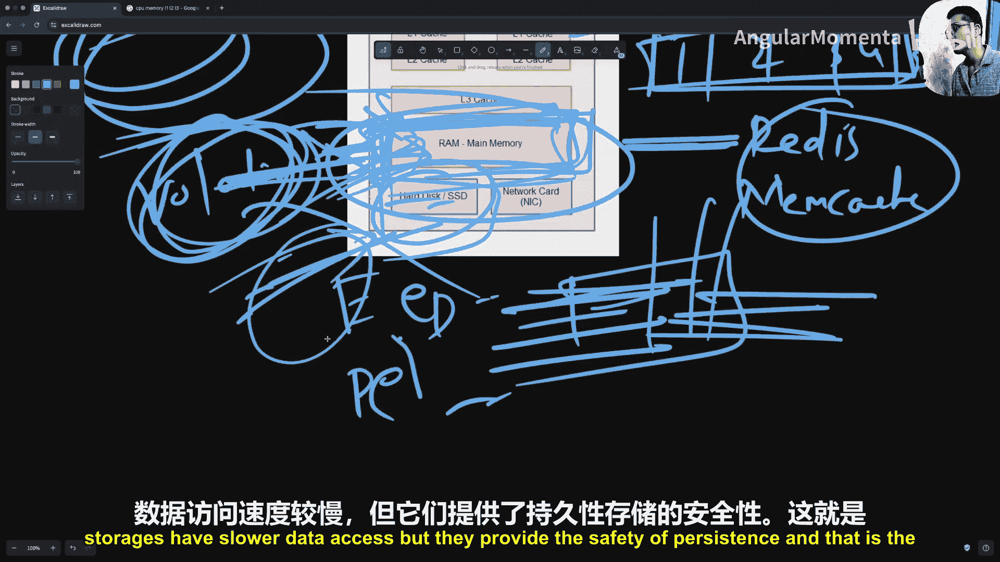

Technologies like Redis or。Mm cached these databases。

 they make use of this random access memory or the main memory to store their data。

 and behind the scenes for persistence， they make use of the secondary storage。

 So with some kind of mechanism， when the program starts up。

They take the data from the secondary storage and load it in the main memory again so that you have your data persistence。

But when you retrieve it， you retrieve it from the primary memory。

is the responsibilities of these programs， Red memory cache or whatever caching technology。

 the in memory caching technology that you are using is there responsibility to implement persistence。

 etc cetera with the secondary storage But when we are talking about accessing the data whether retrieving it or modifying it it happens with the primary memory That's the reason data access operations from these databases。

I be fast。And finally coming back to the context of back in development technologies like Redis or Mecache。

 or if we are talking about cloud technologies， then technologies like AWS El cash。

These come into play。 They provide some kind of storage。

 and that storage is based on the primary average。 That's the reason。

Data access operations are very fast。 We call these technologies。In memory。

 key value based no SQL databases， right， there are four components here。

 The first thing we already saw， they are called in memory based databases because they as compared to traditional databases like postg or mysql。

They are not stored in disks， right， secondary storage， They are stored in Ramm or primary storage。

 That's the reason they are very fast。 right， That's why they are called in memory databases。

 The second thing is key value waste， as compared to traditional databases。Relational databases。

 which have very strict schema， and you have to create tables， and you have to create rows。

 etc cetera， etter right。 Instead of that here， the data structures are pretty simple。

 You have keys and you have values。 You have a particular key。And for that key。

 you can store anything。 It can be a list。 It can be a Json， It can be a string number。

 etc ce Different different technologies offer different different data types。

 So you won't go deep into that。You can do your own research for that and that's the reason they are called key value based No SqL databases they don't enforce the strictness of traditional SQL databases。

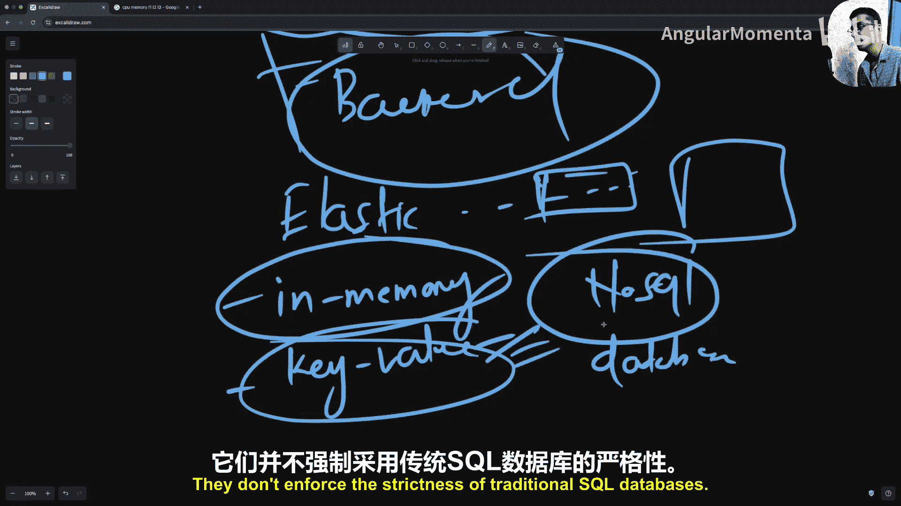

And that's about the name now since we are talking about databases like this。

 which we use in our data day backend development。There are two types of caching。Strategies。

 caching strategies， the first one is lazy caching。Or also known as cash aside。

 and a second one is known as the right through。 And surprisingly， we have already doubt about this。

 so we won't go very deep into this。

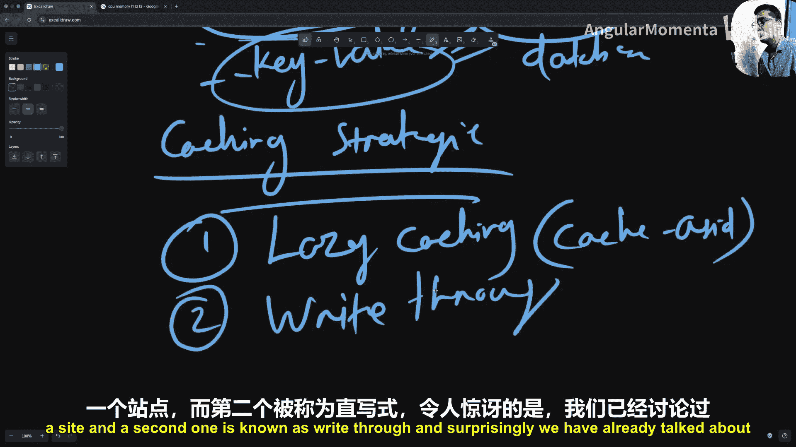

All in all， lazy caching basically means let's say there is a client and it is requesting some resource。

So that server checks whether that resource is present in the cache or not。 if it is。

 then it returns that resource。 if it is not， it fetches it from a different storage right。

 some kind of primary storage it fetches it it gets the data。

 it stores it in the cache and then it returns the result to the client so that the next time the client makes that request or some other client makes a request it again checks and it finds that in the cache and it returns it That's why they are called lazy caching you don't proactively cache things by predicting from client interaction or patterns etc。

 you just cache it when someone actually requests that's why they are called lazy caching and it is a pattern that is very famous in a lot of different different context in backend development。

 The second one is called right through caching。

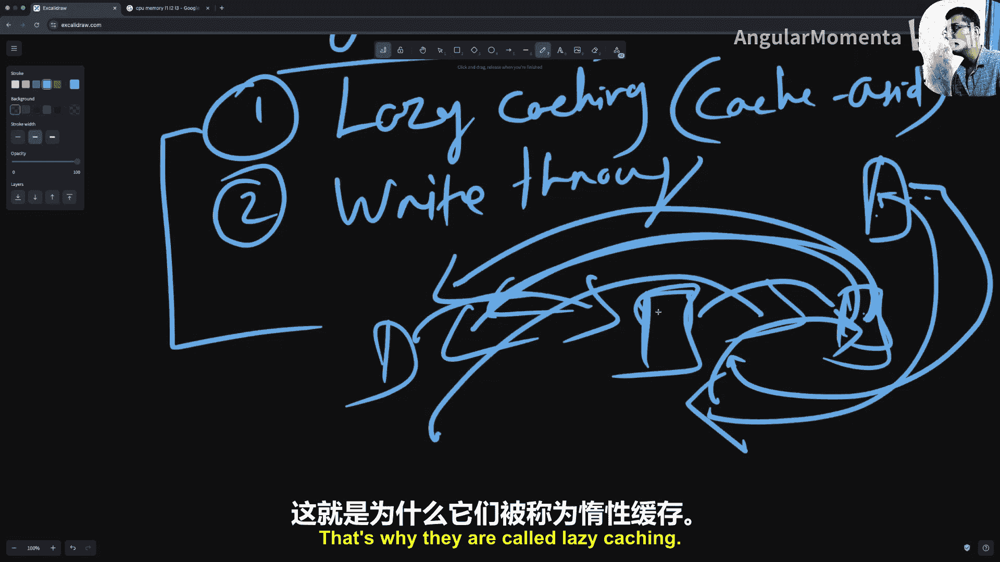

It is more about the cash a strategy。

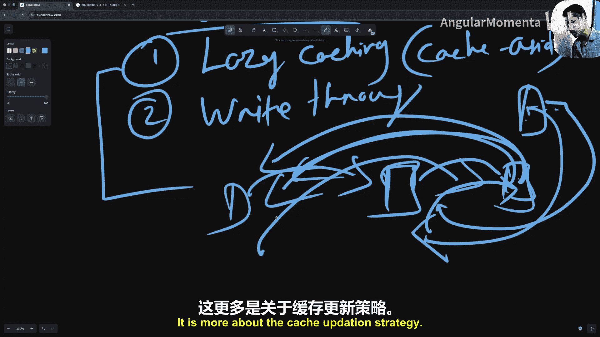

Which basically means every time something changes right every time there is a post call or put call or patch call。

Where you are actually changing some resource or creating some resource in the database in your primary storage。

 what you do you make the change for that resource in your database。

 you make the data query at the same time in the same API call in the same execution flow you also make the same change in your cache so that the next time the request comes you can serve it from the cache。

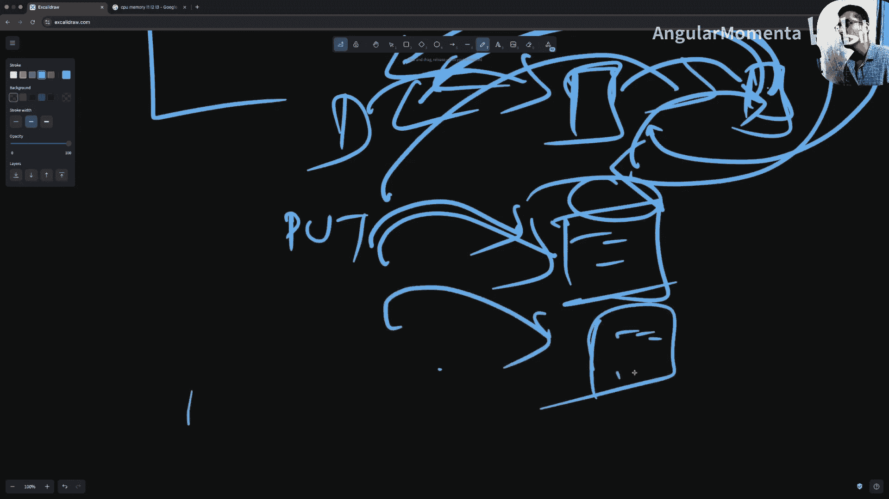

And which also means all your operations， all your right operations bring more overhead because at the same time you have to update the database and the cache at the same time。

 but the advantage here is。Your cache is always fresh right it is never expired。

 you never serve old data since you update the data in the database and the cache at the same time。

 your cache is always fresh so those are two major strategies that you will see frequently。

In your day to day development， the next major component when we are talking about technologies like Redis R M cache is。

 the eviction policy， something else that。We should be aware of is the eviction policy。

 And what it means is when you have a cache， as we already know that in memory caches like Redis。

 they use primary storage or the random access memory， which。

I limited in capacity as compared to the secondary storage。

 So it is pretty obvious that at one point we run out of memory or if we are using a managed storage like A elastic cache right so they have a storage limit right in these conditions we are bound to run out of memory at some point and at that point we have to decide that we want to delete data from our cache of course。

From the initial part of the video， we have already discussed that cache is only a subset of the data。

 which is frequently accessed， which is stored in a different location so that the retrieval is fast so the。

Keyword to focus here is a subset of the primary storage like we cannot store all of the primary storage to cache and that is the reason we have to decide that at some point we have to let go of some data so that the new data can be stored new data which are more important which have higher priority than whatever the older types。

And that's why we have the eviction policies。 eviction policies basically means you decide。

How are you getting rid of the old data so that new data can be stored in the cache？

So a couple of strategies are the first one is no eviction and this basically means you do not configure any eviction policy the next time you try to insert data into the cache。

 you get some error that the memory right does not make any sense， but。

If you have not configured any eviction policies， then。The configuration is called no eviction。

 The second one is L R， also known as least recently used。 This algorithm basically checks。

That which pieces of data are least recently used， basically means if there are other data points let's say we have one。

2，3，4，4 keys in the cache and。Now， the memory is full。Right， and the database。

 something like that is。 they keep track of When was the last time a particular key was accessed。

 Let's say this key was accessed today and this was also accessed today。 This was also access today。

 but this was accessed yesterday。Now， when a new data point comes across。

 let's say we want to store G5。When5 comes across and this cache is full。

 this has to make space for5 and in this situation。

 if we have configured least recently used eviction policy， what it does。

 it checks which is the data point， which is the oldest accessed data point and since4 was accessed yesterday and all the other ones were accessed today only。

It selects this that you will go out and5 will go in。

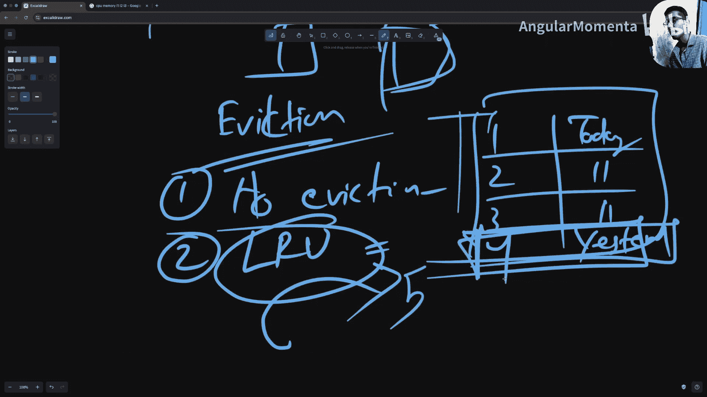

This is what we mean when we say least recently used or LRU cache eviction policies， third。

 we also have LFU。

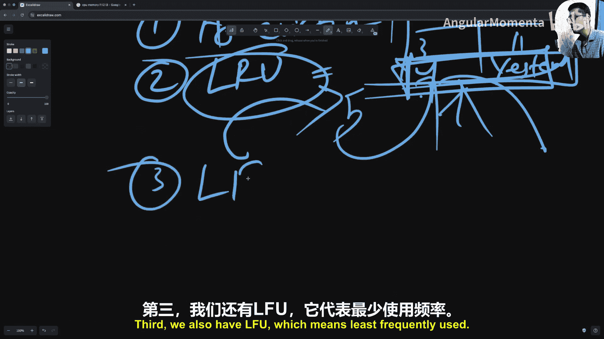

Which means least frequently used。 So going back to the earlier example， So over that time。

 let's say， okay， we have  four keys，1，2，3，4 and 5 comes across。 Now， instead of tracking。

 when was the last time this key was accessed， it also tracks what is the frequency of the axis。

 Let's say one。

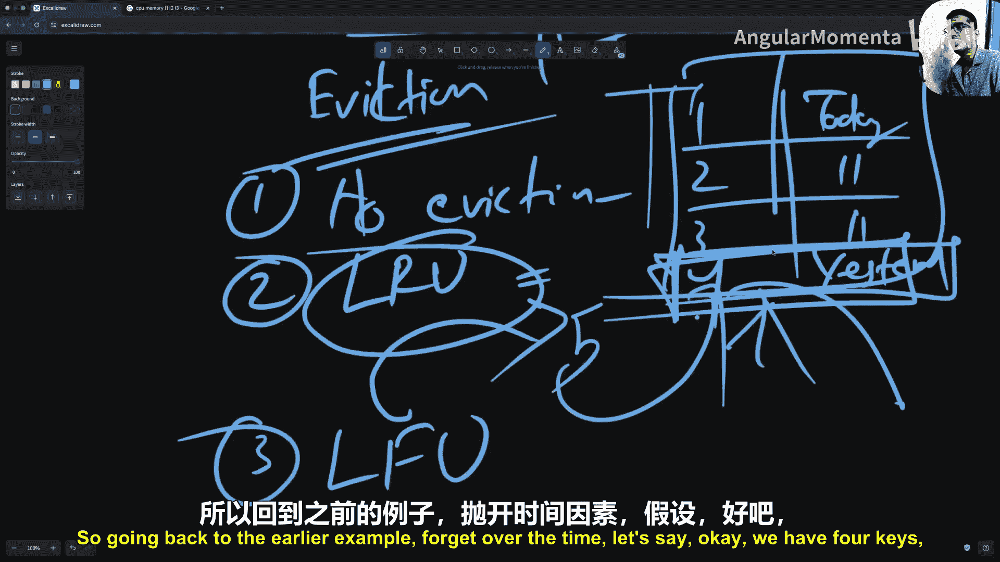

Was accessed five times。 And we are talking about so far， right one。

 the key number one was accessed five times so far and  two its been accessed 10 times。

 Then we have 3，6 and 4 was accessed。 Let's say23 times， right some random numbers。 Now。

 when 5 comes across， it checks which is the data point is at least frequently used。

 which means the axis frequency。Is the least。So if you check this one。

 the key one was was accessed the least number of times right the5。

 the other time the other keys are being accessed more frequently and that is the reason it it selects one and say that you will go out and5 will go in That's what we mean when we say least frequently used cash eviction policy then we also have Ttl time to live based eviction policy。

 which basically means and Redis we can configure what is the ttl time to live for different different keys right so depending on that a particular key can be invalidd automatically depending on the Ttl time to live and that can also be part of the eviction policy So in the same scenario when5 comes in it checks that which of these keys have the lowest amount of Ttl So which key is going to be expired soon。

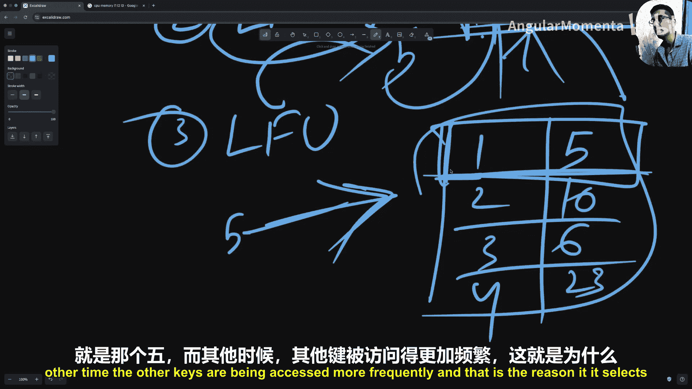

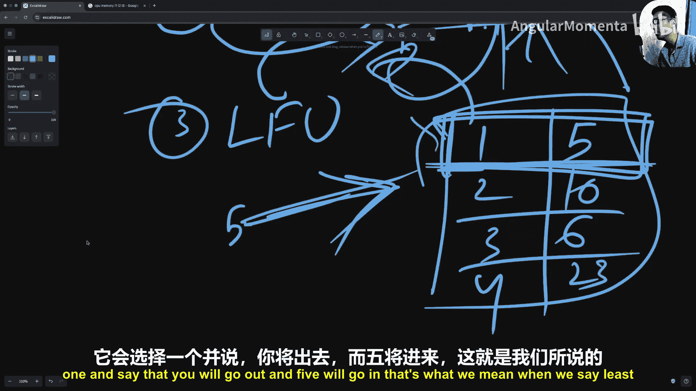

depending on that it selects that key and takes it out and inserts the new key and that's what we mean when we say time to leave TDl based eviction policy and that's pretty much all you need to know when it comes to the technicality of in memorymory caches like Redis and all rest of it is pretty straightforward。

You take whatever compatible library is available in your corresponding programming language。

 let's say nodes has no redis or something something。So depending on that， you just use the library。

 it's not very complex。 You provide a key。 you provide a value。

 you store it and you when you want to retrieve it， you provide the key and you get the value。

 It is pretty straightforward。 It has no complexities like S QL queries and aggregation， etc cea。

 etc cetera。 It's pretty simple to access。But all this technical familiarity with how the technology works behind the scenes。

 one of the major components， it helps you make sense of the whole thing。And make better decisions。

 etc cetera， etctera。So now that we have discussed all the technicalities of in memory databases like Red is Me cache。

 let's see some examples。 What are some use cases Where do we actually use technologies like Redis the in memory databases and a typical back in engineering workflow。

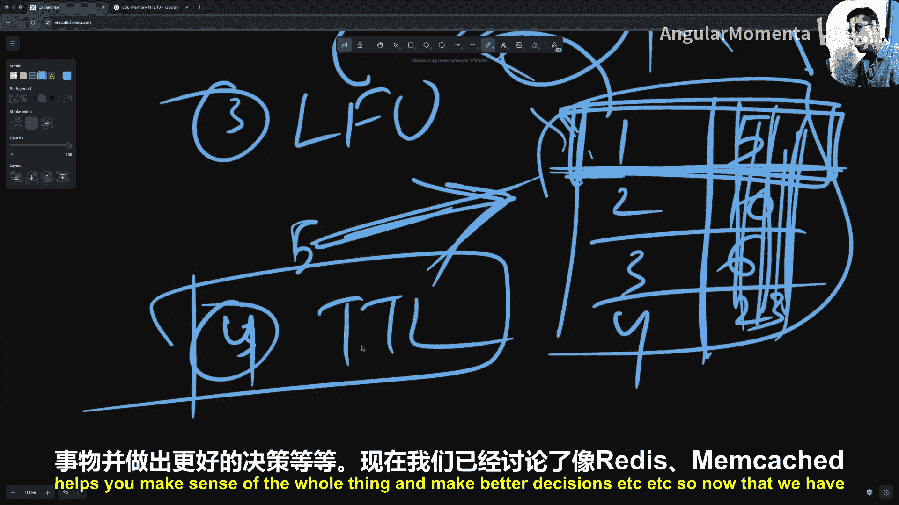

And one of the major use cases is database。BB。Qury so let's take an example that you have an S query which has a lot of joints and it tries to join a lot of tables。

 It does a lot of aggregation right and finally it ends up with a few rows。

It is a very compute intensive operation because you have a large data set。

 let's say millions and millions of rows。And it is a very compute intensive data and you have room monitoring。

 You have noticed that this particular API， which calls this particular database query。

 it is hit pretty frequently right it is let's say in your landing page or in your task page and a lot of users are hitting this API and it is putting a lot of load in your database So what you can do you can take that particular query in the next line what you can do you can cache the result with some detail time to live。

You can say that for the next one hour， cash this result and when the next request comes。

 check if the result is present in the cache， then serve it from there。

 otherwise do the calculation once and store it in the cache。

And whenever some other modification happens， you can manually change the cache or you can delete it you can handle it accordingly。

 right， then whenever users hit that particular API instead of putting the load on the D B。

 you can directly serve that particular result of the query from cache right that is a good example right whenever you have a very compute intensive。

Daabase operation。And it is it is being called pretty frequently。

 Then you can cache that result to save some computing time。

 save some resource and to reduce the latency of the API call。 Also to take some real examples。

 E-commerce websites like Amazon。 they also cash product details， prices and。Inventory data。

 etc cetera， etc cetera， to avoid querying the database for every single request。

 So imagine there is some sale going on for a MacBook and on。

 And if Amazon did not cache the details of a MacBook。For that particular product。

 then during the period of the sale， millions of users hit that particular web page and。

The fetching the image of the MacBook or fetching all the product description of the MacBook。

 these are all database operations right， and the database will get a million requests。

And that puts significant load on the database。 and for no reason。

 regard information like product details for a MacBook， it does not change very often， right。

 So it is a very good candidate。For the guessing。So that's the reason websites like Amazon platforms like Amazon。

 the cache static data like product details， prices in some cases so that。

They can reduce the load in the database。And the database can actually do the importance stuff instead of serving the static content like product details the same way social media platforms like Twitter or Facebook。

 they cache user profile data user profile data is not something that changes very often right maybe a couple of times in a year right That's the reason this serve they cache the user profile data so that every time that data is fetch that is served from the cache instead of from the database。

So imagineag if it is a social media profile of some celebrity in that case。

 that particular page and that particular API of fetching the user profile details of that celebrity that might get hit。

 let's say a thousand times per day。or if they have an upcoming movie， maybe a million times a day。

In that case， putting all that load on the database does not make much of a sense。

 since that user profile information is pretty static most of the times it can serve that content from cache。

Right and even if the user makes some change， they can invalid the cache and put the new enter， but。

It is a pretty read， heavy operation， as you can see from the pattern。

 And whenever we have a read heavy operation and the right is pretty infrequent。

 we can make use of caching。😊，Okay， so database caching。

 database query caching is one of the primary examples of when we use technologies like Redis in memory databases。

 the second one is。Session storing session。 So if you have watched the authentication video in this playlist。

 you might be aware of this in a typical authentication flow。After a successful authentication。

 a session token is generated for that particular user and that session token is stored in some kind of storage right and ideally it is stored in Redis or a in memory database so that。

Every time the user makes a request or an API call， we have to fetch that session information。

From somewhere， right， if did not use Redis， well have to fetch that from our database。

 and as you already know。Ftching data from random access memory or primary memory， or in this case。

 cache like Redis is much much faster than fetching data from a database。

And that's the reason in order to avoid latency in every single API and to avoid putting load on our database。

 people usually store session tokens， authentication related session tokens in Redis or any in memoryory databases right that is another use case of Redis third is A caching。

 So let's say in your backend you are making use of some external API。

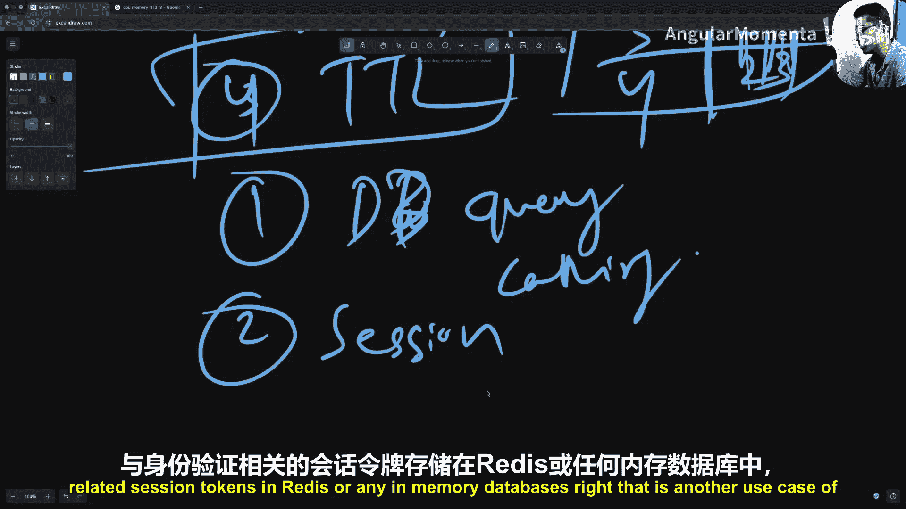

Let's say some weather AA and you are taking the information from that and you are doing some kind of computation to serve your own f。

Now， every time your funding makes a request to your API， if you do not make use of caching。

 you also make another request to the weather API to fetch the weather data。

 And if you have a lot of users and they are making。

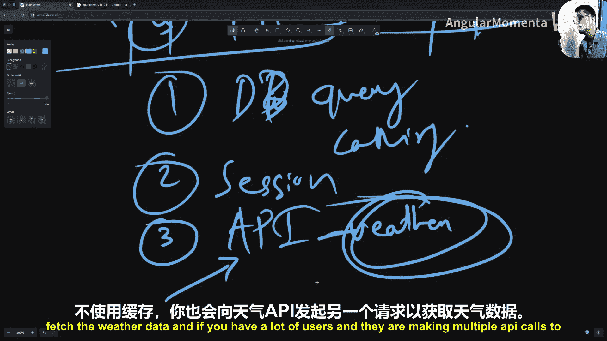

Multiple API calls to here。You also end up making a lot of and thousands of API calls to this external A。

 And usually since external APII calls have some kind of limit， some kind of read limit。

or some kind of pricing based on how frequently you are calling them you will quickly increase your billing or you will hit your rate limit and since in this case it is not real time data right it is a weather data which。

Is safe to cache， whether data does not change in like seconds or minutes。

 That's why it is a kind of data that is safe to cache。 So what you do。

 you fetch that information from that API， you cache it and you make use of that in all the subsequent request that is coming from your front。

 and you can use something like T TL for， let's say， of an hour。So you cache this data for an hour。

 and for the next one hour， all the request will use the value of the weather data from the cache。

 and after an hour， their cash。Automaically invalidates it and the next time a request comes instead of taking it it from cache。

 you will fetch the weather data again， you you will put it in the cache and then you return the request right whenever it comes to interacting with external API。

 we think about caching so that we can decrease the billing or we can avoid hitting the rate limit and one last use case that comes to mindness since we are talking about rate limiting。

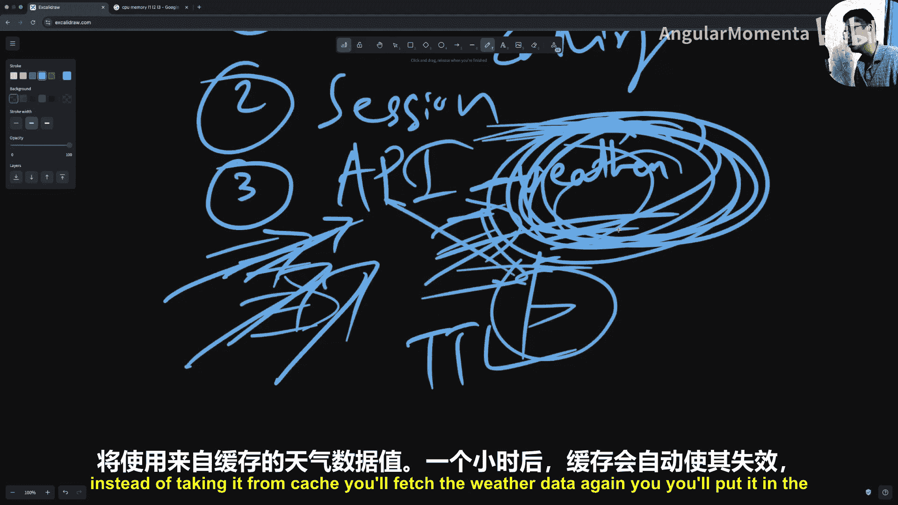

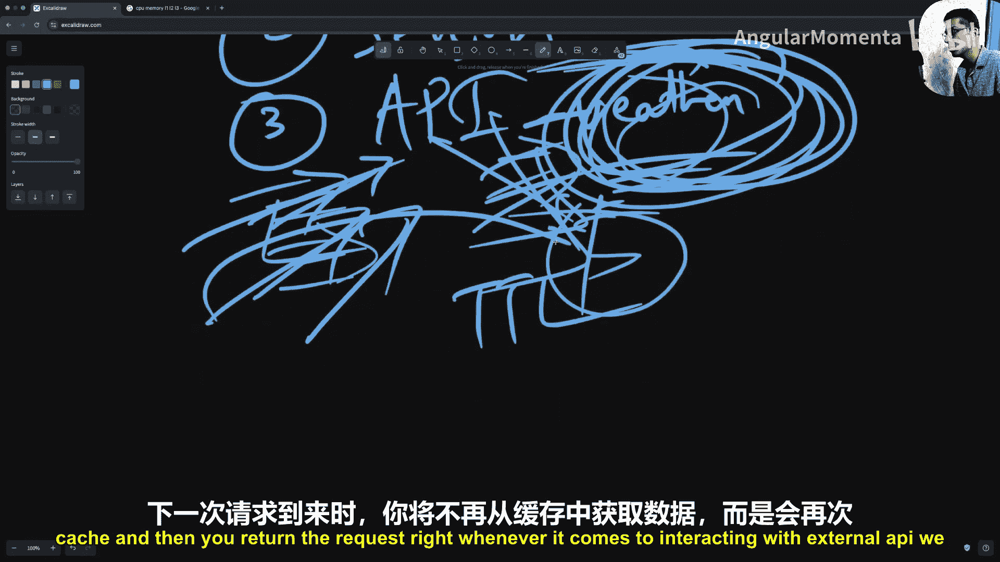

AR limiting mechanism is also implemented most of the times using a technology like Redis or any in memory caches。

 because the way rate limiting is implemented is it is usually some kind of middleware which sits somewhere in the middle since it is called a middleware that's the reason before the request is passed to your。

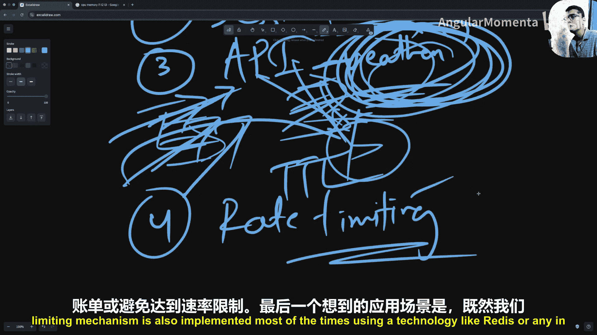

Whatever route or controller or whatever it is， and this is the browser。

Or any client that is making the request and this is this is the entry point to your particular server right and this is the middleware。

 the rate limit middleware and what it does is it takes the header。

 some kind of header which gives it the IP address of the user usually the header is something like X or worded or at this header is mostly used for implementing rate limiting to find out the IP address。

 the public IP address of your client wherever the request is coming from。

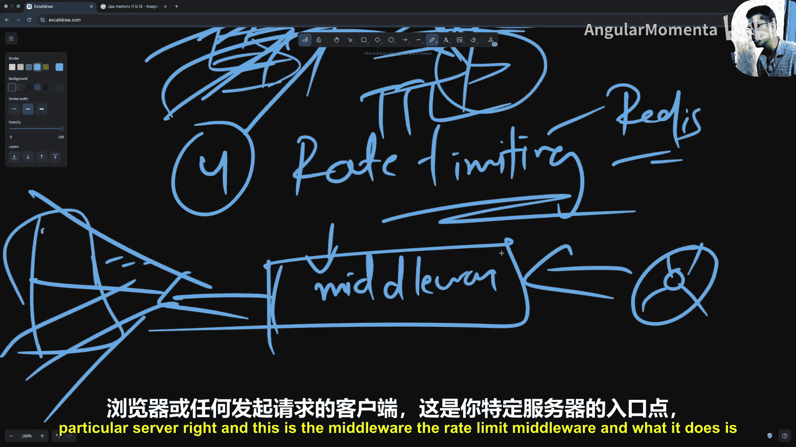

And this is usually added by reverse flux like N G X or whatever that you are using。

That is not the point， the point is。The job of this middleware。

 the rate limit middle layer is it takes this header out from that request every request has some default headers associated which you already know。

Then it takes this particular header out from that request and it checks theip address and usually rate limits have some kind of default mechanisms of durations like how many requests。

 let's say you can only make 50 requests per second。

And these are mostly implemented to avoid uses from bots。

 let's say if it's a very compute intensive API， then rate limiting can help you save your resource。

 right， Sa your compute。Now， let's say this is the condition you a particular client can only do 50 requests in one minute。

 let's say one minute。Then whenever a request comes， it checks that。

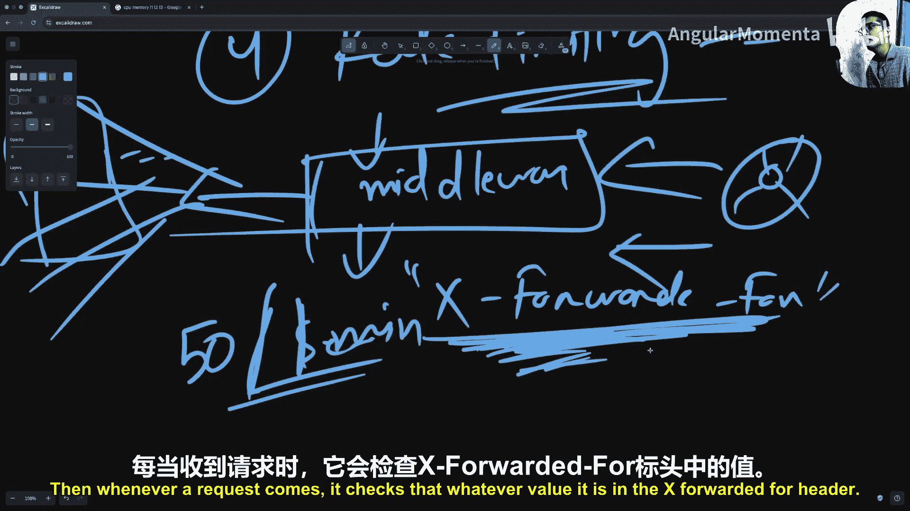

Whatever value it is in the x44er， let's say it finds some I，10 value do。

 some kind of I since we are talking about a key value store。

It saves some kind of counter so that this is the IP address for this IP address for the start of this minute。

 the first request came， I got。One request。 The next time the request comes。

 it checks the cache so far， one minute has not passed， right。

 That's why it checks and it increases the counter from one， it makes two。Same as 3。

4 every time a request comes it increases the counter so that within a minute if the counter exceeds 50。

 then what it does， it blocks that request and it sends an error response of 4 to 9 and when we send a status quo of 4 to 9 it means too many requests to many requests this how a particular overflow looks like for rate limit。

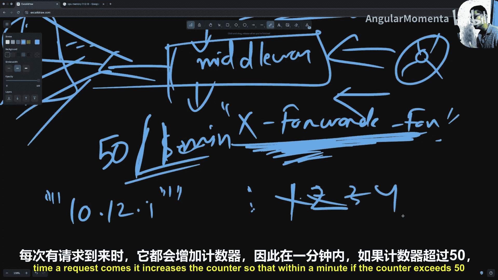

Now， coming and do caching。This particular part。Where it stores the counter。Is usually in redis。

Or any inmemory databases， because if it is stored in a relational database。

 something like Postgres or Mysql， that is possible。

 of course that is possible it has a position in storage and we can retrieve data etc cetera， etc ce。

 but differences taking data out from a relational database takes more time right even a difference of let's say 20 or 30 milliseconds that makes a difference on what is the latency of the API。

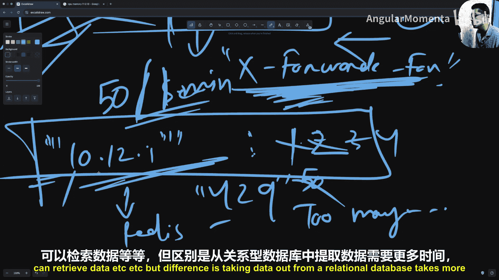

If we stored it in a relational database， then for each request。

 we willll be making a database call in turn。

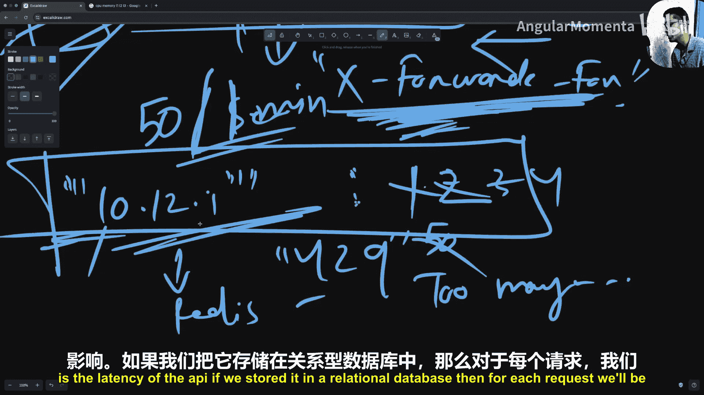

The first thing is anyway the latency will be increased for that particular rate since we are making a database call unnecessarily for each request。

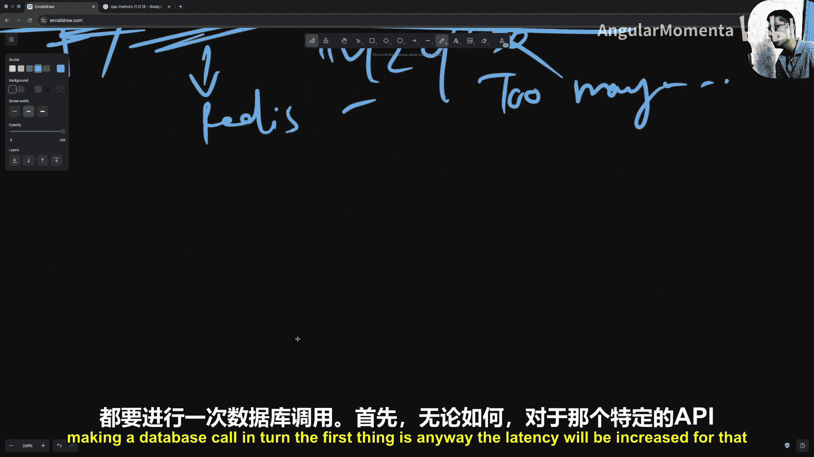

Second thing is the load on our database also increases。 Let's say there are like1 thousand users。

 Then 1 thousand users are making hundred requests for a minute。 Then our database will be flooded。

With just the request of real limiting， right that is the reason we want to separate this out。

For two reasons first is， of course， to make it as fast as possible so that we can minimize the latency of Apis and also to decrease the database load And that is the reason whenever we are talking about implementing great limiting we make use of in memoryory databases like Redis instead of storing it in a relational databases and with that we have pretty much covered what is caching。

 Why do we use it some real world examples and why do we use in memory caches。

 Why is it call in memory cache via Ram primary storage is faster and some real world examples of redis sub different components of redis etc and that pretty much covers all you need to know。

To be comfortable with caching， to understand caching， to understand the context where it is used。

And what are the different components of it and why do we use it some de examples？

And next you can use all these technologies you can start with that is the open source alternative Valki。

It， and you can， depending on your programming language， you can install a library， and you can。

Gets your hand study and see what are the differences in accessing data from a relational database as compared to something like in memory database like Redis。

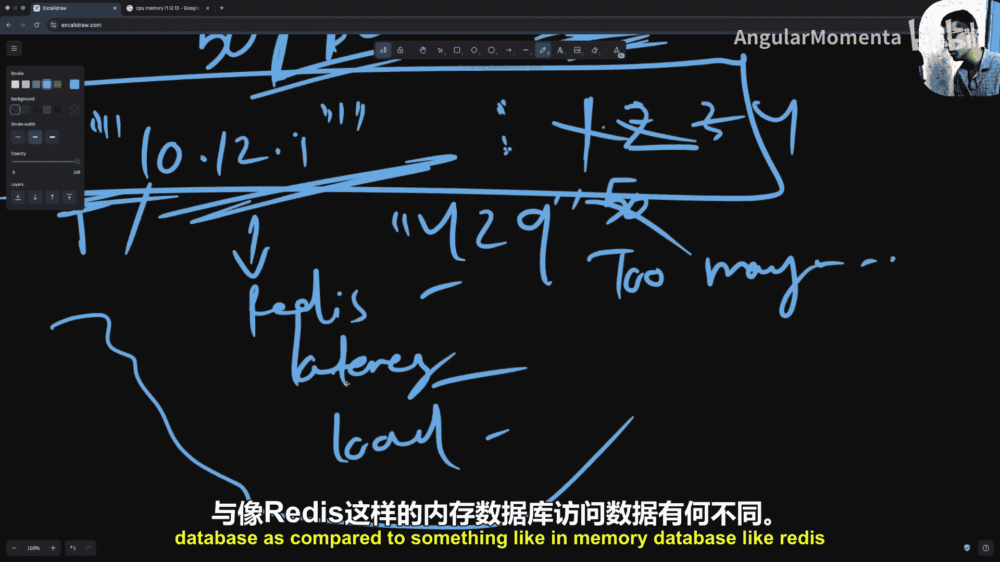