# 【Sriniously】从第一性原理出发的后端开发 ｜ Backend from first principles p14 14. 任务队列与后台作业 -BV17aq1BUEhf_p14-

In this video， we are going to talk about background jobs or background tasks。

 if you are a backend developer。Understanding background jobs is very important so that you can build scalable and。

Responsive applications or responsive backends。 So what exactly is a background task。

 And why should you really care， So a background task is basically any piece of core that runs outside of the request response lifecycl。

 right。I our request is our response， and this is our client is our server， right。

 any piece of code or any logic， any workflow which runs outside of this whole interaction。

 this whole client server interaction or the request response life cycle。

That we call as background job or a background task。

 which means that whatever that you are doing here outside of the request response lifecycl。

This does not need to happen immediately this is not a mission critical task。

That needs to be responded immediately after calling it。 It this is not synchronous。

 and that is the reason we can offload it to a separate process and finish。 However。

 we have programmed it to finish it。 However， we have programmed it to respond。

To whatever client or to whatever separate process， why exactly do we need them。Right。

 so let's take an example。 let's say you have an user and you have a platform。

 some kind of Sas platform， the user comes to a platform and they sign up。Sign up to your platform。

 which means they type their email， they type your name， type their password， etca。

 and they make a request and that request is made by your front end。

 whichever UI is represented to the user and your front end makes a request or an API call to your server to your backend and your server does whatever processing whatever validation etc it needs to do。

For the email， for the password， for the length of the password， for the complexity of the password。

 etc ceter， and after that is successful， what it needs to do。

 it needs to send an email to that user to this user so that if you have ever signed up to different platforms。

 you must have noticed this workflow that whenever you sign up to the platform you give them your email。

 you give them a password and。They send a verification email to your provided email so that they can verify that whatever email that you have provided that actually belongs to you and you are not providing any random email that you don't actually own it that is one of the ways to verify that you own the email。

What they do， they send a verification email， which contains either a link。

 which you can click on and that redirects you to the front end and it。

Ask you to provide a new password， et cetera， et cetera， or it can also provide。

You a at a sixth visit code or a visit code that you need to type into the front end interface。

At some kind of one time password this is how the workflow looks like when you sign up to a new platform now the point of focus here is user comes to your platform。

 they type their email， they type the name， the username whatever and they click and sign up and your frontend makes a request。

 an API call to your backend。And your backend does whatever the initial processing it needs to do。

 and then it sends an email to the user。Now this is the task that we want to focus here。

 the sending the email to the user and this is one of the examples of a workflow or a task that we usually offload to background processes and the reason being when you want to send an email to user what actually happens is you are subscribed or you are using some third party application right some third party platform。

To send your email some email provider， right， it can be a provider。

 some modern providers like recent Revo。 there are a lot of email providers that we use and how it actually works is you construct whatever the content of your email is。

Well let's say you have an HTMLl template that you want to send to the user。

And you fill the template with whatever code or whatever link that you want to send to actually verify the email。

And you take that HTML template and you provide what is the email address that you want to send to。

 which is the email address of the user。And。You provide the subject。

 you provide which email that you want to send from， etc cetera。 et cea， right。

 whatever the default parameters is for sending an email through an email provider an SMMTP provider and you make an APA A call to a different service。

Your backend makes in another API call with the server of whatever email provider that you're using。

 recent mail gun， etc cetera， etc cetera。 Now， that server processes your email。

 it checks whatever it needs to check whether you own this email， whether you have。

The operate APII key， etc cea， etc cetera。 And if everything is successful， it sends the email。

 However， that server has configured to send emails and it sends the response。

Back to your server that whether the email sending was successful or not or whether it is a failure or not it's a transor now。

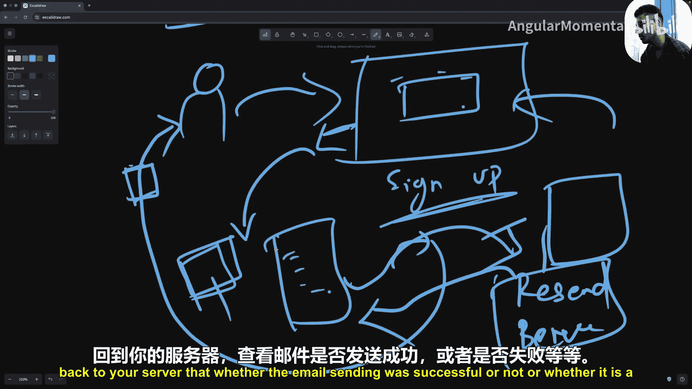

The reason we want to offload this to a background task， offloading this particular interaction。

 you your backend calling another backend or another server for sending the email is because this server may not be as responsive as our own server right because we don't have control over other servers。

And for some reason， for some kind of traffic spike or some kind of service downtime methodology there can be a lot of reasons。

So for some reason， let's set the service is down and assuming we were not doing this whole email sending workflow in a background job。

 we were doing it synchronously， what happens？Your server do server does all the processing。

 It makes the database calls。 It stores the initial data of the user in the database。

 and it creates a。Verification code， etc cetera et cetera。 And it calls this A。

 and this A called fields。So。There can be multiple paths here。1 is。

 if you are not properly handling the error。Of this A failing and。Because of that， what happens？

This API call， this whole the user signing up this API call。

 this also fails if you don't have proper error handling for this API。

 right the email sending you this API and that gives a very bad user experience。

 If your sign up API fails itself。 Now， the second thing is。

Let's say you have proper error handling in place and if you do have that。

 then only this interaction fail right the sign up API itself works properly。But this。

Interaction fail and even in that case， the sign up is successful and in the front end you are showing that we have sent you a verification email and you can use that to verify your account right but since。

This never actually succeeded and you told the user that we have already sent the email so that again gives a very bad user experience now what they have to do。

 they have to come again to the platform and they have to if you have the functionality they can click on resend email。

And again， if the recent email recent email， now that is a different API call and by then if the service is up。

 then all good， you can resend the email and they can verify the account and if the service is still down。

Then again， this part of the API is failed and you show the user that we have sent you an email again。

 right？And etc ceter ce。 you can imagine how that experience goes。

So that's how it works in a synchronous workflow。When you do all the processing in the same process that your API is working in in the same request response life cyclee。

Now， imagining， let's say，s go to a different diagram。 we have a user。

 They come to your frontend platform。 They type their name。

 type their email and your front end platform makes that request to your server right now the server does all the initial processing then what it does at last after doing all the processing etc。

 generating the verification code constructing the email instead of sending the email or instead of calling the APA of the email provider to send the email in the same method in the same function in the same request in the same request response lifecycle。

 what it does， it takes all the content all the information that we need to send the email and it。

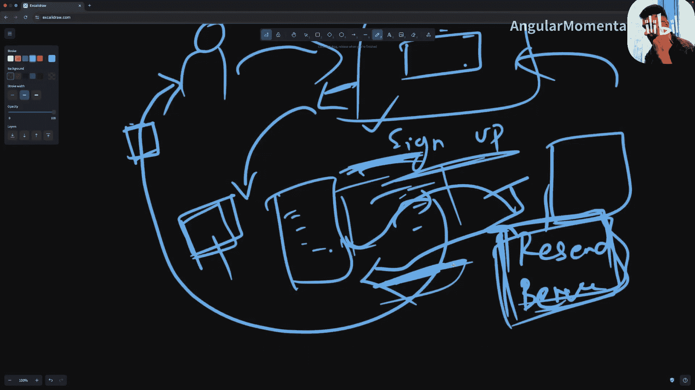

Packages that into some format， let's say a Json format。 Like it serializes it into a Json format。

 all the information that you need。Do send the email。And it injects it into some kind of cube， right。

 some kind of cube。 We have a lot of pass here， or maybe the queue is empty at this point。

 does not matter， but it。Pushes this task into a queue。

And what it does after it pushes the task into the queue， the Aba does not happen at that point。

 it just says that this is a new task， this is a new function call。

That we need to trigger or that we need to execute。At some point， at somewhere。

 we don't know that yet， And it pushes that into the cube。 And after that， it returns。 and by return。

 we mean returns some kind of success statusport， either 2，0，0 or 2，0，1。

 depending on whatever semantics that you' are using。 And because of this workflow， it happens。

 the user signs up。 And。

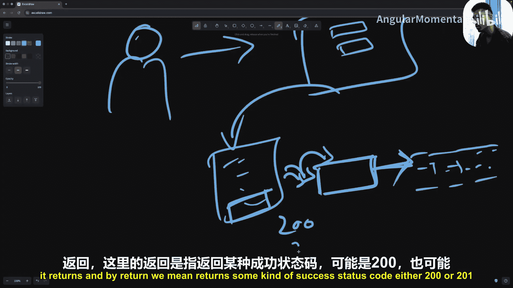

Your frontend mix IP and immediately see that screen that we have sent a verification email to your provided email so you can use the link in that email to verify your account and that takes care of creating the task part coming to a different side of this execution let's say here。

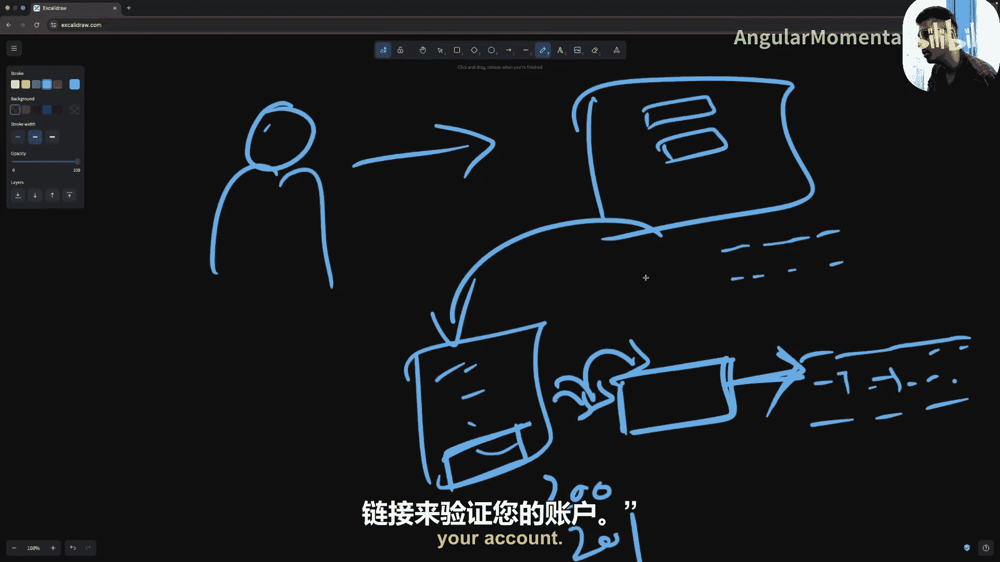

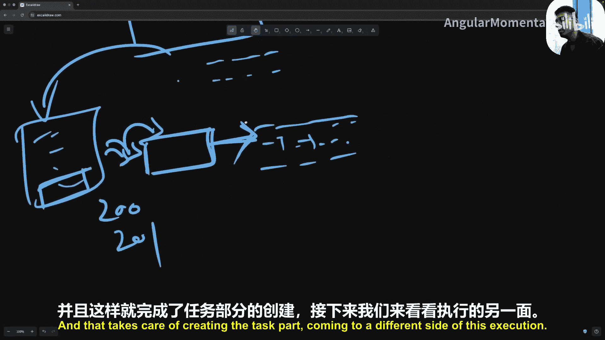

After we created the task and pushed it into the cube。 Now。

 what happens on this side of the task queue is。There are consumers or depending on which framework or which language that you're using。

 there are consumers or there are workers， etc。What they do。

 they take out this particular task from this queue。

And depending on the configuration and there can be a lot of different types of configuration and depending on what kind of skill that you are executing。

If you have different different types of nodes， different nodes for producers。

 different nodes for consumers， but we are talking in a very high level overview to understand how the wflow exactly works。

 what they do， they take out this task from the queue some kind of consumer and when I say consumer what we mean is a program that runs in a different process from our main process from our main backend application this different process。

It picks up this particular task and since we had serialized the all the information。

 the task into some kind of format， let's say JSson format here。

It DCizes into whatever the native language format is， let's say。Pthhen it。

 decizes into a dictionary， if it's JavaScript， it decizes into an object， if it's go。

 it decizes into astruct it， you get the idea。DCLize it and it has now a native format for all the data that it needs to perform that kind of task。

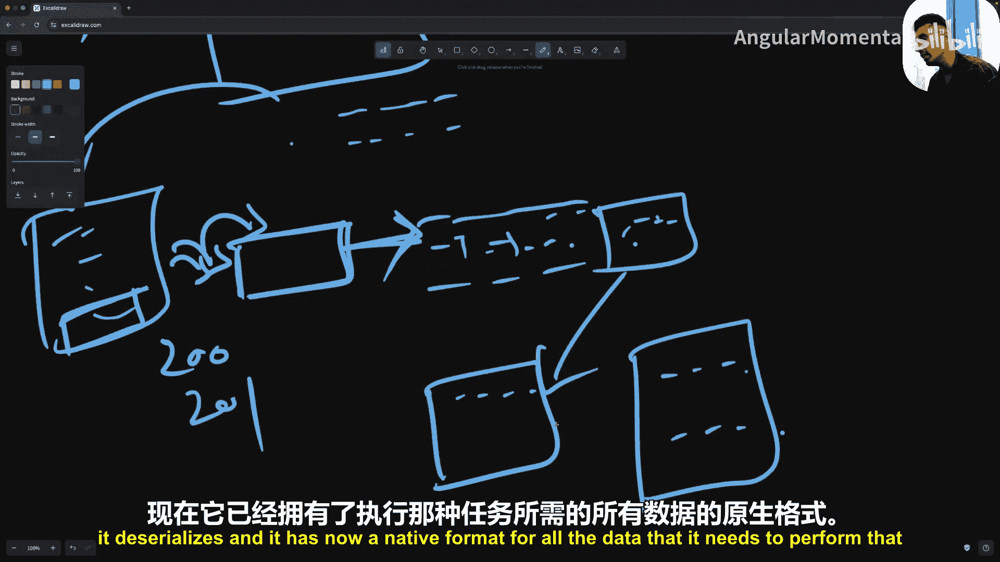

Now there can be different different conflicts here。

 let's say you have pushed the email into the email sending queue right there can be a different queue for sending notifications。

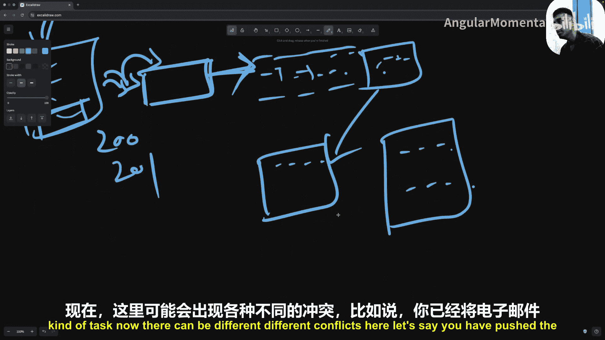

For sending inep notifications or for sending push notifications to mobiles right now different types of consumers pick up different tasks from different cues right those all can be configurable depending on what library or what framework that you are using now since it is an email sending queue or email consumer or email worker picked up this task。

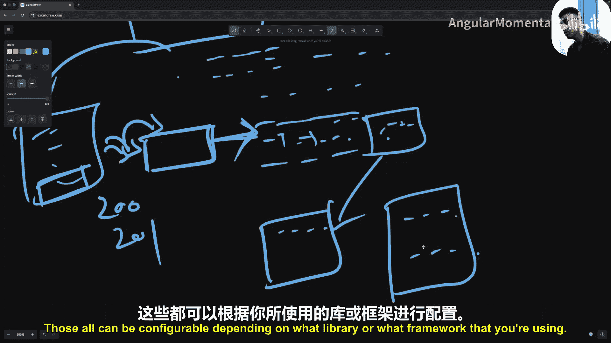

And it was in Json format， it be serial serialized into a native format。

 and now it has all the information that it needs to perform the task。

 Now it happens it has all the information and beforehand what we do。In their consumer side。

We configure from which queue we want to pick up the task from。

And we also configure what kind of data that we are expecting to receive from their task。

right and that falls under the DCization layer of the consumer then what happens we also register a method or a handler which is the code that actually runs when we provide it the data that it needs to use for running。

which is basically the same workflow or the same function that we are running synchronously when we did not have a background job which basically means here at this point what we do。

 we take all the information that we need for sending the email， which is the HTML template。

 the sender email， the receiver email， the subject， etc。And the user I D。

 the user information for adding the user first name， for adding the user's email， etc cetera。

 etc ce。Now， it has all the data it needs to send the email。 Now what it happens。

It calls the API for sending the email from different depend email providers。

 depending on which email provider that you are using。It can be recent。 It can be mail gun。

Can be rebel it。 Now， this consumer。This。Finally calls the APA which。Sends the user， the email。

 Now usually what happens this， all this processing。

 it happens between a few seconds or even milliseconds。 if there are not a lot of tasks in the queue。

So latency is not a problem when you are trying to send an email right， because the expiry of。

 let's say。Verification emails are usually 15 minutes or 20 minutes。

 And since our email will be delivered in milliseconds or a max max under 5 to 10 seconds。

 if you have a lot of traffic and you have a lot of tasks in your queue。

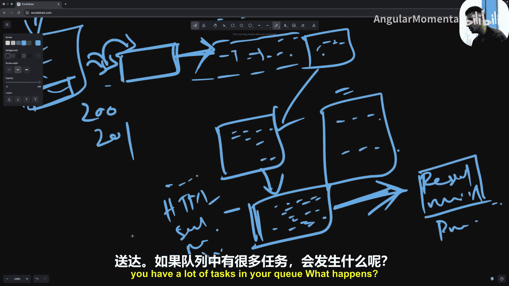

What happens this consumer causes a pay and this service sends the email and the user receives the email and they can now verify their account。

And in a different scenario， what happens since we assumed in the previous example that if this service was down。

And our email sending this aal fails this aal fails。

 What happens now is since this API failed this consumer process。

 This consumer function that the handler that we registered with the consumer， this also fails。

 which means our task， this particular task has failed at this point。

 if we were processing synchronously。Our。The request response life cycle breaks。

 and we return some kind of code since it's in server error。 We return a 500 internal server error。

Now that it's happening in the background， what happens if a task fails and depending on what framework that you are using if you are using Python。

 you have something like cery。If you are using node just。

 you have something like Bull MQ in go you have something like A thinkQ depending on what library or what framework that you are using for all this background task processing background task execution when a task fail。

 it is again injected into the queue for redtry and for redrs。

 we have different different algorithms。One of the popular algorithms。Exponential back off。

 which basically means after a task fails， it will try after， let's say one minute。

 It'll retry that task。 If it again fails， it will try after two minutes。 It will increase the。

Time will increase the whole time。Every time the task fails and of course we have a maximum amount of retice that we have configured beforehand。

 let's say five times。So after it fails， the second time will try after four minutes。After it fails。

 the third time we'll try after 8 minutes。 And usually if youre using an email provider。

 a big email provider like recent or mail gun pevo。

 the services don't go down or your apays don't fail。For like four minutes，8 minutes straight。

 usually the downtime will be in seconds or milliseconds。So for those cases， it might fail。

 let's say once or maximum twice， but the third time it'll most likely succeed the service。

 the external service will be back up again and your email sending will be successful and the user will receive the email and since we offloaded this whole email sending workflow to a background task even if the external service was down。

 we were able to send the email successfully。With all this retraining mechanism， etc。

And that is another advantage of using background task processing because of these very convenient functionalities like retrying mechanisms and failure detection。

 etc cea， etc cetera。 So now we have a very general idea about how background task processing works and。

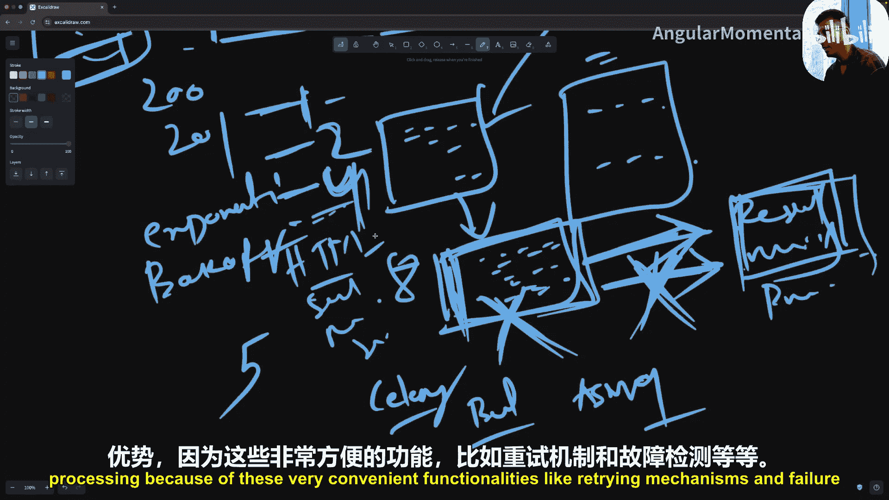

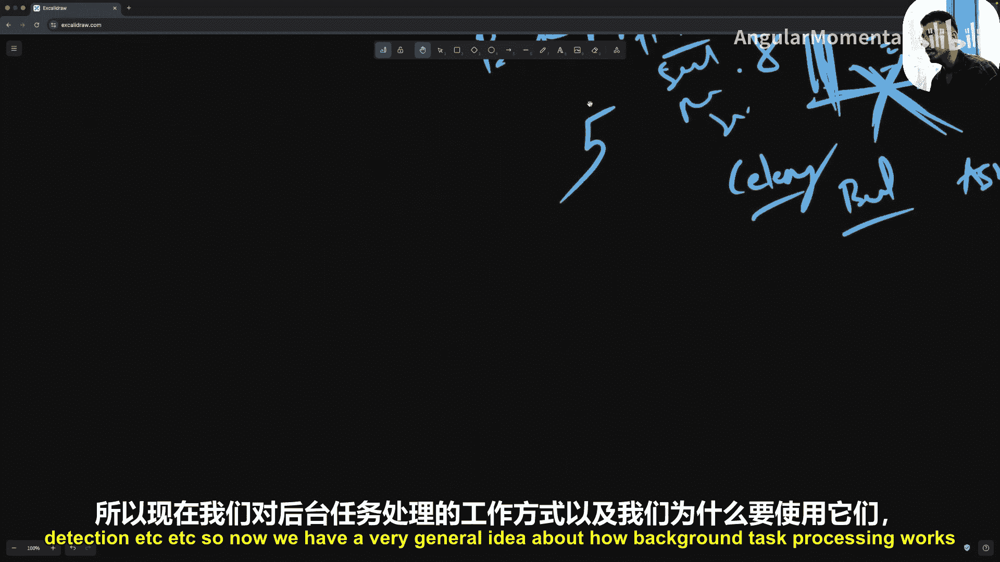

Why do we use them， What are the advantages， One of the advantage is the faster processing time。

 the responsiveness of our backend application so that we don't block our actual API call because of some external service or because of some heavy processing second is we have reing mechanisms or tasks which are prone to failing Now to summarize background tasks allow you to offload time consuming and non-critical operations。

 and because of that your backend application， your actual backend API calls， they are responsive。

 they prevent timeouts because of depend on external services and it significantly improves your overall user experience now。

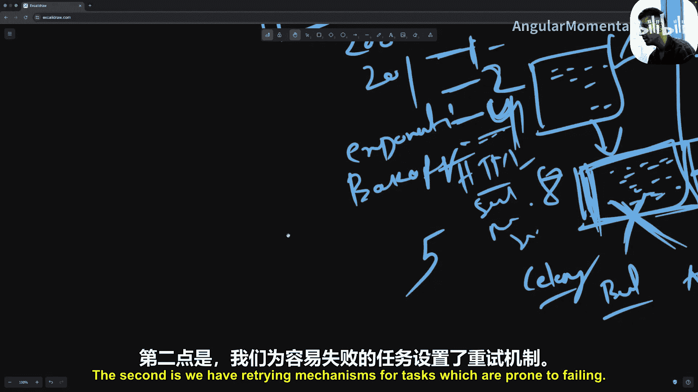

What are some major examples or what are some major kind of tasks that we usually in a typical SAS applications offload to background？

1， which we already saw is sending emails， sending emails， since it depends on external service。

 we upload it to a background task。 She already discussed the whole workflow of the second is processing。

Images are videos。 So if you have a workflow where the user uploads an image。

 and what you have to do is。You have to take that image and you have to resize it or you have to resize it into different different format so that the image can be optimized for delivery。

 depending on the network conditions of the user or the device of the user since in mobile smartphones。

 we usually need smaller sized images and in desktop of applications in big size to Excel etc， etc。

 We need big images for all these kinds of dust processing images or processing videos can be uploaded to background Third。

 we have。Generating generating reports。 So if you are running some kind of enterprise application。

 enterprise SaS application。

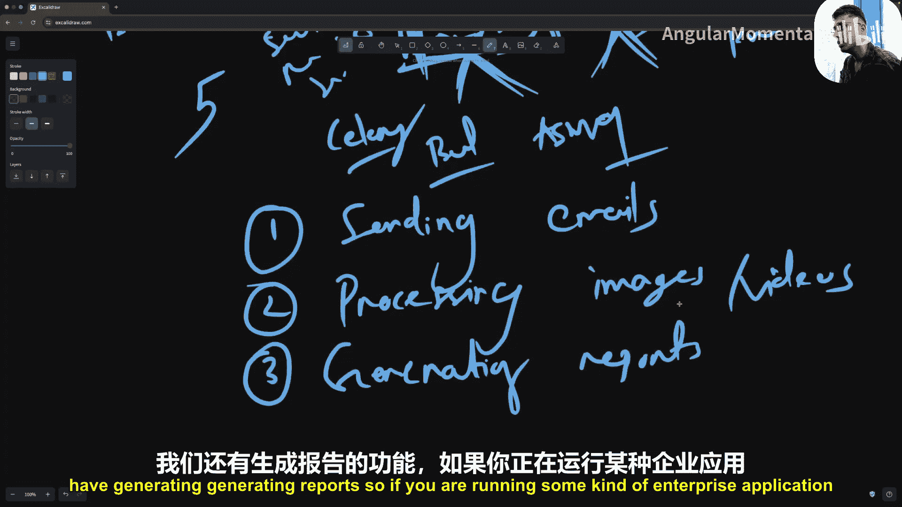

Let's say take an example of a project management application。

 So you have to send weekly reports or daily reports or monthly reports。

 depending on your configuration of the user。TheP reports， which are basically P D F files， emails。

Of all the stats， all the process tasks， all the completed tasks， all the pending tasks。

 all the pendings tasks in a sprint， etc cea et etca in a typical project management application。

Give the construct a email with all the content directly in the Sl format or in a Pf format。

You have to generate that re in the PF format， and you have to send the email。

🎼Daily at midnight at 10 o'clock weekly。On Sunday， at 12 o'clock。

For these kinds of tasks also we offload them to backgrounds using Chon jobs right and if you are using a framework or a library like salary BMQ。

 they also have features for scheduled task so that you can configure a particular date。

 a particular time and those tasks will be executed again and again。On those particular intervals。

 those features are provided by different different libraries or again， sending push notifications。

 P notification basically means all the notification that you receive in your smartphone right on your notification bar from different apps。

 If you have apps like Sw Zmatoto you。Receive these notifications to order food or your delivery guy has reached a restaurant。

 et cetera， et cetera。 Like， these are called push notifications that your user receive in the smartphone directly on the notification panel instead of inside the app。

And usually how it works is。You have a vacend， let's say the Zoomatoto or Swge。 they have the vacend。

 whenever you install the app。In your phone。Let's say you install this Swki app in your phone。

 Your device is registered under this push notification service。

 and usually it is provided by your operating system。

 So Google has their own push notification service， and Apple has their own。

Push not deviation in this service， etc cea。 et cea。

 Now what happens your backend has to store this device some kind of code in their database。

 And whenever they want to send a particular notification。To a particular device。

 they have to make a service call to Google or Apple。

 depending on which operating system their user is using。

And these external services like Google and Apple， they actually send the notification to you。

 not the backend cannot send the notification directly to your phone。

 It is done by our operating system， right operating system service。

The backend actually stores the code of your device in the database and it uses that to send you a notification so since this workflow also involves making an API call making a service called to a different service external service we also upload this to a background task these are some of the major examples of when do we actually use background tasks。

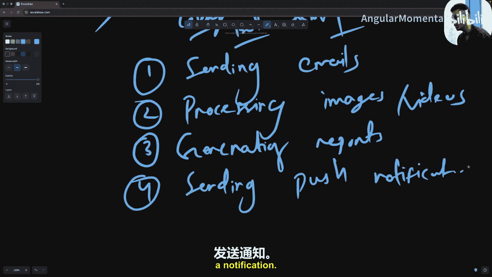

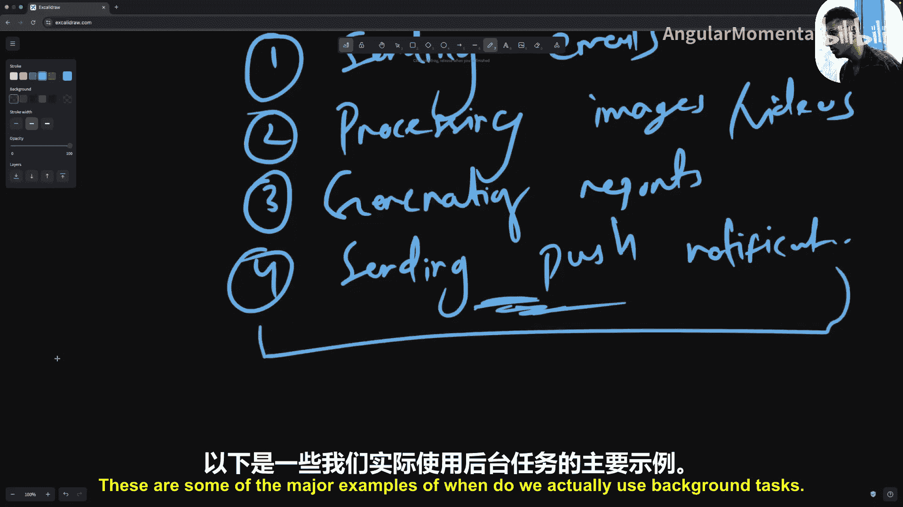

typical backend application now let's get a little technical and understand what exactly is aid task。

Q and how do they actually work Now to go by definition。

 a task queue is just a system for managing and distributing background jobs or tasks。

And this is actually the mechanism， the behind the scenes technology that enables you。

To offload tasks to reliably hand off the work that you want to do in the background to a separate process that this is the core。

 let's say engine that works behind the scenes to enable this whole workflow。

Now the core idea is you have a producer， which is your application code。

 it can be node J code or Python code or Golan code， right？Depending on what language you are using。

 what framework that you're using。Your application code， which creates the task。

 which creates the task。And pushes that into the cube。 The cube。 This is the task cube。

This is called the producer， the responsibility of the producer。

 the work of the producer is it will create the task and that creation process will have all the information。

The consumer， the worker will need to process or execute the task so the producer will take all that information and it will serialize it into a JO format or any other kind of serializable any other kind of serializable format that your framework or your library uses。

 it serializes that data it creates the task and it pushes that into the cube。

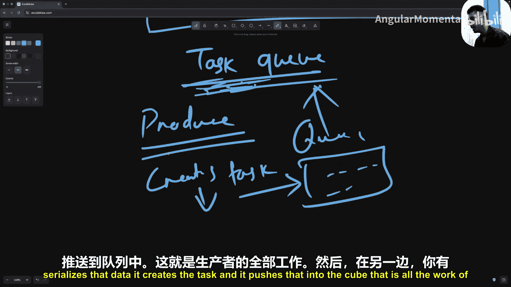

That is all the work of a producer。 Then on the other side you have the consumer。

 you have the consumer which basically runs in a different process。

 it can be in the same back an application code or it can be a separate code base also it runs in a different process and what it does it picks out those tasks and it actually runs them。

It executes。Those tasks， depending on what is the execution code or what is the handler that you have registered for a particular task。

 This is how the whole interaction works on a very high level。

 So this is like imagine it to do list for your backend your application code adds the tasks in through the to do list and the workers or the consumers。

They pick them off one by one and they execute them。A tutorial do list for your backend application。

 So technically speaking on a high level， the producer is part， it creates a task。

 and the task might contain information like the user I D or the user profile information like the name of the user。

 the email of the user。That will need for processing that task。 It will have all the information。

 And if it is an image processing task， it will have the image or if it is a report sending task。

 it will have all the data that it needs to send the report， etca。 etca， right and the producer。

This process of。Wushing the task into the queue， it is called Nqueuing。

 right if you are familiar with data structures and algorithms。

The process of pushing a new item into the queue， it is called enqueing the task。

 which means adding a new item to the task。 Now this part， this is called a broker。

 The queue is also called a broker Now this is responsible for storing this task until a worker is ready to process them。

 which happens on this side right other side。 So this is like a temporary holding area until consumers or workers can pick up this task and start processing。

And this part， the consumer or the worker， this runs in a separate process or a separate thread。

 The technicalities can be different depending on what language。

 what framework and what library that you are using。 But the core fundamentals remain the same。

 This consumer， it runs in a separate process。 and the way it picks these tasks is。

 it constantly monitors the queue or new items or new items being pushed into the queue。

And when it sees a new task， when it finds a new task。

 it deques it in the process of taking out an item from a queue， it is called decoqueing。And。

It des that task， and it starts executing。That is the high level， technical。

Overview of how a task queue actually works。 Now， going a little more deep when a task is ened。

It task this is called N Q and is called B Q。 This is also。Orda。Roker right。

 so when a task is N cubed， it is serializable。 it is serialized into a Jsson format， right。

 This is an important part of enqueing a task。 Now this underlying system， this queue so far。

 we've been talking in a very abstract like task queue， etc。 Usually these are technologies。

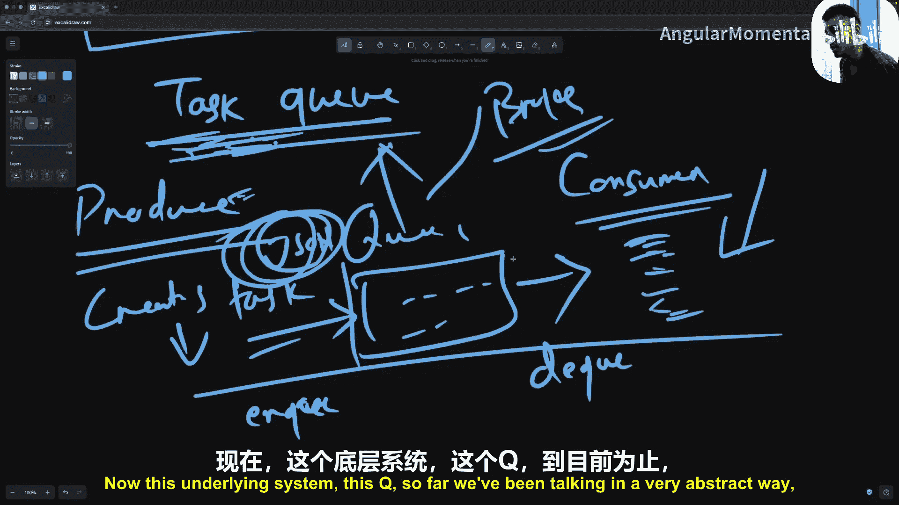

So speaking of examples， this can be technologies like rabbitam Q or。Redis pop up。喂。

Ruce has a very useful module called publisherlish and subscriber module。

 which are usually used for implementing task queues right？Or it can be SGS。

 which is a managed queuing service from AWS right if you are considering scaling your task management or a task processing system。

To different nodes which are spread across the whole world， then Amazon escape it is a good solution。

W is this managed service provided by AWS， which are deployed in multiple regions so that you have a very scalable and a very responsible task processing system in place。

 So this queue this broker， which actually stores the task。Right。

This is usually managed by an underlying technology like rabbit M cu or Redis pop up， etc cea。

 So what happens is when the worker or when the consumer， it completes that task。

 it sends an acknowledgement an acknowledgecment back to the queue。

 This tells a queue that the task was successfully processed and it can be removed。

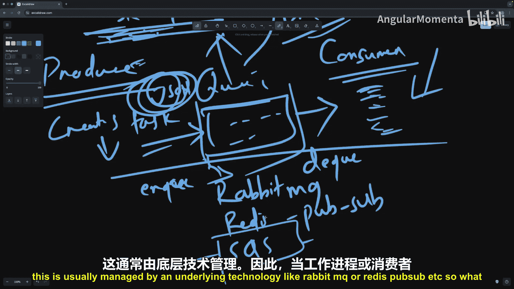

But if it does not send an acment， the you can decide depending on different parameters that whether the task。

Was unresponsive in that case， it will try a different trying mechanism if the tasks fail in that case it will try a different trying mechanism。

 right all these framers like salary bull M Q I all these very popular frames for task processing they have all the features in place to manage all these different kinds of edge cases in this whole interaction we also have a concept called visibility timeout。

 which basically means that this is the period， this whole workflow this visibility timeout is the period。

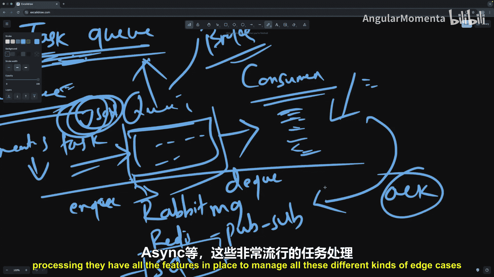

When a task is considered in progress， right by a consumer or by a worker。

And if the worker or the consumer。It does not acknowledge the task。

 It does not send the acknowledgement signal back to the queue within that timeout。

 Whatever timeout we have configured， depending on a configuration。 If it does not， the worker。

 the consumer does not send an acknowledgement signal within that timeout。

 probably because it crashed or probably because the external service hung up。

 it can be a lot of reasons。 What the queue will do is the queue will make the task。

 it will take the task， and it will make it available to other consumers or other workers。

 so that the task does not get lost in the whole interaction。

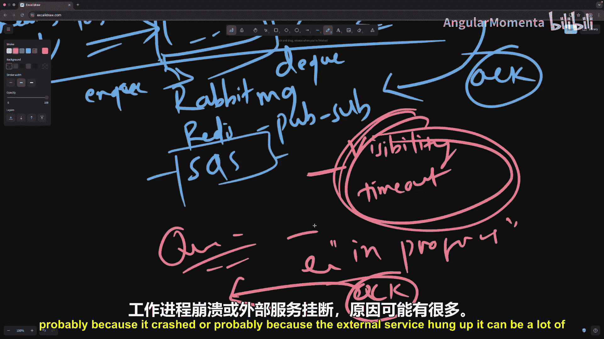

And the reason being since the way our task processing systems work is we the publisher pushes a task into the queue and consumers take out tasks from the queue。

 they process it and the queuees remove the task from the queue right and since the consumer already took out a particular task from the queue and it was not able to acknowledge the success or the failure of the task。

We don't want that task to get lost in the whole interaction。 That's why we have this。

featureature called visibility timeout。Because of that the。Q ensures that our task don't get lost。

 And when a consumer or when a worker。Is not able to send a particular acknowledgement signal。

 It will make that particular task available to other consumers or other workers so that they can start processing。

Some has to send an acknowledment signal back to the queue to mark a particular task either as success or failure Now let's talk about different kinds of tasks。

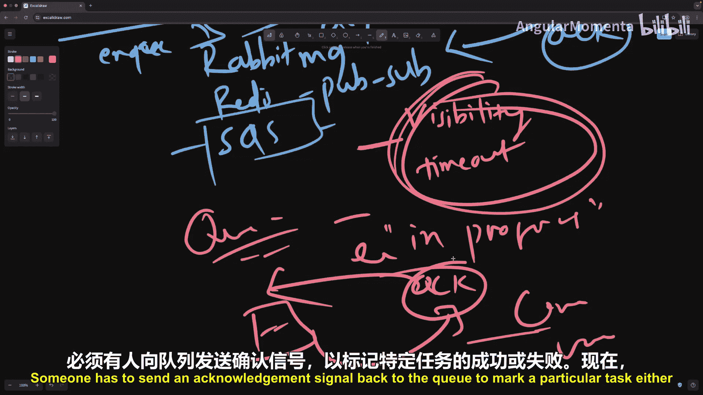

That we usually encounter in a backend application So the first example is pretty simple that we have already seen one of tasks which means something happens in your in your request request response lifecycle and you want to perform a single task which is like a trigger depending on a particular scenario we want to execute a particular function in background so sending an email is a good example of one of tasks a user registered you want to send them a verification email the verification was successful。

 you want to send them an welcome email。And someone wants to reset their password。

 You want to send them an email so that using that link， they can reset their password。

 Let's say it's a social media application and。Someone texted you and you want to send them send the user a notification。

 So that's again a one of tasks right these are examples of one of tasks which you will encounter more frequently as compared to other tasks。

 but other tasks also have their place。 Then we have recurring tasks。

 recurring tasks are basically tasks。Which have to be executed periodically in specific intervals and examples of that can be sending a particular report。

 sending daily reports or sending monthly reports or sending annual reports to your users。

For whatever the stats in that quarter in that year or in that month or in that day， etc cetera。

 recurring tasks also can contain clean or maintenance jobs。

 So let's say you have an authentication system in place and。For authenticating users。

You use stateful technologies and for implementing stateful authentication。

 you have to store all the sessions。Of the user in your database in the session table。

And what happens is the user logs in， logs out， logs in， logs out。For a long time。

 they have a lot of abandon or a lot of orphan sessions， which are not really active。

 but they are still in your database since you never actually deleted them。

So we have a task or a recurring task which executes， let's say。

 in every three months or in every two months or in every month。

End of the month or starting of the month。 What it does。 It goes through all the often sessions。

 all the sessions， which are not active。 And it's been a long time。

So you actually go and delete them from your database so that you have some free storage。

The orphan sessions are not taking unused space in your database。

Those are some examples of recurring tasks， then we also have chain tasks chain tasks basically have parent child relationship between。

Different， different kinds of tasks。 So let's say。You have an LMS platform。

 LMS S means learning management system。 So some of the popular LMS S platforms are let's say youudemi。

 etc cetera， right now let's imagine you have an LMS platform of your own and what happens。The user。

 the instructor， whoever is creating courses in that platform。

 they can come into the platform and they can create a new course。 And for creating a new course。

 What do they have to do they have to do is， they have to upload videos。

They have to upload videos into the platform right now a typical workflow of uploading videos into an LMS platform might look like。

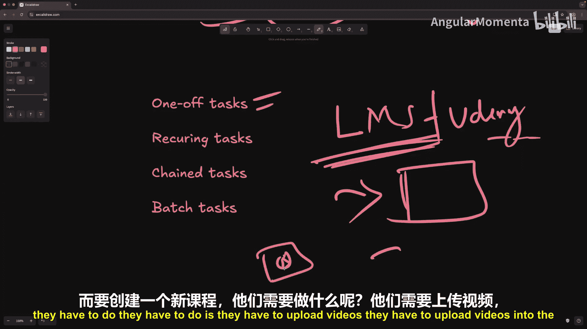

The user comes， they click on upload video and they select the video that they want to upload and they click enter and the video starts uploading。

And。The technically， how it works is the front end takes that video， and it immediately。

 the backend immediately sends an acknowledgecment so that the request is not blocked。

But the uploading process is in progress， right， it can be uploaded to S3 using a presign URL。

 the implementation can be different。After the video is uploaded it。Number of tasks can be triggered。

 The first task can be。 The video has to be taken， and it has to be processed。So that。

The video is available in different different resolutions。

 depending on the network condition of the user or。The device of the user etca。 right。

 the video has to be encoded to different formats to cater to a wide range of network conditions and a wide range of devices。

So that is your first task。AndAfter that video is processed and second task has to be triggered。

 which depends on the first task， which is the video has to be encoded first Now the second task is the thumbnails for that video has to be generated and after the video is encoded to a particular format so that that video can be served efficiently from different different ss。

Cont delivery letters。Or whatever platforms that you're using。After the video is encoded。

 then we have to trigger a different task so that the thumbnails for that video has to be generated。

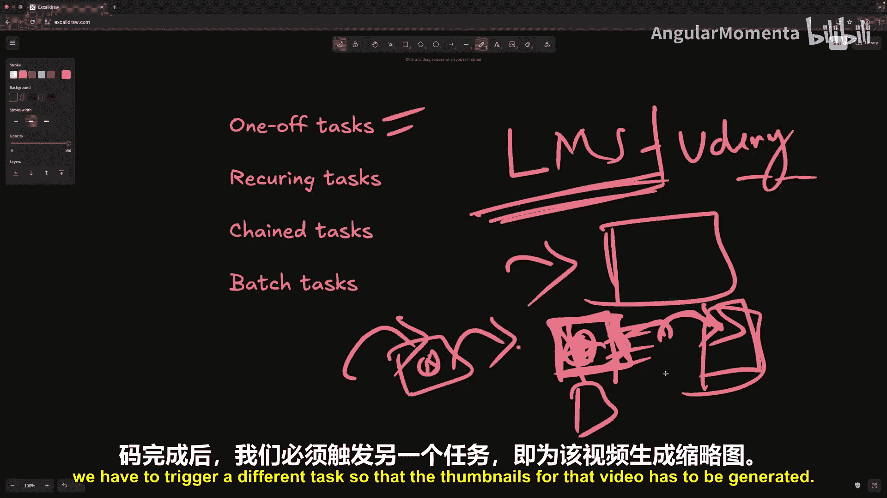

After the thumbnail has been generated， now we have to trigger another task， which is。

Those thumbnail images they have to processed so that。

We have different different resolutions of the same thumbnail images for different network conditions and for different devices now this。

Thumbnail image processing task depends on thumbnail generation task。

 but at the same time after the video is encoded， at the same time we started the thumbnail generation task。

 we can parallelly start another task， which is transcription generation， right。

The audio transcription generation to show to the user when the video is playing the basically the subtitles Now this task。

 the audio transcription generation and this task， the thumbnail generation。

 since they are not dependent on each other， they can be studied parallelly。

 but they are both dependent on the task that the video has to be encoded first。

So this kind of interaction， this kind of task chain。

 this is what we mean when we say chain task or tasks which have a parent childil relationship right or some kind of hierarchy。

A particular task can only be triggered once the parent task is triggered and successfully completed first those are examples of chain task。

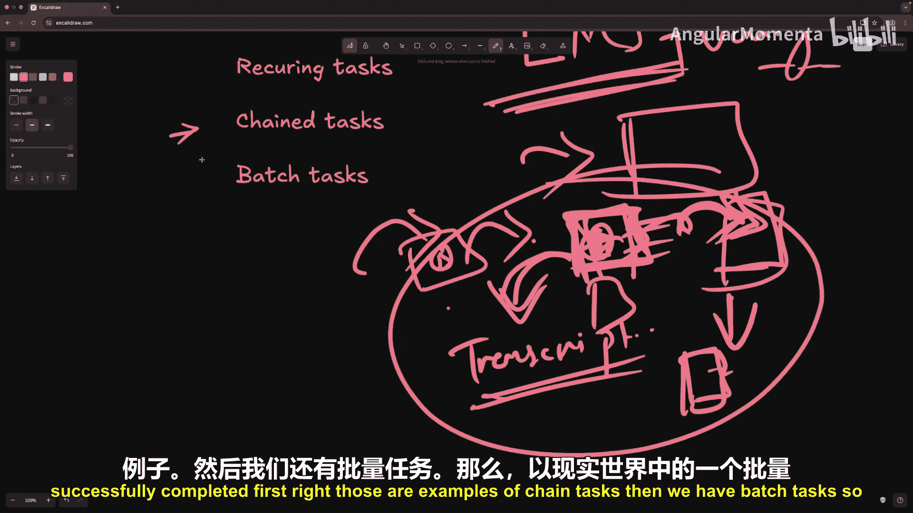

Then we have batch tasks。 So one example of batch tasks from a real world example is。

 let's say you have a Saas and you have a button where the user can click on。

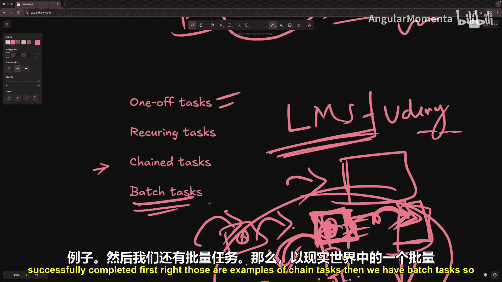

Delete account， right？A lot of SaS platforms offer this feature where you can delete your account Now what happens when the user actually deletes your account？

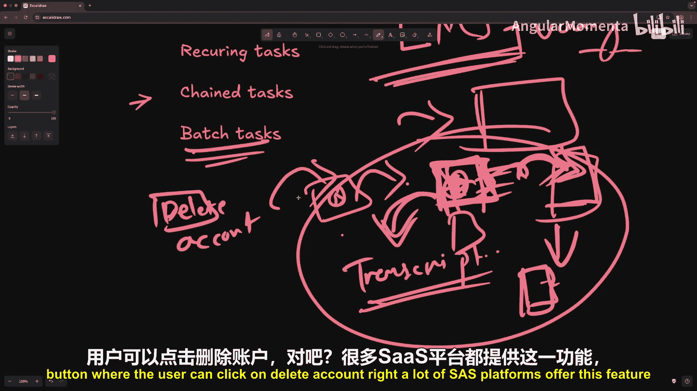

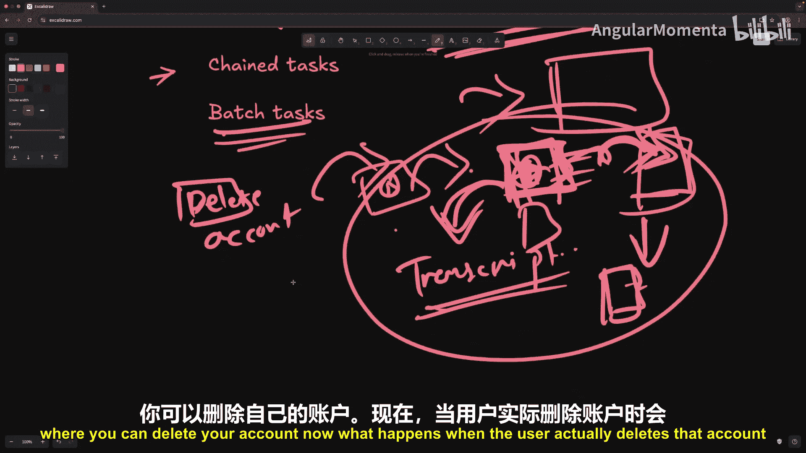

You don't actually the front end cannot just make an API call and the backend cannot just go through all the data of the user in the database and they cannot just delete it in the same request right since if it's a big platform the user might have a lot of data right and they might have data in a database which are spread across different different shards or different different regions etc right they can be a lot of different types of conditions and lot of different types of data of a user that we have in the platform and all of those cannot be。

Deleted in a single request response life。Even if it can be deleted， it might take， let's say。

 more than 40 or 50 seconds， or let's say， worst case more than a minute， right。

 and we cannot stall or we cannot block an API call for that long。

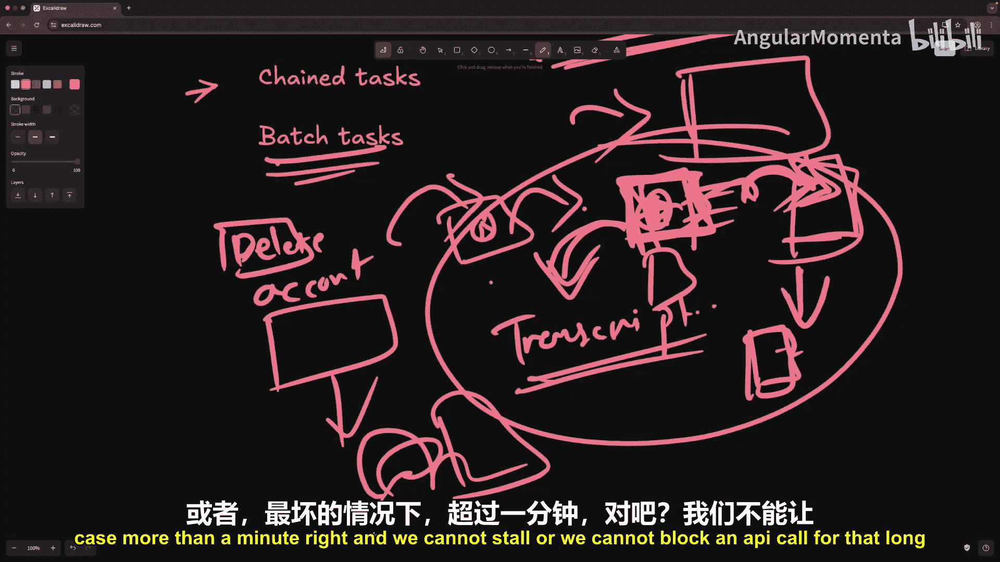

And for that reason， what happens whenever the delete account API call is made what we do。

 we immediately respond back with a successful。Response like 200 and we say that your account deletion task is in progress and the user is logged out from the platform and they are given some kind of grace period that you have three days or you have seven days to log back into the account and cancel a deletion process or the account will be permanently deleted。

the end of three days that can be one use case or the second use case is let's say you don't have a grace period you not a big platform like AWS in that case what you do the moment the delete account API call is made the front end immediately receives the successful response that the backend sends back and it logs the user out and for that user the account is deleted permanently from a platform but what exactly happens is the backend takes wherever the backend receives the delete account API call。

What it does， it creates a task which is delete account and it pushes that task into the queue and it immediately responds back a successful response like 200。

And the front end does its job。And for the back end what happens。The consumer。

Which is responsible for actually performing the task of deleting an account。

 It picks that task from the queue， and it starts the deletion process。

 which might be going through all the resources of the user。

 Let's say if it's a project management application going through all the projects where the user is the owner。

So removing all the entities of the user from that project and then deleting the profile of the user deleting the end assets of the user like logos。

 cover images。And then at last， actually deleting the user account， right。

Then sending some kind of email to the user that your account has been deleted， etca， etc ce。

 So all of those things happen in background。Which means our APII call is not block。

 and that is an example of batch tasks， right， because it involves calling a lot of tasks from a single task。

 So delete account task itself can call a lot of task or deleting the entities of the user deleting assets of the user light。

 those can be batch task triggering a lot of tasks from a single task。

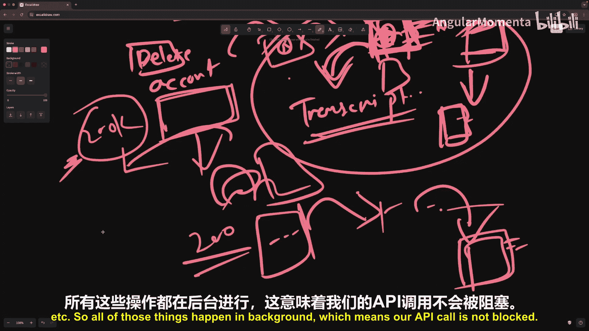

Another example of a batch task can be， let's say at 12 o'clock midnight or at the end of the week。

 you have to send report to a particular user now since you are a big platform。

 you have a lot of users so at the same time you trigger a lot of tasks。

 let's say thousands of tasks。Which all do the same thing generating a report and sending by the user。

 But since it happens for a lot of user that also we can consider as a batch tasks by sending thousands of reports to thousands of users。

At a particular interval those are some of the different types of background tasks that we usually deal with now these are some of the design considerations that you have to account for when working with task queues or working with background task。

 especially when we are talking about skill when you are talking about thousands of users when it's a big platform you' are managing the backend of a big platform and it's concerned about the background task posting is a Putency。

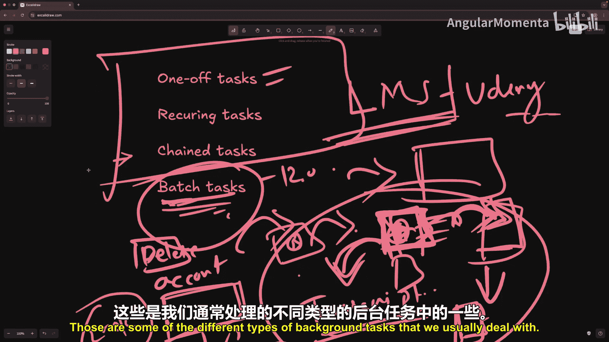

This basically means that whatever task that you are creating that you are executing。

 you have to design them in a way that。They can be safely executed multiple times without causing any side effects。

 right in case of。Let's say failure of the task， let's say。For example。

 in our delete account task we have in a in our delete account task in a typical delete account task。

 what to do is we go through all the resources， all the entities of the user。

In the database and we start removing them or we start setting them null， etca， etca。

 depending on our requirements。Now， the what mean by a tendencyancy in that context is you have to do all of them in a particular transaction。

 right？A particular transaction So that what happens。

 let's say you start deleting stuff from the database and down the road something fails。

 right it can be something related to database or it can be an external service code right calling an API getting some kind of data of the user as a right can be anything at this point if something fails here。

 if you are executing all of this in a single transaction， what you can do it。

 you can do a custom rollback right a manual rollback So what happens since this task has failed when the next time the the task queue retce this task we start from scratch right we start from zero person completion and this is what we mean by I don't put it you have to design your task in a way that they don't cause any side effects in case something fails down the line and you have to retry that task from scratch。

Same way， error handling。 You have to make sure that you have very robust and。

Very extensive error handling in place， especially in task management systems。

 because everything is happening in a different process right so you have to make sure you don't miss anything you don't miss any bottle lengths。

 you don't miss any edge cases， etc， etc right so you have to implement robust error handling。

To catch and to log errors。Also to redr field task， right？

But this is very important in a task management system。

Then you have to set up proper monitoring and what we mean by monitoring is you have to track the status of how many tasks that you currently have in your queue。

 What are the number of successful task， what are the number of field tasks and what is the major reason of fail task it is is it some kind of external service or is it some kind of internal error。

 etc at any point you have to have the complete view of what is the status of your whole task management system So you can use technology like Prometheus using graphfaa and tools like that。

 So every time a new task is created， you can in insert a new metrics will cover things like metrics。

 instrumentation， elastic ELK tag etc ceaa， all these things related to logs traces monitoring。

In a different video。 But we use this technique called metrics where。Every time something happens。

 some kind of trigger we create a new metrics and we insert it into some kind of stack in this case we have Grfaa to monitor what are the different metrics currently that are back backend application have and we have ways to persist those metrics in this different replication techniques etc right so for your task processing system you have to have all these monitoring techniques in place so that at all times you can monitor what is the status of your system。

Same way you have to design your system in a way that it scales so that down the line。

 if you require more processing power right let's say you your user base spite and you have to cater to more users now double the amount of users now so what you have to do is you have to add more number of consumers right so have to design it in a way that down the line you can scale your consumers horizontally right you can add more nodes to your consumers so that the processing remains as responsive as ever。

Same way if you require ordering， you have to make sure that whatever library。

 whatever frame or whatever task you that you are using the support ordered delivery right tasks have to be executed in a particular order。

You have to make sure that your particular library or framework supports that same way we also have rate limiting So if your task interact with external services。

 you have to implement proper rate limiting to prevent overloading those services right because those services also charge you for number of API calls and they also have their own API rate limiting or techniques etca。

 etc right so you have to take this also into consideration。

While designing your tasks these are some of the design considerations you have to keep in mind when you're working with it task management or background task management system。

 Now talking about some of the best practices that I can recommend from my own experience of dealing with these task background task management systems is the first thing is keep your task small and focused which basically means a single task should only be concerned about a single。

Processing unit， right， you should not do a lot of things in a single task。

So you have to design your task in a way that you have to divide the responsibilities between different tasks。

So， that。If one task fails， it does not affect other tasks if the one task one processing is dependent on a different task。

 then what you can do is you can go for chain task right you can have a parent chain relationship so that a task can be。

Skicallled in that way。 so that even if。The child fails。 The parent does not fail， right。

 The child failing is a different task so the red drying mechanism can handle that。

With exponential backup or whatever， but if you do a lot of things in a single task what happens is even if the topmost processing is successful but somewhere down the lane something fails then the whole thing has to be repeated all over again right and if you are trying to add a lot of stuff into a single task then that wastes a lot of processing power of your CPU of your consumer of your server right so if you keep your task focused and small it's easier to scale it's easier to avoid bugs and it's easier to monitor them right and it's also easier for your queue to implement different mechanisms like res etc same always try to avoid longrunning task if you have a task that takes a long time to complete break it down to smaller and more manageable chunks as I say。

This is something similar to the above point if you have a task which is doing a lot of stuff。

 then of course iss going to take a lot of time which is a signal to you that it's about time that you divide this particular task into different tasks either different tasks which are concurrently processed or different tasks which have a parent childild relationship depending on your requirements same way using proper error handling and logging this is。

 as I said one of the most important things when we are dealing with background task processing you have to have proper error handling in place so that you give a chance to your queue。

For redraing and you have all the information you need to debug whatever happened in your task。

 which made it fail。Or。Whether it is an external service。

 whether it is an internal error or everything， so you need all these error handling techniques or login techniques so that its easier for you to debug things。

 it's easier for you to monitor things to find out where the problem is。

And it's also easier for the Q。读。perform various reing mechanisms and at last you have to constantly monitor queue length and worker health which basically means you have to have proper alerting systems in place so that if the queue length exceeds a particular limit you have to come up with different techniques to make it more scalable or if some of the workers are going down for some reason you have to debug them what exactly is there that is causing them to go down etc cetera。

 eta， you have to have proper alerting mechanism so that at all times you are aware that your system。

Your whole task background task management systems is running smoothly Now to recap background tasks are essential for building scalable for building reliable and responsive backend applications。

 and they allow you to offload time consuming and noncritical operations to improve the user experience and to prevent timeouts and to enable redraing mechanisms for。

Dependency on external services and for heavy processing tasks。

That's pretty much all about tasksQs that you need to know as a backend engineer。

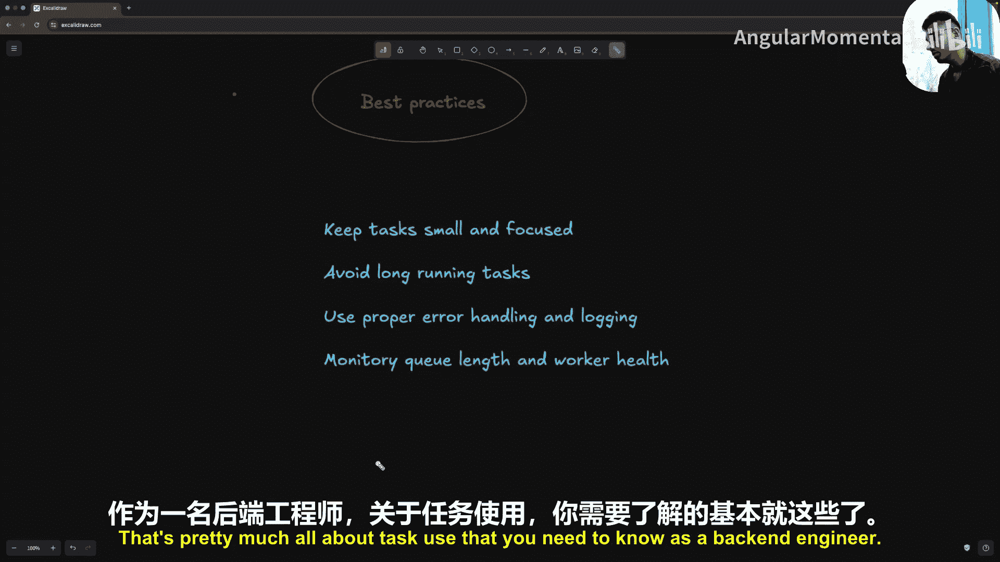