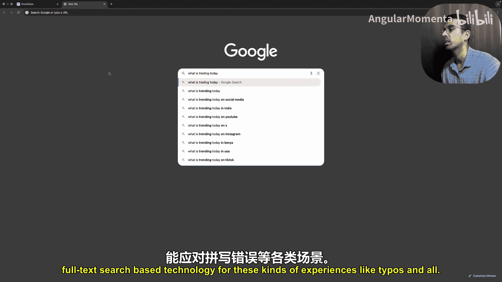
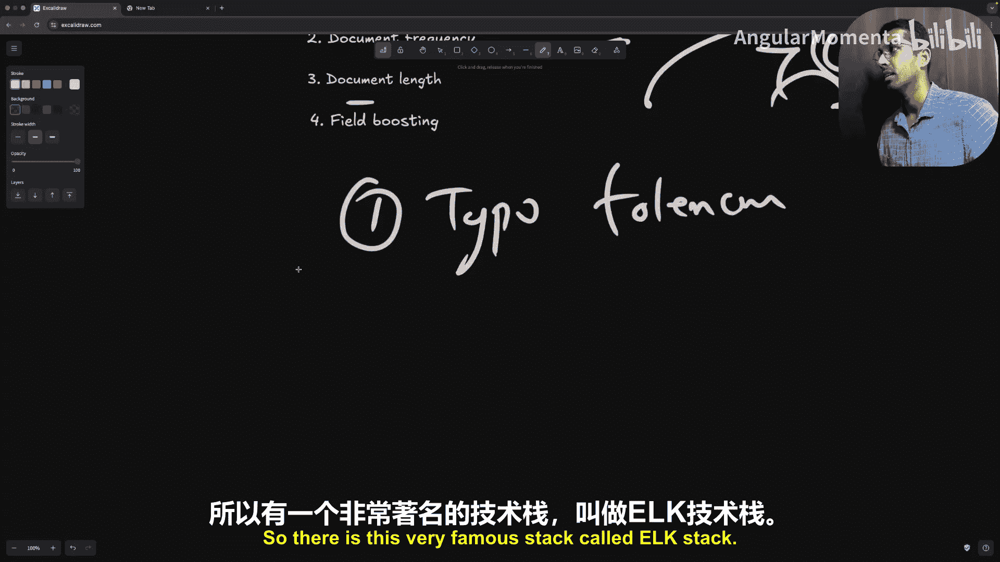
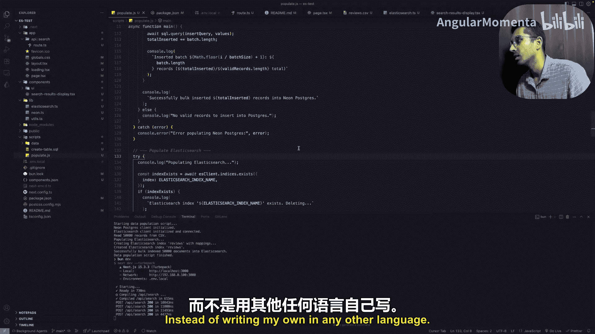
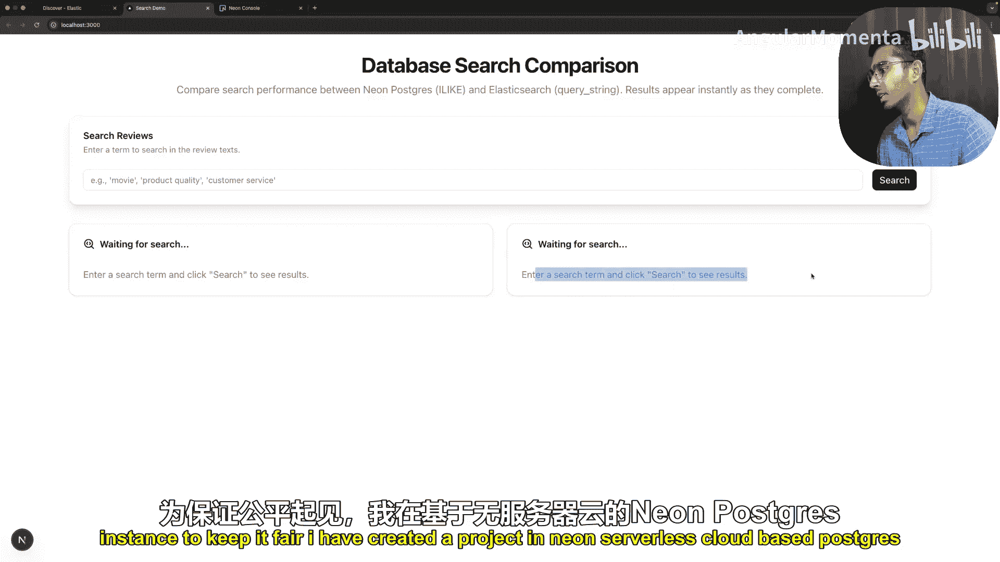
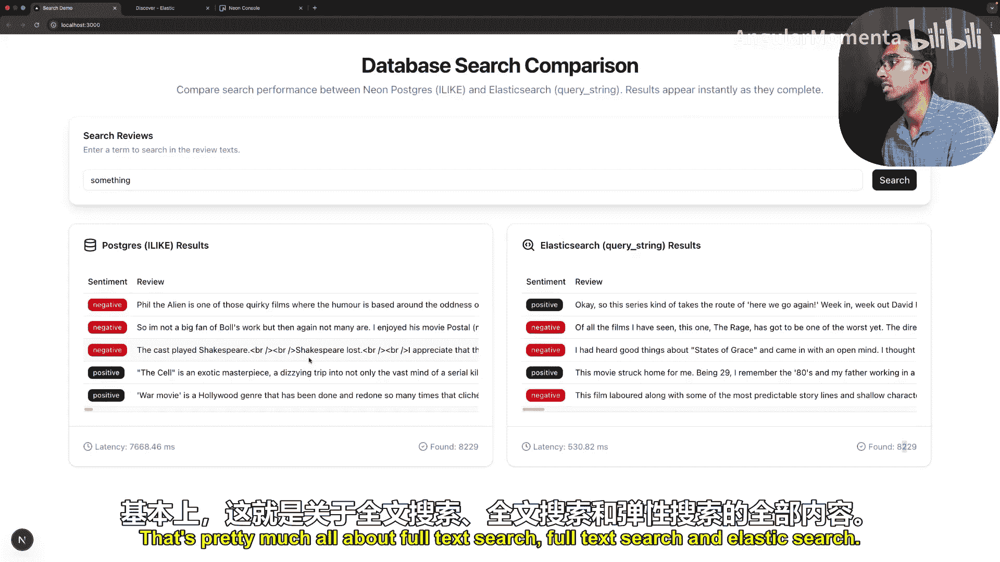

# 【Sriniously】从第一性原理出发的后端开发 ｜ Backend from first principles p15 15. 使用Elasticsearch进行全文检索，实现极速搜索 -BV17aq1BUEhf_p15-

Now， imagine this。 it is 2005， the year 2005。 and you are a software engineer and you work basically at a ecommerce-com based company and the company is rapidly growing because it's 2005 because the dot co bubble etc。

 right， the company is rapidly growing and。You have a task。 You are a software engineer。

 and you have a task to search through thousands of products。 Your company has a around， let's say。

 5000 products。And you have to write a database query to create an A。

Which searches given a user input searches through your database and returns some relevant results right And this is how you write the query for that in a typical relational database base set up。

 you say select are from products where name is like laptop。 So these person symbols are for。

Matching any characters that comes before and comes after that。

Either it can match name or it can match description if the key laptop is either in name or in description。

 you return those results this is how you do a basic search and the customers search for laptop they get a few results and life is very simple。

Now， something happens。Since it is 2005 and because of a lot of companies' growth。

 your company also grew and it grew rapidly suddenly you had millions of products right the the very straightforward I like and the person a symbol based search in your relational database query that once returned results in let's say 50 milliseconds。

Now， it is taking 30 seconds。 And because of that， the youth customers are。Frustrated your。

Manager is frustrated and everyone is asking you to optimize it， and you are clueless。

 They don't just want to make it faster。 They also have more requirements。

 requirements like can we make the search smarter。 For example， when someone searches for laptop。

 we want to show the most relevant results faster。 For example。

 let's say someone searches laptop instead of showing a laptop bag。

 we want to show a MacBook pro first， right， So that kind of smart searching relevance based search。

 and we also have a requirement that customers are they are in a hurry during the sale time right。

 So instead of writing laptop， they are writing laptop pretty frequently。

 and we also want to take that into account， even though they make typos。

  customers make typos in their user queries， we still want to return relevant results for laptop instead of laptop right we want to。

Make it faster。 We want to make it relevant， and we also want to be robust enough that typos cannot break us。

And。😔，With all these requirements。This is the story of why search engines like Elastic search came into place because of all these requirements and this is what we are going to talk about to get the intuition of it。

 your Postgres database or whatever relational database that you are using Now that database is like a librarian you go to a librarian and you ask a librarian the locations of different different books or different different categories right So your Postgres database is like a librarian who knows exactly where every book is located but it has one fatal fl we have a librarian here。

 If you ask the location of a random book then to find that book the librarian has to look through every single book in every single shelf in the whole library one by one that is its fatal fl So for example。

 let's say you ask for a book called machine。You go to the library and you ask the librarian that I am looking for books about machine learning。

So the librarian starts its search， it finds the first book。

 the first book's name is Harry Potter and the philosopher's stone。And it checks that no。

 there is no machine learning in this moving on。 Then it finds that game of Thrs。Again。

 there is no machine learning in that titleMoving on。

 Then it finds a book which is called introduction to machine learning。ItFinally has a match。

 and it returns that。 Now that librarian。🎼Well continue this process of going through every book。

 one by one in the whole library。Depending on the size of the library。

 it might take a few minutes to。A few hours in， in fact， a few days。 If it's a huge library。

 let's say a library with 10 million or 1 billion books。 That is one thing。

 the time it takes to find all our books。 The second thing is。

 the librarian has no concept of relevance。 and what do we mean by relevance in the sense that if the librarian finds two books in one book。

The title name， the name of the book is an introduction to machine learning and in another book。

 the word the phraseM learning is just mentioned in the last page and the topic is something else but machine learning is just mentioned there。

And it returns both of these books in any order it was right， it can return the second book。

 which only has machine learning in the last page， which is not very relevant。

 and it can return that book first and return the book named an introduction to machine learning second。

Even though if you are asking for books about machine learning。

 we want the first book which is title S an introduction to machine learning first and we might not even want the second book because it is pretty irrelevant in our use case coming back to our databases if you think about the librarian the example that I talked about just before as our database itself then a query like this where we use I like which is basically a case insensitive search。

And using person symbol， this is exactly how the librarian looks for books in a huge library。

 The database has to scan every single row。 Ex every single text field and form pattern matching character by character。

 Now it is thorough。 It is going to return results， results that are matching。

 but it is painfulfully slow and second thing the relevant thing。

 It does not really know which books which results are more important than others。

 It returns them in a random order。 We might want some results。

 some results might be completely relevant and some results might be very relevant。

 but they might be in the position of let's say1 thousand00 or 10000 right the database has no sense of what is the most relevant result。

Now coming back to our history， since we are talk about 2005 around the same time the information explosion happened right。

 there are so many websites being built， there are so many servers。

 databases and all these big companies like Google was processing billion of web pages it was indexing。

 crawling through them and Amazon as a e-commerce company just cataloguing millions of products and LinkedIn was indexing millions of profiles。

And these companies， they cannot afford to wait 30 seconds for search results。 Obviously。

 customers are going to leave the site。30 seconds is way too much。In our current standard。

 even two seconds of delay is considered a crazy amount of delay。

 especially when we are talking about latency， search have to be very fast。

 They are talking about milliseconds here。 right。 So obviously。

 these big companies where they are making millions and millions of dollars every single second。

 they cannot afford this kind of latency。 This will affect their conversion， their user base。

 So to solve the problem of search。😊，The answer came from decades of research。

 It was not a new problem。 There has been countless research in in this field when it comes to text based search and information retrieval since decades and computer scientists have been studying how to get the results fast and keep them relevant and。

Researchers， scientists， computer scientists they have been investing a lot of time and a lot of effort into it since the 1960s so the revolution in the idea came from this particular key thought or key idea that so instead of searching through the documents in case of the librarian instead of searching through the books the title the content all the books to find the relevant terms。

 what if we flipped the problem， what if we inverse the problem。

But if we look at it in a different way and that was the birth of。This key invention， the key。

Idea that changed text based search forever。Wwhich is called inverted index Now this is a very simple concept even though the implementation might have more complicated stuff。

 more mathematics， but for a high level understanding it is a very simple concept that we are going to talk about coming back to our earlier example where we think about the database as a librarian and we ask the librarian we ask the librarian that we want books。

Related to machine learning， right， And the library goes to every book to search to the title。

 the content， to the description， etc cea， et cea。 Now， coming back to the same problem。

 But this time， we look at it using this technique called inverted index。

The revolutionary idea here is instead of going through every book and checking the existence of machine learning in those books。

 what if while storing the books in the shelf when the first time the books arrive。

 we take all the words in that book and we create an index of those words in a way that for a particular word？

We can find out that。What are all the books where this word is used and also where exactly it is used。

 For example， let's say we are talking about machine。

 So machine is used in this book called introductionuction to machine learning in page 1，15 and 23。

 same way。Another book called the machine H here。 It is used on page 5 on page 89。

 and another book where C where coffee machine manual， it is used in page 1， same for learning。

 introductionuction to machine learning， it has been used three times1，16 24。

 even though in a practical scenario for a book。Called introduction to machine learning， the words。

 machine and neuralling will be most likely used hundreds of times throughout the books。

 For the sake of this example， we are just showing three pages。

 but they are most likely used in hundreds of pages。 same way， learning to cook。

 It's used in two places and deep learning fundamentals。 It's used in。Three places。

 Now we have this index， which we call inverted index。

 So instead of going through the content and finding the terms。

 we have the terms and through the terms， we find the content。 we just inverted the search。

 That's why it's called inverted index and this technique， this technique of inverted index。

This is the thing that powers。Elastic search， a very famous tool when we are talking about pull deck search。

Elastic search。 Ellastic search also has in history。 It is not a completely new invention。

 It makes use of this technology， which is called Apache Lucne。 This is the key technology。

 the key inverted index based technology。Which elasticastic search and a lot of other tools。

 Elastic search is not the only fullex search tool。 In fact， these days。

 even relational databases like Postgra also have support for fulltex search。

 So Elastic search is not the only tool。 we have also have a lot of other tools。

 fullex search based tool， which most of them make use of this underlying technological Apache illusion。

Which is primarily the inverted index based text search technology。 Now that is one key concept。

 Now that we have this inverted index。 the librarian can just refer to this。 we say machine learning。

 they can see that machine is used in all these books and learning is used in all these books。

 Thats the first thing。 the librarian and the database we are talking about both of these things here just to make it more intuitive。

 We are talking about librarian， but you can think about database when we say a lib now the librarian is faster。

 but there is another advantage and a huge advantage， which is relevance。 So from these results。

 we can see that for the term machine。It is used in three places now， as I said。

 in a book called In to machine learning， the term machine is most probably used in hundreds of places。

 but for this sake of this example it is used in three places and for the book the machine age it is used in two places Now the elasticastic search technologies and tools like elasticastic search。

 they also have this feature called relevant scoring we don't have to understand how actually it works。

Understanding is good。 It is definitely good to understand the underlying architecture。 But again。

 if you just want to make use of the tool and build a service， then you can easily refer to docs。

 take the example and just use it。 just have to know that if you have a use case like this。

 go with a elastic search or full text search from postgra， whatever your typical text stack is。

 But you don't have to completely understand all the technologies。

 what is happening behind the scenes， how the index works， how the scoring works， etc cetera。

 it's pretty complicated and。Unless you are writing on the library about Elasticse or creating alternative to El Elasticse。

 all that knowledge is not going to help you a lot as long as you know the best practices。

 how to do certain stuff。 that's pretty much enough。 Now， coming back。

 Elasticsearch also has this concept called relevant scoring。

 which means that it can check the term machine is present in page1 in the title of the book。

 that fact itself that the term is present in title。

It gives a significant boost to its relevance score。 Now。

 this is the most relevant book for our query since the term is present in the title again after that。

 we also see that it is present three times throughout the book Now that is again another significant relevance booster。

It is present in the title， and it is present in more frequent places。 Those two things。

 because of those two things， this result is came on top。鲜味。For this book， the machine age，1。

 it is present in the title， So that is one relevant scoring， but it is not as frequently used。

 So that's why it is coming in the second place。 Same for the third thing。It is present in the title。

 but it is very less frequently used， so that's why we write it in the third place and same logic for this term also。

 So as you can see using a tool like elasticasticse can make the experience of search fast and also give you this additional advantage of relevance based results We just don't want any result that matches your query you want the most meaningful result。

And elastic tools like elastic search， give you that feature。 Now， it has an algorithm called the。

BM 25 algorithm。As I said， there is a lot of theory behind this if you are interested。

 you can learn more about it， but I would suggest just treat it as a tool。

Whenever you want to use it， you just know that if I have a use case like this。

 I have to go with elastic search， then just refer to the docs implement the feature and move on。

Instead of spending too much time understanding the theory。 But again， if you are curious， then。

It's great。 If you want to learn more， then Elastic search docs is a very good place to learn more about these things。

 So this algorithm that it uses the BM 25 algorithm。

 It has different different parameters to sort the results。

 So one thing that we already talked about is the term frequency。 How often the term machine appears。

😊，In the document， how often if we consider this book as a document in El search， all the。

A single entity D is called a document。 It's a Json document， kind of like Mamo debi。

 So the first category， if we see， it is termed frequency。

 which checks that how often a particular term is present in a document。

And the second category is document frequency， which check that how common is the term machine across all documents。

 This is in a single document， and this across all documents。 Third one， document length。

 which checks basically how long a particular document is if it is a short document or a long。

Book like document。 Then another thing is field boosting。 Now。

 if you have worked with elastic search before， then field boosting feature is something that we use a lot。

 Field boosting basically means that this term machine， if it appears in the title， then。

That is more relevant as compared to it appearing in the description。

And it appearing in the description is more relevant as compared to it appearing in the content。

 let's say for a particular book， we have a title， then that is more relevant than the description。

 and that is more relevant than the content。So if it appears in the title that is more relevant than it appear in the description and that is more relevant then it appear in the content that is what we call as field boosting and while making a search query we can say we can define our own field boosting criteria。

 we can say that。If it appears in the content， then that should be more relevant。

 So we can alter these things。 It's not fixed。 It's up upon us。 the elasticastic search DSL。

 the the language that we use。 It's a Json based query language。And it offers a lot of features。

 a lot of parameters to， do different kinds of search。 And using that， we can。

Extra different different kinds of results。 So there are different use cases when we are using elastic search。

 A from a just basic text matching。 The first one is， of course， the ipo tolerance。 Let's say。

 So I will show you an example。 So we want to make。

Google search now this is a very good example。 We are not sure what exactly the technology that Google uses。

 whether it is elasticasticse or whether it is something proprietary that Google has built on top of Apache Lucin but it is a technology similar to elasticasticse and you can build an interface like this which is called a typehead interface using elasticasticse we have this in websites like Amazon where you type something and you get results want to search what is trending today So I start to write what is So I already got a lot of results Now this results are scored in different different parameters that depends on Google but I want to show something else。

I want to search what is trending today so instead of writing trending， what if I writeing。

So as you can see。We wrote what is ting today， will。Intentionally made a typo。

 But because of this full text search based capabilities of tools elastic search。

 they can derive from the context that there is a typo and。

What is trending today is the most likely intended query of the user and this is a major advantage of using a technology like Elastic search。

 full text search based technology for these kinds of experiences liketypo all。

ItSo。If you are building a search like feature in your backend application。

 then you have two options。 you can go with Postgre now postgre as a modern database。

 it also offers a full text search feature。So you can go with Postgre。

 or if your company already uses elasticastic search， now elasticasticse。

Is a tool and is not just used for these kinds of features like type ahead and full deck search。

 Elasticse is a very famous tool which is also used in the domain of log management。

 So there is this very famous stack called ELK stack So if we look for ELK stack Elasticse Kiana and log stacks。

 all these three technologies combined a very famous stack for managing logs etc。

 right since elasticasticse is very fast in searching things。

Searching through logs and deriving statistics and visualizing data， etc cea， et cea。

 There is a very famous use case of elasticastic search。

 So if your company already has elastic search as a part of EL case stack for log management。

 then going with elastic search for your full text search based requirements also makes a lot of sense instead of going with postg。

 let's go through an example of the difference between a traditional database search and an elastic search based search。

 I have a project here， there is a next g based project。

 there is no reason for creating it in next year， just that LLMs are very good at generating this prototype based applications using next g。

 That's why I went Ed with it instead of writing my own in any other language。

In this project basically we have a U like this where we are comparing we are executing query and running that query in a traditional postgrare based database and also a elastic search。

Instance， to keep it where I have created a project in Nen serverless cloud based Postgres instance and a project in elastic cloud。

And both the instances are situated in the region of US vest。

 so latency because of distance should not be a big factor in our test which are kind of benchmark that we are going to do just now but before that I just want to explain what I have done in this project for the purpose of the demo I created a table called reviews in a Postgre database in the neon Postgre database where the table has three fields1 ID1 review is a text pill and one sentiment is positive or negative。

That is the database table， then going to this script which populates our database and our elasticastic search index have this very big CV file。

It is around 50000 entries of review and sentiment。 I have collected it from somewhere I'm not sure。

 so it has two fields。 It has a review and it has a sentiment that whether it is a positive review or a negative review and it has 50000 entries and we want to insert it first into a database and our elastic search index。

 So what I am doing what I am doing here in the populate script is it's a nodous script。

And I'm taking the database URL ro environment。And elastic search address and the elastic search API key。

 if any of them are not present， I'm throwing an error。

Then we initialize the clients for the database。We start an client。And for the elastic search。

 we start in El search client is where we are pulling the clients。 Then we read the data from CSB。

 We are just doing a read file sync and we are reading the data and storing it in this variable。

Then first， we populate the Postgre instance。 This is our script to run。

 which basically says that if this table。Is not already existing， then create a table。

 but since I have already run this migration once the table already exist。

 this part does not really run， then we are just resetting the I D field so that we start fresh。

 then we are doing some kind of filterration so that we have both the review and a sentiment field if it does not have it we are just filtering it out。

Then if we have valid records， then we start inserting them in batches since inserting them all at once has a limitation in the neon instance。

 we are inserting them in batches。So we are creating a batch of thousand and we are looping through those batches and we are just doing a normal insert statement。

 insert into reviews， review and sentiment and just in the values we are just inserting the review and the corresponding sentiment and we are executing the query here。

Thats the database part。 Then we are populating the elastic search if。The index exists or not。

 We are checking first whether this elastic search index， which is called reviews， exists or not。

 If it already exists， we are deleting it since we want to start fresh。 If， if it does not exist。

 then here we are creating an index And in the inside that index。 here is how we map the fields。

 We are saying that we have two fields review， which is of type text in sentiment。

 which is of type keyword。Text basically means that we don't want to do any kind of discrimination around the different wordss in the text。

 but keyword means that we want to exactly match that particular word。 Now， again。

 we are checking the weld records by the present of both the fields。

 Then we are doing a bulk insert of all the 50000 records in the elastic search。

 So I have gone ahead and。Run this script you can see here。

50000 documents inserted to Elastic searcharch， etc cea， and。If we check in our cloud instance。

 You can see that in our El search cloud instance， we have 50000 documents here， all populated。

 same for our neon database。So if we come here in the SQ editor。

 if we run this query select come start from reviews。

 then we get this value that 50000 which means that we have 50000 rows in our review table both the database and the elasticastic search have been populated successfully then what am I doing here this is the key part not the U UI is pretty generic the route This is basically the API endpoint which we call once the user type something and hits enter runs the query。

 this is the API we call So what exactly were we doing here。

 we are taking the search term from the Json and if there is something wrong with it we just through a bad request error and we are starting a stream because the result timing of the database and the elastic search can be different and we don't want to delay the result of one because of the other That's why as the results are available to us we are just streaming it to our fronted so that we can immediately see which one is faster and how。

Time it is taking right for that here is just starting a new stream here and this is our postre and what are you doing we are just starting a timer to track how much time it took to run the query and this is the query that we are running select this three fields from review table where review is like this search as I have already shown in the just a while back this is how we typically do a search。

In a relational database， we use Iy because we want to do a case insitive search to cover more breadth。

And we put the person sign before and after the term to say that we。

 it does not matter what character comes before it and after it。

 as long as the term is present itself， we want to take that result。

 Then we have this query and we are just running it and taking all the information that comes with it and we are just sending the result。

1 result is the function which actually streams the data to our front end as the data is available right second。

 elasticastic search， same thing we are doing we are running a search through the elasticastic search index。

 we have the index name here， which is reviews and we are searching a query string。In thequities。

 the search term。We are converting it to lower gear to cover as much breadth as possible and whatever characters that come before and after it we are。

Taking that and we are adding some default fields to announce the search。Again， we are running it。

 We are executing the result and returning whatever data comes with it。 And as a response。

 we are saying there， we are。Returning the stream of response as it becomes available。

 And in our front end， we are just reading that response as it comes through。 right。

 there is nothing to see in the front end side。 Now， moving on， this is a demo。

 So let's say I want to earn equally for the keyword laptop。 Now laptop。 and let's say I hit search。

 This is our elastic search results。 right， how much time it took。

 it took around one second and our database search。 It took around。

3 seconds， almost 4 seconds， but 30 seconds。 Now run something else。 Let's say。There something only。

And we hit search and elastic search results is already ready in 500 milliseconds。

And it found around 8000 results。 And our database also found the same number of results because to keep it fair。

 we are kind of keeping the search criteria the same by converting it to lowercase and matching any characters that come before and after。

 because in this demo we just want to show the speed right， even if we run it one more time again。

 our elastic search results is here in 500 milliseconds。

 and our postgre search results is still running and it took around 7。

5 seconds for the database results to come， even though the number of results same。

 the time it takes is significantly larger。In a relational database with the I like base syntax。

 So this is what I wanted to show where you have a use case of any kind of search or typehead。

 things like that。You go ahead with full text search。

 You can go with Postgre full case full text search or elasticastic search。

 a tools like elasticastic search。 right There is something as a backend engineer you should have in your arsenal。

 You don't have to master it or anything。 It is knowing the knowledge of elastic search is not as important as the knowledge of database。

 The knowledge of databases something you absolutely have to master。

 You have to master to work with databases， how to optimize them。

 how to understand indexes every single part of it。

Because that is something that involves almost 99% of your core base as a banking engineer。

 but elasticasticse is something that you can get away with just by copy pasting some snippets from any LLM or any docs。

 of course， if you want to optimize you have to breed a little more into it。

 but most of the use cases， most of the examples provided in these docks and in these snippets are pretty much more than enough to cover most of the search based use cases that's pretty much all about full text search。

 full text search and elastic search。

