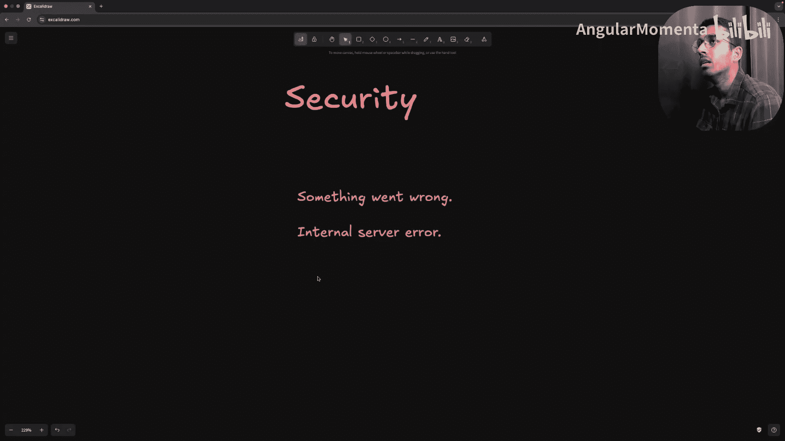
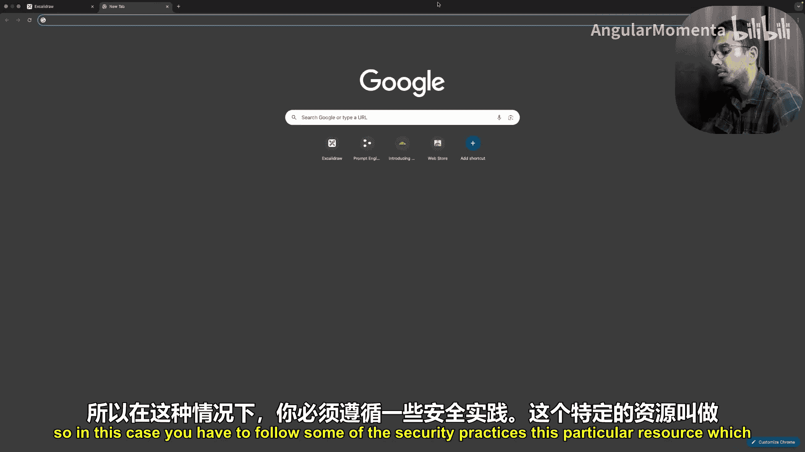
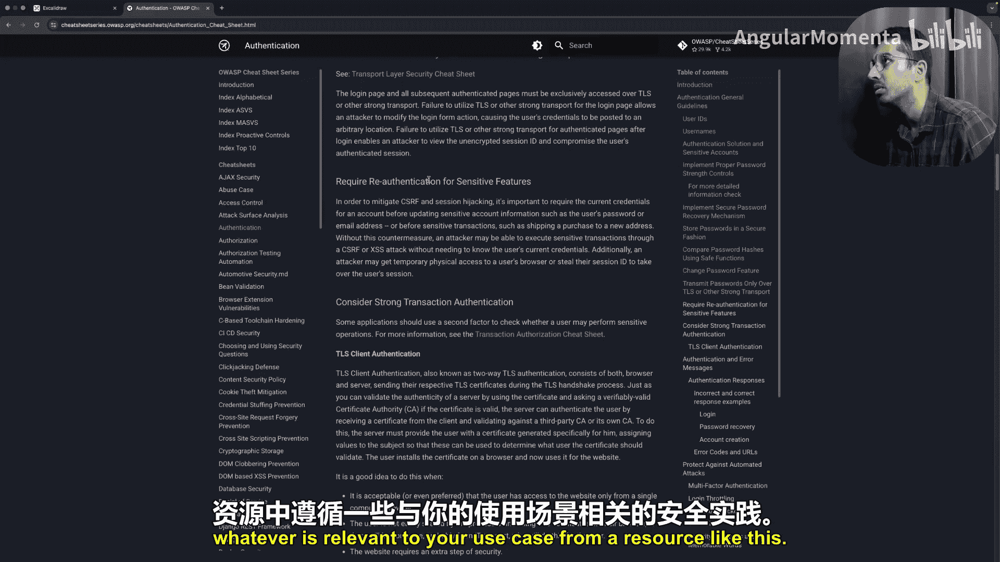
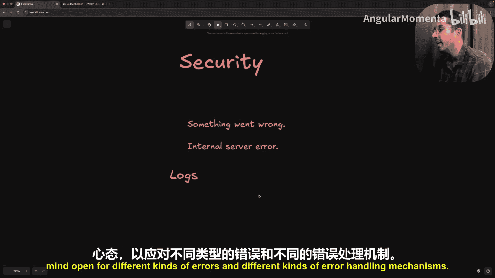

# 【Sriniously】从第一性原理出发的后端开发 ｜ Backend from first principles p16 16. 错误处理与构建容错系统 -BV17aq1BUEhf_p16-

In the world of backend development， errors are not just problems to solve。

 They are a normal part of building applicationss， and every developer needs to understand that errors will happen and。

The keys to being ready for them， being ready to detect them， being ready to fix them。

 and here is a reality。 your database queries， they will sometimes fail。 your external Apis。

 they will sometimes time out and your users will sometimes send bad data which will break your Apis if you are not ready for them or if you are not expecting them and your business logic will hit unexpected edge cases sometimes So the question is not whether errors will happen。

 but how you will handle them when they actually do。

 So in this video there are no tools that I want to talk about there are no frameworks。

 there are no examples， code snippets nothing it is a mindset when you are a backend engineer when you are responsible for executing your core business logic when you're responsible for making sure every single transaction。

 every single user activity。Goes seamlessly。 Then you need a particular mindset。

 a fault tolerant mindset so that you are prepared for the worst and you know how worse it can get。

 and there are some things that you need to keep your eyes on。 and there are some tips。

On how to detect them and how to prevent them。 What are the best practices people usually implement。

 whether it's a starter， whether it's a big enterprise or open source repositories， etca， etc ce。

 let's start with what are the different types of errors that you might encounter in your day to day life as a backend engineer。

 the first type， I think this is the most common type， which logic errors， logic errors。 Now。

 these are the sneaky ones， it's not always very easy to detect them or to fix the logic errors are probably in my experience。

 the most dangerous type， because they don't crash your application as such。

 but they just make it do the wrong thing。 your code which you have written it turns fine。

 but the results incorrect The results are unexpected。 So to take an example。

 let's say we have in ecommerce-commer。You are a Ba engineer in a ecommerce-commerce kind of Saas application and this store that accidentally applies a discount twice and that gives customers negative shipping costs the app does not really crash in this particular scenario but now your platform。

 the platform that you are working for as an engineer， your platform is losing money。

And it is losing money on every single order because of this one logic issue。 Now。

 these errors can go unnoticed for weeks and even months while quietly causing problems if you don't not monitoring them or if your users are not reporting them and your platinum is just facing more and more loss every single week。

 So when do they actually happen and why do they happen。

 Some of the common scenarios are for example， if you， let's say。

 misunderstand requirements or you implement algorithms incorrectly or if you just don't think about edge cases。

 these are some of the usual scenarios when logic errors occur。

 the first thing is misunderstanding requirements， let's say your typical print cycle follows by having a one on one discussion with your client or with your product managers and during。

Those discussions， some of the points came across a little confusing and you noted down the requirements which were not the intended ones。

 So you went ahead and implemented those and that went straight to production and with lack of testing it also went to the users。

And it started causing problems。 So misunderstanding requirements is a pretty common one。

 Then you might have， let's say it's a very complicated algorithm。

 depending on the user's behavior and depending on the user's past purchase history。

 you are issuing different different discount codes and different different discount workflows。

 And in those complicated algorithms， you made one slight miscalculation。 and that in turn。

 caused all this discount related loss in your platform。

 or it might be that you did not expect a particular user activity。

 a particular user behavior in a payment workflow in a discount based workflow and that caused some issue。

 So these are some of the scenarios where logic related errors might occur。

 and they are pretty dangerous ones。 if we are talking about payments or monies or security in that aspect。

 they can corrupt data and they can reduce wrong business reasons over time。

Without getting detected So that's all about logic errors second type is database errors database errors can bring your entire system down since most backend apps they rely heavily on the database and these errors range from a simple connection problem to complex issues like deadlocks and transaction related issues and connection errors happen when your app cannot talk to your database where backend throws a couple of 500 errors and your frontend just shows empty screen everywhere or it can also be because the network is down and the database server is overloaded or you have run out of connection pools you make use of this concept called connection pools so that your backend can hold a couple of open connections to your database server open TP connections。

So that it does not have to do the whole process of TCP handshake and all every time a new request comes So database pooling is kind of an optimization to prevent TCP connection based setup costs So in a poolingbased setup that can also cause an error and when these errors happen your app basically cannot really function because your backend needs to interact with the source of the data to send something to the front end to and the front end needs something to show it so if your database is down if your database is throwing error then your whole platform your whole app cannot really function properly。

 That's about the first kind of database errors。Which I just mentioned are connection errors。

 connection errors。 Second thing can be about constrained violation。

 Now this is something which is not very apparent by constrained violation。

 I mean that you are trying to perform some kind of operation which breaks the database rules for example。

 you might try to create a user with an email that already exists in that case your database just throws a unique constrained error and if will come back to that in the later part of the video。

 but if you are not properly handling that error the unique constrained error and you are not sending a properly formatted message to your user to your front end then that error might bubble up to your to your main process and it might throw a50 error to your front end So that is one kind of constrained violation。

 the unique constrained violation if you' are trying to create a user with the same email or it can also be that you are trying to reference a customer that does not really exist。

In another table， for example， you have two tables， one is customers and second is orders。

 So in the order table， you have a field called customer I and this is a foreign key to this table and this is let's say not nule and you are trying to insert a new record into the order table with a customer ID which does not really exist in the customer table and since it is a foreign key and you are referencing the customer table。

 the database throws an error if it cannot find a associated entry in the customer table So that can also be a cause of constrained violation and the reason for these kinds of violation the constrained violation is usually lies in your validation layer if you' are not properly handling all the edge cases both in your front end and your backend then these kinds of constrained violation error might occur。

So that is something to keep in your mind in order to avoid the database constrained violation related errors。

 then you have to make your violation layer stronger。

 but of course the constrained violation errors like uniquei errors they cannot be avoided only the database knows whether a new entry a new email is unique or not So for those use cases of course you have to focus on your error formatting how to send a properly user friendly message to your frontend so that your frontend can show a proper message that try a different email this email already exists something like that and then in the database we have another kind of error which is called query errors query errors basically happen when your SQl is mailform。

 for example， you are trying to access tables that don't exist because you made a typo in your SQL query let's say you rotate query something like select。

St from customers。 This is a proper query。 But instead of writing this。

 you ended up writing something like you made a typo and that caused an error that this table that you are trying to query from。

 This does not really exist。 So that is a error which happen because of a typo a malform SQ query or it can also happen when your queries are too complex and they timeout etc ce。

 Delocks， Delocks are another reason。 Dlocks are particularly tricky and they occur when multiple database operations are waiting for each other。

 and they create kind of a circular dependency。 So that's where we have a deadlock kind of situation。

 So that's also something you have to be worry about Next we have external service errors Most of the modern apps that we have these days Saas applications mostly that we are talking about。

 they depend on a lot of external services。 external services like。

Processors or email providers or let's say cloud storage storages like object storage like S3 or Redis or let's say you are using a external provider。

 something like odd zero or clerk for your authentication system。

 So that is also an external dependency。 And each one of these external dependencies is a point of failure that you don't really have any control over。

 and that is a big problem。 And you cannot really avoid that。

 it's not like you can abandon using any external dependency。

 That's not possible because you have to build a lot of systems from scratch。

 a lot of complex systems that people have spent years of photon。

 So that is not really something that is practical。

 So you have to expect that all these external services might fail and you have to be prepared that when they fail these are the things that we are going to do to make it up for our users and couple of reasons why these external services might fail posting is of course。

Network， this is how we from our backend application connect to an external services。

 either through H T TP or through T CP or through a web socket， any other kind of connection。

 But the backbone。 the medium is， of course， the network， the Internet。

And the Internet is not really perfect。So you'll have to deal with things like connection timeouts and DNS failures and network partitions is affected by your routing etc Partitions and you need to expect this and you need to plan for them For example。

 let's say you are using a authentication provider。

 something like Cl or something like odd zero Another thing to keep in mind when you' are using an external provider is authentication errors happen when external services services like Cl or odd zero they reject request due to either because bad credentials。

 the username password is not correct。 the email is not correct or expired tokens or insufficient permissions etc。

 So just because you' are using an external services for your authentication is not secure enough in itself because you are using them as an integration。

 you still have your own backend they are not standal alone and in your own。

Backend you can cause security issues security issues like you might expose sensitive user informations in your logs etc cea。

 So that is something that you have to keep in your mind since we are talking about external dependencies authentication etc I just thought of mentioning this point Now next thing is rate limiting when you are using external services。

Let's say you are integrating some kind of AI functionality and you are using an open AI key or you are using something like resend for your emails。

 etc。 And these external services， they pretty much all of them have this functionality called rate limiting and rate limiting exists so that their users。

 So our external services， let's say an email provider like reend and we are their users。

 business users， but still users we cannot abuse them they prevent malicious users who send abnormal amount of request in a particular time frame and they have mechanisms。

 limiting mechanisms implemented so that they can prevent users like us and users with bad intentions。

 And for some reason， let's say your platform because of some kind of user activity in your platform or let's say some kind of logics you ended up hitting their API。

Abormal amount of times and it started failing because and their rate limiting algorithm triggered and they started blocking you are sending you 4 to 9。

 So we get the response code 4 to 9 when we make too many requests it means too many requests and you start getting this error code 4 to 9。

 So in these kinds of scenarios you have to expect them from beforehand and you have to be ready for them and by be ready for them。

 I mean， you have to implement strategies， strategies like let's say exponential back exponential back is a pretty common strategy that we usually implement in case of rate limiting errors for example。

 once we start getting 4 to 9 requests。 So we have a condition in our error handling logic that if we start getting 4 to 9。

 then wait for a minute。 wait for two minutes then try again if you still get  four to 9。

 then wait for double that amount of。If we previously waited for two minutes。

 now we'll wait for four minutes and we'll try again。

 And until we start getting successful responses， we'll keep doing this。

 That's why it's called an exponential back strategy。So in order to deal with rate limiting errors。

 you have to implement these strategies， strategies like exponential backoff and the last one。

 when you are dealing with external dependency， the most inevitable oneness service outage or service going down Now this we see pretty much happening every once in a while。

 let's say some major cloud provider， something like GCP or something like some services of A face some kind of issue。

 some kind of incident and they go down and when they go down a lot of their clients go down and we have this chaos in the internet Twitter that this services down users are complain etc。

 So external services going down is something we as software engineers don't really have a lot of control over they are inevitable and sometimes they go down because of unexpected incidents or sometimes they go down because of maintenance and your app your。

Second needs to handle these kinds of errors also gracefully， either with fallback， you have to have。

 let's say your Redis service goes down， then you should have a second layer of backup。

 something like in memoryory caching。Or a second Redis note etc ce。

 Like some kind of fallback so that your app can handle that gracefully。

 And without affecting any kind of major user functionality。

 they like payments or something like order processing etc。

 in the next category we have and this is a famous one input validation errors。

 And this are something which happen because of users in our platform because of the consumers of our platform input validation errors happen。

 they happen because users send bad data that does not really meet our requirements。

 meet our system requirements meet our rules and the validation layer， which throws these errors。

 this is our first line of defense against any kind of bad data or malicious inputs since we are detecting at the entry point in our backend application and we are just throwing errors。

 something does not meet our requirements。 And there are different types of rules that we usually enforce if you watch。

The validation video in this playlist， then you will have a much deeper understanding about the different kinds of validation that we like to do。

 but usually it's something like format validation where we check if let's say an email is an appropriate email format or not whether a phone number looks like a phone number or not or a date is an appropriate date or not etc etc。

 and you need to be clear even if it's some kind of custom data we need to be clear what exact format that we are expecting and we should only accept that format for the sake of security or the sake of fault tolerance we also have range violations that handles numeric inputs whether the maximum amount is too high or the minimum amount is too low etc or if the string is too long or if it is too short if the array has at least three items or if the error has more than0 items。

 things like this are called rangebased errors we also have required。field validation。

 And this check if a particular field， which is mandatory for a particular operation to happen。

 is present or not。 if they are not present， then we throw an error。

 And usually in these kinds of errors， we throw a 400， which is a bad request error from back end。

 and these kinds of error are the。Easiest ones to expect and the easiest ones to handle。

 because we already know the requirements of our data。

 and we just enforce those rules at the entry point of our backend application。

 And if anything seems off， we just throw an error。

 unlike the other kinds of errors that we saw above， which are external dependency。

 which we don't really have any control over logic errors which are hard to detect。

 it's a validation errors are the easiest ones to handle。 So make sure you have a。

Very robust validation layer does not matter what kind of packing app that you are building。 Next up。

 we also have configuration errors。 What does this mean configuration errors can prevent your app from starting if you have that kind of setup in your app which you should have and they also can make your production environment behave unexpectedly and these kinds of errors configuration errors they usually show up when you are moving between your development。

 your staging and your production environment for example， while development。

 you added a particular environment variable。 let's say something like open AI A you added this in your dot Eb file and you raised a PR and it is most and you forgot to add this particular variable in whatever your production environment variable flow is that is manual or whether it is coming from AS parameter。

Sttor， etc， et ce。 And you just forgot to add that there and the deployment went successful from this point。

 if you forgot to add that two things can happen if you are checking at the start of your application you're validating the presence of all the required environment variables if you have that end of setup in your backend then your app fails you start and I think this is the best case scenario。

 that's why if you are building a backend app， make sure your environment variables or your configuration settings。

 whatever that you are reading from environment variables are from remote stores。

 whatever all these variables which are required for your app to function properly。

 which are not optional make sure you validate them at the first step before your server starts and if any of them are missing if any of them are corrupt then fail your app there so that when you make a new deployment and since most of the deployments have kind of set up like blue。

gren deployment where unless the new deployment is successfully starts the previous deployment does not really stop so if you push something and a new deployment starts and it fails your previous deployment is still running and your app is not really down as compared to another scenario where you are not doing this kind of setup set where the start of your app you're checking all the required environment variables the configuration variables are present or not and you're not doing any kind of error you're not stopping your app but because of this kind of setup what happens in your API handlers API handlers which make use of this new open AI service to make an API called to the open AI servers to let's say generate some kind of image or something so when that API is finally hit。

By some user， then this service is triggered。 and since that service tries to access this particular configuration variable。

 which is open a API key and cannot find it and it errors out and your users get a 500 errors fails during runtime and this is the worst case scenario。

 we always prefer to crash our app at the start before it it starts to serve real users as compared to this this is a bad scenario is something which should not happen So that's all about configuration errors。

 it happens when we are moving between development staging production and it is pretty common。

 So in order to prevent this kinds of errors， make sure you have this kind of setup where before you start your app you are validating all your required configuration variables in the next video in the series we are talking about configuration management of backend apps So there will do a deep dive on what kind of configuration that we need where to store。

etc ce。 but just to give a high level advice that make sure you validate your configuration variables before your server starts so that you can avoid these sneaky kind of errors while your application is running while your backend is running。

 Now let's talk about prevention since we discussed what are the different kinds of errors that might happen and what are things that you have to keep an eye on to make a note of let's see what we actually can do So in my opinion。

 one of the best strategy is finding errors before the spread is the best strategy does not matter what environment that we're talking about whether front end backend infrastructure does not matter Find errors the moment happen before they cause any actual damage that is the best strategy any kind of system can have the best kind of error handling this is the key point in this video which is the best error。

Start before error。This is your key strategy and it should be the best kind of error handling It starts before errors happen so health checks are fundamental in this they continuously monitor your system we typically have a we talk about monitoring our servers htTP servers then we expose a endpoint something like。

Or something like status in an endpoint， which will return some kind of generic response that is okay the key thing is not the response it returns if the response code is important。

 as long as it returns a 200 response code， it means that it's running if it's returning something like 400 or something like 500 then something is wrong。

 that's why you make use of health checks so that any external service。

 any external tool can keep opinion keep hitting this particular endpoint to make sure that it is active。

 it is error free。 but this only checks whether they are running or not your services and your servers are running or not but that is in itself not enough。

 you should not just check if the services are running， you should also check。

And you should also verify that they are really doing their job and when we are talking about that first thing that comes to mind is databases to make sure that your backend is doing its job。

 the primary component that comes to mind is databases and for that we also have database based health checks。

And database based health checks， they test connectivity， whether we are。

 whether we can successfully connect to our database or not and things like query performance。

 if some of the queries which used to take， let's say 500 milliseconds。

 they have certainly started taking four seconds or 5 seconds， then there is something wrong。

Or the data integrity， things like that， a simple ping or a simple health check endpoint which only checks that our server is running or not that in itself is not enough running a representative query and checking the reserve how much time it took and how much time it takes on average etc etc ce。

 And the second thing on our packet is of course the external services Now we should also implement some kind of health check kind of functionality for our external services to make sure that we can successfully connect to them and they are functioning as they are supposed to function for example。

 for payment processor， you can implement test transactions so that when an actual transaction happens from a user side。

 we already know that since the last test transaction five minutes back or successful then we are good to go when it comes to real transactions with real users。

Same way for email services， send test messages to your internal email addresses to make sure that the emails are delivering and your connectivity can be established with the external service etc same way for authentication services you can generate test tokens you can test those tokens against violation endpoints that your authentication service exposes and that way you can verify that your authentication service is functional And the last thing is poor functionality these tests basically involves that your configuration as I mentioned just before this point that at the start of the app we should make sure that all the required configuration variables are present if they are not present then we are stopping at that point and showing a meaningful message show that whichever operator the backend operate the infrastructure operator they can appropriately configure those variables and start the service again successfully So making sure that the configuration is properly loaded the cache。

Some of the default caches， the caches which are necessary to run on production workload they are populated and some of the internal data structure。

 like whether it's about configuration or about external service et ceeta they are consistent so these are called some of the core functionality so we should also keep an eye on these things so all of these combined we can say that these are proactive error detection ahead of time making sure we are already prepared for all these worst case scenarios and we have methodologies to prevent them and if they occur to fix them so that's why we call all of this as proactive error detection then one of the major components。

 especially when we are talking about error handling and fault tolerancele systems。

Then this is something which will always show up， which is monitoring and observability Now this is a huge topic logging。

 monitoring and observability and we have I think the next to next video in this series is going to be about logging monitoring and observability that's why I don't want to spend much time here in this video which is all about the mindset that we need to deal with errors it's nothing concrete。

 just a scope to touch base upon that's why we are not going to talk much about monitoring and observability in this video but the whole idea about monitoring is it detects errors quickly and while they are happening and it provides enough context for us to debug those errors one point to keep in mind in that areas don't just track if for people who are already familiar with practices of monitoring and observability one of the advices。

Is to don't just track error rates， also monitor performance metrics that might indicate problems before they cause failures。

 One of the early telleltale signs before a system is going to break is the performance implications。

 if you are seeing the degradation of performance in some of your services。

 then it might mean that they are going to fail soon。So by monitoring performance。

 we can successfully avoid some of the failures Your monitoring setup should track different types of errors across different parts of your application。

 including HDP errors and database errors。External service failures， business logic errors。

 It should cover everything your are monitoring setup up。

 whatever service that you are using for monitoring or whatever methodology that you are implementing in your backend。

 It should try to cover as many sources of errors as possible。

 And when we are talking about performance metrics or performance monitoring。

 It should track things like response times or。Resource units and to put your business metrics monitoring it should keep track of performance indicators。

 things like a sudden drop in successful transactions。

 assumingum you are running some kind of ecommercecom backend then in a scenario like where the rate of successful transactions suddenly drops you're seeing a lot of failed transactions then it might indicate some kind of technical problem。

 even though the error rates are normal。 That's why tracking business metrics metrics like transactions。

 successful authentications， etc etca。 that's also important。

 Then logging good practices they provide information you need to understand and debug errors。

 you should implement things like structure logging formats like JO logs。

 which can be easily passed and more metada can be added to it and tools like Grfaana or low key these external tools which are meant to be log aggregation tools。

 they can take those logs the。on logs and they can appropriately pass them and can explore your error rates in a visual dashboard kind of setup。

 you can search through them， you can store them in external storage， etc。

 So that's pretty much all about monitoring and observability on a very high level。

 we are going to dive deep into that that tools that are usually used etc。 in a future video。

 But for now， when it comes to error rates and a fault tolerancele system。

 monitoring and observability is a key part to that， that's why we had to mention it here。

 And next up， I want to talk about some of the philosophies that have always helped me。

 especially in the scenario of error handling or building robust systems。

 first thing is immediate error response。 Now when an error happens your immediate response that determines whether it becomes a minor issue or a major failure and the strategy depends on。

error type and the context of the error， for example， for recoverable errors。

 things that we already talked about the email sending work。

 let's say you have in an external service， something like recentend for sending an email and that service failed now you are in a situation of error handling And if you think about it it is a recoverable error sending an email is not something that has to happen under milliseconds we can afford some kind of delay。

 So in scenarios like this for recoverable errors readtry mechanisms or exponential back of strategies。

 they are a a good solution they work well for network errors or temporary resources。

Let's say we have run out of database connections in our database。

 So in these kinds of network errors or resource utilization kind of errors。

 in these kinds of errors， retry mechanisms， exponential back of strategies。

 they work quite well from my own experience。 but something that you have to be careful about is not to overwhelm already stress systems。

 So should keep the error handling logic， whatever retrying logic。

 whatever exponential back of logic that you are implementing the resource over utilization logic that you are implementing。

 they should not add more stress to your system since your system is already under stress。

 that is something that you have to keep an eye on。 And the second is nonrecoverable errors。

 The first one is that we talked about sending an email or earning out of database connections in our pool。

 So those are called recoverable errors， but talking about nonrecoverable errors。

 The strategy that works best is。Containment and graceful degradation， containment。

And graceful in this， we usually do solutions like switching to cast it or disabling nonessential features or providing alternative functionality。

 providing some kind of backup as a fallback and containing the scope of that damage。

 So that is a key strategy that we try to implement in the cases of nonrecoverable errors。

 So that's about immediate error responses。 how should you react to two different kinds errors。

 One is recoverable errors。 and the second is nonrecoverable errors。

 The second part or the second key idea is error recovery strategies， this depends， of course。

 on the error nature and functionality criticality。

 but automatic recovery can handle many errors without human interventions For example。

 if a service has failed。And it is in a state of not responding to any kind of request， etc。

 then restarting that service automatically having some kind of tool or some kind of setup in our workflow for restarting that service or that particular process works pretty much all the time then implementing cleanup functionality like cleaning up corrupted caches if we have problem related to caches or switching to a backup systems that also works most of the time。

 but you should design these things carefully because some of the times these things might make the problems worse you have to adopt a trial and errorbased strategy。

 try these things， try to reach that error threshold ahead of the time and see what works for you。

What kind of recovery strategy works for what kind of service for some other kinds of services。

 manual recovery is pretty much necessary because it requires human judgment and human decision making。

 So for these kinds of errors which needs a manual intervention should plan to document these processes so that all your team members and your new hires are aware of these kinds of workflows。

 what to do in a situation of incident or any kind of service failure and you should test them so that you are already prepared。

 you know that they are definitely going to work Then the situation arises and they can be executed quickly。

 especially in a stress situation where taking decisions quickly is the key to providing a better user experience to your user base and in scenarios like these。

 one of the key things to keep in mind is not to。UpTo your data so data recovery strategies。

 data is the most important part in your application because all other things are basically the code that is running the services that are running。

 but the only tangible thing is the data that you hold data of your user。

 the data of all your transaction of your orders or whatever kind of platform that you are building So data integrity should be one of your number one priorities So this should involve taking backups at the key moments and restoring from backups replaying transaction logs using specialized recovery tools third thing is propagation control not all errors should be handled exactly the moment they occur。

Sometimes for errors you need to propagate up to higher levels。

there is more context to the we also use the word stack trace in scenarios like these。

 but you should have this kind of setup where you are intentionally bubbling up your errors to a particular process。

 the primary process or the secondary process but you should have the whole bubbling workflow in your control otherwise this might spread to other services or it might shut down your main service。

 we have this concept called exception handling in most programming language。

 whether we are dealing javascript or Python where we have this exceptionbased workflow。

 we handle errors using tricach so these exception handling hierarchies provide the structure for error propagation so catching lower level exceptions and wrapping them with enough context and bubbling them up to highle exceptions so that we have more business context so that we have enough information。

In our hands so that we can log the appropriate data。 We can send a meaningful error to our fronted。

 or if。We need to。 We can trigger some kind of recovery strategy at that point。

 So planning this whole thing， bing up the low level error up to our highle process with enough context。

 that is something which is pretty common that we implement in pretty much all our backend applications we also have a different name for this。

 which is called global error handling and we come back to that in the next point。

 So error boundaries， these boundaries where the last point where we stop errors from propagating further。

 these error boundaries in service architecture， especially they prevent errors in one service from affecting others So that's the reason we should aim to use separate processes and implement timeouts。

 things like timeouts which protect service level boundaries and we use things like message queues。

To decooule different different services instead of having them in the same process。

 we should implement things like rabbit M Q， different other kinds of message Q based architecture so that we have it asynchronous communication between two different services without a bug in one service does not cause the failure of another service。

 Now， coming back what I like to call as the final safety in it， global error handling final safe。

This is one of my favorite error handling mechanisms。

 something which I pay a lot of attention to in pretty much every backend app that I have built with is because this is one of those modules which you spend a lot of time initially when you are setting your whole platform up when you are getting to know the features that you might need the services that you are using etca etc but from that point on you only make slide tweaks or add more dons to check etca。

 etc， but this is a onetime effort and this is a single effort which pays a lot in the future not even in the distant future the immediate future because this is the most important error handling a strategy you can implement in a backend app a global error handling workflow this is how it typically works I want to explain this global error handling workflow using real life workflows that。

We typically using in backend appss so from our earlier videos that we already know in a very common backend architecture。

 we usually have the first entry point is of course the routing layer from there we reach the handler the routing layer decides which handler is going to take care of a particular request and the handler deals with taking or extracting whatever data from that payload that we are receiving the performing operations like。

De serialization and validation and binding， etca， et ce。 And once it has all the appropriate data。

 it calls a particular service method。 we call it service because in a typical service method。

 we might make use of one or more repository methods。

 So service method is basically an orchestrator for different repository methods。

 Now what do you mean by repository method， these are the leaf nodes in a backend function。

 which usually do one thing and usually that is running a database query。

 So we might have functions like get user by I， that is a repository method。

 and a service might fetch a particular user by its I D。

 and then it might do additional operations like it can fetch all the user' posts in the same service method by calling a different repository method。

 So one service， which returns a user in all its posts。

Can call two deposititory method That's why we have made this separation so that repository methods are unit level。

 we try to keep their scope limited to one single kind of database operation and we led the service the concern service decide what repository method and how many repository method that it wants to call a。

So in this architecture that most backend appss follow， when we are talking about error handling。

 let's say in the repository layer。The route that we are talking about。

 let's say we have a good reads kind of platform， which is to oversimplified a book management book management platform and in a typical endpoint of a book management platform that we are trying to create a new book that's what we want to do。

 it is a endpoint in aPA endpoint to create a new book and to create a new book。

 we want a couple of fields in our payload the first thing is name the name of the book which is a mandatory field that we need to insert into the database or let's say some optional field called prescription So these are the two fields that we need to create a new book So there are different types of errors that can happen in this particular APIPA So post thing is let's say so let's say in the entry point at this point in our handler since the handler performs operations。

Like validation etc ce。 then validation etc ce。 and we have a business rule that the name of the book cannot exceed more than 500 characters。

 We have this rule in our violation layer and the user has sent a new book name which is around 700 characters So the data the payload reaches our handler and in our handler when the validation fails you want to of course error route and return a meaningful error to the user So that is one kind of error that can happen now going inside we let's say past the service layer and we finally reached the repository layer and in the repository layer we have created a function a function called insert new book and in that function we are running this insert query using aq we are using postgre imagining and we try to insert this new book but we get database error which is a unique constrained violation。

Yeah it。Which says that a book with this particular name already exists in our table。

 in our book table。 That's why this operation cannot be performed， and we get a database level error。

 So that is a different kind of error that we might get。

 So these are the two different kinds of errors we might get in a single A P endpoint。

 The whole point of global error handling is。There are a couple of advantages to it。

 but the pattern usually works by does not matter in what level we get a new error or what kind of error that is Usually what we tried to。

 we try to bubble that error up up to our global error handler middle。

 Usually we try to keep our global error handling in a middleware layer。

So that it has access to all the incoming requests and all the outgoing responses。

 So the aim is to does not matter at to what layer we get a particular type of error we try to bubble that error up So if it is a exception handler kind of language let's say something like javascript or Python。

 which is throw that error and we catch that error in our middleware in our final error handler or if it's a language like go where we return the error then we keep returning the error from our repository to our service to our handler until it reaches our middleware layer and the plan is to from all these different places that error can arise and an error can be thrown from for example。

 from our repository layer we might throw database errors from our service layer。

 we might throw our internal error and from our handler layer we。

Through validation related errors and in every single programming language。

 we have this ability to create custom errors。 So in our final global error handler middleware。

 what we try to do， we read the error And depending on what kind of error that is。

 we perform different different kinds of operation and we return a particular kind of error response back to the user assuming it's an user facing back an application。

 For example， if it is a validation error。 we return an error response back to the user the response code of 400。

 and whatever validation error messages they need to fix their data。 So the first kind can be。

A 400 error。 we return a new HtTP message with the response code of 400。

 which means bad request and we attach all the form field related error or any kind of business logic error etc。

 and we let the user fixed that came from the handler error。 Second thing。

 the other scenario that we talked about where the name of the book already exists in our book table。

 That's why our database through us a unique constrained violation error。

 And for that in the global error handler middleware， we got a new error， which is a database error。

 Now even for a database error will have different different ways to deal with them and different different kinds of message formats to send to the user for example。

 for this use case for a unique constrained violation kind of error。

 the ideal response since it is an。EWhich was thrown because of some data sent by the user。

 So ideally， we can send something like a SDP error。With response code of 400。

 which is for bad request we are saying that this payload is bad request。

 and because in the message we can say that this is for the code SDP code and in the message field an SD error will have in structure。

 So some of the usual fields in an StDP error structure is a code。

 the StP status code is 400 in this case， a message or any other form field related error data。

 which we usually send in a array in an array of dictionaries or array of objects or an array of jsons So in the message field we can say that this book already book already exists in a database or just book already exists and this we did for a unique constrain violation error same way。

 let's say there is a different API end point for fetching the details of a single book So there is a URL in the front end。

A user can go to this particular books and in the book1 to 3。 when this is our front end domain。

 and when they navigate to this particular route。 What we want to do in the front end。

 we want to show the details of the book and for the front end to be able to show the details of the book it has to call an APA and our backend serves the A in a similar route in the backend also we have this particular route and the front end makes a request to this particular route。

 the books route with the path parameter of 1 to3。 So it reaches the handler， it goes through。

 there is no particular violation that we want to do for this particular request and there is no body and the I is a number and that passes the validation layer It passes the service layer and finally reaches the repository layer in the repository layer what we do we run a select query So we do select star books where the I of the book is 1。

23。You can add a valid skill query here， but for the sake of this example。

 this is what you want to do。 you want to select a particular book from the book table whose ID is 1 to 3 now assuming that because of some malform link or someone trying to scam our user for any kind of reason the front end the user in the front reach this particular route。

 but this book with this I does not really exist in our platform。

And the frontendend made a request with this particular ID and we reached a repository error and we ran this particular query and because the book does not exist。

 the database through us a no rows， So most of the drivers database drivers。

 especially in the relational database field， has this particular common error。

 which is no rows if for a particular scale query， especially for a select query。

 there are no rows or those conditions， the driver will throw an error there are no rows。

And what we did， we just bubbled it up so that our global error handler can deal with。

 So that's why we reached here。 The first kind of error that we talked about that the global error handling middle error has to deal with is unicon violation error and same way the second kind of error that we just talked about is no row error So the global error handling middle sees that it is a database error and it is not a unicon violation error。

 It is a no row return kind of error。 So for this use case the the error handling middle error can see that it is a route where a particular resource with a particular I was requested but the database through error response and because of this it can finally deduce that this particular resource does not really exist in our database and for that kind of scenario we have an appropriate error code which is the 404 use the 404 response code。

HttP errors when we are trying to request a particular resource。

 but that resource does not really exist at this point。

 the error handling menu finally throws an error with the code 404 and the message that the book with I1 to3 does not exist that is the second kind of database error another different kind of database error that comes to mind is a foreign key violation error。

 So let's take a scenario where we are talking about a book management platform。

 So in a particular endpoint we are creating a new book with a new author and for that endpoint for that API to work successfully。

 there has to be an existing author and we have to pass the author I in the post payload in our body So we send a payload with the book name the book description which is optional and an author I it passes our violation layer and it finally reaches our repository layer and in our repository layer。

We are inserting， we are running an insert query， insert into books name description author IDd with values whatever the values the user has passed。

 but for some reason the user or the front end has passed author ID which does not really exist in our database and since in our database the book table for the author IDd field for the author ID column the constrain is it is a foreign key which references a row particular row in our author table and since there are no authors with that particular author IDD our database throws an error this particular query breaches the foreign key reference violation error whatever so that can be another kind of database error that our global error handling middler has to deal with So for that scenario。

 what can we do if you think about it the front end passed a ID which does not exist the resource does not exist in our database。

So we can throw a 404 saying that this authority does not really exist。

 That's all about global error handling middlewares。

 This is a final safety net that I like to call it where we can come up with and define different different kinds of error that our platformt has to face throughout its life cycle and we define all these rules about how to deal with those errors and what kind of responses to return to our users。

 So it has two major advantages The first one is， of course。

 more robust and secure because it does not matter where in which layer and error repair we are handling it in our final gateway in our final middle layer。

 It is considered more robust since there is no way will forget some kind of foundation because if let's say。

For a unique constrained violation error， if we did not have a global error handling middleware。

And we let the layers where the error actually occurred to send a meaningful error message to our users in that kind of scenario。

 let's say in a repository layer， a uni constanttrained violation error occurs So it is the responsibility of the repository layer to send a bad requester to our user saying that this book already exists in our database but for a particular repository method let's say we forgot to add that condition and the database function through an error and since in most of the backend setups if a particular error is not appropriately handled or appropriately identified and dealt with what we do we convert that error into a 500 error which basically says that internal server error we don't really know what happened something just went wrong So try again sometimes later So the user instead of getting a meaningful error message like the book already exists in our database it will get a 500 internal server error something went wrong。

 So that is the problem with not having a global error。

HAnd not having all your error handling logic in a single place that sometimes we forget to add all the conditions。

 So in scenarios like those having a final safety net which catches all the different kinds of error that has a possibility to arise the second thing is connected to the same point only which is reducing redance。

 if we don't have a central point of error handling logic。

 then all these different kinds of error handling logic that we have in a single file or a single function we have to spread them out in all different layers and we have to let that particular layer to handle those kinds of error。

 for example， let's say we discuss three different kinds of database error that might occur in a particular SQL query So if we did not have a centralized error handling logic then for each repository method in every place where we are executing an SQL query。

We have to call a particular function or we have to add all these conditions that this is not a unique constant violation error this is not a foreign key violation error etc ceter and if it is that error then deal with it that way so that significantly increases the redundancy of our code and it is also prone to more bugs those are the two major advantages of having a global error handling logic in a sick place since we are talking about error handling the last two things that I want to bring。

I which is mostly related to the security aspect of error handling So first thing that you have to keep in mind is you have to be very mindful about what kind of error messages that you are exposing to your users to your consumers what kind of details are leaving your backend app which might compromise the security of your application which might expose information about some of your users which can fall into wrong hands and they can perform or compromise the security of your users which are equally bad whether it is compromising the security of your platform or compromising the security of your users is equally bad In fact。

 compromiseising the security of your users is was then your platform because that harms your goodwill your trust in the market etc Now it can happen in a couple of places the first one is you have to make sure that whatever default error handling mechanism。

In your backenders， whether it is in the global error handler or whatever place you are keeping it in。

 it is not leaking any kind of internal details back to the consumer， for example。

 let's say you your database through some kind of unique constrained violation error or some kind of database error which has some details about the table names or the indexes or the constrain etca the internal details of your database So in your global error handling middleware if you are just taking whatever error that has bubbled up from your lower layers for example。

 in this case the repository layer and you are sending that message back to the user in the message field of your error structure then that can cause severe damage to your platform because for advanced users for malicious users they can take details like your table names。

 your constrained names etca etc from your database internal details and they can try more advanced attacks。

More advanced forms of S scale injection。 They can just make your platform a target and they can actively come up with more and more strategies to bypass your security and it will be harder for you to prevent those kinds of attacks。

 So that is the reason in all the error messages， try to have as much control as you can over the messages So try to understand what kind of error is being thrown from whatever layer it is being thrown from and generate a message which is meant for a user。

 for example， as I talked about in your default error handling logic instead of throwing a 500 and attaching whatever message that bubbles up from a lower layers。

 add 500 and in the message， just say something went wrong since if you have reached 500。

 which is a default error handling mechanism， which means that in the previously you have tried to check whether it is a violation layer。

 whether it is a un considered violation error business error。As error。

 you have checked all the different kinds of error。 And finally。

 you have reached this stage where you don't really know what kind of error that is。

 So for that kind of situation， you don't really want your user to know what kind of error was thrown。

 So it most probably has some kind of internal details in the error message。

 And that is why in the default error handling logic， you always want to have a generic message。

 something like something went wrong or the default error message in most library。

 which is internal error。that is one aspect。 The second aspect is let's say we are dealing with a authentication or authorization model。

 Let's say it is a login endpoint。 you are expecting an email and password and after you get the email and password from the post request body you will take that。

 you will check from the email whether a user exists or not if the user does not exist。

 you will send an error。 And then if the user exists you。

Proceed you check whether the password is correct or not if the password is correct。

 you'll throw an error etc。 That's what comes to our mind when we think about a login endpoint。

 But here also， when we are talking about error handling。

 something that you have to keep in mind is authentication is one of the most targeted modules in most of the apps that attack malicious uses usually like to target So in this case you have to follow some of the security practices。

 this particular resource， which is called this resource has good practices and advices for a lot of different kinds of workflows。

 for example， authentication， we will get these different different advises that don't do this。

 don't do this。 this will compromise your platform in this way this will compromise your users in this etc So you can follow some of the security practices。

 whatever is relevant to your use case from a resource like this。 But the whole idea is。

 let's say we are talking about。

Sign an endpoint or a login endpoint and the first step you took the email which was provided in the body and you checked that whether a user with this particular email exists or not so if the user does not exist with that email instead of saying a user with this email does not exist you should return an error response which says that invalid username or password invalid email or password so that we can avoid scenarios。

 scenarios like let's say you have a malicious user who is trying to bypass some of the accounts of our legit users are harmless users。

So what strategy they are trying to come up with so they are trying different different email addresses and with various passwords if you are returning very detailed error messages like a user with this email does not exist or your password is incorrect then what they can do they can implement a stepby step approach for this attack and what they can do first they will try different different emails with a single password and for each email they will keep getting this message that a user with this email does not exist a user with this email does not exist and finally when they hit an email for which a user exists since we are naively returning error messages they will get an error message saying that your password is incorrect since they are able to find an email for which a user already exists in our platform now they are getting an error message which says that your password。

Is incorrect。 And now they have an email， which they know that a particular user exists with this email。

 Now they can try different different passwords。Common passwords。

 which have better chances of getting a hit。 and with that they are able to compromise the security of our platform。

 So just using error messages just using the weakness in our error handling mechanism attackers malicious users can compromise our security and security of our users。

 So that is the reason try to follow security best practices when it comes to error messages and the second thing which comes to mind。

 especially in the aspect of security logs on a very high level。

 the idea is try to not expose the sensitive information like users email users passwords。

 their API keys or their great card numbers， etc et in your logs。

 logs which you think are limited to your own servers。

 your own infrastructure which are not getting linkeded to any kind of external malicious user but that's not how。

It always works in most of the major data breaches What happens since major companies use external services。

 multiple services to manage their logs， because for a particular company which has a fair amount of user traffic。

 they generate hundreds of G of logs every day and they have to use multiple services storage services。

 analysis services， observability services different kinds of services to manage their logs efficiently So what happens in these major data breaches。

 the company's logs gets leaked and from these logs if they are not following best security practices like not logging users credit card numbers。

 not logging users， emails， not logging users， passwords， API keys， etc。

 that detail gets leaked and hundreds of malicious users have access to them in case of errors。

 let's say authentication error occurs you should not log any sensitive information about the user always log users I instead of their email and only correlation。

I so that you have enough context。 that's pretty much all I have to say about error handling and creating fault tolerance systems。

 This is mostly theory， just a couple of ways of looking at systems and making the systems more robust and。

Keeping our mind open for different kinds of errors and different kinds of error handling mechanisms。

