# 【Sriniously】从第一性原理出发的后端开发 ｜ Backend from first principles p17 17. 生产级配置管理 -BV17aq1BUEhf_p17-

Config or configuration management， If we go by the definition。

 then we can say that config management is the systematic approach to organize or store or access or basically maintaining all the。

Settings this is the keyword here， all the settings of our backend app so you can think of this as a DNA of your application it decides how your code runs in different different environments when you say configuration management to most people then the first impression that we get the first idea that hits our mind is storing some kind of database passwords。

The secure connection URL of our database or things like secure authentication keys。

 secret keys or your JWT secrets etca etc or any API keys of external services like say your email delivery service during API keys for external services like that those are the things that comes to our mind whenever we talk about config management but thinking like that misses a lot of scope in configuration management because that's like saying a car is just about the engine engine is definitely the most important part of a car but youre still missing out the 90% of the other features of a car So similarly configuration management it has a lot of other things starting from how your application starts up how it connects to external services。

 how it behaves depending on different different environments what does it log whether it logs or not and where it logs and where does it send。

The details about your metrics， the performance metrics。

 your business metrics and things like which features are we enabling for this version of the deployment and which features are going to be disabled and for which users we are enabling which features etc there is a lot of scope for config management and in this video I want to touch upon what are the different things we care about what are the different things we think about whenever we talk about config management It's not just limited to your database URL or your secret keys it affects a lot of behaviors important behaviors of your backend application So definitely an important topic to discuss here So let's say you are building an ecommercemer platform youre building an ecommercemer platform and if you are working on the backend of an ecommerce platform then your configuration might include。

Some of the things like the timeout， what is the host， what is the port， what is the user name。

 What is the password etc。 All the connection details of our database。

 it might also have your payment processor API keys let's say you are using strippe then you might have your strippe API keys there also your feature flags what are the feature flags that we are enabling for this deployment and what are the features that we are keeping disabled for this deployment and these feature flags。

 let's say they control we build a new checkoutflow in our ecommerce platform and using a particular feature flag we can control that whether we are still using the old checkoutflow or we are using the new checkoutflow and we can also conditionally enable the new checkoutflow for some users and the old checkoutflow for some other users So we use feature flags for these kinds of instances you might also have performance。

Tunening parameters like what are we keeping our connection pool size connection pool that we use for our database connections。

 Also security settings like what is session timeouts， whether it is 30 seconds。

60 seconds and we can also store things like business rules。

 business rules for any ecommerce-commerce， it might contain things like what is the maximum amount of order for a user and each of these different configuration that we talked about starting from database connection details to payment process API keys to feature flags to performance。

 tuning parameters and security sessions， security settings like session timeout settings and also business rules。

 All these different different configurations have different different characteristics。

 Some of them are sensitive。 Some of them are supposed to be kept in secret。

 we are not supposed to leave them and they might cause a lot of。Damage。

 they might cause a lot of loss and some of them are not secretive。

 but they impact they control how our application behaves while it is running Also some of them might change frequently and some of them let's say they change once a month or once a quarter etc。

 and some of the configurations may stay the same for all our environments in our development environment in our staging environment and in our production environment and some of the cons theyll be different depending on which environment that we are running our application in all of this there is one challenge。

 which is distributed systems， Most of our modern applications。

 all are modern backends they don't run in isolation anymore。

 Most of them are now part of a complex distributed system， a system consisting of multiple services。

 a databases caches like。Read etca or message queues or thirdparty integrations or authentication or emails and a lot of things and all these different different integration points where we are connecting a separate service to our main backend they all require configuration your backend obviously it needs to know how to connect to these services but on top of that it also needs to know how to handle failures。

 how to optimize performance and how to maintain security depending on different environment。

 depending on different settings and depending on different congs that we can control from different different sources that will soon talk about and this is the reason the reason that most of our modern backends they run on distributed systems this is why configuration management becomes an important part of your application and if you don't have a systematic approach if you don't have a dedicated pipeline if you don't have a dedicated strategy to manage your config。

You will end up with what we call as configuration chaos configurationration chaos bus means that instead of controlling some conflicts from a centralized point。

 you have hard code values。Scattered throughout your core base and you also have inconsistent behavior across different different environments。

 you also have security vulnerabilities from exposed secrets and debugging your application becomes a nightmare because you cannot really reproduce these issues because you don't have a centralized way of managing your config so you don't really know what exactly happened and what particular config caused a particular issue what particular config caused a particular break in production the stakes are pretty high for packet engineers these days since they handle the core business logic and data is pretty much the most important part of any platform any enterprise So if you think about it misconfigured front end it might show let's say a wrong feature a wrong dialogue which it's not supposed to show or it might redirect to a wrong route。

a misconfigured backend it can cause a lot of damage。 it can expose customer data。

 It can process payments incorrectly or it can bring down your entire platform if some important part of it is affected by it Since pa systems run in diverse environments。

 different cloud providers different onpres servers and containers and serverless functions and edge functions and all have their own requirement of different different configurations Since we are talking about cloud providers let me tell you a little bit about the sponsor of this video is Se a platform as a service provider and you can deploy your applications。

 your databases and your object storage your deployment pipelines and you name it if your team is paying per seat pricing in other platform as a service providers for your hosting needs you are literally throwing。

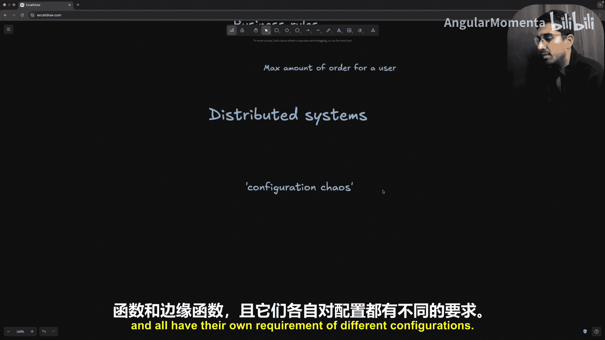

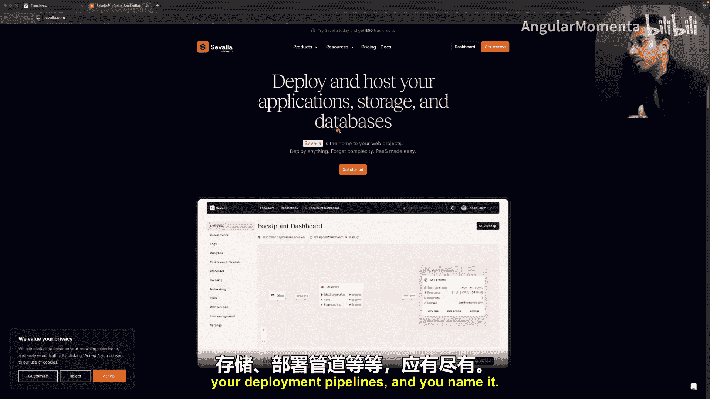

Your money away I'll show you how you can save $300 per month while actually getting a better infrastructure and support so this is a math if we take a look at this platforms like render they charge around 29 per month。

And if let's say we talk about railway， they charge around $20 per month and platforms like nettlify。

 they want $19 per team member So if you are a 5% dev team that's around145 to $290 monthly just for the privilege of collaboration and let's say your team is doubled。

 you have now $10 developers Now you're looking at monthly$2$90 to $580 monthly just for the seat fees you have other cloud hosting fees just for the seat fees you are paying almost $500 per month before you even deploy a single app if you can feel the frustration。

 then you can definitely check out Sevalla they don't have any seat based pricing Sevalla is basically a Kinsta product Kinsta。

 these guys have been around for a long time they are one of the most famous hosting。

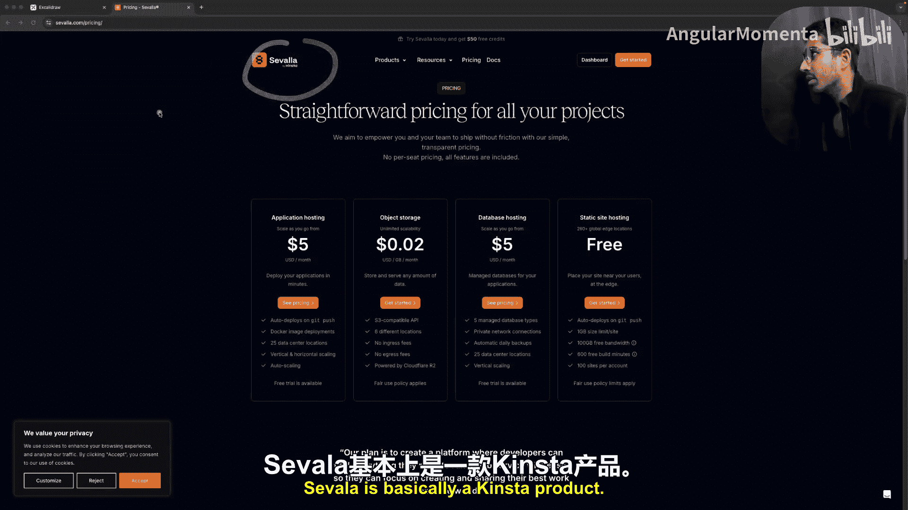

Platforms when we are talking about Wordpress and Sealla is their latest offering since they already had the infrastructure for all their hosting needs。

 they have created this product called Sealla and the interesting thing about this platform is they don't have any seed basedase pricingcing absolutely zero your entire team gets full access whether you have two developers or 200 but just because your costs have come down do not assume that you are going to get lesser quality Sealla uses GCP behind the scenes and the premier networking of GCP and it runs Kubernetes behind the scenes with 25 data centers around the world with 99% SLA they also have an integrated Cloudware offering which has around 260 plus points of presence around the world offering you things like E Cdn Ddos protection and edge caching global load balancing and a lot of things。

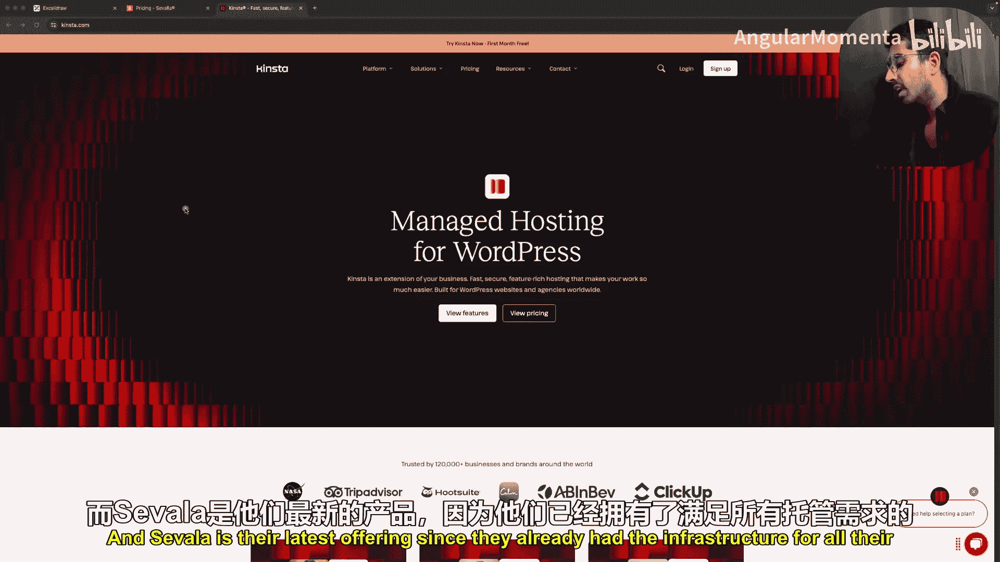

cloudflow natively brings you get enterprise reliability without paying for the enterprise grade pricinging Seallaa supports more than 20 programming languages through Ns。

 which is more so sufficient than traditional build backs you get automatic deployments using Github Gilab bid bucket whatever version control system that you are using in your team and also zero downtime Kubernetes health checks throughout your applications you get features like hivaation pause for your development environments and horizontal scaling for all your production traffic spies but unlike most platforms Sealla has a human monitoring system they support team actually monitors your deployments if you are facing a lot of errors and facing a lot of challenges in your deployments they reach out to you to help you out and help your team out that's not something you see in a lot of platforms they also have a lot of compliance checks you have so to you have IO GDP CCPA does not matter what。

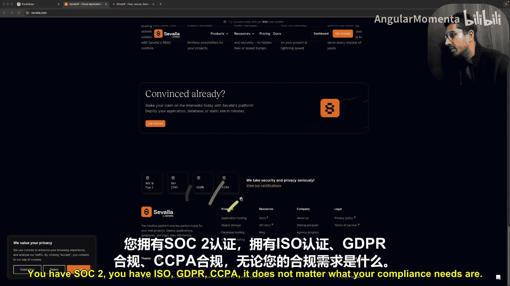

Your compliance needs are they are already there so if that sounds interesting to you check out Seala and you will get 50 credits to try out different applications database hosting object storage whatever your needs are you can calculate your team's current seed based costs and see how much you will save as compared to other platforms your CFO will definitely love the budget relief。

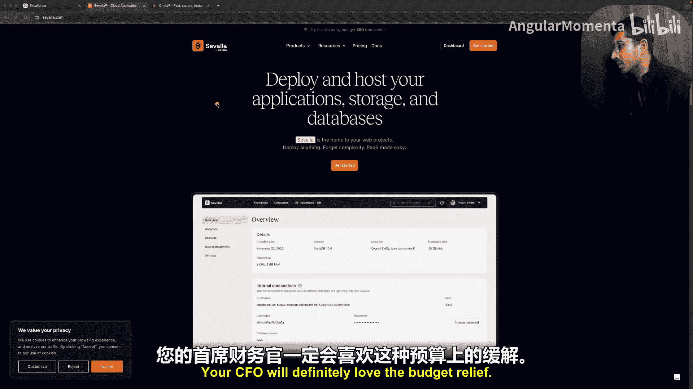

And your developers will love the simplicity of the platform So what are the different types of configuration that we are talking about here。

 Because not all configurations are created equal and understanding the different types of configuration data is very important for choosing the storage mechanism the security measures and the x patterns who can access and what environments。

 a particular config is should be accessible So let's talk about what are the different types of configuration。

 what they look like where do they actually get used The first one is are most common kind of config。

 which is the application settings application settings is the most common kind of config that youll see in most backend appss and this basically includes our log level and things like our port which port the backend application is going to run on are connection pool size。

Timeout values， timeout values like if you have an HTTP request。

 then how long the server should wait for the request to get completed so if you set a timeout value for 60 seconds and let's say you initiate a request which generates an AI image your backend generate an AI image and send it back to your front end in base 64 format and the AI image generation takes let's say around on average 80 seconds so if your server timeout is 60 seconds then your request is going to get dropped you will get a status score of 504 timeout status Similarlyly log level in usually when we are developing our application on development environment we set the log level to debug so that we can actually see and we can actually differentiate between different different logs when we are created。

The application when the application is running on our local environment and when we go to production then we change the log level to info so that we don't cltter a lot of logs in our value production logs same port usually we on our backend app in local aid rate0 and depending on our production setup whether we are using Vps or Kubernetes you might have different different ports same connection pool size for our database connections or our database operations most backend apps use this technique called connection pooling connection pooling helps us optimize database connections so we can also configure what is the maximum connection pool size that we want to have So these are some of the common application level settings that you will see in pretty much all the different kinds of backends next up what we have second we have database database config database config basically includes all。

Your application needs to connect your database This will include the host where your database is running on the port of your database。

 the username of your database the password and the name of your database all these different different parameters combined you can create a connection URL and that URL can be used when your application is running to connect your database It might also have other parameters。

 things like timeouts how long your database query should run for before it times out  moving on the third type of config that we can have is external services Now external services can be a lot of different types if you are using emails then you might have an email provider like mailchimp or something model。

send does not matter what provider that you use you will most probably have some kind of API key in your config that you will need to send the emails to initiate the client。

 Similarlyly， if you are using any kind of payment processor as say strippe then you might also have a typepe API key or if you are using for authentication if you are using something like Cl then you will also have a clerk API key so all these different different services that we call as external services they also have their own configuration needs and you will also need to cater to that then the next type we have a feature flags feature flags feature flags exist so that we can dynamically enable or disable particular features or our application so as earlier I gave an example you are building an ecommerce-comce platform and you have an checkoutflow you have a checkoutflow where we have all the order details here and here。

There is the payment details and proceed to payment something like this and now you are building a new checkoutflow and for that you are using a different API and you don't want to roll out this new checkoutflow for all your users you want to do some kind of AB testing with it you want to only enable this feature for a particular segment of your user depending on the location of the users you let's say you only want to enable this feature。

For people who are from US and you want to keep it dissolve for people who are from India。

If you have requirements like that， we use feature flags for dynamically enabling or disabling features in our application。

 so feature flags also need some kind of conflict management， so that's the fourth category。

Apart from that， we also have other types， things like let's say， infrra confit。

 all your Devops related conflictts and let's say your security cont。Your JW secret。

 your session secret， anything related to security that your application is impacted from。

 then we also have performance tuning performance tuning parameters。

 so if your backend is built with something like go。Go and。

 then you can set different different environment variables like the maximum number of CPUus， etc。

 Then also we have business rules，  different logic related rules that you want to enforce on application level。

 but you want to centralize that config。 That's when we use business rule related config management。

 So that's pretty much all about different types of config that you will face on your day today life as a backend engineer。

 The second important thing is different sources of config， basically the storage of confits。

 If we have all these diverse needs of config management。

 then definitely will also need to think about the storing of the confits and the where do you and where you store your cons。

 It depends on a lot of parameters depending on security depending on speed and your environment。

 When we are talking about storage of configuration。

Then the most common kind that I have seen and most people have seen is the environment variables and if you have worked with backends before then dot Ev this particular pattern is very common among different backend appss this is mostly common among node Ghas but we also have support for them in Python goang does not matter what programming language that youre creating your backend in this is the most common place where we store our configurations if we are running in our local environments then we have a file called dotnv we use any library library called dot Ev is very famous which basically takes all your environment variables from dotnv and it loads it in your operating systems environment so this is basically a feature provided by your operating systems which is not something you build but。

We have libraries which take these values from files and load it in our environment instead of us doing it manually with export Similarlyly if you're not in a local environment let's say you are deploying in some kind of containerized environment using Kubernetes etc so those technologies also have support for loading your environment variables while they are deploying your application So this is the workflow that happens when you deploy it in a cloud provider using environment variables the deployment triggers at a particular stage it fetches all your environment variables from any kind of service let's say from Wal which is from hashicorp or something like less parameter store or Azure or Google secret manager any cloud provider which gives this feature of secrets management it fetches for it fetches from all these cloud providers and。

Loads that in your environment and then when your application starts it takes those environment variables and it functions whatever way it is supposed to function that is the most common storage we have for our configurations the second kind is files in files we have different different formats we store configurations either in JON but these days Yal is more famous or storing configurations one of the major disadvantages of using Json is you cannot add comments JsonN does not have support for comments that say most we will use Yal there you can add your configuration and you can also add different different comments so that it's easier for your team to share knowledge we also have a newer standard with Tal files this is also pretty heavily used for managing configuration so if you were to take a look at a real world code base。

This is some okay this is an example of Ahelia this is a authentication provider technology this is a golan application as you can see this have all these go files so here you can see we have a configuration dot Yal file and there are different different values server we have log level lists debug storage。

Notification related details， identity related details are regulations。

 session related details and all these things all of them are stored in a single Yal file and if you were to search for config then in the results you can see we have config or Yaml in a lot of different different places This is from incubator answer is also another famous open source from Apache and you can see they also have some fixed configurations for app settings that we just talked about application related settings like your which port your server to run on the databases for local environments they are using SQlite and Strgger UI cong UI config So storing your configurations in a Yal file is pretty common in most of the open source repositories  moving on we also have keyvalue stores or in memory stores for this we might use some。

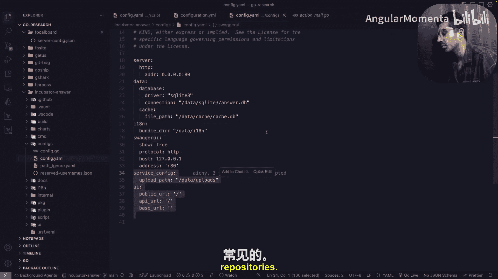

thhing like Redis is most common， but we also have dedicated tools like console or ETCD。

 these cloud native tools we also have access to them depending on your use case you can use any of them key value stores are pretty lightweight and pretty simple to make use of as compared to other complicated and hierarchical data structures for cong management this acts mostly like your environment variables then we also have dedicated cloud providers cloud here major we have hashi orvolt then we have AWS parameters store azure key world all these different different providers if let's say we take a look at has or world can explore all these different different services which are dedicated for config management your secrets management that most companies use because we have deployments set up in a distributed manner。

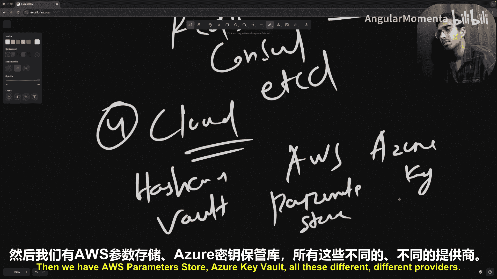

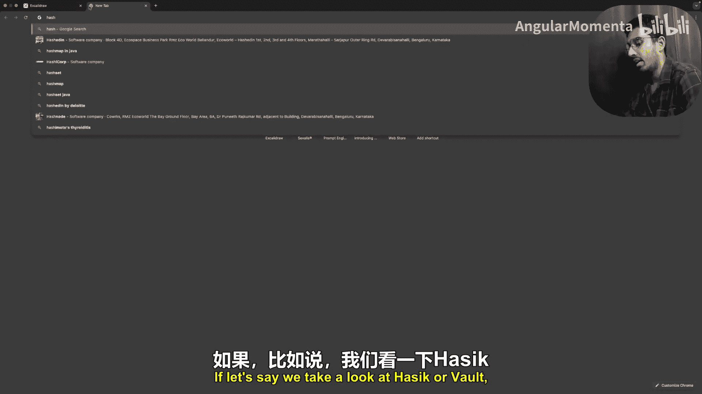

We have Kubernetes we have auto scaling and we also sometimes make use of different different cloud providers at the same time for our scaling needs so having all our configurations in a centralized manner in a tool something like has orvol which already is ready for all these different different environment they already have dedicated support they already have dedicated docs and everything to make the integration as easy as possible using a external provider makes a lot of sense if you are running big user traffic in production but most of the time we also make use of hybrid strategies let's say we have a file where we load all our conts and construct a runtime application settings and when we are in this loading phase we might fetch our cons around different different places in the first priority we might fetch from AWS parameter store then we might also have a confi or DMl then we might also have some environment very。

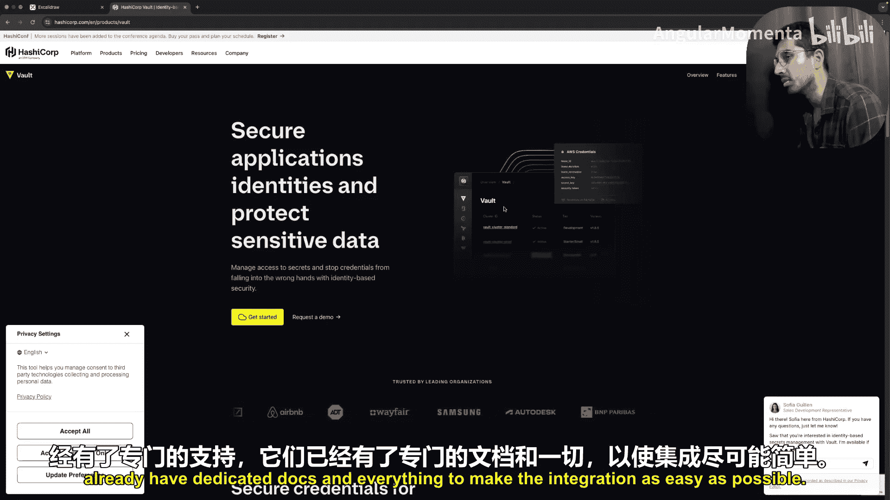

So we can red decideecide that which of these should have the higher priority and depending on the environment。

 we can load those confits conditionally。Depending on the priority and the environment。

 that's all about different different storages for storing our conts。 Now， one question we have is。

 why do we have different different conflicts depending on the environment that we are running on。

 And the answer to that is pretty simple because each environment has a set up priorities that the other environment does not need or。

Should not have。For example， if。We are running in a development。

 whether it is your local in a development， let's say in your local environment。

 you are running on local host， then our number one priority is developer productivity and our debugging capabilities so that we can work faster and we can catch issues faster。

 Similarlyly if we are running in a test environment。

 we trigger negative action and it repairs some kind of testing environment where we can run different different integration testings or unit testing or whatever testing setup that you have。

Then in that kind of environment our number one priority is automated validation and quality assurance similarly staging environment staging environment is basically a hosted version of our application that is as that works and functions as similar to our production environment as possible so that we have a clear idea what our production environment is going to work like and we can make changes fixed issues and debug issues accordingly so that is the priority of the staging environment。

Similarly， the last one in our production environment。

 the number one par is reliability and security and performance。

 so we create our conflicts keeping these priorities in mind and that is the reason our conflicts are loaded in different ways。

 they are stored in different ways and they are different in their values depending on which environment that we are running in the application code of course it remains the same but depending on the con。

 the behavior of our application changes and that is exactly what we want without changing the code of our application which we might have to do if we are hard codingding things but since we are centralizing our cong management。

 we will never have to touch our application code， we can make changes in our con and that will reflect in the behavior of our application。

 So if we take an example of。A database pool size in your development environment when you are running in your local host you can set your pool size max pool size for 10 and it mostly works fine while you are testing your application while you are developing your application it don't really face any issues because local host these days most people have high end devices and can it has a lot of capacity for these kinds of things。

 but on production you have set the connection pool size to 50 because you have to cater to a large user base and you might get traffic spikes in different different times so you have to be prepared for that so you have set a higher database pool size in your production environment Similarlyly in your staging environment you have set the pool size to2 because even though in staging environment our number one priority is to mirror the functionality and the capabilities of。

Our production environment as much as possible so that we can catch issues earlier。

 we can understand our production system better。 but running a similar system。

 which functions exactly like our production systems will cost the same amount when it comes to our cloud costs。

 and that's not something a lot of teams want。 we want to save as much money as possible when we are talking about cloud costs。

 So in our development environment， our another set of priority is minimizing our cloud costs。

 So database pool size since we already know that our staging environment is usually is used by our developers or our testers。

 So we can take some decisions like keeping our database pool size to minimum and we can accommodate some kind of delay there。

 but we save a lot of money in our cloud costs。 And the last thing that we have to talk about when we are talking about cong management is security。

 these are pretty obvious。But just for the sake of covering all the scope， I'll mention these。

 never hard code your secrets。 If you have secrets like your production database URL the API key of your clerk service or your email delivery service or your payment processing service you should never hard those secrets in your codeb it's pretty obvious I don't even have to explain why should not second thing is if it's possible always try to go for a cloud secrets management service。

 something like as I showed earlier hashi or Vol or AWS parameters store or aszure keyword or Google secret manager it's always a good idea to overengineer when it comes to security of your backend application these services they already handle things like。

Enncrypting all your conts when they are stored in this storage。

 does not matter where they store your con， but whenever they store it。

 they encrypt it and then they store it somewhere in any kind of database or any kind of storage Similarlyly when they are in transition when you make an API call and you fetch all the conts。

 they send you the encrypted one and with your private key。

 which is stored in your infrra or your Github action or your repository secret or your Kubernetes environment there they are decoded and then you use them。

 So they are encrypted when they are stored and they are also encrypted when they are transferred from one point when when you are fetching them。

 these are essential security features And when you use a cloud provider like a world or AS parameter store all these things are already taken care of and you don't have to think about this。

 third thing is access control if you have a fairly large。Developers team。

 you should take some time to strategize who should have access to all your conflicts。

Following the rule of least privilege。Developers who are working on frontend。

 they should only have access to all the conts that they need for functioning。

 things like the API URL of the backend and different different API keys or front end integrations etc。

 And if you have backend engineer， they should only have access to your databases， your red instance。

 your elastic search etca， etc ce。 but something like confits for accessing your cloud instances。

 your EC two instances， only your devvo stream should have access to those So following the least privilege principle you should strategize your access control and you should also have things like rotation periodically you should rotate all your conts all your API key secrets。

 all your geoW secrets and things like these so that we are not very prone to leakage the last thing that I want to mention here is validation。

 Most of the times that I have personally seen we don't always。

Validate our environment variables or whatever source our convicts are coming from。

 let's say if we are using dot Ev then we just use some library called dott below load all the variables in our environment and we just access it using process dot Ev dot whatever the name of the variable is but one of the key strategies that can help decrease a lot of headache is when you are loading your confit which is usually the start before your application starts after it is deployed you should validate all the confits does not matter whatever source they are coming from if they are coming from dot Ev they are coming from As parameter store if they are coming from a file let's say confit dotaml file all is validate them using a proper validation library if you have a typescript back and then you can use Z if we have go you can use govalator playground library any kind of Val library that your programming language。

Your framework offers and properly validate all the variables。

 depending on which ones are mandatory to provide， which ones are optional and youre setting the default in your application code and thinking about all these different scenarios。

 always validate your configurations。 I have learned this the hard way。 It can cause a lot of damage。

 it can cause a lot of confusion in your production environment because it's not very easy to spot that you have a mandatory environment variable requirement。

 but you were not able to provide it and now your production system is either breaking or behaving in a strange way because it does not have access to a particular environment variable If you were to take one thing from this video this is the most important part。

 always validate your conts。 does not matter where they are coming from。 All validate them。

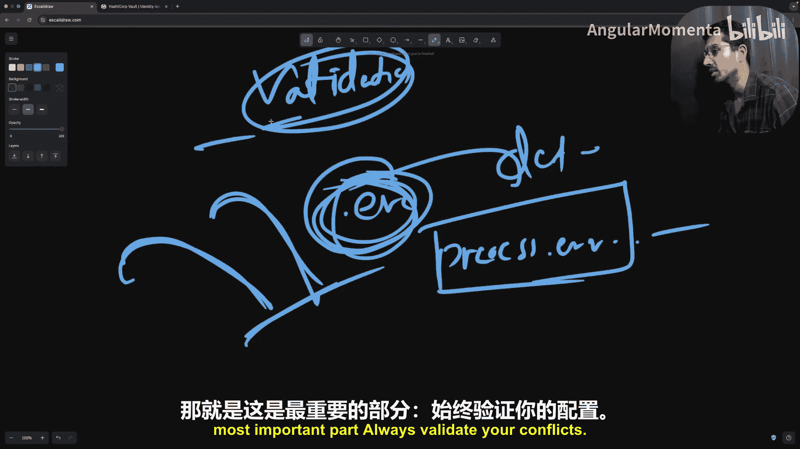