# 【Sriniously】从第一性原理出发的后端开发 ｜ Backend from first principles p18 18. 日志记录、监控与可观测性 -BV17aq1BUEhf_p18-

Logging monitoring and observability。 this is a huge topic。 And each portion itself。

 if we talk about logging or if we talk about monitoring and if we talk about observability。

 there themselves are deserving enough to get their own discussion get their own video。

 but this is also one of those topics where not everything is precided， there are no rules。

 it's more of a spectrum。 These are obviously practices logging monitoring observability。

 I will get to why do we need this and what are these exactly。

 but these are practices which most companies， Most individuals startups。

 They implement in a spectrum。 We can never say that our product。

 our company follows all the good logging monitoring and observability practices。

 There is no such thing as that。 So given that， just wanted to put that information out there so that we don't feel inimidated later on when we see all。

Different different keywords， practices， products and tools that get used all over the industry Now what is what are these termss What is logging what is monitoring and what is observability as I said since this is a huge topic I don't want to spend hours discussing this even though we can spend hours these topics are huge but we'll keep this too limited since these are more of a practices than theory Ill also show more code in this video even though from the start of this series I have kept this as a rule that we won't look at code but this is one of those videos where if you don't look at code this does not really make any sense all these practices they are pretty closely related to code how we implement them how we follow these practices that's why I will look at code how these work in a real application now coming back to why do we need this now since we know that these days in。

Modern internet， all our backend applications， all our wholet applications they run in a distributed environment and they run in different different servers。

 they run in different different regions and our users are spread across the whole world given these scenarios we need practices we need tools and we need methodologies so that we can keep track of what's happening in all our services in all our infrastructure tools and everything and what do I mean by keep track There are a couple of parameters we can keep track of there are a lot of parameters。

 but we can boil them down to some of the important ones logging basically means we record record So it's kind of a record all the events that are happening in our application again。

These practices， logging， monitoring and observability， these also apply for friendend applications。

 your web applications， but we will keep the discussion limited to backend applications as I was saying logging is basically recording all the important events all the suspicious events all the security related events pretty much every important event that happens in our application in our backend application we want to record that event with some metadata metadata basically means what was the user ID which trigger this particular request and what does the latency of this request and what particular method what particular function was triggered for this request and all the different different metadata that will come in handy when we are actually trying to understand our system so the first thing the first component of this whole methodology is logging which is basically recording all the events from the whole。

Licycle of requests and our application execution。 The second thing is monitoring monitoring basically is exactly the same as the way it sounds。

 We want some way of keeping track， we cannot simplify it more than that we want to monitor the state of all our applications or backend application and different components of our backend application the servers CPU。

 the servers memory how many requests the servers processing per second at this particular time and what is the state of our database connections。

 how many database connections are open because we are using database pooling etc monitoring basically means having real time data about our system。

 not exactly real time but a few minutes differing because one thing about logging monitoring and ob。

 all these practice， these data， even though there are tools where we can monitor in real time with a few milliseconds。

 few secondsd。deferring， but usually with our traditional tools， without our traditional practices。

 there is some kind of delay because we don't want to overwhelm our whole logging monitoring and observative systems。

With constant data with every millisecond with every second。

 there is some kind of delay around 10 second or 15 seconds monitoring basically means that having real time data。

 real time we mean 10，15 seconds of delay， having real time data about the state of our system。

 That's all about monitoring。And the next is observability Now observability is in itself includes a lot of other practices and if we go by theoretical terms。

 observability has three pillars we like to call them as pillars because a system a packetend system is can only be called observable if all these three practices if all these three components are in place those are one is basically logs second metrics and third is traces Now logs we already know logs are basically record of all the important event that is happening across our request life cycle or application startup application ending the whole phase metrics metrics is something which closely relates to monitoring I'll come back to this part a little later and same way traces。

Traces， you can imagine traces as transactions it trace basically means that we want some way of tracking at what point a request originated from one system it can be a front system。

 it can be a load balancer or it can be starting from your backend application。

From that point on what are all the components let's say if you have a handler layer。

 you have a service layer we have a validation layer。

 you have a repository layer and then the database layer using traces we can track when a request originated where it originated from and we can track all these components that it touched through while our backend application is was executing this particular request a trace is basically transaction including all the different components that it involves basically will come back to more formal definitions and more explanations a little later on but just for the starting part I gave a very high levelve introduction to logging monitoring and observability on a very high level Now this whole practice of observability is pretty modern a few years it's only been a few years using a traditional monitoring lets say。

the primary form of preventing errors or catching errors or any kind of error handling on an infrastructure level was mostly dependent on monitoring practices。

 but the problem with that is monitoring only tells you that there is a problem we have different different tools we have different different workflows to set up alerts using Graffaana will come back to what other tools we have available in our arsenal。

But using all these tools， using all these monitoring methodrologies we can know we know that there are issues in our application and we'll get alerts and everything。

 but that's pretty much it we cannot really do anything about it will just get informed that there is something wrong with your application and with this whole new movement of observability it will inform you that there is something wrong with your application but it will also tell you exactly what is wrong with your application given that you have followed all the observability practices you have implemented logs。

 you have implemented metrics and you have implemented traces that is the one line definition and explanation of observability let's pddle down on different different components the logging monitoring and observability part the first one was logging and as I said logging is the practice of recording all the important events in our whole application lifecycle examples like let's say user logs in or we。

Execute a database query or something fails and we log that error with timest with the user ID with the database query in everything。

 all the context that we need to debug that error you can think of logs as kind of a journal or a diary your backend application maintains so that when the time comes we will know what happened when happened and exactly why similarly monitoring。

 monitoring as I said， it's getting real time data getting basically continuously checking the health and the performance of your system and tracking the patterns over time and giving an aggregation data that this was the performance so the behavior of your application over time including the current that is all about monitoring and the third one is observability you can call a system as observable。

If we can determine the internal state of the application by looking at different different parameters by looking at the external outputs。

 that's when we call that a system is observable now how do all these three things work together they work together because each of them produce one concrete parameter that is useful when we are debugging our system when we want to understand our system for example。

 using logs we know that what happened what exactly happened using monitoring well know about metrics will talk more about what exactly this term metrics mean but using metrics will know about patterns。

And trends Now the third one using observability will find traces traces is linked with observability Tras。

 as I said， they are transactions and using these， we can find out the interaction of different components component interactions。

 So this， if you have already worked in a production system which implements proper logging monitoring and observability。

 This is how it works。 let's say we have set up some alert parameters that if our error rate goes beyond 80% something like this。

 then we'll get an message in slackla。That something is wrong with your APA service you should look into that and from there we'll go to metrics in metrics we'll see that metrics is basically different different parameters different different real time parameters and historical parameters that we can track about our system some of the examples are how many requests we have processed how many request have failed and fail basically means any request which gave the status code is more than 200 we can consider that as failed request Similarlyly if let's say your application deals with to do list then how many to dos we have created and how many of them fail all these things all these concrete numbers when you are talking about numbers over either historical data or the current numbers in the last 30 minutes in the last one r these things are called metrics and we can predecide this。

When we are configuring our whole logging monitoring and observer system。

 we can configure these things that these are the metrics that we care about both in our code and in our logging monitoring and observability whatever tool that we are using if you get an alert because your error rate just went above 80% we get an error in slacklack using some kind of webbook then from there youll look at the metrics and in the metrics you'll see that you are getting more errors your error rate is more than 80% from there you will jump into usually in systems whatever system that you are using either we have open source tools like Grrafaana Prometheus and Jer for traces and same if we have other tools。

Like new relic， is something that we will see in this video。

 which is kind of a one step solution if you don't want to go to the open source route。

Confgring all the open source applications etcter。 So you if you are using something like Raaffaa which is an open source tool or a new relic dashboard is a proprietary software from the metrics。

 we can immediately find the logs， let's say it says from the metric it says that your error rate is more than 80% and it will also show you that these are the logs related to that metrics basically all the failed log and from the logs you can directly jump into traces let's say you soil log where it says 500 something and when you click on this it will also show you traces basically for this log the request started at this function。

And then it traveled this function then it traveled this function and it failed at this particular point and using this whole workflow you can find out exactly where things went wrong and you can instantly debug it and that is the whole benefit of implementing this whole logging monitoring and observability in your backend systems Next we will talk a little more about different different concepts in logging different concepts and monitoring and different concepts and observability。

But before that， let me tell you a little bit about the sponsor of this video is Sealla Sealla is a platform as a service provider If you have used services like Netlify Versal Hiroku then there is an alternative to that in Sealla you can deploy a full stack applications and you can also deploy your databases you can also deploy custom applications let's say we are talking about observability a whileback so if you want to deploy Graffaana or Prometheus and Jaer and open telemetry collectors then you can deploy all those applications by Dockerizing them and you can connect all these applications to your backend using their internal network if you deploy them in the same region after deploying the first time you can connect your Github repository and the next time you push something to whatever your main branches it gets auto deployloyed using a Github bot。

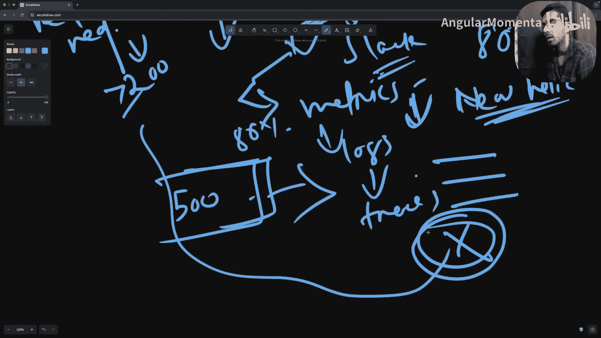

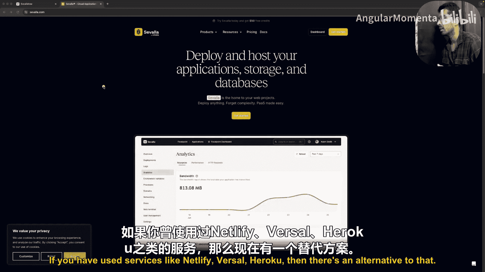

Svala uses Kubernetes under the hood using GCP with their premium network tier to completely abstract away all the complexity that you have to build with if you have to do all these deployments manually using AWS or any kind of cloud providers you never have to touch any kind of Yal files or manage any kind of containers the platform supports three kind of build options we have N packs which by default supports more than 20 languages with better resource efficiency than traditional build backs it also supports build packs or compatibility with Hiroku if your infrastructure is already in Hiroku then it also supports build packs so that your migration is as smooth as possible and if you want to go the custom way it also supports deploying your applications to Docker file and giving yourself the complete control about how you want to configure and how you want to deploy your applications it also provides this very useful feature if you are working。

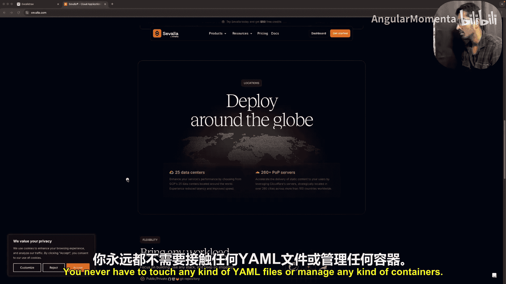

In a team which is preview deployments， if you have used Versal before they also offer the similar kind of feature and preview deployments basically means if someone。

 one of the team members raise a PR then you will instantly get a domain and you can click on the domain and you can actually use your application with all the changes from the new PR and then you can decide whether the to more the PR or to request or more changes and this comes in very handy if you are working in a team and also if you are a 1% team you can quickly become more productive with this kind of workflow all your applications run on Google's infrastructure with Cloudflares edge network your static assets get cached across 260 plus points of presence using the Cloudflares edge network the internal communication between services are free and the bandwidth costs is 33% less。

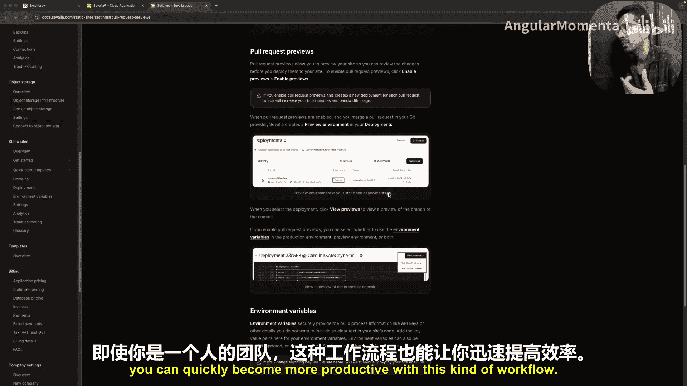

al at just 0。10 per G。 So if that sounds interesting to you。

 if that sounds more cost effectiveff to you， then you can get started with Sea by signing up with the below link you'll find in the description and you'll get $50 worth of credit free to try it out and decide for yourself if it makes sense or not。

 you'll stop spending hours fighting deployment and you'll actually start shipping features Now coming back to our discussion logging let's talk a little bit about logging what are the things that you have to keep in mind again。

 this very informal talk we are not going to go with the definitions and all the different tools and components that you have to know about I'll keep it practical whatever you have to know to get started and to get too far enough so that you can figure things out for yourself Now the first thing when we are talking about logging is。

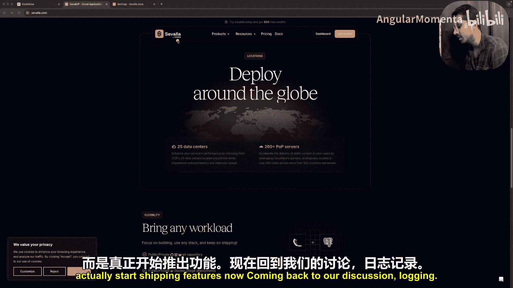

LevelsLogging levels this is something that you will see a lot in production systems when we are logging a particular event。

 usually if your library supports that which it should then we assign a particular level to that log and these levels are usually let's say something like debug or info or one let's say error or fatal these are the most common ones at debug we use the log level debug when we are in development and we are trying to basically debug something we are trying to troubleshoot something and we need as much details about the behavior of the systems as possible。

 these debug logs can be a bit overwhelming so that's why we only care about debug logs in development we usually disable it in production then comes the info logs these are general application operations。

 the business events， let's say we have a todo application then if a to do gets created。

We use loggged out info。To log that event， general information or successful operations。

 any kind of successful operation we can use the info level。 same way warning。

 These are events which are in between info and error。 This is not a successful operation。

 and this is also not critical enough that we want to a it as an error。 For example， if for a user。

 the authentication fail。 then we just log that event as a warning that this user has typed the wrong password。

 but this is not an error。 This is not our fault， right。

So in those cases we can use the one level same way for errors。

 any kind of errors you can imagine the validation errors or if your database query fails all kinds of errors we log it as errors this is the most common one one of the reasons we use logging in the first place then comes the fatal fatal is pretty serious once you log something with the level fatal your application most widely stops。

And it restarts depending on your infrastructure configurations。

 but fatal basically means that this is a very serious bug， a very serious issue。

 and your application is shutting down。 And that's all about levels。

 and we'll go through the code to get more intuition about log levels and everything。

 but let's just get through the theory part first and we'll see what it looks like。

 Then comes structured versus unstructured logs。 We usually log into different kinds of ways。

The first kind is console logs when you are in your development environment。

 when you are running your back and in your local then we want to log whatever logs that we are recording throughout our application running we want to log those in our console wherever you are running in your VS code console in your terminal。

 whatever console we want to log them and we want to log them in a readable way in a more attractive way because it's easier to understand it's easier to spot issues and it's easier to fix them。

So during development we want to keep the logs readable。

 we want to keep the logs attractive with colors and all and we want to make it human readable in the sense it should be plain text the same way structural logging structural logging basically means JON is the most popular format for structure logging instead of printing human readable text what we do we print the error in JON format and it will have all the parameters that what is the status of the error what is the message of the error and all these things but if we do this in development environment it is hard to read。

And it's easy to miss issues， miss errors in our system。

That's why we use JO logging or structure logging in our production systems。

 because in our production system， all these logs are either depending on your configuration or either getting par。

Through some kind of log management application， let's say we have EL case tag。

 or if you are using the open source tools like Loki prompt tail Graffaa。

 the old grafaana tag all these logs are getting passed if they are in text format。

 then all these tools， they'll have a hard time parsing it and they'll face a lot of errors。

 It is not efficient enough to parse a line of text and extract valuable parameters like the user I。

 the request I and things like that。That's why in production system we log in JSON format so that it's easy to parse and it's easy to extract all the valuable information that's all about structured and unstructured logging in development we use unstructured logging to make it user friendlyly to make it easier to spot errors in development environment in production we log in JSON format so that's easier for our tools the log management tools to parse our logs and give us the valuable insights Since we are mostly talking about practices I think it is better to to show how they actually work instead of just talking in theory even though that's the whole point of this series well make an exception for this video so that we have an easier understanding our this all complicated logging。

 monitoring and observability This is the code of todo application and the backend is written in go and this application tries to follow all the practices the logging。

 monitoring and observability and。

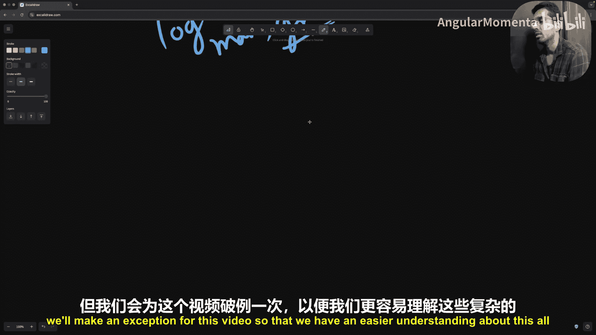

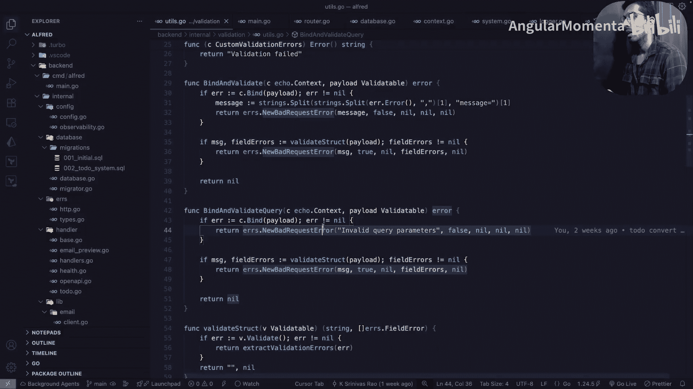

We are using a tool called new relic If we look up new relic。

 this is a complete solution for logging， monitoring and observed the needs of different systems。

 we also have tools called Grrafaana which is actually the front end part the dashboard part and the vacend is usually dealt with Prometheus which actually builds all these metrics and all these are the tools thats used in most of the enterprises the Grrafaana stack that we like to call with Prometheus Graffaana pro tail and Jaer for traces。

 but if you want a simple integration a simple workflow then something like new relic makes more sense if you don't have the team size。

 If you don't have the resources to maintain all these different open source tools then you can definitely go for something like new relic and that's exactly what I have done for this application。

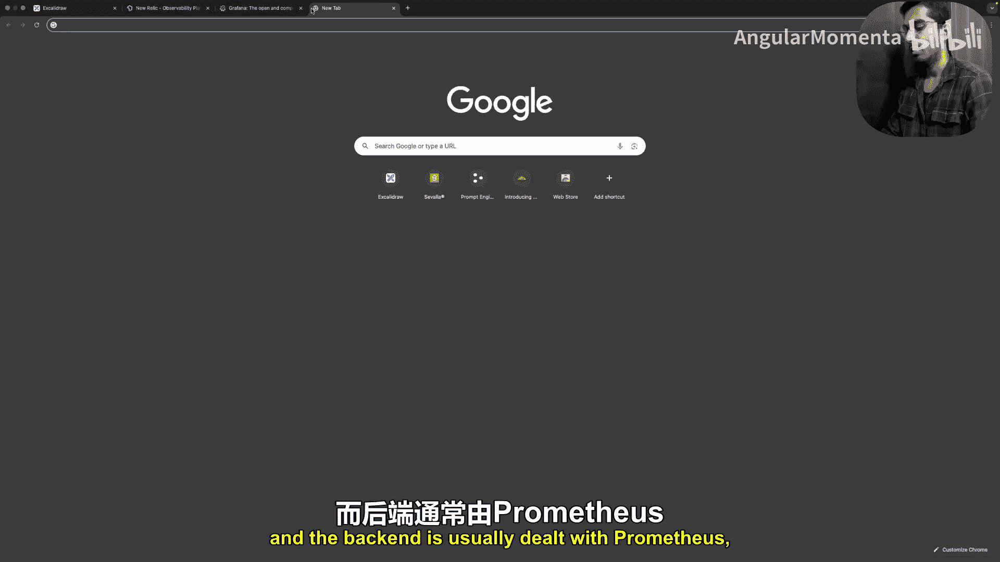

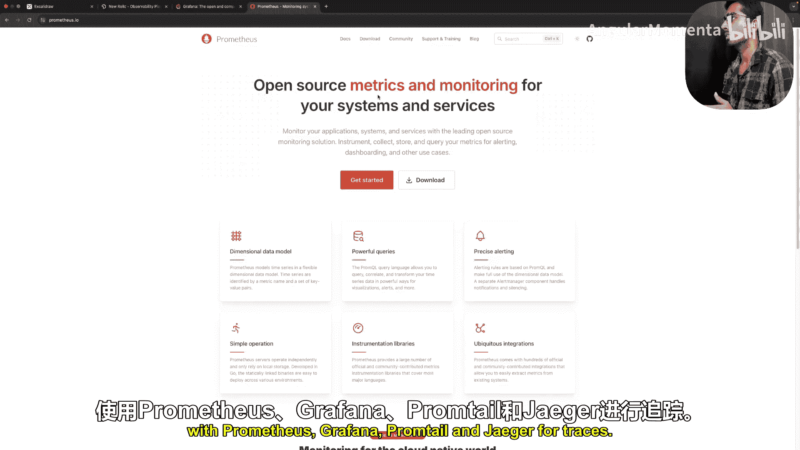

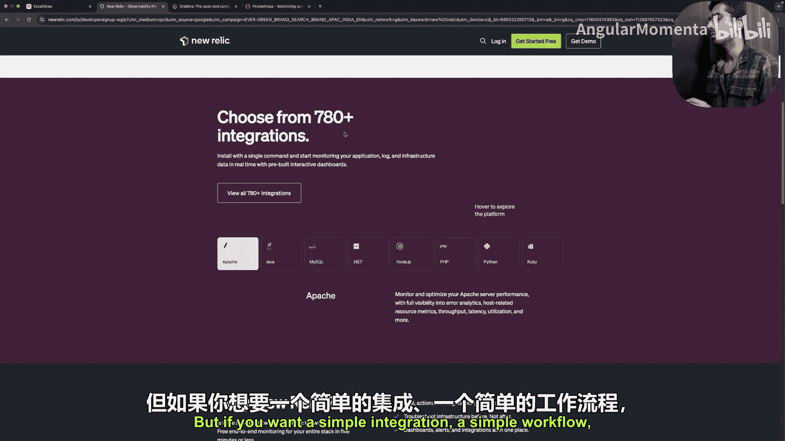

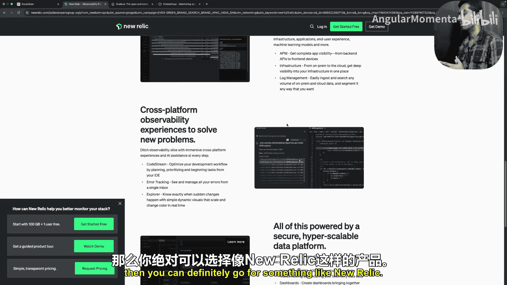

Configuring all this logging monitoring and observability is pretty complicated if you don't have the experience if you don't have that time for it。

 then going with a proprietary solution makes more sense。

 So with that context let me show how we have implemented logging monitoring and obity in this system how they actually work and with this will understand how if in different parts of logging monitoring and observative work the first part if we see So another thing is please don't try to understand the code don't try to memorize the code and don't get over and the whole point of this video is just to show how the operations work。

 how the practices work in the logging monitoring and observative topic not the code but we are just using the code this is the file which creates a new logger before our application starts and it has a couple of configurations the first thing that I went to show because。

We just talked about this different levels of logging We have a function called get log level which basically checks if we are in development mode which means that we are running in our local or if we are in production mode which means that we have deployed our application it's running in our infrastructure depending on that it either returns an info level or a debug level because in local we want more logs for debugging purpose and in production we want just the information related logs and using this function we can filter out we can configure that the second thing is the structured versus unstructured logging thing by default we have set the logging format as console because it is a development management but let's say we change to JSO and here instead of local we make it to now if we start the server as you can see that we are getting all the logs。

Jsson format。And it's great for production environments。

 but it's not very readable if we go ahead and change back to the development setup from dot D N V。

 this is what the development blogs look like as this is definitely more readable in our local environment we can clearly see that the first log is about connecting to database。

 The second one started the background of server and the third one is starting the server。

As compared to the earlier Json format， which is not very easy to understand。

 but it's definitely easy to passse for other tools。

 Now the second thing that we talked about was monitoring and for that to work what we have done if we go to the router we have set up this middleware called new relic middleware if we go inside that is basically initializing a new middleware with wrapping our whole app what happens exactly with this middleware if we look at the source code every time a new request comes it does something it instruments the whole request Now if you are talking about observability two terms youll hear very frequently one is instrumentation the second one is open tele instrumentation is basically the practice of actually measuring different different attributes of your function which is closely related to when you。

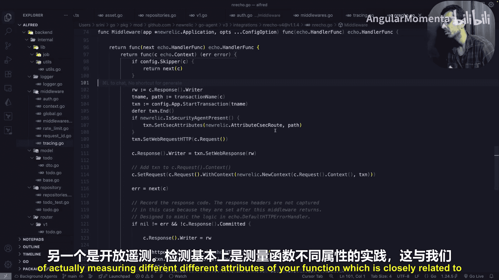

System observable second thing is open teletry。 Open teletry is a standard。 It is a recent addition。

 and it provides a whole ecosystem of tools and SDks and best practices and resources so that you can properly instrument your application does not matter what language that you are using whether it is not just our golan Python does not matter the community has built enough As SDdks and tools for all the languages。

 all the major languages， and it is an open standard。

 even though we are using a proprietary tool like new relic。

 we can definitely integrate an open telemetertry collector so that we can have more control about how we are instrumenting our request how we are instrumenting our components that is a sign note if we take a look at one function which called create to do it is a service which creates。

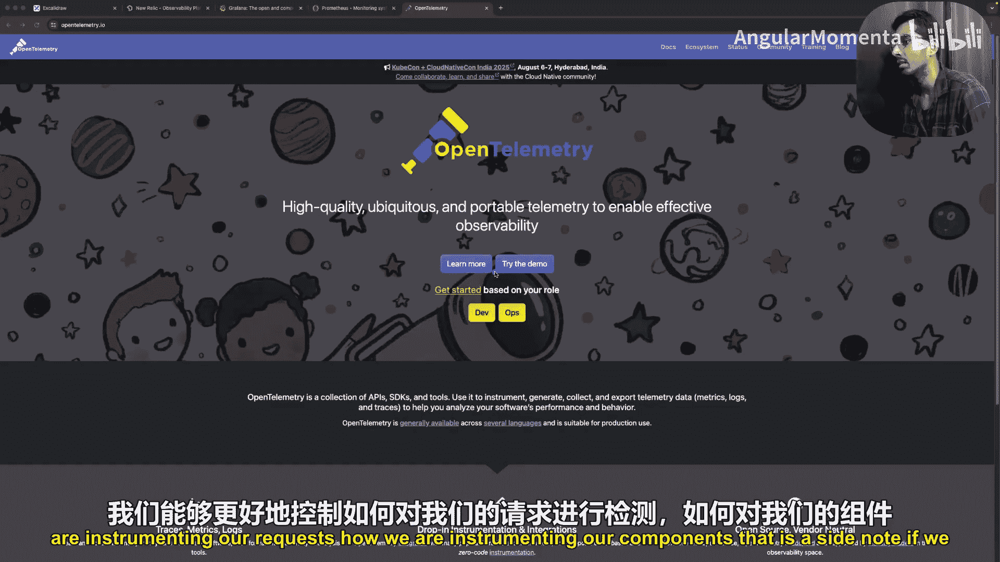

new to do and if we try to track down what exactly are we doing with the whole logging monitoring and observability workflow in the first statement after the function starts executing we are taking out the transaction which we have put inside a context we have a middleware which is called enhanced tracing and when this middleware is post trigger during the livecycle of a request is a first point of contact here we create a new transaction using we create a new transaction using the new relic method and we add some of the parameters like the service name which we take from our configuration then the environment whether it is local production the IP address and the user agent the request ID we fetch the request ID and the user ID the user email Tt ID etc all。

Information that we need during our logs or traces we add inside this transaction and then what we do we add this particular transaction into our context so that when the request reaches the service method which is this method we already have a transaction which we have saved inside our context when we can use that transaction to proceed further what happens with this workflows a single request will have a trace which will start from that middle layer where we are creating the transaction。

 then it will reach the validation layer then it will reach the service layer and all of this will be a single instance of a trace and that's how we be able to debu our issues in the first statement we try to take out the transaction from our context and this statement basically means that when the function returns。

 we want to end this transaction or this particular segment which is there to do create service。

Then since we is the service layer， we want to add two more attributes to this particular transaction。

 the user ID and the title of the to do that the user has requested for then comes our logging as we have discussed before we want to log every single important event in our application that's why at this point we are logging that we are performing an operation which is called create to do this is the title of that to do and we want to log this particular event same way if a priority is passed in the payload the request payload that the user has sent。

 we are adding this attribute also to that transaction it is available in the trace and we are also logging that then we are logging a message with of info level that we are initiating the process of creating a new to do and here we are doing some kind of validation with the children and parent relation same way here at this point we execute。

The database operation which creates the to do and if we face any kind of error at this point we are logging that error again with the level of error we are adding this error to our trace using this particular transaction and we are also adding the attribute that this operation create。

So that we can know that for this operation the result is an error。

 but if it is successful then we are adding that the operation is created and we have created a to do with this particular I we are also adding a log with the level debug we are printing logs with the debug level that to do was created successfully with this particular I this will not be visible in our production systems or our production log。

And finally we are logging another important event which is a business event log for the operation to do is created and all the associated metadata with it the idea of that to do with title the category ID and the priority and this how a workflow looks like with all the logging and observability and we'll see the monitoring part just a bit in our new relic dashboard going back that may change it back to JSON so that these logs are visible in our neural relic dashboard and I have made the logs as JON and change the value to production for the server this is the dashboard of new relic if we click on our application these are some of the data error rates transaction time etc etc since there is no activity in the last 30 minutes。

There is no data to display here， but let's regard some requests here。

 say for get all to do this is the open API interface where we can test our as and if we if we fire this API a couple of times since we have not provided any token we are getting an error of unauthorized but we want to check if this error gets logged in our dashboard trigger this a couple of times then going back go to errors in our dashboard let's do a refresh here and going to the StTP error type now here we can see that we have got a couple of unauthorized errors。

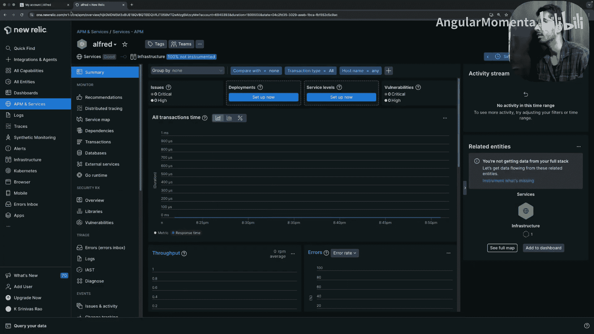

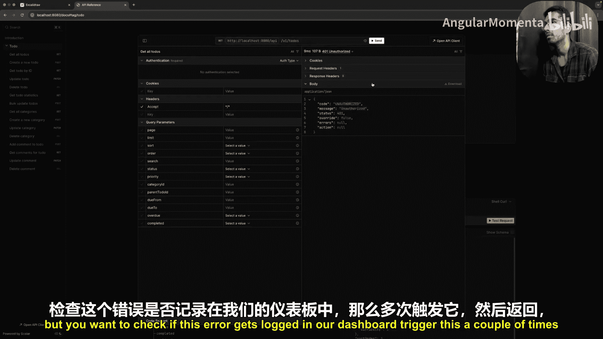

And these are the related logs， as we have discussed before in our whole logging。

 monitoring and observity setup up， all these things。

Work together so that we have a complete understanding of our system so that we can debug better。

So coming from our metrics， these things are called metrics if we go here。

 if we go to the summary part these are called the metrics， what is the average transaction time。

 the throughput， the errors these are the metrics actual numbers that we can see so that we can quantify the state of our system and from the metrics。

 let's say from error it's around 80% average from the errors。

 we can find the logs and if we click on this log， the unauthorized part we can see all the information that was associated with this log。

 This is the name of our application is the environment it is running on this is the error code which is unauthorized the host name the IP the level of the error。

 the message what is the method the get method， what is thePA route that we are trying to fetch which is the slash to do part and。

Pan ID， the timest and everything related to。This log， this part is called a log。

 and this is also connected to eight trace。 As I said， we have three pillars。 One is logging。

 second is metrics， and the third one is traces。 Now， if we click on this。

 this is the whole trace that we can look more into and get more information from here。 Similarlyly。

 if we want to take a look at our transaction in transactions。

 we have in code at this part we are talking about transaction and we are adding more attributes transaction and the whole path of the transaction that was getting tracked here。

 and we can track and we can see the results of all those transaction from this dashboard。

 So if we click on this slash to do， we can get all these different data for this particular transaction different error rate the different response time and all this different data。

 Similarlyly， if we click on the go run time， we can get more information about。

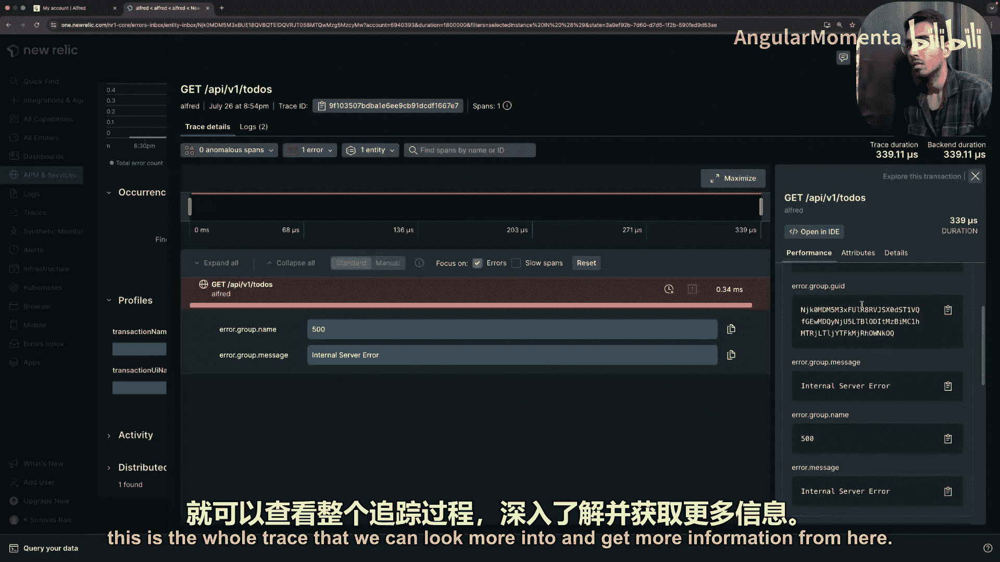

The system where our application backend application is actually running is the garbage collection time。

 the memory uses， which is just 3 m， the throughput and the average response time and all these different things。

So this is what I wanted to show in this video， the whole discussion about logging monitoring and observability。

 this is just a practice and we implement these practices in a spectrum we cannot say that a system is completely observable it is logging and monitoring the 100 percent of the parameters but we implement this in a spectrum and we have different different tools to record and measure them if we are going with the open source route we have Grfaa we have Loki we have Prometheus Jaer for the traces and if we are going with the proprietary softwareer so that our whole setup is a little more simplified and we have services like neural relic datadog etc etc and using these services whether it is open source or it is proprietary we can get all these different information about the state of our service the state of our application the state of our infrastructure。

Different interaction of different different components and everything we can imagine。

 of course we have to actually implement that as we saw in our core to have that result in the first place but assuming that we have done everything from our part in the core side will have a complete understanding a complete dashboard in whatever software that you are using it does not matter。

 but this whole workflow of logging monitoring and observity is a collective effort you as a developer have to do it on code level and the infrastructure people the devvos people they also have to have the correct setup so that they can collect they can monitor all these metrics they can collect all these logs entries so that's all there is to talk about logging monitoring and observity is not particularly skill that you have to learn but you have to keep in mind that is a very important part of any production system。

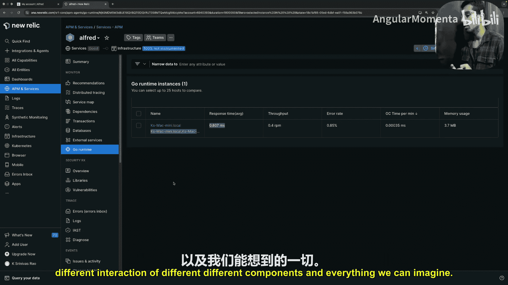

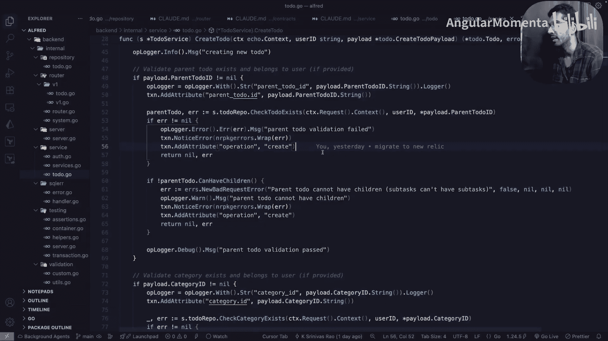