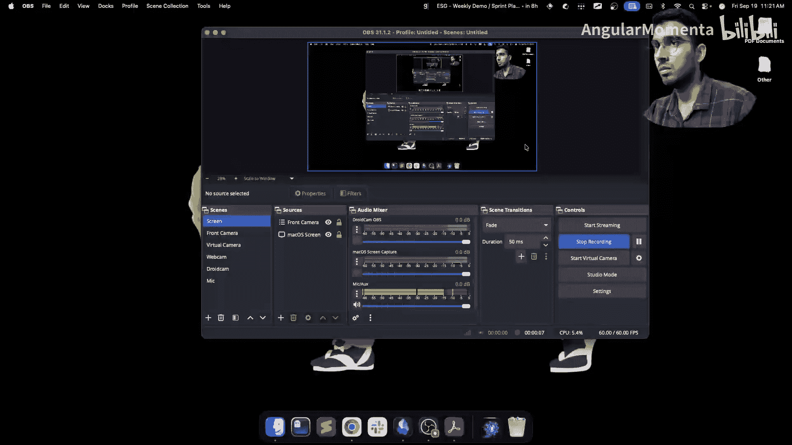
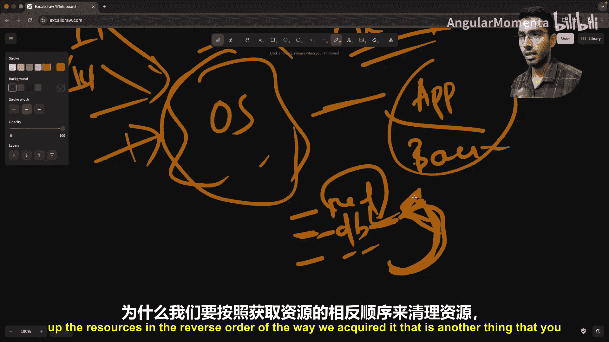
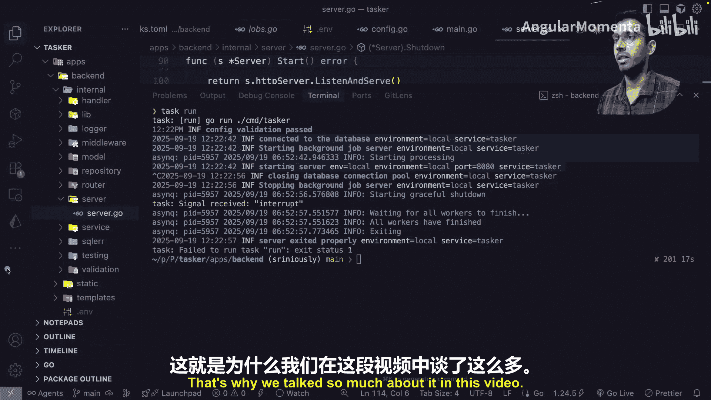

# 【Sriniously】从第一性原理出发的后端开发 ｜ Backend from first principles p19 19. 优雅关机 -BV17aq1BUEhf_p19-

Let's picture a very realistic scenario。 You are in the middle of processinging a critical payment transaction。

 and suddenly your server needs to restart for a deployment。

 Someone push something to the production environment and your server needs to deploy itself。 and。

 of course， we have。

Techniques like zero downtime deployment， etc cea， which make sure that our existing server does not go down before our new server the server with our new code comes up and is ready to receive traffic。

Those mechanisms are there， but at some point when our new server is ready to go online。

 is ready to receive traffic， our old server has to shut down it has to stop receiving traffic and the transition will happen to the new server during that moment we are talking about that part that critical moment and you are in the middle of a transaction let's say you are in the middle of a ecommerce-commerce transition or buying something from Amazon or flip card an Amazon server or flip card server needs to restart for some kind of deployment Now the question is what exactly happens to that payment。

And does it get lost in the digital world or does the customer you do you get charged twice because of some kind of race condition。

 all these scenarios you have to think about as a backend engineer。And this is not a new problem。

 This problem has been around since the start of servers and backends and of course we already have a solution and that solution is called graceful shutdown and it is exactly as the name sounds we want to stop our server gracefully we don't want to stop abruptly certainly that is the whole idea and of course there are some surrounding concepts。

 some surrounding concepts to understand so that you have your foundation clear why we are doing this etc。

 So if we want to oversimplify what graceful shutdown means for our server we can basically say that we want to teach our server we want to teach our backend good manners in the sense cannot stop abruptly when it is between a transition into a new deployment it has to perform some kind of steps some kind of good manner in the sense it cannot just slam the door when it is time to leave when it is time to shut down。

Instead your back in your application， it politely finishes whatever it is doing。

 It finishes its ongoing conversations， says goodbye to all the guests and cleans up after itself then finally closes the door That's what we mean by good manners when you have guests over when you're talking to them when it's 9 o'clock when it's time to go to sleep。

 you don't just push your guests out of the door and slam the door on their face。

 there are some steps you have to perform So it's similar in that way and in this video will talk about the art and the signs of making your backend applications as good manner as efficient as possible and worrying about grace will shutdown will give your application a very good user experience and also avoid issues like data corruption like we just talked about if you are in between a transaction some kind of payment transaction then。

avoid issues like doublechar the customer and the transaction getting lost and processing refunds。

 etc。 Let's start with the first concept， which is process lifecycle management。 Now。

 we are talking about this because your backend is an application which will run as a process in some kind of server in some kind of computer So every application runs in a server。

 within a process。 This is an important thing。 it runs within a process if you are familiar with operating system concepts。

 then it will make sense to you。 otherwise not a big deal。 you can just learn the term。

 which is called process， whatever you run， everything that runs an operating system runs as a process。

 and like all the living things。Every process has a life cycle when it starts， how it starts。

 when it ends and how it ends， so in a way they are born when the process starts and they live while the process is executing and they die when the process is terminated。

This whole thing is called the life cycle of a process Now。

 for implementing or understanding graceful shutdown。

 we have to understand this process lifecycle because that is very closely connected to how graceful shutdown is implemented So this is our OS the operating system where our process is running our application is running when your operating system decides that it's time for your application to stop running。

 It does not just pull the plug。 It does not just kill the process。

 It follows a established protocol and established protocol of communication how to communicate with the process to say that it's time for you to stop and we are going to follow these these steps and then we are going to stop So you can imagine it like a conversation between your operating system and your application which is running inside a process in your operating system to simplify it your operating system sends a message in the conversation like hey。

 it's time for you to stop and your。returns a message that。 Okay。

 give me a few minutes or give me a few seconds， realistically speaking。

 then I'll stop my or you can stop me。 And of course。

 this conversation does not happen through texts。 We are talking about programs here。

So they don't understand text and this whole communication between your application and your operating system。

 This whole communication， This happens through a concept called signals Now signals are an important concept in Uni operating system When I say Uni operating system。

 we mean all the Linux operating system， whatever you're familiar with the arch Linux open to etc and also max Mac has also oriented from a Uni core。

 a Uni kernel and mostly when we are talking about servers。

 we mean Linux only because 99% of the time you'll see whenever we deploy our application in some kind of server。

 some kind of cloud provider， it usually selects a Linux operating system and deploys your application that you'll never see Windows except for some specialized use cases like Windows server。

 etc， mostly we use Linux。Based operating systems for deploying our servers Now Uniix operating systems。

 they have this concept called signals which is used for IPC Again if you are a computer and students you'll know this term is called inter process communication simply speaking this is a technique using which two processes can communicate with each other with some established protocol。

 which you don't have to worry about Now the way it works is you have your application here。

It is running inside a process。 This is a process。 your application is running inside a process and it registers some handlers and what do you mean by handlers handlers are basically you can imagine some kind of code which waits and which is continuously running behind the scenes and it is waiting for a waiting for some kind of communication。

 some kind of signal from your application for these signals these operating system concepts of communicating between two processes these are called signals and your application registers creates some kind of handlers that detects whenever these signals come and then it does something and will talk about what it does exactly and these handlers they basically say that they are basically telling to your operating system that when you want me to stop。

Send me this specific message。 Of course， you cannot say that just stop。 That does not work。

 It is text。 which is just human readable。 So it has to be some kind of message。

 We'll talk about what kind of message it is。 But your handlers your application using or through its handler saying that whenever you want me to stop You have to send me this specific message。

 and I'll handle it appropriately。 I'll handle， I'll stop myself。

 using predefined protocols using predefined steps。 Let's talk about this signals。 What you mean。

 There are two major types of signals。 will talk about what one is S term and the second one is S。

This part， this s， this basically means signal this also means signal and these are the commands。

 you can say one is for termination。 one is for click will soon talk about what is a difference between Now let's talk about the first one which is Now as I said S the first part means obviously signal and the second part means terminate terminate Now S term signal which means terminate it is a polite way for your operating system to ask your application to shut down it is not an extreme way it is just some kind of nudge So imagine you standing and someone just comes from behind and just pose at your shoulder like hey。

 you can imagine the term signal， something like that。

 It is a very gentle nudge and it means that whenever your operating system sends a term signal to your application It means that hey。

 excuse me could you please finish and leave it is a very gentle request。

And because of that your application， your backend has an opportunity to complete whatever it is already doing right it does not have to leave that moment it has some kind of window we'll talk about what kind of window it has some kind of window a few seconds to complete whatever it is doing now what it might be doing so since we are talking about backend an StV backend it might be processing some request that is the primary thing your backend does your client。

 your frontend， whatever your client have some kind of app， some kind of web app some kind of。

Proroome extension， whatever your client is， it sends Stb requests to your backend and your backend processes those and returns some kind of response。

At a random point of time， your backend is probably processing， let's say a 10 or 12 requests。

 and if your application is big enough， let's say it is processing around 5060 request concurrently at one point of time So when it gets a signal it's time for it to finish processing those requests let's write it down whatever it does first finish existing requests iss the first thing second cleanup resources we'll talk about what does cleanup actually mean for your backend and the third is exit we'll talk about well go deep into one and two just a bit after we talk about both S and signal but for now let's just keep it very high level Now we already understood that S is a very gentle request from your operating system to your application to your backend to finish up whatever it is doing and cleanup resources and leave gracefully so。

Exactly uses this kind of signal。 Now this signal is mostly used by deployment systems or process managers or orchestration platforms like Kubernetes。

 etc。 Basically any kind of system that you have established for managing your process it can be a kubernetes or something like system D or or PM2 if you are familiar with PM2 process manager So these things。

 these systems， these tools they use this signal， which is signal to properly let your application finish whatever it is doing and clean up and leave gracefully second I forgot about another important signal which is signal we have a kind of signal which is as I said。

 the first part， this is called signal and this is for this case is an interrupt and interrupt Now when does this happen if you are a developer。

 you probably already using this which is the。Most famous use case of this signal is control plus C。

 If you have worked with any kind of command line applications。

 any kind of tunnel based applications， then you have most probably use some kind of process is running some kind of task is running and if you want to abruptly close it at that moment you can press control C in your keyboard and that process is instantly stopped for example。

 here I am running a backend a backend process in my local of course it is a gobased backend and it is currently running it is ready to accept request and it is serving any kind of client that is sending request to it Now if I want to close it what do I do I just press control and C in my keyboard and here you can see that we have of course implemented graceful shutdown for this application that's why we are logging whatever is happening in our app but for now let's focus on this part where it says that a signal has been received and the signal tie this。

Interrupt signal as we saw， this requires a user a developer to press some key in this case。

 Cr C using a keyboard is mostly used during development environments be as developers mostly use it process to process communication when process to process communication happening they normally don't use it since a S interrupt based signal requires some kind of key control C。

 So it is also called a user initiated shutdown and in pretty much all the cases you want to handle the signal Sig int。

 the same way you are handling Sig term If you think about it it makes sense it does not matter whether your process whether your backend is running in a development environment in your local and you want to stop it using control C versus if it is running in your cloud provider in let's say it is running inside an AWs EC to instance。

And you are using a process manager called PM2 is a process manager and you have deployed your backend in a easy to instance So when there is time to stop your application。

 we will be using PM2 in some kind of programmatic way or manually and PM2 will send a signal to your backend which will be term signal as I said int signal will be used by developers because it requires a key press S term signal will be used by programs in both these cases we will want to handle our shutdown process the same way it does not really matter if a human is initiating it or a program is initiating it what matters is the in we want to shut down So we want to shut down in a clean way graceful way Now let's toward the final thing which is let's write it in red since it is a kill signal which is S kill as I said the first part means signal and the second part is the actual。

a kill command and it is exactly as it sounds like we want to instantly kill the application。

 The interesting thing about this signal is this cannot be caught or it cannot also be ignored which means that in the application we cannot register some kind of handler and those handlers will be able to do some kind of task they will be able to do some kind of cleanup etc。

 etc ce。 when they receive kill signal that will not happen because this particular kind of signal it cannot be detected by our application。

 our application is not given that kind of permission that kind of capability or also it cannot be ignored。

 which means that you cannot say since I was not able to detect it which basically means that Ill just ignore it we don't have to really stop that also does not happen So if your application is sent a sick kill signal it will not be able to detect it and it has。

Stop at that particular moment。Nothing else happens It just stops that's where it is called like kills you can imagine it as a nuclear option this is the equivalent of instead of doing this clicking on your system icon and clicking on shut down you what you do you just go to your power plug and you just pull the plug。

That's it your computer just as That is exactly how signal works and this is why graceful shutdown is an important concept。

 If you don't respond， if you don't respect the polite signals and what do it mean by polite signals and these are the polite signals which let you to finish whatever you are doing which let you to clean up and which let you to gracefully exit if you don't respect those signals。

 then eventually of course you will receive a kill signal so you will have to stop and you don't even get the opportunity to clean up after yourself now that we have a very high level idea about three different kinds of signals the polite signals the polite signals and what exactly happens let's talk about two important things here that we briefly talked about the first one is what does it mean by finishing existing requests and what does it mean by cleaning up resources these are the。

Two important steps， which happens during a graceful shutdown process。

 The first important part of a graceful shutdown， which is stopping on the fly request。

 What do you mean by on the fly requests， your Stp server。

 your backend it is able to cater to or it is able to process multiple requests at the same time or concurrently basically So when it is time to stop your backend when it is time to stop your server at that point。

 it is possible that your backend is already processing a couple of requests now it can be 1012 or it can be hundreds or it can be thousands depending on the scale of your server and that's what you mean by on the fly requests。

 the requests which are already getting processed by your server at a particular time。

 Now to understand this， you can imagine a restaurant。

 let's say you have gone to restaurant with your friends。 And for some reason。

 the restaurant has to close， whether it is time for it to close。 it is。Closing time。

 let's say something like 103011 in the night or some other reason。

 but the point is the restaurant has to close what exactly happens the the restaurant owners they cannot just come up and turn all the lights off and they cannot just throw you out of the restaurant it not a good idea Instead what happens the restaurant owners they will ask someone at the reception or at the gate to stop allowing new customers right stop allowing new people to get into the restaurant first。

Does's the first step that happens you don't want new customers that you have to deal with that you have to say no to first thing that you have to take care of second thing is they will announce to all the existing customers。

 all the existing people in the restaurant were already having their meal theyll announce to them that it is time for us to close up you have。

 let's say 15 minutes， 20 minutes so that you can finish your meal。

 take your time 1520 minutes should be more than enough to finish whatever you're having and then please leave the restaurant pay your bills。

 of course pay your bills and pay your tips and leave the restaurant。

That's exactly how it plays out in this situation。 Now imagine the same situation for our backend for our application and we call that process as connection draining。

 which means that when your application receives a shutdown signal Now it can be s term send from some kind of process or it can be a S int sent from a control C based process from some kind of developer the first thing that it has to do is stop accepting new connections as I said the first thing that you have to do is stop letting new customers get into the restaurant same way the first thing your application has to do is stop accepting new connections which makes the whole situation more mess more difficult to deal with That' the first thing stop accepting new connections new requests from any kind of client so that we can deal with the existing connections the existing requests that are already being。

Process by server， and will let them finish as soon as possible。 Now。

 the implementation of connection drain， this will obviously be different depending on the architecture of the application that we are dealing with。

 So， for example， for StTB servers。For our backend， the core backend， the SttP backend。

 this will mean that it has to stop accepting new SttP requests from any kind of client and allow in flight requests on the flight request the existing request to finish to complete the same way if we are talking about a database application now as we have already discussed in the previous videos database is also a backend。

 it can be imagined as a backend it is backend just not in the sense that we talk about when we are talking about an SttP back but it is still a backend it is still an application now for a database based application what it has to do it has to finish all the existing queries or all the existing transactions and it has to stop taking new transaction or taking new queries into execution before it closes the connection same way for a web socket based connections it has to first notify the client。

That it is closing， then close the socket， it cannot just close the socket abruptly so depending on the application architecture StP back and database web socket the the technical steps of implementing grace will shut down will be different。

 but the high level idea is the same。Stop accepting new connections， stop accepting new requests。

 finish the existing ones and then close the connection three step process Now the problem here is the challenge with connection draining is the timing of it because you want to give the existing connections enough time to complete their work but you cannot really wait as long as the need there should be some kind of limit so most production systems most backing systems。

They will implement some kind of time out mechanism， will have some kind of timeout， for example。

 30 seconds or let's say 60 seconds it depends on you mostly the common thing is 30 seconds and this will be the maximum duration your system will wait for you after that will just stop。

It will give you 30 seconds to finish whatever request that you are processing and most of the time it is fine if you are not accepting new requests。

 if you are not accepting new connections， then 30 seconds should be more than enough to finish up all the existing requests but if for some reason for some kind of blocking our petitionition you cannot finish within this window then well be forcefully stopped we do have a backup plan we cannot just wait for our system for our backend to process all the requests and by taking as long as it needs we cannot let that happen there has to be some kind of limit and the timeout is that hard limit。

You have exactly this amount of time to finish whatever you are doing。 Now。

 choosing this timeout also creates a very interesting design concentration because the question is。

 how long exactly should you wait if it is too short。

 then you risk interrupting actual legitimate operations。But if it is too long。

 your whole shutdown process， it becomes very sluggish。

And it it eventually impacts your deployment speed。

 your system responsiveness So the time the amount of timeout， it depends on your applications。

 typical request duration and your operational requirements。

 So this is not a hardened pass through 30 seconds，60 seconds you have to understand your systems。

 the kind of request that your processing if it is normal if we are talking about traditional normal backend。

 then 30 seconds should be more than enough but we are talking about web sockets or if we are talking about other more complicated architectures。

 then you have to understand your system and decide a timeout which suits you and your system accordingly this whole connection training also requires some kind of coordination between your load balancers and your service discovery systems。

 which means that it also has to work with your health check systems and registering and deregistering with your service discovery Now these are a little。

Advanced stuff service discovery basically means that if you have deployed a set of applications let's say you backend your database。

 your elastic search instance after deployment， how they connect with each other。

 how they communicate with each other this part of the workflow is the responsibility of your service discovery to service discovery mechanism anyway moving on the second thing that we talked about is cleanup or resource cleanup if you are working on your desk you have a working area and it is time for you to leave the house or it is time for you to go to sleep before you leave your desk。

 you do some kind of cleanup right if you have been having your coffee。

 you take out the cup and put it in the or if you manage some of your cable we all have some kind of tiny cleanup stuff before we leave our desks same in the context of our backend application when you say resources it means that things like file handles or network。

Connesor database connections or temporary files or caches or any other system resources that the application had acquired during its execution。

 it has to let go of those for example when your application was running when your backend was running you try to access a particular location in your file system and the way file system access works with backend with programs is you have to send a signal to your operating system it provides you handle to that there is a protocol the way a process a backend application can access the underlying file system but speaking at a very high level you get a kind of handle to your file system which you have to let go which you have to clean up at some point otherwise that handle will keep running and you will acquire more and more and more memory which basically means that you will keep reading your RA random access memory and at some point you will run out of it。

So cleaning up after your file handles is important。

 but the most common kind of resource cleanup that we will see is a cleaning up after a network connections。

 our operating system or OS， which is the mediator。

 let's say if you have your application here or your backend here and this is the internet。

You receive all kind of requests， but all the requests。

 they go through your operating system before it reaches your application， your operating system。

 which is the actual driver， which receives all the requests from your network car and provides you right so obviously it will have all the knowledge about all the network connections that you have and typically operating systems they limit the number of file handles as theyve already said and also network connections a particular process can have open simultaneously the same way if you don't clean up your file handles you will run out of memory the same way network connections also if you don't give up a network connections after dealing with it then eventually you will run out of memory or you will face some kind of performance issues if we are talking about database connections before your application shuts down or before your backend process is shut down the database transactions that your backend was dealing with they either have to be coming。

Or roll back explicitly by your application if you don't then those transactions might get into an inconsistent state which might lead to things like deadlocks or data correction and all different kinds of issues right these are things that you mean when we say resource clean file handles database connection network connections etc and one thing to keep in mind is when we are cleaning up after our resources in our whole graceful shutdown workflow we want to cleaning up resources in the reverse order of the way we acquire them So let's say here you established a readyis then you establish your D connection and whatever so when you are giving up your resources you should go the reverse order and why do we need to do this so that we can prevent situations where we are not cleaning up a resource we are not cleaning up an operation which depends on the previous operation。

Reason we clean up the resources in the reverse order of the way we acquired that is another thing that you have to keep in mind when you are implementing your graceful shutdown I know that we typically avoid looking at code in this particular series but just to give you some kind of context you don't have to understand this code I just want to show a pretty practical and realistic example so that we don't have just a very hollow understanding of the graceful shutdown procedure we quickly just go through the whole thing that we just discussed but this time we just look at the code Now as I said the first thing that you do is we want to register some kind of handler。

 which will wait for some kind of signals So this is what we are doing again this is a golan code you don't have to understand it is follow the narrative and that's more than enough now here at this step we are registering a handler during using some kind of context which is a golan concept but we are waiting for interrupt from our operating system and if we receive an interrupt。

We call this function， which is a shutdown function。

 which is a graceful shutdown function and what do we mean by gracefully shutdown let's go inside this What do we see first what we are doing。

 we are shutting down our HttP server since this is a backend application the core part of is is the httP engine the first thing that we are doing is we are calling a method which is provided by our frameworks typically whatever frame or whatever library that you are using for your httP server they provide you with some kind of function so that when you call it they internally the library internally stops receiving additional connections and cleans up and finishes whatever the existing connection it has then this function finishes then what we are doing we are closing our database same way the database also it stops receiving additional queries。

 additional transactions and it finishes the existing ones and it gives up whatever handle it has whatever database connections it has as you already know the way back and our database connect is through PCP。

TCP connections we can imagine this is our app， this is our backend and this is our database at up database the way these can connect is through TCP is the TCP protocol So for our backend to connect to our database it has to have a TCP connection which is an active connection running that's the only way our backend can connect to our database it can communicate with our database of course when we are talking about pooling database pooling we have a number of this connections active with our database and we use a particular connection from this pool of connections to communicate with our database when we want to close the database connections the database first has to stop accepting new queries using this connections using these path itll finish whatever existing queries existing transaction that is already processing then well start closing all these path one by。

That is exactly what we mean by cleaning up our database resources and in the end we are also cleaning up our background job processing server which is using Redis so internally this function also closes our Redis connection and after all this we have successfully gracefully shut up so if you want to take a look at this let's say it images clear this let's start our server first。

Asask run and let me rest control C， which will send an interrupt signal to our backend。

 then it can initiate the graceful shutdown procedure。

So I pressed control C it took some time since there are no in flight requests。

 This was a pretty locally done packet it was able to shut down instantly but it still we saw that it still took around one second of time before it would properly shut down So if you look at the logs we can see that for starting our server the logs were connected to the database starting our background job server and finally we started our server this was our start log up to this point all of this were start logs then at this point as you can see the control C here。

 when we pressed our control C， the first thing that we did us we closed our database connection close database connection we stopped our background job processing server。

 all these logs are coming from a cube which is the background job processing library that video we are using so when it received the shutdown signal when we call the method which shuts down all the redisions。

 whatever that it in done。Lead it also logged some messages like starting gracefully shutdown。

 waiting for all works to finish all finished and exiting。 and finally。

 we log a message that the server has exited properly when that's how we stop our server So this whole workflow is called the process lifecycle starting and running phase and stopping phase and this part is called a graceful shutdown procedure which is very important especially when we are deploying our applications when we don't want to risk corrupting our in flight requests and corrupting our workflows。

 any kind of workflows and providing a very good delightful user experience to our customers to our users So that's pretty much all you need to understand about gracefully shutdown。

 you don't really have to understand a code because most you'll be using some kind of library some kind of framework can be not just can be go can be in python and most of the frameworks they have these code available which you can just copy and paste。

For implementing the graceful shutdown workflow， but it is important that you understand what exactly happens when you do gracefully shut down and why it is important that' is why we talked so much about it in this video。

