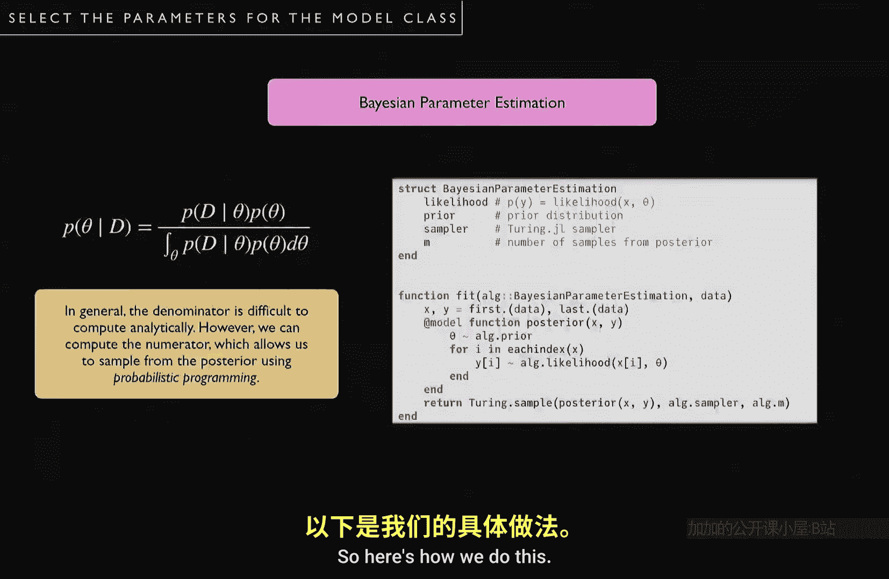

# 003：属性规约 1 🎯

在本节课中，我们将完成上周开始的系统建模讨论，并开始学习验证算法的第二个关键输入：属性规约。我们将通过一个具体的飞机传感器建模示例来巩固对建模过程的理解，并回顾贝叶斯参数学习的概念。

## 从具体示例回顾建模过程

上一节我们介绍了系统建模的基本框架，本节中我们来看看一个具体的建模示例，以帮助理解抽象的数学概念。

假设我们正在为一架飞行中的飞机建模。我们重点关注其测量离地高度的传感器。在真实飞行中，传感器会得到一系列带有噪声的高度观测值。同时，我们假设还有一个极其精确的传感器提供了真实高度的“地面实况”数据。

因此，我们得到了成对的数据点：真实高度 `H` 和观测高度 `H_hat`。我们可以收集 `M` 个这样的数据点。

在这种情况下，我们的**状态**是 `H`，**观测**是 `H_hat`。我们可以绘制一个散点图，X轴是 `H`，Y轴是 `H_hat`。数据点可能大致呈线性分布，并带有一些噪声。

我们试图建模的是**观测模型**，即在给定状态 `S`（此处为 `H`）时，获得特定观测值（`H_hat`）的概率：`P(observation | state)`，即 `P(H_hat | H)`。

建模的第一步是**选择模型类**。鉴于数据看起来是线性的并带有噪声，一个合适的选择是条件高斯模型。我们可以将其建模为：
`H_hat = f_θ(H) + noise`
其中 `f_θ(H)` 是一个由参数 `θ` 参数化的函数。由于关系看起来是线性的，我们可以进一步指定为线性函数：
`H_hat = θ_1 * H + θ_2 + ε`，其中 `ε ~ N(0, σ²)`

这样我们就定义了模型类。第二步是**执行参数优化**。上周我们学习了最大似然估计，通过优化可以得到参数值。在这个例子中，我们可能得到 `θ_1 ≈ 1`，`θ_2 ≈ 0`，`σ² ≈ 0.05`。

这个示例展示了如何根据数据选择模型类并拟合参数。现在，假设我们收集的数据呈现出非线性关系。这时，线性模型类就不再合适，我们需要选择更具表达能力的模型类，这正是我们上周讨论的内容。

## 回顾贝叶斯参数学习

上一节我们通过示例回顾了基于最大似然的参数学习，本节中我们来看看另一种方法：贝叶斯参数学习。

在最大似然估计中，我们最终只得到一组最优参数。然而，由于存在不确定性，我更喜欢贝叶斯参数学习，因为它允许我们维护一个覆盖所有可能参数的**概率分布**。

我们想要建模的是在给定数据 `D` 后参数 `θ` 的分布，即后验概率 `P(θ | D)`。但我们无法直接计算它。

我们知道如何计算的是给定参数 `θ` 时数据 `D` 的似然，即 `P(D | θ)`，这正是最大似然估计中需要计算的部分。

为了建立联系，我们使用了**贝叶斯规则**，它由条件概率的定义推导而来：
`P(θ | D) = [P(D | θ) * P(θ)] / P(D)`

在这个表达式中：
*   `P(D | θ)` 是**似然**，与最大似然估计中的优化目标相同。
*   `P(θ)` 是**先验**，代表我们在看到任何数据之前，对参数 `θ` 可能取值的初始信念。例如，对于一枚硬币正面朝上的概率，我们可能有一个以0.5为中心的强先验。
*   `P(D)` 是**证据**或边缘似然，是一个归一化常数。
*   `P(θ | D)` 是**后验分布**，它结合了先验信念和观测数据，代表了看到数据后更新的参数信念。

在离散情况下，分母 `P(D)` 是一个求和：`Σ_θ‘ P(D | θ’) P(θ‘)`。在连续情况下，它变成一个积分：`∫ P(D | θ) P(θ) dθ`。

问题在于，无论是求和还是积分，要解析地计算这个分母通常都非常困难，因为计算量会随参数维度指数增长。

然而，有一个巧妙之处：虽然计算整个后验分布很难，但对于**任意一个给定的 `θ` 值**，计算贝叶斯公式的**分子** `P(D | θ) * P(θ)` 是相对容易的。这只需要计算似然（我们已经会了）和先验在该点的概率值。

通过一种称为**概率编程**的技术，我们可以利用这个特性，从后验分布中**抽取样本**，从而获得能代表后验分布的样本点。其核心方法是**马尔可夫链蒙特卡洛**，我们将在本课程后续部分深入探讨其工作原理。

---

**本节课总结**：我们一起学习了属性规约课程的引言部分。首先通过一个飞机传感器建模的具体示例，回顾了从选择模型类到进行参数估计的完整建模流程。接着，我们回顾了贝叶斯参数学习的概念，理解了后验分布如何通过贝叶斯规则结合先验和似然，并指出了直接计算后验的困难以及概率编程通过采样来近似解决该问题的思路。