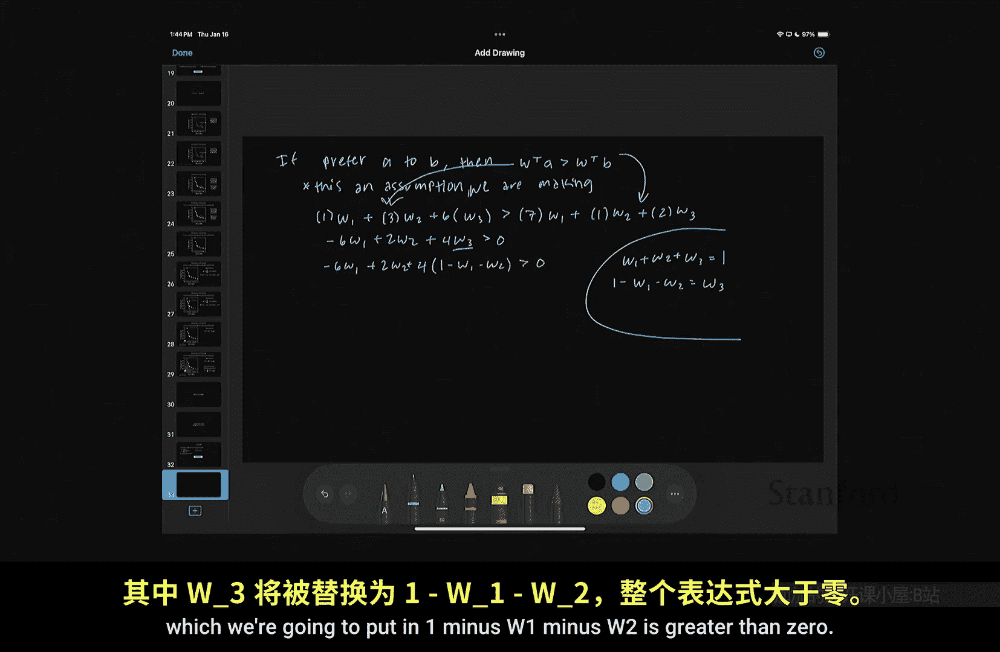

# 004：属性规范 2

在本节课中，我们将继续探讨复合指标。我们将回顾上一节的内容，并深入分析加权和方法，学习如何通过成对比较来推断决策者的权重向量，从而在多个相互冲突的指标间做出选择。

## 复合指标回顾

上一节我们介绍了复合指标。很多时候，我们关心多个性能指标，但这些指标之间常常存在冲突。例如，对于一个飞机防撞系统，我们既关心碰撞率，也关心警报率。理想情况下两者都为零，但这通常无法实现，因此需要在两者之间进行权衡。

以下是理解多个指标间权衡的一种方法：

*   **帕累托最优性**：一个设计点是帕累托最优的，当且仅当我们无法在不使其他指标变差的情况下，改进任何一个指标。
*   **帕累托前沿**：由所有帕累托最优设计点构成的集合。

由于帕累托前沿上的点在没有额外信息时是“同等优秀”的，我们需要创建复合指标来从中选择一个点。

我们讨论了三种复合指标：

1.  **加权和方法**：为每个指标分配一个权重，计算所有指标值的加权和，选择加权和最高的点。公式为：`加权和 = w1 * 指标1 + w2 * 指标2 + ... + wn * 指标n`。
2.  **目标距离法**：设定一个目标点（通常是“乌托邦点”，即所有指标都达到理想值），计算每个设计点到该目标的距离，选择距离最近的点。
3.  **加权指数和法**：类似于目标距离法，但引入了权重。

## 深入加权和方法

现在，让我们更深入地思考加权和方法。一个关键问题是如何确定权重。直接询问专家“您对警报率和碰撞率的权重是多少？”可能难以回答。

一个更自然的方法是进行成对比较：向决策者展示两个具有不同指标值的设计方案，询问他们更偏好哪一个。通过多次这样的比较，我们可以推断出他们隐含的权重向量，而无需他们直接指定。

接下来，我们将通过一个糖果偏好的例子来演示这个过程。

## 通过成对查询学习权重

假设我们想了解一个人对三种糖果（M&M‘s、酸味软糖、彩虹糖）的相对偏好权重。我们有一个需要学习的权重向量 `[w1, w2, w3]`，分别对应三种糖果的权重，且要求 `w1 + w2 + w3 = 1`。

我们不直接询问权重，而是进行成对选择查询。演示如下：

**查询1**：在A袋（1个M&M‘s，3个酸味软糖，6个彩虹糖）和B袋（7个M&M’s，1个酸味软糖，2个彩虹糖）之间，你选择哪一个？（假设志愿者选择了A袋）

根据选择，我们可以进行以下推导：

**假设**：决策者心中存在一个权重向量，他通过比较两个选项的加权和来做决定。即，他偏好A胜过B，意味着A的加权和大于B的加权和。

由此，我们得到不等式：
`1*w1 + 3*w2 + 6*w3 > 7*w1 + 1*w2 + 2*w3`

同时，我们有权重总和为1的约束：
`w1 + w2 + w3 = 1`

将约束 `w3 = 1 - w1 - w2` 代入不等式并化简：
`-6*w1 + 2*w2 + 4*(1 - w1 - w2) > 0`
`-10*w1 - 2*w2 + 4 > 0`
`5*w1 + w2 < 2`

这个不等式定义了权重向量 `[w1, w2]` 必须满足的一个条件，将可能的权重空间限制在了一个特定区域内。

通过多次类似的成对查询，我们可以得到一系列不等式，这些不等式的交集区域就越来越精确地反映了决策者的偏好权重向量。

## 总结

本节课中，我们一起学习了如何利用加权和复合指标在多个冲突目标间进行决策。我们重点探讨了通过成对比较查询来推断决策者隐含权重向量的方法。这种方法的核心是假设决策者基于一个固定的权重向量进行理性选择。通过将每次选择转化为对权重空间的线性约束，我们可以逐步缩小权重向量的可能范围，从而量化其偏好。这为在安全关键系统设计等复杂权衡场景中，将人的主观偏好转化为可计算的客观标准提供了一种实用思路。