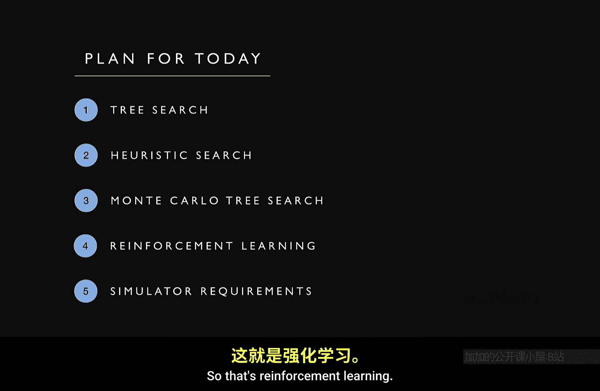
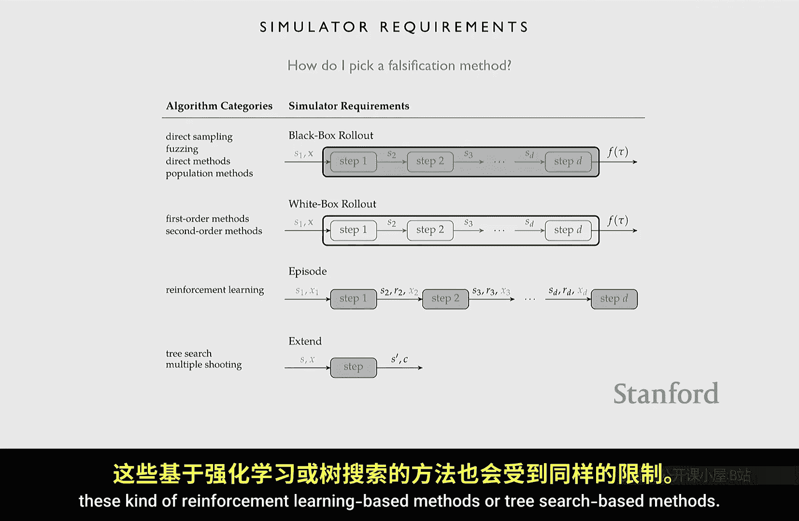

# 007：嘉宾讲座 - Anthony Corso, Terra AI

在本节课中，我们将继续上周的内容，完成最后两个知识点的讲解，然后进入一场非常精彩的嘉宾讲座。

## 概述

我们将首先回顾上周讨论的利用规划技术进行证伪（即寻找系统故障）的方法，特别是启发式搜索和蒙特卡洛树搜索。接着，我们将探讨如何将强化学习应用于系统证伪，并讨论如何根据系统特性和仿真器类型选择最合适的证伪方法。

## 从树搜索到强化学习 🔄

上一节我们介绍了使用树搜索算法（如RRT及其变体、MCTS）来寻找系统故障。本节中，我们来看看如何将问题框架转化为强化学习问题，从而利用成熟的强化学习算法。

我们可以将测试系统的过程视为一个“对抗者”与系统交互的过程。对抗者的目标是使系统失效。在每个时间步，对抗者可以向系统施加一个**扰动**（disturbance），系统则根据其内部状态转移函数（step function）更新状态，并反馈给对抗者一个**奖励**（reward）。

在这个框架中，对抗者获得的奖励与系统的“糟糕”程度正相关。系统越接近失效，对抗者获得的奖励越高，因为它的目标就是导致失效。

这个交互循环——**系统**、**对抗者**、**动作**（扰动）、**奖励**——正是强化学习的标准设置。在这里，对抗者就是强化学习中的**智能体**（agent），其动作是施加扰动，目标是最大化累积奖励（即最大化系统失效的可能性）。

因此，关键洞察在于：**我们可以直接利用现有的、成熟的强化学习算法，通过这个设置来训练一个能有效导致系统故障的对抗者**。

## 为何使用强化学习？ 🤔

使用强化学习进行证伪有几个显著优势：

*   **样本高效**：强化学习领域在过去几十年投入大量研究来设计样本高效的算法，即用尽可能少的系统交互步数学习到一个好的策略。我们可以直接利用这些成果。
*   **泛化能力强**：与树搜索通常从一个固定初始状态展开不同，许多强化学习算法允许智能体（对抗者）学习到的策略能泛化到多种不同的初始状态。这意味着我们可以一次性训练一个能应对多种起始情况的对抗者。

以下是使用强化学习训练对抗者的一个示例。我们再次使用连续世界模型，但这次从多个不同的初始状态开始多条轨迹。目标是训练一个强化学习智能体，使其学会在每条轨迹的不同状态下选择扰动，最终导致所有轨迹撞上障碍物。

在训练过程中，你会看到对抗者的策略逐渐改进，最终能够成功使大多数轨迹从各自的初始点出发并导致失效。

> **关于“导致失效”的说明**：这指的是在上一页幻灯片展示的循环中，在每个时间步，对抗者（智能体）选择并施加一个扰动。这个扰动可以作用于智能体本身、环境或传感器。我们训练对抗者的目的，就是让它学会选择那些最有可能最终导致系统违反安全规范的扰动序列。

## 自适应压力测试 🎯

结合使用我们上周讲的**蒙特卡洛树搜索**和本节讨论的**强化学习**来搜索系统最可能发生的故障，这种方法通常被称为**自适应压力测试**。

自适应压力测试的核心思想是主动、智能地探索系统输入空间，以高效地发现可能导致失效的场景，特别是那些发生概率较高的“最可能故障”。这个概念最初由我们实验室的前学生 Richie Lee 提出。今天的嘉宾 Anthony 将在他的讲座中更深入地探讨这个话题。

## 如何选择证伪方法？ 🧐

我们已经介绍了一系列证伪方法，你可能会疑惑该如何选择。这通常取决于多个因素，尤其是在进行项目实践时。

选择证伪方法时需要考虑以下几点：

*   **领域依赖性**：方法的效果高度依赖于具体领域。某些算法在某个领域表现优异，在另一个领域可能完全无效，通常需要实际尝试才能确定。
*   **故障的稀有性**：如果系统故障并不罕见（例如，在早期开发阶段），那么使用简单的**直接采样**可能就足够高效，无需动用MCTS或基于梯度的优化等复杂方法。相反，故障越稀有、越难发现，使用MCTS这类样本高效算法的优势就越明显。
*   **仿真器/模型的能力**：你所拥有的系统模型或仿真器的类型，直接限制了可用的方法。下图（源自课程教材）清晰地展示了这种关系：

仿真器要求与可用方法的关系：

1.  **黑盒仿真器**：如果你只能向仿真器输入初始状态和扰动序列，并获得最终轨迹或鲁棒性值，但无法知晓中间过程或获取梯度信息（例如某些复杂的飞行模拟器），那么你只能使用不依赖梯度的方法，如**直接采样**、**模糊测试**以及各种**零阶优化方法**。
2.  **可微仿真器**：如果你的系统模型是可微的，允许你计算梯度，那么你就可以使用更高效的**一阶**和**二阶优化方法**。
3.  **可交互仿真器**：像**强化学习**和**树搜索**这类方法，要求仿真器能够支持单步交互。也就是说，你需要能够执行一步系统动态，观察结果，然后基于此决定下一步动作。

## 总结

本节课中，我们一起学习了：
1.  如何将系统证伪问题构建为强化学习问题，从而利用强大的强化学习算法训练一个能主动寻找故障的“对抗者”智能体。
2.  了解了这种方法的优势，包括样本高效和良好的泛化能力。
3.  认识了**自适应压力测试**这一概念，它结合了树搜索和强化学习来寻找最可能的故障。
4.  讨论了在实际项目中如何根据**故障稀有性**、**领域特点**，尤其是**仿真器能力**（黑盒、可微、可交互）来选择最合适的证伪方法。

接下来，我们将进入Anthony Corso的嘉宾讲座，他将更深入地介绍自适应压力测试及其在实践中的应用。