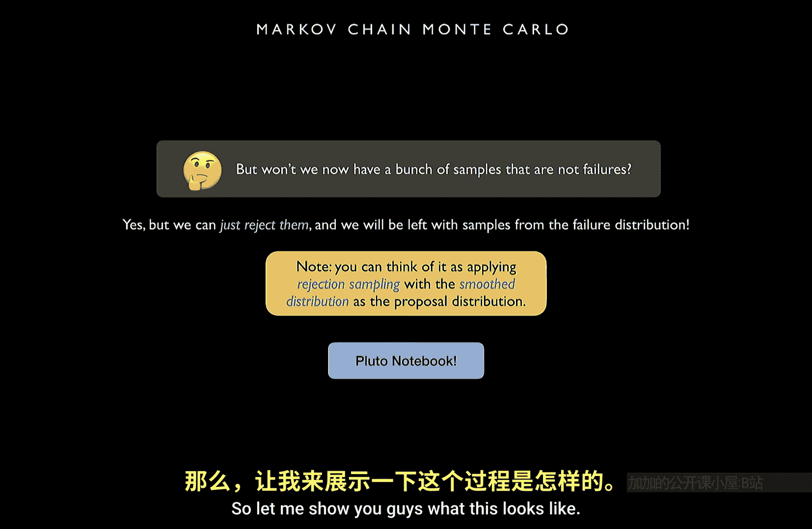
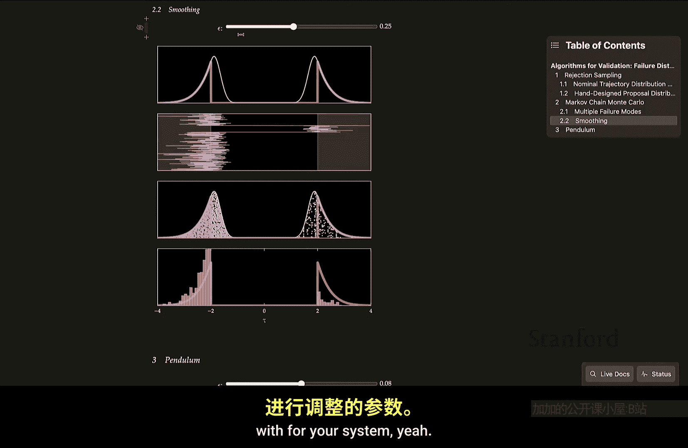

# 009：重要性采样

在本节课中，我们将继续学习如何从故障分布中采样。我们将深入探讨上周四提到的“平滑”技术，这是一种帮助马尔可夫链蒙特卡洛方法在有限样本下更有效地探索多模态故障分布的策略。

上一节我们讨论了马尔可夫链蒙特卡洛方法及其在有限样本下可能遇到的挑战，例如样本相关性和难以跨越不同故障模式。本节中，我们将重点介绍如何通过“平滑”故障分布来解决这些问题。

## 平滑故障分布

我们面临的核心问题是：当故障分布是多模态时，MCMC采样链可能被困在初始的故障模式中，无法探索其他模式。为了解决这个问题，我们引入了一个“平滑”技术。

首先，我们定义一个距离函数 **δ(τ)**。这个函数在轨迹 **τ** 是故障时返回0，在轨迹成功时返回一个正值。一个简单的定义方法是取鲁棒性函数与零的最大值：

**δ(τ) = max(ρ(τ), 0)**

这样，当 **ρ(τ) ≤ 0**（故障）时，**δ(τ) = 0**；当 **ρ(τ) > 0**（成功）时，**δ(τ) = ρ(τ)**。

我们之前定义的故障分布的未归一化密度为：
**p̃_f(τ) = p(τ) * 1[ρ(τ) ≤ 0]**

利用距离函数，我们可以将其等价地重写为：
**p̃_f(τ) = p(τ) * 1[δ(τ) = 0]**

这里的指示函数 **1[δ(τ) = 0]** 在0处为1，其他地方为0。我们可以用一个以0为中心、方差很小的正态分布来平滑地近似这个尖锐的指示函数：

**1[δ(τ) = 0] ≈ N(δ(τ); 0, ε)**

其中，**ε** 是正态分布的方差，也是一个控制平滑程度的参数。

因此，平滑后的未归一化密度变为：
**p̃_{f, smooth}(τ) = p(τ) * N(δ(τ); 0, ε)**

以下是平滑参数 **ε** 的影响：
*   当 **ε = 0** 时，正态分布退化为一个冲激函数，平滑版本变回原始的故障分布。
*   当 **ε → ∞** 时，正态分布变得无限宽，近似于一个均匀分布，此时平滑后的分布趋近于名义轨迹分布 **p(τ)**。
*   通过调节 **ε**，我们可以控制对故障分布的平滑程度。平滑后，成功轨迹（非故障）也会被赋予非零的概率，且越接近故障的成功轨迹概率越高。

## 平滑采样的工作原理

你可能会问：我们最终需要的是故障样本，但平滑后我们却在采样非故障轨迹，这有什么用？

关键在于，我们可以将平滑后的分布 **p̃_{f, smooth}(τ)** 作为一个**提议分布**，然后对从中采样的轨迹执行**拒绝采样**。我们只接受那些确实是故障的样本（即 **δ(τ) = 0**），而拒绝所有非故障样本。

这个过程在数学上完全等价于：使用平滑分布作为提议分布，对原始故障分布进行拒绝采样。最终保留下来的被接受样本，将严格来自我们想要的故障分布 **p_f(τ)**。

这样做的优点是：平滑后的分布更易于探索整个状态空间（包括不同的故障模式），MCMC链更容易在不同模式间跳转。虽然我们会采样并丢弃许多非故障轨迹，但这换来了对故障空间更全面、更高效的探索。

## 参数选择与效果展示

参数 **ε** 的选择至关重要。以下通过图示说明不同 **ε** 值的效果：

*   **红色曲线**：真实的双模态故障分布。
*   **紫色曲线**：平滑后的分布 (**ε = 0.05**)。
*   即使经过轻微平滑，由于概率质量仍然集中在各自模式内部，MCMC链（顶部样本点序列）依然未能从左侧模式跳转到右侧模式。

*   当我们**增大 ε**，平滑程度增加，分布变得更加平缓、连续。
*   此时，MCMC链可以自由地在两个故障模式之间来回跳转。
*   经过拒绝采样（只保留故障样本）后，我们最终获得了来自两个故障模式的均衡样本集。

当然，**ε** 的选择需要权衡：
*   **ε 太小**：平滑不足，链可能仍无法跨越模式。
*   **ε 太大**：平滑过度，分布过于接近名义分布，会导致大量样本被拒绝，采样效率降低。
*   在实践中，**ε** 是一个需要根据具体系统进行调整的超参数。

## 与其他方法的对比

一个相关的问题是：能否不通过平滑故障分布，而是直接**拓宽MCMC的提议核分布**来实现模式间的跳转？

理论上可以。然而，直接设计一个能有效跨越所有潜在故障模式的提议核通常很困难，尤其是当模式在状态空间中相距较远或形状复杂时。平滑技术提供了一个更系统、更直观的方法来引导探索过程，它通过改变目标分布本身的形状来降低探索难度。

本节课中我们一起学习了重要性采样中的“平滑”技术。我们了解到，通过用一个带参数的正态分布来近似故障指示函数，我们可以创建一个易于探索的平滑版本分布。在此分布上运行MCMC并辅以拒绝采样，能够有效地从多模态故障分布中获取样本，克服了传统MCMC方法在有限样本下可能被困于局部模式的问题。这项技术的核心在于平衡探索效率与采样效率，通过调整平滑参数 **ε** 来适应不同的验证场景。