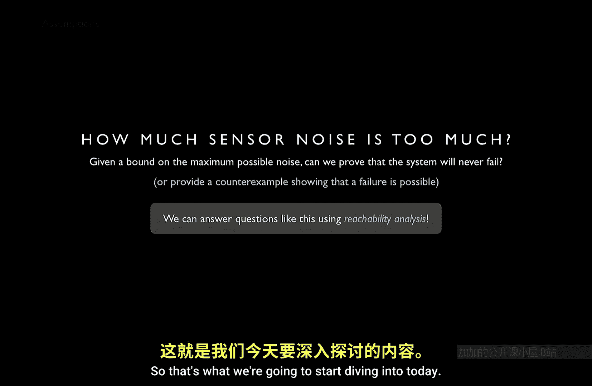
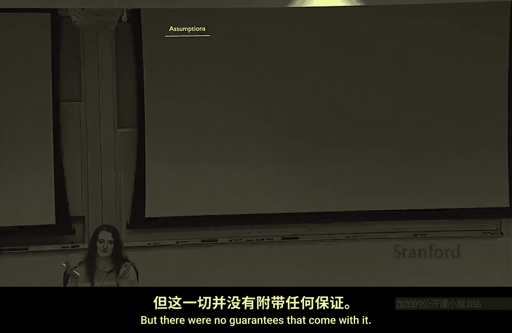
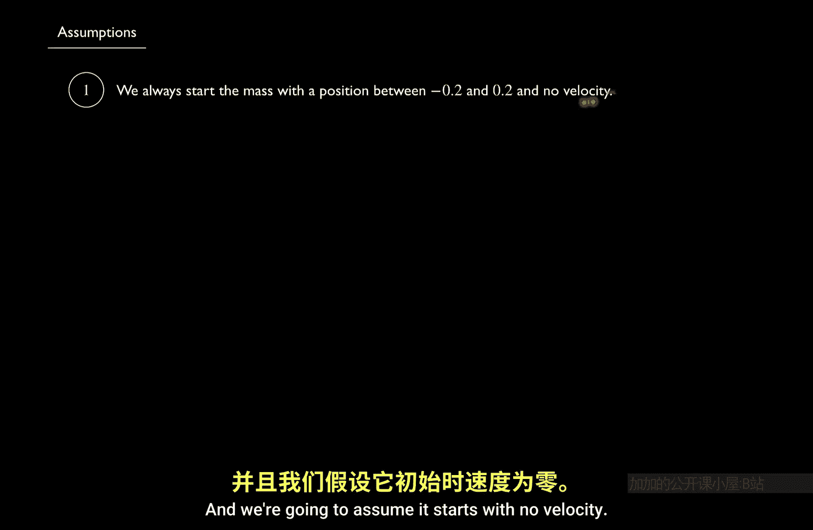
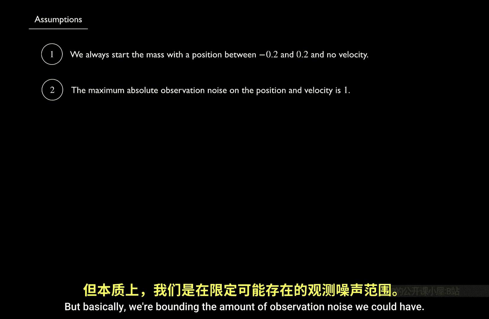
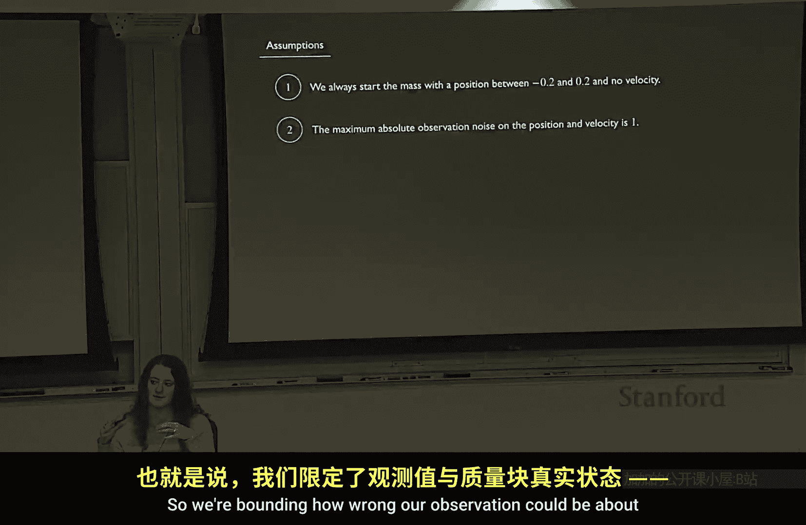
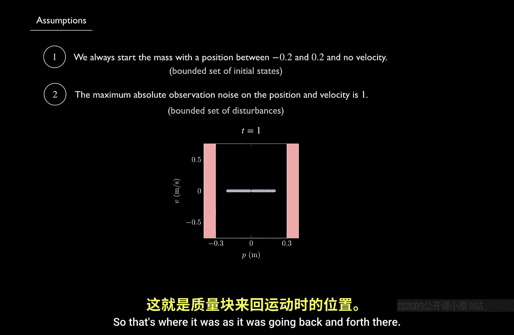
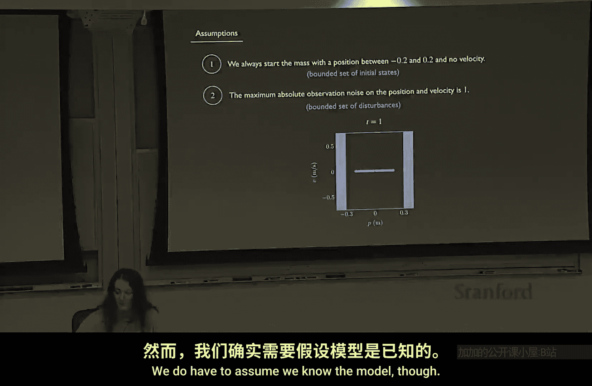
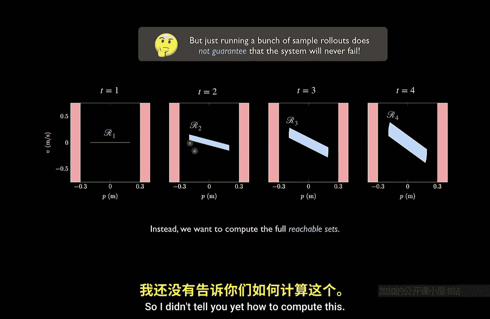

# 011：线性系统的可达性分析 🧮

在本节课中，我们将学习一种称为可达性分析的形式化方法。通过这种方法，我们可以尝试证明系统在特定条件下永远不会发生故障，这与之前寻找或估计故障概率的方法不同。

## 课程概述

在前几周，我们主要讨论了故障分析的相关主题，包括证伪、故障分布和故障概率估计。现在，我们将转向形式化方法领域，目标是获得关于系统行为的严格保证。我们不再试图寻找故障或估计故障概率，而是尝试在特定假设下证明系统永远不会发生故障。我们将主要通过可达性分析来实现这一目标。

## 可达性分析简介

可达性分析的核心是计算系统随时间推移可能到达的所有状态的集合。

为了说明这个概念，我们使用一个简单的质量-弹簧-阻尼器系统作为例子。这个系统在控制理论中很常见，例如可以模拟汽车的悬架系统。系统包含一个质量块，通过弹簧和阻尼器连接到墙壁。质量块可以沿水平方向来回移动，我们忽略重力的影响。

系统故障被定义为质量块的位置进入特定区域，例如过于靠近墙壁或伸展过远。

### 系统行为与控制器

想象一下，如果我们把质量块拉伸到某个位置然后释放，它会来回振荡。为了改善这种行为，我们可以添加一个控制器（在本课程中称为“智能体”）。这个智能体可以对质量块施加一个力，以抵消弹簧和阻尼器的作用，从而减少振荡。

然而，为了使模型更贴近现实，我们假设存在传感器噪声。这意味着施加力的智能体无法精确观测质量块的真实位置和速度，只能获得带有加性噪声的观测值。

*   少量传感器噪声下，控制器仍能大致将系统维持在中心。
*   大量传感器噪声下，系统可能失控并导致故障。

因此，我们可能希望知道：多大的传感器噪声是“过多”的？给定一个最大可能噪声的界限，我们能否证明系统永远不会故障？或者，如果故障是可能的，我们能否提供一个反例轨迹来证明这一点？可达性分析可以帮助我们回答这类问题。

## 可达性分析的假设

为了进行可达性分析并获得保证，我们需要做出一些假设。这就像“没有免费的午餐”——之前的方法没有保证，而现在的方法有保证，但需要前提条件。

对于质量-弹簧-阻尼器系统，我们做出以下假设：

1.  **有界的初始状态集**：我们假设质量块总是从静止位置（零点）附近启动。具体来说，其初始位置在 -0.2 到 0.2 之间（单位任意），且初始速度为零。这相当于我们将质量块压缩或拉伸到某个点，然后准备释放。
2.  **有界的干扰集**：我们假设位置和速度观测噪声的最大绝对值界限为 1。这意味着我们对于质量块真实状态的观测误差最多为 1。这通常基于我们对传感器精度的了解。

更一般地说，进行可达性分析需要假设**有界的初始状态集**和**有界的干扰集**。我们还假设**已知系统的精确动力学模型**，并且在本例中，噪声仅出现在观测中（但方法可以推广到其他类型的噪声）。

## 可视化可达集

为了直观理解，我们可以在状态空间中可视化系统的行为。我们使用横轴表示质量块的位置，纵轴表示其速度。

*   **故障区域**：如果位置小于 -0.3 或大于 0.3，则视为故障，在图中用红色区域表示。
*   **初始状态集**：根据假设，初始状态是位置在 [-0.2, 0.2] 区间内、速度为零的所有点，在图中表现为横轴上的一段线段。

一种简单的方法是**从初始集中采样大量状态点**，然后模拟系统动力学，观察这些样本点随时间推移的轨迹。例如，我们可以模拟前 4 个时间步，并绘制所有样本点到达的状态。

然而，这种方法（类似于之前的故障搜索）只能说明我们没有在这些样本中看到故障，**并不能保证系统永远不会故障**。样本可能没有覆盖所有可能的行为。

我们真正想做的是计算**完整的可达集**——即从初始集出发，在给定的有界干扰下，系统在某个时间点可能到达的所有状态的集合。图中背景的彩色形状就展示了这种可达集。

*   在时间步 1，可达集就是我们的初始集（那条线段）。
*   在时间步 2，可达集扩展为一个更大的形状，包含了系统在第二步所有可能到达的状态。
*   随着时间推移，可达集继续演化。

**本节课的核心就是学习如何计算这个可达集。**

## 总结

本节课我们一起学习了可达性分析的基本概念。我们了解到，与之前无保证的故障分析方法不同，可达性分析是一种形式化方法，旨在为系统行为提供严格保证。我们通过质量-弹簧-阻尼器系统的例子，引入了可达集的概念——即系统从有界初始集出发，在有界干扰下可能到达的所有状态的集合。为了进行计算，我们需要做出有界初始状态、有界干扰以及已知模型等关键假设。在接下来的课程中，我们将深入探讨计算可达集的具体方法。