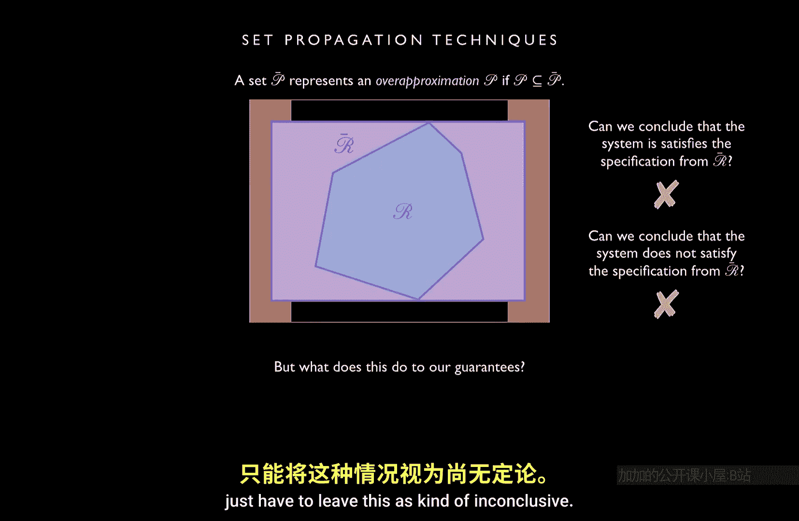
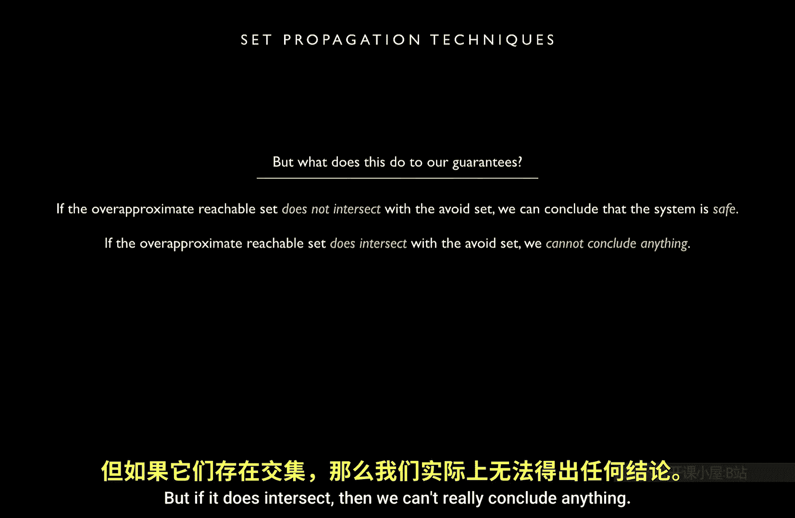
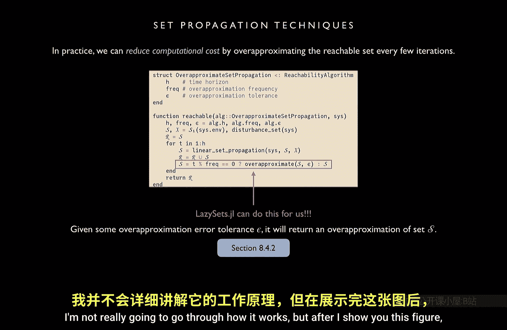
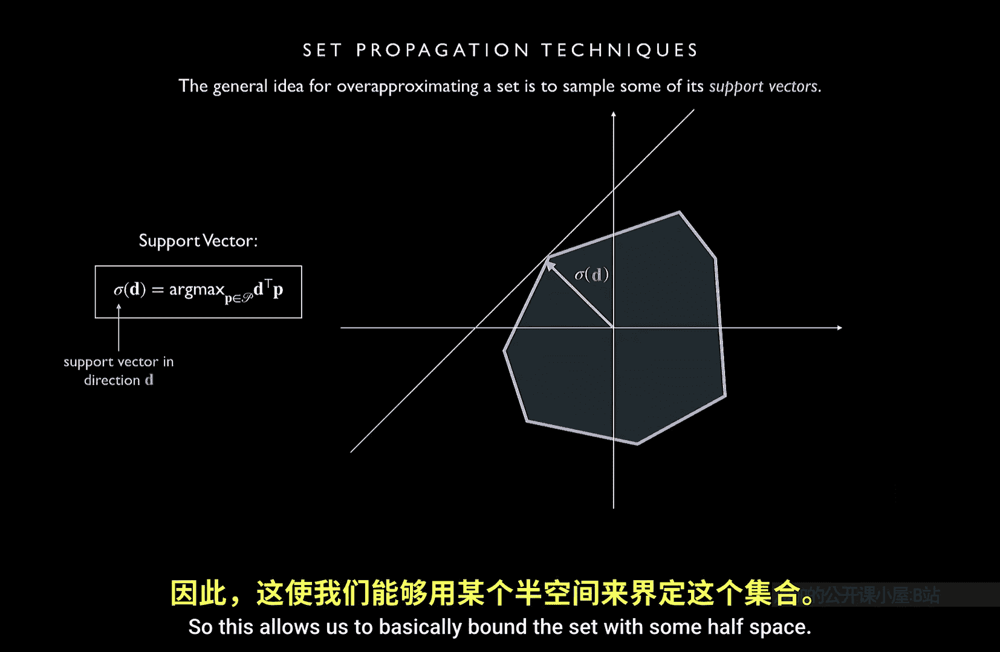
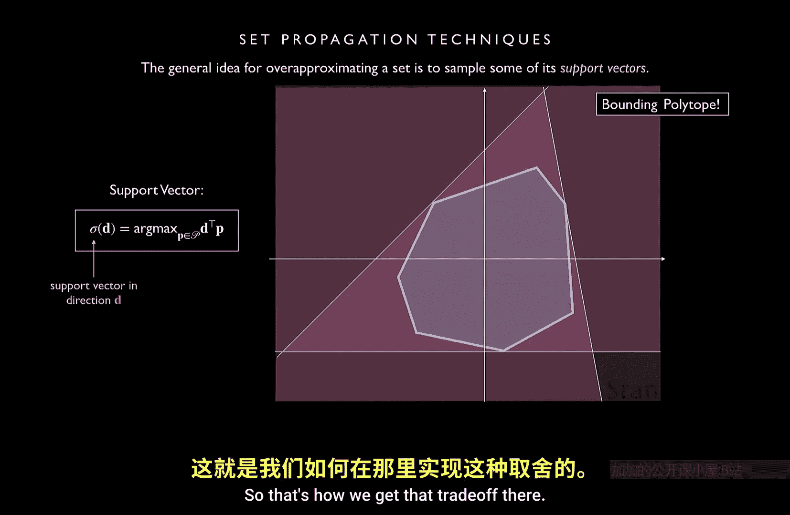
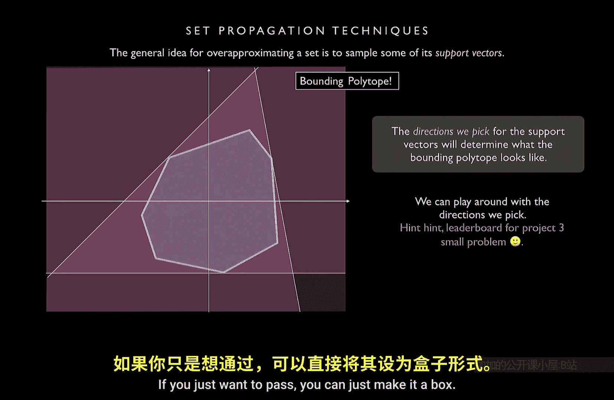

# 012：非线性系统的可达性分析

在本节课中，我们将学习如何通过**过近似**技术来处理可达性分析中计算复杂度爆炸的问题。我们将回顾线性系统可达性分析的挑战，并详细介绍一种通过**支撑向量**来构造过近似集合的通用方法。

## 线性可达性分析的挑战

上一节我们讨论了线性系统的可达性分析。我们遇到了一个问题：在通过线性方程传播多面体时，每一步都会累积顶点数量。

顶点数量呈**指数级增长**。这很快会导致计算变得不可行。

为了解决这个问题，我们提到一种方法是使用**zonotopes**来表示集合。对于zonotopes，生成元的数量随深度**线性增长**，这要好得多。但是，zonotopes不能表示所有多面体。因此，有时这可能不是我们想要的做法。

## 过近似：一种解决方案

在上一讲的结尾，我们讨论的另一个选项是进行**过近似**。

本质上，过近似就是一个集合。假设这里有一个我们想要过近似的集合。过近似就是一个**保证包含**我们试图过近似的原始集合的集合。

我们通常通过在集合符号上加一个横杠来表示这些过近似集合。

其核心思想是：如果一个集合有非常多的顶点，我们可以用一个顶点更少的集合来**过近似**它，这样我们需要跟踪的顶点就更少。

但是，我们必须确保我们仍然能从中获得**安全保证**，因为我们在这里使用的是形式化方法，我们希望保证系统是安全的。

那么，如果我们只知道过近似集合，我们能获得什么样的保证呢？假设这是我们对可达集的过近似。

如果过近似集合**仍然不与**避障集相交，那么我们可以确定真实的可达集也**不会与**避障集相交。因此，即使我们进行了过近似，我们仍然可以得出关于安全性的结论。

但是，如果过近似集合**确实与**避障集相交，那么我们**肯定不能说**它是安全的，但我们也**不能说**它是不安全的，因为我们并不真正知道真实的可达集是什么样子。它可能只是这个过近似集合中一个很小的、实际上不与避障集相交的部分，但我们不知道这一点。因此，我们基本上只能将其视为**不确定**的结果。

**总结一下**：如果过近似的可达集**不**与避障集相交，我们仍然可以做出安全声明，一切顺利。但如果它**确实**相交，那么我们就无法得出任何确定的结论。

## 实践中的过近似策略

在实践中，为了减少顶点数量增长带来的计算成本，我们可能会这样做：每隔一段时间（例如，每隔几次迭代，具体取决于问题），我们可以对可达集进行一次过近似，用一个顶点更少的集合来近似它，然后从那里开始继续使用这个新集合。这样，顶点数量的增长就不会那么快。

令人惊喜的是，我们最喜欢的软件包 **LazySets** 可以自动为我们完成这项工作。基本上，这个算法中的关键是我们设定一个频率（例如，每隔多少步进行一次过近似），然后我们只需调用 LazySets 提供的 `overapproximate` 函数，并给它一个误差容限，它就会用一个顶点更少的集合为我们过近似该集合。

如果你想确切了解这个算法的工作原理，我们在教材中进行了讨论。如果你想了解调用该函数时 LazySets 实际在做什么，可以查阅教材中的相关章节。我不会详细讲解其工作原理，但在展示完下图后，我会简要介绍该算法背后的一些通用概念。

首先让我们看看这个图，它直观地展示了我们每隔几步进行一次过近似的做法。假设我们希望在可达性分析中每三步对集合进行一次过近似。我们从初始集合开始，像往常一样得到时间步 2 的可达集。当我们到达时间步 3 时，我们计算可达集，它包含一定数量的顶点（多于四个）。然后，我们用一个只有四个顶点的集合来**过近似**它。我们可以控制过近似误差的大小：如果我们允许过近似集合有更多顶点，近似会更精确，但假设我们只想要四个顶点，这就是我们能跟踪的全部。然后，我们取这个新集合，并从那里开始向前传播。

这里存在一种**权衡**：因为我们从这个过近似集合开始计算时间步 4 的可达集，所以会引入额外的过近似误差。因此，这就在**计算量**和可达集的**准确性**（或保守性）之间形成了一种权衡。

## 过近似的核心概念：支撑向量

现在，我想谈谈如何进行过近似的一般思路。其背后的关键概念是**支撑向量**。

支撑向量的数学定义如下：`σ(D) = argmax_{x∈X} (D·x)`。这可能会让人困惑，至少曾经让我困惑过。有趣的是，它是一个函数，输入一个方向 `D`（一个多维向量，给出了我们空间中的一个方向），并返回一个向量。

本质上，`σ(D)` 表示的是在方向 `D` 上的**支撑向量**。我们查看集合中的所有点，找到使这个点积 `D·x` 最大化的点。

通过视觉方式观察支撑向量会容易得多，因为它们实际上是一个非常直观的概念。其思路是：我们指定一个方向，例如选择这个方向。我们想找到这个特定形状（这里是一个多边形）在这个方向上的支撑向量。

基本上，你可以这样想象支撑向量：我们画一条垂直于这个方向向量的线。然后想象我们沿着这个方向推动这条线，直到它**刚好接触到**这个集合。我们通过尽可能远地推动它来最大化点积，直到我们不再位于集合内。这就是正在发生的事情。然后，这条线接触到的点就是我们的**支撑向量**。如果我们画一条线到这个点，那就是支撑向量。

这很酷的一点是，这实际上定义了一个**半空间**。因为我们知道，既然这个点积在此处被最大化，那么所有“低于”它的点（在相反方向一侧）都必须在集合内。这使我们能够用一个半空间来**界定**这个集合，我们可以说集合中的所有点都将位于那个半空间内。这给了我们一个**界定半空间**。

你可以想象，这只是我们评估支撑向量的一个方向。让我们尝试另一个方向，例如选择这个方向。我们画线，再次想象我们沿着这个方向推动这条线，直到它刚好接触到我们的集合。我们再次这样做。

现在，这将给出另一个半空间，我们知道我们的集合必须位于这个特定半空间的这一侧。现在，我们不再只有一个界定半空间，我们有了一个**界定多面体**。

让我们再做一次，选择一个方向。像这样，我们直接向下，再次想象向下推动这条线，直到它刚好接触到集合。

现在，我们加入我们的半空间，然后我们得到了这个三角形区域，我们有了一个界定我们当前集合的**有界集合**，也就是一个**界定多面体**，这正是我们想要的。

你可以想象，我们在这里只用了三个方向，但我们可以继续在许多不同的方向上这样做，我们会得到不同的平面和不同的切面。因此，我们的过近似会变得越来越精确，越来越接近这个实际集合，但它也会有更多的顶点。这就是我们获得那种权衡的方式。

具体来说，我们选择用于评估支撑向量的**方向**将决定这个界定多面体的形状。这三个方向给了我们这个三角形。如果我们添加另一个方向，比如朝这个方向，我们会得到另一个切面，从而得到多于三个的顶点，等等。

基本上，LazySets 使用的算法，它有一种巧妙的方式来选择这些方向，以便能够最高效地过近似集合。

因此，这是你可以尝试调整的东西。对于项目三，如果你想优化你的排行榜分数和小问题，你可能需要明智地选择这些方向。如果你只是想通过测试，你可以简单地将其设为一个**包围盒**。

## 总结

本节课中，我们一起学习了如何应对可达性分析中的计算复杂度挑战。我们回顾了线性系统分析中顶点数指数增长的问题，并引入了**过近似**作为核心解决方案。通过理解**支撑向量**的概念及其如何用于构建界定多面体，我们掌握了在保持安全验证能力的同时，有效控制计算复杂度的通用方法。最后，我们了解到在实践中可以利用工具（如 LazySets）自动执行过近似，并在精度与效率之间进行权衡。