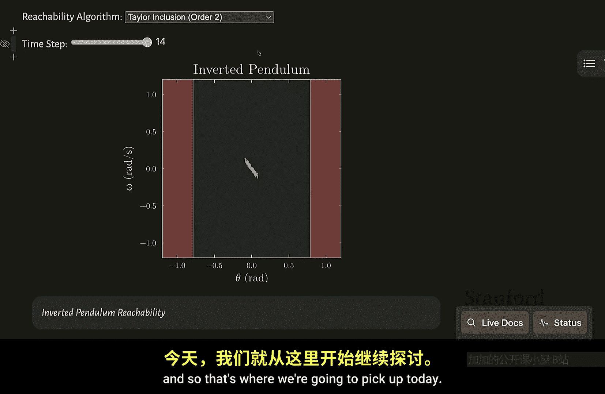
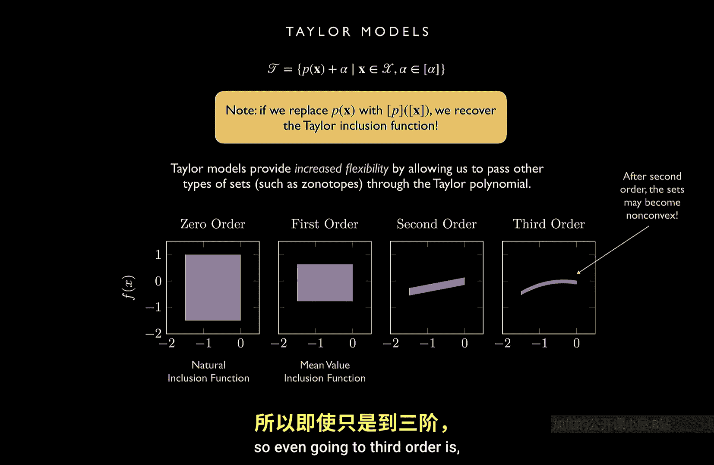

# 013：离散可达性分析 🧮

在本节课中，我们将学习如何利用泰勒模型来处理非线性系统的可达集计算问题，以克服之前仅能输出超矩形集合的限制。

上一节我们介绍了使用区间算术和包含函数来近似非线性系统的可达集，但最终结果往往过于保守，且只能得到超矩形集合。本节中我们来看看如何利用泰勒模型来获得更精确、更灵活的集合表示。

## 从包含函数到泰勒模型

正如上周所讨论的，无论包含函数的阶数多高，其输出始终是超矩形集合。为了获得更具表达能力的集合，我们引入泰勒模型。

泰勒模型的核心思想是：对于一个给定的输入集合（不再局限于区间），我们应用一个多项式并加上一个区间余项。其数学形式如下：

**公式**：`T(x) = P(x) + α`

其中：
*   `P(x)` 是函数 `f` 在某个点（如中点）的 `n-1` 阶泰勒多项式。
*   `α` 是一个区间余项，用于界定泰勒多项式近似所产生的所有高阶误差。

这个区间余项有时被称为拉格朗日余项，它涉及函数 `n` 阶导数的包含函数。泰勒多项式提供了对原函数的最佳近似，而区间余项则确保了输出集合是实际可达点的**过近似**。

一个关键特性是：如果我们仅将区间输入传递给这个泰勒模型（即用 `P(x)` 的自然包含函数处理区间），那么得到的结果与使用泰勒包含函数完全相同。泰勒模型的优势在于其灵活性，它允许我们将各种类型的集合（如多面体）传递给泰勒多项式进行处理。

## 泰勒模型的阶数与效果

以下是不同阶数泰勒模型的效果对比：

*   **零阶泰勒模型**：退化为自然包含函数，效果最差。
*   **一阶泰勒模型**：退化为均值包含函数，效果有所改善。
*   **二阶泰勒模型**：输出不再是超矩形，而是**多面体**。这实现了我们的主要目标之一。
*   **三阶及更高阶泰勒模型**：输出可能变为非凸的、形状复杂的集合。虽然理论上可以计算更高阶，但非凸集合在实际操作中非常困难，因此通常二阶模型是实用性和复杂性的较好平衡点。

## 总结

本节课中我们一起学习了泰勒模型。它通过结合泰勒多项式和区间余项，允许我们使用更灵活的输入集合（而不仅仅是区间），并产生更精确的过近似可达集，特别是能够输出多面体。这解决了我们之前只能得到保守的超矩形近似的问题，为非线性系统可达性分析提供了更强大的工具。