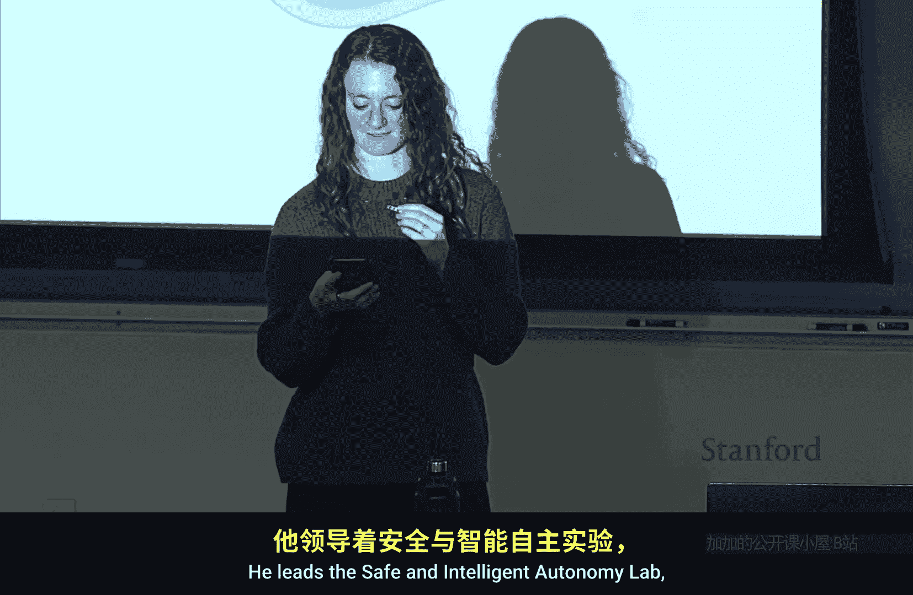
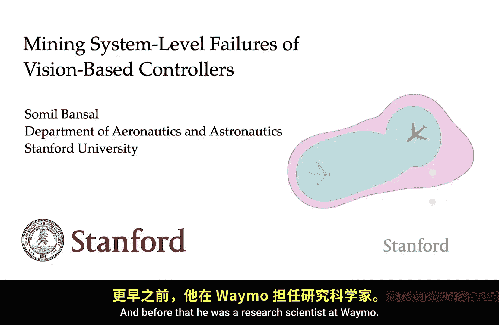
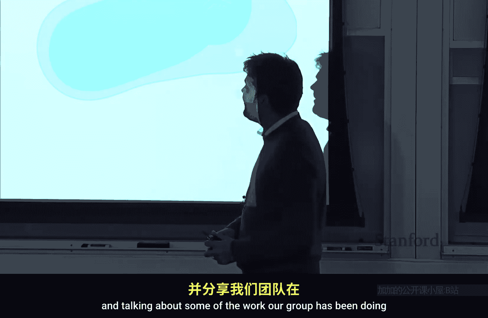
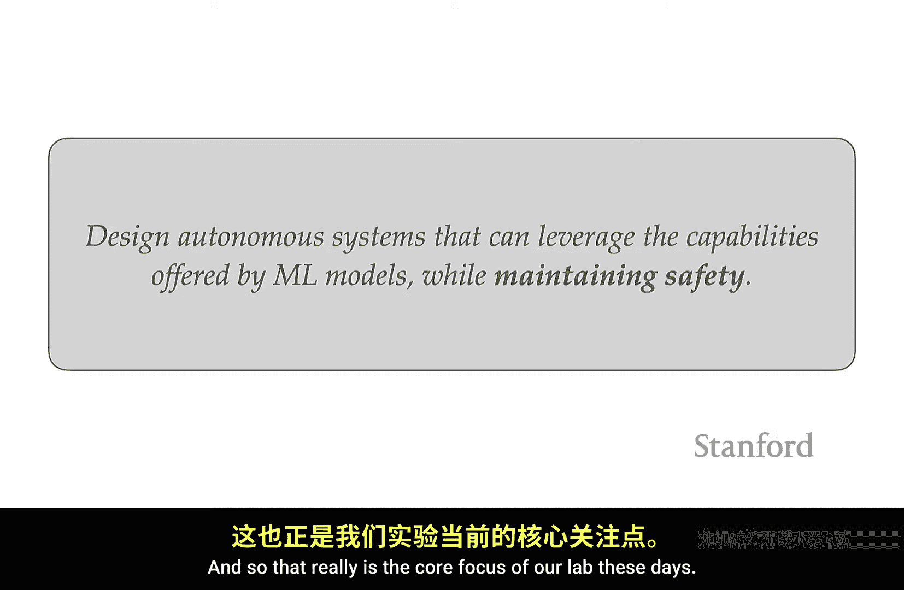
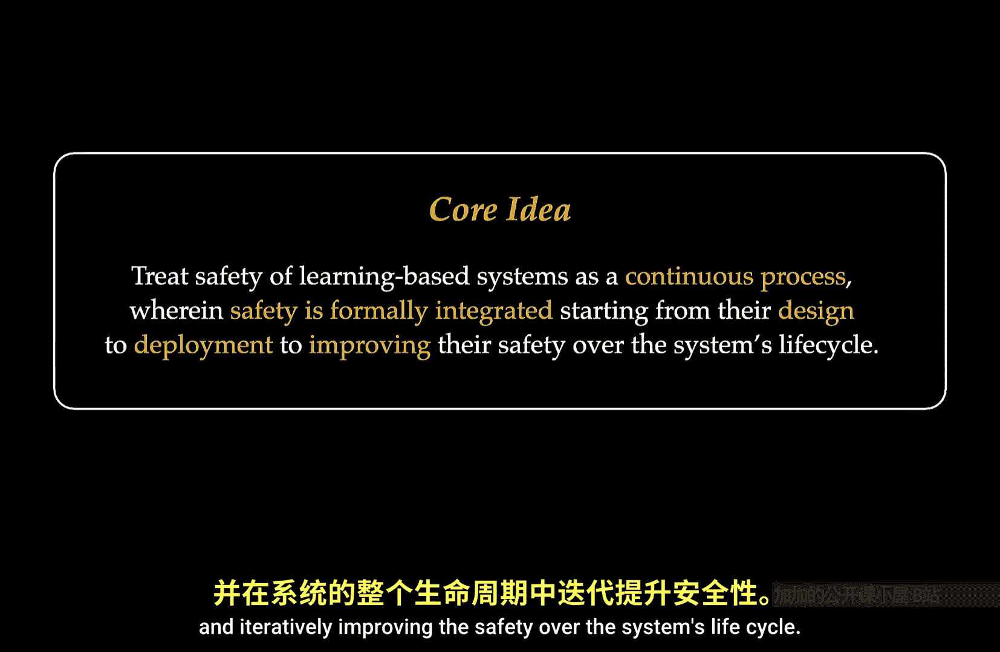
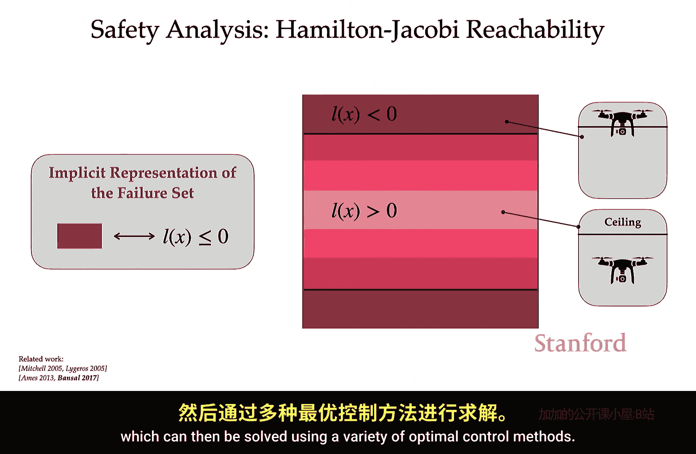

# 015：Somil Bansal，斯坦福大学

今天我们有一场嘉宾讲座，主讲人是Somil Bansal教授。他来自斯坦福大学航空航天系，领导“安全与智能自主实验室”。在此之前，他曾是南加州大学电气与计算机工程系的助理教授，更早之前是Waymo的研究科学家。我们非常期待他的讲座。

大家好，我是Somil。首先，非常感谢Michael和Sydney开设这门精彩的课程。我的几位学生正在学习这门课，他们对课程赞不绝口。我计划在春假期间补看我有权限访问的讲座视频。我很高兴能在这里，与大家分享我们小组在挖掘基于视觉的控制器故障方面所做的一些工作，我认为这与本课程涵盖的一些主题密切相关。

从高层次看，我们小组专注于机器人与自主系统，总体目标是开发能在新的、不确定环境中保证安全和性能的机器人算法。我们在多种应用背景下开发这些算法，范围涵盖自主无人机、自动驾驶汽车、飞机和空间机器人。

在这些系统中，机器学习在其自主技术栈中正变得越来越普遍。最主要的应用仍然是感知和视觉，但现在也扩展到了预测、行为预测以及规划与控制。出于许多充分的原因，机器学习非常擅长捕捉现实世界场景的复杂性，而这些场景用工程领域知识可能很难建模。

但这并非没有缺陷。引入机器学习也带来了一系列新的安全挑战。一个让我深有感触的例子是Cruise自动驾驶汽车从旧金山市撤回，并且此后他们完全终止了自动驾驶业务。问题严重到美国政府现在几乎要重新评估许可，其他一些政府，特别是英国政府，也通过了行政命令，优先讨论人工智能安全，不仅针对自主系统，也涵盖更广泛的人工智能领域。

回到自主系统，我们今天在自主系统中面临一个常见的矛盾：如何利用现代机器学习方法提供的能力，同时又能保持安全。这正是我们实验室当前的核心关注点。

我们应对这一挑战的方法，是将基于人工智能的系统的安全更多地视为一个持续的过程。安全被整合到数据周期或系统周期的不同阶段，从训练时开始，到系统部署，并在系统生命周期中迭代地改进安全性。

具体而言，这意味着我们从三个不同阶段来思考安全。我们从训练时开始，问自己：如何在训练阶段就以编程方式融入安全要求，从而得到安全策略或安全的AI系统。一种思考方式是，我们关注如何确保在训练数据分布内的安全。

但当我们将这些系统部署到新的、不确定的条件下时，这还不够。因此我们必须问自己：何时会超出分布？以及如何针对这些超出分布的场景调整我们的安全策略？

最后，我们专注于开发能够对这些系统进行压力测试的方法，以挖掘其安全关键故障，并利用这些故障来改进系统设计，从而形成闭环。这个框架共同为学习型系统提供了持续的安全保证，在训练时提供临时安全，在运行时进行调整，并在系统生命周期中不断改进。

但在今天剩余的时间里，我想专注于最后一个组成部分，特别是压力测试部分：如何对基于学习的控制器进行压力测试以挖掘安全关键故障，然后我将讨论如何利用这些故障来改进系统。

我们特别在基于视觉的控制器的背景下提出这个问题，原因有二：第一，基于视觉的控制器目前在自主技术栈中已相当普遍；第二，由于其高维度和复杂的输入空间（如RGB图像），传统的控制理论工具对这些控制器进行压力测试一直非常具有挑战性。

那么，让我们来谈谈如何对这些系统或基于视觉的控制器进行压力测试。

首先，让我从数学上形式化这个问题。我们有一个系统，例如一个机器人，它具有某种动力学特性，状态为 **X**，控制输入为 **U**。在每个状态下，我们有一个视觉传感器，提供视觉观测 **I**，这些可以是RGB图像或点云。这些观测随后被基于视觉的控制器作为输入，控制器输出要应用于机器人的控制 **U**，这就形成了一个闭环系统。我们还假设可以访问一个用于压力测试该控制器的模拟器。

我们的目标是找到这些安全关键故障，换句话说，找到导致整个系统安全违规的视觉输入 **I**。

我们采取的方法是将故障发现问题转化为可达性问题。具体做法是，将视觉观测函数与基于视觉的控制器串联起来，得到一个等效的基于状态的机器人策略。因此，为了压力测试的目的，我可以将我的闭环系统简化为机器人与这个等效的基于状态的策略形成的闭环。

在这个特定的闭环系统上，我们可以使用许多现有的可达性分析方法，这些方法最终会计算所谓的**后向可达管**或其某种变体。简单来说，后向可达管是指在该控制器（在我们的案例中就是这个控制器）作用下，最终会将系统引导至某个预定义故障区域的所有初始状态的集合。

接下来，我想简要介绍一下什么是后向可达管，以及如何计算它，然后我会回到这个问题，讨论这个后向可达管如何有助于找到我追求的安全关键故障。

让我用五分钟时间简要介绍一下**哈密顿-雅可比可达性分析**，这是计算后向可达管的方法之一。

在可达性分析中，我们从底层系统的动力学开始，我们假设系统有状态 **X**、控制输入 **U** 和干扰 **D**。这里的干扰可以代表系统中的建模不确定性，例如，我们可能没有完全建模系统，或者可能存在一些我们希望防范的外部干扰。

给定这些动力学，我们再次关注的是该系统的后向可达管，即所有初始状态的集合，从这些状态出发，无论采取何种最佳控制努力，系统最终都会被驱动到一个不希望的状态集合（有时也称为故障集）。

为了理解其含义，让我们考虑一个非常简单的例子：想象一个四旋翼飞行器在这个房间里纵向飞行。在这个特定情况下，天花板和地板可能是我们不希望四旋翼撞上的故障集。图中浅红色区域就是后向可达管，意味着如果四旋翼从这个集合内开始，那么无论它做什么，最终都会撞上天花板或地板，换句话说，最终会进入故障集。

与后向可达管相对的是这个蓝色区域，即安全集。可达性分析保证，如果系统从这个集合内开始，那么存在一个策略可以使其始终保持在集合内。换句话说，这个蓝色集合是**控制不变集**。

我们计算这个蓝色集及相应安全控制器的方法，是将整个安全问题转化为一个最优控制问题，然后可以使用各种最优控制方法来解决。

这样做的第一步是隐式地表示我们的故障集，使得我们用来隐式表示故障集的函数在故障集内为负，在故障集外为正。在这个特定例子中，它应该在天花板和地板内部为负。