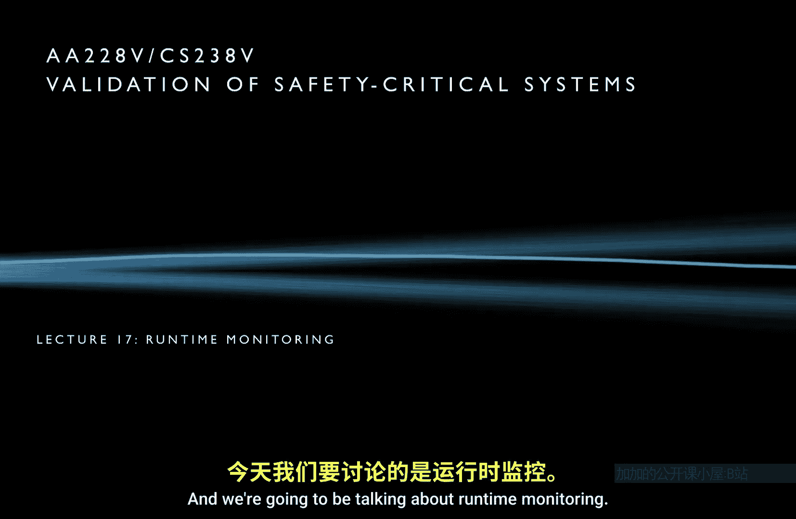
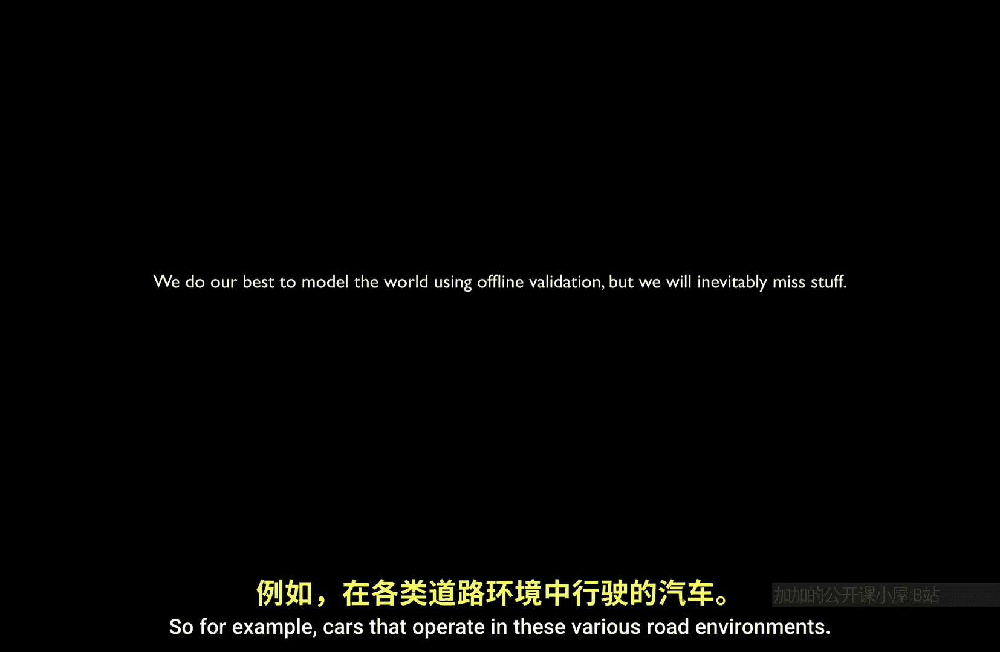
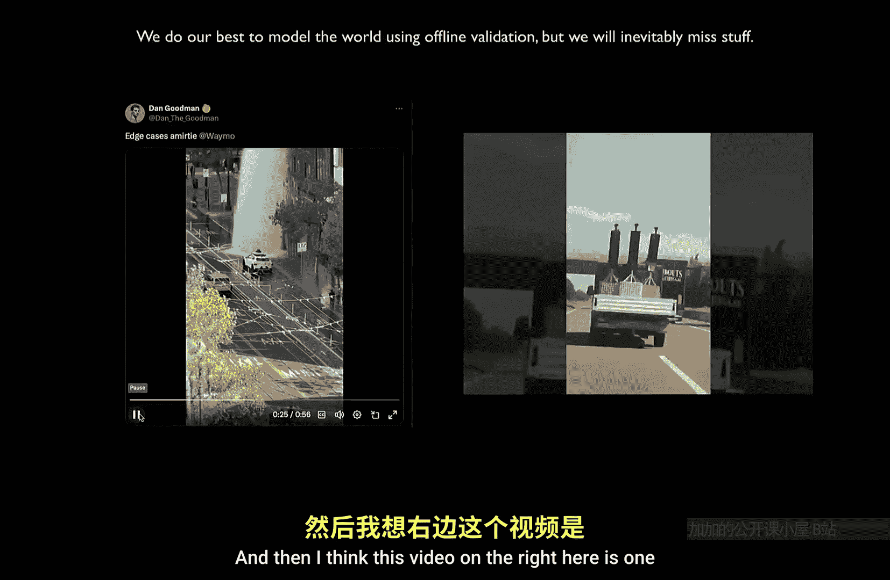
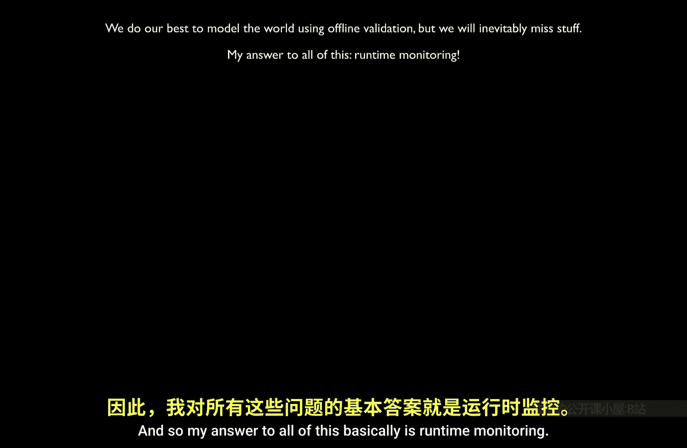
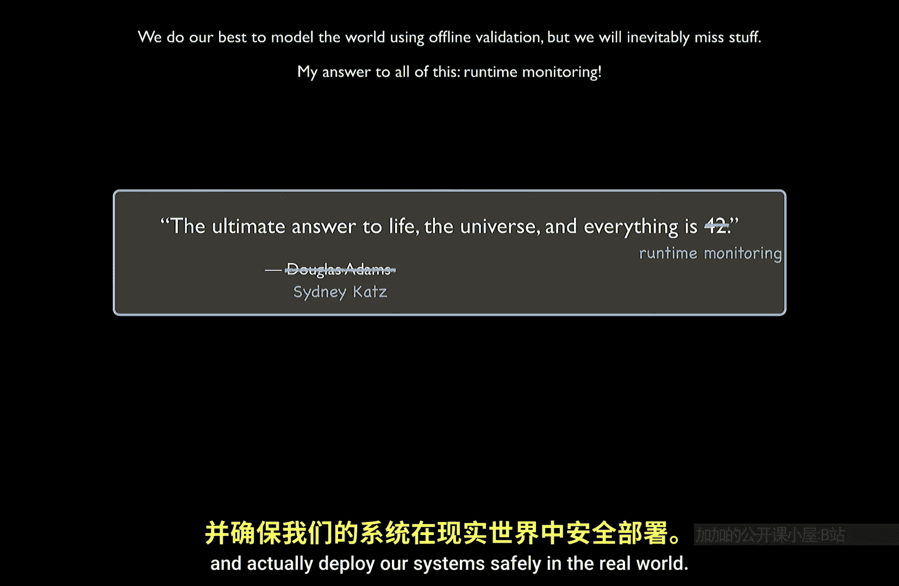
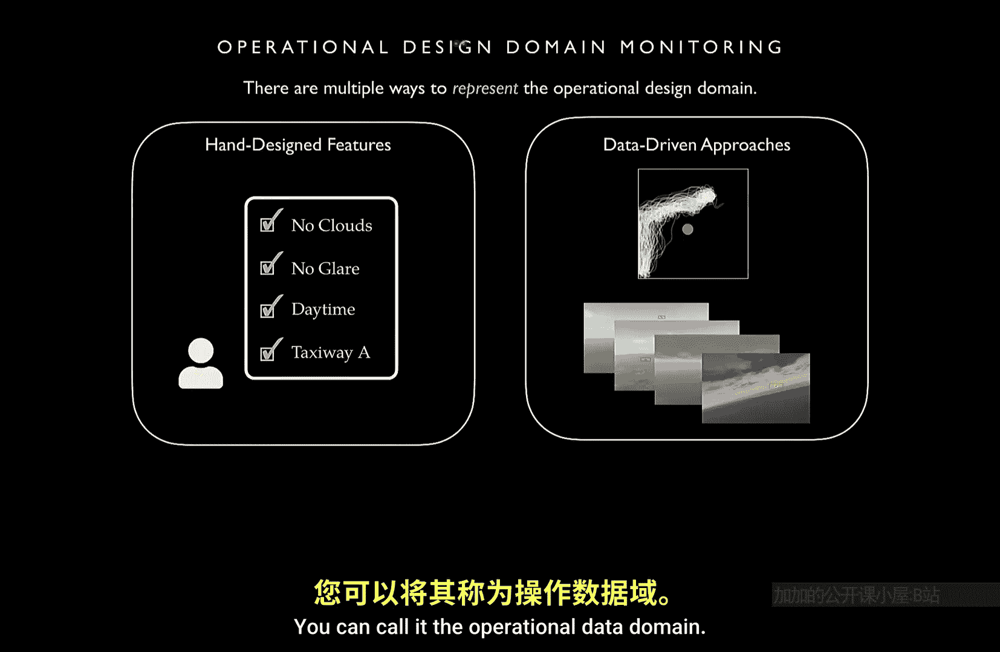

# 016：运行时监控 🛡️

在本节课中，我们将学习运行时监控的概念。这是本书的最后一章。我们将探讨如何通过运行时监控来应对离线验证中难以覆盖的复杂现实情况，从而提升系统在实际部署中的安全性。

## 概述

到目前为止，我们已经讨论了许多验证方法，这些方法都可以称为**离线验证方法**。这些方法通常在系统部署到现实世界之前进行，例如发现故障、估计故障概率、尝试获得形式化保证或进行可解释性分析。所有这些工作都基于我们构建的某个世界模型。

我们在第二和第三讲中讨论过构建模型的方法。然而，要建模系统可能遇到的所有情况非常困难。不可避免地，模型总会遗漏一些东西，尤其是在系统运行于非常复杂环境的情况下。例如，在多变道路环境中行驶的汽车。

左侧视频展示了一个Waymo车辆遇到的极端案例：道路中央出现了一个巨大的随机喷泉。这可能是因为消防栓爆炸之类的原因。车辆行驶到它面前停下，不知道该怎么办，但至少没有撞上去。右侧视频是Anthony在客座讲座中展示的：一辆特斯拉在路上行驶，不断检测到交通信号灯。结果发现它是在跟随一辆运输交通信号灯的卡车。这些案例表明，无论我们多么努力地将所有可能的边缘情况纳入模型，我们终究无法预想到所有可能发生的事情。

这让我回想起第二讲中关于建模的幻灯片。我当时讨论了构建模型的一般思路，并指出了几个关键挑战。其中一个主要挑战是，我们需要得到一个足够**富有表现力**的模型，以捕捉系统可能遇到的所有可能场景。例如，道路喷出的随机水流或卡车上的交通信号灯。我们希望模型能够捕捉所有这些可能性。我提到，每次我作关于验证的演讲时，似乎总会有人提出一个完全合理的问题：如何捕捉我的系统可能遇到的所有可能场景？我甚至不知道它们是什么。我可能根本想不到卡车运输交通信号灯这种情况。

这确实是一个完全合理的问题，因为它确实非常困难。我在第二讲中的回应总是：是的，这确实是个难题，真的很难。但我提到这里有一些希望，并建议大家关注运行时监控这一章。现在，我们就在这里了。运行时监控将是这里的解决方案。

因此，我们尽最大努力在离线验证时对世界进行建模，但不可避免地会遗漏一些东西。所以，我对所有这些问题的基本答案就是**运行时监控**。你可能见过道格拉斯·亚当斯在《银河系漫游指南》中的名言：生命、宇宙以及一切的终极答案是42。我想稍微修改一下：生命、宇宙以及一切的终极答案是**运行时监控**。我是运行时监控的坚定支持者。我认为它对于捕捉离线验证中未发现的问题，并确保系统在现实世界中安全部署，将是绝对必要的。

## 运行时监控的目标

运行时监控的目标是，在可能危险的情况发生时进行**标记**，从而触发某种**后备机制**。理想情况下，我们应该能识别出自己正处于一个可能未经验证、前所未见、不明所以的境地，然后触发后备机制。这可能包括进入安全模式、如果是驾驶则停车，或者如果有在环的人类操作员，则将控制权交还给操作员。我们可以做很多事情，但今天不会具体讨论这些。我们将重点关注如何标记这些可能危险的情况。

## 今日课程计划

我们将讨论实现这一目标的多种不同方法。一种方法是**运行设计域监控**，我们将从这里开始。然后我们将进入**不确定性量化**。我们将讨论两种不同类型的不确定性：第一种是**输出不确定性**，第二种是**模型不确定性**。接着，我们会非常简要地谈谈**故障监控**。最后，作为我的最后一讲，我们将总结整个课程。

现在，让我们从运行设计域监控开始。

## 运行设计域监控

顺便说一下，你们中的一些人可能听说过**分布外检测**技术。有不同的分类方式。我认为这与你们听到分布外检测时想到的概念非常相似。你们可以在脑海中将这两者等同起来。但为了我们的目的，我们称之为**运行设计域监控**。

其核心思想是，系统有所谓的**运行设计域**。这基本上是我们设计系统时，预期其能安全运行的一组条件。例如，可能是白天无雨等条件。从根本上说，这里的想法是，这实际上可以是我们用于验证的模型所覆盖的条件集合。我们创建了一个模型，并针对它进行了验证，该模型包含并建模了一组条件。那么，如果我们在此ODD之外运行，就意味着我们超出了验证模型所覆盖的条件，因此我们的验证结果可能不再有效。所以，这里的基本思路是，我们希望标记那些可能表明我们正在运行设计域之外运行的情况。在这种情况下，我们基本上不再有安全保证，或者说我们的验证结果不再有意义。

例如，特斯拉很可能没有将运输交通信号灯的卡车纳入其自动驾驶汽车的运行设计域定义中。这是可以理解的，因为这是一个需要你凭空想象出来的奇怪、疯狂的事情。因此，我认为我们能做的次优选择，就是在运行时监控系统是否在其运行设计域内运行。这是一项不平凡的任务，我们将讨论不同的方法来实现它，但这是我们的目标。

为了监控我们是否处于运行设计域内，我们必须找到某种方式来表示它。有几种方法可以做到这一点。

一种选择是使用一堆**手动设计的特征**。例如，对于飞机滑行系统，我们可以说：我们为天空无云、没有阳光眩光、白天且在A滑行道上运行的情况设计了它。这可能是一个非常严格的系统，但也许这就是我们测试的全部内容。如果事实证明我们超出了这些条件，那么我们就不能使用该系统，或者说我们超出了ODD。这是我们可以自己写下来，甚至可能在部署滑行系统之前，在当天自行检查的东西。

定义运行设计域的另一种方法是采用**数据驱动**的方法。与其手动设计所有定义ODD的特征，我们可以获取大量数据，这些数据可能来自我们用于验证的所有数据。例如，对于连续世界，我们可能模拟了大量轨迹，拥有离线验证期间看到的所有这些轨迹。或者，对于这个入侵者检测、飞机检测系统，我们拥有训练它所用的所有图像，以及验证所用的所有图像。这些数据就定义了系统的运行设计域。

这两种方法都是同样有效的。在某些情况下，你可能希望使用其中一种而非另一种。

关于第一种方法（手动特征），它独立于我们实际使用的模型，只关乎问题空间和数据。对于第二种数据驱动的方法，设计体现在哪里？因为当你手动设计特征时，说“我设计了我希望工作的领域类型”是有道理的。但我觉得正确的方法更像是从分布外检测的角度来看待这个问题。

“设计”这个词在这里可能被剥离了。嗯，我认为你使用的数据本身就是一个设计决策。你可以称之为运行数据域或数据分布。