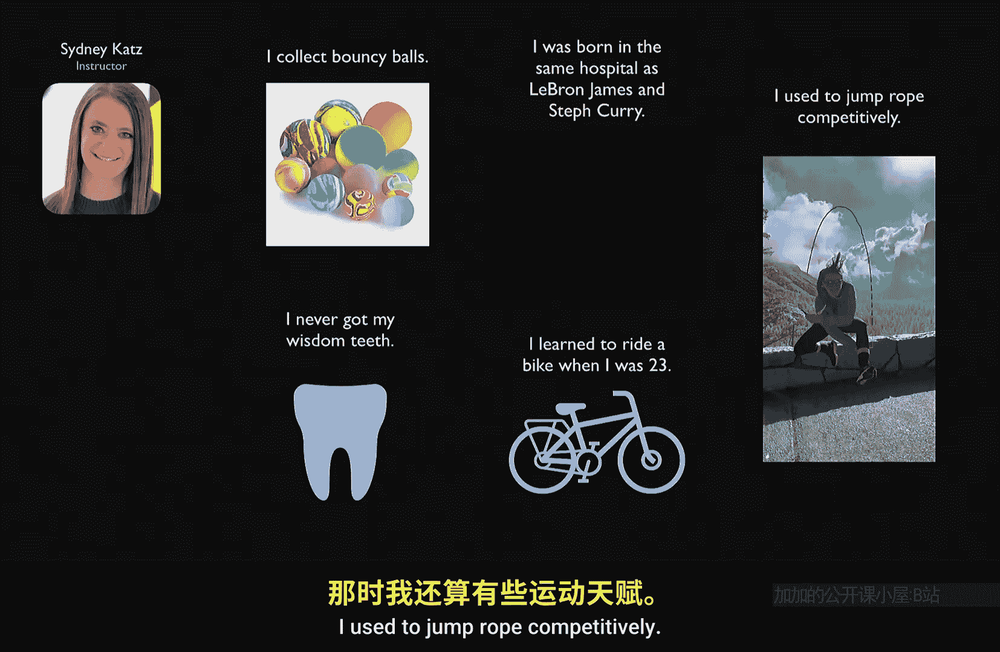

# 斯坦福大学【中英⚡安全关键系统验证｜Stanford AA228V I Validation of Safety Critical Systems】 p01 P1 Introduction & Overview -BV15RkXByEW3_p1-

So welcome everyone to AA2208V CS 230 AV validationid of safetyfety critical systems。

 if you're here for that class， you're in the right spot， if you're here from a different class。

 you're in the wrong spot and we promise not to judge you if you get up and leave it out if you're in the wrong spot that was definitely one of my biggest fears as a student on the first day of class。

So my name is Sydneyney Kattz， I'll be the primary instructor for this course along with the super awesome teaching team。

 and we'll all introduce ourselves shortly。But first I want to jump in by just saying。

 so this is actually the first kind of quarter long full class that I've ever taught and I'm really excited about it and so I thought kind of long and hard about what the first slide of the first lecture of the first class that I ever teach should be and here's what I came up with。

😊，Yeah啊。😊，So yay for a couple reasons， one， I'm just super excited to have this opportunity。

 I think like throughout my kind of entire academic journey I've always really loved teaching and helping students understand concepts and so I'm just really excited to have this opportunity and also yay because I'm excited about the particular class that we're teaching here。

Which is validation of safety critical systems， so I think this is actually kind of one of the first classes of its kind。

It's a new class as you probably know and I think kind of a lot of the skills that you'll take away from this class are going to be extremely useful and valuable whether you go into industry or academia in a whole wide variety of domains so I'm just really excited to share all of that knowledge and skills with you so ya。

All right。I'm going to jump in now and talk a little bit about the textbook that we're going to use for this class。

 so the textbook is called Alrithms for validationidation。

 it was co-authored by myself Michael Cokenurer who's one of the coinstructors for this course。

 Anthony Corso and Robert Moss。嗯。And so this textbook is actually the third textbook in a series of textbooks。

 they're all algorithms books， so if you've taken any of Michael's other classes such as AA222 or maybe last quarter you took AA228。

 you might have used one of these textbooks in the past。

And the way I kind of see these textbooks fitting together is like this。

So in the first two textbooks we design steps， so we design decision making systems。

 we optimize them， and then once we're done with that we come over to this textbook or to this class and we check if what we designed actually works。

 so we check if it does what we intended for it to do。But ideally。

 we're going to find out in a controlled and safe environment such as ass simulation instead of in the real world。

Unlike these people。So the one on the right is actually me。嗯。

I can tell you that was from when I was an undergrad。

 so I hadn't taken any validation classes yet I didn't know what I was doing。

 so there was no validation involved， I just kind of started spinning around a bat and didn't really know how dizzy that would make me definitely had no chance of hitting that finalat。

Okay。So those are some fun systems， but in this class we're mostly going to be focused on decision making systems and specifically decision making systems that operate over time。

So this could be something like a robot， an autonomous vehicle， an autonomous aircraft。

Maybe a financial system or healthcare system。And in this class we're kind of just going to wrap that all into this one component that we call the system so in other classes you may have learned to design intelligent decision making systems like this and in this class we're going to assume we already have that system and now we want to check if it does what we wanted it to do。

And to do that we have to give it some sort of specifications， we need it write down。

 something that tells us what it is we actually wanted the system to do when we designed it and what do we want it to do when we deploy it in the real world。

And so these are kind of the two main inputs that go into validation algorithms that we'll be talking about in this class。

 and what validation algorithm does is essentially takes that system in specification and outputs some sort of information that tells us whether the system is satisfying the specification。

So that information could be something like a failure analysis。

 so when does the system not satisfy the specification？It could be a formal guarantee。

 so that would be something like under a set of assumptions。

 maybe sometimes we can prove that a system will always satisfy a specification。

ItCould be an explanation， so maybe we can explain why a system doesn't satisfy a specification or why it makes a particular decision。

All the way to when we deploy the system at runtime。

We could kind of deploy it with some online validation that allows us to continue checking if our system is operating as intended when it's out in the real world。

And so we're actually going to discuss algorithms from all of these different categories throughout the quarter。

And what I want to say here is just that there's not really one single algorithm that's going to do it all for us so there's not one algorithm that we could just run it on our system。

 see that the results pass and then confidently deploy our system in the real world and instead we really need to apply algorithms for all of these categories to sort of build a safety case。

So you might be wondering why there's like these cheese looking things on this slide。

 essentially the idea here is something called the Swiss cheese model so maybe some of you have heard of this before if you haven't I'll give a quick 30 second overview of it。

But the idea is basically just that all of these methods have different limitations or holes in them。

 just like the slices of Swiss cheese。But ideally， the limitations that these algorithms have。

 maybe the limitations of one algorithm don't line up with the limitations of another algorithm。

 as you can imagine if we stack enough of them together。

 just like we're stacking the slices of Swiss cheese。

 then ideally we won't be able to see through any of the holes and so we'll be able to kind of catch everything that other algorithms miss。

And so the key idea here is just that there's really no silver bullet in safety validation。

And instead we need to build a safety case for these systems。

 so like I said in this class we're going to talk about algorithms that kind of fit into all of those categories of methods and so this course is a really good place to start to kind of give you that toolbox to be able to validate the systems that you design before you deploy them in the world。

Okay， so hopefully that gets you excited to take this course let me just talk for a second about the plan for the rest of this lecture。

 so the course staff will introduce themselves。😊，Then I'm going to do my best if I haven't already to convince you that safety validation is important。

We'll talk about the validation framework that we're going to use throughout this course。

So I'll introduce myself first， here was kind of just like a timeline of my academic journey so far。

 so I did my undergrad at Washington University in St。 Louis in electrical and systems engineering。

And during my time there， I got to do some really cool internships。

But one that's kind of a major highlight and particularly relevant here was at MIT Lincoln Laboratory and that's actually where I first met Michael。

And also it was where I got to work on a system called AX and essentially what it does is collision avoidance for aircraft so this was kind of my first introduction to intelligent decision making systems that operate in safety critical settings and so really it's kind of what set me down the path for my PhD so after I came here to Stanford Id heard how great Michael was I was like really hoping he'd let me in his lab and he did and so for the next five or so years I worked on the design and validation of safety critical decision making systems。

And specifically my PhD thesis was focused on safe machine learning based perception。

 so it's kind of like that video that I'm showing there。

 that would be an example of a perception system we might work on where we basically have a camera that's mounted on an aircraft that's trying to detect other aircraft in the sky。

To avoid colliding with them。So then I got my PhD in 2023 and Ive stuck around as a postdoc for the last year。

 so a large portion of my time as a postdoc was spent actually working on the textbook for this course。

 so I've been doing kind of a broad survey of the validation algorithms that are out there and I'm really excited to share them with you。

Okay， so some fun stuff， I used to collect bouncy balls， I have like jars of them at my dad's house。

I never got my wisdom teeth， so it doesn't mean it's not that I never got them out。

 I just like never got them period， they just never formed in my mouth。

I was born in the same hospital as Lebron James and Steph Curry if you're not a basketball fan。

 Lebron James and Steph Curry are like two of the best basketball players to ever live。

 I did not get whatever was in the hospital I'm not the best basketball player by any means and actually to like really contrast that I didn't even learn to ride a bike until I was 23 so there's any of you out there that still haven't learned to ride a bike there's still hopefully no worries I actually learned when I came to Sanford because there was just no other way that I was going to be able to get around this giant campus。

But then I guess to contrast that again with some athletic ability。

 I used to jump rope competitively and I was part of Stanford jump rope also for a few years while I was here。

