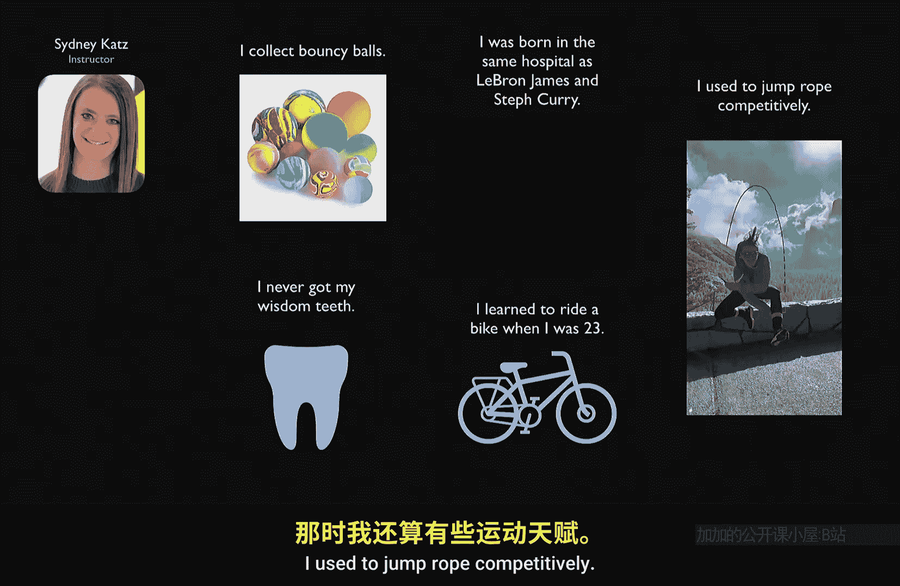

# 斯坦福大学【中英⚡安全关键系统验证】 p01：P1 课程介绍与概述

欢迎各位来到AA228V/CS230AV《安全关键系统验证》课程。如果你是为此课程而来，那么你来对了地方。如果你来自其他课程，那么你走错了教室。如果你发现自己走错了，我们保证不会对你起身离开有任何看法。作为学生，第一天上课走错教室曾是我最大的恐惧之一。

我的名字是Sydney Kattz，我将担任本课程的主要讲师，与一支非常出色的教学团队一起。我们稍后会逐一介绍自己。但首先，我想直接开始，说明这实际上是我第一次教授一个完整的季度课程，我对此感到非常兴奋。我花了很长时间思考，我教授的第一门课、第一堂课、第一张幻灯片应该是什么，这就是我的答案。

😊。我感到高兴有几个原因。首先，我非常兴奋能有这个机会。在我整个学术旅程中，我一直非常热爱教学和帮助学生理解概念，所以能有这个机会我真的很兴奋。其次，我为我们即将教授的这门特定课程感到兴奋。

这门课程是《安全关键系统验证》。我认为这实际上是此类课程中的首批之一。正如你可能知道的，这是一门新课。我认为你将从这门课中学到的许多技能，无论你进入工业界还是学术界，在广泛的领域中都将极其有用和有价值。因此，我非常期待与你们分享所有这些知识和技能。

接下来，我将开始介绍我们这门课程将使用的教科书。这本教科书名为《验证算法》，由我本人、本课程的联合讲师Michael Cokenurer、Anthony Corso和Robert Moss共同撰写。

这本教科书实际上是一系列教科书中的第三本，它们都是关于算法的。如果你上过Michael的其他课程，比如AA222，或者上个季度上过AA228，你可能在过去使用过这些教科书中的一本。

我这样看待这些教科书如何相互关联：在前两本教科书中，我们设计步骤，即设计决策系统并优化它们。完成这些后，我们来到这本教科书或这门课程，检查我们设计的东西是否真的有效，即检查它是否按照我们的意图工作。理想情况下，我们将在受控且安全的环境（如模拟环境）中发现这一点，而不是在现实世界中。

与这些人不同。右边那个实际上是我。我可以告诉你，那是我本科时期。那时我还没有上过任何验证课程，不知道自己在做什么，所以没有任何验证过程。我只是开始挥舞球棒旋转，完全不知道那会让我有多晕，绝对没有机会击中那个球。

这些都是有趣的系统，但在这门课程中，我们将主要关注决策系统，特别是随时间运行的决策系统。这可能是机器人、自动驾驶汽车、自主飞行器，也可能是金融系统或医疗保健系统。在本课程中，我们将所有这些都归入一个我们称之为“系统”的组件中。在其他课程中，你可能学过如何设计像这样的智能决策系统。在本课程中，我们将假设我们已经有了那个系统，现在想要检查它是否按照我们的意图工作。

要做到这一点，我们必须给它一些“规约”。我们需要写下一些东西，告诉我们设计系统时实际希望它做什么，以及当我们在现实世界中部署它时希望它做什么。因此，这些是输入到我们将在本课程讨论的验证算法中的两个主要输入。验证算法本质上接受那个系统和规约，并输出某种信息，告诉我们系统是否满足规约。

这些信息可能是“故障分析”，即系统何时不满足规约。也可能是“形式化保证”，即在某些假设下，我们有时可以证明系统将始终满足规约。也可能是“解释”，即我们可以解释为什么系统不满足规约，或者为什么做出特定决策。甚至到我们在运行时部署系统时，我们可以部署一些“在线验证”，使我们能够在系统在现实世界中运行时继续检查其是否按预期运行。

因此，我们实际上将在整个季度讨论来自所有这些不同类别的算法。我想在这里说明的是，并没有一个单一的算法能为我们完成所有事情。没有一个算法可以让我们在系统上运行它，看到结果通过，然后就有信心在现实世界中部署我们的系统。相反，我们确实需要应用所有这些类别的算法来构建一个“安全案例”。

你可能想知道为什么这张幻灯片上有这些看起来像奶酪的东西。这里的核心思想是所谓的“瑞士奶酪模型”。如果你以前没听说过，我会给你一个快速的30秒概述。

其基本思想是，所有这些方法都有不同的局限性或漏洞，就像瑞士奶酪片一样。但理想情况下，这些算法各自的局限性，也许一个算法的局限性不会与另一个算法的局限性完全对齐。正如你可以想象的，如果我们把足够多的它们堆叠在一起，就像堆叠瑞士奶酪片一样，那么理想情况下，我们将无法透过任何孔洞看到对面，从而能够捕获其他算法遗漏的所有东西。

因此，这里的关键思想是，在安全验证中并没有“银弹”。相反，我们需要为这些系统构建一个安全案例。正如我所说，在本课程中，我们将讨论适合所有这些方法类别的算法。因此，这门课程是一个很好的起点，为你提供工具箱，以便在你将设计的系统部署到世界之前能够验证它们。

希望这能让你对学习这门课程感到兴奋。让我简要谈谈本讲其余部分的计划：课程团队成员将介绍他们自己。😊。然后，我将尽我所能（如果我还没有的话）说服你安全验证是重要的。我们将讨论在本课程中将使用的验证框架。

我先介绍自己。这里大致是我迄今为止的学术旅程时间线：我在圣路易斯的华盛顿大学完成了电气与系统工程的本科学位。在那期间，我有机会做了一些非常酷的实习。但其中一个主要的亮点，特别是与此处相关的，是在MIT林肯实验室。那实际上是我第一次见到Michael的地方。那也是我得以在一个名为AX的系统上工作的地方，该系统本质上为飞机提供防撞功能。这可以说是我第一次接触在安全关键环境中运行的智能决策系统，它确实为我后来的博士研究铺平了道路。来到斯坦福后，我听说Michael非常出色，非常希望他能让我进入他的实验室，他同意了。在接下来的大约五年里，我致力于安全关键决策系统的设计与验证。

具体来说，我的博士论文专注于安全的基于机器学习的感知系统。就像我展示的那个视频一样，那可能是一个我们研究的感知系统示例，我们基本上有一个安装在飞机上的摄像头，试图探测天空中的其他飞机以避免碰撞。我于2023年获得博士学位，并在过去一年作为博士后留在这里。作为博士后，我大部分时间实际上花在了编写本课程的教科书上。我对现有的验证算法进行了广泛的调研，非常期待与你们分享。

一些有趣的事情：我曾经收集弹力球，在我爸爸家里有几罐。我从未长过智齿，意思不是我从未拔过它们，而是我从未长过，它们从未在我嘴里形成。我和勒布朗·詹姆斯以及斯蒂芬·库里出生在同一家医院。如果你不是篮球迷，勒布朗·詹姆斯和斯蒂芬·库里是有史以来最优秀的篮球运动员之一。我没有得到医院里的任何天赋，我绝不是最好的篮球运动员。实际上，为了形成鲜明对比，我直到23岁才学会骑自行车。所以如果你们中还有人没学会骑自行车，希望不用担心。我实际上是来到斯坦福后才学会的，因为在这个巨大的校园里，我没有其他方式可以出行。但话说回来，为了再次形成对比，我也有一些运动能力：我曾经竞技跳绳，并在我在这里的几年里是斯坦福跳绳队的一员。

