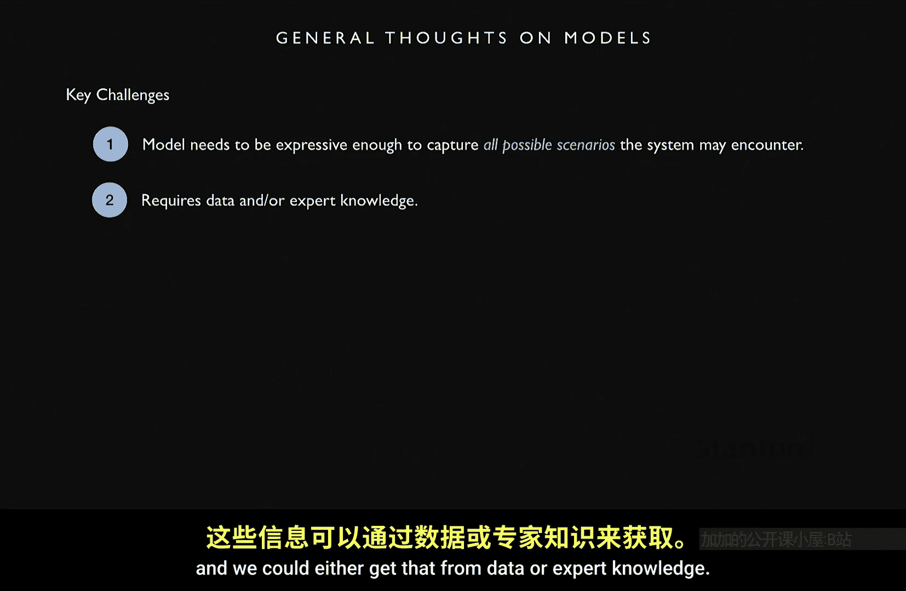

# 斯坦福大学【中英⚡安全关键系统验证｜Stanford AA228V I Validation of Safety Critical Systems】 p02 P2 System Modeling -BV15RkXByEW3_p2-

All right， we'll get started today so welcome back everyone and then yeah let's jump into lecture two。

 so this is a lecture on system modeling which corresponds to chapter two of the book。😊。

So I'll just note some of today might be review for some of you， some of it might be new。

But I just really want to know that we're kind of cramming a lot of topics into one lecture here today。

 so this lecture and the lecture next Tuesday are going to be a little bit a little different I guess in the rest of the lectures because we're going to talk about kind of those input components to the validation problem so we if you remember from last lecture we had the inputs as a system。

 the system that we want to test and then the property that we want that system to satisfy。😊。

So we're going to talk about kind of in this lecture how to set up the system and in the next lecture how to set up that property。

 and the rest of the course will be about validation algorithms。😊。

So I just kind of want to give a warning time might be a lot we might not actually get through all of it we'll finish up what we don't get through next Tuesday but if I am going too faster I brush over something definitely stop me and ask any questions that you have The other good news is that this lecture is kind of selfcontained so everything we learn here we're going to talk about how we can go about modeling the system because we want you to understand various ways to do that when you need to set it up in the real world。

😊，But for the rest of the course after this， we'll actually just give you the system that we want you to validate so everything this lecture is kind of self contained。

😊，okay， but let's jump into system modeling and I want to start again with just remembering the context we have here。

 so in this class we're essentially finding out as we said。

 and we said in the last lecture that you know if we're here to find out we don't really want to find out when it's too late。

 we don't want to find out when we've already deployed the system in the real world。

 what we'd rather do is find out in kind of this controlled safe environment。

 unlike these people did。Okay， so like I said， we don't want to find out in the real world。

 what we do want to do is find out in simulation because if things go wrong in simulation。

 it's not so bad versus if things go wrong in the real world。

 we can get ourselves in a lot of trouble。So today we're going to discuss ways to model systems so that we can simulate them for offline validation。

 so by offline validation， I mean essentially not in the environment we're intending to deploy the system in in some kind of simulated version of that。

😊，So plan for today。We'll start out with just some general thoughts I have on models that I want you all to know。

And then we're just going to go through essentially the steps required for building models。

So the first step is to select a model class， we'll talk about what that means。

Once we have selected a model class， we typically have some set of parameters for that model class and we need to figure out what they are。

 so that's the next step。And the final step is to validate the model。

 I'm not sure if we'll get to that today， but if we don't， we'll get to it on Tuesday。Okay。

 so let's start with some general thoughts on models。

 so there's many different types of models and simulators I'm sure you've heard of many of them。😊。

And what's kind of interesting is they don't even necessarily have to be on the computer。

 so it's essentially just some kind of safe environment where we can find out without having to deploy it in its real environment。

So an example of a model that's not on the computer would be like the neutral buoyancy lab at the Johnson Space Center。

 maybe some of you have seen this before， essentially it's this giant swimming pool that astronauts can do their training in。

Which simulates what it would be like when they're doing a spacewalk on the space station。

So this isn't actually a computational model， but this is a way for them to kind of find out what might go wrong in a safe environment such as a swimming pool on earth。

 not when they're out in the middle of outer space。So giant swimming pools are super cool。

 but in this class we're going to focus on computational models。

 so mathematical models that we can simulate on the computer。So models vary in complexityplex。

 so for example， let's imagine that we're modeling the dynamics of an aircraft so how an aircraft state evolves over time。

And for example， one option here would be to just have a couple of equations that model it state。

 so this is just saying that our altitude at the next time step is our current altitude plus our vertical rate times some delta t and similarly for the vertical rate。

 so this is just kind of two simple linear equations。😊。

Or what we could do if we want to model the dynamics of an aircraft is use this kind of very high fidelity flight simulator。

 so one flight simulator we use a lot in our lab is called Xplanne and it has all these very complicated dynamics so it's paying attention to the angles of the control surfaces on the aircraft。

 it's paying attention to the weight of the aircraft， the type of aircraft， the wind condition， etc。

So this is a much more complicated model， and there's kind of two ends of the spectrum。

 so we could have just a very simple model like these equations here。

 or we could go all the way up to this very high fidelity flight simulator。😊。

And essentially the goal here is that we want to pick the model that is just complex enough to capture what matters。

 so if we don't have to， maybe some of you who've worked with Xplan before could agree with me might want to avoid using this very high fidelity flight simulator in cases where it's not necessary and we could just get away with kind of these simple equations。

😊，And knowing when you we need something more complex versus less complex is typically problem dependent。

 but it's important when you're thinking about what model to use to try to understand the problem domain that you're in and pick something that's just complex enough。

So a good way to summarize this is this quote from Albert Einstein that saysEverything should be as simple as possible but not simpler。

Maybe we're not really sure if Albert Einstein said this。

 we wanted to put it in the book and Michael's requirement was if we put it in the book。

 we need to have a citation for it and so I started searching all over the place and everyone's kind like all the sources online are like he probably said it but they're not really sure he says something similar to it and so that everyone's like oh that's probably what he meant。

Either way， it's a good motto to live via when you're selecting your models。

And then we didn't put it in the book for that reason。Okay。

 another kind of thing that can vary with models is whether they're white box or black box。

 so a white box model means that we give it some inputs， so in this case we'd give it， for example。

 the current altitude of the aircraft and its current vertical rate and then we can see what equations are involved in determining the outputs so the next altitude and the next vertical rate。

😊，A black box model， on the other hand， essentially what we're doing here is we give it some inputs and then we don't really get to see what happens when it's doing things to these inputs。

 we just get to see what the outputs are。😊，And then of course。

 we can have something in the middle where maybe we know what's happening to some of the inputs。

 so in Explain for example， we know some of the dynamics equations that it's using。

 but maybe we don't know exactly what's going on inside。😊，Okay。

 so with that there's kind of a few key challenges that we have when we create models。

The first one is that kind of like we were saying， the model needs to be expressive enough to capture all possible scenarios the system may encounter。

 but you don't want it to be too expressive。So I want to kind of actually dwell on this point。

 this challenge for just a little bit longer， because I think it's really key and it's really important。

Because when you think about really what this means to capture all possible scenarios。

 that's like a pretty tall task， so imagine for example， that our system is a self-driving car。

 so now all possible scenarios is like all the pedestrians it might see all of the other cars on the road。

 what they might do， bikers， construction， it's so many things and so this is definitely like you know no easy easy feat here and it's worth putting a lot of effort into making sure that you capture all of these scenarios。

AndAnother thing I'll say is I've given a number of talks on validation at this point and at almost every single talk I get one question that is this。

 which is how can I capture all possible scenarios。

 my insert crazy complex system here will end up in and they'll say like I don't even know what they are so like were just saying for the self-driving car。

 like how am I supposed to figure out all possible scenarios that this car is going to end up in。

And my answer to them is always， yeah， it's a problem， this is extremely difficult to do。

 as I was saying。But I think there is some hope here or kind of a silver lining。

 which is stay tuned for the runtime monitoring chapter。

 because I think you what we could do is we can make the best effort to capture all possible scenarios or things that might occur in our model。

 but we also could realize that we are probably going to miss stuff。

 especially for very complicated systems that operate in very complicated environments。

So what kind of the next best thing we can do is deploy these systems with runtime monitors so that when we're operating at runtime。

 we can try to understand if we're in a scenario that we didn't model or something that we are unfamiliar with。

 so that would be my answer， but it is really a challenge。Okay。

 second challenge is we're going to talk a little bit about this today。

 we have to base the model on something， we need to know something about the real world and we could either get that from data or expert knowledge。

 but both of those can be kind of difficult to obtain for data you might need to then go into the real world and collect this data or you need to find an X。

😊。

