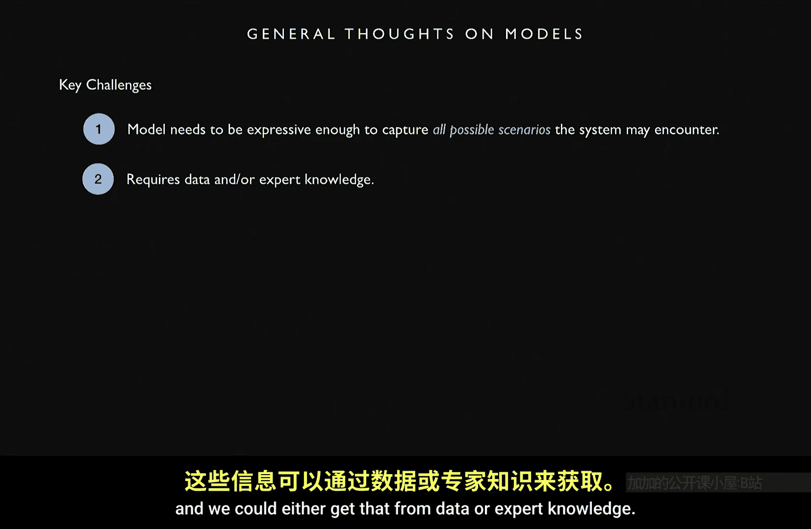

# 安全关键系统验证：02：系统建模 🛠️


在本节课中，我们将学习如何为安全关键系统建立模型，以便在部署前进行模拟和验证。我们将探讨模型选择、参数确定以及模型验证的基本步骤。

## 概述

上一讲我们介绍了验证问题的输入，即待测试的**系统**和该系统需要满足的**属性**。本节中，我们将重点讨论如何为系统建立模型，这是进行离线验证（即在模拟环境中而非真实部署环境中进行测试）的基础。

## 模型的基本概念

模型是真实系统的抽象表示，它允许我们在安全、可控的环境中预测系统行为。模型不一定是计算机程序，例如宇航员在地面巨型泳池中进行失重训练，也是一种物理模型。然而，在本课程中，我们将专注于可在计算机上运行的**计算模型**。

模型的复杂程度差异很大。例如，描述飞机动力学的模型可以非常简单：

```python
# 简单的线性动力学模型示例
next_altitude = current_altitude + vertical_rate * delta_t
next_vertical_rate = current_vertical_rate + acceleration * delta_t
```

也可以非常复杂，例如包含空气动力学、控制面角度、重量和风况等因素的高保真飞行模拟器（如X-Plane）。选择模型的关键原则是：**模型应足够简单，但又不至于过分简化**。正如一句名言所说：“凡事应尽可能简单，但不宜过于简单。”

此外，模型可分为**白盒模型**和**黑盒模型**：
*   **白盒模型**：我们了解其内部运作机制和方程式。
*   **黑盒模型**：我们只提供输入并观察输出，不了解内部过程。
许多实际模型介于两者之间。

## 建模面临的挑战

建立有效模型面临几个关键挑战：

1.  **模型的表达能力**：模型必须足够复杂，以捕捉系统可能遇到的所有场景，但又不能过于复杂。对于像自动驾驶汽车这样在复杂环境中运行的系统，定义“所有可能场景”本身就是一个巨大的挑战。一个可行的思路是，在尽力构建全面模型的同时，为系统部署**运行时监控器**，以便在遇到未建模的陌生场景时能够及时识别。

2.  **模型的知识来源**：模型必须基于对现实世界的了解。这些知识可以来自**数据**（例如，通过传感器收集）或**专家经验**。获取高质量的数据或专家知识都可能很困难。

## 建模步骤

以下是构建系统模型通常遵循的三个主要步骤。

### 第一步：选择模型类别

首先，我们需要根据系统特性和验证目标，选择一个合适的模型类别。以下是几种常见的模型类别：

*   **状态机**：适用于系统行为由离散状态和状态间转移定义的情况。
*   **马尔可夫决策过程**：在状态机的基础上引入了概率转移和决策点。
*   **微分方程**：适用于描述连续变化的动态系统，如物理运动。
*   **基于智能体的模型**：适用于由多个相互作用的自主实体（智能体）组成的复杂系统。
*   **基于仿真的模型**：使用高保真仿真器（如游戏引擎或专业模拟软件）来模拟系统。

选择时需权衡模型的**保真度**（接近真实系统的程度）和**易处理性**（进行分析或模拟的计算成本）。

### 第二步：确定模型参数

选定模型类别后，需要确定其具体参数。参数来源主要有两种：

1.  **基于第一性原理**：利用物理定律（如牛顿运动定律）推导出参数。
2.  **基于数据**：通过收集系统运行数据，并使用**系统辨识**或**机器学习**等技术来估计参数。

### 第三步：验证模型

模型建立后，必须验证其是否准确反映了真实系统。这通常涉及将模型的预测输出与真实系统的观测数据进行对比。如果模型不够准确，则需要返回前两步进行修正。我们将在下一讲中更详细地讨论模型验证。

## 总结



本节课我们一起学习了系统建模的基础知识。我们了解了模型的概念、类型（白盒/黑盒）以及建模时面临的主要挑战（平衡表达力与复杂性，获取知识来源）。接着，我们介绍了建模的三个核心步骤：**选择模型类别**、**确定模型参数**和**验证模型**。下一讲，我们将深入探讨如何形式化地定义系统需要满足的**属性**，这是验证工作的另一个关键输入。