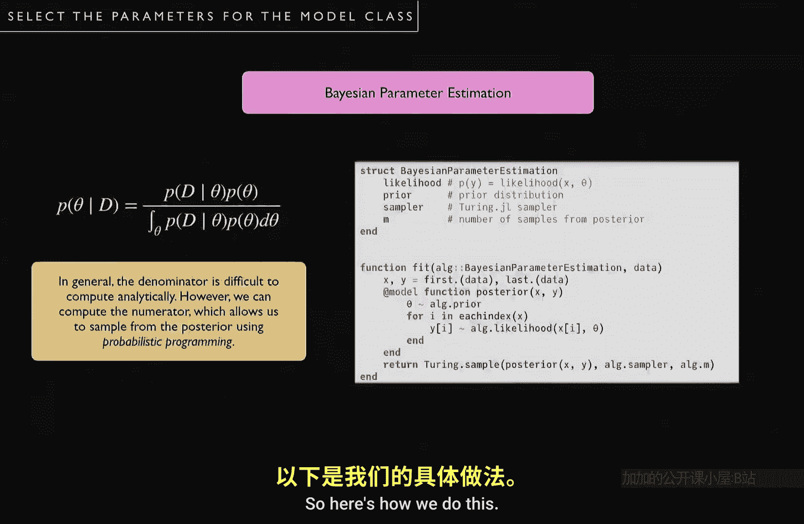

# 斯坦福大学【中英⚡安全关键系统验证｜Stanford AA228V I Validation of Safety Critical Systems】 p03 P3 Property Specification 1 -BV15RkXByEW3_p3-

Okay so today we're going to finish up where we left off last week talking about system modeling。

 so you remember that there's two inputs to validation algorithms。

 one is a model of the system and the other one is a property specification so last week we talked about the first one which was modeling the system we didn't quite finish so we're going to finish that up today and then we're going to move on to the second input which is the property that we want the system to satisfy。

And so before I get into that， I just wanted to really quickly kind of zoom out for a second here。

And just kind of give you a concrete example to kind of have some context in your mind for what we're thinking about when we're building models because I know it can get kind of easy to get lost in the math。

 so I just want to quickly provide this kind of concrete example where if you're getting lost in the math you can try to think back to this and kind of ground the things that we're learning。

So we're in the Air Astro department so I'm going to go ahead and try to use an aircraft。

 they don't teach you to draw aircraft when you get your master's and PhD in the Air Astro department。

 but that's the best I can do。So we're using we have this aircraft kind of flying along。

And it's you know changing altitude every so often and this is the ground here and we're going to assume so if we were going to model this aircraft。

 we would need to model its decision making， we would need so its agent， its sensor。

 and then also its environment。Let's just think about the sensor and let's think about like one part of its state。

 so let's just think about a sensor。That's responsible for measuring its height above the ground or its altitude。

 and so as we go along， we'll get different measurements of this height， something like this。

And they're kind of some noisy version。Of the actual height。So these are our observations。

 when we talk about data， this is the observations that we're getting。

 this is the data that we're getting。And then let's assume also that for this kind of data collection run in the real world。

 we also had this really， really expensive， super good。

 super accurate altitude sensor that we ran along with it that basically gave us kind of the ground truth of what was the actual height that we're at。

And so then we can get these pairs that are like H。And a hat。

Where H hat is going to be that measured version and H is the ground truth version。

 so we can have H1， maybe have H2。And so on all the way to M data points。And so in this case。

 our state。Is H and our observation is H hat。And so what we can do is we could then maybe make a plot。

Where on the X axis， we plot H and on the y axis， we plot H hat and it will probably look。Something。

Like this？And what we're trying to model。😊，Is our observation model。

 which we said is the probability of getting a particular observation given that we're in state S so in this case our observations are these H hats。

 so probability of observing H hat given that we're at height H。😊。

And so the first thing we need to do， which we talked about last time is select a model class。

 so what is a good model class to kind of represent this data that we see here？And to me。

 I don't know， it kind of looks like the H hat is a linear function of H with some noise added to it。

 so that indicates to me that maybe a conditional Gaussian model is a good idea here。

So we're going to model as a conditional Gaussian where we say。

H hat comes from some function parameterized by theta of H。With some noise added to it。

And then I said I think it looks kind of linear， so I'm going to take it one step further and say that's a linear function。

 so we'll say theta 1 times H， so that'd be the slope of that line。Plus theta 2。

 and then this sigma squared。And so now we have our model class， and if you remember the second step。

😊，Was to then perform some sort of optimization to pick these parameters。

 So last time we learned about maximum likelihood optimization。

And then that would give us some values for the parameters so to me this looks kind of like a slope of 1。

 so we'd probably get something like theta 1 equals 1 theta 2 is probably zero the y inters around  zero here and then our sigma squared it is like some value maybe say like 0。

05。嗯。Okay， and so that's kind of what I want you to be thinking of when we're talking about taking data and fitting a set of parameters to that data and selecting model classes。

 and then just kind of one more thing here， let's say that we instead collected a bunch of data here。

And it looked maybe。Sort of like that or something。

Okay so this doesn't look linear anymore first of all you should think about what you're doing if this is what your altitude sensor looks like you might just want to throw it in the trash because this is probably not the best plan。

 but say you do want to use the sensor and you do want to model it to make a model of the sensor。

 you probably don't want to select kind of a linear model here anymore and so you're going to need this kind of more expressive model class which is what I was talking about last week so。

😊，Hopefully this kind of just helps ground all the things we've been talking about。

 what questions do you have on this example？Yeah，S doubt or artist。

 what did you write on the second one。All right， after。That's nice。Which one。哦，我我是我是 letter。Here。

 here。到了对。Is that theyOr what's the thing right next to？Okay， this is with me F of all theta H。😊。

Yeah， always let me know if you can't。Okay， cool， so let's back up where we left off last time。

So if you remember。We had talked about how。I'm super indecisive。And so for that reason。

 I really like Bayesian parameter learning because then we don't just have to pick one set of parameters like we did with maximum likelihood parameter learning。

 instead we get to kind of maintain this distribution over all possible parameters。

So we talked about how we can do that and it turns out we want to model this P theta given D。

 but we don't know how to compute this directly。And so we said what's nice is that we do know how to compute PD given theta。

 and in fact that's actually what we needed to do for the maximum likelihood parameter learning。

 so we talked about how to do that。😊，And then we said， okay， well。

 if we can only compute PD given theta， we need to use this thing called Bayase rule。

 so we derived that from the definition of conditional probability。😊。

Thanks for pointing out this typo last time it should be fixed now。

And so we drive phase rule and then we said， okay， let's take this and apply it to our P theta given D and we got this expression here。

And we kind of examined this further and we said okay。

 this expression has what we call likelihood model。

 which is exactly what we were optimizing in our maximum likelihood parameter learning。

 and then it has this extra term p theta which is a prior。

 so this is something we didn't have with maximum likelihood parameter learning here。

 we're specifying what is kind of our belief before we see any data over what possible values or the likely values for the parameter theta。

 so I gave the example if was if someone handed me a quarter。

 and they said what's the probability that this quarter comes up heads。

 I'd have this kind of strong prior that assigns a lot of likelihood to theta being 0。

5 or like 50% being the probability or chance that it comes up heads。😊。

Then we observe some data and we update our belief over the probability that it becomes heads and we get this thing called the posterior distribution over theta。

But then I told you that we have this problem where so that was the discrete case。

 we also have the continuous case where we have kind of the summation in the bottom turns into an integral。

😊，But regardless of the expression we have， it's generally quite difficult to compute this result analytically。

So when we have the summation， the number of terms in the sum scaled exponentially with the dimension of sta in this continuous case。

 computing this integral can be quite difficult analytically。

 and so a lot of times we can't actually just get kind of an analytic function for these values or for these quantities here。

啊。But there is something that's kind of cool， which is so it's really hard to compute this because we need to compute it for every single value of theta so we need to sum up over all possible values of theta。

 we need to integrate over all possible values of theta， but if I just give you one value of theta。

 we can compute this numerator， it just involves computing PD given theta which we did for our maximum likelihood estimation。

 and then it involves plugging theta into our prior distribution to get the value up。😊。

So what we're trying to says， we can compute this numerator。

And what's kind of cool is through this thing called probabilistic programming。

 we can actually then draw samples from the posterior so we can get samples that look like the posterior distribution over theta。

So here's how we do this I'm not going to dive too deep into how probabilistic programming works。

 but the good news is that later in this course we actually are going to dive into how it works it uses a method called。

😊。

