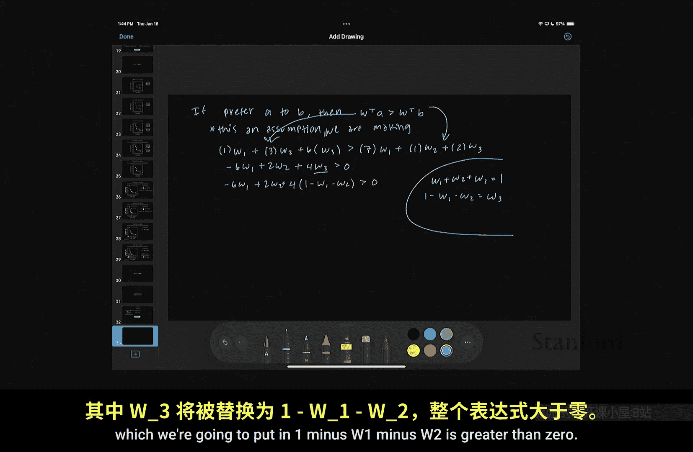

# 斯坦福大学【中英⚡安全关键系统验证｜Stanford AA228V I Validation of Safety Critical Systems】 p04 P4 Property Specification 2 -BV15RkXByEW3_p4-

Okay， so we left off。Last week， and we were talking about。Composite metrics。

So let's review that real quick。Okay， so we were saying。

A lot of times we have multiple metrics that we care about。

 but a lot of times there are odds with one another。

 so for example we might care for an aircraft collision avoidance system about both the collision rate for it and also the alert rate for it。

And then ideally both of those are zero but that's typically not achievable and we typically have some kind of trade off so you can imagine each point on this plot is like a different design and we said one of the ways we kind of understand the trade offs between multiple metrics is this idea of Pato optimality where a point is preto optimal if we can't it without improve one metric without making another one worse。

So we said this point is not Pareto optimal because we can make it better in both collision rate and alert rate。

 we have other designs that were better in both areas， but this point for example。

 is Pareto optimal because there's nothing that we can do to make one metric better without making it a different one worse。

嗯。And so then we said we have this thing called the Pareto frontier。

 which consists of all of the Pareto optimal designs that we have。

 but then these are all kind of equally good if we don't do anything else。

 and so we need to create these kind of composite metrics to allow us to select one of the points along this frontier。

So we talked about some different composite metrics we can use。

 one was the weighted sum method where we just give each of these different metrics a weight。

 so how much we care about alert rate versus how much we care about collision rate in a relative sense。

 and then we just compute the weighted sum of the values of all the metrics。So in this case。

 for example， if we said we care， maybe we wanted our weight vector to add up to  one。

 and so we gave 0。8 of the weight to collision rate or sorry to alert rate。And  or 0。

2 collision rate， then we would pick a point。With the highest weighted sum。Okay， similarly。

We talked about another type of metric we could use that used the goal distance。

 so we just wanted to figure out which point was closest by some distance measure to our goal。

 and typically we picked the goal to be something called the utopia point， which is the in our case。

 zero alerts and zero collisions， we want to see how close we can get。

So we compute the distance between all of our points and the goal。

 and then we pick the one that's the closest。And then finally we had one more metric where we're like。

 well， you could just combine them and there's lots of different things you could imagine doing。

 but one option would be this like weighted exponential sum metric。

 which is essentially just kind of doing this distance thing but with some weights as well。Okay。

But I want to think again， just real quick about this weighted sum metric because we're going to dive into it a little bit deeper now。

And so you can think so here I was just like okay it's 0。8。

2 that's how much we care about each of them， but how could we actually go about picking this so you might say well you just ask an expert and you go up to them and you're like。

 hey what is your weight between alert rate and collision rate but that's kind of a weird question to ask people and so you might be wondering like how do we pick the weights and so a more normal thing would be to ask someone well which do you prefer do you prefer a design that has this alert rate and this collision rate versus this design that has this alert rate and this collision rate which of those two would you pick if you had to？

And it turns out if we do this a bunch of times， we could actually elicit what their weight vector is without them having to like tell it to us or write it down。

So we're going to do an example here， I brought the candy back。

 and we're going to try to learn a weight vector over some candy preferences。

It'd be weird if I came up to you and I was like， hey。

 I have these Minem sour patch kids and skikittles。

 please specify a weight vector for me that adds up to one and tell me the weight of how much you care about each of these so instead I'm going to give you pairwise queries for this。

So again， we have we're trying to learn this way， vector。We're going to require that it sums to one。

And we have three different candies that we want to understand the relative waitinging between。

 so Minems， sour patchch kids and Skittles and we're going to do so using pairwise queries so we'll do a little demonstration here。

Again， we have this weight vector that we want to learn and。

W1 is how much we care about M&Ms relative the others W2 is how much we care about sour patchch kids and W3 is how much we care about Skittles。

 and we said that we want all of our weights to sum up to one so what this plot is showing here is on the X axis。

We have W1 on the Y axis， we have W2 just to make it easier to visualize， we're not visualizing W3。

 but if we know W1 and W2 since they have to add up to1， we automatically know what W3 is。

And what I've shaded here is any space that's not allowed to be a possible weight。

 so we already have the constraint that W1 plus w2 plus w3 is equal to1。

 so this whole area here would be a region where they don't satisfy that constraint。

 so this shaded area is not allowed and our weight vector could be anywhere inside of this unshad area。

Okay， so I need a volunteer who likes candy and has opinions about it。All right。

 firsthand I thought you can say that if you want but it will result in you getting candy in no worries okay so okay so so what we want to do is I have this kind of final question I'm gonna or final pair of different candy so all these bags have different amounts of the Minem's sour patch kids and skikittles this bag has one Minem four sour patch kidss and five skikittles and this bag has five Minems three sour patch kids and two skikittles and I'm going to give you at the end the one we think that you'll like better but first we need to infer your weight vector over these various options。

And so the first thing I'm going to ask you is this kind of first query here so the bag I have the two bags I have here I realize that I didn't actually need to make candy for these bags but I'll give them out after so I was gonna have candy but one of these has one M&M three sour patch kids and six skittles and the other one has seven M&Ms one sour patch kid and two skikittles so if you had to choose between these two which one would you pick you'd pick a okay great so。

Let's think about what it means that he picked A。Okay。So because he picked A。

 we know that if we prefer A to B。嗯。Then。We know that it must be the case。

That when we take the weighted sum with our weight vector for a。

 it's got to result in a value that's greater than when we take the weighted sum。

Of our weight vector with the values in B。But I'll note this is an assumption that we're making。

We are assuming that。In his mind， he has this weight vector， maybe he doesn't know about it。

 but that's how he's making these decisions。This is an assumption we are。

MaAnd that's how he's making decisions when we ask him his preferences。But this might not be true。

Okay， this is an assumption that we're making， and this might not be the case and we'll actually talk when we finish up about how we could potentially relax that。

But given this assumption， we then know that if we preferred A to B， so we preferred1 M&M。

 so1 times w1 plus。Three sour patch kids， so three times W2。Is that right？

136 okay and you preferred that to the712 Yeah， okay for so it's three sour patchsh kidss。

 plus six skikittles。So we know that that must be greater than seven times W1。

Plus1 times W2 plus2 times W3， okay， so we just expanded both of these sides。Okay。

 now I'm just going to do some like algebra here， so multiply all of this out and so I'm going to just kind of like subtract everything over so we get negative6 W1 plus2 W2 plus。

4 W3。I's greater than zero。We also separately kind of had this constraint where we saidW1 plus W2 plus W3。

Had to equal 1， we had to have the weight sum to 1。

 so what we can do is just manipulate this a little bit to say that 1 minus W1 minus W2 is equal to W3。

And so I'm just going to insert that in here。So we get minus6w1 plus 2W2。Plus，4。Times W3。

 which is we're going to put in1 minus w1 minus W2。I's greater than zero。

 and so then we can continue to multiply things out。

And eventually。