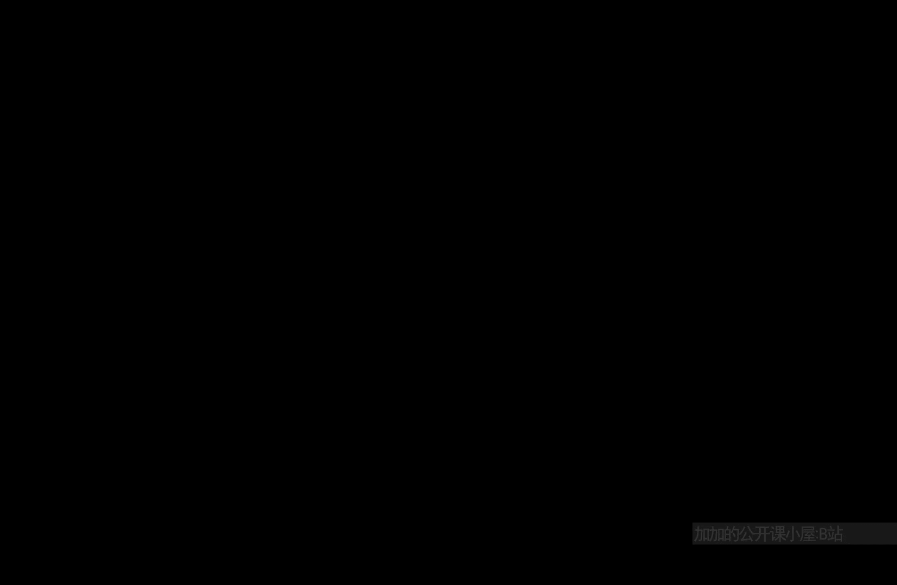
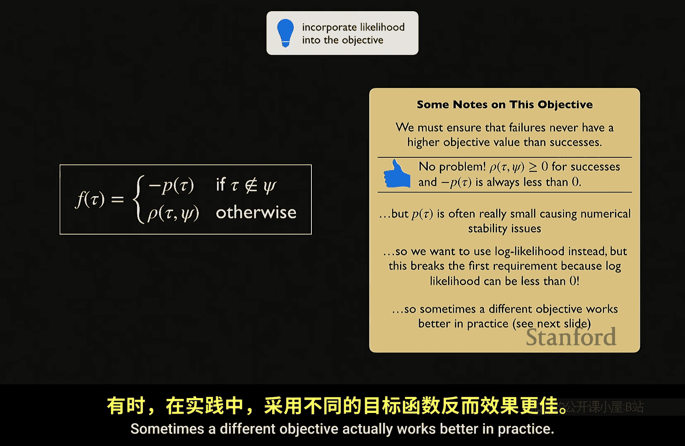

# 斯坦福大学【中英⚡安全关键系统验证｜Stanford AA228V I Validation of Safety Critical Systems】 p06 P6 Falsification through Planning -BV15RkXByEW3_p6-

So we're going to pick back up where we left off on Tuesday。

 so we were talking about finding failures using optimization。

And we had set up this optimization problem where we said that we had kind of these variables we need to decide。

 which was the initial state and some sequence of disturbances。

 we were going to minimize some objective function that represents closeness to failure。

 subject to the fact that tau or our trajectory is a rollout given that initial state and sequence of disturbances。

So we said we needed some objective that kind of represented closeness to failure。

 and we remembered from chapter three that robustness kind of does exactly this。

 exactly what we want here。Or smooth robustness if we're going to use an optimization algorithm that needss gradients and so we said we'll just use this as our objective function but then we were just talking at the end of lecture about how this might be a problem because。

😊，It might result in very unlikely trajectories so if we just tell it to minimize robustness it can kind of do whatever the heck it wants to try to make it the robustness as small as possible。

 but in doing that it could potentially do very unlikely things so for example we saw this trajectory here where we're sampling disturbances from our disturbance distribution but this disturbance here according to this distribution is very low probably it's very unlikely。

And if we just do that a whole bunch of times， we are able to make the pendulum fall over。

 we're able to make the trajectoryy fail， but this is kind of very unlikely and maybe not a type of failure that we're necessarily interested in。

So we said our solution here was going to be to incorporate likelihood into the objective。

 so that's what we're going to do now。We kind of left off here where we said， okay， well。

 if we're going to do that， we now need to know how we could actually evaluate the likelihood of a trajectory。

So the likelihood of a trajectory is just going to be the likelihood of the initial state that we got and then the likelihood of all of the disturbances that we sampled after that occurring。

So what we're going to do here is we'll show kind of the same trajectory we've been looking at right over。

And now we're just going to kind of keep track of everything that we've sampled and the likelihood of that occurring。

 So we'll say P tau。 So we'll say P tau represents the probability of trajectory tau。

iss going to be equal to the probability of this kind of initial state that we sample so we look at whatever the probability density was for that initial state。

 we're going to include that in our probability of the trajectory。😊。

And then we need to keep kind of accumulating probability every time we sample something。

 so next we sample a disturbance for the first time step。

 so we wanted to look at the probability density for that disturbance and now we're saying okay。

 it's the probability that this initial state occurred and that this disturbance occurred and so we're just going to multiply it over here。

then we go to our next state， we now sample another disturbance from this distribution。

 so we look at the likelihood of that disturbance that we sampled。Add that to our product。

 and then we kind of just continue doing this for the rest of the trajectory。

All the way out to our final depth， where we have the final disturbance that we sampled。

So the likelihood of a trajectory is just going to be the product of all of these things。

So here it is in code， specifically we have kind of the product of each disturbance at each time step given the state action and observation。

 we could break that up into each kind of component of the disturbance。

 so we said we had a disturbance for the agent a disturbance for the environment and a disturbance for the sensor。

 so we just multiply those three together， so that's how kind of each of these breaks down。😊。

And so here's what it looks like in code in the book。Here we're implementing the log PDF。

 we're just taking the log of this and the reason for that is because as we begin to multiply things。

 when we multiply small numbers and we multiply many of them together， we get very。

 very small numbers and that can be kind of difficult to work with and result in some poor numerical stability so if we take the log of this。

 we're able to just do addition instead of multiplication and so that's why we compute the log PDF here。

Here we're also working with logs， so it actually does， this is like only somewhat right。

 but it actually does return the PDF because we take the exponent of it at the end。But in general。

 we're working with logs in this function as well where we're just kind of getting the probability。

 the log probability for our initial state that occurred。

 and then we're adding on the log PDF of the disturbance that occurred at every single time。😊，Okay。

 so now we know how to calculate the likelihood of a trajectory so we can incorporate that into our objective function with the hope of finding likely failures。

So here's our new objective function that we're going to consider here。

 and there's two possible cases。So the first case is that the trajectory is a failure。

So in this case， it's written tau not in psi， so every time you see that we'll use this quite a bit in the class。

 anytime you see that that means like trajectory， not in specification。

 meaning trajectory doesn't satisfy the specification， meaning the trajectory is a failure。

 so that' just kind of a mathematical way that we write that a trajectory is a failure trajectory。

So if it's a failure trajectory？Then we're going to return the negative likelihood of the trajectory。

 so that means like if we put a failure trajectory into this objective。

 we're going to say take that failure trajectory and try to make it more likely。

 try to minimize the negative likelihood of it。And then the second case here。

Which is the case at the bottom， if the trajectory is not a failure。

 then we don't care about its likelihood just yet we just want to move the trajectory closer to being a failure。

 so we still try to minimize the robustness if it's not a failure。Okay。

 so now I'm going to show kind of what this looks like。

 so here I'm showing a different example than the pendulum we've been seeing。

 this is a grid world where the agent can kind of move around on these grid squares。

 but every once in a while instead of moving in the direction it wants too it will slip to some other grid square in a different direction。

😊，you can imagine if we had no disturbances at all。

 so the disturbances here are what causes us to kind of slip in these other directions。

 if we had no disturbances at all， we would just follow this path here to the goal and we're trying to avoid the obstacle。

And so a likely trajectory is kind of going to stay near this path， but we want it to also fail。

So I'm going to show what happens if we just minimize the robustness versus if we minimize kind of this new objective and what I'm showing here is kind of what I will be showing is kind of the evolution of a population method。

 which is kind of a category of optimization algorithms that I'll talk about in a minute。

 but really the idea is just that we maintain a whole population of samples so we maintain a whole population of possible trajectories and our goal is to kind of move that population iteratively towards optimizing our objective。

😊，So when I show the next animation here， you're going to see both of these populations change and you'll see how they differ with one objective versus the other。

 so let's check that out。Okay so you can see here we've kind of converged this population where most of the trajectories just kind of go almost straight to the obstacle。

 and then over here， we've kind of with this new objective that incorporates likelihood。

 we' found this failure that stays kind of close to the nominal path and then only kind of deviates right at the end and falls into the obstacle。

So here's just what that looks like kind of over time throughout the progression of the algorithm。

Okay， so that's what we want to do and it turns out if we could actually find like the global minimum of this objective。

 we would get the most likely failure， which is a nice property to have。

 however a lot of times we can't actually find the global minimum because our optimization algorithms just aren't designed to do that or aren't able to do that。

So I just want to give you a few notes on using this objective。

The first thing is that it needs to be the case that failures never have a higher objective value than successes。

 because if that's the case， then we might actually not encourage the algorithm to find a failure。

 it might find a success that's like somehow better than a failure。But you might be thinking okay。

 no problem because when we do have a success trajectory。

 we know that the robustness is greater than zero， and so we said you know in this case where we have a success trajectory we just return the robustness。

 so successes are always going to have positive objective values。

And then the negative likelihood of something， which is what we return when it's a failure。

 well since probability always has to be positive， probability density always has to be positive。

 this is always going to be negative， so this is always going to be less than zero。

 so it seems like we're going to go。And that's true。But there's also one more problem。

 which is that this kind of P of tau here， as we were talking about earlier。

 we're multiplying lots of things together， lots of small numbers together。

 so we might get a really really small number and this might be not very numerically stable so it can be difficult for optimization algorithms。

 especially on the computer to actually go about optimizing this type of objective effectively。😊。

And so you might think， okay， let's just take the log。

 which is like what we did before to make everything more numerically stable。

 But then this breaks our first requirement that the log likely because the log likelihood could be less than 0。

 So that means this could be less than 0。 So this negative， this could be greater than 0。

 and then we don't have this property that we needed anymore。

 And so all of that is kind of just to say that even though this。

 if we could get the global minimum of this， This is what we would want to do。

 Sometimes a different objective actually works better in practice。😊。

And so in practice， what we often do is instead kind of just combine。

