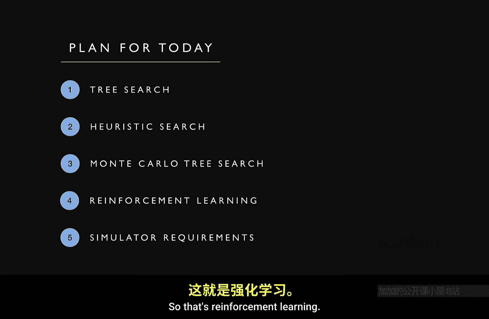
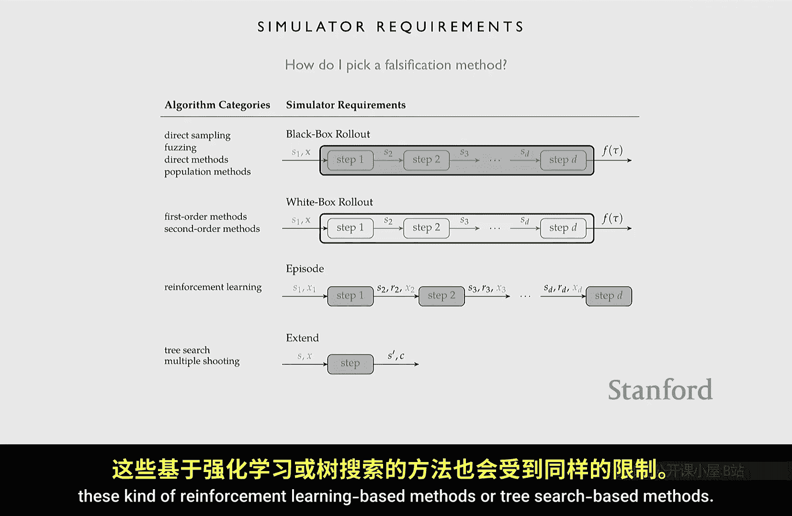

# 斯坦福大学【中英⚡安全关键系统验证｜Stanford AA228V I Validation of Safety Critical Systems】 p07 P7 Guest Lecture： Anthony Corso, Terra AI -BV15RkXByEW3_p7-

Today we're going to jump back into where we left off last week and then I'm just going to finish up kind of these last two things and then we're going to have a really cool guest lecture that I think you guys will really enjoy。

Okay， so last week we talked about doing falsification so finding failures of systems。

 and specifically last Thursday we talked about doing falsification using planninging techniques。

 so we talked a lot about tree search， specifically two different types of tree search。

 heuristic search and Monte Carlo tree search， where heuristic search was a lot of different variations of an algorithm called rapidly exploring random trees。

And we left off with my Carlo research， and so today。

 I just want to dive into kind of these two last things， starting with reinforcement learning。

So if we kind of take a step back and think about kind of the high level approach to what we were doing or the high level setup that we have here。

Is we have this kind of system that we've been testing。

And we can think of ourselves kind of testing the system as an adversary for the system。

 so we're like trying to cause the system to fail。And what the adversary can do is it can give disturbances to the system at each time step。

 the system then takes its step calling that step function we talked about。

And then the system can spit back out some reward for the adversary。

 and so it's kind of weird to think of reward as kind of being a bad thing， but in this case。

 because it's an adversary， the adversary gets rewarded， kind of the worse the situation is。

 so the closer that the system is to failure， the higher the reward the adversary will get because the adversary is trying to make it fail。

And so this kind of loop here where you have this system here， you have this adversary。

 this might look familiar to some of you。And it might specifically remind you of the answers kind of already on the slide。

 it might remind you of reinforcement learning。And so what's really cool and the kind of the key insight here is that this is exactly the setup that we have for reinforcement learning where we're trying to you know train an agent to do some task and it gets some reward feedback and it can take some actions。

 in this case the actions are disturbances。😊，And we don't call it an agent。

 we call it an adversary in this class because we don't want to get it confused with the agent that's in the systems。

But the idea here is now we can just take advantage of all of these reinforcement learning algorithms that are out there using this setup to train an adversary that can cause our system to fail。

So I'm not really going to get into like what the different reinforcement learning algorithms are。

 that's obviously another entire course here at Stanford。

But whats cool is if we can set our system up in this way。

 we can just plug in off the shelf reinforcement learning algorithms to do this。

Why would we want to do this？So what's really cool about this is there's been a ton of research in the field of reinforcement learning over the last couple decades to design reinforcement learning algorithms that are sample efficient。

 so we want to you know do the fewest steps through this loop as we can to learn a good policy or to learn a good adversary and the entire field of reinforcement learning a huge focus area is this kind of sample efficiency so we can take advantage of all of this research and work that's already been done in that field。

In order to very efficiently find failures using reinforcement learning， which is pretty cool。

Another thing that's cool that's kind of different from the other algorithms that we saw last week。

I that it can generalize to different initial states， so if you remember when we were doing research。

 we kind of started from some initial state and then we just kind of built a tree out from that。

And so we would need to start from a whole bunch of different initial states if we wanted to find failures from different states using treese。

 but with reinforcement learning， a lot of these algorithms allow the agent to kind of generalize to a lot of different states or the adversary to generalize to a lot of different states。

 and so we can actually just kind of off the bat， find failures from a lot of different starting points。

Okay， so now I'm going to show an example， so what's going on here is we have our continuum world again。

 but now instead of just starting from kind of one initial state over here as we had been for the other part of this lecture。

😊，We're going to start from a whole bunch of different initial states。

 so all of these kind of trajectories here are just trajectories that start from some initial state and then roll out to some path。

And our goal is to make all of these trajectories fail。

 so right now none of them are actually ending up in the obstacles and none of them fail。

 and what we want to do is train a reinforcement learning agent to select disturbances in each of these different states that it's in throughout its trajectory to cause it to run into the obstacle。

So when I show this animation， you'll see kind of over time what the training of this reinforcement learning agent looks like。

 and you'll see that we can kind of progressively train it to produce failures from these different initial states。

 cool so now you see that most of these trajectories， they start from some initial state。

 and we've trained this adversary to pick disturbances that cause it to move into the obstacle。Okay。

 and so this is what the training kind of looked like over time so after you know a few training steps it still not hasn't quite figured out。

 but as we you know train for longer， the adversary is able to get better and better at causing the system to fail Yeah what exactly you mean by causing it to it turning the environment from the agent's perspective or is it or forcing an agent's hands or what exactly is it Yeah your question so the question was can I explain like what exactly I mean by causing it to fail so what's going on here is like that loop we had that I showed a few slides ago？

This loop here， so at every single time step the adversary gets to pick a disturbance。

 so the disturbance is like those things we talked about before where it could be on the agent。

 it could be on the environment， it could be on the sensor。

 whatever the disturbances are for the system， at every time step the agent or the adversary is picking that so we're basically training an adversary to pick disturbances that should cause the system to fail。

I think we'll just have to watch that cool animation again。Oh， darn。Okay。

 I can't see it animating on my screen， which is why I always look up there when it's like actually moving。

Okay， cool， so one last thing here， I think I have found the actual use for the fireworks animation。

All right。Okay。2。So just one more note here， so using MCTS。

 which is what we talked about last week and then reinforcement learning to search for the most likely failure of a system is often referred to as a concept that we call adaptive stress testing so if you've kind of heard that phrase thrown around all it means is kind of doing what we just did and typically we associate adaptive stress testing if your objective that you're using so in that case maybe the reward for the reinforcement learning agent has some notion of likelihood in it but in general it's just when we're trying to find the most likely failure we call it adaptive stress testing and Anthony's going to talk a lot more about that today in his guest lecture。

But what's kind of cool is that the idea of adaptive stress testing was actually formed in our lab here by a former student named Richie Lee。

 so you can check out this work if you're interested and Anthony again will talk a lot more about it。

Okay， so that's reinforcement learning and then finally I just want to briefly touch on simulator requirements but more generally I just want to talk about this topic of like okay how do I actually go about picking a falsification method so we just went over a ton of methods in the last week or so for doing falsification and so you might be wondering like okay well how do I decide what to do and maybe this is also relevant as you're doing the project。

Like what do I even decide what to do and so there's a lot of considerations here so one is just kind of a general consideration it's very domain specific so some of these algorithms might work really well in one domain and work terribly in another domain and sometimes you don't know until you just try them out。

😊，Another thing to think about is kind of the rarity of failures。

 so if the failures of your system are not super rare。

 like it's not safety critical or it's just in one of its initial stages and it's still failing quite often。

 then it might not be super efficient to go all the way to applying like MCTS to find failures or these like big gradientbased optimization to failures。

 you might just find the failures by doing like that direct sampling that we talked about kind of that first algorithm。

We talked about， and in that case it's probably going to be more efficient because there's no reason to sit down and try to take gradients or do tree or anything like that。

 if failures are already easy to find， but kind of the more rare these failures get。

 the more benefit we'll see to using these like very sample efficient algorithms like treese。

And then finally， kind of what's shown on this slide， this is a figure that we have in the book。

 we just want to talk about， so one thing that will already limit you to what falsification methods you use is the type of simulator that you have。

 so the type of model or a simulator that you're using to simulate your system。So for example。

 suppose we have a simulator that we can put in an initial state and we can put in a sequence of disturbances and we get out you know the trajectory that occurred or maybe its robustness or something like that。

 but we don't get to see what actually happened in between to generate that trajectory so maybe for example this is like a big flight simulator we don't actually know what's going on under the hood in that case then we could use methods like direct sampling。

 fuzzing， direct methods， population methods， all these methods that don't require gradients。

So that's something that could already kind of limit you off the bat if you can't take the gradient of your system。

 then you can't use these like first order and second order methods。And then furthermore。

 these kind of reinforcement learning based methods or research based methods。

 they require us to actually be able to take individual steps of our system。

