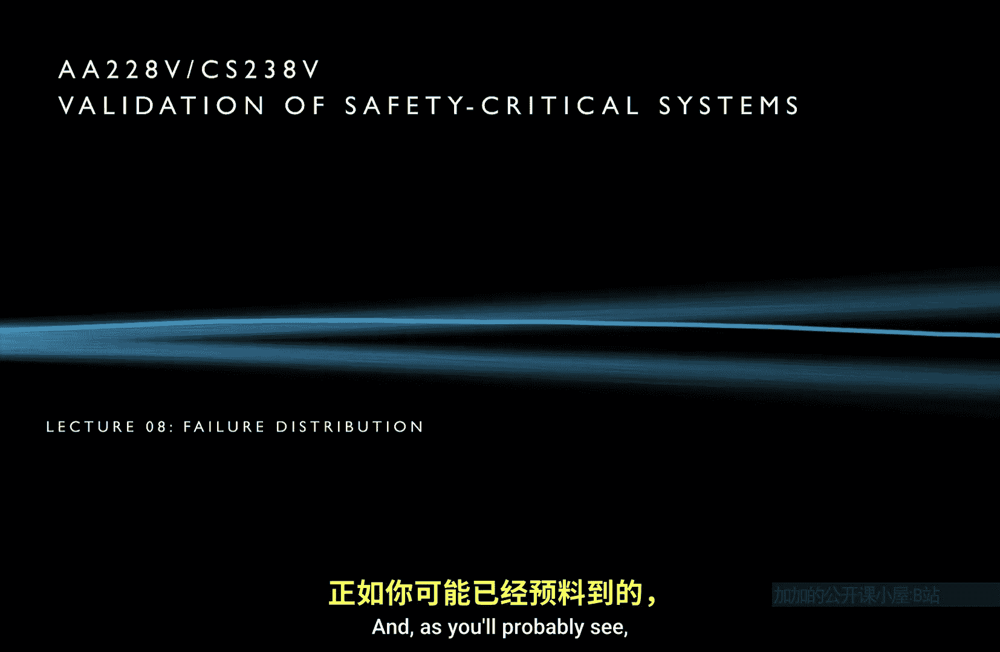
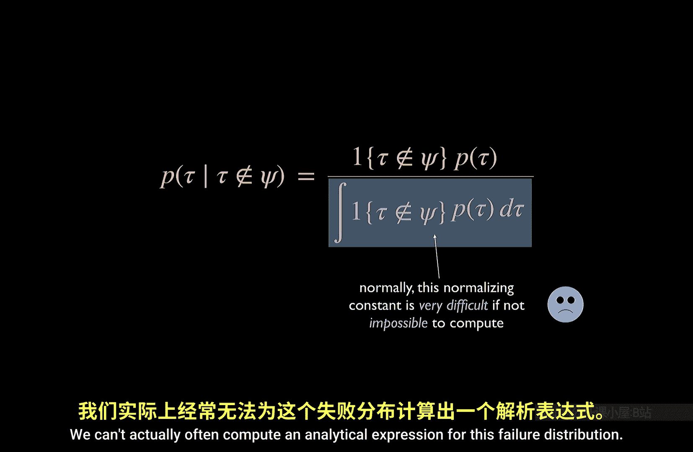
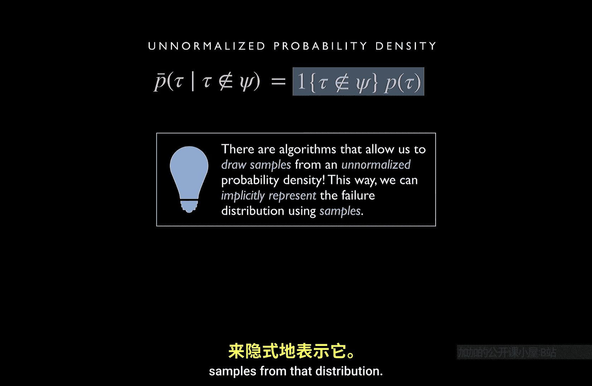
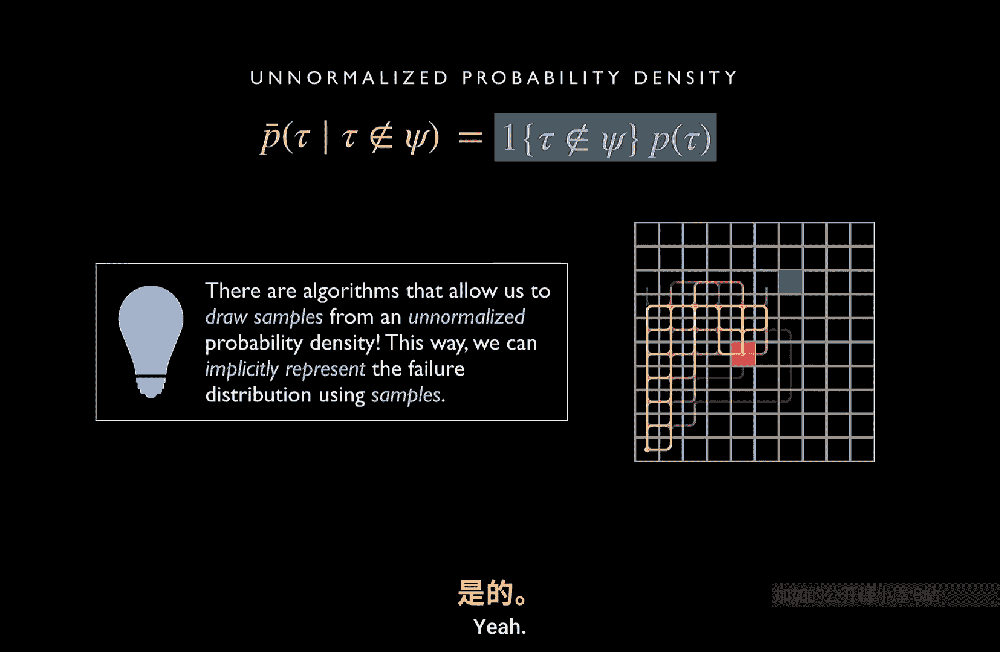

# 斯坦福大学【中英⚡安全关键系统验证｜Stanford AA228V I Validation of Safety Critical Systems】 p08 P8 Failure Distribution -BV15RkXByEW3_p8-

I'm super excited about the lecture today， so before the course I was kind of figuring out how the lecture materials were going to look and preparing slides and some of the slides in this lecture is actually what I started with because I was just so excited to talk about these topics。

😊，I think that they're like extremely mathematically satisfying and kind of visually satisfying so hopefully you enjoy it as well the other thing I want to say before we jump in is I think these topics when I was kind of first learning them it took me kind of a few times through before it really clicked my mind maybe that's just because you know they weren't presented as beautifully as i'm about to present them to you now so maybe that won't be an issue for you but I think some of these you kind of just have to sit with them for a little bit so maybe watch this lecture go back to the textbook maybe watch this lecture again it just might take a few times before they really really click。

😊，Okay， but with that let's jump in， so over the last week or so， a week and a half or so。

 we've been talking about the task of falsification where we're just trying to find failures of a system。

 maybe the most likely failure， maybe any failure we can find。But you know。

 sometimes maybe we want more than just like one most likely failure。

 we want it to know like what is the full distribution over possible failures that we might observe？

So today we're going to talk about how we can kind of take that one step further and try to sample from the full distribution and as you'll probably see。

 the process for doing that is maybe like a little bit more complicated， a little bit more difficult。

 but you get kind of this extra reward of now having like the full distribution over failures that you might see。

Okay， so let's talk about like mathematically what is actually the failure distribution。

So in previous lectures， we've talked about this thing that we're calling the trajectory distribution。

 which given a trajectory tells us how likely that trajectory is。

And so this is basically kind of the distribution over all possible trajectories we might observe。

And then we're just going to extend this to the failure distribution by creating a conditional probability。

 so we're going to say that the failure distribution is this probability conditioned on the fact that tau is a failure。

 that our trajectory is a failure so if you remember this kind of tau not inside notation just means that tau is a failure。

😊，Okay， and it turns out that we can actually write this distribution out like this。

 we can expand it out。So let's just focus on the numerator really quick。

So what's going on here is this kind of one with the curly brackets。

 that's the notation that we use in this course for the indicator function。

So all this function is doing is saying if tau not in size， so if tau is a failure。

 this function returns the value of one， if it is a success， it's not a failure。

 then this function will return a value of zero。😊，And then this P of tau here is just our nominal trajectory distribution。

So what this numerator is is basically it will return P of tau if our trajectory is a failure because this will evaluate to one。

 and if our trajectory is not a failure， this numerator will be zero。

And this is really just kind of what's going on to get the failure distribution。

There's one extra thing we need to add in， which is this denominator here。

Because this will not integrate to one because now we're assigning some trajectories in our full trajectory distribution to a probability of zero。

 so it's not going to integrate to one anymore， and so we actually need to divide by this integral in order to create a valid probability distribution。

So we're going to integrate this over all possible trajectories to get the failure distribution。Okay。

 so let's kind of visually see what all of this looks like and we're going to use a very simple example and so those of you who have started Project one will recognize this。

 this is actually the example that we use for the small system in Project one。😊。

It's a super symbol system where trajectories basically just consist of one state。

 so we just sample an initial state and that's it for the trajectory。And this initial state。

 so our tau is just just this state， it sampled from a Gaussian distribution that looks like this。

 so our nominal trajectory distribution is just this white distribution here that we call P of tau。

And now let's kind of look at what the components of this equation look like with respect to this distribution。

So we're going to say that our trajectory is a failure if that state that we sample is less than some value。

 so for example， minus1 in this case， so anything to the left here is a failure。

 anything to the right here is not a failure。And now let's look at just what this numerator。

 this numerator part here looks like with respect to this particular system。So this numerator， again。

 we said it just evaluates to the nominal trajectory distribution when the trajectory is a failure and then it evaluates to zero otherwise so that's exactly what's happening here this red line shows that numerator。

Where we're getting the same exact value as sol trajectory distribution for the trajectories that were a failure。

 the ones that were less than minus1， and then we're getting a value of zero for all other trajectories。

Okay， and then for the denominator， this is kind of the integral over all possible trajectories of this value。

 so we know from calculus that that integral is just going to be the area under this curve。😊。

And this is just a constant value。So the way in that we can kind of think of this is we take this distribution here and we divide it by this constant value。

 that area is not going to change based on tau， that area is always the same because we're computing it over all possible tau。

And so all it's really going to do is scale kind of this value so that the area under the curve now is equal to one。

 so this is now a valid probability distribution。So what I'm trying to say here is basically this numerator here is really what gives us the actual shape of the failure distribution。

 so we had know this shape here， and then this denominator is just what we compute to scale that shape such that we get a distribution that will integrate to one。

😊，I'll pause questions on that， any questions？O。you shouldたてなた。Yeah。

 so the question is like is each trajectory like a dot yeah。

 so if you've done the project already you'll remember like every single trajectory is just one sample from this situation。

 so just just one dot。And then basically this distribution tells you like， okay。

 if I got this trajectory， you， what is the probability of that trajectory under the failure distribution？

Okay。So the top one gives us the shape and the bottom one gives us kind of the scaling factor that we call the normalizing constant。

 but it's just a constant， it just gives us that area under the curve。Okay。

 so this is our failure distribution and if we could compute this。

 then we would know the failure distribution for all of our systems。😊。

But kind of the main problem here is that typically this denominator， this integral part here。

 is very difficult to compute。 sometimes it's even impossible to compute。😊，So we're kind of bummed。

 we can't actually you know often compute an analytical expression for this failure distribution。

 but one thing that is nice is we can compute this numerator so you might remember kind of a similar theme we had earlier in the class when we were talking about baesing estimation where we had a similar idea we can given a particular trajectory。

 we know how to compute the numerator of this equation because。😊。

To compute this first term here， we just need to check whether or not that trajectory is a failure and if it is a failure we return one。

 if it's not we return zero and to compute this term。

 we just need to evaluate the likelihood of that trajectory under the nominal trajectory distribution and we talked in the previous chapter like when we were talking about likelihood objectives and things like that。

 we already talked about how to compute the probability of a particular trajectory occurring。😊。

So we can compute this new writer is kind of the key idea here。

And if you remember from the previous slide I was just showing。

 the numerator is really what gives us that shape of the distribution。

 so it turns out just knowing this numerator is enough to kind of do interesting things as we'll see。

And what we call this typically is an unnormalized probability density。

 so it gives us the right shape for a probability density， it just doesn't integrate to one。

 so it's not a valid probability distribution。But it can still tell us things。

So in this class when we talk about unnormalized probability densities。

 we're often going to talk about or denote them with kind of this bar over the variable。

 so this is just showing us the unnormalized failure probability density。

And it's equal to that numerator there。And what's really cool about this is that there are algorithms that actually allow us to draw samples from an unnormalized probability density。

 so we already talked about this a little bit previously when we were talking about the Bayesian estimation and I was like there's this magic that happens and you can take this unnormalized probability density you can get all of these samples so we're going to talk a little bit today about what that actual magic really is。

And this way what so you know we can't actually maybe explicitly write down the failure distribution。

 but what we can do then is implicitly represent it by just drawing a bunch of samples from that distribution。

So for example， in the grid world， we can sample from its failure distribution。

 get a bunch of different trajectories that are part of that distribution and just plot them all together。

 and this kind of gives us an idea of what the distribution over failures for the grid world system looks like。

Yeah， do you celebrate your question？

Maybe I'm just not understanding。啊。The currentlyYeah， but yeah， I just like this is。

